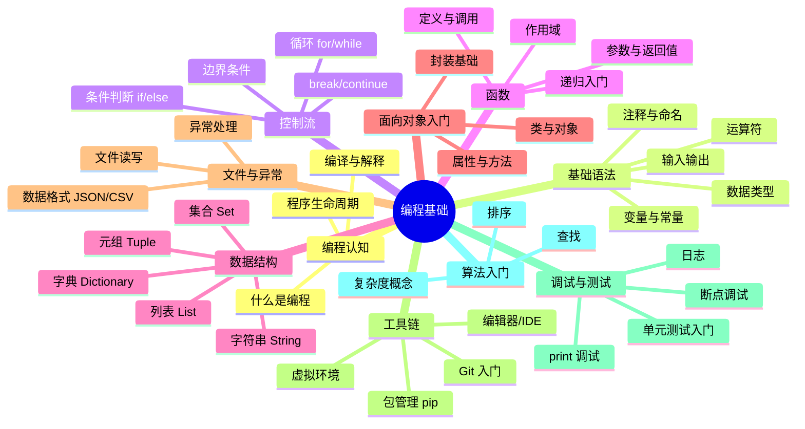

# 编程基础入门学习指南（Python 版）

> **面向对象**：零基础初学者  
> **学习目标**：入门启蒙，建立编程思维，掌握 Python 核心语法，能写实用小脚本  
> **推荐语言**：Python（语法简洁、生态丰富、跨平台、安全领域通用）  
> **预计周期**：长期学习，建议 3~6 个月打基础，每天 1~2 小时  
> **运行环境**：Windows / macOS / Linux 均可，推荐 Python 3.11+

---

## 目录

- [一、编程是什么：从零建立认知](#一编程是什么从零建立认知)
- [二、知识地图](#二知识地图)
- [三、分阶段学习路径](#三分阶段学习路径)
- [四、模块 1：环境搭建与第一个程序](#四模块-1环境搭建与第一个程序)
- [五、模块 2：变量与数据类型](#五模块-2变量与数据类型)
- [六、模块 3：运算符与表达式](#六模块-3运算符与表达式)
- [七、模块 4：控制流（条件与循环）](#七模块-4控制流条件与循环)
- [八、模块 5：函数](#八模块-5函数)
- [九、模块 6：基础数据结构](#九模块-6基础数据结构)
- [十、模块 7：文件操作与异常处理](#十模块-7文件操作与异常处理)
- [十一、模块 8：调试与测试入门](#十一模块-8调试与测试入门)
- [十二、模块 9：工具链与工程基础](#十二模块-9工具链与工程基础)
- [十三、关键概念对比表](#十三关键概念对比表)
- [十四、练习题集（附参考答案）](#十四练习题集附参考答案)
- [十五、小项目建议（由易到难）](#十五小项目建议由易到难)
- [十六、学习资源推荐](#十六学习资源推荐)
- [十七、常见误区与避坑指南](#十七常见误区与避坑指南)
- [十八、自测清单](#十八自测清单)

---

## 一、编程是什么：从零建立认知

### 1.1 什么是编程？

**编程（Programming）** 就是告诉计算机"做什么"和"怎么做"的过程。

> **生活化类比**：编程就像写菜谱。你把做菜的步骤一条条写下来，计算机（厨师）按照你的步骤一步步执行，最后做出菜（得到结果）。
>
> - 菜谱 = 代码（Code）
> - 厨师 = 计算机（Computer）
> - 做菜步骤 = 算法（Algorithm）
> - 食材 = 数据（Data）
> - 做好的菜 = 程序输出（Output）

### 1.2 为什么选 Python 入门？

| 优势 | 说明 | 对初学者的意义 |
|------|------|--------------|
| **语法简洁** | 接近自然语言，代码量少 | 学得快，成就感强 |
| **读起来像英语** | `if 今天下雨: 带伞` 这种直观语法 | 容易理解，降低心理门槛 |
| **生态丰富** | 几十万个第三方库 | 想做什么都有现成的工具 |
| **跨平台** | Windows/Mac/Linux 都能跑 | 不用纠结环境 |
| **用途广泛** | Web、数据、自动化、AI、安全 | 学了以后方向多 |
| **社区活跃** | 遇到问题一搜就有答案 | 不容易卡死 |

### 1.3 编程能用来做什么？（安全视角）

```
安全从业者的编程日常：

  自动化 ───── 日志分析、批量扫描、报告生成、告警处理
  工具开发 ─── 端口扫描器、目录爆破器、基线检查脚本
  数据分析 ─── 威胁情报处理、流量分析、行为检测
  应急响应 ─── 信息收集、取证脚本、批量处置
  代码审计 ─── 漏洞模式匹配、静态扫描工具
```

> 💡 **记住**：编程是工具，不是目的。你学编程是为了更好地做安全工作，不是为了成为纯软件工程师。

---

## 二、知识地图

### 2.1 编程基础知识全景图



### 2.2 学习路线层级图

```
Level 1: 能读懂代码（1~2 个月）
  ↓
Level 2: 能修改代码（2~3 个月）
  ↓
Level 3: 能独立写小程序（3~6 个月）
  ↓
Level 4: 能写实用工具（6~12 个月）
  ↓
Level 5: 能开发完整项目（1 年+）
```

---

## 三、分阶段学习路径

### 3.1 长期学习规划总览

| 阶段 | 时间 | 核心目标 | 关键产出 |
|------|------|---------|---------|
| **第 1 月** | 入门启蒙 | 环境搭建 + 基础语法 + 写第一个程序 | 能写 50 行以内的小程序 |
| **第 2 月** | 基础夯实 | 控制流 + 函数 + 数据结构 | 能写 100~200 行的脚本 |
| **第 3 月** | 数据处理 | 文件操作 + 异常 + 正则 + JSON/CSV | 能写日志分析、数据处理脚本 |
| **第 4~6 月** | 实战应用 | 网络编程 + 命令行工具 + 项目实战 | 完成 3~5 个小项目 |
| **第 7~12 月** | 进阶提升 | 面向对象 + 并发 + 测试 + 工程化 | 能写完整的安全小工具 |

### 3.2 第一阶段：入门启蒙（第 1 个月）

**目标**：建立编程思维，能写简单程序

| 周 | 学习内容 | 练习量 | 检验标准 |
|----|---------|--------|---------|
| 第 1 周 | 环境搭建、第一个程序、变量、数据类型 | 每天 10~20 行代码 | 能定义变量，做简单计算 |
| 第 2 周 | 运算符、输入输出、条件判断 if/else | 每天 20~30 行 | 能写判断逻辑的小程序 |
| 第 3 周 | 循环 for/while、列表基础 | 每天 30~50 行 | 能写循环处理列表数据 |
| 第 4 周 | 函数基础、字符串操作 | 每天 30~50 行 | 能封装函数，处理字符串 |

**毕业项目**：密码强度检查器

---

## 四、模块 1：环境搭建与第一个程序

### 4.1 安装 Python

#### 版本选择

| 版本 | 状态 | 推荐度 | 说明 |
|------|------|--------|------|
| Python 3.12 | 最新稳定版 | ⭐⭐⭐⭐⭐ | 性能优化，新特性多 |
| Python 3.11 | 广泛使用 | ⭐⭐⭐⭐ | 大部分库都兼容 |
| Python 2.x | 已停止维护 | ❌ 不要用 | 2020 年起已 EOL |

#### 安装方法

**Windows**：
1. 访问 [python.org/downloads](https://www.python.org/downloads/)
2. 下载最新稳定版安装包
3. ⚠️ **安装时务必勾选 "Add Python to PATH"**
4. 点击 Install Now

**macOS**：
```bash
# 方式一：官网下载安装包
# 方式二：使用 Homebrew
brew install python3
```

**Linux（Ubuntu/Debian）**：
```bash
sudo apt update
sudo apt install python3 python3-pip
```

#### 验证安装

打开终端（Windows 用 PowerShell 或 CMD），输入：

```bash
python --version
# 或
python3 --version
```

看到类似 `Python 3.12.x` 的输出就说明安装成功了。

### 4.2 选择编辑器/IDE

| 工具 | 类型 | 适合人群 | 说明 |
|------|------|---------|------|
| **VS Code** | 轻量编辑器 | 推荐初学者 | 免费、插件丰富、Python 支持好 |
| **PyCharm Community** | IDE | 项目开发 | 功能强大，智能提示好 |
| **IDLE** | 自带编辑器 | 绝对零基础 | Python 自带，无需额外安装 |
| **在线环境** | 网页版 | 快速试手 | Replit、Colab，不用装环境 |

> 💡 **推荐**：初学者用 **VS Code**。安装后搜索并安装 "Python" 扩展。

### 4.3 第一个程序：Hello, World!

创建一个文件 `hello.py`，写入：

```python
# 这是我的第一个 Python 程序
# 井号开头的是注释，不会被执行

print("Hello, World!")
print("你好，编程世界！")
```

**运行方法**：

```bash
# 打开终端，进入文件所在目录
python hello.py
```

**输出**：
```
Hello, World!
你好，编程世界！
```

> 🎉 **恭喜你！** 你已经写出了人生中的第一个程序。这虽然简单，但意义重大——你已经开始和计算机对话了。

### 4.4 print() 函数

`print()` 是 Python 中最基础也最常用的函数，用来在屏幕上输出内容。

```python
# 输出字符串
print("Hello")

# 输出数字
print(123)

# 输出多个内容，用逗号分隔
print("年龄:", 25, "岁")

# 输出变量
name = "小明"
print(name)

# f-string 格式化（推荐！）
age = 20
print(f"我叫 {name}，今年 {age} 岁")
```

### 4.5 注释（Comment）

注释是写给人看的，计算机不会执行。

```python
# 这是单行注释

"""
这是多行注释
用三个引号包裹
通常用来写函数或文件的说明
"""
```

> 💡 **好习惯**：代码是写给人看的，顺便让机器执行。好的注释能让你三个月后还能看懂自己的代码。

---

## 五、模块 2：变量与数据类型

### 5.1 什么是变量？

**变量（Variable）** 就是给数据起个名字，方便以后使用。

> **生活化类比**：变量就像盒子，你可以把东西（数据）放进盒子里，盒子上贴个标签（变量名），以后你喊标签名，就能拿出盒子里的东西。

```python
# 把 18 放进名叫 age 的盒子里
age = 18

# 把 "张三" 放进名叫 name 的盒子里
name = "张三"

# 使用变量
print(name)      # 输出：张三
print(age)       # 输出：18
```

### 5.2 变量命名规则

| 规则 | 正确示例 | 错误示例 |
|------|---------|---------|
| 只能包含字母、数字、下划线 | `user_name`、`age2` | `user-name`、`2age` |
| 不能以数字开头 | `name1` | `1name` |
| 不能用 Python 关键字 | `my_class` | `class` |
| 区分大小写 | `Name` 和 `name` 是两个变量 | - |
| 见名知意（推荐） | `user_age`、`ip_address` | `a`、`x`、`temp` |

> 💡 **命名规范**：Python 推荐用 **蛇形命名法（snake_case）**，即单词之间用下划线连接，如 `user_name`、`ip_address`。

### 5.3 基本数据类型

#### （1）整数（int）

整数就是没有小数点的数字。

```python
age = 20
year = 2024
port = 8080
```

#### （2）浮点数（float）

浮点数就是有小数点的数字。

```python
price = 99.9
pi = 3.14159
cvss_score = 8.9
```

#### （3）字符串（str）

字符串是文本数据，用引号包裹。

```python
# 单引号或双引号都可以
name = "张三"
message = 'Hello World'

# 三引号可以写多行
long_text = """
这是第一行
这是第二行
这是第三行
"""
```

**字符串常用操作**：

```python
ip = "192.168.1.100"

# 长度
print(len(ip))           # 13

# 拼接
url = "https://" + ip
print(url)               # https://192.168.1.100

# 重复
print("=" * 20)          # ====================

# 分割
parts = ip.split(".")
print(parts)             # ['192', '168', '1', '100']

# 判断开头/结尾
print(ip.startswith("192"))  # True
print(ip.endswith("100"))    # True

# 大小写转换
text = "Hello"
print(text.upper())     # HELLO
print(text.lower())     # hello

# f-string 格式化（最常用！）
port = 443
print(f"https://{ip}:{port}")  # https://192.168.1.100:443
```

#### （4）布尔值（bool）

布尔值只有两个：`True`（真）和 `False`（假）。

```python
is_open = True
is_vulnerable = False
```

### 5.4 类型转换

数据类型之间可以相互转换：

```python
# 字符串转整数
num = int("123")        # 123

# 整数转字符串
text = str(123)         # "123"

# 整数转浮点数
f = float(10)           # 10.0

# 浮点数转整数（截断小数部分）
i = int(3.99)           # 3
```

### 5.5 查看数据类型

用 `type()` 函数查看变量的类型：

```python
print(type(123))        # <class 'int'>
print(type(3.14))       # <class 'float'>
print(type("hello"))    # <class 'str'>
print(type(True))       # <class 'bool'>
```

### 5.6 常见错误

| 错误 | 原因 | 正确写法 |
|------|------|---------|
| `NameError: name 'x' is not defined` | 变量没定义就用了 | 先定义变量再使用 |
| `TypeError: can only concatenate str...` | 字符串和数字直接拼接 | 用 f-string 或 str() 转换 |
| `ValueError: invalid literal for int()` | 把非数字字符串转成 int | 确保内容是数字再转换 |

---

## 六、模块 3：运算符与表达式

### 6.1 算术运算符

| 运算符 | 含义 | 示例 | 结果 |
|--------|------|------|------|
| `+` | 加 | `10 + 3` | 13 |
| `-` | 减 | `10 - 3` | 7 |
| `*` | 乘 | `10 * 3` | 30 |
| `/` | 除（结果是浮点数） | `10 / 3` | 3.333... |
| `//` | 整除（取商的整数部分） | `10 // 3` | 3 |
| `%` | 取余（取模） | `10 % 3` | 1 |
| `**` | 幂运算 | `10 ** 3` | 1000 |

```python
# 安全场景示例：计算子网掩码
total_ips = 2 ** 8   # 256 个 IP
```

### 6.2 比较运算符

| 运算符 | 含义 | 示例 | 结果 |
|--------|------|------|------|
| `==` | 等于 | `5 == 5` | True |
| `!=` | 不等于 | `5 != 3` | True |
| `>` | 大于 | `5 > 3` | True |
| `<` | 小于 | `5 < 3` | False |
| `>=` | 大于等于 | `5 >= 5` | True |
| `<=` | 小于等于 | `5 <= 3` | False |

> ⚠️ **注意**：`=` 是赋值（把右边的值给左边），`==` 是比较（判断两边是否相等）。这是初学者最容易搞混的地方！

### 6.3 逻辑运算符

| 运算符 | 含义 | 说明 | 示例 |
|--------|------|------|------|
| `and` | 与（并且） | 两边都为 True，结果才是 True | `True and True` → True |
| `or` | 或（或者） | 只要一边为 True，结果就是 True | `True or False` → True |
| `not` | 非（取反） | True 变 False，False 变 True | `not True` → False |

```python
# 安全场景：判断漏洞优先级
cvss = 8.5
has_poc = True

if cvss >= 7.0 and has_poc:
    print("高危漏洞，有 POC，立即处理")
```

### 6.4 赋值运算符

| 运算符 | 含义 | 等价于 |
|--------|------|--------|
| `=` | 简单赋值 | `a = 10` |
| `+=` | 加后赋值 | `a += 5` → `a = a + 5` |
| `-=` | 减后赋值 | `a -= 5` → `a = a - 5` |
| `*=` | 乘后赋值 | `a *= 2` → `a = a * 2` |

```python
count = 0
count += 1   # count 变成 1
count += 1   # count 变成 2
# 这在循环计数中非常常用
```

### 6.5 运算符优先级

就像数学里的"先乘除后加减"，Python 的运算符也有优先级。

```
优先级从高到低：
  1. 括号 ()
  2. 幂运算 **
  3. 正负号 +x, -x
  4. 乘除 * / // %
  5. 加减 + -
  6. 比较 == != > < >= <=
  7. 逻辑 not
  8. 逻辑 and
  9. 逻辑 or
```

> 💡 **技巧**：拿不准优先级的时候，就加括号！括号不仅能确保正确，还能让代码更易读。

---

## 七、模块 4：控制流（条件与循环）

### 7.1 条件判断：if / elif / else

程序不是每次都走同一条路，根据条件不同走不同的路，这就是条件判断。

> **生活化类比**：如果明天下雨，就带伞；如果明天晴天，就戴帽子；否则就正常出门。

```python
# 基础用法
score = 85

if score >= 90:
    print("优秀")
elif score >= 80:
    print("良好")
elif score >= 60:
    print("及格")
else:
    print("不及格")
```

**安全场景示例**：

```python
severity = "high"

if severity == "critical":
    print("致命漏洞 → 立即处置")
elif severity == "high":
    print("高危漏洞 → 24小时内处置")
elif severity == "medium":
    print("中危漏洞 → 计划处置")
elif severity == "low":
    print("低危漏洞 → 择机处置")
else:
    print(f"未知等级: {severity}")
```

### 7.2 多条件组合

```python
# 并且（and）：两个条件都满足
age = 25
has_id = True
if age >= 18 and has_id:
    print("可以进入")

# 或者（or）：满足一个就行
is_admin = True
is_editor = False
if is_admin or is_editor:
    print("有权限")

# 取反（not）
is_blocked = False
if not is_blocked:
    print("可以访问")
```

### 7.3 for 循环

循环就是让计算机重复做一件事。

> **生活化类比**：把桌子上的每个苹果都检查一遍，看看有没有坏的。

```python
# 遍历列表
ports = [21, 22, 23, 25, 53, 80, 443]

for port in ports:
    print(f"检查端口 {port}")
```

**range() 函数**：生成数字序列

```python
# 0 到 4（不包含 5）
for i in range(5):
    print(i)  # 0, 1, 2, 3, 4

# 1 到 10
for i in range(1, 11):
    print(i)

# 1 到 10，步长为 2
for i in range(1, 11, 2):
    print(i)  # 1, 3, 5, 7, 9
```

**带索引的遍历**：

```python
ip_list = ["10.0.0.1", "10.0.0.2", "10.0.0.3"]

for index, ip in enumerate(ip_list, 1):
    print(f"[{index}] {ip}")
```

### 7.4 while 循环

`while` 循环：只要条件为真，就一直执行。

```python
count = 0
while count < 3:
    print(f"第 {count + 1} 次重试...")
    count += 1
```

> ⚠️ **小心死循环**：如果条件永远为 True，程序就会一直跑下去。确保循环里有让条件变 False 的语句。

### 7.5 break 和 continue

| 关键字 | 作用 |
|--------|------|
| `break` | 跳出整个循环 |
| `continue` | 跳过本次循环，继续下一次 |

```python
# break 示例
for i in range(10):
    if i == 5:
        break  # 到 5 就停了
    print(i)   # 输出 0,1,2,3,4

# continue 示例
for i in range(10):
    if i % 2 == 0:
        continue  # 偶数跳过
    print(i)      # 输出 1,3,5,7,9
```

### 7.6 循环嵌套

循环里面还可以有循环：

```python
# 打印九九乘法表
for i in range(1, 10):
    for j in range(1, i + 1):
        print(f"{j}×{i}={i*j}", end="\t")
    print()
```

### 7.7 常见错误

| 错误 | 原因 | 解决方法 |
|------|------|---------|
| 缩进错误 `IndentationError` | Python 用缩进表示代码块 | 统一用 4 个空格缩进 |
| 死循环 | while 条件永远为 True | 确保循环内有更新条件的语句 |
| 漏掉冒号 | `if` `for` `while` 后面忘了写 `:` | 记住条件后面加冒号 |

---

## 八、模块 5：函数

### 8.1 什么是函数？

**函数（Function）** 是一段可以重复使用的代码块。

> **生活化类比**：函数就像一个榨汁机——你把水果放进去（输入），它按固定流程榨汁（处理），最后输出果汁（输出）。每次用都不用重新造榨汁机。

### 8.2 定义和调用函数

```python
# 定义函数
def say_hello():
    print("Hello!")
    print("欢迎学习 Python！")

# 调用函数
say_hello()
say_hello()  # 可以调用多次
```

### 8.3 参数（Parameter）

函数可以接收输入，这就是参数。

```python
def greet(name):
    print(f"你好，{name}！")

greet("张三")   # 输出：你好，张三！
greet("李四")   # 输出：你好，李四！
```

**多个参数**：

```python
def add(a, b):
    result = a + b
    print(f"{a} + {b} = {result}")

add(3, 5)   # 3 + 5 = 8
add(10, 20) # 10 + 20 = 30
```

**默认参数**：

```python
def scan_port(ip, port=80, timeout=2.0):
    print(f"扫描 {ip}:{port}，超时 {timeout}s")

scan_port("192.168.1.1")              # 用默认端口 80
scan_port("192.168.1.1", 443)        # 指定端口
scan_port("192.168.1.1", timeout=5)  # 只指定超时
```

### 8.4 返回值（Return Value）

函数可以把结果返回给调用者：

```python
def add(a, b):
    return a + b

result = add(3, 5)
print(result)  # 8
```

**返回多个值**：

```python
def divide(a, b):
    quotient = a // b   # 商
    remainder = a % b   # 余数
    return quotient, remainder

q, r = divide(10, 3)
print(f"商: {q}, 余数: {r}")  # 商: 3, 余数: 1
```

### 8.5 函数文档字符串（Docstring）

在函数开头写说明，方便别人（也包括未来的自己）看懂：

```python
def validate_ip(ip_str):
    """验证 IP 地址格式是否正确（简化版）

    Args:
        ip_str: 要验证的 IP 地址字符串

    Returns:
        bool: 格式正确返回 True，否则返回 False

    示例:
        >>> validate_ip("192.168.1.1")
        True
    """
    parts = ip_str.split(".")
    if len(parts) != 4:
        return False
    for part in parts:
        if not part.isdigit():
            return False
        num = int(part)
        if num < 0 or num > 255:
            return False
    return True
```

### 8.6 作用域（Scope）

变量有自己的"活动范围"：

```python
# 全局变量：整个文件都能用
global_var = "我是全局的"

def test():
    # 局部变量：只在函数内部能用
    local_var = "我是局部的"
    print(global_var)   # 可以访问全局变量
    print(local_var)    # 可以访问局部变量

test()
print(global_var)       # 可以访问
# print(local_var)      # 报错！外部访问不到局部变量
```

> 💡 **原则**：尽量少用全局变量。函数之间通过参数和返回值传递数据，这样代码更清晰、更容易维护。

### 8.7 函数是编程的基石

为什么要使用函数？

1. **代码复用**：写一次，用多次
2. **模块化**：把大问题拆成小问题
3. **易维护**：修改一处，所有调用的地方都生效
4. **可读性**：函数名就是文档，一看就知道在干什么

---

## 九、模块 6：基础数据结构

### 9.1 列表（List）

列表是有序的、可变的元素集合。

> **生活化类比**：列表就像一个购物清单，可以往里加东西、删东西、改东西，顺序也很重要。

```python
# 创建列表
ip_list = ["10.0.0.1", "10.0.0.2", "10.0.0.3"]
mixed = [1, "hello", True, 3.14]  # 可以放不同类型
```

**常用操作**：

| 操作 | 代码 | 说明 |
|------|------|------|
| 访问元素 | `ip_list[0]` | 索引从 0 开始 |
| 最后一个 | `ip_list[-1]` | 负索引从后面数 |
| 长度 | `len(ip_list)` | 元素个数 |
| 添加元素 | `ip_list.append("10.0.0.4")` | 在末尾添加 |
| 插入 | `ip_list.insert(1, "10.0.0.100")` | 在指定位置插入 |
| 删除 | `ip_list.remove("10.0.0.2")` | 按值删除 |
| 弹出 | `ip_list.pop()` | 删除并返回最后一个 |
| 切片 | `ip_list[1:3]` | 取第 2 到第 3 个 |
| 是否包含 | `"10.0.0.1" in ip_list` | 返回 True/False |
| 排序 | `ip_list.sort()` | 原地排序 |
| 反转 | `ip_list.reverse()` | 原地反转 |

**遍历列表**：

```python
# 方式一：直接遍历元素
for ip in ip_list:
    print(ip)

# 方式二：带索引
for i, ip in enumerate(ip_list, 1):
    print(f"{i}. {ip}")
```

### 9.2 字典（Dictionary）

字典是键值对（key-value）的集合，用键来查找值。

> **生活化类比**：字典就像一本词典——你查单词（key），找到对应的解释（value）。查找速度非常快。

```python
# 创建字典
vuln = {
    "cve": "CVE-2024-12345",
    "severity": "high",
    "cvss": 8.9,
    "port": 8080,
    "affected": True
}
```

**常用操作**：

| 操作 | 代码 | 说明 |
|------|------|------|
| 取值 | `vuln["cve"]` | 键不存在会报错 |
| 安全取值 | `vuln.get("severity", "unknown")` | 键不存在返回默认值 |
| 添加/修改 | `vuln["description"] = "..."` | 键存在就修改，不存在就添加 |
| 删除 | `del vuln["port"]` | 删除指定键值对 |
| 所有键 | `vuln.keys()` | 返回所有键 |
| 所有值 | `vuln.values()` | 返回所有值 |
| 键值对 | `vuln.items()` | 返回所有键值对 |
| 长度 | `len(vuln)` | 键值对数量 |

**遍历字典**：

```python
# 遍历键值对（最常用）
for key, value in vuln.items():
    print(f"{key}: {value}")

# 只遍历键
for key in vuln:
    print(key)
```

### 9.3 元组（Tuple）

元组和列表很像，但**不可变**（创建后不能修改）。

```python
# 元组用圆括号
point = (10, 20)
ip_port = ("192.168.1.1", 8080)

# 访问方式和列表一样
print(ip_port[0])  # 192.168.1.1
```

**列表 vs 元组对比**：

| 特性 | 列表 List | 元组 Tuple |
|------|----------|-----------|
| 符号 | `[]` | `()` |
| 可变性 | 可变（可增删改） | 不可变 |
| 速度 | 稍慢 | 稍快 |
| 用途 | 动态数据集合 | 固定的数据组合 |
| 能否作为字典的键 | 不能 | 能 |

### 9.4 集合（Set）

集合是无序的、不重复的元素集合。去重神器！

> **生活化类比**：集合就像一个班级花名册——每个学生只出现一次，没有重复的。

```python
# 创建集合
ioc_list = ["1.1.1.1", "2.2.2.2", "1.1.1.1", "3.3.3.3"]
ioc_set = set(ioc_list)
print(ioc_set)  # {'1.1.1.1', '2.2.2.2', '3.3.3.3'} 自动去重
```

**集合运算**：

```python
set_a = {1, 2, 3, 4, 5}
set_b = {4, 5, 6, 7, 8}

# 并集：两个集合所有元素
print(set_a | set_b)   # {1,2,3,4,5,6,7,8}

# 交集：两个集合共有的元素
print(set_a & set_b)   # {4, 5}

# 差集：a 有但 b 没有的
print(set_a - set_b)   # {1, 2, 3}

# 白名单过滤示例
malicious_ips = {"1.1.1.1", "2.2.2.2", "3.3.3.3"}
whitelist = {"2.2.2.2"}
suspicious = malicious_ips - whitelist  # {'1.1.1.1', '3.3.3.3'}
```

### 9.5 数据结构选择指南

| 场景 | 推荐结构 | 原因 |
|------|---------|------|
| 有序的列表，需要增删改 | List | 灵活，支持各种操作 |
| 键值对，需要快速查找 | Dictionary | 查找速度 O(1) |
| 固定的数据组合 | Tuple | 不可变，安全 |
| 去重、集合运算 | Set | 自动去重，运算高效 |

---

## 十、模块 7：文件操作与异常处理

### 10.1 文件操作

#### 读取文件

```python
# 方式一：读取全部内容
with open("example.txt", "r", encoding="utf-8") as f:
    content = f.read()
    print(content)

# 方式二：逐行读取（推荐大文件用）
with open("example.txt", "r", encoding="utf-8") as f:
    for line in f:
        print(line.strip())  # strip() 去掉换行符
```

> 💡 **为什么用 with？** `with` 语句会自动关闭文件，不用手动调用 `f.close()`，更安全。

#### 写入文件

```python
# 写入（覆盖原有内容）
with open("output.txt", "w", encoding="utf-8") as f:
    f.write("第一行\n")
    f.write("第二行\n")

# 追加（在末尾添加）
with open("output.txt", "a", encoding="utf-8") as f:
    f.write("第三行\n")
```

#### 文件打开模式

| 模式 | 说明 |
|------|------|
| `r` | 只读（默认） |
| `w` | 写入（会覆盖原有内容） |
| `a` | 追加（在末尾添加） |
| `r+` | 读写 |
| `rb` | 二进制只读（图片、视频等） |
| `wb` | 二进制写入 |

### 10.2 JSON 数据

JSON 是最常用的数据交换格式，安全工具经常用。

```python
import json

# 字典转 JSON 字符串（序列化）
data = {"name": "scan_result", "ports": [22, 80, 443]}
json_str = json.dumps(data, indent=2, ensure_ascii=False)
print(json_str)

# JSON 字符串转字典（反序列化）
json_str = '{"ip": "192.168.1.1", "port": 80}'
data = json.loads(json_str)
print(data["ip"])

# 写入 JSON 文件
with open("result.json", "w", encoding="utf-8") as f:
    json.dump(data, f, indent=2, ensure_ascii=False)

# 读取 JSON 文件
with open("result.json", "r", encoding="utf-8") as f:
    data = json.load(f)
```

### 10.3 CSV 数据

CSV 是表格数据的常用格式。

```python
import csv

# 写入 CSV
with open("vulns.csv", "w", newline="", encoding="utf-8") as f:
    writer = csv.writer(f)
    writer.writerow(["IP", "Port", "CVE", "Severity"])  # 表头
    writer.writerow(["192.168.1.1", 80, "CVE-2024-0001", "high"])
    writer.writerow(["192.168.1.2", 443, "CVE-2024-0002", "medium"])

# 读取 CSV
with open("vulns.csv", "r", encoding="utf-8") as f:
    reader = csv.DictReader(f)
    for row in reader:
        print(f"{row['IP']}:{row['Port']} - {row['CVE']}")
```

### 10.4 异常处理

程序运行时可能会出错，异常处理让程序不会直接崩溃。

> **生活化类比**：就像开车遇到红灯——你不会直接撞上去，而是停下来等绿灯，或者换条路走。

```python
try:
    # 可能出错的代码
    num = int(input("请输入一个数字: "))
    result = 10 / num
    print(f"结果: {result}")
except ValueError:
    print("错误：输入的不是有效数字")
except ZeroDivisionError:
    print("错误：不能除以零")
except Exception as e:
    print(f"发生了未知错误: {e}")
finally:
    print("无论是否出错，这里都会执行")
```

**常见异常类型**：

| 异常 | 说明 | 触发场景 |
|------|------|---------|
| `ValueError` | 值错误 | 把 "abc" 转成 int |
| `TypeError` | 类型错误 | 字符串和数字相加 |
| `IndexError` | 索引越界 | 访问列表不存在的索引 |
| `KeyError` | 键不存在 | 访问字典不存在的键 |
| `FileNotFoundError` | 文件不存在 | 打开不存在的文件 |
| `PermissionError` | 权限错误 | 没有读/写权限 |
| `ZeroDivisionError` | 除零错误 | 除数为 0 |

### 10.5 安全场景实战：日志分析

```python
import re

def analyze_log(log_file):
    """分析日志文件，统计 4xx 错误的 IP"""
    ip_stats = {}

    try:
        with open(log_file, "r", encoding="utf-8") as f:
            for line in f:
                # 提取 IP（简化正则）
                ip_match = re.search(r'\b(?:\d{1,3}\.){3}\d{1,3}\b', line)
                if not ip_match:
                    continue
                ip = ip_match.group()

                # 判断是否是 4xx 错误
                if '" 4' in line:
                    ip_stats[ip] = ip_stats.get(ip, 0) + 1

        # 按次数排序
        sorted_ips = sorted(ip_stats.items(), key=lambda x: x[1], reverse=True)
        return sorted_ips

    except FileNotFoundError:
        print(f"错误：文件不存在 {log_file}")
        return []
```

---

## 十一、模块 8：调试与测试入门

### 11.1 为什么需要调试？

> 编程不是写出来就完了，80% 的时间都在找 bug 和修 bug。

**Bug（程序错误）** 就是程序的行为和你预期的不一样。调试就是找 bug、修 bug 的过程。

### 11.2 print 调试法（最基础）

最简单也最常用的调试方法：在关键位置打印变量的值。

```python
def calculate_total(prices):
    total = 0
    for price in prices:
        total += price
        print(f"  当前价格: {price}, 累计: {total}")  # 调试用 print
    return total

# 测试
result = calculate_total([10, 20, 30])
print(f"最终结果: {result}")
```

### 11.3 使用断言（Assert）

断言用来检查"应该成立"的条件，如果不成立就报错。

```python
def validate_ip(ip):
    parts = ip.split(".")
    assert len(parts) == 4, "IP 地址必须有四段"
    # ... 更多验证
    return True
```

### 11.4 日志（Logging）

比 `print` 更专业的记录方式：

```python
import logging

# 配置日志
logging.basicConfig(
    level=logging.DEBUG,
    format='%(asctime)s - %(levelname)s - %(message)s'
)

# 使用日志
logging.debug("这是调试信息")
logging.info("这是普通信息")
logging.warning("这是警告")
logging.error("这是错误")
```

**日志级别**（从低到高）：

| 级别 | 用途 | 示例 |
|------|------|------|
| DEBUG | 调试细节 | 变量值、函数调用 |
| INFO | 正常运行信息 | 程序启动、任务完成 |
| WARNING | 警告（不影响运行） | 配置缺失，使用默认值 |
| ERROR | 错误（功能受影响） | 文件读取失败、网络连接失败 |
| CRITICAL | 严重错误（程序可能崩溃） | 数据库连接失败、内存耗尽 |

### 11.5 单元测试入门

单元测试就是写代码来测试你的代码。

```python
# 待测试的函数
def add(a, b):
    return a + b

def validate_ip(ip_str):
    parts = ip_str.split(".")
    if len(parts) != 4:
        return False
    for part in parts:
        if not part.isdigit():
            return False
        num = int(part)
        if num < 0 or num > 255:
            return False
    return True

# 测试
def test_add():
    assert add(2, 3) == 5
    assert add(-1, 1) == 0
    assert add(0, 0) == 0
    print("add() 测试通过 ✓")

def test_validate_ip():
    # 正常情况
    assert validate_ip("192.168.1.1") == True
    assert validate_ip("0.0.0.0") == True
    assert validate_ip("255.255.255.255") == True
    # 异常情况
    assert validate_ip("256.1.1.1") == False
    assert validate_ip("1.2.3") == False
    assert validate_ip("abc") == False
    assert validate_ip("") == False
    print("validate_ip() 测试通过 ✓")

# 运行所有测试
if __name__ == "__main__":
    test_add()
    test_validate_ip()
    print("所有测试通过！🎉")
```

### 11.6 调试的一般步骤

```
1. 复现问题：确保能稳定地复现 bug
2. 定位问题：用 print/日志/断点缩小范围
3. 分析原因：为什么会出错？
4. 修复问题：修改代码
5. 验证修复：确保 bug 没了，也没引入新问题
```

---

## 十二、模块 9：工具链与工程基础

### 12.1 pip 包管理

pip 是 Python 的包管理器，用来安装第三方库。

```bash
# 安装包
pip install requests

# 指定版本
pip install requests==2.31.0

# 升级包
pip install --upgrade requests

# 卸载包
pip uninstall requests

# 查看已安装的包
pip list

# 导出依赖列表
pip freeze > requirements.txt

# 从依赖列表安装
pip install -r requirements.txt
```

### 12.2 虚拟环境（Virtual Environment）

每个项目有独立的依赖，互不干扰。

> **生活化类比**：虚拟环境就像不同的房间——每个房间有自己的家具（依赖），不会混在一起。

```bash
# 创建虚拟环境
python -m venv venv

# 激活虚拟环境
# Windows (PowerShell)
.\venv\Scripts\Activate.ps1

# Windows (CMD)
venv\Scripts\activate.bat

# macOS / Linux
source venv/bin/activate

# 退出虚拟环境
deactivate
```

### 12.3 Git 版本控制入门

Git 用来管理代码的版本，就像游戏的存档。

| 命令 | 作用 |
|------|------|
| `git init` | 初始化仓库 |
| `git status` | 查看当前状态 |
| `git add 文件名` | 添加文件到暂存区 |
| `git commit -m "说明"` | 提交版本 |
| `git log` | 查看提交历史 |
| `git diff` | 查看修改内容 |

### 12.4 推荐的项目结构

```
my_project/
├── venv/              # 虚拟环境（不要提交到 Git）
├── main.py            # 主程序
├── utils.py           # 工具函数
├── requirements.txt   # 依赖列表
├── README.md          # 项目说明
├── tests/             # 测试文件
│   └── test_utils.py
└── data/              # 数据文件
    └── sample.log
```

---

## 十三、关键概念对比表

### 13.1 编译 vs 解释

| 维度 | 编译型 Compiled | 解释型 Interpreted |
|------|----------------|-------------------|
| **执行方式** | 先编译成机器码，再运行 | 逐行解释，边解释边执行 |
| **速度** | 快 | 慢 |
| **开发效率** | 低（要编译） | 高（写完就跑） |
| **代表语言** | C、C++、Go、Rust | Bash、Python、JavaScript |
| **类比** | 提前把整本菜谱翻译成厨师能看懂的语言 | 翻译官一句一句念给厨师听 |

### 13.2 值传递 vs 引用传递

| 维度 | 值传递（不可变类型） | 引用传递（可变类型） |
|------|---------------------|---------------------|
| **类型示例** | int、float、str、bool、tuple | list、dict、set |
| **函数内修改** | 不影响外部变量 | 会影响外部变量 |
| **内存** | 创建副本 | 指向同一个对象 |

```python
# 值传递示例（不可变类型）
def change_num(n):
    n = 100

x = 10
change_num(x)
print(x)  # 还是 10，没被改变

# 引用传递示例（可变类型）
def add_item(lst):
    lst.append("new")

my_list = [1, 2, 3]
add_item(my_list)
print(my_list)  # [1, 2, 3, 'new']，被改变了
```

### 13.3 列表 vs 元组 vs 集合

| 特性 | 列表 List | 元组 Tuple | 集合 Set |
|------|----------|-----------|---------|
| **符号** | `[]` | `()` | `{}` |
| **有序** | ✅ 是 | ✅ 是 | ❌ 否 |
| **可重复** | ✅ 是 | ✅ 是 | ❌ 否（自动去重） |
| **可修改** | ✅ 是 | ❌ 否 | ✅ 是（增删） |
| **索引访问** | ✅ 是 | ✅ 是 | ❌ 否 |
| **典型用途** | 动态数据列表 | 固定数据组合 | 去重、集合运算 |

### 13.4 for 循环 vs while 循环

| 特性 | for 循环 | while 循环 |
|------|----------|-----------|
| **适用场景** | 遍历已知序列 | 条件满足就循环（次数不确定） |
| **写法** | `for x in 序列:` | `while 条件:` |
| **死循环风险** | 低（序列遍历完就结束） | 高（条件可能永远为真） |
| **示例** | 遍历列表、文件行 | 重试直到成功 |

### 13.5 函数 vs 类

| 维度 | 函数 Function | 类 Class |
|------|--------------|---------|
| **本质** | 一段可复用的代码 | 数据 + 操作数据的方法的封装 |
| **范式** | 过程式编程 | 面向对象编程 |
| **状态** | 不保存状态（每次调用独立） | 保存状态（属性值） |
| **适用** | 单一功能的操作 | 有状态、有行为的实体 |
| **类比** | 一个工具（比如锤子） | 一个机器人（有属性、会做事） |

---

## 十四、练习题集（附参考答案）

### 14.1 入门级练习

#### 练习 1：温度转换器

**题目**：写一个程序，输入摄氏度，转换成华氏度输出。
公式：华氏度 = 摄氏度 × 9/5 + 32

**输入输出示例**：
```
请输入摄氏度: 25
25.0°C = 77.0°F
```

<details>
<summary>👉 点击查看参考答案</summary>

```python
celsius = float(input("请输入摄氏度: "))
fahrenheit = celsius * 9 / 5 + 32
print(f"{celsius}°C = {fahrenheit}°F")
```
</details>

---

#### 练习 2：判断闰年

**题目**：输入一个年份，判断是否为闰年。
规则：能被 4 整除但不能被 100 整除，或者能被 400 整除。

**输入输出示例**：
```
请输入年份: 2024
2024 年是闰年
```

<details>
<summary>👉 点击查看参考答案</summary>

```python
year = int(input("请输入年份: "))

if (year % 4 == 0 and year % 100 != 0) or (year % 400 == 0):
    print(f"{year} 年是闰年")
else:
    print(f"{year} 年不是闰年")
```
</details>

---

#### 练习 3：九九乘法表

**题目**：打印九九乘法表。

**输出示例**：
```
1×1=1
1×2=2  2×2=4
...
```

<details>
<summary>👉 点击查看参考答案</summary>

```python
for i in range(1, 10):
    for j in range(1, i + 1):
        print(f"{j}×{i}={i*j}", end="\t")
    print()
```
</details>

---

### 14.2 进阶级练习

#### 练习 4：密码强度检查器

**题目**：写一个函数，检查密码强度。
- 至少 8 位
- 包含大写字母
- 包含小写字母
- 包含数字
- 包含特殊字符（!@#$%^&*）

输出：弱 / 中 / 强

<details>
<summary>👉 点击查看参考答案</summary>

```python
def check_password_strength(password):
    score = 0
    suggestions = []

    if len(password) >= 8:
        score += 1
    else:
        suggestions.append("密码长度至少 8 位")

    has_upper = any(c.isupper() for c in password)
    has_lower = any(c.islower() for c in password)
    has_digit = any(c.isdigit() for c in password)
    has_special = any(c in "!@#$%^&*" for c in password)

    if has_upper:
        score += 1
    else:
        suggestions.append("需要包含大写字母")

    if has_lower:
        score += 1
    else:
        suggestions.append("需要包含小写字母")

    if has_digit:
        score += 1
    else:
        suggestions.append("需要包含数字")

    if has_special:
        score += 1
    else:
        suggestions.append("需要包含特殊字符 (!@#$%^&*)")

    if score <= 2:
        level = "弱"
    elif score <= 3:
        level = "中"
    else:
        level = "强"

    return level, suggestions


# 测试
password = input("请输入密码: ")
level, suggestions = check_password_strength(password)
print(f"密码强度: {level}")
if suggestions:
    print("改进建议:")
    for s in suggestions:
        print(f"  - {s}")
```
</details>

---

#### 练习 5：统计词频

**题目**：写一个函数，统计一段文本中每个单词出现的次数。

<details>
<summary>👉 点击查看参考答案</summary>

```python
def count_words(text):
    # 转小写，按空格分割
    words = text.lower().split()
    counts = {}

    for word in words:
        # 去掉标点
        word = word.strip(".,!?;:\"'")
        if word:
            counts[word] = counts.get(word, 0) + 1

    return counts


# 测试
text = "Hello world hello Python python python!"
result = count_words(text)
for word, count in sorted(result.items(), key=lambda x: x[1], reverse=True):
    print(f"{word}: {count}")
```
</details>

---

#### 练习 6：IP 地址验证

**题目**：写一个函数验证 IPv4 地址是否合法。
- 四段数字，用点分隔
- 每段 0~255
- 不能有前导零（除非就是 0）

<details>
<summary>👉 点击查看参考答案</summary>

```python
def is_valid_ip(ip_str):
    parts = ip_str.split(".")

    # 必须是四段
    if len(parts) != 4:
        return False

    for part in parts:
        # 必须是数字
        if not part.isdigit():
            return False

        # 不能有前导零（除非是单个 0）
        if len(part) > 1 and part[0] == "0":
            return False

        # 范围 0~255
        num = int(part)
        if num < 0 or num > 255:
            return False

    return True


# 测试
test_ips = [
    ("192.168.1.1", True),
    ("0.0.0.0", True),
    ("255.255.255.255", True),
    ("256.1.1.1", False),
    ("1.2.3", False),
    ("1.2.3.4.5", False),
    ("01.1.1.1", False),
    ("abc.def.ghi.jkl", False),
]

for ip, expected in test_ips:
    result = is_valid_ip(ip)
    status = "✓" if result == expected else "✗"
    print(f"{status} {ip:20s} -> {result} (期望: {expected})")
```
</details>

---

### 14.3 实战级练习

#### 练习 7：日志分析脚本

**题目**：写一个脚本，分析 Nginx 访问日志，统计：
1. 总请求数
2. 状态码分布（2xx、3xx、4xx、5xx 各多少）
3. 访问量 Top 10 的 IP

<details>
<summary>👉 点击查看参考答案</summary>

```python
import re
from collections import defaultdict


def analyze_nginx_log(log_path):
    total = 0
    status_counts = defaultdict(int)
    ip_counts = defaultdict(int)

    # 简化的日志正则（匹配 IP 和状态码）
    # 示例日志行:
    # 192.168.1.100 - - [10/Oct/2024:10:00:01 +0800] "GET /index.html HTTP/1.1" 200 1234
    pattern = r'^(\S+) .*?" (\d{3}) '

    try:
        with open(log_path, "r", encoding="utf-8") as f:
            for line in f:
                match = re.match(pattern, line)
                if not match:
                    continue

                total += 1
                ip = match.group(1)
                status = match.group(2)

                # 状态码分类
                if status.startswith("2"):
                    status_counts["2xx"] += 1
                elif status.startswith("3"):
                    status_counts["3xx"] += 1
                elif status.startswith("4"):
                    status_counts["4xx"] += 1
                elif status.startswith("5"):
                    status_counts["5xx"] += 1

                ip_counts[ip] += 1

    except FileNotFoundError:
        print(f"错误：文件不存在 {log_path}")
        return None

    # IP 排名
    top_ips = sorted(ip_counts.items(), key=lambda x: x[1], reverse=True)[:10]

    return {
        "total_requests": total,
        "status_distribution": dict(status_counts),
        "top_10_ips": top_ips
    }


# 测试（先创建一个示例日志文件）
sample_logs = """\
192.168.1.100 - - [10/Oct/2024:10:00:01 +0800] "GET /index.html HTTP/1.1" 200 1234
10.0.0.5 - - [10/Oct/2024:10:00:02 +0800] "POST /login HTTP/1.1" 401 567
192.168.1.100 - - [10/Oct/2024:10:00:03 +0800] "GET /admin HTTP/1.1" 403 89
10.0.0.5 - - [10/Oct/2024:10:00:04 +0800] "GET /api/users HTTP/1.1" 200 2345
192.168.1.101 - - [10/Oct/2024:10:00:05 +0800] "POST /api/login HTTP/1.1" 500 45
10.0.0.5 - - [10/Oct/2024:10:00:06 +0800] "GET /favicon.ico HTTP/1.1" 404 0
"""

with open("sample_access.log", "w", encoding="utf-8") as f:
    f.write(sample_logs)

# 运行分析
result = analyze_nginx_log("sample_access.log")
if result:
    print(f"总请求数: {result['total_requests']}")
    print("\n状态码分布:")
    for status, count in result['status_distribution'].items():
        print(f"  {status}: {count}")
    print("\n访问量 Top 10 IP:")
    for ip, count in result['top_10_ips']:
        print(f"  {ip}: {count}")
```
</details>

---

## 十五、小项目建议（由易到难）

### 项目 1：密码生成器 ⭐

**难度**：入门
**预计时间**：2~3 小时
**技术点**：随机数、字符串、函数、用户输入

**需求**：
1. 用户输入密码长度
2. 可选择是否包含大写字母、数字、特殊字符
3. 生成符合要求的随机密码
4. 可以一次生成多个密码

**验收标准**：
- [ ] 能正确生成指定长度的密码
- [ ] 能根据选项包含/排除不同字符类型
- [ ] 有输入校验（比如长度不能为 0）
- [ ] 代码有注释和使用说明

---

### 项目 2：待办事项管理器 ⭐⭐

**难度**：基础
**预计时间**：4~6 小时
**技术点**：列表、字典、文件读写、函数、命令行交互

**需求**：
1. 添加任务
2. 查看所有任务
3. 标记任务完成
4. 删除任务
5. 数据保存到文件（JSON 格式），下次打开还在

**验收标准**：
- [ ] 增删改查功能完整
- [ ] 数据持久化（程序退出后不丢失）
- [ ] 有友好的用户菜单
- [ ] 有错误处理（比如删除不存在的任务）

---

### 项目 3：端口扫描器（简化版） ⭐⭐⭐

**难度**：进阶
**预计时间**：8~12 小时
**技术点**：Socket 编程、多线程、命令行参数、异常处理

**需求**：
1. 输入目标 IP 和端口范围
2. 使用 TCP connect 扫描
3. 输出开放的端口
4. 支持命令行参数（目标 IP、端口范围、超时时间）
5. （可选）多线程并发扫描

**验收标准**：
- [ ] 能正确扫描指定端口
- [ ] 命令行参数友好，有帮助信息
- [ ] 错误处理完善（IP 无法解析、超时等）
- [ ] 输出格式清晰
- [ ] 代码有注释和使用说明

> ⚠️ **重要**：仅限在自己的机器或授权环境中使用！可以扫描 `127.0.0.1`（本地回环地址）来测试。

---

### 项目 4：安全基线检查脚本 ⭐⭐⭐⭐

**难度**：实战
**预计时间**：15~20 小时
**技术点**：文件操作、系统命令调用、正则、报告生成

**需求**（Windows 或 Linux 选一个）：
1. 检查系统安全配置项（密码策略、账户策略等）
2. 检查关键文件权限
3. 检查可疑的启动项/服务
4. 输出检查报告（文本或 HTML 格式）
5. 每个检查项有：状态、说明、修复建议

**验收标准**：
- [ ] 至少检查 10 个安全配置项
- [ ] 报告格式清晰，易读
- [ ] 有通过/警告/失败三级状态
- [ ] 出错时不中断，继续检查其他项
- [ ] 有使用说明和配置文件

---

### 项目 5：日志分析与告警工具 ⭐⭐⭐⭐⭐

**难度**：综合
**预计时间**：20~30 小时
**技术点**：文件监控、正则、多线程、配置文件、告警通知

**需求**：
1. 实时监控日志文件（类似 `tail -f`）
2. 检测异常模式（暴力破解、异常时间登录等）
3. 可配置检测规则（YAML/JSON 配置文件）
4. 检测到异常时输出告警
5. （可选）发送邮件或 Webhook 通知

**验收标准**：
- [ ] 能实时监控新增的日志行
- [ ] 能检测至少 3 种异常模式
- [ ] 规则可配置，不用改代码
- [ ] 有日志记录和统计
- [ ] 有完整的使用文档

---

## 十六、学习资源推荐

### 16.1 免费在线资源

| 资源 | 类型 | 适合阶段 | 说明 |
|------|------|---------|------|
| [Python 官方教程（中文）](https://docs.python.org/zh-cn/3/tutorial/) | 官方文档 | 全程 | 最权威的入门教程 |
| [廖雪峰 Python 教程](https://www.liaoxuefeng.com/wiki/1016959663602400) | 在线教程 | 入门~进阶 | 中文，通俗易懂 |
| [菜鸟教程 Python](https://www.runoob.com/python3/python3-tutorial.html) | 在线教程 | 入门 | 简单快速，适合查阅 |
| [freeCodeCamp Python](https://www.freecodecamp.org/) | 交互式 | 入门 | 免费，有练习 |
| [Codecademy Python](https://www.codecademy.com/learn/learn-python-3) | 交互式 | 入门 | 边学边练，体验好 |
| [Python 101](https://python101.pythonlibrary.org/) | 在线书 | 入门~进阶 | 系统全面 |

### 16.2 推荐书籍

| 书名 | 适合阶段 | 说明 |
|------|---------|------|
| 《Python 编程：从入门到实践》 | 入门 | 经典入门书，项目驱动 |
| 《Python Cookbook》 | 进阶 | 大量实用技巧和最佳实践 |
| 《流畅的 Python》 | 进阶 | 深入理解 Python 特性 |
| 《Python 自动化运维》 | 实践 | 运维和安全方向实用 |

### 16.3 练习平台

| 平台 | 说明 | 适合阶段 |
|------|------|---------|
| [LeetCode](https://leetcode.cn/) | 算法题，有 Python 题解 | 进阶 |
| [牛客网](https://www.nowcoder.com/) | 国内平台，有 Python 专项 | 入门~进阶 |
| [Codewars](https://www.codewars.com/) | 闯关式练习，有趣 | 入门+ |
| [Exercism](https://exercism.org/) | 有导师反馈，质量高 | 入门~进阶 |

### 16.4 安全编程资源

| 资源 | 说明 |
|------|------|
| 本目录下的 `python/code/` | 基础和安全案例代码，可直接运行学习 |
| `python/Python编程基础与安全学习资源.md` | Python 安全编程详细资源 |
| `网络安全编程与脚本学习路径.md` | 完整的学习路径规划 |

---

## 十七、常见误区与避坑指南

### 17.1 初学者五大误区

| 误区 | 表现 | 后果 | 正确做法 |
|------|------|------|---------|
| **只看不练** | 视频看了一堆，代码没写几行 | "一看就会，一写就废" | 看和写的时间比例 3:7 |
| **追求完美** | 写几行就想重构成"最佳实践" | 半天写不完一个小功能 | 先跑起来，再优化 |
| **死磕 bug** | 一个问题卡 3 小时不撒手 | 效率低，打击信心 | 卡住了就放一放，或者搜一下 |
| **跳过基础** | 直接找"黑客脚本"复制粘贴 | 看不懂原理，出问题不会改 | 老老实实打基础 |
| **同时学多门** | Python 学一半去学 Go，Go 学一半去学 Rust | 每门都不精，越学越乱 | 先精通一门（Python），再扩展 |

### 17.2 新手常见错误清单

1. **缩进错误**：Python 用缩进表示代码块，必须统一（4 个空格）
2. **漏掉冒号**：`if` `for` `while` `def` 后面都要加 `:`
3. **= 和 == 搞混**：`=` 是赋值，`==` 是比较
4. **字符串和数字拼接**：要用 f-string 或 `str()` 转换
5. **索引越界**：列表索引从 0 开始，最后一个是 `len(list)-1`
6. **修改正在遍历的列表**：会导致奇怪的问题
7. **可变默认参数**：`def func(lst=[])` 是坑，用 `None` 代替
8. **文件操作忘记关闭**：用 `with` 语句自动关闭

### 17.3 学习效率的关键

```
1. 每天写代码（哪怕只有 20 分钟）
2. 从解决实际问题开始学（任务驱动）
3. 读代码 → 改代码 → 写代码（循序渐进）
4. 写注释和文档（教别人是最好的学）
5. 定期复盘（每周回顾一次学了什么）
6. 不要怕犯错（错误是最好的老师）
```

---

## 十八、自测清单

### 18.1 入门级自测（学完第 1 个月）

- [ ] 能安装 Python 和 VS Code，运行第一个程序
- [ ] 理解变量、数据类型（int、float、str、bool）
- [ ] 会用算术运算符、比较运算符、逻辑运算符
- [ ] 能写 if/elif/else 条件判断
- [ ] 能写 for 循环和 while 循环
- [ ] 知道 break 和 continue 的区别
- [ ] 能定义函数，理解参数和返回值
- [ ] 会操作字符串（拼接、分割、格式化）
- [ ] 会使用列表的基本操作（增删改查、遍历）
- [ ] 会使用字典的基本操作（按键取值、遍历）
- [ ] 能读写文本文件
- [ ] 会用 try/except 处理异常
- [ ] 能看懂简单的错误信息，知道怎么排查
- [ ] 能独立写 100 行左右的小程序

### 18.2 基础级自测（学完第 2~3 个月）

- [ ] 理解列表、字典、元组、集合的区别和适用场景
- [ ] 会用列表推导式
- [ ] 能处理 JSON 和 CSV 格式的数据
- [ ] 会用正则表达式做简单的匹配和提取
- [ ] 理解函数的作用域和参数传递
- [ ] 会写有文档字符串的函数
- [ ] 理解类和对象的基本概念
- [ ] 能安装和使用第三方库（pip）
- [ ] 会使用虚拟环境
- [ ] 会用 logging 模块记录日志
- [ ] 能写简单的单元测试
- [ ] 知道怎么用 print 和日志调试程序
- [ ] 能独立写 200~500 行的脚本
- [ ] 能读懂别人写的中等长度的代码

### 18.3 进阶级自测（学完第 4~6 个月）

- [ ] 能使用 requests 库发送 HTTP 请求
- [ ] 了解 Socket 编程基础
- [ ] 会用 argparse 写命令行工具
- [ ] 了解多线程/多进程基础
- [ ] 能设计和完成一个完整的小项目
- [ ] 会用 Git 管理代码版本
- [ ] 代码有清晰的结构和注释
- [ ] 有错误处理和边界条件考虑
- [ ] 能读懂开源工具的源码
- [ ] 能在已有代码基础上修改和扩展功能

---

> **写在最后**：
>
> 编程是一门技能，和开车、游泳一样——是练出来的，不是看出来的。
>
> 你看了 100 小时的游泳教程，不下水还是不会游。
> 你看了 100 小时的编程教程，不写代码还是不会写。
>
> 所以，最重要的不是学了多少，而是写了多少。
> 从今天开始，每天写一点，坚持下去，半年后你会感谢自己。
>
> 祝你学习顺利！🚀
