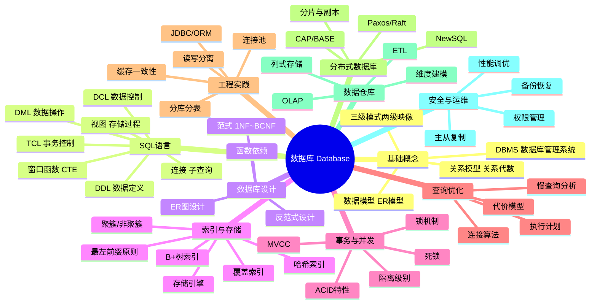

# 数据库系统入门完全指南

> 本文面向数据库初学者，从零开始系统讲解数据库核心知识，涵盖基础概念、SQL 语法、设计范式、索引原理、事务并发、查询优化、分布式数据库等模块。配合知识地图、SQL 示例、对比表格、设计题、练习题与学习路径，帮助你在 1-2 周内建立完整的数据库知识体系。
>
> **目标读者**：数据库初学者、计算机专业学生、后端开发入门者
> **学习周期**：1-2 周（每天 2-3 小时）
> **输出语言**：中文，关键术语中英对照

---

## 目录

- [一、数据库知识地图](#一数据库知识地图)
- [二、数据库系统概述](#二数据库系统概述)
- [三、SQL 语言基础与进阶](#三sql-语言基础与进阶)
- [四、数据库设计与范式](#四数据库设计与范式)
- [五、索引与存储引擎](#五索引与存储引擎)
- [六、事务与并发控制](#六事务与并发控制)
- [七、查询优化与执行计划](#七查询优化与执行计划)
- [八、数据库编程与工程实践](#八数据库编程与工程实践)
- [九、分布式与 NoSQL 数据库](#九分布式与-nosql-数据库)
- [十、数据仓库与大数据基础](#十数据仓库与大数据基础)
- [十一、关键对比表格汇总](#十一关键对比表格汇总)
- [十二、设计题与实战](#十二设计题与实战)
- [十三、练习题与参考答案](#十三练习题与参考答案)
- [十四、学习路径与资源建议](#十四学习路径与资源建议)

---

## 一、数据库知识地图

### 1.1 整体知识框架



### 1.2 学习路径（1-2 周规划）

| 阶段 | 天数 | 内容 | 目标 |
|------|------|------|------|
| **Day 1-2** | 2 天 | 数据库基础概念 + SQL 基础 | 理解数据库是什么，能写 CRUD |
| **Day 3-4** | 2 天 | SQL 进阶 + 数据库设计 | 能写复杂查询，理解范式设计 |
| **Day 5-6** | 2 天 | 索引 + 事务并发 | 理解索引原理和事务 ACID |
| **Day 7-8** | 2 天 | 查询优化 + 工程实践 | 看懂执行计划，了解 ORM/连接池 |
| **Day 9-10** | 2 天 | 分布式 + NoSQL + 数据仓库 | 建立完整知识体系 |
| **Day 11-14** | 3-4 天 | 练习题 + 设计题 + 查漏补缺 | 巩固知识，动手实践 |

---

## 二、数据库系统概述

### 2.1 什么是数据库

**数据库（Database, DB）**：长期存储在计算机内、有组织、可共享的大量数据的集合。

**数据库管理系统（Database Management System, DBMS）**：介于用户和操作系统之间的数据管理软件，用于科学地组织和存储数据、高效地获取和维护数据。

> **生活化类比**：
> - 数据库 = 图书馆的书库（存放数据的地方）
> - DBMS = 图书管理系统 + 图书管理员（帮你找书、借书、还书、整理书架）
> - SQL = 你跟管理员说的"帮我找一本讲数据库的书"（查询语言）

### 2.2 三级模式两级映像

这是数据库系统的标准体系结构，也是**数据独立性**的保障。

```
┌─────────────────────────────────────┐
│  外模式（External Schema）           │  ← 用户视图，用户能看到的数据
│  （子模式 / 用户模式）               │
├─────────────────────────────────────┤
│         ↓ 外模式/模式映像             │  ← 逻辑数据独立性
├─────────────────────────────────────┤
│  模式（Schema）                      │  ← 全局逻辑结构，所有数据的组织方式
│  （逻辑模式 / 概念模式）              │
├─────────────────────────────────────┤
│         ↓ 模式/内模式映像             │  ← 物理数据独立性
├─────────────────────────────────────┤
│  内模式（Internal Schema）           │  ← 物理存储结构，数据存在磁盘上的样子
│  （存储模式）                        │
└─────────────────────────────────────┘
```

| 概念 | 说明 | 例子 |
|------|------|------|
| **内模式** | 数据的物理存储结构 | 数据存在哪个文件、什么格式、索引怎么存 |
| **模式** | 数据的全局逻辑结构 | 有哪些表、表有哪些字段、字段什么类型、表之间关系 |
| **外模式** | 用户看到的局部数据 | 学生只能看到自己的成绩，老师能看到全班成绩 |

**数据独立性**：
- **逻辑数据独立性**：模式变了（加了个字段），外模式可以不变（应用程序不用改）
- **物理数据独立性**：内模式变了（换了存储方式），模式可以不变（上层不用管）

### 2.3 数据模型

数据模型是对现实世界数据特征的抽象，是数据库系统的核心和基础。

#### 三大经典数据模型

| 模型 | 代表 | 特点 | 优点 | 缺点 |
|------|------|------|------|------|
| **层次模型** | IMS | 树形结构，一对多 | 结构清晰，查询快 | 不能表示多对多，不灵活 |
| **网状模型** | DBTG | 图结构，多对多 | 能表示复杂关系 | 结构复杂，用户难用 |
| **关系模型** | MySQL, Oracle, PostgreSQL | 二维表（关系） | 简单、灵活、数学基础好 | 大表查询可能慢 |

> **关系模型是当前主流**：我们现在说的数据库，90% 以上都是关系型数据库（RDBMS）。

### 2.4 ER 模型（实体-联系模型）

ER 模型是数据库设计的工具，用图形化方式描述现实世界。

| 概念 | 英文 | 说明 | ER 图表示 |
|------|------|------|----------|
| **实体** | Entity | 客观存在并可相互区别的事物 | 矩形 |
| **属性** | Attribute | 实体的特性 | 椭圆形 |
| **联系** | Relationship | 实体之间的关系 | 菱形 |
| **码/键** | Key | 唯一标识实体的属性 | 下划线 |

#### 联系的三种类型

| 类型 | 符号 | 例子 | 说明 |
|------|------|------|------|
| **一对一 (1:1)** | 1 ↔ 1 | 学生 ↔ 学生证 | 一个学生只有一个学生证，一个学生证只属于一个学生 |
| **一对多 (1:n)** | 1 ↔ n | 班级 ↔ 学生 | 一个班级有多个学生，一个学生只属于一个班级 |
| **多对多 (m:n)** | m ↔ n | 学生 ↔ 课程 | 一个学生选多门课，一门课有多个学生选 |

### 2.5 关系模型

关系模型用**二维表**来组织数据。

| 术语 | 英文 | 通俗说法 | 说明 |
|------|------|---------|------|
| **关系** | Relation | 一张表 | 一个关系就是一张二维表 |
| **元组** | Tuple | 一行 / 记录 | 表中的一行数据 |
| **属性** | Attribute | 一列 / 字段 | 表中的一列 |
| **域** | Domain | 取值范围 | 属性的取值范围（如年龄 0-150） |
| **码/键** | Key | 关键字 | 能唯一标识元组的属性集 |
| **主键** | Primary Key | 主码 | 选一个作为主要标识的候选码 |
| **外键** | Foreign Key | 外码 | 引用另一个表的主键，建立表之间的联系 |

> **⚠️ 易混淆点提醒**：
> - 候选码（Candidate Key）：能唯一标识元组的最小属性集，可能有多个
> - 主码（Primary Key）：从候选码中选一个当主键
> - 主属性：包含在任何一个候选码中的属性
> - 非主属性：不包含在任何候选码中的属性

### 2.6 关系代数

关系代数是关系模型的数学基础，用代数运算来表达查询。

**五种基本运算**：

| 运算 | 符号 | 英文 | 作用 | 例子（学生表） |
|------|------|------|------|---------------|
| **选择** | σ | Selection | 选行（按条件筛选记录） | σ<sub>年龄>20</sub>(学生) → 选年龄大于20的学生 |
| **投影** | π | Projection | 选列（只保留某些列） | π<sub>姓名,年龄</sub>(学生) → 只看姓名和年龄 |
| **并** | ∪ | Union | 合并两个表（结构相同） | 一班学生 ∪ 二班学生 → 所有学生 |
| **差** | - | Difference | 从一个表去掉另一个表的记录 | 所有学生 - 一班学生 → 非一班学生 |
| **笛卡尔积** | × | Cartesian Product | 两表所有组合（乘法） | 学生 × 课程 → 每个学生配每门课 |

**其他常用运算**：

| 运算 | 符号 | 英文 | 作用 |
|------|------|------|------|
| **交** | ∩ | Intersection | 两表的共同部分 |
| **连接** | ⋈ | Join | 按条件连接两表（笛卡尔积 + 选择） |
| **自然连接** | ⋈ | Natural Join | 按同名属性等值连接，去重列 |
| **除** | ÷ | Division | 表示"全部"的查询（如选了全部课程的学生） |

> **生活化类比**：
> - 选择 = 从水果摊挑出苹果（按种类选行）
> - 投影 = 只看苹果的价格和重量（选列）
> - 连接 = 把学生表和成绩表按学号拼起来

---

## 三、SQL 语言基础与进阶

### 3.1 SQL 概述

**SQL（Structured Query Language，结构化查询语言）** 是关系数据库的标准语言。

#### SQL 的四个组成部分

| 分类 | 全称 | 作用 | 代表命令 |
|------|------|------|---------|
| **DDL** | Data Definition Language | 数据定义（定义数据库结构） | CREATE, ALTER, DROP |
| **DML** | Data Manipulation Language | 数据操作（增删改查） | SELECT, INSERT, UPDATE, DELETE |
| **DCL** | Data Control Language | 数据控制（权限管理） | GRANT, REVOKE |
| **TCL** | Transaction Control Language | 事务控制 | COMMIT, ROLLBACK, SAVEPOINT |

> **SQL 语法特点**：
> - 不区分大小写（关键字建议大写）
> - 用分号 `;` 结束
> - 注释：`-- 单行注释` 或 `/* 多行注释 */`

### 3.2 DDL 数据定义

#### 数据库操作

```sql
-- MySQL 8.0
CREATE DATABASE school;       -- 创建数据库
SHOW DATABASES;               -- 查看所有数据库
USE school;                   -- 使用数据库
DROP DATABASE school;         -- 删除数据库
```

#### 表操作

```sql
-- MySQL 8.0：创建学生表
CREATE TABLE students (
    id INT PRIMARY KEY AUTO_INCREMENT COMMENT '学号',
    name VARCHAR(50) NOT NULL COMMENT '姓名',
    age INT COMMENT '年龄',
    gender CHAR(1) COMMENT '性别',
    class_id INT COMMENT '班级编号',
    create_time DATETIME DEFAULT CURRENT_TIMESTAMP COMMENT '创建时间'
) ENGINE=InnoDB DEFAULT CHARSET=utf8mb4 COMMENT='学生表';

-- 查看表结构
DESC students;

-- 修改表：添加列
ALTER TABLE students ADD COLUMN email VARCHAR(100);

-- 修改表：修改列类型
ALTER TABLE students MODIFY COLUMN name VARCHAR(100);

-- 修改表：删除列
ALTER TABLE students DROP COLUMN email;

-- 删除表
DROP TABLE students;
```

### 3.3 DML 数据操作

#### INSERT 插入

```sql
-- MySQL 8.0
INSERT INTO students (name, age, gender, class_id)
VALUES ('张三', 20, '男', 1);

-- 批量插入
INSERT INTO students (name, age, gender, class_id)
VALUES ('李四', 21, '男', 1),
       ('王五', 19, '女', 2),
       ('赵六', 22, '男', 2);
```

#### UPDATE 更新

```sql
-- MySQL 8.0
UPDATE students 
SET age = 21, class_id = 2
WHERE id = 1;
-- ⚠️  WHERE 条件不能漏！否则会更新整张表
```

#### DELETE 删除

```sql
-- MySQL 8.0
DELETE FROM students WHERE id = 1;
-- ⚠️  WHERE 条件不能漏！否则会删除整张表

-- TRUNCATE 清空表（DDL，不能回滚，更快）
TRUNCATE TABLE students;
```

> **DELETE vs TRUNCATE vs DROP 区别**：
> | 操作 | 类型 | 是否可回滚 | 速度 | 影响 |
> |------|------|-----------|------|------|
> | DELETE | DML | ✅ 可回滚 | 慢（一行一行删） | 删数据，保留表结构 |
> | TRUNCATE | DDL | ❌ 不可回滚 | 快（直接释放空间） | 删数据，保留表结构 |
> | DROP | DDL | ❌ 不可回滚 | 最快 | 数据和表结构都删掉 |

#### SELECT 查询（重点）

```sql
-- MySQL 8.0：基本语法顺序
SELECT 列名                        -- 5. 选列
FROM 表名                          -- 1. 从哪个表
WHERE 条件                         -- 2. 筛选行
GROUP BY 列名                      -- 3. 分组
HAVING 条件                        -- 4. 分组后筛选
ORDER BY 列名 [ASC|DESC]           -- 6. 排序
LIMIT n OFFSET m;                  -- 7. 分页
```

> **执行顺序（重要！）**：
> FROM → WHERE → GROUP BY → HAVING → SELECT → ORDER BY → LIMIT
> 
> 这就是为什么 WHERE 里不能用 SELECT 里的别名（WHERE 执行时 SELECT 还没执行）。

```sql
-- 简单查询
SELECT name, age FROM students;
SELECT DISTINCT class_id FROM students;  -- 去重

-- 条件查询
SELECT * FROM students WHERE age > 20 AND gender = '男';
SELECT * FROM students WHERE age BETWEEN 19 AND 21;  -- 闭区间
SELECT * FROM students WHERE class_id IN (1, 2, 3);
SELECT * FROM students WHERE name LIKE '张%';  -- % 匹配任意字符，_ 匹配一个字符
SELECT * FROM students WHERE email IS NULL;  -- 空值判断（不能用 = NULL）

-- 排序
SELECT * FROM students ORDER BY age DESC, id ASC;  -- 先按年龄降序，同年龄按学号升序

-- 分页：第 2 页，每页 10 条
SELECT * FROM students ORDER BY id LIMIT 10 OFFSET 10;
-- 简写：LIMIT m, n  等价于 LIMIT n OFFSET m
SELECT * FROM students ORDER BY id LIMIT 10, 10;
```

### 3.4 聚合函数与分组

#### 常用聚合函数

| 函数 | 作用 | 说明 |
|------|------|------|
| `COUNT(*)` | 统计行数 | 包括 NULL 行 |
| `COUNT(列名)` | 统计非 NULL 值个数 | 不包括 NULL |
| `SUM(列名)` | 求和 | 只能用于数值型 |
| `AVG(列名)` | 平均值 | 只能用于数值型 |
| `MAX(列名)` | 最大值 | 可用于数值、字符串、日期 |
| `MIN(列名)` | 最小值 | 可用于数值、字符串、日期 |

#### GROUP BY 分组

```sql
-- MySQL 8.0：每个班有多少学生
SELECT class_id, COUNT(*) AS student_count
FROM students
GROUP BY class_id;

-- HAVING：分组后筛选（学生人数大于 30 的班级）
SELECT class_id, COUNT(*) AS student_count
FROM students
GROUP BY class_id
HAVING COUNT(*) > 30;
```

> **WHERE vs HAVING 区别**：
> | 特性 | WHERE | HAVING |
> |------|-------|--------|
> | 作用时机 | 分组前筛选行 | 分组后筛选组 |
> | 能否用聚合函数 | ❌ 不能 | ✅ 可以 |
> | 执行顺序 | 先执行 | 后执行 |

### 3.5 连接查询（JOIN）

连接是关系数据库最核心的操作之一，用于从多张表中查询数据。

#### 连接类型

```
内连接 (INNER JOIN)      左外连接 (LEFT JOIN)      右外连接 (RIGHT JOIN)
     ●●●                       ●●●○                       ○●●●
    =======                  =======                     =======
   /       \                /         \                 /         \
  /   交集  \              /  左表全部  \               /  右表全部  \
  \   部分  /              \  + 交集    /               \  + 交集    /
   \       /                \         /                 \         /
    =======                  =======                     =======
```

```sql
-- MySQL 8.0：示例表
-- students(id, name, class_id)
-- classes(id, class_name)
-- scores(student_id, course_name, score)

-- 1. INNER JOIN 内连接：只有两边都匹配的才返回
SELECT s.name, c.class_name
FROM students s
INNER JOIN classes c ON s.class_id = c.id;

-- 2. LEFT JOIN 左外连接：左表全部返回，右表不匹配的为 NULL
SELECT s.name, c.class_name
FROM students s
LEFT JOIN classes c ON s.class_id = c.id;
-- 没有班级的学生也会显示，class_name 为 NULL

-- 3. RIGHT JOIN 右外连接：右表全部返回
SELECT s.name, c.class_name
FROM students s
RIGHT JOIN classes c ON s.class_id = c.id;
-- 没有学生的班级也会显示，name 为 NULL

-- 4. 多表连接
SELECT s.name, c.class_name, sc.course_name, sc.score
FROM students s
JOIN classes c ON s.class_id = c.id
JOIN scores sc ON s.id = sc.student_id;

-- 5. 自连接：自己跟自己连接（如上下级关系）
-- employee(id, name, manager_id)
SELECT e.name AS emp_name, m.name AS manager_name
FROM employee e
LEFT JOIN employee m ON e.manager_id = m.id;
```

### 3.6 子查询

子查询就是嵌套在另一个查询中的查询。

```sql
-- MySQL 8.0

-- 标量子查询（返回单个值）：查最高分的学生
SELECT name, score
FROM scores
WHERE score = (SELECT MAX(score) FROM scores);

-- 列子查询（返回一列值）：查有成绩的学生
SELECT name FROM students
WHERE id IN (SELECT DISTINCT student_id FROM scores);

-- 行子查询（返回一行）
SELECT * FROM students
WHERE (class_id, age) = (SELECT class_id, MAX(age) FROM students WHERE class_id = 1);

-- 表子查询（返回一张表）：查每个班年龄最大的学生
SELECT s.*
FROM students s
JOIN (
    SELECT class_id, MAX(age) AS max_age
    FROM students
    GROUP BY class_id
) t ON s.class_id = t.class_id AND s.age = t.max_age;

-- EXISTS 子查询：存在即返回
-- 查有成绩的学生
SELECT s.name
FROM students s
WHERE EXISTS (
    SELECT 1 FROM scores sc WHERE sc.student_id = s.id
);
```

> **IN vs EXISTS 选择**：
> - 子查询结果集小 → 用 IN
> - 外表小、子查询表大 → 用 EXISTS
> - 实际中 MySQL 优化器会自动优化，差别不大

### 3.7 窗口函数（MySQL 8.0+）

窗口函数是 SQL 高级特性，可以在不减少行数的情况下做聚合计算。

> **窗口函数 vs GROUP BY**：
> - GROUP BY：分组后聚合，每组返回一行
> - 窗口函数：分组后计算，每行都返回（行数不变）

```sql
-- MySQL 8.0

-- 排名函数
SELECT 
    name,
    course_name,
    score,
    ROW_NUMBER() OVER (PARTITION BY course_name ORDER BY score DESC) AS rn,
    RANK() OVER (PARTITION BY course_name ORDER BY score DESC) AS rk,
    DENSE_RANK() OVER (PARTITION BY course_name ORDER BY score DESC) AS dr
FROM scores;
-- ROW_NUMBER：连续排名（1,2,3,4）
-- RANK：跳跃排名（1,1,3,4）有并列时跳过
-- DENSE_RANK：密集排名（1,1,2,3）有并列时不跳过

-- 聚合窗口函数
SELECT 
    name,
    course_name,
    score,
    AVG(score) OVER (PARTITION BY course_name) AS course_avg,  -- 每门课平均分
    SUM(score) OVER (ORDER BY id) AS running_total            -- 累计和
FROM scores;
```

### 3.8 CTE 公用表表达式

CTE（Common Table Expression）让复杂查询更清晰、可复用。

```sql
-- MySQL 8.0：普通 CTE
WITH class_avg AS (
    SELECT class_id, AVG(age) AS avg_age
    FROM students
    GROUP BY class_id
)
SELECT s.name, s.age, c.avg_age
FROM students s
JOIN class_avg c ON s.class_id = c.class_id
WHERE s.age > c.avg_age;

-- 递归 CTE（查树形结构，如部门层级）
WITH RECURSIVE dept_hierarchy AS (
    -- 锚点：顶级部门
    SELECT id, name, parent_id, 1 AS level
    FROM departments
    WHERE parent_id IS NULL
    
    UNION ALL
    
    -- 递归：子部门
    SELECT d.id, d.name, d.parent_id, dh.level + 1
    FROM departments d
    JOIN dept_hierarchy dh ON d.parent_id = dh.id
)
SELECT * FROM dept_hierarchy;
```

### 3.9 视图、存储过程与触发器

#### 视图（View）

视图是虚拟表，本身不存储数据，是基于查询结果的。

```sql
-- MySQL 8.0
-- 创建视图
CREATE VIEW student_class_view AS
SELECT s.id, s.name, c.class_name
FROM students s
JOIN classes c ON s.class_id = c.id;

-- 使用视图（像表一样查询）
SELECT * FROM student_class_view WHERE class_name = '一班';
```

#### 存储过程（Stored Procedure）

存储过程是一组预编译的 SQL 语句，存在数据库中。

```sql
-- MySQL 8.0
DELIMITER //  -- 临时修改分隔符

CREATE PROCEDURE GetStudentByClass(IN class_id INT, OUT count INT)
BEGIN
    SELECT * FROM students WHERE class_id = class_id;
    SELECT COUNT(*) INTO count FROM students WHERE class_id = class_id;
END //

DELIMITER ;

-- 调用
CALL GetStudentByClass(1, @count);
SELECT @count;
```

#### 触发器（Trigger）

触发器在表发生增删改时自动执行。

```sql
-- MySQL 8.0
CREATE TRIGGER student_log_trigger
AFTER INSERT ON students
FOR EACH ROW
BEGIN
    INSERT INTO student_log(student_id, action, create_time)
    VALUES (NEW.id, 'insert', NOW());
END;
```

### 3.10 DCL 与权限管理

```sql
-- MySQL 8.0

-- 创建用户
CREATE USER 'app_user'@'localhost' IDENTIFIED BY 'StrongP@ssw0rd!';

-- 授权：授予某数据库的增删改查权限
GRANT SELECT, INSERT, UPDATE, DELETE ON school.* TO 'app_user'@'localhost';

-- 撤销权限
REVOKE DELETE ON school.* FROM 'app_user'@'localhost';

-- 刷新权限
FLUSH PRIVILEGES;
```

---

## 四、数据库设计与范式

### 4.1 为什么要做数据库设计

> **生活化类比**：
> 盖房子前要有设计图，建数据库前要有 ER 图和表结构设计。
> 设计不好的数据库：数据冗余、更新异常、插入异常、删除异常。

**不好的设计会导致的问题**：

| 问题 | 说明 |
|------|------|
| **数据冗余** | 同样的数据存多份，浪费空间 |
| **更新异常** | 修改一处没改全，数据不一致 |
| **插入异常** | 该插入的信息插不进去（缺少主键） |
| **删除异常** | 删不该删的数据一起删掉了 |

### 4.2 函数依赖

函数依赖是范式理论的基础。

**定义**：设 R(U) 是属性集 U 上的关系模式，X 和 Y 是 U 的子集。若对于 R(U) 的任意一个可能的关系 r，r 中不可能存在两个元组在 X 上的属性值相等，而在 Y 上的属性值不等，则称 **X 函数确定 Y** 或 **Y 函数依赖于 X**，记作 X → Y。

> **生活化类比**：
> - 学号 → 姓名：知道学号就能确定姓名
> - 班级号 → 班主任：知道班级号就能确定班主任
> - 学号 + 课程号 → 成绩：知道学号和课程号才能确定成绩

#### 函数依赖分类

| 类型 | 定义 | 例子 |
|------|------|------|
| **完全函数依赖** | X→Y，且 X 的任何真子集都不能确定 Y | (学号, 课程号) → 成绩（少一个都不行） |
| **部分函数依赖** | X→Y，且 X 的某个真子集也能确定 Y | (学号, 课程号) → 姓名（只需要学号） |
| **传递函数依赖** | X→Y，Y→Z，且 Y 不能确定 X | 学号→班级号，班级号→班主任 |

### 4.3 范式（Normal Form）

范式是衡量数据库设计好坏的标准，级别越高，冗余越少，但查询可能越慢。

> **记忆口诀**：
> - 1NF：属性不可再分
> - 2NF：消除部分依赖
> - 3NF：消除传递依赖
> - BCNF：消除主属性对码的部分和传递依赖

#### 第一范式（1NF）

**定义**：每一列都是不可分割的基本数据项。

```
❌ 不符合 1NF：
| 学生 | 联系方式       |
|------|---------------|
| 张三 | 手机:138...,QQ:123 |

✅ 符合 1NF：
| 学生 | 手机       | QQ    |
|------|-----------|-------|
| 张三 | 138xxxxxx | 123   |
```

#### 第二范式（2NF）

**定义**：在 1NF 基础上，消除非主属性对码的**部分函数依赖**。

> 简单说：所有非主属性都**完全依赖**于整个主键（而不是主键的一部分）。

```
❌ 不符合 2NF（有部分依赖）：
表：选课(学号, 课程号, 姓名, 成绩, 学分)
主键：(学号, 课程号)

依赖关系：
  (学号, 课程号) → 成绩  ✅ 完全依赖
  学号 → 姓名            ❌ 部分依赖（只需要学号就能确定姓名）
  课程号 → 学分          ❌ 部分依赖（只需要课程号就能确定学分）

问题：数据冗余（同一个学生姓名存多次）、修改麻烦

✅ 符合 2NF（拆成三张表）：
  学生(学号, 姓名)
  课程(课程号, 学分)
  选课(学号, 课程号, 成绩)
```

#### 第三范式（3NF）

**定义**：在 2NF 基础上，消除非主属性对码的**传递函数依赖**。

> 简单说：非主属性之间不能有依赖关系（非主属性只能依赖于主键）。

```
❌ 不符合 3NF（有传递依赖）：
表：学生(学号, 姓名, 班级号, 班主任)
主键：学号

依赖关系：
  学号 → 班级号
  班级号 → 班主任
  因此：学号 → 班主任（传递依赖）

问题：插入异常（还没学生的班级没法存班主任）、删除异常（删光学生就没班主任了）

✅ 符合 3NF（拆成两张表）：
  学生(学号, 姓名, 班级号)
  班级(班级号, 班主任)
```

#### BCNF（巴斯-科德范式）

**定义**：在 3NF 基础上，消除**主属性**对码的部分和传递函数依赖。

> 简单说：每个决定因素都必须是候选码（只要有 X→Y，X 就必须是候选码）。

```
典型例子：
表：仓库管理(仓库号, 管理员, 物品号, 数量)
假设：一个仓库只有一个管理员，一个管理员只在一个仓库

候选码：(仓库号, 物品号) 和 (管理员, 物品号)
主属性：仓库号、管理员、物品号

依赖：
  仓库号 → 管理员  ❌ 仓库号不是候选码（但它是主属性）
  管理员 → 仓库号  ❌ 管理员不是候选码（但它是主属性）

不符合 BCNF，因为决定因素（仓库号/管理员）不是候选码。

✅ 符合 BCNF（拆成两张表）：
  仓库(仓库号, 管理员)
  库存(仓库号, 物品号, 数量)
```

#### 范式总结

| 范式 | 解决的问题 | 通俗理解 |
|------|-----------|---------|
| 1NF | 属性原子性 | 每列不能再拆 |
| 2NF | 部分依赖 | 非主属性完全依赖主键（不能只依赖主键一部分） |
| 3NF | 传递依赖 | 非主属性之间不能有依赖 |
| BCNF | 主属性依赖 | 任何属性都不能依赖非码 |

> **⚠️ 重要提醒**：
> - 范式不是越高越好！越高的范式表越多，查询时 JOIN 越多，性能可能越差。
> - 实际工程中，通常做到 3NF 就够了。
> - 有时为了性能，会故意**反范式**（加冗余字段减少 JOIN）。
> - 设计原则：**先范式化，再按需反范式化**。

### 4.4 ER 图转关系模式

ER 图设计好后，需要转换成数据库表。

| ER 元素 | 转换规则 |
|---------|---------|
| **实体** | 一个实体 → 一张表，实体的属性 → 表的列 |
| **1:1 联系** | 可以合并到任意一方（加外键），也可以单独建表 |
| **1:n 联系** | 在 n 端（多方）加外键，引用 1 端的主键 |
| **m:n 联系** | 必须单独建一张联系表，包含两端的主键 |

```
例子：学生选课系统

实体：
  学生(学号, 姓名, 年龄)
  课程(课程号, 课程名, 学分)

联系：
  选课(m:n) → 选课表(学号, 课程号, 成绩)
```

---

## 五、索引与存储引擎

### 5.1 什么是索引

**索引（Index）** 是帮助数据库高效获取数据的数据结构。

> **生活化类比**：
> 索引就像书的目录。想找某一章内容，先查目录找到页码，直接翻到那一页，而不是一页一页翻。
> - 没有索引：全表扫描（从第一页翻到最后一页）
> - 有索引：先查目录，直达目标页
> - 代价：目录也占篇幅，而且内容变了目录也要更新

### 5.2 索引的数据结构

#### B+ 树（最常用）

**B+ 树（B+ Tree）** 是一种多路平衡查找树，是数据库索引的首选。

```
B+ 树结构示意（3 阶）：

              [ 30 | 60 ]             ← 根节点（内部节点，只存索引键）
            /     |     \
     [10|20]  [30|40|50]  [60|70|80]  ← 内部节点
       / \       / | \       / | \
  10 20 30   30 40 50 60   60 70 80 90  ← 叶子节点（存所有数据，链表相连）
  ↑                                    ↑
  └──────────── 双向链表 ───────────────┘
```

**B+ 树的特点**：
1. 非叶子节点只存索引键，不存数据 → 同样大小的节点能存更多索引 → 树更矮 → IO 更少
2. 叶子节点包含所有数据，且通过链表相连 → 范围查询方便
3. 平衡树，所有叶子节点在同一层 → 查询稳定

> **B 树 vs B+ 树**：
> | 特性 | B 树 | B+ 树 |
> |------|------|-------|
> | 数据存储 | 每个节点都存数据 | 只有叶子节点存数据 |
> | 查询速度 | 不稳定（可能在根就找到） | 稳定（都要走到叶子） |
> | 范围查询 | 需要中序遍历 | 叶子链表直接遍历 |
> | 树高 | 更高（节点存数据，能存的键少） | 更矮（节点只存键，能存的键多） |
> | 数据库使用 | 较少 | 主流（MySQL InnoDB 等） |

#### 哈希索引

哈希索引基于哈希表，只能做等值查询，不能做范围查询和排序。

```
哈希索引示意：
  hash(key) → 桶位置 → 数据
  
  "张三" → hash → 桶3 → 数据
  "李四" → hash → 桶1 → 数据
```

| 特性 | B+ 树索引 | 哈希索引 |
|------|----------|---------|
| 等值查询 | O(log n) | O(1)（更快） |
| 范围查询 | ✅ 支持 | ❌ 不支持 |
| 排序 | ✅ 支持 | ❌ 不支持 |
| 最左前缀 | ✅ 支持 | ❌ 不支持 |
| 适用场景 | 大多数场景 | 纯等值查询（如 Memory 引擎） |

### 5.3 聚簇索引 vs 非聚簇索引

这是初学者最容易混淆的概念之一。

> **生活化类比**：
> - **聚簇索引**：字典按拼音排序，正文就是按拼音排的。找到拼音目录就能直接翻到正文。
> - **非聚簇索引**：字典按部首查字，部首目录告诉你页码，你还要翻到那一页才看到正文。
> 
> 聚簇索引的叶子节点就是数据本身，非聚簇索引的叶子节点是主键值（还要回表）。

#### InnoDB 的索引结构（聚簇索引组织表）

```
主键索引（聚簇索引）：
  叶子节点 = 完整的行数据
  （数据本身就是索引的一部分，按主键排序存储）

二级索引（非聚簇索引）：
  叶子节点 = 主键值
  （查到主键后，还要去主键索引查完整数据 → 回表）
```

```
二级索引查询过程：

  二级索引(name)          主键索引(id)
  ┌───────────┐          ┌───────────┐
  │  name     │          │   id      │
  │  "张三" → 2 ────────→│   2       │ ← 回表
  │  "李四" → 1 ────────→│   1       │
  │  "王五" → 3 ────────→│   3       │
  └───────────┘          └───────────┘
```

| 特性 | 聚簇索引（主键索引） | 非聚簇索引（二级索引） |
|------|-------------------|---------------------|
| 叶子节点内容 | 完整行数据 | 主键值 |
| 是否需要回表 | 不需要 | 需要（除非覆盖索引） |
| 每个表数量 | 只能有一个 | 可以有多个 |
| 物理存储 | 数据按索引顺序存储 | 独立于数据存储 |
| 查询速度 | 更快（不用回表） | 稍慢（可能需要回表） |

> **⚠️ 重要提醒**：
> - InnoDB 必须有聚簇索引（主键就是聚簇索引）
> - 没有定义主键？InnoDB 会选第一个唯一非空索引当主键
> - 还没有？InnoDB 会偷偷建一个隐藏的 6 字节 row_id
> - **MyISAM 是非聚簇的**，索引和数据是分开的文件（.MYI 和 .MYD）

#### 覆盖索引

如果查询的列正好在二级索引里，就不需要回表了，这叫**覆盖索引**（Covering Index）。

```sql
-- MySQL 8.0
-- 假设有联合索引 (name, age)

-- ✅ 覆盖索引：不需要回表
SELECT name, age FROM students WHERE name = '张三';

-- ❌ 需要回表：因为要查 gender，索引里没有
SELECT name, age, gender FROM students WHERE name = '张三';
```

### 5.4 最左前缀原则

联合索引遵循**最左前缀原则**：从索引的最左边开始匹配，遇到范围查询就停止。

```sql
-- MySQL 8.0
-- 联合索引：idx_name_age_class(name, age, class_id)

-- ✅ 走索引（用了 name）
SELECT * FROM students WHERE name = '张三';

-- ✅ 走索引（用了 name + age）
SELECT * FROM students WHERE name = '张三' AND age = 20;

-- ✅ 走索引（全用了）
SELECT * FROM students WHERE name = '张三' AND age = 20 AND class_id = 1;

-- ❌ 不走索引（跳过了最左的 name）
SELECT * FROM students WHERE age = 20;

-- ⚠️ 只用了 name（遇到范围查询 age>20，后面的 class_id 用不上）
SELECT * FROM students WHERE name = '张三' AND age > 20 AND class_id = 1;
```

> **口诀**：最左前缀不能丢，中间断了后面废，范围查询右边废。

### 5.5 索引的分类

| 分类方式 | 类型 | 说明 |
|---------|------|------|
| 数据结构 | B+ 树索引 | 最常用，支持范围、排序 |
| | 哈希索引 | 等值查询快，不支持范围 |
| | 全文索引 | 文本搜索（FULLTEXT） |
| 存储方式 | 聚簇索引 | 叶子节点存数据（主键） |
| | 非聚簇索引 | 叶子节点存主键（二级索引） |
| 字段数 | 单列索引 | 一个字段 |
| | 联合索引（复合索引） | 多个字段组合 |
| 约束 | 主键索引 | PRIMARY KEY，唯一且非空 |
| | 唯一索引 | UNIQUE，值唯一，可以有 NULL |
| | 普通索引 | INDEX，普通的索引 |
| 功能 | 覆盖索引 | 查询的列都在索引里，不用回表 |
| | 前缀索引 | 只索引前几个字符（长字符串用） |

### 5.6 索引设计原则

| 原则 | 说明 |
|------|------|
| **优先考虑 WHERE 和 JOIN 的列** | 经常用于查询条件、连接条件的列建索引 |
| **区分度高的列** | 性别（男/女）区分度低，建索引效果差 |
| **联合索引比单列索引好** | 多个条件查询时，联合索引效率更高 |
| **最左前缀原则** | 联合索引的顺序很重要，把最常用的放左边 |
| **索引不是越多越好** | 索引加速查询，但减慢增删改（都要更新索引） |
| **避免索引失效** | 不要在索引列上做计算、函数、类型转换 |
| **短索引** | 字符串列可以考虑前缀索引，减少索引大小 |

### 5.7 索引失效的常见场景

```sql
-- MySQL 8.0：索引失效场景

-- 1. 索引列上做运算/函数
SELECT * FROM students WHERE YEAR(create_time) = 2024;  -- ❌
SELECT * FROM students WHERE create_time >= '2024-01-01';  -- ✅

-- 2. 隐式类型转换
SELECT * FROM students WHERE phone = 13800138000;  -- ❌ phone是字符串，数字会导致转换
SELECT * FROM students WHERE phone = '13800138000';  -- ✅

-- 3. LIKE 以 % 开头
SELECT * FROM students WHERE name LIKE '%三';  -- ❌
SELECT * FROM students WHERE name LIKE '张%';  -- ✅ 前缀匹配可以走索引

-- 4. OR 条件中有非索引列
SELECT * FROM students WHERE name = '张三' OR age = 20;  -- ❌ 如果 age 没索引，全表扫

-- 5. NOT IN / != 
SELECT * FROM students WHERE class_id != 1;  -- 可能不走索引（优化器判断）

-- 6. IS NOT NULL
SELECT * FROM students WHERE email IS NOT NULL;  -- 可能不走索引
```

### 5.8 存储引擎

MySQL 支持多种存储引擎，最常用的是 InnoDB。

| 特性 | InnoDB | MyISAM |
|------|--------|--------|
| **事务** | ✅ 支持 | ❌ 不支持 |
| **外键** | ✅ 支持 | ❌ 不支持 |
| **行级锁** | ✅ 支持 | ❌ 只有表锁 |
| **聚簇索引** | ✅ 是 | ❌ 非聚簇 |
| **崩溃恢复** | ✅ 好（有 redo log） | ❌ 差 |
| **全文索引** | 5.6+ 支持 | ✅ 支持（更好） |
| **计数(COUNT(*))** | 要扫表（或索引） | 存了总行数，直接返回 |
| **适用场景** | 事务、并发、高可用（绝大多数场景） | 读多写少、全文索引（已过时） |

> **结论**：MySQL 5.5 以后默认就是 InnoDB，99% 的场景用 InnoDB 就对了。

---

## 六、事务与并发控制

### 6.1 什么是事务

**事务（Transaction）** 是一组不可分割的 SQL 操作，要么全部成功，要么全部失败。

> **生活化类比**：
> 转账就是典型的事务场景。张三给李四转 100 块：
> 1. 张三账户 -100
> 2. 李四账户 +100
> 
> 这两步必须都成功。如果第一步成功第二步失败（比如服务器崩了），张三的钱就没了。事务保证要么都成功，要么都回滚到初始状态。

### 6.2 ACID 四大特性

| 特性 | 英文 | 说明 | 实现方式 |
|------|------|------|---------|
| **原子性** | Atomicity | 事务是最小单位，不可分割，要么全成要么全败 | undo log（回滚日志） |
| **一致性** | Consistency | 事务执行前后，数据从一个一致状态变到另一个一致状态 | 其他三大特性的共同结果 |
| **隔离性** | Isolation | 多个事务之间互不干扰 | 锁 + MVCC |
| **持久性** | Durability | 事务提交后，数据就永久保存了，即使断电也不丢 | redo log（重做日志） |

> **⚠️ 注意**：很多初学者以为 ACID 是平级的。实际上，一致性是最终目标，原子性、隔离性、持久性都是为了保证一致性。

### 6.3 事务的并发异常

多个事务同时运行时，如果没有隔离，会出现各种问题：

#### 脏读（Dirty Read）

读到了其他事务还没提交的数据。

```
时间   事务A（取款）          事务B（转账）
 T1    开始事务
 T2    余额=1000
 T3                         开始事务
 T4                         余额=1000
 T5                         转账+100 → 余额=1100（未提交）
 T6    读余额=1100 ← 脏读！
 T7                         ROLLBACK（事务回滚了）
 T8    取200 → 余额=900
 T9    提交
结果：凭空多了100块！
```

#### 不可重复读（Non-repeatable Read）

同一个事务内，两次读同一条数据，结果不一样（因为中间被别的事务改了并提交了）。

```
时间   事务A                  事务B
 T1    开始事务
 T2    读张三余额=1000
 T3                         开始事务
 T4                         张三+100 → 提交
 T5    读张三余额=1100 ← 两次不一样！
```

#### 幻读（Phantom Read）

同一个事务内，两次按相同条件查询，结果行数不一样（因为别的事务插入/删除了数据）。

```
时间   事务A                  事务B
 T1    开始事务
 T2    SELECT * FROM 学生 WHERE 年龄>20 → 3 行
 T3                         插入一个21岁学生 → 提交
 T4    SELECT * FROM 学生 WHERE 年龄>20 → 4 行 ← 多了一行！
```

#### 三个异常的区别

| 异常 | 原因 | 关注点 |
|------|------|--------|
| **脏读** | 读到了未提交的数据 | 数据是"脏"的（可能会回滚） |
| **不可重复读** | 读到了其他事务提交的修改 | 同一条数据内容变了 |
| **幻读** | 读到了其他事务提交的新增/删除 | 行数变了，像出现了幻觉 |

> **易混淆提醒**：
> - 不可重复读 → 针对 UPDATE（内容变了）
> - 幻读 → 针对 INSERT/DELETE（行数变了）

### 6.4 四种隔离级别

SQL 标准定义了四种隔离级别，级别越高，安全性越高，但性能越低。

| 隔离级别 | 脏读 | 不可重复读 | 幻读 | 性能 |
|---------|:----:|:---------:|:----:|:----:|
| **读未提交 Read Uncommitted** | ❌ 可能 | ❌ 可能 | ❌ 可能 | 最高 |
| **读已提交 Read Committed (RC)** | ✅ 避免 | ❌ 可能 | ❌ 可能 | 高 |
| **可重复读 Repeatable Read (RR)** | ✅ 避免 | ✅ 避免 | ⚠️ 理论上可能，MySQL用MVCC+间隙锁基本解决 | 中 |
| **串行化 Serializable** | ✅ 避免 | ✅ 避免 | ✅ 避免 | 最低 |

> **各数据库默认隔离级别**：
> - MySQL InnoDB：**可重复读（RR）**
> - PostgreSQL：**读已提交（RC）**
> - Oracle：**读已提交（RC）**
> - SQL Server：**读已提交（RC）**

> **⚠️ 重要**：MySQL InnoDB 在 RR 级别下，通过 MVCC（快照读）+ 间隙锁（当前读）基本解决了幻读问题。这是 MySQL 的一个重要特点，面试常考。

### 6.5 锁机制

#### 锁的分类

| 分类方式 | 类型 | 说明 |
|---------|------|------|
| 粒度 | 表锁 | 锁住整张表，粒度大，冲突多 |
| | 行锁 | 锁住行，粒度小，冲突少 |
| | 间隙锁（Gap Lock） | 锁住间隙，防止幻读（InnoDB RR 级别） |
| 类型 | 共享锁（S锁 / 读锁） | 读读不冲突，读写冲突 |
| | 排他锁（X锁 / 写锁） | 读写、写写都冲突 |
| 态度 | 悲观锁 | 先加锁再操作（Pessimistic） |
| | 乐观锁 | 不加锁，提交时检查（Optimistic） |

#### 共享锁与排他锁

| 兼容性 | S 锁（读） | X 锁（写） |
|-------|:----------:|:----------:|
| **S 锁** | ✅ 兼容 | ❌ 冲突 |
| **X 锁** | ❌ 冲突 | ❌ 冲突 |

```sql
-- MySQL 8.0

-- 共享锁（读锁）：别人可以读，不能写
SELECT * FROM students WHERE id = 1 LOCK IN SHARE MODE;  -- MySQL 8.0 前
SELECT * FROM students WHERE id = 1 FOR SHARE;            -- MySQL 8.0+

-- 排他锁（写锁）：别人不能读也不能写
SELECT * FROM students WHERE id = 1 FOR UPDATE;
```

#### 两阶段锁协议（2PL）

两阶段锁是事务中锁的获取和释放的规则：

1. **加锁阶段（Growing Phase）**：事务开始后，只能加锁，不能解锁
2. **解锁阶段（Shrinking Phase）**：事务提交/回滚后，才能开始解锁

> 两阶段锁保证了事务的可串行化，但可能导致死锁。

### 6.6 MVCC（多版本并发控制）

**MVCC（Multi-Version Concurrency Control）** 是一种并发控制方式，通过保存数据的多个版本，让读写不冲突。

> **生活化类比**：
> MVCC 就像图书馆的"复印本"制度。你想看一本书（读），不用等别人还（不用等写锁释放），直接复印一份拿走。写的人写新版本，读的人读旧版本，互不干扰。

#### MVCC 实现原理（InnoDB）

每行数据都有两个隐藏字段：
- `DB_TRX_ID`：最后修改这行的事务 ID
- `DB_ROLL_PTR`：回滚指针，指向上一个版本（在 undo log 里）

```
版本链示意：

  当前行
  (name=张三, age=20, trx_id=10, roll_ptr=●)
                          ↓
  undo log 版本1
  (name=张三, age=19, trx_id=8, roll_ptr=●)
                          ↓
  undo log 版本2
  (name=张三, age=18, trx_id=5, roll_ptr=null)
```

#### Read View（读视图）

读视图决定了事务能看到哪些版本的数据。

| 变量 | 含义 |
|------|------|
| `m_ids` | 当前活跃的事务 ID 列表 |
| `min_trx_id` | 活跃事务中最小的 ID |
| `max_trx_id` | 下一个要分配的事务 ID |
| `creator_trx_id` | 创建这个 Read View 的事务 ID |

**可见性规则**（按版本链从新到旧判断）：
1. 如果版本的 trx_id < min_trx_id → 可见（这个版本在我开始前就提交了）
2. 如果版本的 trx_id >= max_trx_id → 不可见（这个版本是我开始后才开始的）
3. 如果版本的 trx_id 在 m_ids 中 → 不可见（这个版本还没提交）
4. 如果版本的 trx_id 不在 m_ids 中 → 可见（这个版本已经提交了）

#### RC 和 RR 的区别

| 隔离级别 | Read View 生成时机 | 效果 |
|---------|------------------|------|
| **RC** | 每次 SELECT 都生成新的 | 能读到其他事务刚提交的 → 不可重复读 |
| **RR** | 第一次 SELECT 时生成，之后复用 | 读的始终是同一个快照 → 可重复读 |

> **快照读 vs 当前读**：
> - **快照读（Snapshot Read）**：普通 SELECT，读 MVCC 版本，不加锁
> - **当前读（Current Read）**：SELECT ... FOR UPDATE / INSERT / UPDATE / DELETE，读最新数据，加锁

### 6.7 死锁

**死锁（Deadlock）**：两个或多个事务互相等待对方释放锁，形成循环等待。

```
经典死锁场景：

事务A                    事务B
  |                        |
  | 1. 锁 id=1 的行        |
  |                        | 2. 锁 id=2 的行
  | 3. 等 id=2 的锁 ←──────┤
  └──────→ 4. 等 id=1 的锁  |
         互相等待，死锁了！
```

#### 死锁的四个必要条件

1. **互斥条件**：资源不能共享，只能一个事务用
2. **请求与保持条件**：已经占了锁，还请求新的锁
3. **不剥夺条件**：锁只能自己释放，不能被强行夺走
4. **循环等待条件**：形成了循环等待链

#### 死锁的处理

| 策略 | 说明 | MySQL 实现 |
|------|------|-----------|
| **预防** | 破坏死锁的必要条件 | 按相同顺序加锁（破坏循环等待） |
| **检测** | 检测死锁，主动打破 | InnoDB 有死锁检测，回滚代价小的事务 |
| **超时** | 等超时了就回滚 | `innodb_lock_wait_timeout` 默认 50 秒 |

### 6.8 乐观锁 vs 悲观锁

| 特性 | 悲观锁（Pessimistic） | 乐观锁（Optimistic） |
|------|---------------------|---------------------|
| 假设 | 认为并发冲突一定会发生 | 认为并发冲突很少发生 |
| 做法 | 先加锁再操作 | 不加锁，提交时检查 |
| 实现 | SELECT ... FOR UPDATE | 版本号 / 时间戳 / CAS |
| 适用 | 写多读少，冲突多的场景 | 读多写少，冲突少的场景 |
| 性能 | 并发低（锁等待） | 并发高（无锁） |

```sql
-- 乐观锁示例：用版本号
-- 表：goods(id, name, stock, version)

-- 扣库存
UPDATE goods 
SET stock = stock - 1, version = version + 1
WHERE id = 1 AND version = #{version};
-- 如果影响行数为 0，说明被别人改过了，重试
```

---

## 七、查询优化与执行计划

### 7.1 执行计划（EXPLAIN）

**EXPLAIN** 可以查看 MySQL 如何执行一条 SQL，是查询优化的重要工具。

```sql
-- MySQL 8.0
EXPLAIN SELECT s.name, c.class_name
FROM students s
JOIN classes c ON s.class_id = c.id
WHERE s.age > 20;
```

#### EXPLAIN 输出字段详解

| 字段 | 含义 | 重点关注 |
|------|------|---------|
| **id** | 查询的执行顺序标识 | id 相同从上到下执行，id 越大越先执行 |
| **select_type** | 查询类型 | SIMPLE / PRIMARY / SUBQUERY / DERIVED / UNION |
| **table** | 操作的表 | |
| **type** | 访问类型（性能指标） | 从好到坏：system > const > eq_ref > ref > range > index > ALL |
| **possible_keys** | 可能用到的索引 | |
| **key** | 实际用到的索引 | NULL 表示没走索引 |
| **key_len** | 索引使用的长度 | 联合索引中用了多少列 |
| **ref** | 与索引比较的列或常量 | |
| **rows** | 预估要扫描的行数 | 越小越好 |
| **Extra** | 额外信息 | Using index / Using where / Using filesort / Using temporary |

#### type 字段详解（性能从好到差）

| type 值 | 说明 | 场景 |
|---------|------|------|
| **system** | 系统表，只有一行 | 如 mysql.proc |
| **const** | 常量级，最多一行匹配 | 主键或唯一索引等值查询 |
| **eq_ref** | 唯一性索引扫描，每行对应另一表一行 | 主键或唯一索引 JOIN |
| **ref** | 非唯一性索引扫描，返回匹配某值的行 | 普通索引等值查询 |
| **range** | 范围扫描 | BETWEEN, >, <, IN |
| **index** | 全索引扫描 | 遍历整个索引树（比 ALL 好，因为索引一般比数据小） |
| **ALL** | 全表扫描 | 性能最差，要优化 |

#### Extra 字段常见值

| Extra 值 | 含义 | 好坏 |
|----------|------|:----:|
| **Using index** | 覆盖索引，不需要回表 | ✅ 好 |
| **Using where** | 用 WHERE 过滤 | 正常 |
| **Using index condition** | 索引条件下推（ICP） | ✅ 好 |
| **Using filesort** | 用了外部排序（不是索引排序） | ❌ 要优化 |
| **Using temporary** | 用了临时表 | ❌ 要优化 |
| **Using join buffer** | 连接用了连接缓存（被驱动表没索引） | ❌ 要优化 |

### 7.2 查询优化示例

```sql
-- MySQL 8.0：慢查询优化示例

-- ❌ 慢查询：全表扫描 + filesort
EXPLAIN SELECT * FROM students 
WHERE class_id = 1 
ORDER BY age DESC;
-- type: ALL, Extra: Using where; Using filesort

-- ✅ 优化：建联合索引 (class_id, age)
CREATE INDEX idx_class_age ON students(class_id, age);

EXPLAIN SELECT * FROM students 
WHERE class_id = 1 
ORDER BY age DESC;
-- type: ref, key: idx_class_age, Extra: Using where
-- 走索引了，而且排序也用到索引了（不需要 filesort）
```

### 7.3 常见优化技巧

| 优化方向 | 具体做法 |
|---------|---------|
| **索引优化** | 给 WHERE、JOIN、ORDER BY、GROUP BY 的列建合适的索引 |
| **避免全表扫描** | 确保查询能用上索引，避免索引失效 |
| **覆盖索引** | 尽量让查询的列都在索引里，减少回表 |
| **联合索引** | 用联合索引代替多个单列索引，注意最左前缀 |
| **分页优化** | 大偏移量分页用延迟关联（先查 ID 再 JOIN） |
| **JOIN 优化** | 小表驱动大表，确保被驱动表的连接列有索引 |
| **避免 SELECT *** | 只查需要的列，减少数据传输和回表 |
| **UNION ALL 代替 UNION** | UNION 会去重，不需要去重用 UNION ALL 更快 |

---

## 八、数据库编程与工程实践

### 8.1 JDBC

**JDBC（Java Database Connectivity）** 是 Java 访问数据库的标准 API。

```java
// Java JDBC 示例
import java.sql.*;

public class JdbcExample {
    public static void main(String[] args) {
        String url = "jdbc:mysql://localhost:3306/school?useSSL=false&serverTimezone=UTC";
        String user = "root";
        String password = "password";
        
        // 1. 加载驱动（JDBC 4.0+ 可自动加载）
        // Class.forName("com.mysql.cj.jdbc.Driver");
        
        try (
            // 2. 建立连接
            Connection conn = DriverManager.getConnection(url, user, password);
            
            // 3. 创建 Statement（不推荐，有 SQL 注入风险）
            // Statement stmt = conn.createStatement();
            
            // 3. 用 PreparedStatement（推荐，参数化查询，防注入）
            PreparedStatement pstmt = conn.prepareStatement(
                "SELECT * FROM students WHERE class_id = ?"
            )
        ) {
            // 4. 设置参数
            pstmt.setInt(1, 1);
            
            // 5. 执行查询
            try (ResultSet rs = pstmt.executeQuery()) {
                // 6. 处理结果
                while (rs.next()) {
                    System.out.println(rs.getInt("id") + " " + rs.getString("name"));
                }
            }
        } catch (SQLException e) {
            e.printStackTrace();
        }
    }
}
```

### 8.2 ORM 框架

**ORM（Object-Relational Mapping）** 把数据库表映射成对象，让开发者不用写 SQL。

| 框架 | 语言 | 特点 |
|------|------|------|
| **Hibernate** | Java | 全自动 ORM，功能强大，学习成本高 |
| **MyBatis** | Java | 半自动化，SQL 自己写，灵活 |
| **SQLAlchemy** | Python | Python 最流行的 ORM |
| **Django ORM** | Python | Django 内置的 ORM |
| **GORM** | Go | Go 语言的 ORM |
| **Prisma** | Node.js/TypeScript | 新一代 ORM，类型安全 |

> **⚠️ ORM 安全提醒**：
> - MyBatis 中 `#{}` 是参数化（安全），`${}` 是字符串拼接（有注入风险）
> - 尽量用 ORM 的 API，少写 raw SQL
> - 必须写 raw SQL 时，一定要参数化

### 8.3 数据库连接池

连接池复用数据库连接，避免频繁创建和销毁连接。

| 连接池 | 说明 |
|--------|------|
| **HikariCP** | 目前最快的连接池（Spring Boot 默认） |
| **Druid** | 阿里巴巴开源，功能多，监控好 |
| **C3P0** | 老牌连接池（已过时） |
| **DBCP** | Apache 的连接池（已过时） |

```
没有连接池：
  每次请求 → 创建连接 → 执行SQL → 关闭连接 → 很慢！
  
有连接池：
  初始化 N 个连接
  请求 → 从池里拿连接 → 执行SQL → 归还连接 → 快！
```

### 8.4 读写分离

当读请求远多于写请求时，用主库写、从库读来分担压力。

```
                ┌─────┐
                │ 应用 │
                └──┬──┘
                   │
              读写分离中间件
             /            \
      写操作               读操作
        │                  │
   ┌────▼────┐      ┌──────▼──────┐
   │  主库    │─────→│   从库1     │
   │ (Master)│  同步 │  (Slave)    │
   └─────────┘      └─────────────┘
                           │
                      ┌────▼────┐
                      │  从库2   │
                      └─────────┘
```

### 8.5 分库分表

当单库单表数据量太大（如千万级以上），性能下降时，需要分库分表。

#### 垂直拆分

```
垂直分库：按业务拆分
  ┌─────────┐    ┌─────────┐    ┌─────────┐
  │ 用户库   │    │ 订单库   │    │ 商品库   │
  └─────────┘    └─────────┘    └─────────┘

垂直分表：把大表的列拆到多张表
  主表：用户基本信息(id, name, age)
  扩展表：用户详情(id, address, hobby, ...)
```

#### 水平拆分

```
水平分库分表：按某个键（如用户ID）把数据分到多张表
  users_00 (id % 3 == 0)
  users_01 (id % 3 == 1)
  users_02 (id % 3 == 2)
```

| 分表策略 | 说明 | 优点 | 缺点 |
|---------|------|------|------|
| **范围分片** | 按时间、ID 范围 | 容易扩展，范围查询方便 | 数据可能不均匀（热点） |
| **哈希分片** | 按某个字段取模 | 数据均匀 | 扩容麻烦（数据迁移） |
| **一致性哈希** | 哈希环 | 扩容影响小 | 实现复杂 |

### 8.6 缓存与数据库一致性

用 Redis 等做缓存时，需要考虑缓存和数据库的一致性问题。

#### Cache Aside Pattern（旁路缓存模式）

```
读：
  先读缓存 → 有就返回
          → 没有就读数据库 → 写入缓存 → 返回

写：
  先更新数据库 → 再删除缓存
```

> **为什么是删缓存而不是更新缓存？**
> - 更新缓存可能导致并发下的数据不一致
> - 删除缓存简单，下次读的时候再加载（懒加载）
> - 如果写多读少，更新缓存会浪费很多没用的写操作

---

## 九、分布式与 NoSQL 数据库

### 9.1 CAP 定理

CAP 定理是分布式系统的基础理论：分布式系统不可能同时满足以下三个特性，最多满足两个。

| 特性 | 英文 | 说明 |
|------|------|------|
| **一致性** | Consistency | 所有节点在同一时间看到的数据是一样的 |
| **可用性** | Availability | 每个请求都能得到响应（不一定是最新数据） |
| **分区容错性** | Partition Tolerance | 网络分区（节点间通信中断）时，系统仍能工作 |

```
        C (一致性)
       / \
      /   \
     /     \
    A-------P
  (可用性) (分区容错性)
```

> **为什么是三选二？**
> 网络分区在分布式系统中不可避免（P 是必须的），所以实际是在 C 和 A 之间做选择：
> - **CP**：网络分区时，为了一致性，拒绝服务（不可用）
> - **AP**：网络分区时，为了可用性，允许返回旧数据（不一致）

### 9.2 BASE 理论

BASE 是对 CAP 的延伸，是很多 NoSQL 数据库的设计思想。

| 特性 | 英文 | 说明 |
|------|------|------|
| **基本可用** | Basically Available | 允许部分损失（如响应慢点、功能少点），但整体可用 |
| **软状态** | Soft State | 允许系统存在中间状态（数据同步有延迟） |
| **最终一致性** | Eventually Consistent | 经过一段时间后，数据最终会达到一致 |

> **ACID vs BASE**：
> - ACID：强一致，传统关系型数据库
> - BASE：弱一致/最终一致，NoSQL、分布式系统

### 9.3 共识算法

分布式系统中，多个节点如何就某个结果达成一致？

| 算法 | 特点 | 代表 |
|------|------|------|
| **Paxos** | 强一致，难理解，难实现 | Google Chubby |
| **Raft** | 强一致，易理解，易实现（Paxos 的简化版） | Etcd, TiDB, CockroachDB |

**Raft 三个角色**：
- **Leader（领导者）**：处理所有客户端请求
- **Follower（跟随者）**：被动响应，不主动发起请求
- **Candidate（候选人）**：选举过程中的临时角色

**Raft 两个阶段**：
1. **Leader Election（领导者选举）**：选一个 Leader
2. **Log Replication（日志复制）**：Leader 把日志复制到 Follower

### 9.4 NoSQL 数据库分类

| 类型 | 代表 | 特点 | 适用场景 |
|------|------|------|---------|
| **键值存储** | Redis, Memcached | 简单的 key-value，极快 | 缓存、会话、排行榜 |
| **文档存储** | MongoDB, CouchDB | JSON/BSON 文档，灵活 | 内容管理、IoT、大数据 |
| **列存储** | HBase, Cassandra | 按列存储，扩展性好 | 大数据、时间序列 |
| **图数据库** | Neo4j, JanusGraph | 图结构，擅长关系查询 | 社交网络、推荐、知识图谱 |
| **搜索引擎** | Elasticsearch, Solr | 全文检索，倒排索引 | 搜索、日志分析 |

### 9.5 NewSQL

NewSQL = 关系模型 + 分布式 + 强一致 + 高可用

| 数据库 | 说明 |
|--------|------|
| **TiDB** | 国产，兼容 MySQL，HTAP（OLTP + OLAP） |
| **CockroachDB** | 兼容 PostgreSQL，全球分布式 |
| **Spanner** | Google 的分布式数据库，TrueTime 原子钟 |
| **OceanBase** | 阿里/蚂蚁的分布式数据库 |

---

## 十、数据仓库与大数据基础

### 10.1 OLTP vs OLAP

| 特性 | OLTP（联机事务处理） | OLAP（联机分析处理） |
|------|---------------------|---------------------|
| 英文 | On-Line Transaction Processing | On-Line Analytical Processing |
| 用途 | 日常业务操作（增删改查） | 数据分析、决策支持 |
| 数据量 | GB 级 | TB/PB 级 |
| 查询 | 简单、高频、涉及少量行 | 复杂、低频、涉及大量行 |
| 用户 | 普通用户、操作人员 | 分析师、管理层 |
| 代表 | MySQL, PostgreSQL | ClickHouse, Hive, Spark SQL |
| 设计 | 范式化设计（减少冗余） | 反范式化（星型/雪花模型） |

### 10.2 维度建模

数据仓库常用的建模方法，由 Kimball 提出。

#### 星型模型（Star Schema）

```
        ┌──────────────┐
        │   日期维度表   │
        └──────┬───────┘
               │
        ┌──────▼───────┐
        │   产品维度表   │
        └──────┬───────┘
               │
┌──────────────▼──────────────┐
│        销售事实表            │
│  (订单ID, 日期, 产品, 地区,  │
│   数量, 金额)                │
└──────────────┬──────────────┘
               │
        ┌──────▼───────┐
        │   地区维度表   │
        └──────────────┘

中心是事实表，周围是维度表，像星星一样
```

| 表类型 | 说明 | 特点 |
|--------|------|------|
| **事实表** | 存储业务度量数据（数量、金额等） | 大，行数多 |
| **维度表** | 存储描述信息（时间、地点、产品等） | 小，行数少 |

### 10.3 常见数据仓库/大数据产品

| 产品 | 类型 | 特点 |
|------|------|------|
| **ClickHouse** | 列式数据库 | 极快的 OLAP 查询，列式存储 |
| **Hive** | 数据仓库 | 基于 Hadoop，SQL 转 MapReduce |
| **Spark SQL** | 大数据计算 | 内存计算，比 Hive 快 |
| **Presto / Trino** | 查询引擎 | 联邦查询，可查多种数据源 |
| **Doris / StarRocks** | 分析型数据库 | 国产，MPP 架构，实时分析 |

---

## 十一、关键对比表格汇总

### 11.1 MySQL vs PostgreSQL

| 特性 | MySQL | PostgreSQL |
|------|-------|-----------|
| 类型 | 关系型 | 关系型（对象-关系型） |
| 许可证 | GPL（社区版） | PostgreSQL License（更宽松） |
| 扩展性 | 一般（插件机制） | 强（自定义类型、运算符、索引类型等） |
| 复杂查询 | 一般 | 强（优化器更强大） |
| 并发控制 | MVCC + 锁 | MVCC（实现不同） |
| 全文索引 | 支持（一般） | 支持（强，GIN 索引） |
| JSON | 5.7+ 支持 | 原生支持（JSONB 更强） |
| 地理信息 | 一般 | 强（PostGIS 扩展） |
| 适用场景 | Web 应用、电商、通用 | 复杂查询、地理信息、数据仓库 |

### 11.2 InnoDB vs MyISAM

| 特性 | InnoDB | MyISAM |
|------|--------|--------|
| 事务 | ✅ 支持 | ❌ 不支持 |
| 外键 | ✅ 支持 | ❌ 不支持 |
| 行级锁 | ✅ 支持 | ❌ 只有表锁 |
| 聚簇索引 | ✅ | ❌ |
| 崩溃恢复 | 好 | 差 |
| COUNT(*) | 要扫描 | 直接返回（存了总数） |
| 全文索引 | 5.6+ 支持 | 原生支持（更好） |
| 默认引擎 | 5.5+ 是默认 | 5.5 前是默认 |
| 适用场景 | 绝大多数场景 | 读多写少（已过时） |

### 11.3 聚簇索引 vs 非聚簇索引

| 特性 | 聚簇索引 | 非聚簇索引 |
|------|---------|-----------|
| 叶子节点 | 完整行数据 | 主键值 / 行指针 |
| 是否回表 | 不需要 | 需要（除非覆盖索引） |
| 每表数量 | 只能一个 | 可以多个 |
| 物理存储 | 数据按索引排序 | 索引独立存储 |
| 查询速度 | 快（直接拿数据） | 稍慢（可能回表） |
| 插入速度 | 可能有页分裂 | 快（不影响数据顺序） |
| 代表 | InnoDB 主键索引 | MyISAM 所有索引、InnoDB 二级索引 |

### 11.4 B+ 树 vs LSM-Tree

| 特性 | B+ 树 | LSM-Tree |
|------|-------|----------|
| 读性能 | 快（O(log n)） | 稍慢（可能查多层） |
| 写性能 | 一般（随机写，页分裂） | 快（顺序写，先写内存再合并） |
| 空间放大 | 小 | 大（有冗余，需要 compaction） |
| 适用场景 | 读多写少 | 写多读少 |
| 代表 | InnoDB, PostgreSQL | LevelDB, RocksDB, HBase, Cassandra |

### 11.5 OLTP vs OLAP

| 特性 | OLTP | OLAP |
|------|------|------|
| 全称 | On-Line Transaction Processing | On-Line Analytical Processing |
| 用途 | 业务交易处理 | 数据分析决策 |
| 数据量 | 小（GB） | 大（TB/PB） |
| 查询特征 | 简单、高频、读写都多 | 复杂、低频、读为主 |
| 响应时间 | 毫秒级 | 秒/分钟级 |
| 用户 | 业务人员、普通用户 | 分析师、管理层 |
| 设计 | 范式化（3NF） | 反范式化（星型/雪花） |
| 代表数据库 | MySQL, PostgreSQL | ClickHouse, Hive, Spark SQL |

### 11.6 脏读 vs 不可重复读 vs 幻读

| 异常 | 原因 | 表现 | 隔离级别解决 |
|------|------|------|-------------|
| **脏读** | 读到未提交的数据 | 读到的数据可能被回滚 | Read Committed 及以上 |
| **不可重复读** | 读到其他事务提交的修改 | 同一行数据两次读不一样 | Repeatable Read 及以上 |
| **幻读** | 读到其他事务提交的增删 | 同一条件两次查询行数不同 | Serializable |

---

## 十二、设计题与实战

### 12.1 设计题：博客系统数据库设计

**需求**：设计一个博客系统的数据库，包含用户、文章、评论、分类、标签。

#### ER 图设计

```
用户 ──── 发表 ──── 文章
  │              │    │
  │              │    │
  评论            │   标签
  │              │
  └── 属于 ──────┘

文章 ──── 属于 ──── 分类
```

#### 表结构设计

```sql
-- MySQL 8.0：博客系统数据库

-- 用户表
CREATE TABLE users (
    id INT PRIMARY KEY AUTO_INCREMENT,
    username VARCHAR(50) NOT NULL UNIQUE COMMENT '用户名',
    password VARCHAR(255) NOT NULL COMMENT '密码哈希',
    email VARCHAR(100) UNIQUE COMMENT '邮箱',
    nickname VARCHAR(50) COMMENT '昵称',
    avatar VARCHAR(255) COMMENT '头像',
    create_time DATETIME DEFAULT CURRENT_TIMESTAMP,
    update_time DATETIME DEFAULT CURRENT_TIMESTAMP ON UPDATE CURRENT_TIMESTAMP
) ENGINE=InnoDB DEFAULT CHARSET=utf8mb4 COMMENT='用户表';

-- 分类表
CREATE TABLE categories (
    id INT PRIMARY KEY AUTO_INCREMENT,
    name VARCHAR(50) NOT NULL UNIQUE COMMENT '分类名',
    description VARCHAR(255) COMMENT '描述',
    parent_id INT DEFAULT 0 COMMENT '父分类ID（0表示顶级）',
    sort INT DEFAULT 0 COMMENT '排序'
) ENGINE=InnoDB DEFAULT CHARSET=utf8mb4 COMMENT='分类表';

-- 文章表
CREATE TABLE articles (
    id INT PRIMARY KEY AUTO_INCREMENT,
    title VARCHAR(200) NOT NULL COMMENT '标题',
    content TEXT NOT NULL COMMENT '内容',
    summary VARCHAR(500) COMMENT '摘要',
    user_id INT NOT NULL COMMENT '作者ID',
    category_id INT COMMENT '分类ID',
    view_count INT DEFAULT 0 COMMENT '浏览量',
    like_count INT DEFAULT 0 COMMENT '点赞数',
    comment_count INT DEFAULT 0 COMMENT '评论数',
    status TINYINT DEFAULT 1 COMMENT '状态：1-已发布，0-草稿',
    create_time DATETIME DEFAULT CURRENT_TIMESTAMP,
    update_time DATETIME DEFAULT CURRENT_TIMESTAMP ON UPDATE CURRENT_TIMESTAMP,
    INDEX idx_user_id(user_id),
    INDEX idx_category_id(category_id),
    INDEX idx_create_time(create_time)
) ENGINE=InnoDB DEFAULT CHARSET=utf8mb4 COMMENT='文章表';

-- 标签表
CREATE TABLE tags (
    id INT PRIMARY KEY AUTO_INCREMENT,
    name VARCHAR(30) NOT NULL UNIQUE COMMENT '标签名',
    article_count INT DEFAULT 0 COMMENT '文章数'
) ENGINE=InnoDB DEFAULT CHARSET=utf8mb4 COMMENT='标签表';

-- 文章标签关联表（多对多）
CREATE TABLE article_tags (
    id INT PRIMARY KEY AUTO_INCREMENT,
    article_id INT NOT NULL,
    tag_id INT NOT NULL,
    create_time DATETIME DEFAULT CURRENT_TIMESTAMP,
    UNIQUE KEY uk_article_tag(article_id, tag_id),
    INDEX idx_tag_id(tag_id)
) ENGINE=InnoDB DEFAULT CHARSET=utf8mb4 COMMENT='文章标签关联表';

-- 评论表
CREATE TABLE comments (
    id INT PRIMARY KEY AUTO_INCREMENT,
    article_id INT NOT NULL COMMENT '文章ID',
    user_id INT NOT NULL COMMENT '评论用户ID',
    parent_id INT DEFAULT 0 COMMENT '父评论ID（0表示顶级评论）',
    content TEXT NOT NULL COMMENT '评论内容',
    like_count INT DEFAULT 0 COMMENT '点赞数',
    status TINYINT DEFAULT 1 COMMENT '状态：1-正常，0-删除',
    create_time DATETIME DEFAULT CURRENT_TIMESTAMP,
    INDEX idx_article_id(article_id),
    INDEX idx_user_id(user_id),
    INDEX idx_parent_id(parent_id)
) ENGINE=InnoDB DEFAULT CHARSET=utf8mb4 COMMENT='评论表';
```

#### 索引设计说明

| 表 | 索引 | 原因 |
|----|------|------|
| users | username UNIQUE | 登录时按用户名查 |
| users | email UNIQUE | 按邮箱查 |
| articles | idx_user_id | 查询某个用户的文章 |
| articles | idx_category_id | 按分类查文章 |
| articles | idx_create_time | 按时间排序、分页 |
| article_tags | uk_article_tag | 防止重复关联 |
| article_tags | idx_tag_id | 按标签查文章 |
| comments | idx_article_id | 查询文章的评论 |

---

## 十三、练习题与参考答案

### 13.1 基础概念题

**1. 什么是数据库的三级模式两级映像？它有什么作用？**

> 三级模式：内模式（物理存储结构）、模式（全局逻辑结构）、外模式（用户视图）。
> 两级映像：外模式/模式映像（保证逻辑数据独立性）、模式/内模式映像（保证物理数据独立性）。
> 作用：实现数据的逻辑独立性和物理独立性，使应用程序不受数据结构变化的影响。

**2. 什么是事务的 ACID 特性？分别由什么机制保证？**

> - 原子性（Atomicity）：事务不可分割，要么全成要么全败 → undo log
> - 一致性（Consistency）：事务前后数据保持一致状态 → 原子性+隔离性+持久性共同保证
> - 隔离性（Isolation）：事务之间互不干扰 → 锁 + MVCC
> - 持久性（Durability）：事务提交后数据永久保存 → redo log

**3. 聚簇索引和非聚簇索引有什么区别？**

> - 聚簇索引：叶子节点存完整行数据，一个表只能一个，查询更快，InnoDB 主键索引
> - 非聚簇索引：叶子节点存主键值（或行指针），可以有多个，可能需要回表，InnoDB 二级索引

**4. B 树和 B+ 树有什么区别？为什么数据库索引用 B+ 树而不用 B 树？**

> 区别：
> - B 树每个节点都存数据，B+ 树只有叶子节点存数据
> - B+ 树叶子节点用链表相连，B 树没有
> - B+ 树查询更稳定（都要走到叶子节点）
> 
> 为什么用 B+ 树：
> 1. 非叶子节点不存数据，同样大小能存更多键 → 树更矮 → IO 更少
> 2. 叶子链表相连，范围查询方便
> 3. 查询稳定，都是 O(log n)

**5. 什么是 MVCC？它是如何实现的？**

> MVCC（多版本并发控制）通过保存数据的多个版本，让读写不冲突。
> 实现（InnoDB）：
> - 每行有隐藏字段：DB_TRX_ID（事务ID）、DB_ROLL_PTR（回滚指针）
> - undo log 保存历史版本，形成版本链
> - Read View（读视图）判断版本可见性
> - RC 级别每次 SELECT 都生成新的 Read View
> - RR 级别第一次 SELECT 生成，之后复用

### 13.2 SQL 练习题

**表结构**：
```
students(id, name, age, gender, class_id)
classes(id, class_name)
courses(id, course_name, credit)
scores(student_id, course_id, score)
```

**题目 1：查询每个班的学生人数，按人数降序排列**

```sql
-- 参考答案
SELECT c.class_name, COUNT(s.id) AS student_count
FROM classes c
LEFT JOIN students s ON c.id = s.class_id
GROUP BY c.id, c.class_name
ORDER BY student_count DESC;
```

**题目 2：查询每门课程的平均分、最高分、最低分**

```sql
-- 参考答案
SELECT c.course_name, 
       AVG(s.score) AS avg_score,
       MAX(s.score) AS max_score,
       MIN(s.score) AS min_score
FROM courses c
JOIN scores s ON c.id = s.course_id
GROUP BY c.id, c.course_name;
```

**题目 3：查询选了所有课程的学生姓名**

```sql
-- 参考答案（用 COUNT）
SELECT s.name
FROM students s
JOIN scores sc ON s.id = sc.student_id
GROUP BY s.id, s.name
HAVING COUNT(DISTINCT sc.course_id) = (SELECT COUNT(*) FROM courses);
```

**题目 4：查询每门课成绩排名前 3 的学生**

```sql
-- 参考答案（窗口函数，MySQL 8.0+）
WITH ranked_scores AS (
    SELECT 
        c.course_name,
        s.name AS student_name,
        sc.score,
        RANK() OVER (PARTITION BY c.id ORDER BY sc.score DESC) AS rk
    FROM scores sc
    JOIN students s ON sc.student_id = s.id
    JOIN courses c ON sc.course_id = c.id
)
SELECT course_name, student_name, score
FROM ranked_scores
WHERE rk <= 3
ORDER BY course_name, rk;
```

**题目 5：查询各科成绩都大于 80 分的学生**

```sql
-- 参考答案
SELECT s.name
FROM students s
JOIN scores sc ON s.id = sc.student_id
GROUP BY s.id, s.name
HAVING MIN(sc.score) > 80;
```

### 13.3 范式判断题

**判断以下关系模式属于第几范式，并说明理由，如不满足 3NF 则分解。**

**题目**：R(学生编号, 姓名, 系名, 系主任, 课程号, 成绩)
主键：(学生编号, 课程号)

**参考答案**：

分析函数依赖：
- 学生编号 → 姓名, 系名
- 系名 → 系主任
- (学生编号, 课程号) → 成绩

判断：
1. **1NF**：属性都是原子的 ✅
2. **2NF**：存在部分依赖（学生编号就能确定姓名、系名，不需要课程号）❌
   - 所以只属于 1NF

分解到 3NF：
1. 学生(学生编号, 姓名, 系名)
2. 系(系名, 系主任)
3. 选课(学生编号, 课程号, 成绩)

### 13.4 索引优化题

**题目**：有如下表和查询，如何优化？

```sql
CREATE TABLE orders (
    id INT PRIMARY KEY,
    user_id INT,
    status TINYINT,
    create_time DATETIME,
    amount DECIMAL(10,2)
);

-- 查询1：查某个用户的订单，按时间倒序
SELECT * FROM orders 
WHERE user_id = 123 
ORDER BY create_time DESC;

-- 查询2：查某个用户的已支付订单
SELECT * FROM orders 
WHERE user_id = 123 AND status = 2;

-- 查询3：统计某个用户的订单总金额
SELECT SUM(amount) FROM orders 
WHERE user_id = 123;
```

**参考答案**：

建一个联合索引：`idx_user_status_time(user_id, status, create_time)`

理由：
1. 三个查询都有 `user_id`，放最左边（最左前缀）
2. 查询 2 有 `status`，放第二位
3. 查询 1 需要按 `create_time` 排序，放第三位
4. 这样：
   - 查询 1：用 `user_id` 定位，然后 `create_time` 有序，不需要 filesort
   - 查询 2：用 `user_id + status` 定位
   - 查询 3：用 `user_id` 定位，扫描索引

如果想让查询 3 也用上覆盖索引，可以把 `amount` 加进去，或者用 `idx_user_amount(user_id, amount)`。

---

## 十四、学习路径与资源建议

### 14.1 1-2 周学习计划

#### 第 1 周：基础夯实

| 天 | 学习内容 | 实践任务 |
|----|---------|---------|
| **Day 1** | 数据库基础概念、三级模式、关系模型、ER 图 | 画一个简单系统的 ER 图 |
| **Day 2** | SQL 基础：DDL、DML、SELECT 基础查询 | 安装 MySQL，建库建表，写 20 道基础查询 |
| **Day 3** | SQL 进阶：JOIN、子查询、聚合、分组 | 完成 30 道中等难度 SQL 题 |
| **Day 4** | SQL 高级：窗口函数、CTE、视图 | 练习窗口函数排名、CTE 递归 |
| **Day 5** | 数据库设计：函数依赖、范式、ER 转关系模式 | 做 5 道范式判断题，设计一个小型系统 |
| **Day 6-7** | 复习 + 练习 + 小项目 | 完成博客系统数据库设计 |

#### 第 2 周：原理深入

| 天 | 学习内容 | 实践任务 |
|----|---------|---------|
| **Day 8** | 索引原理：B+ 树、聚簇/非聚簇、最左前缀 | EXPLAIN 分析查询，看 type、key、Extra |
| **Day 9** | 事务与并发：ACID、隔离级别、锁、MVCC | 手动制造脏读/不可重复读/死锁场景 |
| **Day 10** | 查询优化：执行计划、慢查询分析、优化技巧 | 优化 5 条慢查询 |
| **Day 11** | 工程实践：JDBC/ORM、连接池、读写分离 | 用 Python/Java 写一个数据库 CRUD 程序 |
| **Day 12** | 分布式数据库、NoSQL、数据仓库 | 安装 Redis，练习基本命令 |
| **Day 13-14** | 总复习 + 做练习题 + 查漏补缺 | 完成自测题，整理错题 |

### 14.2 学习资源推荐

#### 书籍

| 书名 | 难度 | 说明 |
|------|------|------|
| **《数据库系统概论》（王珊、萨师煊）** | ⭐⭐ 入门 | 国内经典教材，考研指定，理论全面 |
| **《数据库系统概念》（Abraham Silberschatz）** | ⭐⭐⭐ 进阶 | 国外经典教材，内容深入 |
| **《高性能 MySQL》** | ⭐⭐⭐ 实战 | MySQL 性能调优圣经 |
| **《MySQL 技术内幕：InnoDB 存储引擎》** | ⭐⭐⭐⭐ 深入 | InnoDB 内核级讲解 |
| **《SQL 必知必会》** | ⭐ 入门 | 薄，快速上手 SQL |

#### 在线课程

| 平台 | 课程 | 说明 |
|------|------|------|
| **国家高等教育智慧教育平台** | 数据库系统概论（人民大学） | 免费，中文，对应王珊教材 |
| **Coursera** | Database Management Essentials | 英文，科罗拉多大学 |
| **B站** | 尚硅谷 MySQL 教程 | 免费中文，实战性强 |

#### SQL 练习平台

| 平台 | 说明 | 链接 |
|------|------|------|
| **LeetCode 数据库** | 面试级 SQL 题，难度分级 | leetcode.cn |
| **SQLZoo** | 交互式 SQL 学习，从入门到进阶 | sqlzoo.net |
| **牛客网 SQL** | 国内 SQL 练习平台，有题解 | nowcoder.com |
| **HackerRank SQL** | 英文 SQL 练习 | hackerrank.com |

### 14.3 学习建议

1. **动手实践最重要**：光看不练假把式。一定要装 MySQL，写 SQL，看执行计划。
2. **先建立框架，再深入细节**：先知道数据库有哪些模块，再逐个深入。
3. **多问为什么**：为什么用 B+ 树不用红黑树？为什么要有隔离级别？理解原理比记结论重要。
4. **从业务角度思考**：数据库是服务于业务的，设计表、建索引都要从业务需求出发。
5. **定期复习总结**：数据库知识点多且杂，定期整理笔记，画思维导图。

### 14.4 自测清单（入门级）

- [ ] 能解释三级模式两级映像和数据独立性
- [ ] 能说出 ER 模型的三个要素和三种联系类型
- [ ] 能熟练写出增删改查 SQL
- [ ] 能写出多表 JOIN、子查询、分组聚合
- [ ] 能解释 1NF、2NF、3NF、BCNF 的区别
- [ ] 能判断一个关系模式属于第几范式
- [ ] 能解释 B+ 树索引的原理
- [ ] 能区分聚簇索引和非聚簇索引
- [ ] 能解释最左前缀原则
- [ ] 能说出事务 ACID 四大特性
- [ ] 能区分脏读、不可重复读、幻读
- [ ] 能说出四种隔离级别和各自解决的问题
- [ ] 能解释 MVCC 的基本原理
- [ ] 能看懂 EXPLAIN 的 type、key、Extra 字段
- [ ] 能说出 InnoDB 和 MyISAM 的区别
- [ ] 了解 JDBC/ORM/连接池的概念
- [ ] 了解 CAP 定理和 BASE 理论
- [ ] 了解 NoSQL 的分类和代表数据库
- [ ] 能区分 OLTP 和 OLAP

---

> **写在最后**：
> 数据库是计算机科学的核心基础之一，也是后端开发、DBA、数据分析等岗位的必备技能。入门阶段最重要的是建立整体框架和动手实践，不要被复杂的概念吓倒。
>
> 建议学习顺序：先会用 SQL → 再懂设计 → 再深入原理（索引、事务、优化）→ 最后扩展到分布式和大数据。循序渐进，多动手，多思考，你一定能掌握好数据库这门技术！
>
> 加油！🚀
