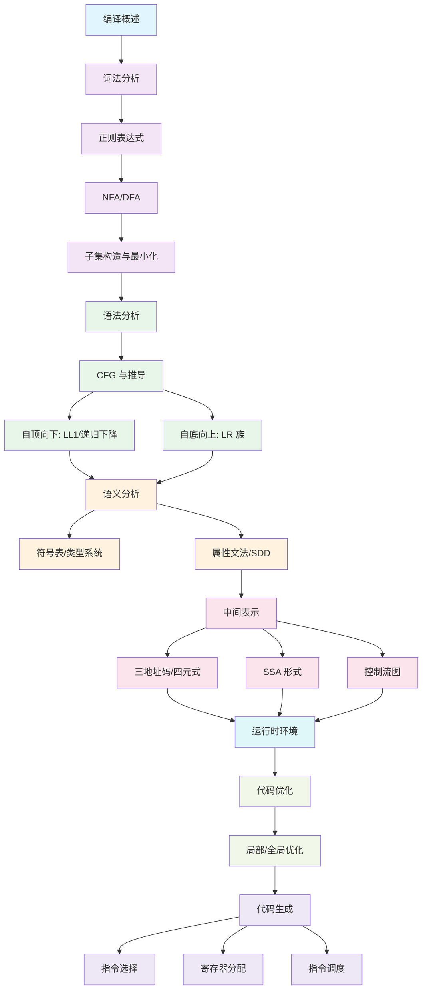

# 编译原理入门完全指南

> **面向对象**：零基础初学者  
> **学习目标**：系统入门编译原理，建立完整知识体系  
> **覆盖范围**：理论 + 算法推导 + 实验实践 + 工具 + 前沿  
> **预计周期**：长期（建议 3~6 个月，每天 1~2 小时）  
> **输出语言**：中文，关键术语中英对照

---

## 目录

- [一、知识地图](#一知识地图)
- [二、编译概述](#二编译概述)
- [三、词法分析](#三词法分析)
- [四、语法分析](#四语法分析)
- [五、语义分析](#五语义分析)
- [六、中间表示](#六中间表示)
- [七、运行时环境](#七运行时环境)
- [八、代码优化](#八代码优化)
- [九、代码生成](#九代码生成)
- [十、工具与实践](#十工具与实践)
- [十一、前沿扩展](#十一前沿扩展)
- [十二、学习路径规划](#十二学习路径规划)
- [十三、实验项目分级](#十三实验项目分级)
- [十四、自测题库](#十四自测题库)
- [十五、资源推荐](#十五资源推荐)

---

## 一、知识地图

### 1.1 整体框架

```
编译原理 Compiler Principles
│
├── 编译流程总览
│   ├── 前端 Frontend（与源语言相关）
│   │   ├── 词法分析 Lexical Analysis
│   │   ├── 语法分析 Syntax Analysis
│   │   └── 语义分析 Semantic Analysis
│   ├── 中间表示 Intermediate Representation
│   ├── 优化 Optimization（机器无关）
│   └── 后端 Backend（与目标机器相关）
│       ├── 代码生成 Code Generation
│       └── 目标代码优化 Target Optimization
│
├── 理论基础
│   ├── 形式语言与自动机
│   │   ├── 正则语言 ↔ 有限自动机
│   │   └── 上下文无关语言 ↔ 下推自动机
│   ├── 文法与推导
│   └── 属性文法与语法制导翻译
│
├── 核心算法
│   ├── 词法：NFA→DFA 子集构造、DFA 最小化
│   ├── 语法：LL(1)、LR(0)/SLR/LALR/LR(1)
│   ├── 优化：数据流分析、图着色寄存器分配
│   └── 代码生成：指令选择、指令调度
│
├── 工具生态
│   ├── Lex/Flex、Yacc/Bison
│   ├── ANTLR
│   ├── LLVM / Clang
│   └── GCC
│
└── 实践项目
    ├── Level 1：计算器 / 正则引擎
    ├── Level 2：微型语言解释器
    ├── Level 3：玩具编译器
    └── Level 4：LLVM 前端 / JIT
```

### 1.2 学习路线图（Mermaid）



---

## 二、编译概述

### 2.1 什么是编译器？

**编译器（Compiler）**：将一种语言（源语言）编写的程序翻译成另一种语言（目标语言）的等价程序。

> 🧩 **生活化类比**：编译器就像一位专业翻译。你用中文写了一本书（源代码），翻译把它逐字逐句准确地翻译成英文（目标代码），而且翻译后的书表达的意思必须和原文完全一致。

### 2.2 编译过程的经典"六阶段"

```
源程序 → [词法分析] → [语法分析] → [语义分析] 
       → [中间代码生成] → [代码优化] → [目标代码生成] → 目标程序
```

| 阶段 | 英文 | 输入 | 输出 | 核心任务 |
|------|------|------|------|----------|
| 词法分析 | Lexical Analysis / Scanning | 字符流 | Token 流 | 分词、识别单词 |
| 语法分析 | Syntax Analysis / Parsing | Token 流 | 语法树 | 组词成句、检查语法 |
| 语义分析 | Semantic Analysis | 语法树 | 注释语法树 | 类型检查、语义验证 |
| 中间代码生成 | IR Generation | 注释树 | 中间表示 | 生成与机器无关的中间代码 |
| 代码优化 | Code Optimization | 中间代码 | 优化后的中间代码 | 提高效率、减少冗余 |
| 目标代码生成 | Code Generation | 中间代码 | 目标机器代码 | 生成汇编/机器码 |

> ⚠️ **注意**：实际编译器不一定严格分为六步，有些阶段会合并（如语法分析和语义分析合并），但概念上的划分是通用的。

### 2.3 前端与后端

- **前端（Frontend）**：与源语言相关，与目标机器无关
  - 词法分析、语法分析、语义分析、中间代码生成
- **后端（Backend）**：与目标机器相关，与源语言无关
  - 代码优化、目标代码生成
- **好处**：同一前端 + 不同后端 = 支持多种目标机器；不同前端 + 同一后端 = 支持多种源语言（如 LLVM 的设计思想）

### 2.4 编译器 vs 解释器 vs JIT

| 特性 | 编译器 Compiler | 解释器 Interpreter | JIT 编译器 |
|------|----------------|-------------------|-----------|
| 执行方式 | 先全部翻译，再执行 | 逐行翻译，逐行执行 | 运行时编译热点代码 |
| 输出 | 目标代码文件 | 直接执行结果 | 机器码（内存中） |
| 执行速度 | 快 | 慢 | 较快（预热后） |
| 启动速度 | 慢（需编译时间） | 快 | 中等 |
| 调试友好度 | 较低 | 高 | 中等 |
| 典型代表 | GCC、Clang | Python 解释器、Bash | Java HotSpot、V8 |

> 🧩 **生活化类比**：
> - **编译器** = 把整本书先翻译完，你再读翻译好的书
> - **解释器** = 请了个同声传译，说一句翻一句
> - **JIT** = 先同声传译，发现某段内容反复出现，就把这段提前翻译好放着备用

### 2.5 其他重要概念

- **交叉编译（Cross Compilation）**：在 A 机器上编译出能在 B 机器上运行的代码（如在 x86 上编译 ARM 程序）
- **自举（Bootstrapping）**：用某种语言写它自己的编译器（如用 C 写 C 编译器）。就像"用钳子造钳子"——先用简陋的工具造出更好的工具
- **一遍 vs 多遍**：一遍编译器只扫描一次源代码（快但限制多）；多遍编译器扫描多次（功能强但慢）

### 2.6 入门自测

**Q1**：为什么编译器要分前端和后端？  
**A**：为了实现"多源语言 + 多目标机器"的组合。新增一门语言只需写新前端，新增一种机器只需写新后端，无需全部重写。

**Q2**：Python 是解释型语言还是编译型语言？  
**A**：官方 CPython 是先编译成字节码（.pyc），再由虚拟机解释执行。所以是"编译 + 解释"的混合模式。

---

## 三、词法分析（Lexical Analysis）

### 3.1 核心概念

**词法分析器（Lexer / Scanner）**：读取源代码的字符流，识别出一个个"单词"（Token）。

> 🧩 **生活化类比**：词法分析就像中文分词。给你一句话"我喜欢编程"，分词器识别出"我 / 喜欢 / 编程"三个词。词法分析器做的就是类似的事，但针对的是程序代码。

**Token 的组成**：
- **种类（Kind/Type）**：关键字、标识符、数字、运算符、分隔符等
- **属性值（Value/Lexeme）**：具体的文本内容

例如 `int x = 42;` 会被分解为：

| Token 类型 | 词素 Lexeme |
|-----------|------------|
| KEYWORD_INT | int |
| IDENTIFIER | x |
| OP_ASSIGN | = |
| NUMBER | 42 |
| SEMICOLON | ; |

### 3.2 正则表达式（Regular Expression）

正则表达式是描述词法规则的标准工具。

**基本运算**：

| 符号 | 含义 | 示例 | 匹配 |
|------|------|------|------|
| `\|` | 或（选择） | `a\|b` | a 或 b |
| 连接 | 拼接 | `ab` | ab |
| `*` | 闭包（0次或多次） | `a*` | ε, a, aa, aaa, ... |
| `+` | 正闭包（1次或多次） | `a+` | a, aa, aaa, ... |
| `?` | 可选（0次或1次） | `a?` | ε 或 a |
| `[ ]` | 字符类 | `[a-z]` | 任意小写字母 |
| `.` | 任意字符 | `.` | 任意单个字符 |

**运算符优先级**：`*` > 连接 > `|`

**常见正则示例**：
- 标识符：`[a-zA-Z_][a-zA-Z_0-9]*`
- 整数：`[0-9]+` 或 `\d+`
- 浮点数：`\d+\.\d+`
- C 风格注释：`/\*.*?\*/`（非贪婪）

### 3.3 有限自动机（Finite Automaton）

正则表达式可以转化为自动机，自动机是正则表达式的"执行引擎"。

#### 3.3.1 NFA（非确定有限自动机）

**NFA（Nondeterministic Finite Automaton）**：对于同一输入字符，从同一状态出发，可能有 0 个、1 个或多个转移；还允许 **ε-转移**（不读入任何字符就能跳转）。

> 🧩 **生活化类比**：NFA 就像一个有"传送门"的迷宫。站在某个房间（状态），你面前可能有多扇门（多个转移），甚至有些门不用走、一睁眼就穿过去了（ε-转移）。你不确定走哪条路，但只要有一条路能走到终点，就算匹配成功。

**形式化定义**：NFA = (Q, Σ, δ, q₀, F)
- Q：有限状态集合
- Σ：输入字母表
- δ：转移函数 Q × (Σ ∪ {ε}) → 2^Q（状态子集）
- q₀：起始状态
- F：接受状态集合

#### 3.3.2 DFA（确定有限自动机）

**DFA（Deterministic Finite Automaton）**：对于每个状态和每个输入字符，**有且仅有一条**转移。没有 ε-转移。

> 🧩 **生活化类比**：DFA 就像一个"单向迷宫"。每个房间里，面对每种颜色的门，只有唯一的一扇。你永远知道下一步该走哪里，不需要"猜"。

**形式化定义**：DFA = (Q, Σ, δ, q₀, F)
- δ：转移函数 Q × Σ → Q（单个状态）

#### 3.3.3 NFA vs DFA 对比表

| 特性 | NFA | DFA |
|------|-----|-----|
| 转移确定性 | 非确定（0或多个） | 确定（唯一） |
| ε-转移 | 允许 | 不允许 |
| 状态数 | 少 | 多（最坏 2^n） |
| 构造难度 | 容易（对应正则） | 需从 NFA 转化 |
| 匹配效率 | 低（需回溯/并行） | 高（线性扫描） |
| 表达能力 | 等价 | 等价 |

> ✅ **重要结论**：NFA 和 DFA **表达能力完全等价**。任何 NFA 都可以转化为等价的 DFA。这是子集构造算法的理论基础。

### 3.4 子集构造算法（Subset Construction）

将 NFA 转化为 DFA 的经典算法。

**核心思想**：DFA 的每个状态对应 NFA 的一个**状态子集**。

**两个关键操作**：
1. **ε-闭包（ε-closure）**：从状态集合 S 出发，只通过 ε-转移能到达的所有状态
2. **move(S, a)**：从状态集合 S 出发，通过字符 a 的转移能到达的所有状态

**算法伪代码**：

```
输入：NFA N
输出：等价的 DFA D

1. 计算 ε-closure(q₀)，作为 DFA 的初始状态 s₀
2. 将 s₀ 加入未标记状态队列
3. while 队列不为空:
       取出一个未标记状态 T
       标记 T
       for 每个输入符号 a:
           U = ε-closure(move(T, a))
           if U 不在 DFA 状态集合中:
               将 U 加入 DFA 状态集合
               将 U 加入未标记队列
           DFA[T][a] = U
4. 所有包含 NFA 接受状态的 DFA 状态，都是接受状态
```

**手算示例**：

NFA：正则 `a(b|c)*` 对应的 NFA

```
状态0 --a--> 状态1 --ε--> 状态2 --ε--> 状态4
                    |                    ^
                    ε                    ε
                    |                    |
                    v                    |
                    状态3 --b--> 状态5 --┘
                         --c--> 状态6 --┘
```

（接受状态：状态4）

**步骤 1**：初始状态 = ε-closure({0}) = {0}

**步骤 2**：处理状态 {0}
- move({0}, a) = {1} → ε-closure({1}) = {1, 2, 3, 4} → 新状态 S1={1,2,3,4}
  - 注：状态1经ε到2，2经ε到3和4，所以闭包是 {1,2,3,4}

**步骤 3**：处理状态 S1={1,2,3,4}
- move(S1, b) = {5} → ε-closure({5}) = {2,3,4,5} → 新状态 S2={2,3,4,5}
- move(S1, c) = {6} → ε-closure({6}) = {2,3,4,6} → 新状态 S3={2,3,4,6}

**步骤 4**：处理状态 S2={2,3,4,5}
- move(S2, b) = {5} → ε-closure = {2,3,4,5} = S2（自身）
- move(S2, c) = {6} → ε-closure = {2,3,4,6} = S3

**步骤 5**：处理状态 S3={2,3,4,6}
- move(S3, b) = {5} → ε-closure = {2,3,4,5} = S2
- move(S3, c) = {6} → ε-closure = {2,3,4,6} = S3（自身）

**最终 DFA 状态转移表**：

| 状态 | a | b | c | 是否接受 |
|------|---|---|---|----------|
| S0={0} | S1 | - | - | 否 |
| S1={1,2,3,4} | - | S2 | S3 | **是**（含状态4） |
| S2={2,3,4,5} | - | S2 | S3 | **是**（含状态4） |
| S3={2,3,4,6} | - | S2 | S3 | **是**（含状态4） |

### 3.5 DFA 最小化（Minimization）

**目标**：将 DFA 的状态数降到最少，同时保持语言不变。

**算法**：Hopcroft 算法（分区精化法）

**核心思想**：把状态分成等价类，同一类的状态"行为相同"，可以合并。

**算法步骤**：

```
输入：DFA D
输出：最小化的 DFA D'

1. 初始划分：将状态分为两组 —— 接受状态 F 和 非接受状态 Q-F
2. 建立工作队列，初始包含所有分组
3. while 队列不为空:
       取出一个分组 S
       for 每个输入符号 a:
           找出所有能通过 a 转移到 S 的状态集合 T
           for 划分中的每个分组 G:
               G_in = G ∩ T      （在 G 中、能到 S 的）
               G_out = G - T     （在 G 中、不能到 S 的）
               if G_in 和 G_out 都非空:
                   用 G_in 和 G_out 替换划分中的 G
                   if G 在队列中:
                       用 G_in 和 G_out 替换
                   else:
                       将较小的那个加入队列
4. 每个等价类选一个代表状态，构成最小 DFA
```

> 🧩 **生活化类比**：就像公司部门重组。先把所有人分成"经理"和"员工"两大组（初始划分）。然后发现"员工"里有些人做一样的工作，可以合并成一个组（等价类），最后得到最精简的部门结构。

### 3.6 Thompson 构造法

将正则表达式转化为 NFA 的经典方法。递归地构造：

1. **空串 ε**：起始状态 → 接受状态（ε-转移）
2. **单个字符 a**：起始状态 --a--> 接受状态
3. **并集 r|s**：新起始状态 ε-分别指向 r 和 s 的起始；r 和 s 的接受都 ε-指向新接受
4. **连接 rs**：r 的接受状态 ε-指向 s 的起始状态
5. **闭包 r\***：新起始状态 ε-指向 r 起始和新接受；r 接受 ε-指向 r 起始和新接受

### 3.7 Lex / Flex 工具

**Lex**（GNU 版本叫 Flex）是词法分析器生成工具：你写正则规则，它生成 C 语言的词法分析器。

**基本结构**：

```lex
%{
/* C 代码声明部分 */
#include <stdio.h>
%}

%%
/* 规则部分：正则模式 + 动作 */
int         { printf("关键字: int\n"); }
[a-zA-Z_][a-zA-Z_0-9]*   { printf("标识符: %s\n", yytext); }
[0-9]+      { printf("数字: %s\n", yytext); }
[ \t\n]     { /* 跳过空白 */ }
.           { printf("未知字符: %s\n", yytext); }
%%

int yywrap() { return 1; }

int main() {
    yylex();
    return 0;
}
```

### 3.8 手写字法分析器（Python 示例）

```python
# 简单的词法分析器：识别整数、标识符、运算符
import re

# Token 类型
TOKEN_TYPES = {
    'NUMBER': r'\d+',
    'IDENT': r'[a-zA-Z_][a-zA-Z_0-9]*',
    'PLUS': r'\+',
    'MINUS': r'-',
    'STAR': r'\*',
    'SLASH': r'/',
    'LPAREN': r'\(',
    'RPAREN': r'\)',
    'ASSIGN': r'=',
    'SEMICOLON': r';',
    'WHITESPACE': r'[ \t\n]+',
}

def lex(source):
    tokens = []
    pos = 0
    while pos < len(source):
        match = None
        for token_type, pattern in TOKEN_TYPES.items():
            regex = re.compile(pattern)
            m = regex.match(source, pos)
            if m:
                match = (token_type, m.group())
                # 跳过空白
                if token_type != 'WHITESPACE':
                    tokens.append(match)
                pos = m.end()
                break
        if not match:
            raise ValueError(f"无法识别的字符: '{source[pos]}' 在位置 {pos}")
    return tokens

# 测试
if __name__ == '__main__':
    code = "x = 42 + y * 3"
    tokens = lex(code)
    for t in tokens:
        print(t)
```

**输出**：
```
('IDENT', 'x')
('ASSIGN', '=')
('NUMBER', '42')
('PLUS', '+')
('IDENT', 'y')
('STAR', '*')
('NUMBER', '3')
```

### 3.9 常见误区

1. ❌ **"NFA 比 DFA 表达能力强"** —— 错！两者等价，只是状态数和运行效率不同
2. ❌ **"正则表达式能匹配所有语法"** —— 错！正则只能匹配正则语言（如括号匹配就做不到）
3. ❌ **"词法分析器要处理注释和字符串"** —— 词法分析器负责识别它们是一个整体 token，解析内容是语义阶段的事
4. ❌ **"DFA 最小化后一定状态最少"** —— 是的，Hopcroft 算法得到的是**唯一的**最小 DFA（在同构意义下）

### 3.10 入门自测

**Q1**：正则 `a(b|c)*d` 能匹配哪些字符串？  
**A**：以 a 开头、以 d 结尾，中间可以是 0 个或多个 b/c 的任意组合。如 ad、abd、acd、abbccd、abcbcd 等。

**Q2**：一个 NFA 有 n 个状态，转化为 DFA 后最多有多少个状态？  
**A**：2^n 个（每个状态子集对应一个 DFA 状态）。但实际通常远小于这个数。

**Q3**：为什么词法分析用正则，语法分析不用？  
**A**：正则表达式表达能力有限（无法处理嵌套结构如括号），但效率高。语法需要上下文无关文法（CFG）来描述嵌套结构。

---

## 四、语法分析（Syntax Analysis）

### 4.1 核心概念

**语法分析器（Parser）**：接收 Token 流，根据文法规则构建语法树（Parse Tree / AST），并检查语法错误。

> 🧩 **生活化类比**：语法分析就像语文课上的"句子成分分析"。给你一句话"我吃苹果"，你分析出"主语：我，谓语：吃，宾语：苹果"。语法分析器做的事类似，但分析的是程序代码的"句子结构"。

### 4.2 上下文无关文法（CFG）

**CFG（Context-Free Grammar）**：G = (V, T, P, S)
- V：非终结符集合（变量，如 <语句>、<表达式>）
- T：终结符集合（Token，如 if、+、标识符）
- P：产生式集合（规则，如 <表达式> → <表达式> + <项>）
- S：开始符号（起始非终结符）

**常用记号**：
- 大写字母 A, B, C... 表示非终结符
- 小写字母 a, b, c... 表示终结符
- α, β, γ 表示文法符号串（终结符 + 非终结符）
- ε 表示空串

### 4.3 推导与归约

**推导（Derivation）**：从开始符号出发，不断用产生式右部替换左部，直到得到终结符串。

- **最左推导**：每次替换最左边的非终结符
- **最右推导**：每次替换最右边的非终结符（也叫规范推导）

**示例文法**：
```
E → E + T | T
T → T * F | F
F → id | ( E )
```

**最左推导** `id + id * id`：
```
E ⇒ E + T        （用 E→E+T 替换最左 E）
  ⇒ T + T        （用 E→T 替换最左 E）
  ⇒ F + T        （用 T→F 替换最左 T）
  ⇒ id + T       （用 F→id 替换最左 F）
  ⇒ id + T * F   （用 T→T*F 替换最左 T）
  ⇒ id + F * F   （用 T→F 替换最左 T）
  ⇒ id + id * F  （用 F→id 替换最左 F）
  ⇒ id + id * id （用 F→id 替换最左 F）
```

**归约（Reduction）**：推导的逆过程。从终结符串出发，不断用产生式左部替换右部，直到归约到开始符号。

> ⚠️ **关键对应**：
> - 自顶向下分析 = 从开始符号出发，推导句子
> - 自底向上分析 = 从句子出发，归约到开始符号

### 4.4 语法树与二义性

**语法树（Parse Tree）**：推导过程的图形化表示。根是开始符号，叶子是终结符，内部节点是非终结符。

**抽象语法树（AST）**：去掉了语法分析细节的、更简洁的树表示。比如 `3 + 4 * 5` 的 AST 是：
```
    +
   / \
  3   *
     / \
    4   5
```

**二义性（Ambiguity）**：如果一个文法对同一个句子存在**两棵不同的语法树**（即两种最左推导），则该文法是二义的。

**经典二义性示例**：
```
E → E + E | E * E | id
```
对于 `id + id * id`，有两种推导：
1. 先加后乘：`E ⇒ E+E ⇒ id+E ⇒ id+E*E ⇒ id+id*E ⇒ id+id*id`
2. 先乘后加：`E ⇒ E*E ⇒ E+E*E ⇒ id+E*E ⇒ id+id*E ⇒ id+id*id`

**消除二义性的方法**：
1. 引入优先级和结合性（如改写文法，引入更多非终结符分层）
2. 使用消除二义性规则（如 Yacc/Bison 中的 %left、%right）

### 4.5 语法分析方法分类

```
语法分析
├── 自顶向下（Top-Down）
│   ├── 递归下降（Recursive Descent）
│   ├── 预测分析（LL(1)）
│   └── LL(k)
│
└── 自底向上（Bottom-Up）
    ├── 算符优先（Operator Precedence）
    └── LR 族
        ├── LR(0)
        ├── SLR(1)
        ├── LALR(1)
        └── LR(1)（规范LR）
```

### 4.6 自顶向下分析：递归下降

**递归下降（Recursive Descent）**：为每个非终结符写一个递归函数，从文法开始符号开始，逐步匹配输入。

> 🧩 **生活化类比**：就像你按照菜谱做菜。菜谱说"先做汤"，汤的菜谱又说"先切菜"，切菜的菜谱又说"先洗番茄"...一层层递归下去，最后把菜做好。

**Python 示例：简单表达式的递归下降解析器**

```python
# 文法：
#   expr   → term (('+' | '-') term)*
#   term   → factor (('*' | '/') factor)*
#   factor → NUMBER | '(' expr ')'

class RecursiveDescentParser:
    def __init__(self, tokens):
        self.tokens = tokens
        self.pos = 0
    
    def peek(self):
        if self.pos < len(self.tokens):
            return self.tokens[self.pos]
        return None
    
    def consume(self, expected_type=None):
        token = self.peek()
        if token is None:
            raise SyntaxError("意外的输入结束")
        if expected_type and token[0] != expected_type:
            raise SyntaxError(f"期望 {expected_type}，得到 {token[0]}")
        self.pos += 1
        return token
    
    def parse(self):
        result = self.expr()
        if self.pos < len(self.tokens):
            raise SyntaxError(f"多余的输入: {self.tokens[self.pos:]}")
        return result
    
    def expr(self):
        """expr → term (('+' | '-') term)*"""
        left = self.term()
        while self.peek() and self.peek()[0] in ('PLUS', 'MINUS'):
            op = self.consume()
            right = self.term()
            left = ('binop', op[0], left, right)
        return left
    
    def term(self):
        """term → factor (('*' | '/') factor)*"""
        left = self.factor()
        while self.peek() and self.peek()[0] in ('STAR', 'SLASH'):
            op = self.consume()
            right = self.factor()
            left = ('binop', op[0], left, right)
        return left
    
    def factor(self):
        """factor → NUMBER | '(' expr ')'"""
        token = self.peek()
        if token[0] == 'NUMBER':
            self.consume()
            return ('num', int(token[1]))
        elif token[0] == 'LPAREN':
            self.consume('LPAREN')
            node = self.expr()
            self.consume('RPAREN')
            return node
        else:
            raise SyntaxError(f"期望数字或括号，得到 {token}")

# 测试
if __name__ == '__main__':
    # 3 + 4 * 5
    tokens = [
        ('NUMBER', '3'),
        ('PLUS', '+'),
        ('NUMBER', '4'),
        ('STAR', '*'),
        ('NUMBER', '5'),
    ]
    parser = RecursiveDescentParser(tokens)
    ast = parser.parse()
    print(ast)
    # 输出: ('binop', 'PLUS', ('num', 3), ('binop', 'STAR', ('num', 4), ('num', 5)))
```

### 4.7 LL(1) 分析

LL(1)：第一个 L 表示从左到右扫描输入，第二个 L 表示最左推导，1 表示向前看 1 个符号。

#### 4.7.1 FIRST 集

**FIRST(α)**：可以从 α 推导出的所有终结符串的首终结符的集合。如果 α ⇒* ε，则 ε 也在 FIRST(α) 中。

**计算规则**：
1. 如果 X 是终结符，则 FIRST(X) = {X}
2. 如果 X → ε 是产生式，则 ε ∈ FIRST(X)
3. 如果 X → Y₁Y₂...Yₖ 是产生式：
   - 将 FIRST(Y₁) 中所有非 ε 符号加入 FIRST(X)
   - 如果 ε ∈ FIRST(Y₁)，将 FIRST(Y₂) 中所有非 ε 符号加入 FIRST(X)
   - ...以此类推
   - 如果所有 Yᵢ 都能推导出 ε，则将 ε 加入 FIRST(X)

#### 4.7.2 FOLLOW 集

**FOLLOW(A)**：在某个句型中，紧跟在 A 后面的终结符的集合。如果 A 在句型末尾，则 $（输入结束标记）也在 FOLLOW(A) 中。

**计算规则**：
1. 将 $ 加入 FOLLOW(S)（S 是开始符号）
2. 对于产生式 A → αBβ：
   - 将 FIRST(β) 中所有非 ε 符号加入 FOLLOW(B)
   - 如果 ε ∈ FIRST(β)，将 FOLLOW(A) 加入 FOLLOW(B)
3. 对于产生式 A → αB：
   - 将 FOLLOW(A) 加入 FOLLOW(B)

#### 4.7.3 手算 FIRST/FOLLOW 示例

**文法**：
```
E  → T E'
E' → + T E' | ε
T  → F T'
T' → * F T' | ε
F  → id | ( E )
```

**计算 FIRST 集**：

```
FIRST(F) = {id, (}
FIRST(T') = {*, ε}
FIRST(T) = FIRST(F) = {id, (} （因为 T → F T'，F 不能推导出 ε）
FIRST(E') = {+, ε}
FIRST(E) = FIRST(T) = {id, (} （因为 E → T E'，T 不能推导出 ε）
```

**计算 FOLLOW 集**：

```
初始：FOLLOW(E) = {$}

从 E → T E'：
  - FOLLOW(T) 包含 FIRST(E') - {ε} = {+}
  - 因为 E'→ε，FOLLOW(T) 还包含 FOLLOW(E) = {$}
  - 所以 FOLLOW(T) = {+, $}
  - FOLLOW(E') 包含 FOLLOW(E) = {$}

从 E' → + T E'：
  - FOLLOW(T) 包含 FIRST(E') - {ε} = {+}（已有的）
  - 因为 E'→ε，FOLLOW(T) 还包含 FOLLOW(E') = {$}（已有的）
  - FOLLOW(E') 包含 FOLLOW(E') = {$}（已有）

从 T → F T'：
  - FOLLOW(F) 包含 FIRST(T') - {ε} = {*}
  - 因为 T'→ε，FOLLOW(F) 还包含 FOLLOW(T) = {+, $}
  - 所以 FOLLOW(F) = {*, +, $}
  - FOLLOW(T') 包含 FOLLOW(T) = {+, $}

从 T' → * F T'：
  - FOLLOW(F) 包含 FIRST(T') - {ε} = {*}（已有）
  - 因为 T'→ε，FOLLOW(F) 还包含 FOLLOW(T') = {+, $}（已有）
  - FOLLOW(T') 包含 FOLLOW(T') = {+, $}（已有）

从 F → ( E )：
  - FOLLOW(E) 包含 {)}  → FOLLOW(E) = {$, )}

更新：因为 FOLLOW(E) 增加了 )，需要重新计算依赖项
  - FOLLOW(E') 包含 FOLLOW(E) = {$, )}
  - FOLLOW(T) 包含 FOLLOW(E') = {$, )} → FOLLOW(T) = {+, $, )}
  - FOLLOW(T') 包含 FOLLOW(T) = {+, $, )}
  - FOLLOW(F) 包含 FOLLOW(T') = {+, $, )} → FOLLOW(F) = {*, +, $, )}

最终结果：
FOLLOW(E)  = {$, )}
FOLLOW(E') = {$, )}
FOLLOW(T)  = {+, $, )}
FOLLOW(T') = {+, $, )}
FOLLOW(F)  = {*, +, $, )}
```

#### 4.7.4 预测分析表

**构造方法**：对于每个产生式 A → α：
1. 对每个终结符 a ∈ FIRST(α)，将 A → α 加入 M[A, a]
2. 如果 ε ∈ FIRST(α)，则对每个终结符 b ∈ FOLLOW(A)，将 A → α 加入 M[A, b]
3. 如果 ε ∈ FIRST(α) 且 $ ∈ FOLLOW(A)，将 A → α 加入 M[A, $]

**预测分析表（以上述文法为例）**：

| 非终结符 | id | + | * | ( | ) | $ |
|----------|----|---|---|---|---|---|
| E | E→TE' | | | E→TE' | | |
| E' | | E'→+TE' | | | E'→ε | E'→ε |
| T | T→FT' | | | T→FT' | | |
| T' | | T'→ε | T'→*FT' | | T'→ε | T'→ε |
| F | F→id | | | F→(E) | | |

**LL(1) 文法判定**：预测分析表中每个格子最多一个产生式，就是 LL(1) 文法。

### 4.8 自底向上分析：LR 族

LR：L 表示从左到右扫描，R 表示最右推导的逆过程（最左归约）。

#### 4.8.1 核心概念

- **句柄（Handle）**：句型中可以被归约的最左产生式右部
- **移进（Shift）**：将下一个输入符号移入栈
- **归约（Reduce）**：将栈顶的句柄归约为对应的非终结符
- **接受（Accept）**：归约到开始符号，输入处理完毕
- **项目（Item）**：带点的产生式，如 A → α·β，表示已经识别了 α，接下来要识别 β

#### 4.8.2 LR(0) 分析

**LR(0) 项目集规范族**：通过闭包（closure）和转移（goto）构造所有状态。

**closure(I) 计算**：
- I 中的项目都在 closure(I) 中
- 如果 A → α·Bβ 在 closure(I) 中，且 B → γ 是产生式，则 B → ·γ 也加入
- 重复直到不再增加

**goto(I, X) 计算**：
- goto(I, X) = closure({A → αX·β | A → α·Xβ ∈ I})

**LR(0) 分析表构造**：
- 移进：如果 goto(Iᵢ, a) = Iⱼ，且 a 是终结符，则 action[i, a] = shift j
- 归约：如果 A → α· ∈ Iᵢ，且 A ≠ S'，则对所有终结符 a，action[i, a] = reduce A→α
- 接受：如果 S' → S· ∈ Iᵢ，则 action[i, $] = accept
- 转移：如果 goto(Iᵢ, A) = Iⱼ，且 A 是非终结符，则 goto[i, A] = j

**LR(0) 冲突**：
- 移进-归约冲突：同一项目集中既有移进项目又有归约项目
- 归约-归约冲突：同一项目集中有多个归约项目

#### 4.8.3 SLR(1) 分析

SLR = Simple LR。解决 LR(0) 的移进-归约冲突：

**改进**：归约时不只看输入符号是不是终结符，而是看输入符号是否在 FOLLOW(A) 中。

- 如果 A → α· ∈ Iᵢ，则对所有 a ∈ FOLLOW(A)，action[i, a] = reduce A→α

> ⚠️ **注意**：SLR 仍然可能有冲突，因为 FOLLOW 集可能过大。这时需要用 LALR 或 LR(1)。

#### 4.8.4 LR(1) 分析

LR(1) = 规范 LR。每个项目带有**向前看符号**（lookahead）：[A → α·β, a]，其中 a 是向前看符号（终结符）。

**closure(I) 计算（LR(1)）**：
- I 中的项目都在 closure(I) 中
- 如果 [A → α·Bβ, a] 在 closure(I) 中，且 B → γ 是产生式，
  则对每个 b ∈ FIRST(βa)，将 [B → ·γ, b] 加入 closure(I)
- 重复直到不再增加

**goto(I, X) 计算（LR(1)）**：
- goto(I, X) = closure({[A → αX·β, a] | [A → α·Xβ, a] ∈ I})

#### 4.8.5 LALR(1) 分析

LALR = Look-Ahead LR。在 LR(1) 基础上，**合并同心项目集**（即核心相同、向前看符号不同的项目集），得到的分析表大小和 SLR 相同，但分析能力比 SLR 强。

> 🧩 **生活化类比**：LR(1) 就像每个学生有自己的课桌（项目集），东西很全但占地方。LALR 把长得一样的课桌合并成一张，向前看符号写在同一张桌子上，省空间但偶尔会有小冲突（归约-归约冲突，但不会有移进-归约冲突）。

#### 4.8.6 LL vs LR 对比表

| 特性 | LL(1) | LR 族（LR(0)/SLR/LALR/LR(1)） |
|------|-------|-------------------------------|
| 分析方向 | 自顶向下 | 自底向上 |
| 推导方式 | 最左推导 | 最左归约（最右推导的逆） |
| 文法限制 | 严格（不能有左递归、左公因子） | 宽松得多 |
| 错误检测 | 较早（进入错误状态前） | 较晚（发现无法移进/归约时） |
| 实现难度 | 简单（递归下降很好写） | 复杂（通常用工具生成） |
| 错误恢复 | 较容易 | 较困难 |
| 典型工具 | 手写递归下降 | Yacc/Bison、ANTLR（实际上是 LL*） |

#### 4.8.7 SLR vs LALR vs LR(1) 对比表

| 特性 | SLR(1) | LALR(1) | LR(1) |
|------|--------|---------|-------|
| 状态数 | 少（同 LR(0)） | 中（同 LR(0)/SLR） | 多 |
| 分析能力 | 最弱 | 中等 | 最强 |
| 冲突可能性 | 较高（移进-归约、归约-归约） | 较低（只有归约-归约） | 最低 |
| 向前看符号 | FOLLOW 集（可能过大） | 合并后的向前看 | 精确的向前看 |
| 实际应用 | 教学用 | 最常用（Yacc/Bison 默认） | 理论意义大 |
| 空间效率 | 高 | 高 | 低 |

### 4.9 Yacc / Bison 工具

Yacc（GNU 版本叫 Bison）是语法分析器生成工具，输入文法规则，输出 LALR(1) 分析器。

**基本结构**：

```yacc
%{
#include <stdio.h>
#include <ctype.h>
int yylex();
void yyerror(const char *s);
%}

%token NUMBER

%%
/* 语法规则 */
expr: expr '+' term   { $$ = $1 + $3; }
    | expr '-' term   { $$ = $1 - $3; }
    | term            { $$ = $1; }
    ;

term: term '*' factor { $$ = $1 * $3; }
    | term '/' factor { $$ = $1 / $3; }
    | factor          { $$ = $1; }
    ;

factor: NUMBER        { $$ = $1; }
      | '(' expr ')'  { $$ = $2; }
      ;
%%

int main() {
    printf("输入表达式: ");
    yyparse();
    return 0;
}

void yyerror(const char *s) {
    printf("错误: %s\n", s);
}
```

### 4.10 常见误区

1. ❌ **"语法分析器检查类型错误"** —— 错！那是语义分析的工作。语法分析只检查"结构对不对"
2. ❌ **"LL(1) 比 LR(1) 强"** —— 错！LR(1) 能分析的文法严格包含 LL(1)
3. ❌ **"LALR 比 LR(1) 状态少，所以能力弱，有移进-归约冲突"** —— 部分对。LALR 能力确实弱，但不会引入新的移进-归约冲突，只会引入归约-归约冲突
4. ❌ **"递归下降只能处理 LL(1) 文法"** —— 不完全对。纯递归下降处理 LL(1)，但加上回溯可以处理更多文法（只是效率低）
5. ❌ **"二义文法一定不能用"** —— 错！在 Yacc/Bison 中，二义文法配合优先级/结合性声明反而更简洁

### 4.11 入门自测

**Q1**：文法 `S → aSbS | bSaS | ε` 是二义的吗？  
**A**：是的。例如串 `abab` 有多种最左推导方式。

**Q2**：消除左递归：`E → E + T | T`  
**A**：改写为 `E → T E'`，`E' → + T E' | ε`

**Q3**：提取左公因子：`S → iEtS | iEtSeS | a`  
**A**：改写为 `S → iEtSS' | a`，`S' → eS | ε`

---

## 五、语义分析（Semantic Analysis）

### 5.1 核心概念

**语义分析**：在语法正确的基础上，检查程序的语义是否正确，并收集类型信息供后续代码生成使用。

> 🧩 **生活化类比**：语法分析检查"句子通不通"（如"我吃苹果"语法正确，"苹果吃我"语法也正确）。语义分析检查"意思对不对"（"苹果吃我"语法没问题，但语义上很奇怪——苹果不能吃）。

**语义分析的主要任务**：
1. **符号表管理**：记录变量、函数、类的声明信息
2. **类型检查**：确保运算的类型匹配
3. **作用域分析**：处理变量的可见性
4. **控制流检查**：确保 break/continue 在循环内等
5. **唯一性检查**：如 case 标签不重复
6. **名字解析**：将标识符的使用和声明关联起来

### 5.2 符号表（Symbol Table）

**符号表**：存储程序中所有名字（变量、函数、类等）及其属性的数据结构。

**每个符号的典型信息**：
- 名字（Name）
- 类型（Type）
- 种类（Kind）：变量、函数、类...
- 作用域（Scope）
- 存储位置（Offset / Address）
- 访问权限（Public/Private...）

**数据结构**：
- 哈希表（最常用，O(1) 查找）
- 二叉搜索树
- 链表（简单但慢）

### 5.3 作用域（Scope）

**作用域规则**：
- **静态作用域（词法作用域）**：变量的作用域由源代码的位置决定（C、Java、Python 等大多数语言）
- **动态作用域**：变量的作用域由运行时的调用栈决定（Bash、早期 Lisp）

> 🧩 **生活化类比**：静态作用域就像"看户口本"——你是谁家孩子，看出生登记就知道。动态作用域就像"看当前谁在说话"——你是谁取决于谁在叫你。

**符号表的作用域实现：栈式结构**

```
进入作用域 → 创建新符号表（压栈）
  查找 → 从栈顶往下找
  声明 → 在栈顶符号表中添加
离开作用域 → 弹出符号表（弹栈）
```

### 5.4 类型系统（Type System）

**类型系统的作用**：
1. **安全性**：防止无意义操作（如整数和字符串相加）
2. **抽象**：隐藏底层实现细节
3. **效率**：帮助编译器生成更好的代码
4. **文档**：函数签名就是最好的文档

**类型检查方式**：
- **静态类型检查**：编译时检查（C、Java、Rust）
- **动态类型检查**：运行时检查（Python、JavaScript）
- **强类型 vs 弱类型**：是否允许隐式类型转换（强弱是相对概念）

### 5.5 属性文法（Attribute Grammar）

**属性文法**：为每个文法符号关联一些"属性"（值），并为每个产生式关联语义规则来计算属性值。

**属性分类**：
- **综合属性（Synthesized）**：从子节点的属性计算而来（自底向上传递）
- **继承属性（Inherited）**：从父节点或兄弟节点的属性计算而来（自顶向下传递）

> 🧩 **生活化类比**：综合属性就像"孩子的身高"——由父母基因决定，从下往上传。继承属性就像"家族姓氏"——由父亲传给孩子，从上往下传。

**示例：表达式求值的属性文法**

```
产生式                     语义规则
E → E₁ + T               E.val = E₁.val + T.val
E → T                    E.val = T.val
T → T₁ * F               T.val = T₁.val * F.val
T → F                    T.val = F.val
F → num                  F.val = num.lexval
```

所有属性都是综合属性，这叫 **S-属性文法**。

### 5.6 语法制导定义（SDD）与语法制导翻译（SDT）

**SDD（Syntax-Directed Definition）**：将语义规则附加到文法产生式上，描述"要计算什么"（声明式）。

**SDT（Syntax-Directed Translation Scheme）**：将语义动作嵌入到产生式右部中，描述"什么时候计算"（过程式）。

**S-属性 vs L-属性**：
- **S-属性文法**：只有综合属性。可以在自底向上分析中计算。
- **L-属性文法**：可以有综合属性和继承属性，但继承属性只能依赖于父节点和左侧兄弟。可以在自顶向下分析中计算。

### 5.7 类型检查示例

```
产生式                    语义规则（类型检查）
E → E₁ + T               if E₁.type = int 且 T.type = int
                            then E.type = int
                            else type_error
E → E₁ < T               if E₁.type = int 且 T.type = int
                            then E.type = bool
                            else type_error
E → id                   E.type = lookup(id, symtab)
```

### 5.8 常见误区

1. ❌ **"语法分析和语义分析是一回事"** —— 语法只看结构，语义看含义。`"hello" + 1` 语法正确但语义可能错误
2. ❌ **"静态类型语言一定比动态类型快"** —— 不一定。现代 JIT 可以根据运行时类型信息做激进优化
3. ❌ **"属性文法只能用来做类型检查"** —— 错！属性文法可以做任何语法制导的计算，包括中间代码生成
4. ❌ **"符号表只在语义分析阶段用"** —— 错！词法、语法、代码生成、优化阶段都可能用到

### 5.9 入门自测

**Q1**：`3 + "hello"` 在 C 语言中会怎样？  
**A**：编译错误。C 是静态类型语言，int 和 char* 不能直接相加（除非做隐式转换，但 + 运算符不支持）。

**Q2**：综合属性和继承属性的区别？  
**A**：综合属性从子节点计算（自底向上），继承属性从父/兄节点计算（自顶向下）。综合属性更常用。

---

## 六、中间表示（Intermediate Representation）

### 6.1 核心概念

**中间表示（IR）**：编译器前端和后端之间的桥梁。源程序先翻译成 IR，再从 IR 翻译成目标代码。

> 🧩 **生活化类比**：IR 就像"世界语"。如果有 N 种源语言和 M 种目标机器，直接翻译需要 N×M 个编译器。但如果大家都先翻译成"世界语"（IR），再从世界语翻译出去，只需要 N + M 个翻译器。

**好的 IR 应具备的特点**：
- 与源语言无关
- 与目标机器无关
- 易于生成
- 易于翻译成目标代码
- 便于优化

### 6.2 常见 IR 形式

#### 6.2.1 三地址码（Three-Address Code）

每条指令最多有三个地址（两个操作数 + 一个结果）。

**常见形式**：
```
x = y op z        （二元运算）
x = op y          （一元运算）
x = y             （复制）
goto L            （无条件跳转）
if x goto L       （条件跳转）
if x relop y goto L （关系跳转）
param x           （参数传递）
call p, n         （调用函数 p，n 个参数）
return x          （返回）
```

**示例**：`a = b + c * d`

```
t1 = c * d
t2 = b + t1
a = t2
```

#### 6.2.2 四元式（Quadruple）

四元式是三地址码的具体表示形式：(op, arg1, arg2, result)

**示例**：`a = b + c * d`

| 序号 | op | arg1 | arg2 | result |
|------|----|------|------|--------|
| 0 | * | c | d | t1 |
| 1 | + | b | t1 | t2 |
| 2 | = | t2 | - | a |

#### 6.2.3 三元式（Triple）

三元式用位置引用结果，不用临时变量名：(op, arg1, arg2)

**示例**：`a = b + c * d`

| 序号 | op | arg1 | arg2 |
|------|----|------|------|
| 0 | * | c | d |
| 1 | + | b | (0) |
| 2 | = | a | (1) |

#### 6.2.4 抽象语法树（AST）

```
    =
   / \
  a   +
     / \
    b   *
       / \
      c   d
```

#### 6.2.5 DAG（有向无环图）

DAG 是 AST 的优化形式，公共子表达式共享节点。

**示例**：`a = b + c; b = b + c; d = a + b`

```
      +         ← a 指向它
     / \
    b   +      ← b 指向它
       / \
      b   c    ← c 被共享
```

（注意：b 和 c 的值在两个加法中都用了，所以共享）

### 6.3 SSA 形式（Static Single Assignment）

**SSA（静态单赋值）**：每个变量只被赋值一次。如果需要多次赋值，就创建新的"版本"。

**普通三地址码**：
```
x = a + b
x = x * 2
y = x - 1
```

**SSA 形式**：
```
x1 = a + b
x2 = x1 * 2
y1 = x2 - 1
```

**Φ 函数（Phi 函数）**：处理控制流汇合处的变量合并。

```
        if (cond)
          x1 = 5
        else
          x2 = 10
        x3 = Φ(x1, x2)   ← 汇合处，根据来自哪个分支选择值
```

**SSA 的好处**：
1. 简化优化（每个变量只有一个定值点，数据流分析更简单）
2. 寄存器分配更容易
3. 许多现代优化基于 SSA（LLVM、GCC 都用）

### 6.4 控制流图（CFG）

**控制流图（Control Flow Graph）**：以基本块为节点、控制流为边的图。

**基本块（Basic Block）**：最大的顺序执行语句序列，只能从开头进入、从结尾离开。

**基本块划分算法**：
1. 确定首指令（第一个语句、条件/无条件跳转的目标、跳转语句的下一条）
2. 每个首指令到下一个首指令之前（或程序结束）构成一个基本块

**示例**：
```
1: i = 0
2: if i >= 10 goto 7
3: t = i * 2
4: a[t] = 0
5: i = i + 1
6: goto 2
7: return
```

基本块：
- B1: 语句 1
- B2: 语句 2
- B3: 语句 3-6
- B4: 语句 7

CFG 边：B1→B2, B2→B3, B2→B4, B3→B2

### 6.5 SSA vs 三地址码 对比表

| 特性 | 三地址码 | SSA 形式 |
|------|----------|----------|
| 变量赋值 | 可多次赋值 | 每个变量只赋值一次 |
| 数据流分析 | 需要追踪所有定值点 | 每个变量只有一个定值点，更简单 |
| 控制流汇合 | 直接使用变量 | 需要 Φ 函数 |
| 优化支持 | 一般 | 友好（许多算法基于 SSA） |
| 直观性 | 直观，接近汇编 | 不直观，变量有多个版本 |
| 典型代表 | 经典编译器 | LLVM、GCC、MLIR |

### 6.6 入门自测

**Q1**：为什么要用中间表示？直接从源代码生成目标代码不行吗？  
**A**：有了 IR，前端和后端解耦。支持 N 种语言和 M 种机器只需 N+M 个模块，而不是 N×M。而且优化可以在 IR 上统一进行。

**Q2**：SSA 中 Φ 函数的作用是什么？  
**A**：在控制流汇合点，根据程序来自哪个分支选择对应的变量版本。它是 SSA 形式中处理多分支的关键。

---

## 七、运行时环境（Runtime Environment）

### 7.1 核心概念

**运行时环境**：程序运行时的内存布局、管理方式和支持机制。

> 🧩 **生活化类比**：运行时环境就像"舞台后台"。演员（程序）在前台表演，后台要管理道具（数据）、化妆间（栈帧）、仓库（堆）等，确保演出顺利进行。

### 7.2 程序运行时的内存布局

典型的进程内存布局（从低地址到高地址）：

```
┌────────────────────┐ 低地址
│    代码段 (Text)    │  只读，存放机器指令
├────────────────────┤
│    数据段 (Data)    │  已初始化的全局变量、静态变量
├────────────────────┤
│    BSS 段          │  未初始化的全局变量（自动清零）
├────────────────────┤
│                    │
│         堆 (Heap)   │  ↓ 向下增长，动态分配
│                    │
│         ...         │
│                    │
│         栈 (Stack)  │  ↑ 向上增长，函数调用
│                    │
└────────────────────┘ 高地址
```

### 7.3 栈与活动记录

**活动记录（Activation Record）/ 栈帧（Stack Frame）**：函数调用时在栈上分配的一块内存，保存函数的局部信息。

**典型栈帧结构**：

```
高地址  ┌────────────────────┐
       │   实参（参数）       │
       ├────────────────────┤
       │   返回地址          │
       ├────────────────────┤
       │   旧的帧指针 (FP)   │  ← FP 指向这里
       ├────────────────────┤
       │   局部变量          │
       ├────────────────────┤
       │   临时变量          │
       ├────────────────────┤
       │   保存的寄存器      │
低地址  └────────────────────┘  ← SP 指向这里
```

**关键寄存器**：
- **SP（Stack Pointer）**：栈顶指针，指向栈的最低地址
- **FP（Frame Pointer）**：帧指针，指向当前栈帧的固定位置（方便寻址局部变量）

### 7.4 函数调用过程

**调用者（Caller）做的事**：
1. 计算实参的值
2. 将实参按约定顺序压栈（或放入寄存器）
3. 将返回地址压栈，调用函数（call 指令）

**被调用者（Callee）做的事**：
1. 保存旧的 FP，设置新的 FP
2. 分配局部变量空间（SP 下移）
3. 保存需要保存的寄存器
4. 执行函数体
5. 将返回值放入约定位置
6. 恢复寄存器
7. 释放局部变量（SP 上移）
8. 恢复旧的 FP
9. 返回（ret 指令）

> 🧩 **生活化类比**：函数调用就像"借用工作台"。你正在工作（当前函数），突然需要做一个子任务（调用函数）。你把当前进度记下来（保存返回地址），然后给子任务腾出一块工作台（分配栈帧），子任务做完后把结果交给你（返回值），你收拾好工作台（弹栈），继续之前的工作。

### 7.5 参数传递方式

| 方式 | 英文 | 传递内容 | 修改形参影响实参？ | 典型语言 |
|------|------|----------|-------------------|----------|
| 值传递 | Pass by value | 值的副本 | 不影响 | C、Java（基本类型） |
| 引用传递 | Pass by reference | 地址/引用 | 影响 | C++ &、C# ref |
| 指针传递 | Pass by pointer | 指针的值 | 可通过指针修改 | C、C++ * |
| 名传递 | Pass by name | 文本替换 | 取决于使用方式 | Algol、Scala（传名参数） |
| 共享对象 | Pass by sharing | 对象引用的值 | 可修改对象内容，但不能重新绑定 | Java（对象）、Python |

> ⚠️ **易混淆点**：Java 是"值传递"还是"引用传递"？答：Java 只有值传递。对于对象类型，传递的是**引用的值**（即对象地址的副本），所以可以修改对象内容，但不能让实参指向新对象。

### 7.6 符号表与存储分配

**存储分配策略**：
1. **静态分配**：编译时确定大小和位置（全局变量、静态变量）
2. **栈分配**：函数调用时分配，返回时释放（局部变量）
3. **堆分配**：按需动态分配和释放（new/malloc 的对象）

### 7.7 垃圾回收（Garbage Collection）

**垃圾回收**：自动回收堆上不再使用的内存。

**常见算法**：
1. **引用计数（Reference Counting）**：每个对象记录引用数，归零时回收
   - 优点：实时、实现简单
   - 缺点：循环引用无法回收、计数开销
2. **标记-清除（Mark-Sweep）**：从根出发标记所有可达对象，清除未标记的
   - 优点：解决循环引用
   - 缺点：碎片、停顿
3. **复制收集（Copying）**：将堆分为两半，存活对象复制到另一半
   - 优点：无碎片、分配快
   - 缺点：空间浪费
4. **分代收集（Generational）**：按对象年龄分代，不同代用不同算法
   - 基于"大多数对象朝生夕死"的假说
   - 年轻代用复制，老年代用标记-清除/标记-整理

### 7.8 入门自测

**Q1**：栈和堆的区别？  
**A**：栈由编译器自动管理，存储局部变量和函数调用信息，分配释放快，大小有限；堆由程序员手动管理（或 GC），存储动态分配的对象，分配释放慢，空间大但可能有碎片。

**Q2**：什么是栈溢出（Stack Overflow）？  
**A**：函数调用嵌套过深（如无限递归），栈空间耗尽。

---

## 八、代码优化（Code Optimization）

### 8.1 核心概念

**代码优化**：在不改变程序语义的前提下，改进代码，使其运行更快、占用更少内存。

> 🧩 **生活化类比**：优化就像"整理行李"。你要带的东西（功能）不能少，但可以通过合理摆放（优化）让箱子更轻、空间利用更好。

**优化的原则**：
1. **等价原则**：优化不能改变程序的正确语义
2. **有效原则**：优化后的代码确实更快/更省空间
3. **权衡原则**：编译时间 vs 运行时间

### 8.2 优化分类

**按范围分**：
1. **局部优化**：在一个基本块内进行
2. **全局优化**：在整个函数/过程内进行（跨基本块）
3. **过程间优化**：跨函数进行（内联、过程间常量传播等）

**按优化方向分**：
1. **速度优化**：让程序跑得更快
2. **空间优化**：让程序占用更少内存

### 8.3 局部优化

#### 8.3.1 常量折叠（Constant Folding）

编译时计算常量表达式的值。

```
优化前: x = 3 + 4 * 5
优化后: x = 23
```

#### 8.3.2 常量传播（Constant Propagation）

如果变量的值是常量，就用常量替换变量的使用。

```
优化前: a = 5
       b = a + 3
优化后: a = 5
       b = 8
```

#### 8.3.3 公共子表达式消除（CSE）

如果一个表达式计算过且值没变，就复用结果。

```
优化前: t1 = a + b
       t2 = a + b     ← 和 t1 一样
       c = t1 + t2
优化后: t1 = a + b
       c = t1 + t1
```

#### 8.3.4 死代码消除（Dead Code Elimination）

删除结果永远不会被使用的代码。

```
优化前: x = 3
       y = 4
       z = x + y
       return y
优化后: y = 4
       return y
```

#### 8.3.5 代数化简

利用代数恒等式简化。

```
x + 0     → x
x * 1     → x
x * 0     → 0
x - x     → 0
x + y - x → y
```

### 8.4 全局优化

#### 8.4.1 全局公共子表达式消除

跨基本块的公共子表达式消除（需要证明表达式在路径上值不变）。

#### 8.4.2 循环优化

循环优化是最重要的优化之一，因为程序大部分时间花在循环里。

**循环不变代码外提（Loop-Invariant Code Motion）**：把循环中值不变的计算提到循环外。

```
优化前: for (i = 0; i < n; i++) {
           a[i] = b * c + i;   ← b*c 在循环中不变
       }
优化后: t = b * c;
       for (i = 0; i < n; i++) {
           a[i] = t + i;
       }
```

**强度削弱（Strength Reduction）**：用代价低的运算代替代价高的。

```
优化前: for (i = 0; i < n; i++) {
           a[i] = i * 4;    ← 乘法变加法
       }
优化后: t = 0;
       for (i = 0; i < n; i++) {
           a[i] = t;
           t = t + 4;       ← 加法比乘法快
       }
```

**归纳变量删除**：删除只用来计数的归纳变量。

#### 8.4.3 内联展开（Inlining）

将函数调用替换为函数体，消除调用开销。

```
优化前: int add(int a, int b) { return a + b; }
       x = add(3, 4);
优化后: x = 3 + 4;    （进一步常量折叠 → x = 7）
```

### 8.5 数据流分析

数据流分析是全局优化的基础，用来计算程序中数据的流向信息。

**常见数据流问题**：

| 分析 | 方向 | 用途 |
|------|------|------|
| 到达定值（Reaching Definitions） | 前向 | 哪些定值点能到达某一点 |
| 活跃变量（Live Variables） | 后向 | 变量在某点之后是否还会被使用 |
| 可用表达式（Available Expressions） | 前向 | 表达式在某点之前是否已计算过 |
| 非常忙表达式（Very Busy Expressions） | 后向 | 表达式在某点之后一定会被计算 |

**通用框架**：
- **前向分析**：从入口开始，沿着控制流方向传播信息
- **后向分析**：从出口开始，逆着控制流方向传播信息
- **迭代算法**：反复计算直到收敛（不动点）

### 8.6 优化级别（以 GCC/Clang 为例）

| 级别 | 主要优化 | 编译时间 | 调试友好度 |
|------|----------|----------|------------|
| -O0 | 不优化 | 最快 | 最好 |
| -O1 | 基本优化（局部、分支优化） | 较快 | 较好 |
| -O2 | 大部分优化（循环、内联等） | 中等 | 一般 |
| -O3 | 激进优化（向量化、更多内联） | 较慢 | 较差 |
| -Os | 优化大小（减少代码体积） | 中等 | 一般 |
| -Ofast | 最激进（可能牺牲精度/标准兼容） | 最慢 | 最差 |

### 8.7 常见误区

1. ❌ **"优化级别越高越好"** —— 不一定。-O3 可能增大代码体积导致缓存不友好，还可能引入 bug
2. ❌ **"死代码就是没用的代码，编译器都会删掉"** —— 不一定。如果编译器无法证明代码不会被执行（如 volatile、外部可见的函数），就不会删
3. ❌ **"所有优化都是编译器做的"** —— 程序员层面的算法优化和架构优化通常比编译器优化效果大得多

### 8.8 入门自测

**Q1**：什么是循环不变代码外提？  
**A**：把循环中值不会改变的计算提到循环外面，避免每次循环都重复计算。

**Q2**：数据流分析的"不动点"是什么意思？  
**A**：迭代计算到某一步后，结果不再变化，说明达到了稳定状态（不动点），分析完成。

---

## 九、代码生成（Code Generation）

### 9.1 核心概念

**代码生成**：将中间表示翻译成目标机器的汇编代码或机器码。

> 🧩 **生活化类比**：代码生成就像"把菜谱变成实际操作"。菜谱（IR）说"翻炒均匀"，具体到每个人（不同机器）的动作细节不一样——左撇子和右撇子的手法不同，但结果一样。

**代码生成的主要任务**：
1. **指令选择（Instruction Selection）**：选择哪些机器指令来实现 IR 操作
2. **寄存器分配（Register Allocation）**：哪些值放在寄存器里，放哪个寄存器
3. **指令调度（Instruction Scheduling）**：指令的执行顺序（利用流水线）

### 9.2 目标代码形式

1. **汇编语言**：可读的文本形式（.s 文件），需要汇编器转换成机器码
2. **机器语言**：二进制形式（.o 文件），可直接被 CPU 执行
3. **可重定位目标代码**：需要链接器处理后才能执行

### 9.3 指令选择

**指令选择**：为每条 IR 指令选择合适的机器指令。

**示例**：三地址码 `x = y + z` 在 x86 上可能生成：

```x86asm
mov eax, [y]    ; 把 y 加载到 eax
add eax, [z]    ; 加上 z
mov [x], eax    ; 结果存回 x
```

**更复杂的情况**：利用目标机器的复杂指令（如 x86 的 lea 指令可以做加法+移位）。

**指令选择的方法**：
- **宏展开**：简单直接，每条 IR 对应固定的指令序列
- **树重写**：将 AST 或 DAG 用模式匹配来选择最优指令
- **动态规划**：选择代价最小的指令序列

### 9.4 寄存器分配

**寄存器分配**：决定哪些变量/临时值放在寄存器中，以及放哪个寄存器。

**为什么重要**：寄存器访问速度比内存快得多（约 100 倍）。

**核心问题**：寄存器数量有限（x86-64 有 16 个通用寄存器，ARM64 有 31 个），变量数量可能远超寄存器数。

**解决方法：溢出（Spilling）**：把不常用的变量"溢出"到内存，需要时再加载回来。

#### 9.4.1 图着色寄存器分配

最经典的寄存器分配算法，基于图着色问题。

**步骤**：
1. **构建冲突图（Interference Graph）**：节点是临时变量，边表示两个变量"同时活跃"（不能放同一寄存器）
2. **简化（Simplify）**：不断删除度数 < K（寄存器数）的节点，压入栈
3. **溢出（Spill）**：如果有节点度数 ≥ K，选择一个节点溢出（放到内存）
4. **选择（Select）**：从栈中弹出节点，尝试分配颜色（寄存器）
5. **合并（Coalescing）**：如果复制指令的两个变量不冲突，可以合并（减少移动指令）

> 🧩 **生活化类比**：寄存器分配就像"安排办公室"。有 K 个办公室（寄存器），N 个员工（变量）。有些员工不能在同一间办公室（冲突关系）。图着色算法就是给每个人安排办公室，尽量让大家都有工位，实在安排不下的就让他远程办公（溢出到内存）。

### 9.5 指令调度

**指令调度**：调整指令的执行顺序，以充分利用 CPU 流水线，减少停顿。

**为什么需要调度**：
- 某些指令执行周期长（如浮点运算、内存访问）
- 如果下一条指令依赖上一条的结果，就需要等待（流水线停顿）
- 重新排序可以让不相关的指令填满等待时间

**示例**：
```
原始顺序（有停顿）:
  load  r1, [a]     ; 需要 3 个周期
  add   r2, r1, #1  ; 等 r1，停顿 2 周期
  load  r3, [b]     ; 需要 3 个周期
  add   r4, r3, #1  ; 等 r3，停顿 2 周期

调度后（更少停顿）:
  load  r1, [a]     ; 周期1
  load  r3, [b]     ; 周期2（并行执行）
  add   r2, r1, #1  ; 周期4（r1 已就绪）
  add   r4, r3, #1  ; 周期5（r3 已就绪）
```

**调度算法**：
- 表调度（List Scheduling）：最常用，基于优先级的贪心算法
- 跟踪调度（Trace Scheduling）：针对超块的全局调度
- 软件流水线（Software Pipelining）：循环体的调度优化

### 9.6 入门自测

**Q1**：寄存器分配中，什么是"溢出"？  
**A**：当寄存器不够用时，把某些变量暂时存到内存中，需要时再加载回来。溢出会降低性能，要尽量避免。

**Q2**：指令选择、寄存器分配、指令调度的顺序？  
**A**：典型顺序是先指令选择，再寄存器分配，最后指令调度。但也有交错进行的，比如先分配寄存器再选指令可能更好。

---

## 十、工具与实践

### 10.1 词法/语法分析工具

#### 10.1.1 Lex / Flex

- **Lex**：最早的词法分析器生成工具（Bell Labs）
- **Flex**：GNU 版本的 Lex，更快、功能更强
- **输入**：正则规则 + C 动作
- **输出**：C 语言的词法分析器（yylex() 函数）

#### 10.1.2 Yacc / Bison

- **Yacc**：Yet Another Compiler-Compiler，最早的 LALR 分析器生成工具
- **Bison**：GNU 版本的 Yacc，兼容且扩展更多
- **输入**：文法规则 + C 动作
- **输出**：C 语言的语法分析器（yyparse() 函数）

#### 10.1.3 ANTLR

- **ANTLR**：ANother Tool for Language Recognition
- **特点**：
  - 基于 LL*（自适应 LL）算法
  - 支持多种目标语言（Java、C#、Python、JavaScript、Go 等）
  - 有 GUI 工具（ANTLRWorks）
  - 生态好，很多语言的文法可以直接用
- **适用场景**：快速开发 DSL、做语言工具

### 10.2 LLVM / Clang

#### 10.2.1 LLVM 是什么？

**LLVM**：Low Level Virtual Machine（现在已经不叫这个名字了，就是 LLVM）。是一个模块化、可重用的编译器基础设施。

> 🧩 **生活化类比**：LLVM 就像"编译器的乐高积木"。你可以用它的零件（模块）拼出各种编译器，不用从零开始。

**LLVM 的核心组件**：
- **LLVM IR**：中间表示（SSA 形式）
- **优化器**：一系列优化 Pass
- **后端**：支持多种目标架构（x86、ARM、MIPS、RISC-V、WebAssembly 等）
- **JIT 编译器**：MCJIT、ORC JIT

#### 10.2.2 Clang 是什么？

**Clang**：基于 LLVM 的 C/C++/Objective-C 编译器前端。

- **特点**：
  - 编译速度快
  - 占用内存少
  - 错误信息友好（彩色、具体、有建议）
  - 模块化设计，容易集成到 IDE
  - 提供 libclang（C 接口）和 Clang 工具链（静态分析、重构等）

#### 10.2.3 LLVM IR 示例

**C 代码**：
```c
int add(int a, int b) {
    return a + b;
}
```

**LLVM IR**（`clang -S -emit-llvm add.c` 生成）：
```llvm
define i32 @add(i32 %a, i32 %b) {
entry:
  %a.addr = alloca i32, align 4
  %b.addr = alloca i32, align 4
  store i32 %a, ptr %a.addr, align 4
  store i32 %b, ptr %b.addr, align 4
  %0 = load i32, ptr %a.addr, align 4
  %1 = load i32, ptr %b.addr, align 4
  %add = add nsw i32 %0, %1
  ret i32 %add
}
```

> 注：开优化（-O2）后会简洁很多，因为会消除不必要的 alloca/load/store。

#### 10.2.4 用 LLVM 写编译器的基本思路

1. 前端：将你的源语言翻译成 LLVM IR
2. 优化：调用 LLVM 的优化 Pass
3. 后端：用 LLVM 的后端生成目标机器码（或用 JIT 直接执行）

**好处**：你只需要写前端，优化和目标代码生成都由 LLVM 搞定。

### 10.3 GCC

**GCC**：GNU Compiler Collection，GNU 编译器集合。

- **支持语言**：C、C++、Fortran、Ada、Go、Objective-C 等
- **支持目标**：几乎所有主流架构
- **特点**：
  - 历史悠久，生态完善
  - 优化能力强
  - 但代码结构复杂，不如 LLVM 模块化

### 10.4 写一个解释器 vs 写一个编译器

| 特性 | 解释器 | 编译器 |
|------|--------|--------|
| 难度 | 较低 | 较高 |
| 实现步骤 | 词法 → 语法 → 求值 | 词法 → 语法 → 语义 → IR → 优化 → 代码生成 |
| 执行速度 | 慢 | 快 |
| 适合入门 | ✅ 非常适合 | 需要更多基础 |
| 典型实现 | AST 遍历解释器 | 生成字节码或机器码 |

> 🎯 **初学者建议**：先写一个解释器（AST 遍历），理解语言的语义；再过渡到编译器（生成字节码或 LLVM IR）。

### 10.5 玩具编译器示例（Python）

下面是一个极简的表达式编译器：将表达式编译为"栈式虚拟机"的字节码。

```python
# 简单的表达式编译器：编译到栈式虚拟机字节码
# 指令集：
#   PUSH n   - 将数字 n 压栈
#   ADD      - 弹出两个数相加，结果压栈
#   SUB      - 弹出两个数相减，结果压栈
#   MUL      - 弹出两个数相乘，结果压栈
#   DIV      - 弹出两个数相除，结果压栈

class ExprCompiler:
    def __init__(self):
        self.code = []
    
    def compile(self, ast):
        self._gen(ast)
        return self.code
    
    def _gen(self, node):
        if node[0] == 'num':
            self.code.append(('PUSH', node[1]))
        elif node[0] == 'binop':
            op = node[1]
            left = node[2]
            right = node[3]
            self._gen(left)
            self._gen(right)
            if op == 'PLUS':
                self.code.append(('ADD',))
            elif op == 'MINUS':
                self.code.append(('SUB',))
            elif op == 'STAR':
                self.code.append(('MUL',))
            elif op == 'SLASH':
                self.code.append(('DIV',))

# 虚拟机
class StackVM:
    def __init__(self):
        self.stack = []
    
    def run(self, code):
        pc = 0
        while pc < len(code):
            instr = code[pc]
            op = instr[0]
            if op == 'PUSH':
                self.stack.append(instr[1])
            elif op == 'ADD':
                b = self.stack.pop()
                a = self.stack.pop()
                self.stack.append(a + b)
            elif op == 'SUB':
                b = self.stack.pop()
                a = self.stack.pop()
                self.stack.append(a - b)
            elif op == 'MUL':
                b = self.stack.pop()
                a = self.stack.pop()
                self.stack.append(a * b)
            elif op == 'DIV':
                b = self.stack.pop()
                a = self.stack.pop()
                self.stack.append(a // b)
            pc += 1
        return self.stack[0] if self.stack else None

# 测试
if __name__ == '__main__':
    # AST: 3 + 4 * 5
    ast = ('binop', 'PLUS', ('num', 3), 
           ('binop', 'STAR', ('num', 4), ('num', 5)))
    
    compiler = ExprCompiler()
    bytecode = compiler.compile(ast)
    print("字节码:")
    for i, instr in enumerate(bytecode):
        print(f"  {i}: {instr}")
    
    vm = StackVM()
    result = vm.run(bytecode)
    print(f"执行结果: {result}")
    # 输出: 23
```

---

## 十一、前沿扩展

### 11.1 JIT 编译

**JIT（Just-In-Time）**：即时编译，在程序运行时将热点代码编译成机器码。

**工作原理**：
1. 程序开始时以解释方式执行
2. 运行时收集性能数据（哪些代码执行频率高）
3. 将热点代码编译成机器码
4. 后续执行直接运行机器码

**优点**：
- 启动快（初始解释执行）
- 稳态性能好（热点编译后接近原生速度）
- 可以做运行时优化（基于 profile 信息）

**典型代表**：
- Java HotSpot VM
- V8（Chrome/Node.js 的 JavaScript 引擎）
- LuaJIT
- .NET CLR

### 11.2 AOT 编译

**AOT（Ahead-of-Time）**：预先编译，在程序运行前就编译成机器码。

- **优点**：启动快、运行时无编译开销
- **缺点**：无法做运行时 profile 优化
- **典型代表**：C/C++、Rust、Go、Java GraalVM Native Image

### 11.3 DSL（领域特定语言）

**DSL（Domain-Specific Language）**：针对特定领域的语言，表达能力受限但在领域内非常高效。

- **内部 DSL**：宿主语言的库/API，利用宿主语言的语法（如 Ruby on Rails、SQLAlchemy）
- **外部 DSL**：独立的语言，有自己的语法（如 SQL、正则表达式、Makefile、HTML）

> 编译原理是实现 DSL 的核心技术。很多公司需要 DSL 来提高特定领域的开发效率。

### 11.4 MLIR（Multi-Level Intermediate Representation）

MLIR 是 LLVM 社区的新项目，目标是构建一个"多级 IR"的基础设施，支持不同抽象层次的 IR 共存和逐步降级。

**应用场景**：
- 机器学习编译（TensorFlow/XLA、PyTorch）
- 硬件综合（HLS）
- 量子计算
- 传统编译器

### 11.5 AI 辅助编译优化

近年来的趋势：用机器学习来做编译优化决策。

- **MLGO**：Google 的机器学习引导的编译器优化（LLVM 集成）
- **AutoPhase**：用强化学习做 HLS 阶段排序
- **编译器中的 AI 应用**：
  - 内联决策
  - 循环变换选择
  - 寄存器分配启发式
  - 自动向量化

> ⚠️ **注意**：AI 辅助编译优化目前还在研究和早期应用阶段，传统优化算法仍然是主流。AI 更多是"增强"而不是"替代"。

### 11.6 WASM（WebAssembly）

WebAssembly 是一种可以在浏览器中运行的低级字节码格式，也可以在其他环境中运行（Wasmtime、Wasmer 等运行时）。

**意义**：编译原理有了新的目标平台——不仅是 x86/ARM 等物理机器，还有 WebAssembly 这种虚拟 ISA。

### 11.7 并行编译

为了利用多核 CPU，编译器也在并行化：

- **并行前端**：并行解析多个文件
- **并行后端**：并行编译多个函数
- **LTO（链接时优化）**：也在并行化
- **增量编译**：只重新编译修改过的部分（Rust 编译器的重点优化方向）

---

## 十二、学习路径规划

### 12.1 阶段一：入门筑基（第 1~4 周）

**目标**：理解编译的整体流程，建立直觉

**学习内容**：
1. 编译概述（6 个阶段、前端后端、编译器 vs 解释器）
2. 正则表达式基础
3. 有限自动机（NFA、DFA、等价性）
4. 手写一个简单的词法分析器

**实践项目**：
- 🎯 项目 1：用 Python 手写一个支持数字、标识符、运算符的词法分析器
- 🎯 项目 2：用 Flex 写同样功能的词法分析器，对比

**检验标准**：
- 能画出编译流程图
- 能解释 NFA 和 DFA 的区别
- 能自己写正则表达式并手动转换成 NFA

### 12.2 阶段二：语法分析核心（第 5~10 周）

**目标**：掌握上下文无关文法和主要的语法分析方法

**学习内容**：
1. CFG、推导、语法树、二义性
2. 递归下降分析（手写）
3. LL(1) 分析（FIRST/FOLLOW 集、预测分析表）
4. LR 族分析（LR(0)、SLR、LALR、LR(1)）
5. 用 Bison 写语法分析器

**实践项目**：
- 🎯 项目 3：手写递归下降的表达式解析器（支持 +、-、*、/、括号）
- 🎯 项目 4：实现一个 LL(1) 预测分析器（给定文法，自动生成分析表并解析）
- 🎯 项目 5：用 Bison 写一个计算器（支持变量赋值）

**检验标准**：
- 能手算 FIRST/FOLLOW 集
- 能构造 LL(1) 预测分析表
- 能解释 LR 项目集的构造过程
- 能区分 SLR 和 LALR 的不同

### 12.3 阶段三：语义与中间表示（第 11~16 周）

**目标**：理解语义分析和中间代码生成

**学习内容**：
1. 符号表与作用域
2. 类型系统与类型检查
3. 属性文法与语法制导翻译
4. 三地址码、四元式
5. SSA 形式
6. 控制流图

**实践项目**：
- 🎯 项目 6：为之前的计算器添加变量和类型检查
- 🎯 项目 7：实现一个三地址码生成器（将 AST 翻译成四元式）
- 🎯 项目 8：实现简单的 SSA 转换（Φ 函数插入）

**检验标准**：
- 能解释 S-属性和 L-属性的区别
- 能手工将表达式翻译成三地址码
- 能解释 SSA 的好处和 Φ 函数的作用
- 能划分基本块并画出 CFG

### 12.4 阶段四：运行时与优化（第 17~22 周）

**目标**：理解程序运行机制和代码优化

**学习内容**：
1. 栈帧与活动记录
2. 参数传递方式
3. 存储分配（静态/栈/堆）
4. 垃圾回收基础
5. 局部优化（常量折叠、CSE、死代码消除）
6. 循环优化
7. 数据流分析基础

**实践项目**：
- 🎯 项目 9：实现一个栈式虚拟机（支持基本运算和函数调用）
- 🎯 项目 10：实现局部优化器（常量折叠 + 公共子表达式消除）
- 🎯 项目 11：实现到达定值数据流分析

**检验标准**：
- 能画出函数调用时的栈帧变化
- 能解释各种参数传递方式的区别
- 能手算基本块内的优化
- 能解释到达定值分析的迭代过程

### 12.5 阶段五：代码生成与工具（第 23~30 周）

**目标**：理解目标代码生成，掌握工业级工具

**学习内容**：
1. 指令选择
2. 寄存器分配（图着色）
3. 指令调度
4. LLVM IR 基础
5. Clang 使用与调试
6. JIT 基础

**实践项目**：
- 🎯 项目 12：写一个简单的代码生成器（三地址码 → x86 汇编或 LLVM IR）
- 🎯 项目 13：用 LLVM 实现一个玩具语言的编译器
- 🎯 项目 14：尝试用 ANTLR 生成一个简单语言的解析器

**检验标准**：
- 能解释图着色寄存器分配的基本步骤
- 能阅读简单的 LLVM IR
- 能用 LLVM 的 C++ 或 Python API 生成简单的 IR
- 对编译器工具有整体认识

### 12.6 阶段六：深入与拓展（第 31 周以后）

**方向选择**：
- **方向 A：编译器工程** → 深入 LLVM、写优化 Pass、研究 Clang 源码
- **方向 B：编程语言理论** → 类型系统、函数式语言、形式化方法
- **方向 C：JIT/VM** → 深入虚拟机设计、JIT 编译、GC 算法
- **方向 D：程序分析** → 静态分析、符号执行、模糊测试

---

## 十三、实验项目分级

### Level 1：入门级（1~2 周）

#### 项目 1.1：正则表达式匹配器
- **目标**：实现一个支持基本正则（字符、连接、|、*）的匹配器
- **建议实现方式**：NFA + 回溯，或 Thompson 构造 + 子集构造
- **参考**：Russ Cox 的 "Regular Expression Matching Can Be Simple And Fast"

#### 项目 1.2：JSON 解析器
- **目标**：手写一个 JSON 解析器（递归下降）
- **收获**：练习递归下降、理解语法结构
- **扩展**：支持错误恢复、美化输出

### Level 2：进阶级（3~4 周）

#### 项目 2.1：完整的计算器语言
- **支持**：变量、赋值、基本运算、比较、if/while、函数
- **实现方式**：递归下降 + AST 遍历解释器
- **扩展**：添加作用域、闭包

#### 项目 2.2：用 Flex + Bison 写 Mini C
- **支持**：变量、函数、if/while、数组、指针（选一部分）
- **实现方式**：Flex 做词法、Bison 做语法、C 做语义
- **输出**：生成三地址码或直接解释执行

### Level 3：提高级（5~8 周）

#### 项目 3.1：玩具编译器（生成汇编）
- **源语言**：类似 C 的子集
- **目标**：生成 x86 或 ARM 汇编
- **内容**：词法 → 语法 → 语义 → 三地址码 → 目标代码
- **扩展**：寄存器分配、基本优化

#### 项目 3.2：LLVM 前端
- **源语言**：自己设计的小型语言
- **目标**：生成 LLVM IR，用 LLVM 优化并生成机器码
- **工具**：LLVM C++ API 或 llvmlite（Python）
- **收获**：理解工业级编译器基础设施

### Level 4：挑战级（8~12 周以上）

#### 项目 4.1：带 GC 的语言实现
- **实现一个带垃圾回收的语言**
- **GC 算法**：标记-清除 或 复制收集
- **扩展**：分代 GC、写屏障

#### 项目 4.2：JIT 编译器
- **实现一个简单的 JIT**
- **方式**：用 LLVM ORC JIT 或 DynAsm
- **功能**：热点检测 + 编译 + 执行

---

## 十四、自测题库

### 14.1 概念题（选择题/简答题）

**Q1**：编译器的"前端"不包括以下哪个阶段？  
A. 词法分析 B. 语法分析 C. 语义分析 D. 代码生成  
**A**：D。代码生成属于后端。

**Q2**：NFA 和 DFA 的表达能力关系是？  
A. NFA 更强 B. DFA 更强 C. 等价 D. 无法比较  
**A**：C。两者表达能力等价，都对应正则语言。

**Q3**：LL(1) 文法中，第一个 L、第二个 L、1 分别代表什么？  
**A**：第一个 L：从左到右扫描输入；第二个 L：最左推导；1：向前看 1 个符号。

**Q4**：SLR 和 LALR 的主要区别是什么？  
**A**：SLR 使用 FOLLOW 集作为归约的向前看符号（可能过大）；LALR 使用更精确的向前看符号（合并同心项目集后的向前看）。LALR 分析能力比 SLR 强，状态数相同。

**Q5**：SSA 形式的核心特点是什么？Φ 函数的作用是什么？  
**A**：SSA 的核心特点是每个变量只被赋值一次。Φ 函数用于控制流汇合处，根据程序来自哪个分支选择对应的变量版本。

**Q6**：解释"综合属性"和"继承属性"的区别。  
**A**：综合属性从子节点的属性计算而来（自底向上）；继承属性从父节点或兄弟节点的属性计算而来（自顶向下）。

**Q7**：什么是"句柄"？在自底向上分析中的作用是什么？  
**A**：句柄是句型中可以被归约的最左产生式右部。自底向上分析的每一步就是找到句柄并归约。

**Q8**：图着色寄存器分配的基本思想是什么？  
**A**：将变量表示为图的节点，冲突关系表示为边。给图着色（颜色数 = 寄存器数），相邻节点颜色不同。如果着色失败，选择变量溢出到内存。

### 14.2 推导计算题

**Q9**：给文法 `S → aSbS | bSaS | ε`，写出串 `abab` 的两种最左推导。

**A**：
```
推导 1：
S ⇒ aSbS ⇒ abS ⇒ abaSbS ⇒ ababS ⇒ abab

推导 2：
S ⇒ aSbS ⇒ aSb aSbS ⇒ aSbabS ⇒ ababS ⇒ abab
（具体路径可能有多种，只要是两种不同的最左推导即可，
说明该文法是二义的）
```

**Q10**：给文法：
```
E → E + T | T
T → T * F | F
F → id | ( E )
```
求 `FIRST(F)`、`FIRST(T)`、`FIRST(E)`、`FOLLOW(E)`、`FOLLOW(T)`、`FOLLOW(F)`。

**A**：
```
FIRST(F) = { id, ( }
FIRST(T) = { id, ( }
FIRST(E) = { id, ( }

FOLLOW(E) = { $, ) }
FOLLOW(T) = { +, $, ) }
FOLLOW(F) = { *, +, $, ) }
```

**Q11**：给文法 `S → ( L ) | a`，`L → L , S | S`，构造 LL(1) 预测分析表（需要先消除左递归）。

**A**：
先消除左递归：
```
S → ( L ) | a
L → S L'
L' → , S L' | ε
```

FIRST 集：
```
FIRST(S) = { (, a }
FIRST(L) = { (, a }
FIRST(L') = { ,, ε }
```

FOLLOW 集：
```
FOLLOW(S) = { $, ,, ) }
FOLLOW(L) = { ) }
FOLLOW(L') = { ) }
```

预测分析表：
| 非终结符 | ( | ) | , | a | $ |
|----------|---|---|---|---|---|
| S | S→(L) | | | S→a | |
| L | L→SL' | | | L→SL' | |
| L' | | L'→ε | L'→,SL' | | |

### 14.3 代码题

**Q12**：用你熟悉的语言，手写一个递归下降的表达式解析器（支持 +、-、*、/、括号和数字），并计算表达式的值。

**参考答案**：见第 4.6 节的 Python 示例，在 AST 节点上求值即可。

**Q13**：实现一个 DFA 最小化的程序（Hopcroft 算法或 Moore 算法均可）。

**提示**：可以用分区法，初始分为接受/非接受两组，反复精化直到稳定。

---

## 十五、资源推荐

### 15.1 经典教材

| 书名 | 昵称 | 难度 | 特点 |
|------|------|------|------|
| Compilers: Principles, Techniques, and Tools | **龙书** | 中高 | 最经典的编译原理教材，全面系统 |
| Modern Compiler Implementation in C/Java/ML | **虎书** | 中 | 实践性强，边学边写编译器 |
| Engineering a Compiler | **鲸书** | 中高 | 工程视角，内容更现代 |
| Programming Language Pragmatics | | 中 | 程序语言 + 编译原理，视角更广 |
| 编译原理（陈意云、张昱） | | 中 | 国内经典教材，适合考研 |

### 15.2 在线课程

- **Stanford CS143**：Stanford 的编译原理课，有视频和作业
- **MIT 6.035**：MIT 的计算机语言工程课
- **Coursera - Compilers**：Stanford 的公开课（Alex Aiken 主讲）
- **中国大学MOOC - 编译原理**：国内多所高校的课程

### 15.3 在线工具与练习

- **RegexOne**：正则表达式互动练习
- **LLVM Godbolt**：在线查看 C/C++ 编译生成的汇编（godbolt.org）
- **ANTLR Lab**：在线测试 ANTLR 文法
- **Cyber-Dojo**：编程练习平台

### 15.4 推荐阅读顺序（零基础）

1. **先看视频课**：建立直观认识（推荐 Coursera Compilers 或国内 MOOC）
2. **再读龙书前 6 章**：词法、语法、语义、中间表示
3. **同步动手写**：跟着虎书或教程写玩具编译器
4. **深入优化和代码生成**：读龙书后面的章节 + 鲸书
5. **接触工业级工具**：学习 LLVM，读 LLVM 文档和源码

### 15.5 学习建议

1. **一定要动手**：编译原理是"做"出来的，不是"看"出来的。光看书不写代码，学不会
2. **先易后难**：先写解释器，再写编译器；先手写解析器，再用工具
3. **手算推导**：FIRST/FOLLOW、LR 项目集一定要自己动手算几个，不能只看
4. **对比学习**：NFA vs DFA、LL vs LR、SLR vs LALR，对比着学更容易理解
5. **建立直觉**：每个概念都想想"为什么需要它"、"解决什么问题"
6. **从简单语言开始**：先做计算器，再做带变量的语言，再做带函数的语言，逐步扩展

---

> **结语**：编译原理是计算机科学中最经典、最优美的领域之一。它不仅教你如何写编译器，更重要的是培养你对"语言"和"计算"的深刻理解。慢慢来，享受这个构建的过程！

---

*文档版本：v1.0 | 最后更新：2026-09-25*
