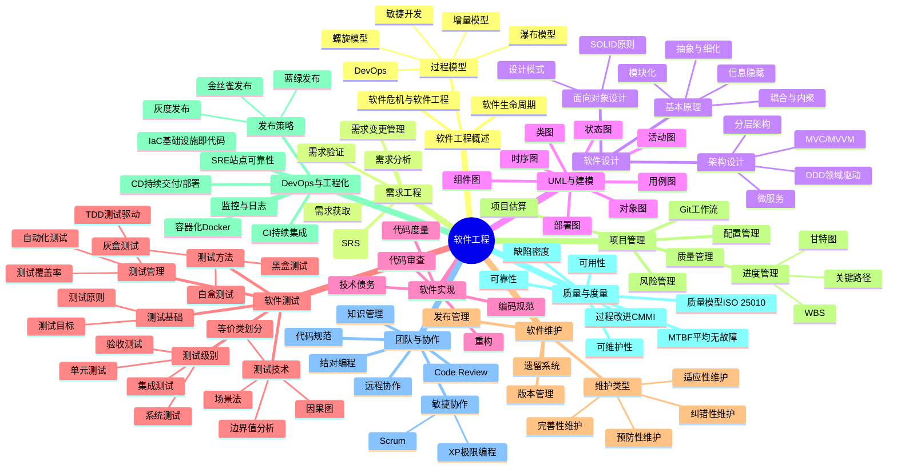

# 软件工程知识地图与学习路径

> **适用对象**：初学者入门 | **学习目标**：建立完整软件工程知识体系 | **预计周期**：持续学习，建议 8-12 周完成基础

---

## 🗺️ 一、软件工程知识地图（Mermaid）

---

## 📚 二、核心模块概览

| 模块 | 核心内容 | 重要程度 | 学习难度 | 建议学时 |
|------|----------|----------|----------|----------|
| 软件工程概述 | 软件危机、生命周期、过程模型 | ⭐⭐⭐⭐⭐ | ⭐⭐ | 4小时 |
| 需求工程 | 需求获取分析、SRS、用例、用户故事 | ⭐⭐⭐⭐⭐ | ⭐⭐⭐ | 6小时 |
| 软件设计 | 模块化、耦合内聚、SOLID、架构风格 | ⭐⭐⭐⭐⭐ | ⭐⭐⭐⭐ | 8小时 |
| UML与建模 | 用例图、类图、时序图、活动图等 | ⭐⭐⭐⭐ | ⭐⭐⭐ | 6小时 |
| 软件实现 | 编码规范、代码审查、重构、技术债务 | ⭐⭐⭐ | ⭐⭐⭐ | 4小时 |
| 软件测试 | 测试级别、黑盒白盒、TDD、自动化 | ⭐⭐⭐⭐⭐ | ⭐⭐⭐ | 8小时 |
| 软件维护 | 维护类型、遗留系统、版本发布 | ⭐⭐⭐ | ⭐⭐ | 3小时 |
| 项目管理 | 估算、进度、风险、配置、Git工作流 | ⭐⭐⭐⭐ | ⭐⭐⭐ | 6小时 |
| DevOps与工程化 | CI/CD、容器、监控、发布策略 | ⭐⭐⭐⭐ | ⭐⭐⭐⭐ | 6小时 |
| 质量与度量 | ISO 25010、CMMI、质量指标 | ⭐⭐⭐ | ⭐⭐⭐ | 3小时 |
| 团队与协作 | Code Review、Scrum、XP、结对编程 | ⭐⭐⭐⭐ | ⭐⭐ | 3小时 |
| 设计模式 | 单例、工厂、策略、观察者、适配器等 | ⭐⭐⭐⭐ | ⭐⭐⭐⭐ | 8小时 |
| **合计** | | | | **约 65 小时** |

---

## 🛤️ 三、分阶段学习路径

### 第一阶段：基础入门（第1-2周）——建立全局视野

**目标**：理解软件工程是什么、为什么需要、整体流程是怎样的

| 周次 | 学习内容 | 实践任务 | 产出物 |
|------|----------|----------|--------|
| 第1周 | 软件工程概述 - 软件危机与软件工程定义 - 软件生命周期各阶段 - 经典过程模型（瀑布、增量、螺旋） | 1. 梳理一个你用过的软件，分析它的生命周期 2. 对比瀑布模型和增量模型的适用场景 | 过程模型对比笔记 |
| 第2周 | 敏捷与DevOps入门 - 敏捷宣言与核心价值观 - Scrum框架基础 - DevOps理念与CI/CD概念 | 1. 用Scrum的方式规划一个小项目 2. 了解GitHub Actions基础 | 简单Scrum规划文档 |

**自测标准**：
- [ ] 能用自己的话解释什么是软件工程
- [ ] 能说出软件生命周期的5个主要阶段
- [ ] 能区分瀑布模型和敏捷开发的核心差异
- [ ] 能说出Scrum的三个角色、三个工件、四个会议

---

### 第二阶段：需求与设计（第3-5周）——核心理论深化

**目标**：掌握需求工程方法和软件设计原则，能画基本UML图

| 周次 | 学习内容 | 实践任务 | 产出物 |
|------|----------|----------|--------|
| 第3周 | 需求工程 - 需求获取方法（访谈、问卷、观察） - 需求分析与建模 - 需求规格说明书SRS - 用例与用户故事 | 1. 为"图书馆管理系统"编写10个用户故事 2. 绘制系统用例图 | 需求文档初稿 + 用例图 |
| 第4周 | 软件设计基础 + UML - 模块化、耦合与内聚 - 用例图、类图深入 - 时序图、活动图 | 1. 分析3段代码的耦合内聚情况 2. 为电商下单流程画时序图 | 类图 + 时序图 |
| 第5周 | 软件架构与设计原则 - SOLID原则 - 常见架构风格（分层、MVC） - 微服务入门 | 1. 用SOLID原则重构一段代码 2. 设计一个博客系统的分层架构 | 架构设计图 + 重构代码 |

**自测标准**：
- [ ] 能独立编写合格的用户故事和用例描述
- [ ] 能区分7种耦合类型和7种内聚类型
- [ ] 能正确绘制用例图、类图、时序图
- [ ] 能说出SOLID每个原则的含义和示例
- [ ] 能解释分层架构和MVC的区别

---

### 第三阶段：实现与测试（第6-8周）——质量保障体系

**目标**：掌握代码质量保障方法和软件测试技术

| 周次 | 学习内容 | 实践任务 | 产出物 |
|------|----------|----------|--------|
| 第6周 | 软件实现与代码质量 - 编码规范与代码风格 - 代码审查Code Review - 重构与技术债务 - 静态代码分析 | 1. 为你的项目建立编码规范 2. 对一段代码进行Code Review 3. 完成一次小型重构练习 | 编码规范文档 + Review记录 |
| 第7周 | 软件测试基础 - 测试原则与测试级别 - 黑盒测试方法（等价类、边界值） - 白盒测试方法（逻辑覆盖） | 1. 为一个函数设计黑盒测试用例 2. 计算一段代码的语句覆盖率和分支覆盖率 | 测试用例设计表 |
| 第8周 | 测试进阶与TDD - 单元测试与集成测试 - TDD测试驱动开发 - 自动化测试基础 | 1. 用JUnit/Pytest写单元测试 2. 用TDD方式实现一个小功能 3. 了解测试覆盖率工具 | 单元测试代码 + TDD练习 |

**自测标准**：
- [ ] 能说出4个测试级别和各自的关注点
- [ ] 能用等价类和边界值设计测试用例
- [ ] 能计算语句覆盖、判定覆盖、条件覆盖
- [ ] 能独立编写单元测试代码
- [ ] 理解TDD的红绿重构循环

---

### 第四阶段：管理与工程化（第9-10周）——项目与流程

**目标**：掌握项目管理方法和DevOps工程化实践

| 周次 | 学习内容 | 实践任务 | 产出物 |
|------|----------|----------|--------|
| 第9周 | 项目管理 - 项目估算方法 - WBS工作分解结构 - 甘特图与关键路径 - 风险管理 - Git工作流（GitFlow、GitHub Flow） | 1. 为一个小项目做WBS分解 2. 用工具绘制甘特图 3. 识别项目的Top5风险 | 项目计划文档 + 甘特图 |
| 第10周 | DevOps与工程化 - CI持续集成 - CD持续交付与部署 - Docker容器基础 - 发布策略（蓝绿、灰度、金丝雀） | 1. 用GitHub Actions搭建简单CI流水线 2. 编写第一个Dockerfile 3. 理解三种发布策略的区别 | CI配置文件 + Dockerfile |

**自测标准**：
- [ ] 能独立完成项目WBS分解
- [ ] 能看懂并绘制甘特图
- [ ] 理解GitFlow和GitHub Flow的区别
- [ ] 能解释CI和CD的区别
- [ ] 能编写简单的Dockerfile

---

### 第五阶段：综合实战（第11-12周）——项目融会贯通

**目标**：通过完整项目案例，将所学知识串联起来

| 周次 | 学习内容 | 实践任务 | 产出物 |
|------|----------|----------|--------|
| 第11周 | 设计模式实战 - 创建型：单例、工厂、建造者 - 结构型：适配器、装饰器 - 行为型：策略、观察者、模板方法 | 1. 在项目中应用3种以上设计模式 2. 分析每个模式的适用场景和优缺点 | 设计模式应用示例代码 |
| 第12周 | 完整项目实战 - 从需求分析到部署上线的完整流程 - 综合运用各模块知识 | 完成一个小型完整项目（如Todo应用），包含： • 需求文档与用例图 • 架构设计与类图 • 代码实现与单元测试 • CI流水线配置 | 完整项目 + 全套文档 |

---

## 🎯 四、重点与难点

### ⭐ 重点内容（必须掌握）

1. **软件生命周期** — 所有软件工程活动的基础框架
2. **需求工程** — 项目失败80%源于需求问题
3. **耦合与内聚** — 软件设计的基石，评估设计质量的核心指标
4. **SOLID原则** — 面向对象设计的黄金法则
5. **UML三图** — 用例图、类图、时序图（最常用、面试最高频）
6. **软件测试** — 黑盒方法（等价类、边界值）+ 白盒覆盖
7. **设计模式** — 单例、工厂、策略、观察者（四大高频模式）
8. **Scrum框架** — 敏捷开发最主流的实践框架

### 🔥 难点内容（需要反复理解）

1. **耦合vs内聚的区分** — 初学者容易混淆，记住：耦合是模块**之间**，内聚是模块**内部**
2. **UML时序图的消息传递** — 同步消息、异步消息、返回消息的画法和含义
3. **设计模式的适用场景** — 不是为了用模式而用模式，而是问题驱动
4. **白盒测试的逻辑覆盖** — 语句覆盖→判定覆盖→条件覆盖→判定/条件覆盖→条件组合覆盖，层层递进
5. **微服务架构的边界划分** — 领域驱动设计DDD的核心难点
6. **需求变更管理** — 理论容易实践难，需要项目经验积累

---

## ⚠️ 五、易混淆概念对比

### 1. 验证 vs 确认（Verification vs Validation）

| 维度 | 验证 Verification | 确认 Validation |
|------|-------------------|-----------------|
| 核心问题 | "Are we building the product **right**?" 我们正确地构建产品了吗？ | "Are we building the **right** product?" 我们构建的是正确的产品吗？ |
| 关注点 | 过程是否正确，产品是否符合规格 | 产品是否满足用户真实需求 |
| 阶段 | 主要在开发阶段进行 | 主要在测试/验收阶段进行 |
| 类比 | 按照菜谱做菜，每一步都按配方来 | 做好的菜是否符合顾客的口味 |

### 2. 质量保证 vs 质量控制（QA vs QC）

| 维度 | 质量保证 QA | 质量控制 QC |
|------|------------|------------|
| 性质 | 预防性的，流程驱动 | 检测性的，产品驱动 |
| 目标 | 确保**过程**正确，预防缺陷 | 发现并修复**产品**中的缺陷 |
| 手段 | 流程审计、标准制定、培训 | 测试、评审、检查 |
| 类比 | 制定卫生标准和操作规范 | 对成品进行质量抽检 |

### 3. 缺陷、错误、故障（Defect / Error / Failure）

- **错误（Error/Mistake）**：人的行为导致的错误，比如程序员写错代码
- **缺陷（Defect/Bug）**：错误在代码中的体现，是静态存在的问题
- **故障（Failure）**：缺陷被触发后导致的系统异常行为，是动态表现

> 💡 关系：人犯错误 → 代码中引入缺陷 → 缺陷被触发 → 系统出现故障

---

## 📖 六、推荐学习资源

### 入门书籍
| 书名 | 作者 | 特点 |
|------|------|------|
| 《软件工程：实践者的研究方法》 | Roger S. Pressman | 经典教材，全面系统 |
| 《代码大全》 | Steve McConnell | 编程实践宝典，深入浅出 |
| 《敏捷软件开发：原则、模式与实践》 | Robert C. Martin | 敏捷+设计模式经典 |
| 《人月神话》 | Frederick P. Brooks | 软件工程哲学，必读经典 |
| 《重构：改善既有代码的设计》 | Martin Fowler | 代码质量提升必读书 |

### 在线资源
- **UML教程**：UML Diagrams.org (https://www.uml-diagrams.org/)
- **设计模式**：Refactoring.Guru (https://refactoring.guru/)
- **敏捷开发**：Scrum Guide (https://scrumguides.org/)
- **DevOps**：DevOps Toolkit 系列

### 实践工具
- **UML绘图**：Draw.io / StarUML / PlantUML / Mermaid
- **项目管理**：Trello / Jira / 禅道
- **代码托管**：GitHub / GitLab
- **CI/CD**：GitHub Actions / Jenkins / GitLab CI
- **测试框架**：JUnit / pytest / Jest

---

## ✅ 七、学习建议与方法论

### 1. 理论联系实际
不要只看书，一定要动手实践。每学一个概念，就想一个你做过的项目来对应。

### 2. 画图是最好的理解方式
UML不是为了考试，是为了理清思路。遇到复杂的问题，先画个图。

### 3. 对比学习效率高
很多概念是成对出现的：耦合vs内聚、黑盒vs白盒、瀑布vs敏捷、验证vs确认...对比着学，记得更牢。

### 4. 从"为什么"开始
每个方法、每个模型，先理解"为什么需要它"，再学"它是什么"，最后学"怎么用"。

### 5. 循序渐进，不追求一次到位
软件工程是实践学科，很多东西要做过项目才能真正理解。第一遍先建立框架，以后在实践中不断深化。

---

## 📊 八、学习进度自检表

打印或复制下表，每完成一项打勾：

| 阶段 | 知识点 | 理解 | 能画图 | 能实践 |
|------|--------|------|--------|--------|
| 概述 | 软件生命周期 | ☐ | ☐ | ☐ |
| 概述 | 瀑布vs敏捷 | ☐ | ☐ | ☐ |
| 概述 | Scrum框架 | ☐ | ☐ | ☐ |
| 需求 | 用例与用户故事 | ☐ | ☐ | ☐ |
| 需求 | SRS需求规格说明 | ☐ | ☐ | ☐ |
| 设计 | 耦合与内聚 | ☐ | ☐ | ☐ |
| 设计 | SOLID原则 | ☐ | ☐ | ☐ |
| 设计 | 分层架构 | ☐ | ☐ | ☐ |
| UML | 用例图 | ☐ | ☑️ | ☐ |
| UML | 类图 | ☐ | ☐ | ☐ |
| UML | 时序图 | ☐ | ☐ | ☐ |
| 测试 | 黑盒测试方法 | ☐ | ☐ | ☐ |
| 测试 | 白盒覆盖 | ☐ | ☐ | ☐ |
| 测试 | 单元测试 | ☐ | ☐ | ☐ |
| 管理 | WBS与甘特图 | ☐ | ☐ | ☐ |
| DevOps | CI/CD概念 | ☐ | ☐ | ☐ |
| 模式 | 单例模式 | ☐ | ☐ | ☐ |
| 模式 | 工厂模式 | ☐ | ☐ | ☐ |
| 模式 | 策略模式 | ☐ | ☐ | ☐ |
| 模式 | 观察者模式 | ☐ | ☐ | ☐ |

---

> 📌 **下一步**：从「软件工程概述」开始你的学习之旅 → [01-软件工程概述.md](./01-软件工程概述.md)
