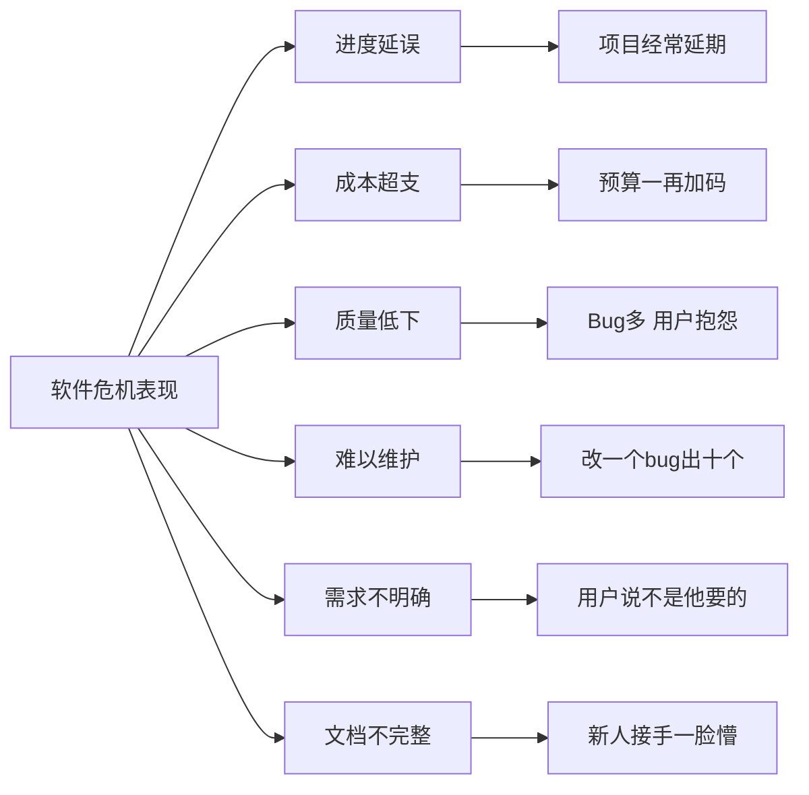
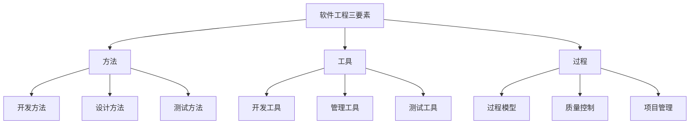
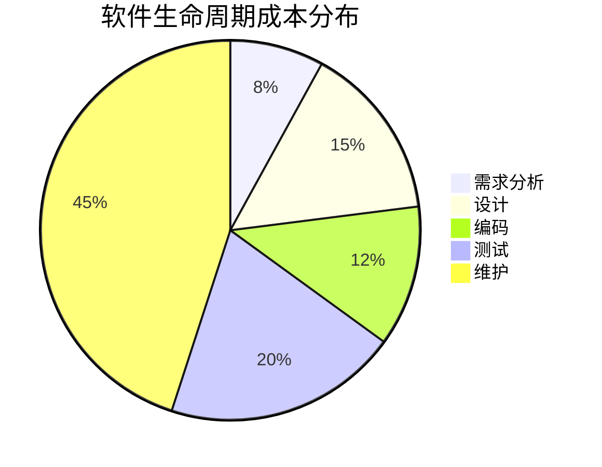
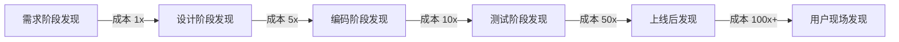
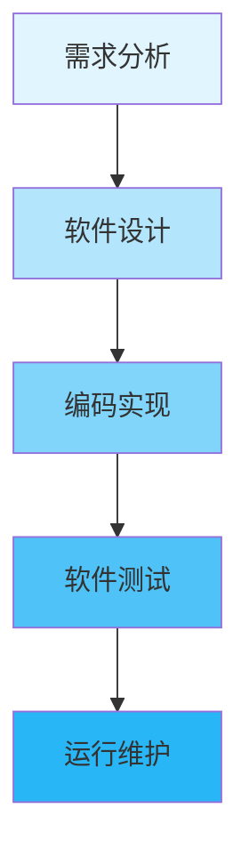
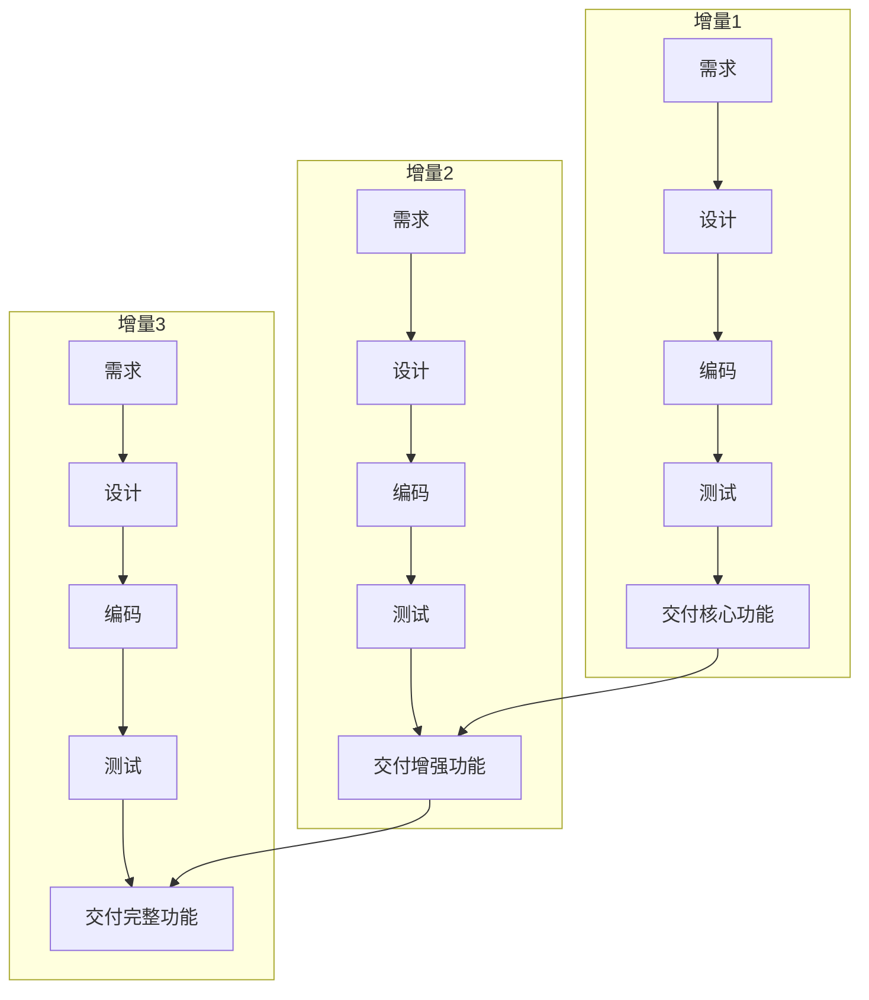
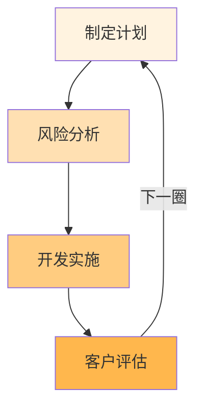
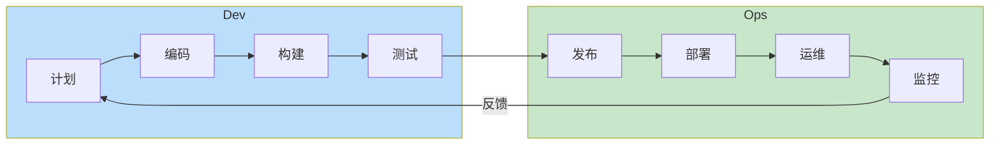

# 第一章 软件工程概述

> **学习目标**：理解软件工程的起源与定义，掌握软件生命周期各阶段，熟悉主流过程模型的特点与适用场景
> **预计学时**：4小时 | **重要程度**：⭐⭐⭐⭐⭐

---

## 1.1 软件与软件危机

### 1.1.1 什么是软件？

**软件（Software）** = 程序 + 数据 + 文档

| 组成 | 说明 | 示例 |
|------|------|------|
| 程序（Program） | 按事先设计的功能和性能要求执行的指令序列 | 源代码、可执行文件 |
| 数据（Data） | 使程序能正常操纵信息的数据结构 | 数据库、配置文件、测试数据 |
| 文档（Document） | 与程序开发、维护和使用有关的图文材料 | 需求文档、设计文档、用户手册 |

> 💡 **易忽略点**：很多初学者以为软件就是代码，实际上文档是软件不可或缺的一部分。没有文档的软件是无法维护的。

**软件的特点**：
1. **逻辑产品**：软件是无形的、逻辑的，不像硬件是物理实体
2. **不会磨损**：软件没有老化问题，但会有缺陷累积和技术债务
3. **开发成本高**：主要成本是人力，复制成本几乎为零
4. **定制化程度高**：很多软件需要根据客户需求定制
5. **维护复杂**：软件维护占整个生命周期成本的 60%-80%

### 1.1.2 软件危机（Software Crisis）

**软件危机**：在计算机软件的开发和维护过程中所遇到的一系列严重问题。

#### 软件危机的典型表现

#### 软件危机产生的原因

| 原因类别 | 具体说明 |
|----------|----------|
| **软件本身特点** | 逻辑复杂、规模庞大、需求易变 |
| **开发方法问题** | 忽视需求分析、轻视设计、编码至上 |
| **管理问题** | 进度难估算、质量难衡量、风险意识弱 |
| **人员问题** | 水平参差不齐、沟通成本高、人员流动 |
| **维护问题** | 文档缺失、技术债务、遗留系统 |

> 🎯 **生活类比**：软件危机就像盖房子——
> - 没有图纸就开工（忽视设计）
> - 盖到一半业主说要改户型（需求变更）
> - 工人各干各的没有统一标准（编码规范）
> - 盖完了没有验收就入住（测试缺失）
> - 出了问题找不到当时的施工记录（文档缺失）

### 1.1.3 软件工程的诞生

为了解决软件危机，人们开始借鉴传统工程的原则和方法来开发软件。

- **1968年**：NATO（北约）在德国召开的国际会议上首次提出"软件工程"（Software Engineering）概念
- **核心思想**：用工程化的方法来开发和维护软件

#### 软件工程的定义

> **软件工程**是应用计算机科学理论和技术以及工程管理原则和方法，按预算和进度实现满足用户要求的软件产品的定义、开发、发布和维护的工程，或以之为研究对象的学科。——《软件工程术语》GB/T 11457

**简单理解**：软件工程 = 技术 + 管理，目标是**按时、按预算、高质量**地交付软件。

#### 软件工程三要素

- **方法（Method）**：回答"怎么做"，包括各种开发、设计、测试方法
- **工具（Tool）**：回答"用什么做"，各种软件工具提高效率
- **过程（Process）**：回答"按什么顺序做"，将方法和工具组织起来

---

## 1.2 软件生命周期

### 1.2.1 什么是软件生命周期？

**软件生命周期（Software Life Cycle, SLC）**：软件从提出开发要求开始，直到该软件报废为止的整个时期。

> 🎯 **生活类比**：软件生命周期就像人的一生——
> - 需求分析 = 怀孕/备孕（决定要不要、要什么样的）
> - 软件设计 = 胎儿发育（各器官如何形成）
> - 编码实现 = 出生（呱呱坠地）
> - 测试 = 体检/打疫苗（检查有没有问题）
> - 运行维护 = 成长/生活（不断适应环境变化）
> - 退役报废 = 寿终正寝（被新产品替代）

### 1.2.2 软件生命周期各阶段

```mermaid
graph LR
    A[问题定义] --> B[可行性研究]
    B --> C[需求分析]
    C --> D[概要设计]
    D --> E[详细设计]
    E --> F[编码实现]
    F --> G[软件测试]
    G --> H[运行维护]
    H --> I[退役报废]
    
    style A fill:#f9f,stroke:#333
    style B fill:#f9f,stroke:#333
    style C fill:#9f9,stroke:#333
    style D fill:#99f,stroke:#333
    style E fill:#99f,stroke:#333
    style F fill:#ff9,stroke:#333
    style G fill:#f99,stroke:#333
    style H fill:#9ff,stroke:#333
    style I fill:#ccc,stroke:#333
```

#### 阶段1：问题定义（Problem Definition）

- **目标**：回答"要解决的问题是什么"
- **任务**：确定项目的目标、规模和范围
- **产出**：问题定义报告
- **关键问题**：
  - 这个项目要解决什么问题？
  - 项目边界在哪里？什么做、什么不做？

#### 阶段2：可行性研究（Feasibility Study）

- **目标**：回答"这个问题值得解决吗"
- **任务**：从技术、经济、操作等维度评估可行性
- **产出**：可行性研究报告
- **可行性四维度**：

| 维度 | 说明 | 关键问题 |
|------|------|----------|
| **技术可行性** | 现有技术能否实现 | 技术上做得到吗？有成熟方案吗？ |
| **经济可行性** | 成本收益是否划算 | 投入产出比如何？多久能回本？ |
| **操作可行性** | 用户能否使用和接受 | 用户会用吗？组织流程适配吗？ |
| **法律可行性** | 是否符合法律法规 | 有合规风险吗？有专利问题吗？ |

#### 阶段3：需求分析（Requirements Analysis）

- **目标**：回答"系统必须做什么"
- **任务**：确定系统的功能、性能、数据、界面等需求
- **产出**：需求规格说明书（SRS）
- **注意**：需求分析阶段**不讨论怎么做**，只讨论"做什么"

> ⚠️ **常见误区**：很多项目跳过或轻视需求分析，直接开始写代码，结果做出来的东西不是用户想要的。
>
> 统计数据：项目失败的原因中，80% 以上与需求问题有关！

#### 阶段4：概要设计（Architectural Design / High-level Design）

- **目标**：回答"系统总体上怎么实现"
- **任务**：
  - 系统架构设计（分层、模块划分）
  - 数据库设计
  - 接口设计
- **产出**：概要设计说明书
- **关键词**：架构、模块、分层、接口

#### 阶段5：详细设计（Detailed Design / Low-level Design）

- **目标**：回答"每个模块具体怎么实现"
- **任务**：
  - 模块内部算法设计
  - 数据结构设计
  - 类设计/函数设计
- **产出**：详细设计说明书
- **关键词**：算法、数据结构、类、方法

> 💡 **概要设计 vs 详细设计的区别**：
> - 概要设计 = 建筑的整体结构图（几层、什么户型、哪里是客厅卧室）
> - 详细设计 = 每个房间的装修图（开关在哪、插座几个、水管怎么走）

#### 阶段6：编码实现（Implementation / Coding）

- **目标**：把设计翻译成计算机能执行的代码
- **任务**：编写程序、调试、单元测试
- **产出**：源代码、可执行程序
- **注意**：编码不是最重要的阶段，但很多程序员觉得这是唯一的阶段

#### 阶段7：软件测试（Testing）

- **目标**：发现软件中的缺陷，确保质量
- **任务**：
  - 单元测试
  - 集成测试
  - 系统测试
  - 验收测试
- **产出**：测试报告、缺陷列表

#### 阶段8：运行维护（Operation & Maintenance）

- **目标**：让软件持续正常运行，适应变化
- **任务**：纠错、适应新环境、增加功能、性能优化
- **产出**：维护记录、版本更新
- **特点**：维护是生命周期中**时间最长、成本最高**的阶段

#### 阶段9：退役报废（Retirement）

- **目标**：安全、平滑地替换旧系统
- **任务**：数据迁移、用户培训、旧系统下线
- **标志**：软件不再满足需求，被新产品替代

### 1.2.3 生命周期各阶段成本分布

> 📌 **重要结论**：
> 1. 维护占总成本的近一半，说明软件质量和可维护性极其重要
> 2. 需求分析虽然占比不高，但影响最大——需求错误的修复成本随阶段递增

### 1.2.4 缺陷修复成本曲线

> 💡 **核心启示**：越晚发现的缺陷，修复成本越高。所以要在需求和设计阶段尽量把问题想清楚！

---

## 1.3 软件过程模型

### 1.3.1 什么是过程模型？

**软件过程模型（Software Process Model）**：也叫软件生命周期模型，是软件开发全部过程、活动和任务的结构框架。

> 简单说：过程模型就是软件开发的"流程模板"，告诉我们先做什么、后做什么、各阶段怎么衔接。

### 1.3.2 瀑布模型（Waterfall Model）

#### 基本概念

瀑布模型是**最早**提出的软件过程模型，1970年由 Winston Royce 提出。

核心特点：**阶段分明、顺序执行、不回头**（或很少回头）

#### 瀑布模型的特点

| 特点 | 说明 |
|------|------|
| **阶段顺序性** | 前一阶段完成，后一阶段才能开始 |
| **阶段依赖性** | 上一阶段的输出是下一阶段的输入 |
| **文档驱动** | 每个阶段都有完整的文档产出 |
| **推迟实现** | 前期专注分析设计，后期才开始编码 |
| **质量保证** | 每个阶段结束都有评审和验证 |

#### 瀑布模型的优点

1. ✅ **简单易懂**：线性流程，容易理解和管理
2. ✅ **文档齐全**：每个阶段都有明确的交付物
3. ✅ **管理方便**：进度清晰，里程碑明确
4. ✅ **质量可控**：阶段评审，问题早发现

#### 瀑布模型的缺点

1. ❌ **缺乏灵活性**：需求变更成本极高
2. ❌ **风险后移**：直到后期才能看到产品，问题发现晚
3. ❌ **客户参与少**：客户只在需求阶段和验收阶段参与
4. ❌ **不适合需求不确定的项目**：需求模糊时几乎无法使用

#### 适用场景

- 需求明确、稳定的项目（如工业控制软件）
- 有类似项目开发经验
- 对文档要求高的项目（如军工、医疗）
- 小规模项目

> 🎯 **生活类比**：瀑布模型就像传统的建筑流程——
> - 先画图纸（需求设计）→ 打地基（架构）→ 砌墙（编码）→ 装修（测试）→ 入住（维护）
> - 房子盖好后想改户型？成本极高！

---

### 1.3.3 增量模型（Incremental Model）

#### 基本概念

增量模型把软件产品看作一系列的增量构件，逐个设计、实现、集成和测试。

核心特点：**分批交付、逐步完善**

#### 增量模型的特点

- 第一个增量往往是核心功能
- 每个增量都是可运行的完整版本
- 用户可以尽早使用部分功能
- 增量之间可以有重叠

#### 优点

1. ✅ **早期交付价值**：第一个版本就能用
2. ✅ **降低风险**：可以根据反馈调整后续增量
3. ✅ **逐步投资**：不需要一次性投入全部资源
4. ✅ **用户参与**：用户可以尽早反馈

#### 缺点

1. ❌ **架构设计难**：需要提前考虑好扩展性
2. ❌ **增量划分难**：功能如何拆分是个学问
3. ❌ **版本管理复杂**：多个版本同时存在

#### 适用场景

- 需求比较明确，但需要尽快上线
- 项目规模较大，可以拆分功能
- 市场竞争激烈，需要快速迭代

---

### 1.3.4 螺旋模型（Spiral Model）

#### 基本概念

螺旋模型由 Barry Boehm 于 1988 年提出，将瀑布模型和原型实现结合起来，强调**风险分析**。

核心特点：**迭代开发、风险驱动**

螺旋模型的每一圈（迭代）都包含四个象限：

| 象限 | 活动 | 说明 |
|------|------|------|
| 第一象限 | 制定计划 | 确定目标、方案、约束条件 |
| 第二象限 | 风险分析 | 识别风险、评估风险、制定风险应对策略 |
| 第三象限 | 开发实施 | 开发和测试产品 |
| 第四象限 | 客户评估 | 客户评审、提出改进意见 |

#### 螺旋模型的特点

- 每一圈都是一个迭代版本
- 风险分析是核心特色
- 版本越往后，功能越完整
- 适合大型、高风险项目

#### 优点

1. ✅ **风险驱动**：强调风险分析，降低项目失败概率
2. ✅ **灵活性好**：每轮迭代都可以调整需求
3. ✅ **逐步完善**：用户可以逐步看到产品演进
4. ✅ **质量有保障**：每轮都有测试和评审

#### 缺点

1. ❌ **成本高**：每次迭代都要做风险分析
2. ❌ **周期长**：不适合时间紧迫的项目
3. ❌ **依赖经验**：风险分析需要丰富的经验
4. ❌ **管理复杂**：多轮迭代的管理难度大

#### 适用场景

- 大型、复杂、高风险的项目
- 需求不明确、需要探索的项目
- 对风险控制要求高的项目

---

### 1.3.5 敏捷开发（Agile Development）

#### 敏捷宣言

2001年，17位软件开发大师在美国犹他州雪鸟滑雪场聚会，发布了**敏捷软件开发宣言**（Manifesto for Agile Software Development）。

> **我们一直在实践中探寻更好的软件开发方法，身体力行的同时也帮助他人。由此我们建立了如下价值观：**
>
> - **个体和互动** 高于 流程和工具
> - **工作的软件** 高于 详尽的文档
> - **客户合作** 高于 合同谈判
> - **响应变化** 高于 遵循计划
>
> 也就是说，尽管右项有其价值，我们更重视左项的价值。

#### 敏捷的12条原则

1. 我们最重要的目标，是通过持续不断地及早交付有价值的软件使客户满意
2. 欣然面对需求变化，即使在开发后期也一样。为了客户的竞争优势，敏捷过程掌控变化
3. 经常地交付可工作的软件，相隔几星期或一两个月，倾向于采取较短的周期
4. 业务人员和开发人员必须相互合作，项目中的每一天都不例外
5. 激发个体的斗志，以他们为核心搭建项目。提供所需的环境和支援，辅以信任，从而达成目标
6. 不论团队内外，传递信息效果最好效率也最高的方式是面对面的交谈
7. 可工作的软件是进度的首要度量标准
8. 敏捷过程倡导可持续开发。责任人、开发人员和用户要能够共同维持其步调稳定延续
9. 坚持不懈地追求技术卓越和良好设计，敏捷能力由此增强
10. 以简洁为本，它是极力减少不必要工作量的艺术
11. 最好的架构、需求和设计出自自组织团队
12. 团队定期地反思如何能提高成效，并依此调整自身的举止表现

#### 敏捷开发的特点

| 特点 | 说明 |
|------|------|
| **迭代式开发** | 短周期迭代（1-4周），每个迭代交付可用功能 |
| **增量式交付** | 软件功能逐步增加，而不是一次性交付 |
| **用户参与** | 客户/产品负责人全程参与 |
| **响应变化** | 拥抱需求变化，而不是抗拒变化 |
| **自组织团队** | 团队自主决定怎么做，而不是被指挥 |
| **持续反馈** | 每日站会、迭代评审、持续集成 |

#### 常见的敏捷方法

| 方法 | 全称 | 核心特点 |
|------|------|----------|
| **Scrum** | Scrum | 迭代框架、角色清晰、会议固定 |
| **XP** | eXtreme Programming 极限编程 | 技术实践导向、TDD、结对编程 |
| **Kanban** | 看板方法 | 可视化流程、限制在制品、持续流动 |
| **Crystal** | 水晶方法 | 因人制宜、灵活调整 |
| **FDD** | Feature Driven Development 特征驱动开发 | 以功能特征为核心 |

> 📌 最流行、最常用的是 **Scrum**，我们在后续章节详细讲解。

---

### 1.3.6 DevOps

#### 基本概念

**DevOps** = Development（开发）+ Operations（运维）

DevOps 是一种重视软件开发（Dev）和IT运维（Ops）之间沟通合作的文化、运动或惯例。

核心目标：**自动化软件交付和基础设施变更的流程，让构建、测试、发布软件更加快捷、频繁和可靠**

#### DevOps的核心思想

1. **打破壁垒**：消除开发和运维之间的隔阂
2. **自动化一切**：构建自动化、测试自动化、部署自动化
3. **持续交付**：小步快跑，频繁发布
4. **监控反馈**：全面监控，快速反馈
5. **共同担责**：开发和运维共同对产品质量负责

#### DevOps的关键实践

| 实践 | 说明 |
|------|------|
| **CI/CD** | 持续集成/持续交付/持续部署 |
| **基础设施即代码（IaC）** | 用代码管理基础设施配置 |
| **容器化** | Docker、Kubernetes 等容器技术 |
| **微服务架构** | 独立部署、独立扩展 |
| **监控告警** | 全面的系统监控和告警机制 |
| **日志管理** | 集中式日志收集和分析 |
| **混沌工程** | 主动注入故障，检验系统韧性 |

---

## 1.4 过程模型对比

### 1.4.1 瀑布 vs 敏捷

| 维度 | 瀑布模型 Waterfall | 敏捷开发 Agile |
|------|-------------------|----------------|
| **核心思想** | 计划驱动，按部就班 | 价值驱动，响应变化 |
| **流程特点** | 线性顺序，阶段分明 | 迭代循环，增量交付 |
| **需求处理** | 需求固定，前期确定 | 需求可变，持续完善 |
| **交付方式** | 一次性交付最终产品 | 分批交付，持续可用 |
| **文档** | 文档详尽，文档驱动 | 轻量文档，代码和沟通为主 |
| **客户参与** | 需求和验收阶段参与 | 全程参与，持续反馈 |
| **风险** | 风险后移，后期集中爆发 | 风险分散，每轮迭代暴露 |
| **变更成本** | 后期变更成本极高 | 拥抱变化，变更成本较低 |
| **适用场景** | 需求明确稳定、低风险项目 | 需求不确定、需要快速验证的项目 |
| **团队要求** | 分工明确，按流程执行 | 自组织团队，综合能力强 |
| **进度衡量** | 按阶段里程碑衡量 | 按可用软件功能衡量 |

> 🎯 **生活类比**：
> - 瀑布模型 = 去餐厅点菜，一次点完所有菜，厨师按菜单做，做好一起上
> - 敏捷开发 = 吃火锅，边吃边点，先上几个试试，好吃再加，不好吃换别的

### 1.4.2 各模型适用场景总结

| 项目特点 | 推荐模型 | 不推荐模型 |
|----------|----------|------------|
| 需求非常明确稳定 | 瀑布模型 | 敏捷开发 |
| 需求不确定，需要探索 | 敏捷/螺旋 | 瀑布 |
| 大型高风险项目 | 螺旋模型 | 瀑布 |
| 需要快速上线抢占市场 | 增量/敏捷 | 瀑布 |
| 对文档和流程要求严格（军工/医疗） | 瀑布模型 | 敏捷（纯敏捷） |
| 小型项目、团队经验丰富 | 敏捷开发 | 瀑布（太重） |
| 互联网产品、持续迭代 | DevOps + 敏捷 | 瀑布 |

---

## 1.5 关键术语中英对照

| 中文 | 英文 | 缩写 |
|------|------|------|
| 软件工程 | Software Engineering | SE |
| 软件危机 | Software Crisis | - |
| 软件生命周期 | Software Life Cycle | SLC |
| 软件过程模型 | Software Process Model | - |
| 瀑布模型 | Waterfall Model | - |
| 增量模型 | Incremental Model | - |
| 螺旋模型 | Spiral Model | - |
| 敏捷开发 | Agile Development | - |
| 极限编程 | eXtreme Programming | XP |
| 功能驱动开发 | Feature Driven Development | FDD |
| 需求分析 | Requirements Analysis | - |
| 概要设计 | Architectural Design / High-level Design | HLD |
| 详细设计 | Detailed Design / Low-level Design | LLD |
| 编码实现 | Implementation / Coding | - |
| 软件测试 | Software Testing | - |
| 运行维护 | Operation & Maintenance | O&M |
| 可行性研究 | Feasibility Study | - |
| 需求规格说明书 | Software Requirements Specification | SRS |
| DevOps | Development + Operations | - |
| 持续集成 | Continuous Integration | CI |
| 持续交付 | Continuous Delivery | CD |
| 持续部署 | Continuous Deployment | CD |

---

## 1.6 练习题与自测

### 一、选择题

1. 软件工程的三要素是（ ）
   - A. 方法、工具、过程
   - B. 方法、技术、管理
   - C. 人员、工具、流程
   - D. 计划、执行、监控

2. 软件生命周期中，成本占比最高的阶段通常是（ ）
   - A. 需求分析
   - B. 编码实现
   - C. 软件测试
   - D. 运行维护

3. 瀑布模型的核心特点是（ ）
   - A. 迭代开发
   - B. 顺序执行
   - C. 风险驱动
   - D. 增量交付

4. 敏捷宣言中，最重视的是（ ）
   - A. 流程和工具
   - B. 详尽的文档
   - C. 个体和互动
   - D. 遵循计划

5. 螺旋模型的核心特色是强调（ ）
   - A. 文档管理
   - B. 风险分析
   - C. 成本控制
   - D. 进度管理

### 二、简答题

1. 什么是软件危机？软件危机产生的原因有哪些？

2. 简述软件生命周期的主要阶段和各阶段的核心任务。

3. 瀑布模型有哪些优缺点？适用于什么场景？

4. 敏捷开发的核心价值观是什么？与瀑布模型的主要区别是什么？

5. 为什么说"越晚发现的缺陷，修复成本越高"？

### 三、思考题

1. 你做过的项目中，哪些问题属于"软件危机"的表现？如果用软件工程的方法，该如何改进？

2. 如果你要开发一个个人博客系统，你会选择哪种过程模型？为什么？

3. 有人说"敏捷开发就是不用写文档"，你同意吗？为什么？

---

## 1.7 参考答案

### 一、选择题

1. **A** — 软件工程三要素：方法、工具、过程
2. **D** — 运行维护通常占总成本的 40%-60%，甚至更高
3. **B** — 瀑布模型是线性顺序执行的
4. **C** — 敏捷宣言四条价值观，左项更重要：个体和互动、工作的软件、客户合作、响应变化
5. **B** — 螺旋模型的核心是风险分析，每轮迭代都先做风险评估

### 二、简答题（要点）

1. **软件危机**是软件开发和维护过程中遇到的一系列严重问题。
   产生原因包括：软件本身特点（逻辑复杂、规模大）、开发方法问题（忽视需求、轻视设计）、管理问题（进度难估、质量难衡）、人员问题（水平参差、沟通成本）、维护问题（文档缺失、技术债务）。

2. 软件生命周期主要阶段：
   - 问题定义：确定要解决的问题是什么
   - 可行性研究：从技术、经济、操作等方面评估是否可行
   - 需求分析：确定系统必须做什么
   - 概要设计：系统总体架构设计
   - 详细设计：每个模块的具体实现设计
   - 编码实现：把设计翻译成代码
   - 软件测试：发现缺陷，保证质量
   - 运行维护：持续运行和改进
   - 退役报废：系统下线，被替代

3. **瀑布模型优点**：简单易懂、文档齐全、管理方便、质量可控
   **缺点**：缺乏灵活性、风险后移、客户参与少、不适合需求不确定的项目
   **适用场景**：需求明确稳定的项目、有类似经验的项目、对文档要求高的项目、小规模项目

4. 敏捷核心价值观（敏捷宣言）：
   - 个体和互动 高于 流程和工具
   - 工作的软件 高于 详尽的文档
   - 客户合作 高于 合同谈判
   - 响应变化 高于 遵循计划
   
   与瀑布的主要区别：瀑布是计划驱动、线性顺序、一次性交付；敏捷是价值驱动、迭代增量、持续交付。

5. 因为缺陷发现越晚，需要修改的范围越大：
   - 需求阶段发现：只需要改需求文档
   - 设计阶段发现：需要改设计文档
   - 编码阶段发现：需要改代码
   - 测试阶段发现：需要改代码+重新测试
   - 上线后发现：需要改代码+测试+部署+用户培训+可能的数据修复
   
   越往后，修复涉及的环节越多，成本呈指数级增长。

---

> 📌 **下一章**：深入学习需求工程 → [02-需求工程.md](./02-需求工程.md)
