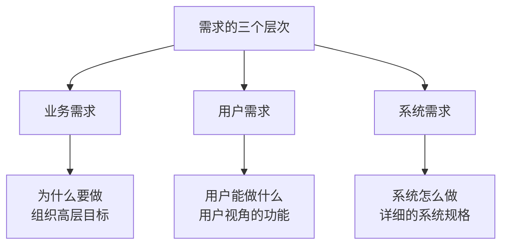
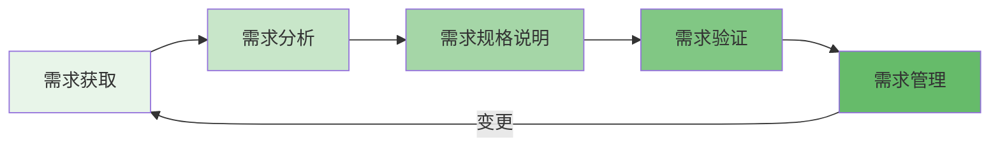
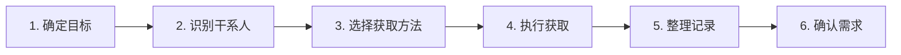
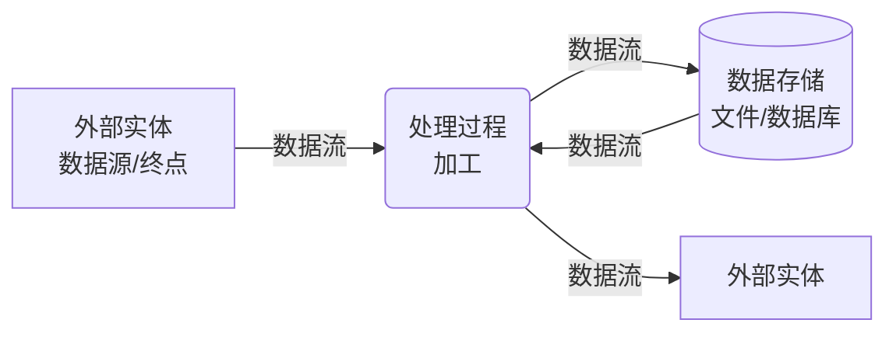
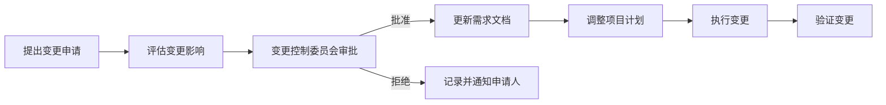

# 第二章 需求工程

> **学习目标**：掌握需求工程的完整流程，能够进行需求获取、分析和规格说明，掌握用例和用户故事的编写方法
> **预计学时**：6小时 | **重要程度**：⭐⭐⭐⭐⭐

---

## 2.1 需求工程概述

### 2.1.1 什么是需求？

**软件需求（Software Requirement）**：用户对软件在功能、性能、设计约束等方面的期望和要求。

> IEEE 定义：需求是用户解决问题或达到目标所需的条件或能力；是系统或系统部件为满足合同、标准、规范或其他正式规定文档所需具有的条件或能力。

#### 需求的三个层次



| 层次 | 说明 | 来源 | 示例 |
|------|------|------|------|
| **业务需求** | 组织的高层目标，为什么要做这个系统 | 客户/投资人/管理层 | "提高图书借阅效率，减少人工操作" |
| **用户需求** | 用户使用系统能完成什么任务 | 最终用户/业务人员 | "读者可以在线查询图书、预约借阅" |
| **系统需求** | 系统必须实现的详细功能和规格 | 开发人员/分析人员 | "系统应支持按书名、作者、ISBN查询图书，查询响应时间不超过2秒" |

### 2.1.2 需求的分类

| 分类 | 英文 | 说明 | 示例 |
|------|------|------|------|
| **功能需求** | Functional Requirement | 系统必须提供的功能和服务 | 用户登录、查询图书、借阅图书 |
| **非功能需求** | Non-Functional Requirement | 系统的质量属性和约束条件 | 性能、安全性、可用性、可靠性 |
| **设计约束** | Design Constraint | 对设计方案的限制条件 | 必须使用MySQL数据库、必须兼容IE11 |
| **数据需求** | Data Requirement | 系统需要处理的数据要求 | 数据格式、数据量、数据保留期限 |

#### 非功能需求（NFR）的常见类型

| 类型 | 说明 | 示例 |
|------|------|------|
| **性能需求** | 系统的响应速度、吞吐量 | 查询响应时间≤2秒，支持1000并发用户 |
| **安全性需求** | 数据安全、访问控制 | 用户密码加密存储，敏感操作需要审计日志 |
| **可用性需求** | 系统正常运行的时间比例 | 系统可用性99.9%，年停机时间不超过8.76小时 |
| **可靠性需求** | 系统无故障运行的能力 | 平均无故障时间MTBF≥1000小时 |
| **可维护性需求** | 系统修改和维护的难易程度 | 模块化设计，代码注释覆盖率≥30% |
| **可移植性需求** | 系统从一个环境迁移到另一个环境的难易 | 支持Windows和Linux平台部署 |
| **易用性需求** | 用户使用系统的难易程度 | 新用户培训时间不超过2小时 |

> ⚠️ **常见误区**：很多人只关注功能需求，忽视非功能需求。但实际上，非功能需求往往决定了系统的成败。
>
> 比如：一个电商网站功能再全，如果打开要等10秒，用户也会跑光。

### 2.1.3 什么是需求工程？

**需求工程（Requirements Engineering, RE）**：是指应用已证实有效的原理、方法、技术和工具，来确定、分析、规格说明和验证需求的系统方法。

简单说：需求工程就是**把模糊的、混乱的用户想法，变成清晰、准确、可验证的软件需求**的过程。

#### 需求工程的过程



| 阶段 | 英文 | 核心任务 | 关键问题 |
|------|------|----------|----------|
| **需求获取** | Elicitation | 收集、发现用户需求 | 用户需要什么？ |
| **需求分析** | Analysis | 分析、整理、建模需求 | 这些需求合理吗？完整吗？ |
| **需求规格说明** | Specification | 编写正式的需求文档 | 怎么把需求准确写下来？ |
| **需求验证** | Validation | 检查需求是否正确完整 | 需求写对了吗？是用户要的吗？ |
| **需求管理** | Management | 管理需求变更和版本 | 需求变了怎么办？ |

> 🎯 **生活类比**：需求工程就像装修房子
> - 需求获取 = 跟业主聊天，了解想要什么风格、什么功能
> - 需求分析 = 整理想法，看看哪些能实现、哪些不合理
> - 需求规格说明 = 出正式的装修设计图和材料清单
> - 需求验证 = 跟业主确认设计图，问"这是你想要的吗？"
> - 需求管理 = 装修过程中业主要改方案，怎么管理这些变更

---

## 2.2 需求获取

### 2.2.1 需求获取的挑战

需求获取是需求工程中**最困难**的环节，因为：

| 挑战 | 说明 |
|------|------|
| **用户说不清楚** | 用户往往只知道"我想要个系统"，但具体要什么说不清 |
| **需求容易遗漏** | 用户觉得"这是常识，不用说"，但开发人员不知道 |
| **需求不断变化** | 用户的想法会变，业务环境也会变 |
| **理解偏差** | 同样的话，不同的人理解不一样 |
| **用户表达能力不同** | 有的用户善于表达，有的只会说"你看着办" |

> 🔴 **经典困境**：用户说的 ≠ 用户想要的 ≠ 用户需要的 ≠ 开发理解的

### 2.2.2 需求获取的方法

#### 方法一：访谈（Interview）

**定义**：与用户进行面对面的交流，了解需求。

| 类型 | 说明 | 适用场景 |
|------|------|----------|
| **结构化访谈** | 提前准备好问题清单，按顺序提问 | 需求比较明确，想高效获取信息 |
| **非结构化访谈** | 开放式问题，自由交流 | 需求不明确，需要探索和启发 |

**访谈技巧**：
1. 提前准备，了解背景
2. 多问"为什么"，挖掘真实需求
3. 少说多听，不要引导用户
4. 及时确认，避免理解偏差
5. 做好记录，事后整理

#### 方法二：问卷调查（Questionnaire）

**定义**：通过书面问卷的方式收集大量用户的需求。

| 优点 | 缺点 |
|------|------|
| 覆盖面广，能收集大量数据 | 回收率低 |
| 成本低，速度快 | 无法深入追问 |
| 结果易于统计分析 | 容易误解问题 |
| 用户可以匿名回答 | 无法观察用户反应 |

**问卷设计原则**：
- 问题清晰，避免歧义
- 先易后难，先封闭后开放
- 选项互斥且完整
- 控制问卷长度（10-15分钟内完成）

#### 方法三：观察法（Observation）

**定义**：到用户现场，观察用户的实际工作流程。

> 也叫"移情法"或"用户画像法"，核心是"站在用户的角度看问题"。

| 优点 | 缺点 |
|------|------|
| 能发现用户没意识到的需求 | 成本高，耗时 |
| 能获取真实的工作流程 | 用户被观察时可能不自然 |
| 能验证用户说的和做的是否一致 | 只能观察到表面行为 |

#### 方法四：原型法（Prototyping）

**定义**：快速做一个简易版本，让用户试用并反馈。

| 优点 | 缺点 |
|------|------|
| 用户能直观感受，需求更准确 | 原型迭代需要时间 |
| 能激发用户的想法和灵感 | 用户可能把原型当成品 |
| 降低需求理解偏差的风险 | 容易陷入"改了又改"的循环 |

**原型的分类**：
- **抛弃式原型**：用完就扔，只为了验证需求
- **演化式原型**：逐步完善，最终变成成品

#### 方法五：文档分析（Document Analysis）

**定义**：阅读用户现有的文档、报表、流程文件，了解业务。

| 优点 | 缺点 |
|------|------|
| 信息准确，有历史依据 | 文档可能过时 |
| 不打扰用户 | 只能看到书面流程，看不到实际操作 |
| 能了解数据格式和业务规则 | 文档可能不完整 |

#### 方法六：头脑风暴（Brainstorming）

**定义**：组织相关人员开会，自由畅想，收集创意和需求。

**头脑风暴四原则**：
1. 禁止批评：不对任何想法说"不"
2. 自由奔放：想法越新奇越好
3. 多多益善：数量比质量重要
4. 搭便车：在别人想法基础上改进

### 2.2.3 需求获取的步骤



1. **确定目标**：明确本次需求获取的范围和目标
2. **识别干系人**：找出所有相关的人（用户、客户、管理员、运维...）
3. **选择获取方法**：根据项目特点选择合适的方法组合
4. **执行获取**：按计划进行访谈、问卷、观察等
5. **整理记录**：把收集到的信息整理成文档
6. **确认需求**：跟用户确认整理出来的需求是否正确

---

## 2.3 需求分析

### 2.3.1 什么是需求分析？

**需求分析（Requirements Analysis）**：对获取到的需求进行分析、整理、建模，消除歧义、发现遗漏、解决冲突，形成清晰、完整、一致的需求模型。

> 简单说：需求获取是"收集原材料"，需求分析是"加工成半成品"。

### 2.3.2 需求分析的任务

| 任务 | 说明 |
|------|------|
| **需求澄清** | 把模糊的需求说清楚，消除歧义 |
| **需求分类** | 把需求按功能、非功能、约束等分类 |
| **需求排序** | 确定需求的优先级（哪些必须做，哪些可以晚做） |
| **需求建模** | 用模型（图形、文字）来表达需求 |
| **发现遗漏** | 找出用户没说但系统必须有的需求 |
| **解决冲突** | 协调不同用户之间的矛盾需求 |

### 2.3.3 需求优先级

需求不是平等的，要分优先级。常用的方法是 **MoSCoW 原则**：

| 优先级 | 英文 | 含义 | 说明 |
|--------|------|------|------|
| **必须有** | Must have | 没有这个功能，系统就不能用 | 没有它项目就失败了 |
| **应该有** | Should have | 很重要，但没有也能勉强用 | 有时间一定要做 |
| **可以有** | Could have | 有了更好，没有也没关系 | 锦上添花的功能 |
| **这次不做** | Won't have | 这次版本不做，以后再说 | 留到下一个版本 |

> 💡 **二八定律**：80% 的用户只用 20% 的功能。所以先把"必须有"的做好，比什么功能都有但都做不好强得多。

### 2.3.4 结构化分析方法

**结构化分析（Structured Analysis, SA）**：面向过程的需求分析方法，核心是"自顶向下，逐步分解"。

#### 结构化分析的工具

| 工具 | 英文 | 作用 |
|------|------|------|
| **数据流图** | Data Flow Diagram, DFD | 描述数据的流动和处理过程 |
| **数据字典** | Data Dictionary, DD | 定义数据的含义和结构 |
| **判定表** | Decision Table | 描述复杂的条件判断逻辑 |
| **判定树** | Decision Tree | 用树形结构描述判断逻辑 |

#### 数据流图（DFD）

DFD 是结构化分析最核心的工具，用四种基本元素描述数据流动：



| 元素 | 图形 | 说明 | 示例 |
|------|------|------|------|
| **外部实体** | 矩形 | 数据的来源或去向，系统之外的人或物 | 读者、图书管理员 |
| **处理过程** | 圆形/圆角矩形 | 对数据进行的加工和变换 | 借书处理、查询图书 |
| **数据存储** | 两条平行线/圆柱 | 保存数据的地方 | 图书表、借阅记录表 |
| **数据流** | 箭头 | 数据的流动方向和内容 | 图书信息、借阅请求 |

**DFD 的分层思想**：自顶向下，逐层分解

- 顶层DFD（上下文图）：整个系统是一个加工，只有输入输出
- 0层DFD：把系统分解成几个主要的加工
- 1层DFD：对0层的每个加工再分解
- ...直到足够详细

> 📌 注意：DFD 是结构化分析方法的核心，在面向对象方法中，我们更多用 UML 用例图来表达功能需求。

### 2.3.5 面向对象分析方法

**面向对象分析（Object-Oriented Analysis, OOA）**：用对象的思想来分析需求，核心是"找出对象，分析对象之间的关系"。

#### 面向对象分析的核心概念

| 概念 | 说明 |
|------|------|
| **对象（Object）** | 客观世界中的实体，有属性和行为 |
| **类（Class）** | 具有相同属性和行为的对象的抽象 |
| **属性（Attribute）** | 对象的特征、数据 |
| **方法（Method）** | 对象的行为、操作 |
| **关系（Relationship）** | 对象之间的联系（关联、继承、依赖等） |

#### 面向对象分析的步骤

1. **识别对象**：找出系统中的实体（名词）
2. **识别属性**：每个对象有什么特征
3. **识别方法**：每个对象能做什么
4. **识别关系**：对象之间有什么联系
5. **建立模型**：用类图、用例图等表达

> 详细的面向对象建模我们在 UML 章节讲解。

---

## 2.4 需求规格说明

### 2.4.1 什么是SRS？

**软件需求规格说明（Software Requirements Specification, SRS）**：也叫需求规格说明书，是描述软件需求的正式文档。

> SRS 是需求工程阶段最重要的交付物，是后续设计、编码、测试、验收的依据。

### 2.4.2 SRS 的作用

| 作用对象 | 作用 |
|----------|------|
| **客户和开发方** | 双方达成共识的基础，合同的依据 |
| **项目管理** | 制定项目计划、估算成本进度的依据 |
| **设计开发** | 软件设计和编码的依据 |
| **测试** | 编写测试用例、进行验收测试的依据 |
| **维护** | 软件维护和升级的参考 |

### 2.4.3 优秀SRS的特性（质量要求）

| 特性 | 说明 |
|------|------|
| **正确性** | 每个需求都正确反映了用户的期望 |
| **无歧义性** | 每个需求只有一种解释，不会让人误解 |
| **完整性** | 所有重要的需求都包含了，没有遗漏 |
| **一致性** | 需求之间没有矛盾和冲突 |
| **可验证性** | 每个需求都可以通过测试或其他方法验证 |
| **可追溯性** | 每个需求都有编号，可以追踪来源和去向 |
| **可修改性** | 需求的结构清晰，容易修改和维护 |
| **完整性** | 重要的需求都被描述，没有遗漏 |

> 🔴 **常见坏味道**：
> - "系统要快" —— 多快算快？不可验证
> - "用户体验要好" —— 什么叫好？有歧义
> - "系统要稳定" —— 怎么定义稳定？不可验证
> - "尽量满足用户需求" —— 哪些需求？不完整

### 2.4.4 SRS 的典型结构

```
1. 引言
   1.1 编写目的
   1.2 项目背景
   1.3 术语定义
   1.4 参考资料
2. 总体描述
   2.1 产品愿景
   2.2 用户特征
   2.3 运行环境
   2.4 设计约束
3. 功能需求
   3.1 功能1
   3.2 功能2
   ...
4. 非功能需求
   4.1 性能需求
   4.2 安全需求
   4.3 可用性需求
   ...
5. 数据需求
   5.1 数据字典
   5.2 数据量估算
6. 其他需求
   6.1 接口需求
   6.2 部署需求
附录
```

### 2.4.5 需求描述的原则

1. **用肯定句，不用否定句**
   - ❌ 系统不能出错
   - ✅ 系统的正确率应达到 99.9%

2. **用明确的数量词，不用模糊的形容词**
   - ❌ 系统要很快
   - ✅ 系统的查询响应时间不超过 2 秒

3. **用主动语态，明确主语**
   - ❌ 可以查询图书
   - ✅ 读者可以按书名查询图书信息

4. **每条需求只说一件事**
   - ❌ 用户可以登录、注册、修改密码和找回密码
   - ✅ 拆分成四条独立的需求

5. **可验证**
   - 每条需求都要能通过测试、评审等方式验证是否满足

---

## 2.5 用例与用户故事

### 2.5.1 用例（Use Case）

#### 什么是用例？

**用例**：从用户的角度描述系统功能的一种方法，描述了"谁（参与者）使用系统做什么（用例），以达到什么目标"。

用例是 UML 的重要组成部分，也是需求分析中最常用的工具之一。

#### 用例的核心元素

| 元素 | 英文 | 说明 |
|------|------|------|
| **参与者** | Actor | 使用系统的人或其他系统 |
| **用例** | Use Case | 系统提供的一个完整功能 |
| **关系** | Relationship | 参与者与用例、用例与用例之间的关系 |

#### 用例的描述格式

一个完整的用例描述通常包含：

```
用例名称：借书
参与者：读者
前置条件：读者已登录系统，图书可借阅
后置条件：借阅记录生成，图书状态更新为已借出
主事件流：
  1. 读者输入图书编号
  2. 系统显示图书信息
  3. 读者确认借阅
  4. 系统生成借阅记录
  5. 系统更新图书状态
  6. 系统显示借阅成功
扩展流（异常情况）：
  3a. 图书已被借出
    3a1. 系统提示图书已借出
    3a2. 询问是否预约
  4a. 读者借阅数量已达上限
    4a1. 系统提示借阅数量超限
```

#### 用例的粒度

用例的粒度很重要：
- **太粗**："使用系统"——这不是用例，是整个系统
- **太细**："输入密码"——这是步骤，不是用例
- **合适**："用户登录"——一个完整的、对参与者有价值的功能

> 💡 **判断标准**：用例应该能给参与者带来一个"可见的价值"，完成一个完整的业务目标。

#### 用例之间的关系

| 关系 | 说明 | 示例 |
|------|------|------|
| **包含（Include）** | 一个用例包含另一个用例的功能，是必须的 | "借书"包含"验证用户身份" |
| **扩展（Extend）** | 一个用例可以选择性地扩展另一个用例 | "打印借书凭证"扩展"借书" |
| **泛化（Generalization）** | 子用例继承父用例的特征并可以扩展 | "微信支付"和"支付宝支付"泛化自"支付" |

> 详细的用例图绘制我们在 UML 章节讲解。

### 2.5.2 用户故事（User Story）

#### 什么是用户故事？

**用户故事**：敏捷开发中描述需求的一种轻量级方式，从用户的角度用简短的语言描述一个功能点。

#### 用户故事的标准格式

```
作为一个 <角色>，我想要 <功能>，以便于 <价值/目的>
```

**示例**：
- 作为一个读者，我想要按书名查询图书，以便于快速找到我想借的书
- 作为一个管理员，我想要添加新图书，以便于扩充图书馆的藏书
- 作为一个用户，我想要找回密码，以便于在忘记密码时重新登录

#### 用户故事的三个要素（3C）

| 要素 | 英文 | 说明 |
|------|------|------|
| **卡片** | Card | 写在卡片上的简短描述 |
| **对话** | Conversation | 与客户/产品负责人的详细讨论 |
| **确认条件** | Confirmation | 验收标准，判断是否完成 |

#### 验收标准（Acceptance Criteria）

验收标准是判断用户故事是否完成的条件，类似于测试用例。

**示例**：
```
用户故事：作为一个读者，我想要按书名查询图书

验收标准：
1. 给定正确的书名，系统能显示对应的图书信息
2. 给定部分书名，系统能显示模糊匹配的结果
3. 给定不存在的书名，系统提示"未找到相关图书"
4. 查询结果按相关度排序
5. 查询响应时间不超过2秒
```

#### 好的用户故事的特征（INVEST原则）

| 原则 | 英文 | 说明 |
|------|------|------|
| **独立的** | Independent | 故事之间尽量独立，不依赖其他故事 |
| **可协商的** | Negotiable | 故事不是合同，可以讨论和调整 |
| **有价值的** | Valuable | 对用户有明确的价值 |
| **可估算的** | Estimable | 开发团队能估算工作量 |
| **小的** | Small | 一个迭代内能完成 |
| **可测试的** | Testable | 有明确的验收标准 |

### 2.5.3 用例 vs 用户故事

| 维度 | 用例 Use Case | 用户故事 User Story |
|------|---------------|---------------------|
| **起源** | 传统软件工程、UML | 敏捷开发、XP |
| **详细程度** | 详细，有完整的事件流 | 简洁，细节靠对话补充 |
| **粒度** | 较粗，一个完整业务流程 | 较细，一个小功能点 |
| **文档量** | 文档驱动，写得多 | 轻量，卡片+对话 |
| **变更处理** | 变更需要走流程 | 拥抱变化，随时调整 |
| **适用场景** | 瀑布/增量模型，需求明确 | 敏捷开发，需求需要探索 |
| **重点** | 完整描述功能流程 | 用户价值和快速交付 |

---

## 2.6 需求验证与需求管理

### 2.6.1 需求验证

**需求验证（Requirements Validation）**：检查需求文档是否正确、完整、一致、无歧义，是否真正反映了用户的需求。

> 注意区分：
> - **需求验证（Validation）**：我们做的需求是用户想要的吗？（做对的事）
> - **需求确认（Verification）**：需求文档写得对吗？（把事做对）

#### 需求验证的方法

| 方法 | 说明 |
|------|------|
| **需求评审** | 组织相关人员一起审查需求文档 |
| **原型验证** | 通过原型让用户体验和确认 |
| **测试用例设计** | 尝试编写测试用例，看需求是否可验证 |
| **自动化分析** | 用工具检查需求的一致性、完整性 |

#### 需求评审

需求评审是最常用的验证方法，通常包括：

| 评审类型 | 参与者 | 重点 |
|----------|--------|------|
| **用户评审** | 客户、用户代表 | 需求是否符合业务需要 |
| **技术评审** | 架构师、开发、测试 | 需求是否可行、是否可实现 |
| **管理评审** | 项目经理、管理层 | 需求是否符合项目目标 |

### 2.6.2 需求变更管理

#### 为什么需求会变？

1. 业务环境变化（政策、市场）
2. 用户对系统的认识加深
3. 技术发展带来新的可能
4. 项目初期需求考虑不周

> 💡 **真理**：需求变更是必然的，不变才是偶然的。好的项目管理不是杜绝变更，而是管理好变更。

#### 需求变更的影响

- 进度延误
- 成本增加
- 质量下降（匆忙修改容易引入bug）
- 团队士气受挫
- 范围蔓延（Scope Creep）

#### 变更控制流程



1. **提出变更申请**：任何人都可以提出，但要书面记录
2. **评估变更影响**：评估对进度、成本、质量的影响
3. **变更控制委员会（CCB）审批**：决定是否批准
4. **更新文档**：批准后更新需求文档和基线
5. **调整计划**：相应调整项目计划
6. **执行变更**：开发团队执行变更
7. **验证变更**：测试确认变更正确实现

### 2.6.3 需求基线

**需求基线（Requirements Baseline）**：经过正式评审和批准的需求文档，作为后续开发和变更的基准。

> 基线就像"冻结版本"，不是不能改，而是改必须走正式的变更流程。

---

## 2.7 常见误区与易错点

### 误区1：需求分析就是"把用户说的话写下来"

- ❌ 错！用户说的往往是零散的、模糊的、甚至矛盾的
- ✅ 需求分析需要：理解、整理、提炼、建模、验证

### 误区2：需求分析阶段不用考虑技术实现

- ❌ 不完全对！需求分析主要关注"做什么"，不是"怎么做"
- ✅ 但完全不考虑技术可行性也是危险的，要做可行性评估

### 误区3：需求写完就不变了

- ❌ 大错特错！需求变更几乎是必然的
- ✅ 重要的是建立变更管理机制，而不是幻想需求不变

### 误区4：需求越详细越好

- ❌ 不一定！太详细的需求可能限制设计空间，也增加维护成本
- ✅ 需求的详细程度要根据项目特点来把握，够用就好

### 误区5：用户故事 = 敏捷 = 不用写需求文档

- ❌ 错！用户故事是轻量的需求表达方式，但不是没有需求
- ✅ 敏捷也需要需求管理，只是方式更灵活、更强调沟通

---

## 2.8 关键术语中英对照

| 中文 | 英文 | 缩写 |
|------|------|------|
| 需求工程 | Requirements Engineering | RE |
| 需求获取 | Requirements Elicitation | - |
| 需求分析 | Requirements Analysis | - |
| 需求规格说明 | Requirements Specification | - |
| 需求验证 | Requirements Validation | - |
| 需求管理 | Requirements Management | - |
| 功能需求 | Functional Requirement | FR |
| 非功能需求 | Non-Functional Requirement | NFR |
| 软件需求规格说明 | Software Requirements Specification | SRS |
| 用例 | Use Case | UC |
| 用户故事 | User Story | US |
| 参与者 | Actor | - |
| 验收标准 | Acceptance Criteria | AC |
| 业务需求 | Business Requirement | BR |
| 用户需求 | User Requirement | UR |
| 系统需求 | System Requirement | SR |
| 数据流图 | Data Flow Diagram | DFD |
| 数据字典 | Data Dictionary | DD |
| 结构化分析 | Structured Analysis | SA |
| 面向对象分析 | Object-Oriented Analysis | OOA |
| 需求基线 | Requirements Baseline | - |
| 变更控制委员会 | Change Control Board | CCB |
| 范围蔓延 | Scope Creep | - |

---

## 2.9 练习题与自测

### 一、选择题

1. 需求工程的第一步是（ ）
   - A. 需求分析
   - B. 需求获取
   - C. 需求规格说明
   - D. 需求验证

2. 下列哪项属于非功能需求？（ ）
   - A. 用户可以注册账号
   - B. 用户可以修改密码
   - C. 系统响应时间不超过2秒
   - D. 用户可以查询订单

3. 用例之间的包含关系是（ ）
   - A. 可选的
   - B. 必须的
   - C. 互斥的
   - D. 并列的

4. 用户故事的标准格式中不包括（ ）
   - A. 角色
   - B. 功能
   - C. 价值
   - D. 实现方式

5. 需求基线是指（ ）
   - A. 最初的需求版本
   - B. 经过评审批准的需求基准
   - C. 最详细的需求文档
   - D. 用户签字的需求文档

### 二、简答题

1. 需求获取有哪些常用方法？各有什么优缺点？

2. 什么是SRS？一份优秀的SRS应该具备哪些特性？

3. 用例和用户故事有什么区别？分别适用于什么场景？

4. 为什么需求会发生变化？如何管理需求变更？

5. 非功能需求有哪些常见类型？为什么非功能需求很重要？

### 三、实践题

**题目**：请为"图书馆管理系统"完成以下需求分析任务：

1. 列出至少 3 个参与者（Actor）
2. 列出至少 10 个功能需求
3. 列出至少 5 个非功能需求
4. 编写 5 个用户故事（含验收标准）
5. 编写一个"借书"用例的详细描述（含主事件流和扩展流）

---

## 2.10 参考答案

### 一、选择题

1. **B** — 需求工程的顺序是：获取→分析→规格说明→验证→管理
2. **C** — 响应时间是性能需求，属于非功能需求
3. **B** — 包含关系是必须的，基用例执行时一定会执行被包含的用例
4. **D** — 用户故事格式：作为<角色>，我想要<功能>，以便于<价值>，不包括实现方式
5. **B** — 需求基线是经过正式评审和批准的需求基准版本

### 二、简答题（要点）

1. 需求获取常用方法：
   - **访谈**：优点是深入、可以追问；缺点是耗时、受表达能力影响
   - **问卷**：优点是覆盖面广、成本低；缺点是回收率低、无法深入
   - **观察法**：优点是真实、能发现隐性需求；缺点是成本高、用户不自然
   - **原型法**：优点是直观、减少理解偏差；缺点是迭代耗时、容易陷入修改循环
   - **文档分析**：优点是准确、有依据；缺点是文档可能过时
   - **头脑风暴**：优点是激发创意；缺点是需要组织引导

2. **SRS**（Software Requirements Specification）即软件需求规格说明，是描述软件需求的正式文档。
   优秀SRS的特性：正确性、无歧义性、完整性、一致性、可验证性、可追溯性、可修改性。

3. **用例 vs 用户故事**：
   - 用例详细完整，有事件流；用户故事简洁轻量，细节靠对话
   - 用例粒度较粗；用户故事粒度较细
   - 用例是文档驱动；用户故事强调沟通
   - 用例适合瀑布/增量模型；用户故事适合敏捷开发
   - 本质都是描述功能需求，只是表达方式和适用场景不同

4. 需求变化的原因：业务环境变化、用户认识加深、技术发展、初期考虑不周。
   管理需求变更：建立变更控制流程，包括申请→评估→审批→更新→执行→验证；设立变更控制委员会（CCB）；建立需求基线。

5. 非功能需求常见类型：性能、安全性、可用性、可靠性、可维护性、可移植性、易用性等。
   非功能需求重要的原因：功能决定"能做什么"，非功能决定"做得怎么样"；非功能需求往往决定用户体验和系统成败；非功能需求对架构设计影响巨大。

### 三、实践题（参考答案）

**1. 参与者（Actor）**：
- 读者（普通用户）
- 图书管理员
- 系统管理员

**2. 功能需求（示例）**：
- 读者可以注册账号
- 读者可以登录系统
- 读者可以查询图书（按书名、作者、ISBN等）
- 读者可以借阅图书
- 读者可以归还图书
- 读者可以预约图书
- 读者可以查看借阅记录
- 管理员可以添加图书
- 管理员可以修改图书信息
- 管理员可以办理借还手续

**3. 非功能需求（示例）**：
- 性能：查询响应时间不超过2秒
- 可用性：系统可用性达到99.5%
- 安全性：用户密码加密存储
- 并发：支持500个用户同时在线
- 易用性：新用户上手时间不超过10分钟

**4. 用户故事（示例）**：
```
故事1：
作为一个读者，我想要按书名查询图书，以便于快速找到我想借的书
验收标准：
- 输入完整书名能精确匹配
- 输入部分书名能模糊匹配
- 未找到时显示提示信息
- 查询结果分页展示

故事2：
作为一个读者，我想要查看我的借阅记录，以便于了解我的借书情况
验收标准：
- 显示当前借阅的图书
- 显示历史借阅记录
- 显示每本书的借阅时间和应还时间
- 可以按时间排序
```

**5. "借书"用例描述（示例）**：
```
用例名称：借书
参与者：图书管理员
前置条件：管理员已登录系统，读者已出示借阅证
后置条件：借阅记录生成，图书状态更新为已借出

主事件流：
1. 管理员输入读者借阅证号
2. 系统显示读者信息和当前借阅情况
3. 管理员扫描图书条码
4. 系统显示图书信息
5. 管理员确认借阅
6. 系统检查借阅数量是否超限
7. 系统生成借阅记录
8. 系统更新图书状态为"已借出"
9. 系统显示借阅成功

扩展流：
3a. 图书条码无效
  3a1. 系统提示"图书条码无效"
  3a2. 用例结束

6a. 借阅数量已达上限
  6a1. 系统提示"借阅数量已达上限，无法继续借阅"
  6a2. 用例结束

6b. 图书已被借出
  6b1. 系统提示"该图书已被借出"
  6b2. 询问是否为该读者预约
  6b3. 如果确认预约，转入预约流程
```

---

> 📌 **下一章**：学习软件设计的核心原理 → [03-软件设计原理与架构.md](./03-软件设计原理与架构.md)
