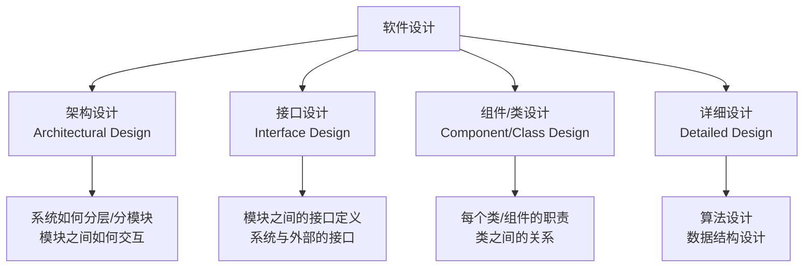
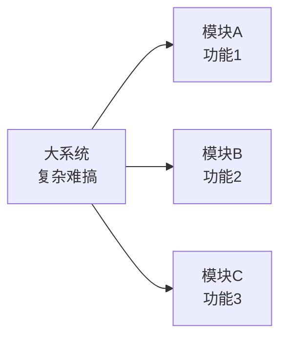
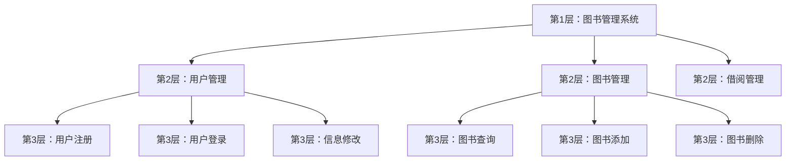
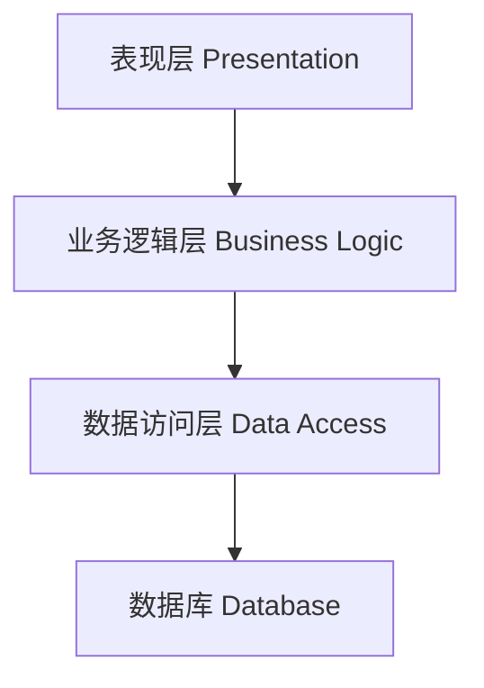
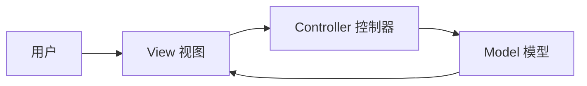
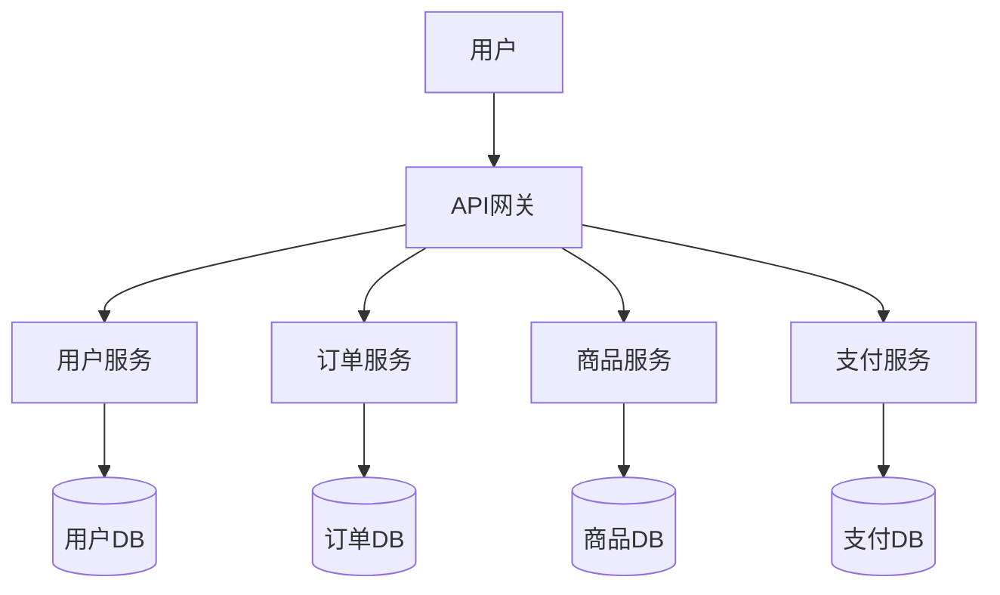

# 第三章 软件设计原理与架构

> **学习目标**：掌握软件设计的核心原理，深刻理解耦合与内聚、SOLID原则，熟悉常见架构风格
> **预计学时**：8小时 | **重要程度**：⭐⭐⭐⭐⭐

---

## 3.1 软件设计概述

### 3.1.1 什么是软件设计？

**软件设计（Software Design）**：把需求转化为软件实现方案的过程，回答"系统怎么实现"的问题。

> 需求分析解决"做什么"（What），软件设计解决"怎么做"（How）。

### 3.1.2 软件设计的层次



| 设计层次 | 别称 | 核心问题 | 产出 |
|----------|------|----------|------|
| **架构设计** | 概要设计/高层设计 | 系统总体结构是什么样的？ | 架构图、模块划分 |
| **接口设计** | - | 模块之间怎么交互？ | 接口定义、API文档 |
| **组件/类设计** | 详细设计 | 每个类有什么属性和方法？ | 类图、类设计文档 |
| **详细设计** | 过程设计 | 每个方法的算法是什么？ | 流程图、伪代码 |

> 🎯 **生活类比**：软件设计就像盖房子的设计——
> - 架构设计 = 城市规划（住宅区、商业区、道路怎么布局）
> - 接口设计 = 水电气管线接口（各区域怎么连接）
> - 类设计 = 单栋建筑设计（每层什么户型、几间房）
> - 详细设计 = 房间装修设计（开关在哪、插座几个、水管怎么走）

### 3.1.3 软件设计的目标

| 目标 | 说明 |
|------|------|
| **正确性** | 设计必须正确实现所有需求 |
| **可维护性** | 容易修改和扩展 |
| **可复用性** | 组件可以在其他项目中复用 |
| **可理解性** | 其他开发人员能看懂 |
| **高效性** | 性能满足要求 |
| **可靠性** | 不容易出问题，出了问题容易定位 |

---

## 3.2 软件设计基本原理

### 3.2.1 模块化（Modularity）

#### 什么是模块化？

**模块化**：把一个大的软件系统划分成若干个独立的模块，每个模块完成一个特定的功能，模块之间通过接口进行交互。

> 简单说："分而治之"，把大问题拆成小问题。



#### 模块化的优点

1. ✅ **降低复杂度**：每个模块相对独立，容易理解和开发
2. ✅ **便于并行开发**：不同模块可以由不同的人同时开发
3. ✅ **提高可维护性**：修改一个模块，对其他模块影响小
4. ✅ **促进复用**：好的模块可以在其他项目中复用
5. ✅ **便于测试**：每个模块可以独立测试

#### 模块化的代价

1. ❌ **模块间调用有开销**：模块划分越多，调用开销越大
2. ❌ **接口设计难度增加**：模块越多，接口越多，设计越复杂
3. ❌ **过度模块化反而复杂**：模块拆得太细，系统反而更难理解

> 💡 **最佳实践**：模块不是越多越好，也不是越少越好，要找到一个平衡点。
>
> 就像切蛋糕——切太少，每块太大不好吃；切太多，碎得没法吃。

### 3.2.2 抽象（Abstraction）

**抽象**：忽略不重要的细节，只关注本质特征。

> 抽象是人类认知复杂事物的基本方法。我们每天都在用抽象——
> - 你说"开车"，不需要知道发动机怎么工作的
> - 你说"打电话"，不需要知道信号怎么传输的

#### 抽象的层次

| 抽象层次 | 说明 | 示例 |
|----------|------|------|
| **最高层** | 问题域视角，最接近用户 | "图书管理系统" |
| **中间层** | 模块/组件视角 | "用户模块"、"图书模块" |
| **底层** | 实现视角，最接近代码 | 具体的类、方法、变量 |

> 设计原则：**自顶向下，逐步细化**。先从高层抽象开始，再逐步往下细化。

### 3.2.3 信息隐藏（Information Hiding）

**信息隐藏**：每个模块对外只暴露必要的接口，隐藏内部的实现细节。

> 也叫"封装"（Encapsulation），是面向对象的重要特性。

#### 为什么要信息隐藏？

1. **降低耦合**：其他模块不需要知道内部细节，只通过接口交互
2. **便于修改**：内部实现可以随便改，只要接口不变，就不影响其他模块
3. **安全性**：内部数据不会被外部随意修改

> 🎯 **生活类比**：信息隐藏就像电视机——
> - 你只需要知道按遥控器换台、调音量（接口）
> - 不需要知道电视机内部的电路怎么工作的（实现细节）
> - 电视厂商可以随便改内部电路，只要遥控器还能用就行

### 3.2.4 逐步细化（Stepwise Refinement）

**逐步细化**：从高层的抽象概念开始，一层一层地向下分解，直到足够详细可以实现为止。

> 也叫"自顶向下，逐步求精"。



---

## 3.3 耦合与内聚（Coupling & Cohesion）

> ⚠️ **重点中的重点**：耦合与内聚是软件设计的基石，是评估设计质量的核心指标。
> 几乎所有的设计原则、设计模式，最终都是为了"高内聚、低耦合"。

### 3.3.1 基本概念

| 概念 | 定义 | 关注点 | 目标 |
|------|------|--------|------|
| **耦合（Coupling）** | 模块之间相互依赖的紧密程度 | 模块**之间**的关系 | **低耦合**（越松越好） |
| **内聚（Cohesion）** | 一个模块内部各个元素之间结合的紧密程度 | 模块**内部**的关系 | **高内聚**（越紧越好） |

> 🎯 **生活类比**：
> - **耦合** = 人与人之间的关系。两个人关系越紧密，耦合越高。
>   - 高耦合 = 连体婴儿，一个动另一个必须跟着动，改一个另一个必受影响
>   - 低耦合 = 普通同事，各自独立工作，通过会议沟通
> - **内聚** = 一个团队的凝聚力。团队成员目标越一致，内聚越高。
>   - 高内聚 = 特种兵小队，每个人职责明确，配合默契，目标一致
>   - 低内聚 = 杂牌军，各怀鬼胎，什么都干但什么都干不好

```mermaid
graph LR
    subgraph 低耦合高内聚（好）
        A[模块A] -.->|接口| B[模块B]
        A -.->|接口| C[模块C]
        note right of A: 内部功能高度相关<br>对外只暴露接口
    end
    
    subgraph 高耦合低内聚（差）
        D[模块D] <==> E[模块E]
        D <==> F[模块F]
        E <==> F
        note right of D: 内部功能杂乱无章<br>模块之间互相依赖
    end
```

### 3.3.2 耦合的类型（从低到高）

耦合程度从**低到高**排列，越靠前越好：

| 序号 | 耦合类型 | 英文 | 说明 | 示例 |
|------|----------|------|------|------|
| 1 | **非直接耦合** | Indirect Coupling | 两个模块没有直接关系，通过第三方模块间接联系 | 模块A调用模块B，模块B调用模块C，A和C之间没有直接联系 |
| 2 | **数据耦合** | Data Coupling | 模块之间通过简单的数据传递进行交互 | 调用方法时传入参数，返回结果 |
| 3 | **标记耦合** | Stamp Coupling | 模块之间传递数据结构（对象、结构体） | 传入一个User对象，方法只用到了其中的name属性 |
| 4 | **控制耦合** | Control Coupling | 一个模块控制另一个模块的执行逻辑 | 传入一个flag参数，控制被调用模块走哪个分支 |
| 5 | **外部耦合** | External Coupling | 模块之间共享外部环境（文件、设备、协议） | 两个模块都读写同一个文件 |
| 6 | **公共耦合** | Common Coupling | 多个模块共享同一个全局数据区 | 多个模块都访问同一个全局变量 |
| 7 | **内容耦合** | Content Coupling | 一个模块直接访问另一个模块的内部数据或代码 | 直接修改另一个模块的私有变量，使用goto跳到另一个模块 |

> 💡 **记忆口诀**：非标控外公内（非、数、标、控、外、公、内）

#### 降低耦合的方法

1. 合理划分模块，职责单一
2. 使用接口通信，隐藏内部实现
3. 减少全局变量的使用
4. 传递数据时只传必要的数据
5. 避免直接操作其他模块的内部数据

### 3.3.3 内聚的类型（从低到高）

内聚程度从**低到高**排列，越靠后越好：

| 序号 | 内聚类型 | 英文 | 说明 | 示例 |
|------|----------|------|------|------|
| 1 | **偶然内聚** | Coincidental Cohesion | 模块内各元素之间没有关系，只是偶然凑在一起 | 一个工具类，里面放了各种不相关的方法 |
| 2 | **逻辑内聚** | Logical Cohesion | 模块内各元素在逻辑上属于同一类，但功能不相关 | 一个"工具模块"，里面有字符串处理、日期处理、数学计算 |
| 3 | **时间内聚** | Temporal Cohesion | 模块内各元素因为在同一时间执行而放在一起 | 系统初始化模块，里面有各种初始化操作 |
| 4 | **过程内聚** | Procedural Cohesion | 模块内各元素按特定的流程顺序执行 | 按步骤执行的一个操作流程 |
| 5 | **通信内聚** | Communicational Cohesion | 模块内各元素操作相同的数据 | 对同一个数据结构进行各种操作的方法 |
| 6 | **顺序内聚** | Sequential Cohesion | 模块内各元素顺序执行，前一个的输出是后一个的输入 | 数据处理流程：读取→解析→计算→输出 |
| 7 | **功能内聚** | Functional Cohesion | 模块内所有元素共同完成一个单一的功能，缺一不可 | 计算两个数的和、验证用户身份 |

> 💡 **记忆口诀**：偶逻时过通信顺功（偶、逻、时、过、通、信、顺、功）

#### 提高内聚的方法

1. 每个模块只做一件事（单一职责）
2. 把相关的功能放在一起
3. 不相关的功能拆分出去
4. 功能粒度适中，不要太大也不要太小

### 3.3.4 耦合与内聚的关系

- **高内聚往往带来低耦合**：每个模块功能单一，模块之间的依赖自然就少
- **低内聚往往带来高耦合**：模块功能杂乱，必然和其他模块有很多交叉依赖
- **最终目标**：**高内聚、低耦合**

> 🔴 **易混淆点提醒**：
> - 耦合是模块**之间**的，目标是**低**耦合
> - 内聚是模块**内部**的，目标是**高**内聚
> - 很多初学者搞反，记住："高内低耦"（高地耦）

---

## 3.4 SOLID 原则

> SOLID 是面向对象设计的五大基本原则，由 Robert C. Martin（"Bob大叔"）总结提出。
> 这五个原则是设计模式和架构设计的基础。

### 3.4.1 SOLID 概览

| 原则 | 英文 | 中文 | 核心思想 |
|------|------|------|----------|
| **S** | Single Responsibility Principle | 单一职责原则 | 一个类只做一件事 |
| **O** | Open/Closed Principle | 开闭原则 | 对扩展开放，对修改关闭 |
| **L** | Liskov Substitution Principle | 里氏替换原则 | 子类必须能替换父类 |
| **I** | Interface Segregation Principle | 接口隔离原则 | 接口要小而专，不要大而全 |
| **D** | Dependency Inversion Principle | 依赖倒置原则 | 依赖抽象，不依赖具体 |

### 3.4.2 单一职责原则（SRP）

#### 定义

> 一个类应该只有一个引起它变化的原因。

换句话说：**一个类只负责一项职责**。

#### 为什么需要单一职责？

- 如果一个类承担了多个职责，那么一个职责的变化可能会影响到其他职责
- 类的复杂度增加，难以理解和维护
- 复用性差，想复用其中一个职责时，不得不带上其他不相关的代码

#### 反例（不好的设计）

```java
// ❌ 违反单一职责：一个类既管用户数据，又管用户展示，还管用户存储
class User {
    private String name;
    private String email;
    
    // 数据操作
    public void setName(String name) { this.name = name; }
    public String getName() { return name; }
    
    // 业务逻辑
    public boolean validateEmail() {
        return email.contains("@");
    }
    
    // 持久化
    public void saveToDB() {
        // 保存到数据库
    }
    
    // 展示
    public void displayUserInfo() {
        System.out.println("Name: " + name);
    }
}
```

**问题**：
- 数据库变了，要改这个类
- 展示格式变了，要改这个类
- 验证逻辑变了，还要改这个类
- 改任何一个功能，都可能影响其他功能

#### 正例（好的设计）

```java
// ✅ 符合单一职责：每个类只负责一件事

// 只负责用户数据
class User {
    private String name;
    private String email;
    
    public String getName() { return name; }
    public void setName(String name) { this.name = name; }
    public String getEmail() { return email; }
    public void setEmail(String email) { this.email = email; }
}

// 只负责用户验证
class UserValidator {
    public boolean validateEmail(User user) {
        return user.getEmail().contains("@");
    }
}

// 只负责用户存储
class UserRepository {
    public void save(User user) {
        // 保存到数据库
    }
}

// 只负责用户展示
class UserPresenter {
    public void display(User user) {
        System.out.println("Name: " + user.getName());
    }
}
```

#### 注意事项

- 单一职责的"单一"是相对的，不是绝对的
- 粒度的把握需要根据实际情况来
- 过度拆分也会导致系统复杂化

> 🎯 **生活类比**：单一职责就像公司的岗位分工——
> - 前台就管接待，财务就管账，程序员就写代码
> - 如果让一个人既当前台又当财务又写代码，那肯定什么都做不好

---

### 3.4.3 开闭原则（OCP）

#### 定义

> 软件实体（类、模块、函数）应该对扩展开放，对修改关闭。

换句话说：**增加新功能时，应该通过扩展来实现，而不是修改已有的代码**。

#### 为什么需要开闭原则？

- 修改已有代码可能引入新的bug
- 修改已有代码需要重新测试所有相关功能
- 扩展新功能不影响已有功能，风险更低

#### 反例（不好的设计）

```java
// ❌ 违反开闭原则：每增加一种形状，都要修改这个类
class ShapeCalculator {
    // 计算面积
    public double calculateArea(Object shape) {
        if (shape instanceof Circle) {
            Circle circle = (Circle) shape;
            return Math.PI * circle.radius * circle.radius;
        } else if (shape instanceof Rectangle) {
            Rectangle rectangle = (Rectangle) shape;
            return rectangle.width * rectangle.height;
        }
        // 新增三角形，又要加一个else if...
        return 0;
    }
}
```

**问题**：
- 每增加一种新形状，都要修改 calculateArea 方法
- 修改已有代码可能引入bug
- 代码越来越长，越来越难维护

#### 正例（好的设计）

```java
// ✅ 符合开闭原则：新增形状只需要新增类，不用修改已有代码

// 抽象接口
interface Shape {
    double calculateArea();
}

// 圆形
class Circle implements Shape {
    private double radius;
    
    public Circle(double radius) {
        this.radius = radius;
    }
    
    @Override
    public double calculateArea() {
        return Math.PI * radius * radius;
    }
}

// 矩形
class Rectangle implements Shape {
    private double width;
    private double height;
    
    public Rectangle(double width, double height) {
        this.width = width;
        this.height = height;
    }
    
    @Override
    public double calculateArea() {
        return width * height;
    }
}

// 新增三角形，只需要新增一个类，不用修改已有代码
class Triangle implements Shape {
    private double base;
    private double height;
    
    public Triangle(double base, double height) {
        this.base = base;
        this.height = height;
    }
    
    @Override
    public double calculateArea() {
        return 0.5 * base * height;
    }
}

// 计算类不需要修改
class ShapeCalculator {
    public double calculateArea(Shape shape) {
        return shape.calculateArea();
    }
}
```

#### 实现开闭原则的方法

- 使用抽象和多态
- 面向接口编程，而不是面向实现编程
- 识别出容易变化的部分，把它们抽象出来

> 🎯 **生活类比**：开闭原则就像插线板——
> - 插线板的接口是固定的（对修改关闭）
> - 但你可以插各种不同的电器（对扩展开放）
> - 你不需要为了插一个新电器而去改造插线板

---

### 3.4.4 里氏替换原则（LSP）

#### 定义

> 子类必须能够替换掉它的父类，而不影响程序的正确性。

换句话说：**所有引用父类的地方，都可以透明地使用子类，而程序行为不会出错**。

这个原则由麻省理工学院的 Barbara Liskov 教授提出，因此得名。

#### 为什么需要里氏替换？

- 继承是面向对象的重要特性，但如果用不好，会带来很多问题
- 里氏替换原则是保证继承关系合理的重要准则
- 违反里氏替换的继承，本质上是错误的继承

#### 经典反例：正方形不是长方形？

```java
// ❌ 违反里氏替换原则：正方形继承长方形，但行为不一致

// 长方形
class Rectangle {
    protected double width;
    protected double height;
    
    public void setWidth(double width) { this.width = width; }
    public void setHeight(double height) { this.height = height; }
    public double getArea() { return width * height; }
}

// 正方形继承长方形
class Square extends Rectangle {
    @Override
    public void setWidth(double width) {
        super.setWidth(width);
        super.setHeight(width); // 同时修改高，保证长宽相等
    }
    
    @Override
    public void setHeight(double height) {
        super.setWidth(height); // 同时修改宽，保证长宽相等
        super.setHeight(height);
    }
}

// 测试
class Test {
    public void testRectangle(Rectangle rect) {
        rect.setWidth(5);
        rect.setHeight(4);
        // 预期面积是 5*4 = 20
        System.out.println(rect.getArea());
    }
    
    public static void main(String[] args) {
        Test test = new Test();
        test.testRectangle(new Rectangle()); // 输出 20.0，正确
        test.testRectangle(new Square());    // 输出 16.0，错误！
    }
}
```

**问题**：
- 从数学上看，正方形是长方形的一种
- 但从行为上看，正方形不能替换长方形
- 因为长方形的宽和高可以独立变化，而正方形不行
- 所以这个继承关系是错误的

#### 正确的做法

```java
// ✅ 正确的设计：长方形和正方形都是形状，没有继承关系

interface Shape {
    double getArea();
}

class Rectangle implements Shape {
    private double width;
    private double height;
    
    public Rectangle(double width, double height) {
        this.width = width;
        this.height = height;
    }
    
    public double getArea() { return width * height; }
}

class Square implements Shape {
    private double side;
    
    public Square(double side) {
        this.side = side;
    }
    
    public double getArea() { return side * side; }
}
```

#### 里氏替换的几个要点

1. **子类不能修改父类方法的参数**（参数可以更宽松，但不能更严格）
2. **子类不能缩小父类方法的返回值**（返回值可以更严格，但不能更宽松）
3. **子类不能抛出父类没有的异常**（异常可以更具体，不能是新的类型）
4. **子类必须遵守父类的约定**（前置条件、后置条件、不变式）

> 💡 **简单判断法**：子类能不能说"我是一种父类"？如果不能，那继承关系可能有问题。
>
> - 狗是一种动物 ✓
> - 正方形是一种长方形？✗（行为上不是）
> - 鸵鸟是一种鸟？✗（鸟会飞，但鸵鸟不会）

---

### 3.4.5 接口隔离原则（ISP）

#### 定义

> 客户端不应该依赖它不需要的接口。

换句话说：**接口要小而专，不要大而全**。应该为不同的客户端提供不同的接口，而不是提供一个什么都有的"胖接口"。

#### 为什么需要接口隔离？

- 胖接口会让客户端依赖它不需要的功能
- 接口一变，所有客户端都受影响
- 接口越小，越稳定，越容易复用

#### 反例（不好的设计）

```java
// ❌ 违反接口隔离：一个胖接口，什么方法都有

interface Worker {
    void work();      // 工作
    void eat();       // 吃饭
    void sleep();     // 睡觉
    void attendMeeting(); // 开会
}

// 程序员
class Programmer implements Worker {
    public void work() { /* 写代码 */ }
    public void eat() { /* 吃饭 */ }
    public void sleep() { /* 睡觉 */ }
    public void attendMeeting() { /* 程序员不想开会，但不得不实现 */ }
}

// 机器人
class Robot implements Worker {
    public void work() { /* 工作 */ }
    public void eat() { /* 机器人不需要吃饭，但不得不实现空方法 */ }
    public void sleep() { /* 机器人不需要睡觉，但不得不实现空方法 */ }
    public void attendMeeting() { /* 机器人不需要开会，但不得不实现空方法 */ }
}
```

**问题**：
- 机器人不需要吃饭、睡觉、开会，但不得不实现这些空方法
- 如果接口加了新方法（比如"打游戏"），所有实现类都要改
- 客户端依赖了它不需要的方法

#### 正例（好的设计）

```java
// ✅ 符合接口隔离：拆分成多个小接口

interface Workable {
    void work();
}

interface Eatable {
    void eat();
}

interface Sleepable {
    void sleep();
}

interface MeetingAttendable {
    void attendMeeting();
}

// 程序员：需要工作、吃饭、睡觉、开会
class Programmer implements Workable, Eatable, Sleepable, MeetingAttendable {
    public void work() { /* 写代码 */ }
    public void eat() { /* 吃饭 */ }
    public void sleep() { /* 睡觉 */ }
    public void attendMeeting() { /* 开会 */ }
}

// 机器人：只需要工作
class Robot implements Workable {
    public void work() { /* 工作 */ }
}
```

#### 接口隔离的原则

1. **接口要小**：接口的方法不要太多
2. **接口要专**：一个接口只服务于一个子模块
3. **按需依赖**：客户端只依赖它需要的接口
4. **避免污染**：不要让客户端看到它不需要的方法

> 🎯 **生活类比**：接口隔离就像会员套餐——
> - 不好的设计：只有一个"全家桶套餐"，不管你用不用，所有功能都给你
> - 好的设计：有基础版、进阶版、专业版，你按需选择，只付你需要的钱

---

### 3.4.6 依赖倒置原则（DIP）

#### 定义

> 1. 高层模块不应该依赖低层模块，两者都应该依赖抽象。
> 2. 抽象不应该依赖细节，细节应该依赖抽象。

换句话说：**面向接口编程，不要面向实现编程**。

#### 什么是"倒置"？

传统的依赖关系：高层模块 → 低层模块（高层直接调用低层）
依赖倒置后：高层模块 → 抽象接口 ← 低层模块（两边都依赖抽象）

```mermaid
graph TD
    subgraph 传统依赖（不好）
        A[高层模块<br>业务逻辑] --> B[低层模块<br>数据库访问]
    end
    
    subgraph 依赖倒置（好）
        C[高层模块<br>业务逻辑] --> D[抽象接口]
        E[低层模块<br>数据库访问] --> D
    end
```

#### 为什么需要依赖倒置？

- 高层模块是业务逻辑，应该是稳定的
- 低层模块是具体实现，容易变化
- 如果高层直接依赖低层，低层一变，高层也要变
- 依赖抽象后，两边都可以独立变化，只要接口不变

#### 反例（不好的设计）

```java
// ❌ 违反依赖倒置：高层模块直接依赖低层模块

// 低层模块：MySQL数据库
class MySQLDatabase {
    public void insert(String data) {
        System.out.println("MySQL插入数据: " + data);
    }
}

// 高层模块：用户服务
class UserService {
    private MySQLDatabase db; // 直接依赖具体的MySQLDatabase
    
    public UserService() {
        this.db = new MySQLDatabase();
    }
    
    public void addUser(String username) {
        db.insert(username);
    }
}
```

**问题**：
- UserService 直接依赖 MySQLDatabase
- 如果以后要换成 Oracle 数据库，UserService 也要改
- UserService 是业务逻辑，不应该关心具体用什么数据库

#### 正例（好的设计）

```java
// ✅ 符合依赖倒置：双方都依赖抽象接口

// 抽象接口
interface Database {
    void insert(String data);
}

// 低层模块：MySQL实现
class MySQLDatabase implements Database {
    @Override
    public void insert(String data) {
        System.out.println("MySQL插入数据: " + data);
    }
}

// 低层模块：Oracle实现
class OracleDatabase implements Database {
    @Override
    public void insert(String data) {
        System.out.println("Oracle插入数据: " + data);
    }
}

// 高层模块：用户服务，依赖抽象接口
class UserService {
    private Database db; // 依赖抽象接口，而不是具体实现
    
    // 依赖注入：通过构造函数传入具体实现
    public UserService(Database db) {
        this.db = db;
    }
    
    public void addUser(String username) {
        db.insert(username);
    }
}

// 使用
class Main {
    public static void main(String[] args) {
        // 用MySQL
        UserService userService1 = new UserService(new MySQLDatabase());
        userService1.addUser("张三");
        
        // 换成Oracle，UserService不用改
        UserService userService2 = new UserService(new OracleDatabase());
        userService2.addUser("李四");
    }
}
```

#### 依赖倒置与依赖注入

- **依赖倒置（DIP）**：是一种设计原则，指导我们应该依赖抽象
- **依赖注入（Dependency Injection, DI）**：是实现依赖倒置的一种技术手段
- **控制反转（Inversion of Control, IoC）**：是依赖倒置的另一种说法，强调控制权的转移

> 🎯 **生活类比**：依赖倒置就像插头标准——
> - 电器（高层）不直接依赖某个具体的电厂（低层）
> - 而是依赖"插座标准"（抽象接口）
> - 只要符合插座标准，不管是火电、水电还是风电，电器都能用
> - 电厂也只需要按照插座标准供电，不用管具体是什么电器

---

### 3.4.7 SOLID 原则总结

| 原则 | 一句话总结 | 解决的问题 |
|------|-----------|-----------|
| **SRP 单一职责** | 一个类只做一件事 | 类太复杂，职责太多 |
| **OCP 开闭原则** | 对扩展开放，对修改关闭 | 需求变化时频繁修改代码 |
| **LSP 里氏替换** | 子类能替换父类 | 继承关系不合理 |
| **ISP 接口隔离** | 接口要小而专 | 胖接口，客户端依赖不需要的方法 |
| **DIP 依赖倒置** | 依赖抽象，不依赖具体 | 高层依赖低层，耦合太紧 |

> 💡 **SOLID 的核心目标**：高内聚、低耦合、易扩展、易维护

---

## 3.5 软件架构风格

### 3.5.1 什么是软件架构？

**软件架构（Software Architecture）**：系统的高层结构，包括系统的组件、组件之间的关系以及设计和演化的原则。

> 简单说：架构就是"系统的骨架"，决定了系统的整体形状。

### 3.5.2 常见架构风格

#### 一、分层架构（Layered Architecture）

##### 基本概念

把系统分成若干层，每一层为上一层提供服务，同时使用下一层的服务。



##### 常见的分层

| 层 | 英文 | 职责 | 示例 |
|----|------|------|------|
| **表现层** | Presentation Layer | 用户界面，展示数据，接收用户输入 | Web页面、App界面、API接口 |
| **业务逻辑层** | Business Layer | 核心业务逻辑处理 | 用户注册、下单流程、权限判断 |
| **数据访问层** | Data Access Layer | 与数据库交互，CRUD操作 | SQL语句、ORM映射 |
| **数据层** | Data Layer | 数据存储 | 数据库、文件、缓存 |

##### 优点

1. ✅ **职责清晰**：每层只负责一件事
2. ✅ **易于开发**：不同层可以由不同团队并行开发
3. ✅ **易于替换**：某一层可以整体替换，只要接口不变
4. ✅ **降低复杂度**：每层只需要关注自己层的逻辑

##### 缺点

1. ❌ **性能开销**：请求需要经过每一层，有性能损耗
2. ❌ **层级限制**：严格的分层可能导致不必要的间接层
3. ❌ **扩展性**：对于复杂业务，分层可能不够灵活

##### 适用场景

- 大多数传统企业应用
- 业务逻辑相对清晰的系统
- 团队分工明确的项目

> 🎯 **生活类比**：分层架构就像餐厅——
> - 服务员（表现层）：接待客人，点餐上菜
> - 厨师（业务层）：做菜，处理核心业务
> - 采购员（数据层）：采购食材，和供应商打交道
> - 每一层只跟相邻的层打交道，服务员不会直接找供应商

---

#### 二、MVC 架构

##### 基本概念

**MVC** = Model（模型）+ View（视图）+ Controller（控制器）



| 组件 | 英文 | 职责 |
|------|------|------|
| **模型** | Model | 数据和业务逻辑，处理数据的存取和计算 |
| **视图** | View | 用户界面，展示数据给用户 |
| **控制器** | Controller | 接收用户输入，调用模型，更新视图 |

##### MVC 的交互流程

1. 用户和 View 交互（点击按钮、输入内容）
2. View 把用户操作传给 Controller
3. Controller 调用 Model 处理业务逻辑
4. Model 更新数据
5. View 从 Model 获取最新数据并更新显示

##### 优点

1. ✅ **职责分离**：数据、视图、控制逻辑分离
2. ✅ **可复用性高**：同一个模型可以有多个视图
3. ✅ **易于维护**：修改界面不影响业务逻辑
4. ✅ **便于测试**：业务逻辑可以独立测试

##### 缺点

1. ❌ **概念复杂**：初学者不容易理解
2. ❌ **Controller 可能臃肿**：控制逻辑都放在Controller
3. ❌ **View 和 Model 耦合**：View 需要知道 Model 的存在

##### 适用场景

- Web应用开发
- 桌面应用开发
- 需要多种视图展示同一数据的场景

> 💡 **MVC 的变种**：MVP、MVVM 等，都是在 MVC 基础上的演变。
>
> 比如 MVVM（Model-View-ViewModel）把 Controller 换成了 ViewModel，实现了数据双向绑定，在前端框架（Vue、React、Angular）中很流行。

---

#### 三、微服务架构（Microservices）

##### 基本概念

把一个大的单体应用拆分成多个小的服务，每个服务独立部署、独立运行，服务之间通过轻量级机制（通常是HTTP API）通信。



##### 微服务的特点

| 特点 | 说明 |
|------|------|
| **服务拆分** | 按业务领域拆分成小服务 |
| **独立部署** | 每个服务可以独立部署和升级 |
| **独立数据** | 每个服务有自己的数据库 |
| **技术异构** | 不同服务可以用不同的技术栈 |
| **去中心化** | 没有中心节点，服务自治 |
| **容错设计** | 一个服务挂了不影响其他服务 |

##### 优点

1. ✅ **独立部署**：修改一个服务，只需要部署这个服务
2. ✅ **技术灵活**：每个服务可以选最合适的技术栈
3. ✅ **扩展性好**：哪个服务压力大就扩容哪个
4. ✅ **容错性好** | 一个服务挂了，其他服务还能用
5. ✅ **团队自治** | 每个团队负责一个或多个服务

##### 缺点

1. ❌ **复杂度高**：分布式系统的复杂度远高于单体
2. ❌ **运维成本高**：服务多了，运维、监控、部署都更复杂
3. ❌ **数据一致性**：跨服务的数据一致性是个难题
4. ❌ **调用链长**：一次请求可能经过多个服务，排查问题难
5. ❌ **服务治理**：需要处理服务发现、负载均衡、熔断降级等问题

##### 适用场景

- 大型复杂系统
- 需要快速迭代和独立部署的系统
- 团队规模较大，需要拆分团队的项目

> ⚠️ **注意**：微服务不是银弹！小项目、团队小时，用微服务反而增加复杂度。
>
> 经典建议："除非你有一个单体搞不定的系统，否则不要用微服务。"

---

#### 四、其他架构风格简介

| 架构风格 | 说明 | 适用场景 |
|----------|------|----------|
| **管道-过滤器** | 数据经过一系列过滤器处理，每个过滤器独立 | 数据处理流水线、编译器 |
| **事件驱动** | 组件通过事件通信，发布订阅模式 | GUI应用、消息系统 |
| **客户端-服务器** | 客户端请求，服务器响应 | Web应用、数据库系统 |
| **点对点（P2P）** | 节点之间对等，没有中心服务器 | 文件共享、区块链 |
| **黑板架构** | 所有组件共享一个"黑板"（公共数据区） | AI系统、专家系统 |
| **领域驱动设计（DDD）** | 以领域为核心，通过限界上下文划分边界 | 复杂业务系统 |

---

## 3.6 常见误区与易错点

### 误区1：设计越复杂越高级

- ❌ 错！好的设计是简单的，而不是复杂的
- ✅ 能简单解决的问题，就不要搞复杂
- ✅ 设计的目标是解决问题，不是炫技

### 误区2：为了用设计模式而用设计模式

- ❌ 错！设计模式是工具，不是目的
- ✅ 应该是问题驱动，遇到什么问题用什么模式
- ✅ 过度使用设计模式，反而增加复杂度

### 误区3：耦合越低越好，内聚越高越好

- ❌ 不完全对！这是理想状态，但实际中要平衡
- ✅ 过度追求低耦合，可能导致系统碎片化
- ✅ 内聚太高，模块可能太小太多

### 误区4：架构一次定型

- ❌ 错！架构是演化的，不是一次设计好的
- ✅ 好的架构是演进出来的，不是设计出来的
- ✅ 要留有余地，允许架构随业务发展而调整

### 误区5：分层架构中可以跨层调用

- ❌ 严格的分层架构中，每一层只能调用下一层
- ✅ 但实际中为了性能等原因，有时会放宽限制
- ✅ 关键是要有清晰的规则，不能乱调

---

## 3.7 关键术语中英对照

| 中文 | 英文 | 缩写 |
|------|------|------|
| 软件设计 | Software Design | - |
| 架构设计 | Architectural Design | - |
| 详细设计 | Detailed Design | - |
| 模块化 | Modularity | - |
| 抽象 | Abstraction | - |
| 信息隐藏 | Information Hiding | - |
| 逐步细化 | Stepwise Refinement | - |
| 耦合 | Coupling | - |
| 内聚 | Cohesion | - |
| 数据耦合 | Data Coupling | - |
| 控制耦合 | Control Coupling | - |
| 公共耦合 | Common Coupling | - |
| 内容耦合 | Content Coupling | - |
| 功能内聚 | Functional Cohesion | - |
| 偶然内聚 | Coincidental Cohesion | - |
| 单一职责原则 | Single Responsibility Principle | SRP |
| 开闭原则 | Open/Closed Principle | OCP |
| 里氏替换原则 | Liskov Substitution Principle | LSP |
| 接口隔离原则 | Interface Segregation Principle | ISP |
| 依赖倒置原则 | Dependency Inversion Principle | DIP |
| 软件架构 | Software Architecture | - |
| 分层架构 | Layered Architecture | - |
| 模型-视图-控制器 | Model-View-Controller | MVC |
| 模型-视图-视图模型 | Model-View-ViewModel | MVVM |
| 微服务 | Microservices | - |
| 领域驱动设计 | Domain-Driven Design | DDD |
| 依赖注入 | Dependency Injection | DI |
| 控制反转 | Inversion of Control | IoC |

---

## 3.8 练习题与自测

### 一、选择题

1. 软件设计中，模块内部各元素结合的紧密程度称为（ ）
   - A. 耦合
   - B. 内聚
   - C. 模块化
   - D. 抽象

2. 下列耦合类型中，耦合程度最高的是（ ）
   - A. 数据耦合
   - B. 控制耦合
   - C. 公共耦合
   - D. 内容耦合

3. 单一职责原则要求（ ）
   - A. 一个类只有一个方法
   - B. 一个类只有一个引起变化的原因
   - C. 一个类只能被一个类调用
   - D. 一个类只能有一个属性

4. 开闭原则的含义是（ ）
   - A. 对扩展开放，对修改关闭
   - B. 对修改开放，对扩展关闭
   - C. 对测试开放，对开发关闭
   - D. 对开发开放，对测试关闭

5. MVC 架构中，负责处理业务逻辑的是（ ）
   - A. Model
   - B. View
   - C. Controller
   - D. 以上都是

6. 微服务架构的特点不包括（ ）
   - A. 独立部署
   - B. 共享数据库
   - C. 技术异构
   - D. 服务自治

### 二、简答题

1. 什么是耦合？什么是内聚？为什么要追求"高内聚、低耦合"？

2. 简述 SOLID 五大原则的内容和各自解决的问题。

3. 分层架构有什么优缺点？适用于什么场景？

4. 微服务架构有什么优缺点？什么时候适合用微服务？

5. 里氏替换原则是什么？为什么正方形不应该继承长方形？

### 三、分析题

**题目**：分析以下代码的设计问题，并用 SOLID 原则进行重构。

```python
class Employee:
    def __init__(self, name, type_, hours=0):
        self.name = name
        self.type = type_  # "fulltime", "parttime", "intern"
        self.hours = hours
    
    def calculate_salary(self):
        if self.type == "fulltime":
            return 8000  # 固定工资
        elif self.type == "parttime":
            return self.hours * 100  # 按小时计算
        elif self.type == "intern":
            return 2000  # 实习补贴
        return 0
    
    def save_to_database(self):
        # 保存到数据库
        print(f"保存员工 {self.name} 到数据库")
    
    def generate_report(self):
        # 生成员工报告
        print(f"员工报告: {self.name}, 类型: {self.type}")
```

**要求**：
1. 指出违反了哪些 SOLID 原则
2. 给出重构后的代码

---

## 3.9 参考答案

### 一、选择题

1. **B** — 内聚是模块内部的紧密程度；耦合是模块之间的依赖程度
2. **D** — 耦合程度从低到高：非直接→数据→标记→控制→外部→公共→内容
3. **B** — 单一职责原则：一个类应该只有一个引起它变化的原因
4. **A** — 开闭原则：对扩展开放，对修改关闭
5. **A** — Model 负责数据和业务逻辑；View 负责展示；Controller 负责协调
6. **B** — 微服务每个服务有自己的数据库，不共享数据库

### 二、简答题（要点）

1. **耦合**是模块之间相互依赖的紧密程度；**内聚**是模块内部各元素结合的紧密程度。
   追求"高内聚、低耦合"的原因：
   - 高内聚：每个模块功能单一明确，易于理解、维护和复用
   - 低耦合：模块之间依赖少，修改一个模块不容易影响其他模块，系统更稳定、更灵活

2. SOLID 五大原则：
   - **SRP 单一职责**：一个类只做一件事。解决类太复杂、职责太多的问题。
   - **OCP 开闭原则**：对扩展开放，对修改关闭。解决需求变化时频繁修改代码的问题。
   - **LSP 里氏替换**：子类必须能替换父类。解决继承关系不合理的问题。
   - **ISP 接口隔离**：接口要小而专。解决胖接口、客户端依赖不需要的方法的问题。
   - **DIP 依赖倒置**：依赖抽象，不依赖具体。解决高层依赖低层、耦合太紧的问题。

3. **分层架构优点**：职责清晰、易于开发、易于替换、降低复杂度
   **缺点**：性能开销、层级限制、对复杂业务不够灵活
   **适用场景**：传统企业应用、业务逻辑清晰的系统、团队分工明确的项目

4. **微服务优点**：独立部署、技术灵活、扩展性好、容错性好、团队自治
   **缺点**：复杂度高、运维成本高、数据一致性难、调用链长、服务治理复杂
   **适用场景**：大型复杂系统、需要快速迭代的系统、团队规模较大的项目
   **注意**：小项目不适合用微服务，反而增加复杂度

5. **里氏替换原则**：子类必须能够替换掉它的父类，而不影响程序的正确性。
   正方形不应该继承长方形的原因：
   - 数学上正方形是长方形的一种，但行为上不是
   - 长方形的宽和高可以独立变化，正方形的宽和高必须一起变
   - 如果用正方形替换长方形，程序的行为会出错（比如设置宽5高4，面积应该是20，但正方形得到的是16）
   - 所以这个继承关系违反了里氏替换原则

### 三、分析题（参考答案）

**1. 违反的 SOLID 原则：**

- **违反 SRP（单一职责原则）**：Employee 类同时承担了计算工资、保存数据库、生成报告三个职责
- **违反 OCP（开闭原则）**：新增一种员工类型（比如"外包"），需要修改 calculate_salary 方法
- **违反 DIP（依赖倒置原则）**：Employee 直接依赖具体的数据库操作，而不是抽象接口

**2. 重构后的代码：**

```python
from abc import ABC, abstractmethod

# ==================== 工资计算策略（遵循OCP、SRP）====================
class SalaryCalculator(ABC):
    """工资计算器抽象接口"""
    @abstractmethod
    def calculate(self, employee) -> float:
        pass

class FullTimeSalary(SalaryCalculator):
    """全职员工工资"""
    def calculate(self, employee) -> float:
        return 8000

class PartTimeSalary(SalaryCalculator):
    """兼职员工工资"""
    def calculate(self, employee) -> float:
        return employee.hours * 100

class InternSalary(SalaryCalculator):
    """实习生补贴"""
    def calculate(self, employee) -> float:
        return 2000

# ==================== 数据存储抽象（遵循DIP）====================
class EmployeeRepository(ABC):
    """员工存储抽象接口"""
    @abstractmethod
    def save(self, employee):
        pass

class DatabaseEmployeeRepository(EmployeeRepository):
    """数据库存储实现"""
    def save(self, employee):
        print(f"保存员工 {employee.name} 到数据库")

# ==================== 员工类（遵循SRP，只保留数据）====================
class Employee:
    def __init__(self, name, salary_calculator: SalaryCalculator, hours=0):
        self.name = name
        self.salary_calculator = salary_calculator
        self.hours = hours
    
    def calculate_salary(self) -> float:
        return self.salary_calculator.calculate(self)

# ==================== 报告生成器（遵循SRP，从Employee中拆分出来）====================
class EmployeeReporter:
    """员工报告生成器"""
    def generate_report(self, employee):
        salary = employee.calculate_salary()
        print(f"员工报告: {employee.name}, 月薪: {salary}")

# ==================== 使用示例 ====================
if __name__ == "__main__":
    # 全职员工
    ft_employee = Employee("张三", FullTimeSalary())
    print(f"{ft_employee.name} 的工资: {ft_employee.calculate_salary()}")
    
    # 兼职员工
    pt_employee = Employee("李四", PartTimeSalary(), hours=80)
    print(f"{pt_employee.name} 的工资: {pt_employee.calculate_salary()}")
    
    # 实习生
    intern = Employee("王五", InternSalary())
    print(f"{intern.name} 的工资: {intern.calculate_salary()}")
    
    # 保存到数据库
    repo = DatabaseEmployeeRepository()
    repo.save(ft_employee)
    
    # 生成报告
    reporter = EmployeeReporter()
    reporter.generate_report(ft_employee)
```

**重构后遵循的原则：**
- **SRP**：每个类只做一件事（Employee管数据、各SalaryCalculator管工资计算、Repository管存储、Reporter管报告）
- **OCP**：新增员工类型只需要新增一个 SalaryCalculator 实现类，不用修改已有代码
- **DIP**：Employee 依赖抽象的 SalaryCalculator 接口，而不是具体实现

---

> 📌 **下一章**：学习 UML 建模，掌握用例图、类图、时序图 → [04-UML与建模.md](./04-UML与建模.md)
