# 第四章 UML 与建模

> **学习目标**：掌握 UML 的基本概念，能够正确绘制和阅读用例图、类图、时序图、活动图、状态图
> **预计学时**：6小时 | **重要程度**：⭐⭐⭐⭐

---

## 4.1 UML 概述

### 4.1.1 什么是 UML？

**UML**（Unified Modeling Language，统一建模语言）是一种可视化的建模语言，用于软件系统的分析、设计和文档化。

> 简单说：UML 就是画软件设计图的"标准画法"，让大家用同一种语言交流设计思想。

#### UML 的特点

| 特点 | 说明 |
|------|------|
| **统一标准** | OMG（对象管理组织）制定的国际标准 |
| **可视化** | 用图形表达，直观易懂 |
| **面向对象** | 支持面向对象的分析与设计 |
| **独立于过程** | 不依赖特定的开发过程 |
| **表达能力强** | 能描述从需求到实现的各个阶段 |

### 4.1.2 UML 的发展历史

- **1994年**：Grady Booch 和 James Rumbaugh 开始合作，统一 Booch 方法和 OMT 方法
- **1995年**：Ivar Jacobson 加入，带来了 OOSE 方法的用例思想
- **1997年**：UML 1.0 提交给 OMG，成为正式标准
- **2005年**：UML 2.0 发布，大幅扩充了内容
- 三位创始人被称为"UML三友"（Three Amigos）

### 4.1.3 UML 图的分类

UML 2.0 定义了 14 种图，分为两大类：

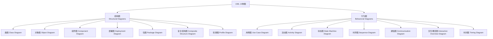

#### 最常用的 5 种图（初学者重点掌握）

| 图 | 类别 | 用途 | 重要程度 |
|----|------|------|----------|
| **用例图** | 行为图 | 描述系统功能和用户角色 | ⭐⭐⭐⭐⭐ |
| **类图** | 结构图 | 描述系统的静态结构（类、属性、方法、关系） | ⭐⭐⭐⭐⭐ |
| **时序图** | 行为图 | 描述对象之间的交互顺序 | ⭐⭐⭐⭐⭐ |
| **活动图** | 行为图 | 描述工作流程和活动流转 | ⭐⭐⭐⭐ |
| **状态图** | 行为图 | 描述对象的状态变化 | ⭐⭐⭐ |

> 💡 **学习建议**：先掌握这 5 种最常用的图，其他图用到时再学。
> 面试和考试中，用例图、类图、时序图是最高频的考点。

### 4.1.4 UML 的作用

1. **沟通工具**：团队成员之间用图形交流，比文字更清晰
2. **设计工具**：帮助思考和梳理设计思路
3. **文档工具**：系统设计的可视化文档
4. **分析工具**：帮助理解复杂的业务逻辑

> 🔴 **常见误区**：UML 不是为了画漂亮的图，而是为了理清思路。
> 画图的过程比最终的图更重要——很多问题在画图的过程中就被发现和解决了。

---

## 4.2 用例图（Use Case Diagram）

### 4.2.1 什么是用例图？

**用例图**：从用户的角度描述系统功能的图，展示了参与者（Actor）、用例（Use Case）以及它们之间的关系。

> 用例图回答"谁能用系统做什么"的问题。

### 4.2.2 用例图的基本元素

| 元素 | 图形表示 | 说明 |
|------|----------|------|
| **参与者 Actor** | 小人 | 使用系统的人或外部系统 |
| **用例 Use Case** | 椭圆 | 系统提供的一个功能 |
| **系统边界** | 矩形 | 表示系统的范围 |
| **关联关系** | 实线 | 参与者与用例之间的关系 |
| **包含关系** | 虚线箭头 + <<include>> | 基用例一定包含被包含用例 |
| **扩展关系** | 虚线箭头 + <<extend>> | 扩展用例可选地扩展基用例 |
| **泛化关系** | 空心三角箭头 | 子用例继承父用例 |

### 4.2.3 用例图示例（图书馆管理系统）

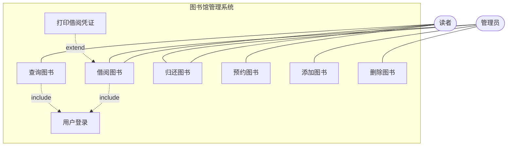

#### 元素说明

| 元素 | 说明 |
|------|------|
| **参与者**：读者、管理员 | 使用系统的不同角色 |
| **用例**：查询图书、借阅图书等 | 系统提供的功能 |
| **关联**：读者-查询图书 | 参与者可以执行这个用例 |
| **包含**：借阅图书 include 用户登录 | 借书时一定会先登录 |
| **扩展**：打印借阅凭证 extend 借阅图书 | 借书时可以选择打印凭证，也可以不打 |

### 4.2.4 参与者（Actor）

#### 什么是参与者？

参与者是**在系统外部**，与系统交互的人或事物。

> 注意：参与者一定在系统边界之外！

#### 参与者的类型

| 类型 | 说明 | 示例 |
|------|------|------|
| **主要参与者** | 主动使用系统功能，从系统获得价值的人 | 读者借书、用户购物 |
| **次要参与者** | 为系统提供服务，被系统调用的人或系统 | 支付系统、短信网关 |
| **系统参与者** | 其他外部系统 | 第三方登录系统 |

#### 识别参与者的方法

问自己几个问题：
1. 谁使用系统的主要功能？
2. 谁需要系统的支持来完成工作？
3. 谁来维护和管理系统？
4. 系统需要和哪些外部系统交互？

### 4.2.5 用例（Use Case）

#### 什么是用例？

用例是系统提供的一个**完整的功能**，能给参与者带来**可见的价值**。

#### 用例的命名

- 通常用"动词+名词"的形式
- 从参与者的视角命名
- 示例：查询图书、借阅图书、修改密码

#### 用例的粒度

- **不要太粗**："使用系统"——这不是用例，是整个系统
- **不要太细**："输入密码"——这是步骤，不是用例
- **合适的粒度**：一个完整的业务目标，能给参与者带来价值

> 💡 **EBP 原则**：一个用例应该是一个"基本业务过程"（Elementary Business Process），
> 即：一个人在一个时间、一个地点、做一件事，对应一个业务目标。

### 4.2.6 用例之间的关系

#### 1. 包含关系（Include）

**含义**：基用例在执行过程中，**一定会**执行被包含的用例。

**用途**：提取多个用例的公共部分，避免重复。

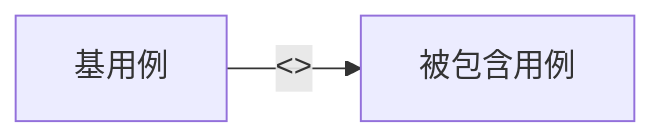

**示例**：
- 借阅图书 → include → 用户登录
- 查询图书 → include → 用户登录
- （登录是很多操作都需要的公共步骤）

#### 2. 扩展关系（Extend）

**含义**：扩展用例可以**选择性地**扩展基用例的功能。

**用途**：处理可选的、例外的情况。

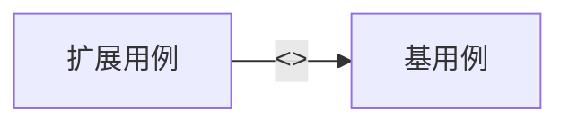

**注意箭头方向**：扩展关系的箭头是从扩展用例指向基用例！

**示例**：
- 打印借书凭证 → extend → 借阅图书
- （借书时可以选择打印，也可以不打印）

#### 3. 泛化关系（Generalization）

**含义**：子用例继承父用例的特征，并可以有自己的特殊行为。

**用途**：表示用例的不同实现方式。

```mermaid
graph TD
    A[父用例] <|-- B[子用例1]
    A <|-- C[子用例2]
```

**示例**：
- 支付（父用例）
  - 微信支付（子用例）
  - 支付宝支付（子用例）
  - 银行卡支付（子用例）

### 4.2.7 用例描述

用例图只展示了用例的概览，详细的用例需要用文字描述。

#### 用例描述的模板

```
用例名称：借阅图书
用例编号：UC002
参与者：读者
前置条件：
  1. 读者已登录系统
  2. 图书处于可借阅状态
后置条件：
  1. 生成借阅记录
  2. 图书状态更新为"已借出"
  3. 读者借阅数量+1

主事件流（基本路径）：
  1. 读者输入图书编号或扫描条码
  2. 系统验证图书是否存在
  3. 系统显示图书信息
  4. 读者确认借阅
  5. 系统检查读者借阅数量是否超限
  6. 系统生成借阅记录
  7. 系统更新图书状态为"已借出"
  8. 系统显示借阅成功信息

扩展流（替代路径）：
  2a. 图书不存在
    2a1. 系统提示"图书不存在"
    2a2. 用例结束
  
  3a. 图书已被借出
    3a1. 系统提示"图书已被借出"
    3a2. 询问读者是否预约
    3a3. 如果读者确认预约，转入"预约图书"用例
    3a4. 用例结束
  
  5a. 借阅数量已达上限
    5a1. 系统提示"借阅数量已达上限"
    5a2. 用例结束

特殊需求：
  - 借阅成功后，系统自动发送提醒邮件
  - 借阅期限为30天
```

### 4.2.8 用例图常见错误

| 错误示例 | 问题 | 正确做法 |
|----------|------|----------|
| 参与者之间画关联线 | 参与者之间没有关联关系 | 参与者只和用例关联 |
| 用例之间画关联线 | 用例之间不用普通关联 | 用包含、扩展、泛化 |
| 用例命名为名词（如"图书"） | 用例是功能，应该是动作 | 用"动词+名词"，如"查询图书" |
| 把系统内部对象当参与者 | 参与者必须在系统外部 | 内部对象不是参与者 |
| 包含和扩展箭头方向搞反 | include是基→被包含；extend是扩展→基 | 记住方向不要搞反 |

---

## 4.3 类图（Class Diagram）

### 4.3.1 什么是类图？

**类图**：描述系统中的类、类的属性和方法，以及类之间关系的图。

> 类图是最常用的 UML 图，是面向对象设计的核心工具。

### 4.3.2 类的表示

一个类用一个矩形表示，分为三层：

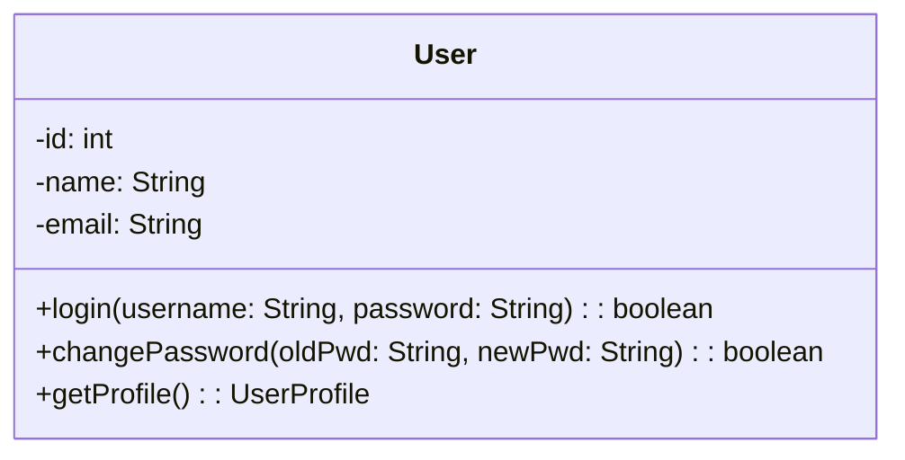

| 层级 | 内容 | 说明 |
|------|------|------|
| **第一层** | 类名 | 类的名称，首字母大写 |
| **第二层** | 属性 | 类的成员变量，格式：可见性 名称: 类型 |
| **第三层** | 方法 | 类的成员函数，格式：可见性 名称(参数): 返回类型 |

#### 可见性（访问修饰符）

| 符号 | 可见性 | 对应Java | 说明 |
|------|--------|----------|------|
| **+** | 公有的 | public | 所有类都能访问 |
| **-** | 私有的 | private | 只有本类能访问 |
| **#** | 受保护的 | protected | 本类和子类能访问 |
| **~** | 包级私有 | (default) | 同一个包内能访问 |

### 4.3.3 类之间的关系

类之间有 6 种常见关系，从强到弱排列：

| 关系 | 英文 | 图形表示 | 关系强度 |
|------|------|----------|----------|
| **泛化（继承）** | Generalization | 空心三角 + 实线 | 最强 |
| **实现** | Realization | 空心三角 + 虚线 | 强 |
| **组合** | Composition | 实心菱形 + 实线 | 很强 |
| **聚合** | Aggregation | 空心菱形 + 实线 | 较强 |
| **关联** | Association | 实线（可带箭头） | 一般 |
| **依赖** | Dependency | 虚线箭头 | 最弱 |

> 💡 **记忆口诀**：泛实组聚关依（泛、实、组、聚、关、依）

---

#### 1. 泛化关系（Generalization）

**含义**：继承关系，子类继承父类。

**表示方法**：空心三角箭头，从子类指向父类。

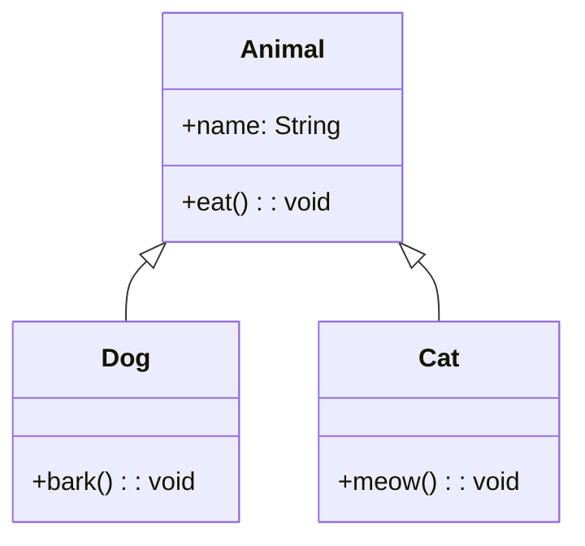

**特点**：
- "is-a" 关系（狗是一种动物）
- 子类继承父类的属性和方法
- 子类可以重写父类的方法
- 对应 Java 的 `extends`

---

#### 2. 实现关系（Realization）

**含义**：类实现接口，类实现了接口定义的行为。

**表示方法**：空心三角箭头 + 虚线，从实现类指向接口。

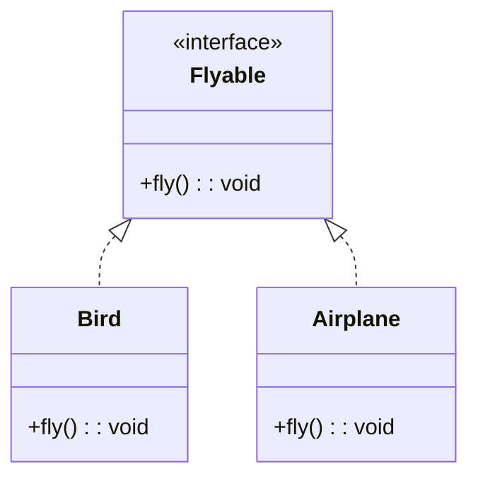

**特点**：
- "can-do" 关系（鸟会飞，飞机也会飞）
- 接口定义行为契约，类负责实现
- 对应 Java 的 `implements`

---

#### 3. 组合关系（Composition）

**含义**：整体与部分的关系，部分不能脱离整体而存在。

**表示方法**：实心菱形 + 实线，菱形在整体那一端。

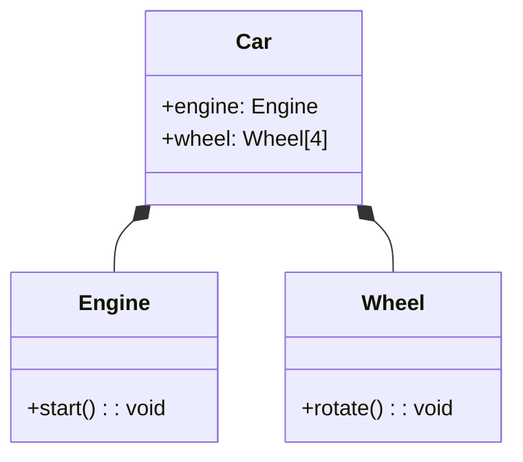

**特点**：
- "contains-a" 关系，强拥有
- 整体和部分生命周期一致
- 整体没了，部分也没了
- 示例：车和发动机、人和心脏

---

#### 4. 聚合关系（Aggregation）

**含义**：整体与部分的关系，部分可以脱离整体而存在。

**表示方法**：空心菱形 + 实线，菱形在整体那一端。

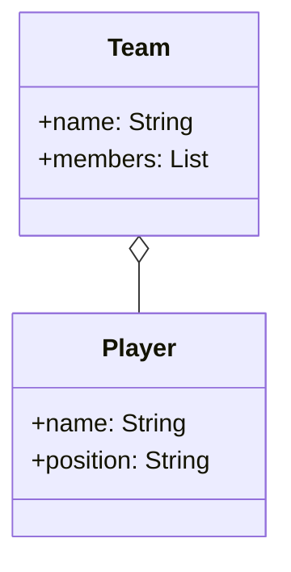

**特点**：
- "has-a" 关系，弱拥有
- 整体和部分可以独立存在
- 整体没了，部分还可以存在
- 示例：球队和球员、班级和学生

> 🔴 **组合 vs 聚合的区别**：
> - 组合：整体没了，部分也没了（车毁了，发动机也废了）
> - 聚合：整体没了，部分还活着（球队解散了，球员还在）
> - 很多时候判断标准是语义上的，没有绝对的对错

---

#### 5. 关联关系（Association）

**含义**：类之间的结构关系，表示一个类的对象和另一个类的对象有联系。

**表示方法**：实线（可以有箭头、可以有多重性、可以有角色名）。

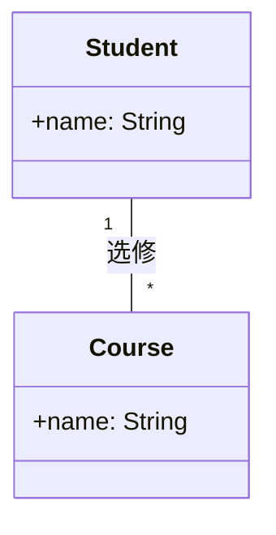

**关联的多重性（Multiplicity）**：

| 表示 | 含义 |
|------|------|
| 1 | 1个 |
| 0..1 | 0个或1个 |
| 0..* 或 * | 0个或多个 |
| 1..* | 1个或多个 |
| n..m | n个到m个 |

**常见的关联类型**：

| 类型 | 示例 |
|------|------|
| 一对一 | 学生 - 学号 |
| 一对多 | 班级 - 学生 |
| 多对多 | 学生 - 课程 |

**单向关联 vs 双向关联**：
- **双向关联**：两端都知道对方，用不带箭头的实线
- **单向关联**：只有一端知道另一端，用带箭头的实线（指向被知道的一方）

---

#### 6. 依赖关系（Dependency）

**含义**：一个类的变化可能影响到另一个类（通常是临时使用关系）。

**表示方法**：虚线箭头，从使用者指向被使用者。

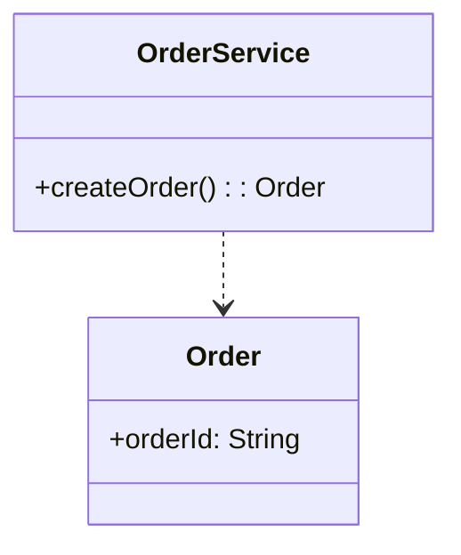

**常见的依赖场景**：

1. 一个类的方法参数使用了另一个类
2. 一个类的方法返回值是另一个类
3. 一个类的方法内部创建了另一个类的对象
4. 一个类调用了另一个类的静态方法

**特点**：
- "uses-a" 关系
- 是最弱的关系
- 通常是临时性的
- 关联是一种特殊的依赖（更强的依赖）

---

### 4.3.4 关系强度总结

```mermaid
graph LR
    A[泛化<br>继承] --> B[实现]
    B --> C[组合]
    C --> D[聚合]
    D --> E[关联]
    E --> F[依赖]
    
    style A fill:#ff6b6b
    style B fill:#feca57
    style C fill:#48dbfb
    style D fill:#1dd1a1
    style E fill:#5f27cd
    style F fill:#c8d6e5
    
    note right of A: 最强
    note right of F: 最弱
```

### 4.3.5 类图常见错误

| 错误 | 问题 | 正确做法 |
|------|------|----------|
| 箭头方向搞反 | 泛化、实现的箭头应该指向父 | 子类→父类，实现类→接口 |
| 菱形方向搞反 | 组合/聚合的菱形在整体那端 | 整体有菱形，部分没有 |
| 多重性只标一端 | 关联两端都要标多重性 | 两端都标，如 1 对 * |
| 属性和方法搞混 | 属性是数据，方法是行为 | 属性在第二层，方法在第三层 |
| 把关联画成依赖 | 长期结构关系用关联，临时使用用依赖 | 区分清楚使用关系 |

---

## 4.4 时序图（Sequence Diagram）

### 4.4.1 什么是时序图？

**时序图**（也叫序列图、顺序图）：描述对象之间消息传递的时间顺序的图。

> 时序图展示了"在什么时间，谁给谁发了什么消息"。

### 4.4.2 时序图的基本元素

| 元素 | 表示 | 说明 |
|------|------|------|
| **对象** | 矩形框（带下划线的对象名） | 参与交互的对象 |
| **生命线** | 向下的虚线 | 对象存在的时间线 |
| **激活条** | 细长矩形 | 对象正在执行的时间段 |
| **消息** | 箭头 | 对象之间的通信 |
| **返回消息** | 虚线箭头 | 方法调用的返回 |
| **自调用** | 自己指向自己的箭头 | 对象调用自己的方法 |

### 4.4.3 消息的类型

| 消息类型 | 图形 | 说明 |
|----------|------|------|
| **同步消息** | 实线实心箭头 | 调用者等待返回（普通方法调用） |
| **异步消息** | 实线空心箭头 | 调用者不等待返回，继续执行 |
| **返回消息** | 虚线空心箭头 | 方法调用的返回值 |
| **自调用消息** | 自己调用自己的箭头 | 对象内部的方法调用 |

### 4.4.4 时序图示例（用户登录流程）

```mermaid
sequenceDiagram
    participant User as 用户
    participant UI as 登录界面
    participant Service as 用户服务
    participant DB as 数据库
    
    User->>UI: 输入用户名密码
    UI->>UI: 校验输入格式
    alt 输入格式正确
        UI->>Service: login(username, password)
        activate Service
        Service->>DB: 查询用户信息
        activate DB
        DB-->>Service: 返回用户数据
        deactivate DB
        Service->>Service: 验证密码
        alt 密码正确
            Service->>Service: 生成Token
            Service-->>UI: 登录成功 + Token
            deactivate Service
            UI-->>User: 显示登录成功
        else 密码错误
            Service-->>UI: 密码错误
            deactivate Service
            UI-->>User: 提示密码错误
        end
    else 输入格式错误
        UI-->>User: 提示格式错误
    end
```

### 4.4.5 时序图的组成说明

#### 1. 对象/参与者（Participant）

- 放在时序图的顶部
- 每个对象有一条垂直的生命线
- 命名方式：对象名:类名，或只有类名

#### 2. 生命线（Lifeline）

- 从对象向下延伸的虚线
- 表示对象存在的时间
- 对象被创建后生命线开始，被销毁后结束

#### 3. 激活条（Activation / Execution Occurrence）

- 生命线上的细长矩形
- 表示对象正在执行某个操作
- 操作开始时激活，结束时停止

#### 4. 消息（Message）

- 从一个对象的生命线指向另一个对象的生命线
- 消息名称通常是方法名
- 可以带参数

### 4.4.6 组合片段（Combined Fragment）

组合片段用来表达复杂的流程控制。

#### 常见的组合片段

| 操作符 | 名称 | 含义 |
|--------|------|------|
| **alt** | 抉择 | 相当于 if-else，条件分支 |
| **opt** | 可选 | 相当于 if，满足条件才执行 |
| **loop** | 循环 | 相当于 for/while，重复执行 |
| **par** | 并行 | 并行执行 |
| **break** | 中断 | 满足条件则中断 |
| **try/catch** | 异常 | 异常处理 |

#### alt 示例（条件分支）

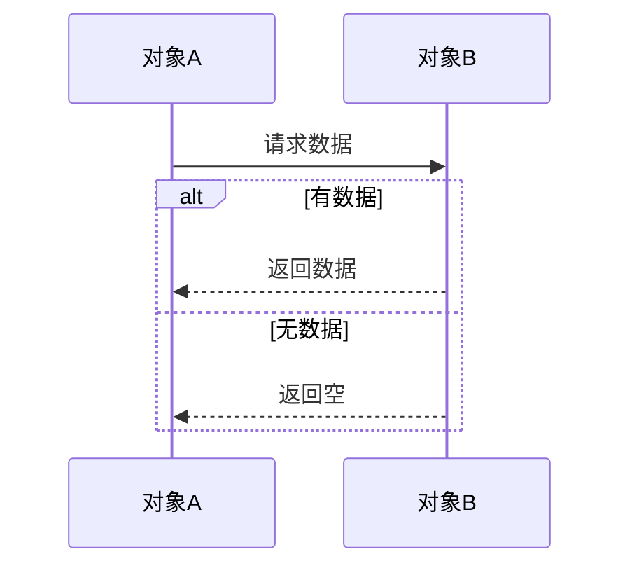

#### loop 示例（循环）

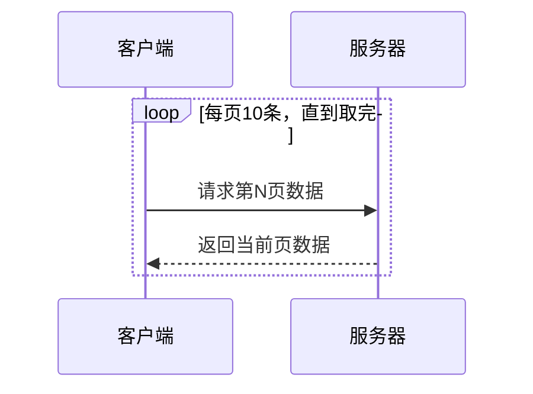

### 4.4.7 时序图阅读技巧

阅读时序图时，按照以下顺序：
1. **从上往下看**：时间顺序是从上到下的
2. **从左到右看消息**：消息从发送者指向接收者
3. **关注关键对象**：哪些对象参与了交互
4. **关注消息顺序**：消息的先后顺序是什么
5. **关注条件分支**：有哪些判断和分支

### 4.4.8 时序图常见错误

| 错误 | 问题 | 正确做法 |
|------|------|----------|
| 消息方向搞反 | 消息从调用者指向被调用者 | 注意箭头方向 |
| 返回消息用实线 | 返回消息应该用虚线 | 返回用虚线空心箭头 |
| 没有激活条 | 方法执行期间应该有激活条 | 调用方法时画激活条 |
| 对象顺序混乱 | 相关的对象放在一起 | 按交互流程排列对象 |

---

## 4.5 活动图（Activity Diagram）

### 4.5.1 什么是活动图？

**活动图**：描述工作流程和活动流转的图，类似于流程图。

> 活动图展示了"做什么事情，按什么顺序做"。

### 4.5.2 活动图的基本元素

| 元素 | 图形 | 说明 |
|------|------|------|
| **初始节点** | 实心圆 | 活动的开始 |
| **终止节点** | 实心圆加外圈 | 活动的结束 |
| **活动节点** | 圆角矩形 | 一个活动/操作 |
| **转换** | 箭头 | 活动之间的流转 |
| **决策节点** | 菱形 | 条件判断，多个输出路径 |
| **合并节点** | 菱形 | 多个输入路径合并 |
| **分叉节点** | 粗横线 | 并行开始，一个输入多个输出 |
| **汇合节点** | 粗横线 | 并行结束，多个输入一个输出 |
| **泳道/分区** | 矩形区域 | 按职责划分活动的区域 |

### 4.5.3 活动图示例（订单处理流程）

```mermaid
flowchart TD
    start([开始]) --> submit[提交订单]
    submit --> checkStock{检查库存}
    
    checkStock -->|库存充足| checkPayment{检查支付}
    checkStock -->|库存不足| notifyOut[通知缺货]
    notifyOut --> end2([结束])
    
    checkPayment -->|支付成功| ship[发货]
    checkPayment -->|支付失败| cancel[取消订单]
    cancel --> end2
    
    ship --> parallel[并行处理]
    parallel --> updateDB[更新数据库]
    parallel --> sendEmail[发送邮件通知]
    parallel --> updateLog[更新物流信息]
    
    updateDB --> join[等待全部完成]
    sendEmail --> join
    updateLog --> join
    
    join --> finish[订单完成]
    finish --> end([结束])
```

### 4.5.4 活动图的核心概念

#### 1. 决策与合并

- **决策节点（Decision）**：一个输入，多个输出，根据条件选择走哪条路
- **合并节点（Merge）**：多个输入，一个输出，任何一条路径到达都可以继续

> 注意：决策和合并都是菱形，区别看上下文——
> - 一个输入多个输出 = 决策
> - 多个输入一个输出 = 合并

#### 2. 分叉与汇合

- **分叉节点（Fork）**：一个输入，多个输出，多个活动**并行**执行
- **汇合节点（Join）**：多个输入，一个输出，**等待所有**并行活动都完成才继续

> 注意区分：
> - 决策/合并 = 条件分支（多选一）
> - 分叉/汇合 = 并行执行（同时进行，全部完成才继续）

#### 3. 泳道（Swimlane）

泳道（也叫分区）用来区分不同角色/部门负责的活动。

```mermaid
flowchart LR
    subgraph 客户
        start([开始]) --> submit[提交订单]
    end
    
    subgraph 销售部
        submit --> check[审核订单]
        check -->|通过| confirm[确认订单]
        check -->|拒绝| reject[拒绝订单]
    end
    
    subgraph 仓库
        confirm --> ship[发货]
        ship --> end([结束])
        reject --> end
    end
```

### 4.5.5 活动图 vs 流程图

| 维度 | 活动图 Activity Diagram | 流程图 Flowchart |
|------|------------------------|------------------|
| 起源 | UML，面向对象 | 传统，面向过程 |
| 并行支持 | 支持（分叉/汇合） | 不支持 |
| 泳道 | 支持 | 部分支持 |
| 对象流 | 支持（可以显示对象状态） | 不支持 |
| 适用场景 | 业务流程、用例实现 | 算法、程序流程 |

### 4.5.6 活动图常见错误

| 错误 | 问题 | 正确做法 |
|------|------|----------|
| 决策和分叉搞混 | 决策是条件选一个，分叉是并行全走 | 注意区分条件分支和并行 |
| 合并和汇合搞混 | 合并是任一到达就继续，汇合是全部到才继续 | 注意是"或"还是"且" |
| 活动节点太粗或太细 | 粒度不合适，太大或太小 | 粒度适中，一个活动是一个完整动作 |

---

## 4.6 状态图（State Machine Diagram）

### 4.6.1 什么是状态图？

**状态图**：描述一个对象在其生命周期中经历的状态变化，以及引起状态变化的事件。

> 状态图展示了"一个对象有哪些状态，在什么条件下从一个状态变到另一个状态"。

### 4.6.2 状态图的基本元素

| 元素 | 图形 | 说明 |
|------|------|------|
| **初始状态** | 实心圆 | 对象的初始状态 |
| **终止状态** | 实心圆加外圈 | 对象的最终状态 |
| **状态** | 圆角矩形 | 对象的一种状态 |
| **转换** | 箭头 | 从一个状态到另一个状态的转移 |
| **事件** | 转换上的标注 | 引起状态转换的事件 |
| **监护条件** | [条件] | 转换发生必须满足的条件 |
| **动作** | /动作 | 转换发生时执行的动作 |

**转换的语法格式**：
```
事件名 [监护条件] / 动作
```

### 4.6.3 状态图示例（订单状态）

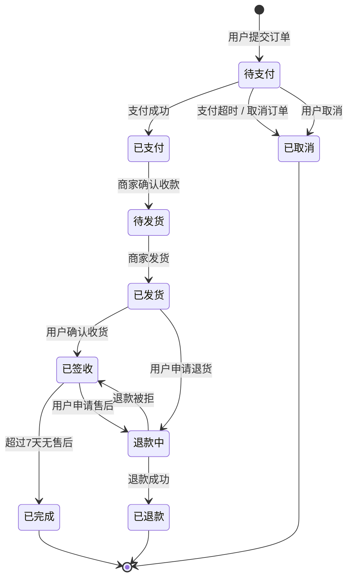

### 4.6.4 状态图的核心概念

#### 状态（State）

状态是对象在其生命周期中的一个阶段，满足以下条件：
- 对象满足某些条件
- 对象执行某些活动
- 对象等待某些事件

#### 转换（Transition）

转换是从一个状态到另一个状态的转移，由事件触发。

转换的五要素：
1. **源状态**：转换从哪个状态开始
2. **目标状态**：转换到哪个状态
3. **触发事件**：什么事件引起的转换
4. **监护条件**：满足什么条件才转换（可选）
5. **动作**：转换时执行什么操作（可选）

### 4.6.5 状态图 vs 活动图

| 维度 | 状态图 State Diagram | 活动图 Activity Diagram |
|------|---------------------|------------------------|
| 关注点 | 对象的状态变化 | 工作流程和活动流转 |
| 核心 | 状态 + 事件 + 转换 | 活动 + 决策 + 流转 |
| 适用 | 描述单个对象的生命周期 | 描述业务流程/用例流程 |
| 触发 | 由外部事件驱动 | 由活动完成驱动 |
| 示例 | 订单状态变化、用户账户状态 | 订单处理流程、审批流程 |

> 💡 **简单区分**：
> - 状态图关注"对象处于什么状态"（名词）
> - 活动图关注"正在做什么事情"（动词）

---

## 4.7 UML 建模工具与实践

### 4.7.1 常用 UML 工具

| 工具 | 类型 | 特点 | 适用场景 |
|------|------|------|----------|
| **Draw.io (diagrams.net)** | 在线/桌面 | 免费、开源、功能全 | 日常绘图、团队协作 |
| **StarUML** | 桌面 | 专业、功能强、颜值高 | 专业建模、项目开发 |
| **Visual Paradigm** | 桌面/在线 | 功能非常全面 | 企业级项目 |
| **PlantUML** | 文本转图 | 用代码写UML、版本控制友好 | 程序员、文档集成 |
| **Mermaid** | 文本转图 | 轻量、Markdown集成 | 文档中嵌入图表 |
| **EA (Enterprise Architect)** | 桌面 | 功能最强、企业级 | 大型企业项目 |
| **亿图图示** | 桌面 | 国产、模板多 | 国产替代 |

> 💡 **初学者推荐**：
> - 想快速上手：Draw.io（免费、好用、模板多）
> - 程序员、喜欢用代码写：Mermaid + PlantUML
> - 专业做项目：StarUML 或 Visual Paradigm

### 4.7.2 UML 建模的最佳实践

1. **UML 是工具，不是目的**
   - 画图是为了理清思路，不是为了画图而画图
   - 能用文字说清的就不用画图

2. **选择合适的图**
   - 不是每种图都要画
   - 根据需要选择合适的图
   - 重点掌握：用例图、类图、时序图

3. **粒度适中**
   - 不要太粗（看不清细节）
   - 不要太细（图太复杂）
   - 一张图说一件事

4. **保持简洁**
   - 去掉不必要的细节
   - 突出重点
   - 图是用来交流的，不是用来炫技的

5. **及时更新**
   - 代码变了，图也要跟着变
   - 过时的图比没有图更可怕

### 4.7.3 UML 在项目中的使用时机

| 阶段 | 常用图 | 用途 |
|------|--------|------|
| **需求阶段** | 用例图、活动图 | 描述功能需求和业务流程 |
| **设计阶段** | 类图、时序图、状态图、组件图、部署图 | 描述系统结构和交互 |
| **实现阶段** | 类图、时序图 | 指导编码、记录设计 |
| **测试阶段** | 用例图、活动图 | 设计测试用例 |
| **维护阶段** | 各类图 | 理解系统、辅助修改 |

---

## 4.8 常见误区与易错点

### 误区1：UML 必须画得非常详细

- ❌ 错！UML 是沟通工具，够用就行
- ✅ 根据受众和目的决定详细程度
- ✅ 给自己看的草图和给客户看的正式图不一样

### 误区2：UML 是过时的东西，敏捷开发不用UML

- ❌ 错！敏捷只是不做大量的前期设计文档
- ✅ 敏捷团队也用 UML 来讨论和交流设计
- ✅ 只是画的是草图、白板图，不是精美的正式文档

### 误区3：UML 只能用于面向对象

- ❌ 错！虽然 UML 起源于面向对象，但很多图（用例图、活动图、部署图）也可以用于非面向对象系统
- ✅ UML 是通用的建模语言，不局限于某种开发范式

### 误区4：用例图 = 功能列表

- ❌ 错！用例图不只是功能列表，更重要的是参与者和关系
- ✅ 用例是从用户视角的完整功能，要有价值

### 误区5：类图的关系搞混

- 常见错误：
  - 泛化方向搞反（应该是子类指向父类）
  - 组合/聚合菱形方向搞反（菱形在整体那端）
  - 组合和聚合区分不清
- ✅ 多画图、多看例子，熟能生巧

---

## 4.9 关键术语中英对照

| 中文 | 英文 | 缩写 |
|------|------|------|
| 统一建模语言 | Unified Modeling Language | UML |
| 用例图 | Use Case Diagram | - |
| 类图 | Class Diagram | - |
| 时序图 | Sequence Diagram | - |
| 活动图 | Activity Diagram | - |
| 状态图 | State Machine Diagram | - |
| 对象图 | Object Diagram | - |
| 组件图 | Component Diagram | - |
| 部署图 | Deployment Diagram | - |
| 包图 | Package Diagram | - |
| 参与者 | Actor | - |
| 用例 | Use Case | UC |
| 包含关系 | Include Relationship | - |
| 扩展关系 | Extend Relationship | - |
| 泛化 | Generalization | - |
| 实现 | Realization | - |
| 关联 | Association | - |
| 聚合 | Aggregation | - |
| 组合 | Composition | - |
| 依赖 | Dependency | - |
| 多重性 | Multiplicity | - |
| 生命线 | Lifeline | - |
| 激活条 | Activation / Execution | - |
| 同步消息 | Synchronous Message | - |
| 异步消息 | Asynchronous Message | - |
| 泳道 | Swimlane | - |
| 分叉 | Fork | - |
| 汇合 | Join | - |
| 决策 | Decision | - |
| 合并 | Merge | - |

---

## 4.10 练习题与自测

### 一、选择题

1. UML 中，用来描述系统功能和用户角色的图是（ ）
   - A. 类图
   - B. 用例图
   - C. 时序图
   - D. 活动图

2. 用例之间的包含关系是（ ）
   - A. 可选的
   - B. 必须的
   - C. 互斥的
   - D. 并行的

3. 类图中，组合关系的表示是（ ）
   - A. 空心菱形
   - B. 实心菱形
   - C. 空心三角
   - D. 实心三角

4. 时序图中，同步消息用（ ）表示
   - A. 实线实心箭头
   - B. 实线空心箭头
   - C. 虚线实心箭头
   - D. 虚线空心箭头

5. 活动图中，并行分支的开始用（ ）表示
   - A. 菱形
   - B. 粗横线（分叉）
   - C. 圆角矩形
   - D. 实心圆

6. 状态图描述的是（ ）
   - A. 对象之间的交互顺序
   - B. 工作流程和活动流转
   - C. 对象的状态变化
   - D. 系统的静态结构

### 二、简答题

1. UML 中有哪些常用的图？各自的用途是什么？

2. 用例图中有哪些元素？包含和扩展有什么区别？

3. 类之间有哪几种关系？从强到弱排列。

4. 组合和聚合有什么区别？举例说明。

5. 时序图和活动图有什么区别？分别适用于什么场景？

### 三、画图题

**题目1：用例图**
请为"在线购物系统"画出用例图，要求：
- 参与者：买家、卖家、管理员
- 用例：浏览商品、搜索商品、购物车、下单、支付、评价、发布商品、管理商品、用户管理
- 合理使用包含和扩展关系

**题目2：类图**
请为"图书馆管理系统"画出类图，要求：
- 类：图书、读者、管理员、借阅记录
- 每个类至少 3 个属性和 2 个方法
- 标出类之间的关系和多重性

**题目3：时序图**
请画出"用户注册"的时序图，要求：
- 参与者：用户、注册页面、用户服务、数据库、邮件服务
- 流程：用户输入信息 → 页面校验 → 调用注册接口 → 检查用户名是否存在 → 创建用户 → 发送验证邮件 → 返回结果
- 包含"用户名已存在"的异常分支

---

## 4.11 参考答案

### 一、选择题

1. **B** — 用例图描述系统功能和用户角色
2. **B** — 包含关系是必须的，基用例执行时一定会执行被包含用例
3. **B** — 组合是实心菱形；聚合是空心菱形
4. **A** — 同步消息是实线实心箭头；异步是实线空心；返回是虚线空心
5. **B** — 分叉（粗横线）表示并行开始；菱形是决策
6. **C** — 状态图描述对象的状态变化；时序图描述交互顺序；活动图描述流程

### 二、简答题（要点）

1. UML 常用图及用途：
   - **用例图**：描述系统功能和用户角色（需求阶段）
   - **类图**：描述系统的静态结构，类和类的关系（设计阶段）
   - **时序图**：描述对象之间的交互顺序（设计阶段）
   - **活动图**：描述工作流程和活动流转（需求/设计阶段）
   - **状态图**：描述对象的状态变化（设计阶段）
   - **组件图**：描述组件及其关系（架构设计）
   - **部署图**：描述系统的物理部署（架构设计）

2. 用例图元素：参与者、用例、系统边界、关联、包含、扩展、泛化。
   **包含 vs 扩展**：
   - 包含：基用例一定执行被包含用例，是必须的，箭头从基指向被包含
   - 扩展：扩展用例可选地扩展基用例，是可选的，箭头从扩展指向基

3. 类之间的关系（从强到弱）：
   泛化（继承）→ 实现 → 组合 → 聚合 → 关联 → 依赖

4. **组合 vs 聚合**：
   - 都是整体-部分关系
   - 组合：强拥有，整体和部分生命周期一致，整体没了部分也没了（如人和心脏）
   - 聚合：弱拥有，整体和部分可以独立存在，整体没了部分还活着（如球队和球员）

5. **时序图 vs 活动图**：
   - 时序图：关注对象之间的消息传递和时间顺序，适合描述对象交互
   - 活动图：关注工作流程和活动流转，适合描述业务流程
   - 场景：想展示"谁给谁发了什么消息"用时序图；想展示"事情按什么流程做"用活动图

### 三、画图题（参考思路）

**题目1：在线购物系统用例图**
- 参与者：买家、卖家、管理员
- 买家用例：浏览商品、搜索商品、加入购物车、下单、支付、评价商品
- 卖家用例：发布商品、管理商品、处理订单
- 管理员用例：用户管理、商品审核、系统配置
- 包含关系：下单 include 登录、支付 include 订单验证
- 扩展关系：使用优惠券 extend 下单

**题目2：图书馆管理系统类图**
- Book（图书）：id, title, author, isbn, status + borrow(), returnBook()
- Reader（读者）：id, name, email, maxBorrow + borrowBook(), returnBook()
- Librarian（管理员）：id, name, password + addBook(), removeBook()
- BorrowRecord（借阅记录）：id, borrowDate, dueDate, returnDate + createRecord(), closeRecord()
- 关系：
  - Reader 和 BorrowRecord：一对多（1个读者有多条借阅记录）
  - Book 和 BorrowRecord：一对一（1条记录对应1本书）
  - Librarian 和 Book：一对多（管理员管理多本图书）

**题目3：用户注册时序图**
- 用户 → 注册页面：输入注册信息
- 注册页面 → 注册页面：校验输入格式
- 注册页面 → 用户服务：register(userInfo)
- 用户服务 → 数据库：检查用户名是否存在
- 数据库 → 用户服务：返回查询结果
- alt 用户名已存在
  - 用户服务 → 注册页面：返回"用户名已存在"
  - 注册页面 → 用户：提示用户名已被注册
- else 用户名可用
  - 用户服务 → 数据库：创建用户记录
  - 数据库 → 用户服务：创建成功
  - 用户服务 → 邮件服务：发送验证邮件
  - 邮件服务 → 用户服务：发送成功
  - 用户服务 → 注册页面：返回注册成功
  - 注册页面 → 用户：显示注册成功，提示查收邮件

---

> 📌 **下一章**：学习软件测试技术 → [05-软件测试.md](./05-软件测试.md)
