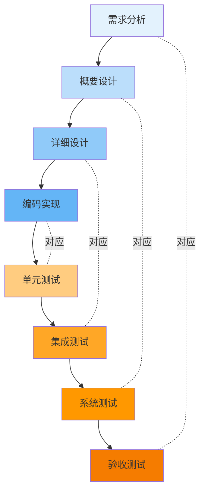
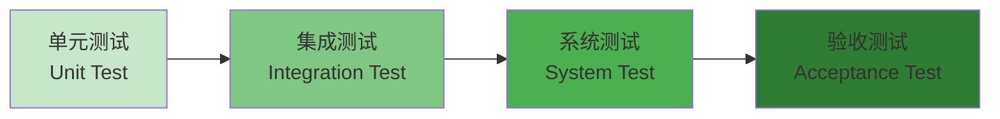
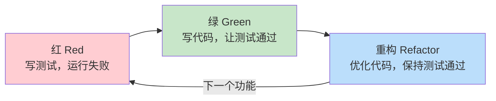
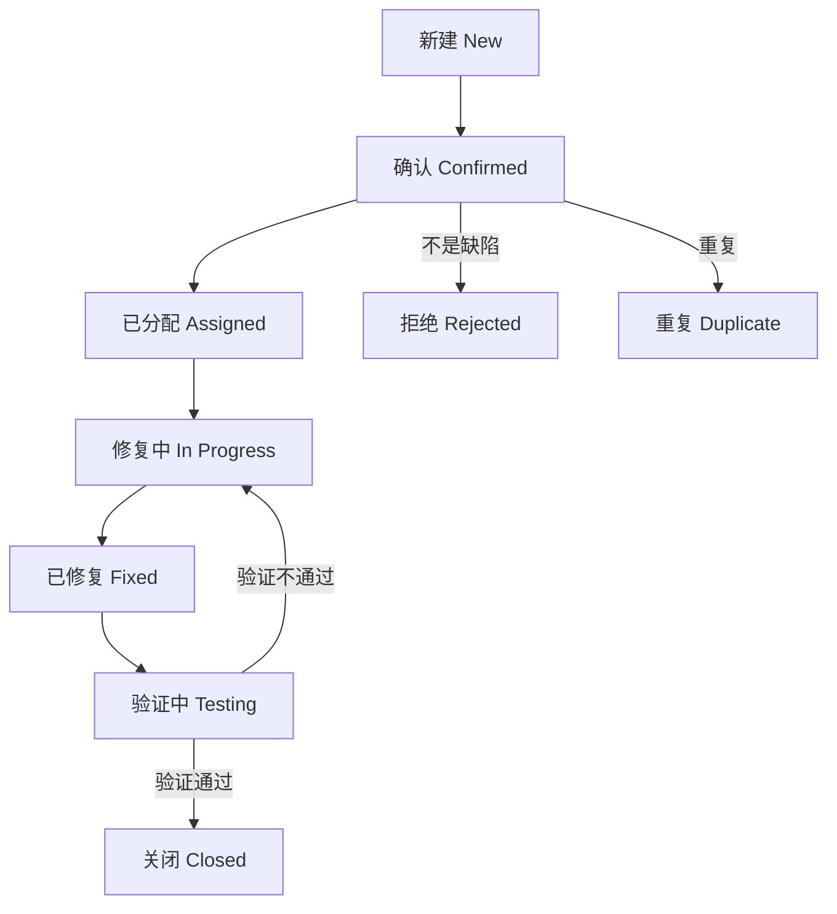

# 第五章 软件测试

> **学习目标**：掌握软件测试的基本概念、测试级别、黑盒白盒测试方法，了解TDD和自动化测试
> **预计学时**：8小时 | **重要程度**：⭐⭐⭐⭐⭐

---

## 5.1 软件测试概述

### 5.1.1 什么是软件测试？

**软件测试（Software Testing）**：在规定的条件下对程序进行操作，以发现程序错误，衡量软件质量，并对其是否能满足设计要求进行评估的过程。

> 简单说：软件测试就是"找bug" + "评估质量"。

#### 经典定义

> **Grenford J. Myers** 在《软件测试的艺术》中提出：
> 1. 测试是为了发现错误而执行程序的过程
> 2. 好的测试用例是发现了至今尚未发现的错误的测试用例
> 3. 成功的测试是发现了至今尚未发现的错误的测试

> 💡 **重要观点**：
> - 测试的目的是**发现错误**，不是证明程序没有错误
> - 测试只能证明有bug，不能证明没有bug
> - 没有发现bug的测试，不代表程序没有bug，可能只是测试不够充分

### 5.1.2 为什么需要测试？

| 原因 | 说明 |
|------|------|
| **发现缺陷** | 找出软件中的bug和问题 |
| **保证质量** | 确保软件符合质量要求 |
| **降低风险** | 减少上线后出问题的概率 |
| **提升信心** | 对软件质量有把握 |
| **改进开发** | 测试反馈帮助改进开发流程 |

> 🔴 **惨痛教训**：历史上因为软件bug导致的重大事故
> - 1996年，欧洲阿丽亚娜5号火箭发射后爆炸，原因是软件数据溢出，损失3.7亿美元
> - 1999年，美国NASA火星气候探测器坠毁，原因是英制公制单位混淆，损失1.25亿美元
> - 2009年，丰田汽车"踏板门"事件，软件问题导致意外加速，赔偿数十亿美元

### 5.1.3 测试的基本原则

| 原则 | 说明 |
|------|------|
| **测试显示存在缺陷** | 测试能发现缺陷，但不能证明没有缺陷 |
| **穷尽测试是不可能的** | 不可能测试所有情况，需要基于风险和优先级 |
| **测试尽早介入** | 测试越早开始，发现缺陷的成本越低 |
| **缺陷集群效应** | 80%的缺陷集中在20%的模块中 |
| **杀虫剂悖论** | 用同样的测试用例反复测试，逐渐发现不了新bug |
| **测试依赖上下文** | 不同的软件测试方法不同（如游戏vs医疗软件） |
| **没有缺陷就是有用的谬论** | 没有bug不等于用户满意，可能产品本身就不对 |

> 🐛 **杀虫剂悖论**（Pesticide Paradox）：
> 就像农药用久了害虫会产生抗药性一样，测试用例用多了也发现不了新bug。
> 所以测试用例需要不断更新和补充。

### 5.1.4 测试的 V 模型

**V 模型**（V-Model）是软件测试的经典模型，展示了测试级别和开发阶段的对应关系。



| 开发阶段 | 对应测试级别 | 测试依据 |
|----------|-------------|----------|
| 需求分析 | 验收测试 | 需求规格说明书 |
| 概要设计 | 系统测试 | 系统设计文档 |
| 详细设计 | 集成测试 | 详细设计文档 |
| 编码实现 | 单元测试 | 代码/详细设计 |

> V 模型的核心思想：**测试不是编码之后才开始的，每个开发阶段都有对应的测试活动**。

---

## 5.2 测试级别

### 5.2.1 测试级别概览

软件测试通常分为四个级别，从低到高，从小到大：



| 测试级别 | 测试对象 | 测试目的 | 谁来做 |
|----------|----------|----------|--------|
| **单元测试** | 最小的功能单元（函数、方法、类） | 验证每个单元是否正确实现 | 开发人员 |
| **集成测试** | 模块之间的接口和交互 | 验证模块组装后是否正常工作 | 开发/测试人员 |
| **系统测试** | 整个系统 | 验证整个系统是否符合需求 | 测试人员 |
| **验收测试** | 整个系统 | 验证系统是否满足用户需求 | 用户/客户 |

---

### 5.2.2 单元测试（Unit Testing）

#### 什么是单元测试？

对软件中最小的可测试单元进行检查和验证。

- **单元**：一个函数、一个方法、一个类
- **目标**：验证每个单元是否按照设计正确工作

#### 单元测试的特点

| 特点 | 说明 |
|------|------|
| **粒度最小** | 测试最小的功能单元 |
| **最早进行** | 编码阶段就开始写 |
| **开发者自测** | 通常由开发人员自己写 |
| **运行最快** | 执行速度快，可以频繁运行 |
| **发现问题最早** | 在编码阶段就发现问题 |

#### 好的单元测试的特点（AIR 原则）

| 原则 | 英文 | 说明 |
|------|------|------|
| **A - 自动的** | Automatic | 自动执行，自动判断结果 |
| **I - 独立的** | Independent | 测试用例之间互不依赖 |
| **R - 可重复的** | Repeatable | 多次运行结果一致，不受环境影响 |

#### 单元测试示例（Python + pytest）

```python
# 要测试的函数
def add(a, b):
    """两个数相加"""
    return a + b

# 单元测试
def test_add_positive_numbers():
    """测试正数相加"""
    assert add(2, 3) == 5

def test_add_negative_numbers():
    """测试负数相加"""
    assert add(-1, -1) == -2

def test_add_zero():
    """测试加零"""
    assert add(5, 0) == 5
```

#### 常用单元测试框架

| 语言 | 框架 |
|------|------|
| Java | JUnit, TestNG |
| Python | pytest, unittest |
| JavaScript | Jest, Mocha |
| C/C++ | Google Test, CppUnit |
| C# | NUnit, xUnit |
| Go | testing（内置） |

---

### 5.2.3 集成测试（Integration Testing）

#### 什么是集成测试？

在单元测试的基础上，将模块组装在一起，测试模块之间的接口和交互是否正确。

- **测试对象**：模块之间的接口、数据传递
- **目标**：发现模块集成时的接口问题

#### 为什么需要集成测试？

- 每个单元测试都通过了，但组合到一起可能出问题
- 接口定义理解不一致
- 数据传递出错
- 一个模块的变更影响其他模块

#### 集成测试的策略

| 策略 | 说明 | 优点 | 缺点 |
|------|------|------|------|
| **自顶向下** | 从顶层模块开始，逐步集成下层 | 早期验证主要流程 | 需要编写桩程序（Stub） |
| **自底向上** | 从底层模块开始，逐步集成上层 | 不需要桩，底层先验证 | 直到最后才能看到整体 |
| **三明治** | 自顶向下 + 自底向上，中间汇合 | 兼顾两者优点 | 中间层测试不充分 |
| **大爆炸** | 所有模块写完了一次性集成 | 简单，适合小项目 | 问题发现晚，定位难 |

> 📌 **相关概念**：
> - **Stub（桩）**：代替被调用模块的模拟对象（自顶向下时需要）
> - **Driver（驱动）**：代替调用模块的模拟对象（自底向上时需要）
> - **Mock（模拟）**：更通用的说法，模拟依赖对象

---

### 5.2.4 系统测试（System Testing）

#### 什么是系统测试？

将整个软件系统作为一个整体进行测试，验证系统是否满足需求规格说明的要求。

- **测试对象**：整个软件系统
- **测试依据**：需求规格说明书
- **测试人员**：专业测试人员

#### 系统测试的特点

| 特点 | 说明 |
|------|------|
| **端到端测试** | 从用户角度测试完整功能 |
| **黑盒测试** | 不关心内部实现，只看输入输出 |
| **全面性** | 功能、性能、安全、兼容性等都测 |
| **独立测试** | 通常由独立的测试团队进行 |

#### 系统测试的内容

| 测试类型 | 说明 |
|----------|------|
| **功能测试** | 验证功能是否符合需求 |
| **性能测试** | 验证系统性能指标（响应时间、吞吐量） |
| **安全测试** | 验证系统的安全性 |
| **兼容性测试** | 验证在不同环境下的兼容性 |
| **易用性测试** | 验证用户体验是否良好 |
| **可靠性测试** | 验证系统长时间运行的稳定性 |

---

### 5.2.5 验收测试（Acceptance Testing）

#### 什么是验收测试？

在系统测试之后，由用户或客户进行的测试，验证系统是否满足业务需求，决定是否验收。

- **测试人员**：用户、客户、业务人员
- **测试目的**：确认系统是否可以上线使用

#### 验收测试的类型

| 类型 | 英文 | 说明 |
|------|------|------|
| **Alpha 测试** | Alpha Testing | 在开发环境下，由用户进行的测试 |
| **Beta 测试** | Beta Testing | 在实际使用环境下，由最终用户进行的测试 |
| **UAT测试** | User Acceptance Testing | 用户验收测试，正式验收前的测试 |

> 💡 **Alpha vs Beta**：
> - Alpha：在公司内部，开发环境，用户来测
> - Beta：在用户现场，真实环境，真实用户用

---

### 5.2.6 测试级别对比总结

| 维度 | 单元测试 | 集成测试 | 系统测试 | 验收测试 |
|------|----------|----------|----------|----------|
| **测试对象** | 函数/方法/类 | 模块间接口 | 整个系统 | 整个系统 |
| **测试依据** | 详细设计/代码 | 概要设计 | 需求规格说明 | 用户需求/合同 |
| **测试方法** | 白盒为主 | 灰盒为主 | 黑盒为主 | 黑盒 |
| **测试人员** | 开发人员 | 开发/测试 | 测试人员 | 用户/客户 |
| **发现问题** | 编码错误 | 接口错误 | 功能错误 | 需求偏差 |
| **测试粒度** | 最小 | 较小 | 最大 | - |
| **执行速度** | 最快 | 较快 | 较慢 | 最慢 |

---

## 5.3 黑盒测试（Black-box Testing）

### 5.3.1 什么是黑盒测试？

**黑盒测试**：把测试对象看作一个黑盒子，不考虑内部结构和实现，只检查输入和输出是否符合要求。

> 也叫"功能测试"、"数据驱动测试"。

```mermaid
graph LR
    A[输入] --> B[黑盒<br>不知道内部结构]
    B --> C[输出]
    
    note right of B: 只看输入输出对不对<br>不关心内部怎么实现
```

#### 黑盒测试的特点

| 特点 | 说明 |
|------|------|
| **不关心内部实现** | 只看输入输出是否正确 |
| **站在用户角度** | 模拟用户使用系统 |
| **测试用例基于需求** | 根据需求设计用例 |
| **适用于各测试级别** | 系统测试、验收测试主要用黑盒 |

#### 黑盒测试能发现的问题

- 功能不正确或遗漏
- 界面错误
- 输入输出错误
- 数据结构错误或外部数据库访问错误
- 性能问题
- 初始化和终止错误

### 5.3.2 等价类划分法

#### 基本思想

把输入数据划分成若干个等价类，从每个等价类中选取少量代表性数据作为测试用例。

> 为什么可行？因为同一等价类中的数据，暴露缺陷的概率是一样的。

#### 等价类的类型

| 类型 | 说明 |
|------|------|
| **有效等价类** | 合理的、有意义的输入数据构成的集合 |
| **无效等价类** | 不合理的、无意义的输入数据构成的集合 |

#### 设计步骤

1. **划分等价类**：根据需求，把输入分成有效和无效等价类
2. **编号等价类**：给每个等价类编号
3. **设计测试用例**：
   - 覆盖所有有效等价类（尽量用最少的用例覆盖最多的有效类）
   - 每个无效等价类单独一个用例

#### 示例：用户注册功能

**需求**：用户名长度为 6-12 位，只能包含字母和数字。

**第一步：划分等价类**

| 等价类编号 | 类型 | 说明 |
|-----------|------|------|
| 1 | 有效 | 长度 6-12 位，字母+数字 |
| 2 | 无效 | 长度 < 6 位 |
| 3 | 无效 | 长度 > 12 位 |
| 4 | 无效 | 包含特殊字符 |
| 5 | 无效 | 包含中文 |
| 6 | 无效 | 空字符串 |

**第二步：设计测试用例**

| 用例编号 | 输入 | 预期结果 | 覆盖等价类 |
|----------|------|----------|-----------|
| TC01 | abc123 | 注册成功 | 1 |
| TC02 | abc12 | 提示长度不足 | 2 |
| TC03 | abcdefghijklm | 提示长度过长 | 3 |
| TC04 | abc@123 | 提示含非法字符 | 4 |
| TC05 | abc张三123 | 提示含非法字符 | 5 |
| TC06 | （空） | 提示用户名不能为空 | 6 |

> 💡 **为什么无效等价类要单独测？**
> 因为如果多个无效条件放在一起，可能只触发第一个错误就返回了，后面的错误没被测试到。

---

### 5.3.3 边界值分析法

#### 基本思想

在等价类的边界上选取测试数据，因为边界是最容易出问题的地方。

> 经验表明：大量的错误发生在输入输出范围的边界上，而不是在范围内部。

#### 为什么边界容易出问题？

- 程序员容易把 `<` 写成 `<=`
- 循环条件容易多一次或少一次
- 数组下标越界
- 整数溢出

#### 边界值的选取

对于一个范围 `[min, max]`，通常选取以下边界值：

| 点 | 含义 | 示例：[6, 12] |
|----|------|--------------|
| **min** | 最小值 | 6 |
| **min-1** | 略小于最小值 | 5 |
| **min+1** | 略大于最小值 | 7 |
| **max** | 最大值 | 12 |
| **max-1** | 略小于最大值 | 11 |
| **max+1** | 略大于最大值 | 13 |

> 口诀：**六点法** — 上点、内点、离点
> - 上点：边界上的点（min, max）
> - 内点：范围内部的点
> - 离点：离边界最近的外部点

#### 示例：用户名长度验证

**需求**：用户名长度为 6-12 位。

**边界值测试用例**：

| 用例编号 | 输入（长度） | 预期结果 | 说明 |
|----------|-------------|----------|------|
| TC01 | 5位 | 不通过 | 最小值-1 |
| TC02 | 6位 | 通过 | 最小值 |
| TC03 | 7位 | 通过 | 最小值+1（内点） |
| TC04 | 11位 | 通过 | 最大值-1（内点） |
| TC05 | 12位 | 通过 | 最大值 |
| TC06 | 13位 | 不通过 | 最大值+1 |

#### 边界值与等价类的关系

- **等价类划分**：选"代表性"的数据，覆盖各类情况
- **边界值分析**：选"边界"的数据，检查边界正确性
- **实际工作中**：两种方法结合使用，等价类划分+边界值补充

---

### 5.3.4 因果图法

#### 基本思想

考虑输入条件之间的组合关系，以及输入和输出之间的因果关系。

> 等价类和边界值没有考虑输入条件之间的组合，因果图解决这个问题。

#### 适用场景

- 输入条件之间有组合关系
- 输出结果依赖于输入条件的组合
- 业务逻辑比较复杂

#### 因果图的基本符号

| 关系 | 符号 | 含义 |
|------|------|------|
| **恒等** | — | 原因出现，结果就出现 |
| **非** | ~ | 原因出现，结果不出现 |
| **或** | ∨ | 只要有一个原因出现，结果就出现 |
| **与** | ∧ | 所有原因都出现，结果才出现 |

#### 设计步骤

1. 分析原因（输入条件）和结果（输出）
2. 画出因果图
3. 转换成判定表
4. 根据判定表设计测试用例

> 因果图最终会转换成判定表，所以也可以直接用判定表法。

---

### 5.3.5 判定表法（决策表法）

#### 什么是判定表？

**判定表（Decision Table）**：用表格形式表达多个条件组合下的不同动作。

#### 判定表的组成

| 部分 | 说明 |
|------|------|
| **条件桩** | 所有的条件（输入） |
| **动作桩** | 所有的动作（输出） |
| **条件项** | 条件的取值组合 |
| **动作项** | 对应的动作 |

#### 示例：登录功能

**条件**：
- 用户名是否正确（Y/N）
- 密码是否正确（Y/N）
- 验证码是否正确（Y/N）

**动作**：
- 登录成功
- 提示用户名错误
- 提示密码错误
- 提示验证码错误

**判定表**：

| 规则 | 1 | 2 | 3 | 4 | 5 | 6 | 7 | 8 |
|------|---|---|---|---|---|---|---|---|
| **条件** | | | | | | | | |
| 用户名正确 | Y | Y | Y | Y | N | N | N | N |
| 密码正确 | Y | Y | N | N | Y | Y | N | N |
| 验证码正确 | Y | N | Y | N | Y | N | Y | N |
| **动作** | | | | | | | | |
| 登录成功 | ✓ | | | | | | | |
| 提示用户名错误 | | | | | ✓ | ✓ | ✓ | ✓ |
| 提示密码错误 | | | ✓ | | | | | |
| 提示验证码错误 | | ✓ | | ✓ | | ✓ | | ✓ |

> 注意：规则5-8中，用户名错误时，不管密码和验证码对不对，都应该先提示用户名错误。
> 实际中可能会合并一些规则，但测试时要考虑各种组合。

#### 判定表法的优缺点

| 优点 | 缺点 |
|------|------|
| 能覆盖所有条件组合 | 条件多时，组合数爆炸（n个条件有2ⁿ种组合） |
| 逻辑清晰，不容易遗漏 | 不适合条件之间有依赖关系的情况 |
| 适合复杂的业务逻辑 | 设计成本较高 |

---

### 5.3.6 场景法（场景分析法）

#### 基本思想

模拟用户使用场景，通过事件流来设计测试用例。

> 用例的基本流+各种扩展流，构成不同的场景。

#### 场景法的来源

基于用例的场景，每个用例有：
- **基本流**：正常的、没有异常的流程
- **备选流/扩展流**：各种异常情况和分支

#### 示例：电商下单场景

**基本流**：浏览商品 → 加入购物车 → 结算 → 支付 → 下单成功

**场景设计**：

| 场景编号 | 场景名称 | 流程 |
|----------|----------|------|
| 场景1 | 正常下单 | 基本流 |
| 场景2 | 库存不足 | 基本流 → 结算时库存不足 |
| 场景3 | 支付失败 | 基本流 → 支付失败 → 重新支付 → 成功 |
| 场景4 | 取消订单 | 基本流 → 支付前取消订单 |
| 场景5 | 使用优惠券 | 基本流 + 使用优惠券 |

> 场景法非常贴近用户实际使用，适合系统测试和验收测试。

---

### 5.3.7 错误推测法

#### 基本思想

基于经验和直觉，推测程序中可能存在的各种错误，从而有针对性地设计测试用例。

> 也叫"错误猜测法"，是一种经验主义的方法。

#### 常见的错误推测

| 类型 | 示例 |
|------|------|
| **输入数据类** | 空值、空格、特殊字符、超长字符串 |
| **数值类** | 0、负数、极大值、小数、除零 |
| **边界类** | 刚好等于边界、刚好超过边界 |
| **顺序类** | 第一个、最后一个、倒序 |
| **状态类** | 重复操作、并发操作、超时 |
| **兼容性** | 不同浏览器、不同分辨率、不同操作系统 |

#### 优缺点

| 优点 | 缺点 |
|------|------|
| 快速高效，直击要害 | 依赖经验，没有经验的人用不好 |
| 容易发现深层问题 | 不系统，可能遗漏 |
| 适合补充测试 | 不能作为主要测试方法 |

> 💡 **实际工作中**：
> 先用等价类+边界值+判定表等系统方法设计用例，
> 再用错误推测法补充一些经验性的用例。

---

## 5.4 白盒测试（White-box Testing）

### 5.4.1 什么是白盒测试？

**白盒测试**：把测试对象看作一个透明的盒子，测试人员了解内部结构和代码，根据内部结构设计测试用例。

> 也叫"结构测试"、"玻璃盒测试"、"逻辑驱动测试"。

```mermaid
graph LR
    A[输入] --> B[白盒<br>能看到内部结构]
    B --> C[输出]
    
    note right of B: 根据代码逻辑设计用例<br>检查每条路径是否正确
```

#### 白盒测试的特点

| 特点 | 说明 |
|------|------|
| **了解内部实现** | 能看到代码，根据代码结构设计用例 |
| **测试更深入** | 可以测试到代码的每条路径 |
| **主要用于单元测试** | 开发人员自测时使用 |
| **需要编程能力** | 测试人员需要会写代码 |

### 5.4.2 逻辑覆盖

逻辑覆盖是白盒测试最核心的方法，根据覆盖程度从低到高分为：

```mermaid
graph LR
    A[语句覆盖] --> B[判定覆盖]
    B --> C[条件覆盖]
    C --> D[判定/条件覆盖]
    D --> E[条件组合覆盖]
    E --> F[路径覆盖]
    
    note right of A: 最弱
    note right of F: 最强
```

| 覆盖级别 | 英文 | 覆盖目标 | 强度 |
|----------|------|----------|------|
| **语句覆盖** | Statement Coverage | 每条语句至少执行一次 | ⭐ |
| **判定覆盖** | Decision Coverage | 每个判定的真假分支至少走一次 | ⭐⭐ |
| **条件覆盖** | Condition Coverage | 每个条件的真假至少取一次 | ⭐⭐ |
| **判定/条件覆盖** | Decision/Condition Coverage | 同时满足判定覆盖和条件覆盖 | ⭐⭐⭐ |
| **条件组合覆盖** | Multiple Condition Coverage | 每个判定中条件的所有组合至少出现一次 | ⭐⭐⭐⭐ |
| **路径覆盖** | Path Coverage | 程序中所有可能的路径至少执行一次 | ⭐⭐⭐⭐⭐ |

> 注意：条件覆盖不一定包含判定覆盖，两者没有绝对的强弱关系。

---

#### 示例代码

我们用以下代码来演示各种覆盖：

```java
public int calculate(int a, int b, boolean flag) {
    int result = 0;
    
    // 判定1：两个条件
    if (a > 0 && b > 0) {    // 语句1
        result = a + b;       // 语句2
    }
    
    // 判定2：一个条件
    if (flag) {               // 语句3
        result = result * 2;  // 语句4
    }
    
    return result;            // 语句5
}
```

对应的流程图：

```mermaid
flowchart TD
    start([开始]) --> cond1{a > 0 && b > 0?}
    cond1 -->|是| stmt1[result = a + b]
    cond1 -->|否| cond2{flag?}
    stmt1 --> cond2
    cond2 -->|是| stmt2[result = result * 2]
    cond2 -->|否| end([返回result])
    stmt2 --> end
```

---

#### 1. 语句覆盖（Statement Coverage）

**定义**：设计测试用例，使得程序中每条语句至少执行一次。

**目标**：覆盖所有可执行语句。

**测试用例**：

| 用例 | a | b | flag | 执行路径 | 覆盖语句 |
|------|---|---|------|----------|----------|
| TC01 | 1 | 1 | true | 判定1是 → 判定2是 | 语句1,2,3,4,5 |

**覆盖率**：100%（5条语句都执行了）

**问题**：
- 如果把 `a > 0 && b > 0` 错写成 `a > 0 || b > 0`，这个用例发现不了
- 语句覆盖是最弱的覆盖，100%语句覆盖不代表没问题

---

#### 2. 判定覆盖（Decision Coverage）

**定义**：设计测试用例，使得每个判定的取真和取假分支至少执行一次。

> 也叫"分支覆盖"（Branch Coverage）。

**目标**：覆盖所有判定的真假分支。

**测试用例**：

| 用例 | a | b | flag | 判定1 | 判定2 |
|------|---|---|------|-------|-------|
| TC01 | 1 | 1 | true | 真 | 真 |
| TC02 | -1 | 1 | false | 假 | 假 |

**覆盖率**：
- 判定1：真✓ 假✓ → 100%
- 判定2：真✓ 假✓ → 100%

**问题**：
- 判定覆盖只看判定的整体结果，不关心每个条件
- 比如 `a > 0 && b > 0`，只要判定1为假就行，不关心是a不大于0还是b不大于0

---

#### 3. 条件覆盖（Condition Coverage）

**定义**：设计测试用例，使得每个判定中的每个条件的可能取值（真/假）至少满足一次。

**目标**：覆盖所有条件的真假。

**判定1有两个条件**：
- 条件C1：a > 0
- 条件C2：b > 0

**判定2有一个条件**：
- 条件C3：flag

**测试用例**：

| 用例 | a | b | flag | C1: a>0 | C2: b>0 | C3: flag | 判定1 | 判定2 |
|------|---|---|------|---------|---------|----------|-------|-------|
| TC01 | 1 | -1 | true | 真 | 假 | 真 | 假 | 真 |
| TC02 | -1 | 1 | false | 假 | 真 | 假 | 假 | 假 |

**条件覆盖率**：
- C1：真✓ 假✓ → 100%
- C2：真✓ 假✓ → 100%
- C3：真✓ 假✓ → 100%

**注意**：条件覆盖不一定包含判定覆盖！
- 上面的例子中，判定1始终为假，真分支从来没走过
- 所以条件覆盖和判定覆盖没有绝对的强弱关系

---

#### 4. 判定/条件覆盖（Decision/Condition Coverage）

**定义**：设计测试用例，使得判定中每个条件的所有可能取值至少出现一次，同时每个判定本身的所有可能结果也至少出现一次。

> 简单说：同时满足判定覆盖和条件覆盖。

**测试用例**：

| 用例 | a | b | flag | C1 | C2 | C3 | 判定1 | 判定2 |
|------|---|---|------|----|----|----|-------|-------|
| TC01 | 1 | 1 | true | 真 | 真 | 真 | 真 | 真 |
| TC02 | -1 | -1 | false | 假 | 假 | 假 | 假 | 假 |

**覆盖率**：
- 条件覆盖：所有条件的真假都有了 ✓
- 判定覆盖：所有判定的真假都有了 ✓

**问题**：
- 看起来很完美，但实际上可能有问题
- 因为 `&&` 和 `||` 有短路特性，有些条件组合可能没被真正执行到
- 比如 `a > 0 && b > 0`，当a不大于0时，b>0这个条件可能根本没被计算

---

#### 5. 条件组合覆盖（Multiple Condition Coverage）

**定义**：设计测试用例，使得每个判定中条件的所有可能组合至少出现一次。

> 这是最强的条件级覆盖。

**判定1的条件组合**（2个条件，2²=4种组合）：
1. a > 0 为真，b > 0 为真 → 判定为真
2. a > 0 为真，b > 0 为假 → 判定为假
3. a > 0 为假，b > 0 为真 → 判定为假
4. a > 0 为假，b > 0 为假 → 判定为假

**判定2的条件组合**（1个条件，2¹=2种组合）：
1. flag 为真
2. flag 为假

**测试用例**：

| 用例 | a | b | flag | 判定1组合 | 判定2组合 |
|------|---|---|------|-----------|-----------|
| TC01 | 1 | 1 | true | 真真 | 真 |
| TC02 | 1 | -1 | true | 真假 | 真 |
| TC03 | -1 | 1 | false | 假真 | 假 |
| TC04 | -1 | -1 | false | 假假 | 假 |

**覆盖率**：所有条件组合都覆盖了 ✓

**问题**：
- 组合数随条件数指数增长：n个条件有2ⁿ种组合
- 实际中很难做到100%条件组合覆盖

---

#### 6. 路径覆盖（Path Coverage）

**定义**：设计测试用例，覆盖程序中所有可能的执行路径。

> 这是最强的逻辑覆盖。

**示例程序的所有路径**：
1. 判定1真 → 判定2真
2. 判定1真 → 判定2假
3. 判定1假 → 判定2真
4. 判定1假 → 判定2假

**测试用例**：

| 用例 | a | b | flag | 路径 |
|------|---|---|------|------|
| TC01 | 1 | 1 | true | 真→真 |
| TC02 | 1 | 1 | false | 真→假 |
| TC03 | -1 | 1 | true | 假→真 |
| TC04 | -1 | 1 | false | 假→假 |

**覆盖率**：4条路径全覆盖 ✓

**问题**：
- 对于复杂程序，路径数是爆炸性的（循环会导致无限路径）
- 实际中几乎不可能做到100%路径覆盖
- 通常用基本路径覆盖（独立路径）来代替

---

### 5.4.3 逻辑覆盖总结

| 覆盖类型 | 覆盖目标 | 强度 | 用例数（示例） | 发现问题能力 |
|----------|----------|------|---------------|-------------|
| 语句覆盖 | 每条语句 | 最弱 | 1 | 最弱 |
| 判定覆盖 | 每个判定真假 | 弱 | 2 | 较弱 |
| 条件覆盖 | 每个条件真假 | 弱 | 2 | 中等 |
| 判定/条件覆盖 | 判定+条件 | 中 | 2 | 中等 |
| 条件组合覆盖 | 所有条件组合 | 强 | 4 | 强 |
| 路径覆盖 | 所有路径 | 最强 | 4 | 最强 |

> 💡 **实际工作中**：
> - 单元测试一般要求 80% 以上的语句覆盖或分支覆盖
> - 核心模块要求更高的覆盖率
> - 不是覆盖率越高越好，要平衡投入产出比

---

## 5.5 测试驱动开发（TDD）

### 5.5.1 什么是 TDD？

**TDD（Test-Driven Development，测试驱动开发）**：先写测试代码，再写功能代码，由测试来驱动开发的过程。

> 简单说：先写测试，再写代码，测试不通过就改代码，直到测试通过。

### 5.5.2 TDD 的核心循环：红绿重构



| 步骤 | 名称 | 说明 |
|------|------|------|
| **第一步** | 红（Red） | 写一个测试，运行它，它会失败（因为功能还没实现） |
| **第二步** | 绿（Green） | 写最少的功能代码，让测试通过 |
| **第三步** | 重构（Refactor） | 优化代码结构，保持测试通过 |

### 5.5.3 TDD 示例

假设我们要实现一个"字符串反转"的功能。

#### 第一步：红 — 先写测试

```python
# test_reverse.py
import pytest

def test_reverse_string():
    """测试字符串反转"""
    assert reverse("hello") == "olleh"
    assert reverse("") == ""
    assert reverse("a") == "a"
```

运行测试 → 失败（因为 reverse 函数还不存在）❌

#### 第二步：绿 — 写最少的代码让测试通过

```python
# reverse.py
def reverse(s):
    return s[::-1]
```

运行测试 → 通过 ✓

#### 第三步：重构 — 优化代码

```python
# reverse.py
def reverse(s: str) -> str:
    """
    反转字符串
    
    Args:
        s: 输入字符串
        
    Returns:
        反转后的字符串
    """
    if not s:
        return s
    return s[::-1]
```

运行测试 → 仍然通过 ✓

然后继续下一个功能...

### 5.5.4 TDD 的好处

1. ✅ **代码质量更高**：边写边测，bug 发现早
2. ✅ **设计更好**：为了可测试，代码会更模块化
3. ✅ **信心更足**：改代码后跑一遍测试，放心
4. ✅ **文档作用**：测试用例就是活的文档
5. ✅ **减少调试时间**：出问题时很快能定位

### 5.5.5 TDD 的常见误解

| 误解 | 事实 |
|------|------|
| TDD 就是写测试 | TDD 是一种开发方法，测试是手段不是目的 |
| TDD 不需要设计 | TDD 是增量设计，不是没有设计 |
| TDD 用例100%覆盖就没问题 | TDD 也不能保证没有 bug |
| TDD 只适合单元测试 | TDD 主要在单元级别，但也有 ATDD（验收TDD）、BDD（行为驱动） |

> ⚠️ **注意**：TDD 不是银弹，不是所有项目都适合。
> 对于需求非常不稳定、探索性的项目，TDD 可能效率不高。

---

## 5.6 自动化测试

### 5.6.1 什么是自动化测试？

**自动化测试**：使用工具和脚本自动执行测试，代替人工手动测试。

> 简单说：让机器帮你跑测试。

### 5.6.2 为什么需要自动化测试？

| 原因 | 说明 |
|------|------|
| **提高效率** | 机器比人快，而且可以24小时跑 |
| **降低成本** | 长期来看，自动化比人工便宜 |
| **提高准确性** | 机器不会疲劳，不会粗心 |
| **支持回归测试** | 每次改代码都可以快速跑一遍 |
| **支持CI/CD** | 自动化是持续集成的基础 |

### 5.6.3 自动化测试金字塔

```mermaid
graph TD
    A[E2E 端到端测试] --> B[集成测试]
    B --> C[单元测试]
    
    style A fill:#ffcdd2,stroke:#d32f2f
    style B fill:#fff3e0,stroke:#f57c00
    style C fill:#c8e6c9,stroke:#388e3c
    
    note right of A: 数量少<br>速度慢<br>成本高
    note right of C: 数量多<br>速度快<br>成本低
```

| 层级 | 测试类型 | 数量 | 速度 | 成本 | 稳定性 |
|------|----------|------|------|------|--------|
| **顶层** | E2E端到端测试 | 少 | 慢 | 高 | 低 |
| **中间** | 集成测试 | 中 | 中 | 中 | 中 |
| **底层** | 单元测试 | 多 | 快 | 低 | 高 |

> 💡 **最佳实践**：
> - 单元测试最多，占 70% 左右
> - 集成测试次之，占 20% 左右
> - 端到端测试最少，占 10% 左右
> - 越往上，测试越少越精

### 5.6.4 常见自动化测试工具

| 测试类型 | 工具/框架 |
|----------|-----------|
| **单元测试** | JUnit, pytest, Jest, Go test |
| **接口测试** | Postman, JMeter, RestAssured, requests |
| **UI自动化** | Selenium, Appium, Cypress, Playwright |
| **性能测试** | JMeter, LoadRunner, k6, Locust |
| **安全测试** | OWASP ZAP, Burp Suite, Nessus |

### 5.6.5 什么时候做自动化？

| 适合自动化 | 不适合自动化 |
|------------|-------------|
| 回归测试（反复执行的） | 一次性的测试 |
| 高频执行的测试 | 需求频繁变动的功能 |
| 性能测试、压力测试 | 探索性测试 |
| 数据驱动的测试 | 用户体验/易用性测试 |
| 稳定的功能 | 新功能（先手工再自动化） |

> 🔴 **常见误区**：不是所有测试都要自动化！
> 盲目追求自动化率，反而会增加维护成本，降低效率。

---

## 5.7 测试管理与质量

### 5.7.1 测试用例

#### 什么是测试用例？

**测试用例（Test Case）**：为某个特殊目标而编制的一组测试输入、执行条件以及预期结果，以便测试某个程序路径或核实是否满足某个特定需求。

#### 测试用例的要素

| 要素 | 说明 | 示例 |
|------|------|------|
| **用例编号** | 唯一标识 | TC-LOGIN-001 |
| **用例名称** | 简短描述 | 正确用户名密码登录成功 |
| **前置条件** | 执行前需要满足的条件 | 用户已注册 |
| **测试步骤** | 操作步骤 | 1. 打开登录页 2. 输入用户名密码 3. 点击登录 |
| **测试数据** | 输入数据 | username: test, password: 123456 |
| **预期结果** | 期望的输出 | 登录成功，跳转到首页 |
| **实际结果** | 实际执行的结果 | （执行后填写） |
| **测试结果** | 通过/失败/阻塞 | Pass / Fail / Block |
| **优先级** | 用例的重要程度 | P0 / P1 / P2 |

### 5.7.2 缺陷管理

#### 什么是缺陷？

**缺陷（Defect / Bug）**：软件中存在的问题，导致软件不符合需求或预期。

#### 缺陷的生命周期



#### 缺陷报告的要素

| 要素 | 说明 |
|------|------|
| **缺陷标题** | 简洁描述问题 |
| **缺陷编号** | 唯一标识 |
| **严重程度** | 致命/严重/一般/轻微 |
| **优先级** | 高/中/低，什么时候修 |
| **缺陷描述** | 详细描述问题现象 |
| **复现步骤** | 怎么操作能重现问题 |
| **预期结果** | 正确的应该是什么样 |
| **实际结果** | 现在是什么样 |
| **环境信息** | 操作系统、浏览器、版本号 |
| **附件** | 截图、日志、录屏 |

> 💡 **好的缺陷报告的标准**：
> 开发人员拿到报告，不需要问额外信息，就能复现和定位问题。

### 5.7.3 测试覆盖率

**测试覆盖率（Test Coverage）**：衡量测试充分程度的指标。

| 覆盖率类型 | 说明 |
|-----------|------|
| **需求覆盖率** | 测试覆盖了多少需求 |
| **功能覆盖率** | 测试覆盖了多少功能点 |
| **代码覆盖率** | 测试执行了多少代码（语句覆盖、分支覆盖等） |
| **用例执行率** | 执行了多少测试用例 |

### 5.7.4 软件质量与测试的关系

- 测试是质量保证的重要手段，但不是唯一手段
- 质量不是测出来的，是设计出来的、开发出来的
- 测试只能发现缺陷，不能提高质量本身
- 提高质量需要从需求、设计、编码、测试全流程入手

---

## 5.8 常见误区与易错点

### 误区1：测试的目的是证明程序没有错误

- ❌ 错！测试只能证明有bug，不能证明没有bug
- ✅ 测试的目的是发现尽可能多的bug

### 误区2：测试是测试人员的事，开发不用管

- ❌ 错！质量是每个人的责任
- ✅ 开发要做单元测试、代码审查，测试做系统测试

### 误区3：测试越晚开始越好，等代码写完再测

- ❌ 错！测试越早介入越好
- ✅ 需求阶段测试就可以开始参与，评审需求

### 误区4：测试用例越多越好

- ❌ 错！低质量的用例再多也没用
- ✅ 用例要精，覆盖面要广，重复的用例要合并

### 误区5：自动化测试能代替手工测试

- ❌ 错！自动化和手工各有优势，互相补充
- ✅ 自动化适合回归测试、重复测试；手工适合探索性测试、新功能测试

### 误区6：100%代码覆盖率就是完美

- ❌ 错！100%覆盖率不代表没有bug
- ✅ 覆盖率是手段不是目的，关键是测试的质量

---

## 5.9 关键术语中英对照

| 中文 | 英文 | 缩写 |
|------|------|------|
| 软件测试 | Software Testing | - |
| 单元测试 | Unit Testing | UT |
| 集成测试 | Integration Testing | IT |
| 系统测试 | System Testing | ST |
| 验收测试 | Acceptance Testing | AT |
| 用户验收测试 | User Acceptance Testing | UAT |
| 黑盒测试 | Black-box Testing | - |
| 白盒测试 | White-box Testing | - |
| 灰盒测试 | Gray-box Testing | - |
| 等价类划分 | Equivalence Partitioning | - |
| 边界值分析 | Boundary Value Analysis | BVA |
| 判定表 | Decision Table | - |
| 场景法 | Scenario Method | - |
| 错误推测 | Error Guessing | - |
| 语句覆盖 | Statement Coverage | - |
| 判定覆盖 | Decision / Branch Coverage | - |
| 条件覆盖 | Condition Coverage | - |
| 路径覆盖 | Path Coverage | - |
| 测试驱动开发 | Test-Driven Development | TDD |
| 自动化测试 | Automated Testing | - |
| 端到端测试 | End-to-End Testing | E2E |
| 测试用例 | Test Case | TC |
| 缺陷/错误 | Defect / Bug | - |
| 回归测试 | Regression Testing | - |
| 测试覆盖率 | Test Coverage | - |
| 质量保证 | Quality Assurance | QA |
| 质量控制 | Quality Control | QC |
| Alpha测试 | Alpha Testing | - |
| Beta测试 | Beta Testing | - |

---

## 5.10 练习题与自测

### 一、选择题

1. 软件测试的目的是（ ）
   - A. 证明程序没有错误
   - B. 发现程序中的错误
   - C. 评估程序员的水平
   - D. 减少代码量

2. 下列测试级别中，粒度最小的是（ ）
   - A. 单元测试
   - B. 集成测试
   - C. 系统测试
   - D. 验收测试

3. 黑盒测试是根据（ ）设计测试用例的
   - A. 代码结构
   - B. 软件需求
   - C. 程序逻辑
   - D. 算法复杂度

4. 等价类划分的目的是（ ）
   - A. 测试所有可能的输入
   - B. 减少测试用例的数量，同时保证覆盖率
   - C. 测试边界值
   - D. 测试条件组合

5. 白盒测试中，最弱的逻辑覆盖是（ ）
   - A. 语句覆盖
   - B. 判定覆盖
   - C. 条件覆盖
   - D. 路径覆盖

6. TDD 的正确顺序是（ ）
   - A. 写代码 → 写测试 → 重构
   - B. 写测试 → 写代码 → 重构
   - C. 重构 → 写测试 → 写代码
   - D. 写测试 → 重构 → 写代码

### 二、简答题

1. 软件测试有哪些基本原则？

2. 简述测试的四个级别及各自的测试对象和目的。

3. 黑盒测试和白盒测试有什么区别？各有哪些常用方法？

4. 什么是等价类划分？有效等价类和无效等价类有什么区别？

5. 什么是 TDD？TDD 的红绿重构循环是什么？

### 三、设计题

**题目1：等价类划分 + 边界值**

某系统的"年龄"输入框要求：年龄必须是 18-60 之间的整数。

请完成：
1. 划分有效等价类和无效等价类
2. 设计边界值测试用例
3. 列出完整的测试用例表

**题目2：逻辑覆盖**

有以下代码：

```python
def calculate_grade(score, is_makeup):
    """
    根据分数计算成绩等级
    score: 分数（0-100）
    is_makeup: 是否补考
    """
    if score >= 60 and not is_makeup:
        if score >= 90:
            grade = "A"
        elif score >= 80:
            grade = "B"
        else:
            grade = "C"
    elif score >= 60 and is_makeup:
        grade = "D"  # 补考及格只有D
    else:
        grade = "F"  # 不及格
    
    return grade
```

请完成：
1. 画出流程图
2. 为了达到 100% 判定覆盖，需要哪些测试用例？
3. 为了达到 100% 条件组合覆盖（只考虑最外层if的条件），需要哪些测试用例？

---

## 5.11 参考答案

### 一、选择题

1. **B** — 测试的目的是发现错误，不是证明没有错误
2. **A** — 单元测试粒度最小，测试函数/方法/类
3. **B** — 黑盒测试不关心内部实现，根据需求（功能）设计用例
4. **B** — 等价类划分用少量代表性数据覆盖各类情况，减少用例数量
5. **A** — 语句覆盖是最弱的逻辑覆盖
6. **B** — TDD：先写测试（红）→ 写代码通过（绿）→ 重构

### 二、简答题（要点）

1. 软件测试基本原则：
   - 测试显示存在缺陷，不能证明没有缺陷
   - 穷尽测试是不可能的
   - 测试尽早介入
   - 缺陷集群效应（80%缺陷在20%模块）
   - 杀虫剂悖论（同样的测试用例会失效）
   - 测试依赖上下文（不同软件测试方法不同）
   - 没有缺陷的谬论（没有bug不等于产品有用）

2. 四个测试级别：
   - **单元测试**：测试最小的功能单元（函数、类），验证单元是否正确实现
   - **集成测试**：测试模块之间的接口和交互，验证组装后是否正常
   - **系统测试**：测试整个系统，验证是否符合需求规格说明
   - **验收测试**：由用户进行，验证是否满足业务需求，决定是否验收

3. **黑盒测试**：不关心内部实现，只看输入输出，基于需求设计用例
   - 方法：等价类划分、边界值分析、判定表、场景法、错误推测
   
   **白盒测试**：了解内部代码结构，基于代码逻辑设计用例
   - 方法：逻辑覆盖（语句、判定、条件、路径等）、基本路径测试
   
   **区别**：黑盒站在用户角度测功能；白盒站在开发者角度测代码逻辑

4. **等价类划分**：把输入数据划分成若干等价类，从每个等价类中选少量代表性数据作为测试用例。
   
   **有效等价类**：合理的、有意义的输入，应该被系统正确处理
   **无效等价类**：不合理的、无意义的输入，系统应该拒绝或报错
   
   两者都要测试：既要测正常情况，也要测异常情况。

5. **TDD**（Test-Driven Development）：测试驱动开发，先写测试再写功能代码。
   
   **红绿重构循环**：
   - **红（Red）**：写一个测试，运行失败（功能还没实现）
   - **绿（Green）**：写最少的代码，让测试通过
   - **重构（Refactor）**：优化代码结构，保持测试通过

### 三、设计题（参考答案）

**题目1：年龄输入框**

**1. 等价类划分**：

| 编号 | 类型 | 说明 |
|------|------|------|
| 1 | 有效 | 18-60 之间的整数 |
| 2 | 无效 | 小于18的整数 |
| 3 | 无效 | 大于60的整数 |
| 4 | 无效 | 非整数（小数、字符串） |
| 5 | 无效 | 空值 |
| 6 | 无效 | 负数 |

**2. 边界值**：

| 边界点 | 值 | 类型 |
|--------|-----|------|
| min-1 | 17 | 无效 |
| min | 18 | 有效 |
| min+1 | 19 | 有效 |
| max-1 | 59 | 有效 |
| max | 60 | 有效 |
| max+1 | 61 | 无效 |

**3. 测试用例表**：

| 用例编号 | 输入 | 预期结果 | 等价类覆盖 | 边界点 |
|----------|------|----------|-----------|--------|
| TC01 | 25 | 通过 | 1 | 内点 |
| TC02 | 17 | 不通过 | 2 | min-1 |
| TC03 | 18 | 通过 | 1 | min |
| TC04 | 19 | 通过 | 1 | min+1 |
| TC05 | 59 | 通过 | 1 | max-1 |
| TC06 | 60 | 通过 | 1 | max |
| TC07 | 61 | 不通过 | 3 | max+1 |
| TC08 | 25.5 | 不通过 | 4 | - |
| TC09 | abc | 不通过 | 4 | - |
| TC10 | （空） | 不通过 | 5 | - |
| TC11 | -5 | 不通过 | 6 | - |

---

**题目2：成绩计算逻辑覆盖**

**1. 流程图**：

```mermaid
flowchart TD
    start([开始]) --> cond1{score >= 60<br>且不是补考?}
    
    cond1 -->|是| cond2{score >= 90?}
    cond2 -->|是| gradeA[grade = A]
    cond2 -->|否| cond3{score >= 80?}
    cond3 -->|是| gradeB[grade = B]
    cond3 -->|否| gradeC[grade = C]
    
    cond1 -->|否| cond4{score >= 60<br>且是补考?}
    cond4 -->|是| gradeD[grade = D]
    cond4 -->|否| gradeF[grade = F]
    
    gradeA --> end([返回grade])
    gradeB --> end
    gradeC --> end
    gradeD --> end
    gradeF --> end
```

**2. 判定覆盖测试用例**：

需要覆盖的判定：
- 判定1（外层if）：真、假
- 判定2（score >= 90）：真、假
- 判定3（score >= 80）：真、假
- 判定4（补考及格）：真、假

| 用例 | score | is_makeup | 预期结果 | 判定覆盖 |
|------|-------|-----------|----------|----------|
| TC01 | 95 | false | A | 判定1真, 判定2真 |
| TC02 | 85 | false | B | 判定1真, 判定2假, 判定3真 |
| TC03 | 70 | false | C | 判定1真, 判定2假, 判定3假 |
| TC04 | 70 | true | D | 判定1假, 判定4真 |
| TC05 | 50 | false | F | 判定1假, 判定4假 |

（注：TC02-TC03可以选一个覆盖判定3的真假，实际至少需要4个用例）

**3. 最外层if的条件组合覆盖**：

最外层if的条件：
- C1: score >= 60
- C2: not is_makeup（即is_makeup为false）

组合（2个条件，4种组合）：

| 组合 | C1: score>=60 | C2: 不是补考 |
|------|-------------|-------------|
| 1 | 真 | 真 |
| 2 | 真 | 假 |
| 3 | 假 | 真 |
| 4 | 假 | 假 |

对应的测试用例：

| 用例 | score | is_makeup | 预期结果 | 组合 |
|------|-------|-----------|----------|------|
| TC01 | 70 | false | C | 组合1：真真 |
| TC02 | 70 | true | D | 组合2：真假 |
| TC03 | 50 | false | F | 组合3：假真 |
| TC04 | 50 | true | F | 组合4：假假 |

---

> 📌 **下一章**：学习常用设计模式 → [06-设计模式实战.md](./06-设计模式实战.md)
