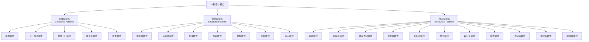
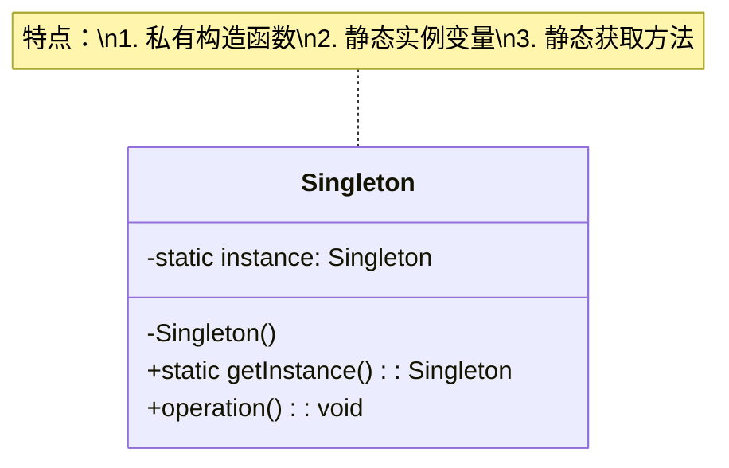
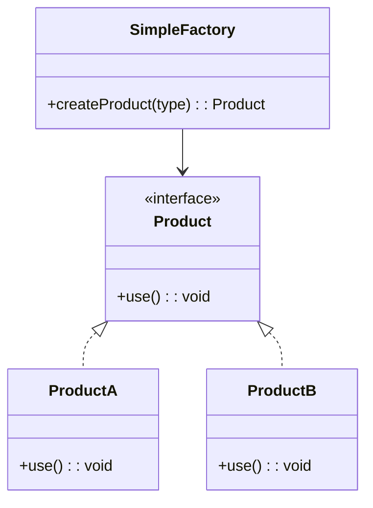
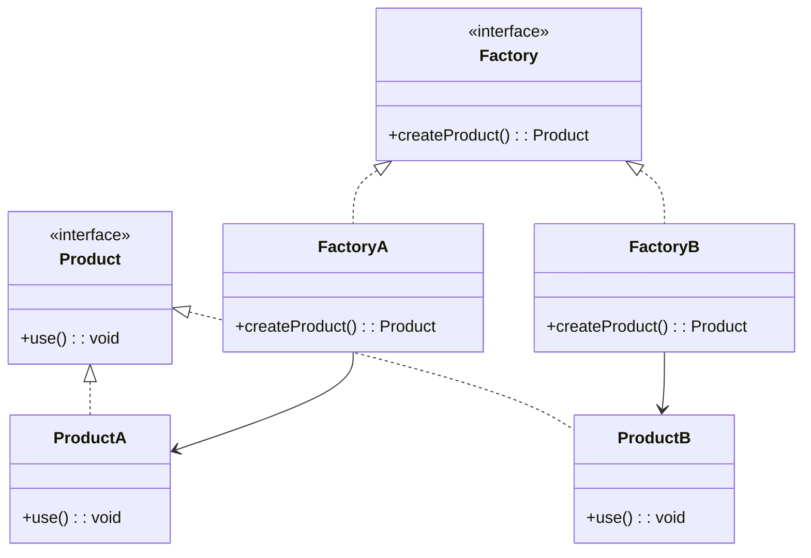
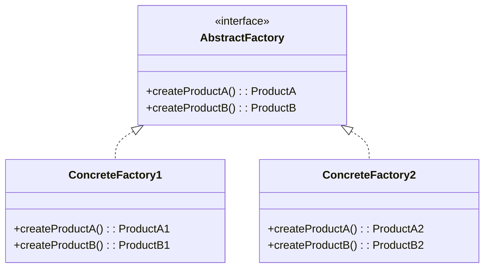
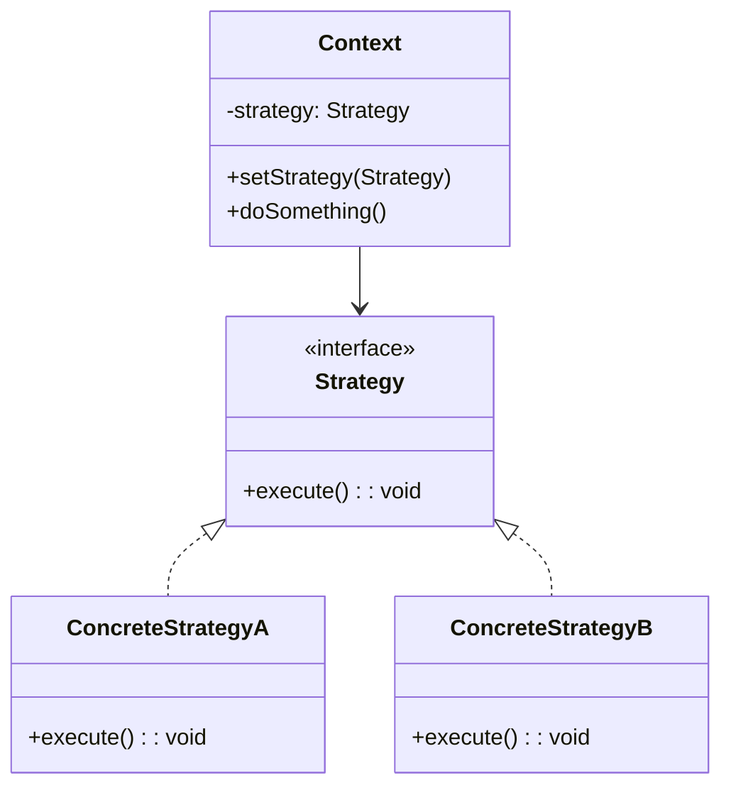
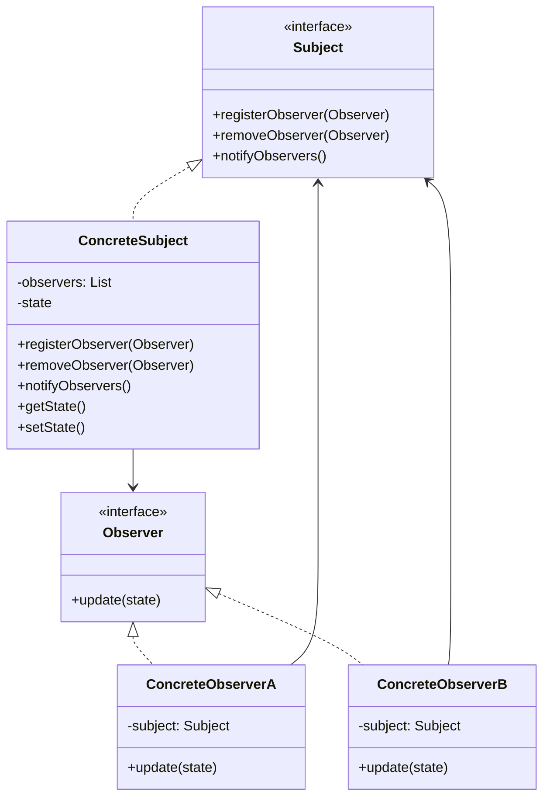
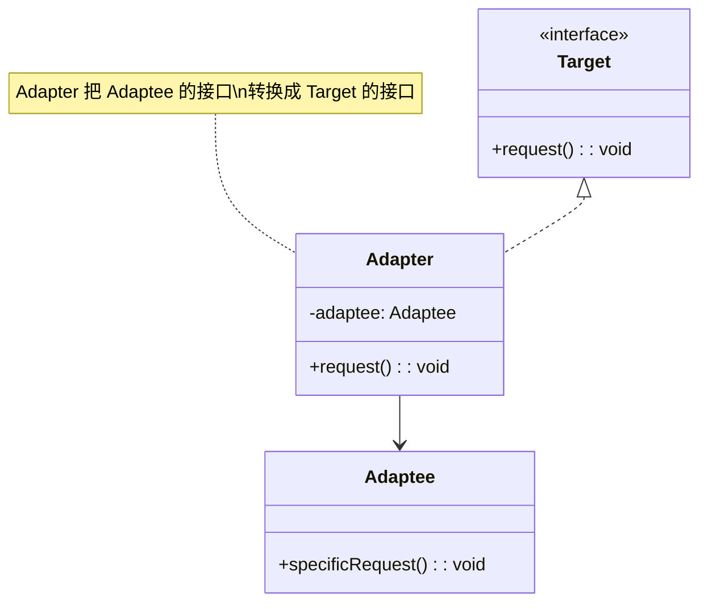

# 第六章 设计模式实战

> **学习目标**：理解设计模式的概念，掌握最常用的设计模式（单例、工厂、策略、观察者、适配器），能够在合适的场景应用正确的模式
> **预计学时**：8小时 | **重要程度**：⭐⭐⭐⭐

---

## 6.1 设计模式概述

### 6.1.1 什么是设计模式？

**设计模式（Design Pattern）**：是软件开发中针对常见问题的、经过验证的、可复用的解决方案。

> 简单说：设计模式就是"软件开发的最佳实践"，是前人总结出来的解决特定问题的套路。

#### 设计模式的本质

- 不是现成的代码，而是解决问题的思路
- 不是银弹，不能解决所有问题
- 是经验的总结和提炼
- 是沟通的共同语言（"这里用了单例模式"，懂的人都明白）

### 6.1.2 设计模式的起源

- **1994年**：Erich Gamma、Richard Helm、Ralph Johnson、John Vlissides 四人合著出版了《设计模式：可复用面向对象软件的基础》（Design Patterns: Elements of Reusable Object-Oriented Software）
- 这四位作者被称为 **GoF（Gang of Four，四人帮）**
- 书中总结了 **23种** 经典设计模式

### 6.1.3 设计模式的分类

GoF 的 23 种设计模式分为三大类：



| 类别 | 英文 | 核心关注点 | 数量 |
|------|------|-----------|------|
| **创建型** | Creational | 对象的创建过程 | 5种 |
| **结构型** | Structural | 类和对象的组合结构 | 7种 |
| **行为型** | Behavioral | 对象之间的交互和职责分配 | 11种 |

### 6.1.4 最常用的设计模式（初学者重点）

不是所有模式都常用，以下是面试和实际开发中最高频的模式：

| 模式 | 类别 | 重要程度 | 一句话概括 |
|------|------|----------|-----------|
| **单例模式** | 创建型 | ⭐⭐⭐⭐⭐ | 保证一个类只有一个实例 |
| **工厂方法/抽象工厂** | 创建型 | ⭐⭐⭐⭐⭐ | 把对象创建的逻辑封装起来 |
| **策略模式** | 行为型 | ⭐⭐⭐⭐⭐ | 封装算法，可互相替换 |
| **观察者模式** | 行为型 | ⭐⭐⭐⭐ | 一对多的通知机制 |
| **适配器模式** | 结构型 | ⭐⭐⭐⭐ | 转换接口，让不兼容的能一起工作 |
| **装饰器模式** | 结构型 | ⭐⭐⭐ | 动态给对象增加功能 |
| **模板方法** | 行为型 | ⭐⭐⭐ | 定义算法骨架，子类实现细节 |
| **代理模式** | 结构型 | ⭐⭐⭐ | 控制对对象的访问 |

> 💡 **学习建议**：先掌握前5个最常用的，理解它们的思想和适用场景，
> 遇到具体问题时再去查对应的模式怎么实现。

### 6.1.5 学习设计模式的正确姿势

1. **先理解思想，再记实现**
   - 设计模式的核心是思想，不是代码
   - 代码实现可以有很多种，但核心思想是一样的

2. **问题驱动，不要为了用模式而用模式**
   - 遇到问题了，再想"这个问题适合用什么模式"
   - 而不是"我今天要把单例模式用在项目里"

3. **理解每个模式的适用场景和优缺点**
   - 没有万能的模式，每个模式都有适用场景
   - 知道什么时候用，比知道怎么用更重要

4. **多思考模式之间的联系和区别**
   - 比如：策略模式和状态模式有什么区别？
   - 比如：适配器模式和代理模式有什么区别？

5. **从重构中体会模式**
   - 先写"能用但不好"的代码
   - 再用设计模式去重构
   - 这样才能真正理解模式解决了什么问题

---

## 6.2 单例模式（Singleton Pattern）

### 6.2.1 什么是单例模式？

**单例模式**：保证一个类只有一个实例，并提供一个全局访问点。

> 简单说：这个类只能创建一个对象，大家都用同一个对象。

### 6.2.2 为什么需要单例？

有些对象，整个系统只需要一个实例：

- **配置管理器**：配置只需要加载一次
- **数据库连接池**：连接池只需要一个
- **日志记录器**：日志只需要一个实例
- **线程池**：线程池只需要一个
- **缓存**：全局缓存只需要一份

如果这些对象创建多个实例，会有什么问题？
- 浪费资源
- 状态不一致
- 配置冲突

### 6.2.3 单例模式的结构



**单例模式的三个要点**：
1. **私有构造函数** — 不让外部随便 new
2. **静态私有实例** — 自己保存唯一的实例
3. **静态公有获取方法** — 给外部提供获取实例的入口

### 6.2.4 单例模式的实现方式

单例有多种实现方式，各有优缺点：

#### 方式一：饿汉式（Eager Initialization）

```python
class Singleton:
    # 类加载时就创建实例
    _instance = None
    
    def __init__(self):
        # 初始化操作
        self.data = "单例数据"
    
    @classmethod
    def get_instance(cls):
        if cls._instance is None:
            cls._instance = cls()
        return cls._instance


# 使用
s1 = Singleton.get_instance()
s2 = Singleton.get_instance()
print(s1 is s2)  # True，同一个对象
```

**特点**：
- ✅ 实现简单
- ✅ 线程安全（类加载时就创建了）
- ❌ 不管用不用，一开始就创建了（浪费资源）
- ❌ 不支持延迟加载

> 适用场景：单例对象不大，初始化不耗时，肯定会用到。

---

#### 方式二：懒汉式（Lazy Initialization）

```python
class Singleton:
    _instance = None
    
    def __init__(self):
        self.data = "单例数据"
    
    @classmethod
    def get_instance(cls):
        # 第一次调用时才创建
        if cls._instance is None:
            cls._instance = cls()
        return cls._instance
```

**特点**：
- ✅ 延迟加载，用的时候才创建
- ✅ 节省资源
- ❌ 线程不安全（多线程下可能创建多个实例）

> 线程安全问题：如果两个线程同时判断 `_instance is None`，就会创建两个实例。

---

#### 方式三：双重检查锁（Double-Checked Locking）

为了解决懒汉式的线程安全问题，引入锁机制。

```python
import threading

class Singleton:
    _instance = None
    _lock = threading.Lock()
    
    def __init__(self):
        self.data = "单例数据"
    
    @classmethod
    def get_instance(cls):
        # 第一次检查：没有锁，提高效率
        if cls._instance is None:
            # 加锁：保证只有一个线程能创建
            with cls._lock:
                # 第二次检查：防止多个线程都通过第一次检查
                if cls._instance is None:
                    cls._instance = cls()
        return cls._instance
```

**为什么要双重检查？**
- 第一次检查：避免每次都加锁，提高性能
- 加锁：保证线程安全
- 第二次检查：防止多个线程都通过第一次检查，重复创建

**特点**：
- ✅ 线程安全
- ✅ 延迟加载
- ✅ 性能较好（只在第一次创建时加锁）
- ❌ 实现稍复杂

> 这是最常用、最推荐的单例实现方式。

---

#### 方式四：Python 特有的模块单例

Python 的模块天然就是单例的，因为模块只会被导入一次。

```python
# singleton.py
class Singleton:
    def __init__(self):
        self.data = "单例数据"

# 模块加载时创建实例
instance = Singleton()
```

使用时：
```python
from singleton import instance

# 直接用 instance，大家拿到的都是同一个
```

**特点**：
- ✅ 最简单，Python 风格
- ✅ 线程安全（Python 模块导入是线程安全的）
- ❌ 不够灵活（不能传参初始化）

### 6.2.5 单例模式的优缺点

| 优点 | 缺点 |
|------|------|
| 保证唯一实例，避免重复创建 | 扩展困难，不能继承 |
| 节省资源 | 测试困难，难以 Mock |
| 全局访问点，方便使用 | 违反单一职责（既管业务又管自己的实例） |
| 控制共享资源的访问 | 多线程下需要注意线程安全 |

### 6.2.6 单例模式的适用场景

- 系统只需要一个实例对象的场景
- 需要频繁创建和销毁的对象
- 创建对象耗时或耗资源，但又经常用到的对象
- 工具类、配置类、连接池、日志记录器等

> 🔴 **注意**：不要滥用单例！单例用多了会带来全局状态、难以测试、耦合高等问题。
> 很多时候用依赖注入比单例更好。

---

## 6.3 工厂模式（Factory Pattern）

### 6.3.1 什么是工厂模式？

**工厂模式**：把对象创建的逻辑封装起来，由工厂来负责创建对象，而不是直接 new。

> 简单说：要对象，找工厂要，自己不 new。

### 6.3.2 为什么需要工厂模式？

1. **解耦**：把对象的创建和使用分开
2. **统一管理**：创建逻辑集中在工厂，方便修改
3. **屏蔽细节**：使用者不需要知道创建细节
4. **便于扩展**：新增产品时，只需要改工厂

> 🎯 **生活类比**：工厂模式就像——
> - 你想吃披萨，不需要自己做（new Pizza()）
> - 直接打电话给披萨店（工厂），让他们做好送过来
> - 你不需要知道披萨是怎么做的，只需要吃

### 6.3.3 工厂模式的三种形式

工厂模式不是一个模式，而是一类模式，包括：

| 模式 | 说明 | 复杂度 |
|------|------|--------|
| **简单工厂** | 一个工厂创建所有产品 | ⭐ |
| **工厂方法** | 每个产品对应一个工厂 | ⭐⭐ |
| **抽象工厂** | 工厂能创建一族产品 | ⭐⭐⭐ |

---

#### 一、简单工厂（Simple Factory）

**基本结构**：一个工厂类，根据参数创建不同的产品。



**代码示例**：

```python
from abc import ABC, abstractmethod

# 产品接口
class Pizza(ABC):
    @abstractmethod
    def prepare(self):
        pass
    
    @abstractmethod
    def bake(self):
        pass
    
    def get_name(self):
        return self.name

# 具体产品
class CheesePizza(Pizza):
    def __init__(self):
        self.name = "芝士披萨"
    
    def prepare(self):
        print(f"准备{self.name}的材料：芝士、面粉、番茄酱")
    
    def bake(self):
        print(f"烘烤{self.name}，15分钟")

class PepperoniPizza(Pizza):
    def __init__(self):
        self.name = "意大利辣香肠披萨"
    
    def prepare(self):
        print(f"准备{self.name}的材料：辣香肠、芝士、面粉")
    
    def bake(self):
        print(f"烘烤{self.name}，20分钟")

class VeggiePizza(Pizza):
    def __init__(self):
        self.name = "蔬菜披萨"
    
    def prepare(self):
        print(f"准备{self.name}的材料：各种蔬菜、芝士")
    
    def bake(self):
        print(f"烘烤{self.name}，18分钟")


# 简单工厂
class SimplePizzaFactory:
    @staticmethod
    def create_pizza(pizza_type):
        if pizza_type == "cheese":
            return CheesePizza()
        elif pizza_type == "pepperoni":
            return PepperoniPizza()
        elif pizza_type == "veggie":
            return VeggiePizza()
        else:
            raise ValueError(f"未知的披萨类型: {pizza_type}")


# 使用
class PizzaStore:
    def __init__(self, factory):
        self.factory = factory
    
    def order_pizza(self, pizza_type):
        pizza = self.factory.create_pizza(pizza_type)
        
        pizza.prepare()
        pizza.bake()
        
        return pizza


# 客户端代码
factory = SimplePizzaFactory()
store = PizzaStore(factory)

pizza = store.order_pizza("cheese")
print(f"订购了：{pizza.get_name()}")
```

**简单工厂的优缺点**：

| 优点 | 缺点 |
|------|------|
| 封装了创建逻辑，客户端不需要知道怎么创建 | 违反开闭原则，新增产品需要修改工厂类 |
| 客户端只和工厂打交道，解耦 | 工厂类职责过重，什么都造 |
| 实现简单 | 产品多了工厂会很臃肿 |

> 适用场景：产品种类少，变化不大的场景。

---

#### 二、工厂方法（Factory Method）

为了解决简单工厂违反开闭原则的问题，把工厂也抽象出来。

**基本结构**：定义一个创建对象的接口，让子类决定实例化哪个类。



**代码示例**：

```python
from abc import ABC, abstractmethod

# 产品接口
class Pizza(ABC):
    @abstractmethod
    def prepare(self):
        pass
    
    @abstractmethod
    def bake(self):
        pass

# 具体产品
class CheesePizza(Pizza):
    def __init__(self):
        self.name = "芝士披萨"
    
    def prepare(self):
        print(f"准备{self.name}")
    
    def bake(self):
        print(f"烘烤{self.name}")

class PepperoniPizza(Pizza):
    def __init__(self):
        self.name = "辣香肠披萨"
    
    def prepare(self):
        print(f"准备{self.name}")
    
    def bake(self):
        print(f"烘烤{self.name}")


# 工厂接口
class PizzaFactory(ABC):
    @abstractmethod
    def create_pizza(self):
        pass

# 具体工厂
class CheesePizzaFactory(PizzaFactory):
    def create_pizza(self):
        return CheesePizza()

class PepperoniPizzaFactory(PizzaFactory):
    def create_pizza(self):
        return PepperoniPizza()


# 使用
class PizzaStore:
    def order_pizza(self, factory):
        pizza = factory.create_pizza()
        pizza.prepare()
        pizza.bake()
        return pizza


# 客户端代码
store = PizzaStore()

# 点芝士披萨
cheese_factory = CheesePizzaFactory()
pizza1 = store.order_pizza(cheese_factory)

# 点辣香肠披萨
pepperoni_factory = PepperoniPizzaFactory()
pizza2 = store.order_pizza(pepperoni_factory)
```

**工厂方法的优缺点**：

| 优点 | 缺点 |
|------|------|
| 符合开闭原则，新增产品只需新增工厂类 | 类的数量增多，每个产品对应一个工厂 |
| 每个工厂职责单一，符合单一职责 | 增加了系统的复杂度 |
| 产品创建和使用完全解耦 | 对于简单场景，可能过度设计 |

> 适用场景：产品种类多，经常需要新增产品类型的场景。

---

#### 三、抽象工厂（Abstract Factory）

**基本结构**：提供一个接口，用于创建相关或依赖对象的家族，而不需要指定具体类。

> 简单说：一个工厂能创建一族相关的产品。



**示例**：UI 主题工厂（每个主题下有按钮、输入框、菜单等一族产品）

```python
from abc import ABC, abstractmethod

# 产品族接口
class Button(ABC):
    @abstractmethod
    def render(self):
        pass

class Input(ABC):
    @abstractmethod
    def render(self):
        pass

# 具体产品 - 浅色主题
class LightButton(Button):
    def render(self):
        print("渲染浅色按钮")

class LightInput(Input):
    def render(self):
        print("渲染浅色输入框")

# 具体产品 - 深色主题
class DarkButton(Button):
    def render(self):
        print("渲染深色按钮")

class DarkInput(Input):
    def render(self):
        print("渲染深色输入框")


# 抽象工厂接口
class UIFactory(ABC):
    @abstractmethod
    def create_button(self) -> Button:
        pass
    
    @abstractmethod
    def create_input(self) -> Input:
        pass

# 具体工厂 - 浅色主题工厂
class LightUIFactory(UIFactory):
    def create_button(self):
        return LightButton()
    
    def create_input(self):
        return LightInput()

# 具体工厂 - 深色主题工厂
class DarkUIFactory(UIFactory):
    def create_button(self):
        return DarkButton()
    
    def create_input(self):
        return DarkInput()


# 使用
class Application:
    def __init__(self, factory: UIFactory):
        self.factory = factory
        self.button = None
        self.input = None
    
    def create_ui(self):
        self.button = self.factory.create_button()
        self.input = self.factory.create_input()
    
    def render(self):
        self.button.render()
        self.input.render()


# 客户端代码
# 使用浅色主题
light_factory = LightUIFactory()
app1 = Application(light_factory)
app1.create_ui()
app1.render()

# 切换到深色主题，只需要换工厂
dark_factory = DarkUIFactory()
app2 = Application(dark_factory)
app2.create_ui()
app2.render()
```

**抽象工厂的优缺点**：

| 优点 | 缺点 |
|------|------|
| 产品族内的对象保持一致 | 增加新的产品等级结构困难（比如新增一个"菜单"产品，所有工厂都要改） |
| 隔离了具体类的生成 | 系统更复杂，类更多 |
| 符合开闭原则（增加新的产品族容易） | 理解和使用成本较高 |

> 适用场景：系统中有多个产品族，每次只使用其中一族的场景（如换主题、换数据库）。

### 6.3.4 工厂模式总结

| 模式 | 核心思想 | 适用场景 | 复杂度 |
|------|----------|----------|--------|
| 简单工厂 | 一个工厂造所有产品 | 产品少、变化小 | 低 |
| 工厂方法 | 每个产品一个工厂 | 产品多、经常新增 | 中 |
| 抽象工厂 | 一个工厂造一族产品 | 有多族产品、整族切换 | 高 |

> 💡 **选择建议**：
> - 能用简单工厂就用简单工厂
> - 产品经常增加，用工厂方法
> - 有多族相关产品需要一起切换，用抽象工厂

---

## 6.4 策略模式（Strategy Pattern）

### 6.4.1 什么是策略模式？

**策略模式**：定义一系列算法，把它们一个个封装起来，并且使它们可以互相替换。

> 简单说：把不同的算法/策略封装起来，可以随时切换。

### 6.4.2 为什么需要策略模式？

当有很多相似的算法/行为，需要根据不同情况选择不同的实现时：

- 支付方式：微信支付、支付宝、银行卡
- 折扣策略：满减、折扣、赠品
- 排序算法：冒泡、快排、归并
- 出行方式：步行、骑车、开车、公交

如果不用策略模式，会有什么问题？
- 大量 if-else / switch-case
- 新增一种算法要修改原有代码（违反开闭原则）
- 算法和业务逻辑耦合在一起

### 6.4.3 策略模式的结构



| 角色 | 说明 |
|------|------|
| **策略接口（Strategy）** | 所有策略的共同接口 |
| **具体策略（ConcreteStrategy）** | 具体的算法实现 |
| **上下文（Context）** | 使用策略的类，持有策略对象的引用 |

### 6.4.4 代码示例：支付方式选择

```python
from abc import ABC, abstractmethod

# 策略接口
class PaymentStrategy(ABC):
    @abstractmethod
    def pay(self, amount):
        """支付方法，返回支付结果"""
        pass

# 具体策略：微信支付
class WeChatPay(PaymentStrategy):
    def __init__(self, openid):
        self.openid = openid
    
    def pay(self, amount):
        print(f"使用微信支付 {amount} 元，用户: {self.openid}")
        # 实际的微信支付逻辑...
        return True

# 具体策略：支付宝支付
class AliPay(PaymentStrategy):
    def __init__(self, alipay_account):
        self.account = alipay_account
    
    def pay(self, amount):
        print(f"使用支付宝支付 {amount} 元，账户: {self.account}")
        # 实际的支付宝逻辑...
        return True

# 具体策略：银行卡支付
class BankCardPay(PaymentStrategy):
    def __init__(self, card_number):
        self.card_number = card_number
    
    def pay(self, amount):
        print(f"使用银行卡支付 {amount} 元，卡号: ****{self.card_number[-4:]}")
        # 实际的银行卡支付逻辑...
        return True


# 上下文：订单
class Order:
    def __init__(self, amount):
        self.amount = amount
        self.payment_strategy = None
    
    def set_payment_strategy(self, strategy: PaymentStrategy):
        """设置支付策略"""
        self.payment_strategy = strategy
    
    def checkout(self):
        """结账"""
        if not self.payment_strategy:
            raise ValueError("请先选择支付方式")
        
        print(f"订单金额: {self.amount} 元")
        result = self.payment_strategy.pay(self.amount)
        
        if result:
            print("支付成功！")
        else:
            print("支付失败！")
        return result


# 客户端代码
if __name__ == "__main__":
    # 创建订单
    order = Order(199.0)
    
    # 选择微信支付
    order.set_payment_strategy(WeChatPay("wx_user_123"))
    order.checkout()
    
    print("-" * 30)
    
    # 切换成支付宝支付
    order.set_payment_strategy(AliPay("user@example.com"))
    order.checkout()
    
    print("-" * 30)
    
    # 切换成银行卡支付
    order.set_payment_strategy(BankCardPay("6222021234567890"))
    order.checkout()
```

### 6.4.5 策略模式的优缺点

| 优点 | 缺点 |
|------|------|
| 算法可以自由切换 | 策略类数量增多 |
| 符合开闭原则，新增策略很容易 | 客户端需要知道所有策略，自己选择 |
| 避免使用大量 if-else | 每个策略是一个类，可能有很多小类 |
| 算法和业务逻辑解耦 | 只适用于算法相似、行为不同的场景 |
| 便于测试，每个策略可以独立测试 | - |

### 6.4.6 策略模式的适用场景

- 多个类只有算法或行为上稍有不同
- 需要在运行时动态切换算法
- 有很多 if-else/switch 分支，每个分支都是一种算法
- 需要封装算法的具体实现，让客户端不关心细节

> 🔴 **与 if-else 的对比**：
> - if-else 适合简单的、不怎么变的情况
> - 策略模式适合复杂的、经常变化的情况
> - 不是所有 if-else 都要改成策略模式，要根据实际情况判断

---

## 6.5 观察者模式（Observer Pattern）

### 6.5.1 什么是观察者模式？

**观察者模式**：定义对象间的一对多依赖关系，当一个对象状态发生改变时，所有依赖它的对象都会收到通知并自动更新。

> 也叫"发布-订阅模式"（Publish-Subscribe）。
> 简单说：一个对象被观察，多个观察者观察它，被观察者一变，所有人都收到通知。

### 6.5.2 为什么需要观察者模式？

当一个对象的变化需要通知其他对象，而且不知道有多少对象需要通知时：

- 消息推送：订阅了公众号，有新文章自动推送
- 事件监听：按钮点击了，触发多个回调
- 数据同步：数据变了，界面自动更新
- 通知系统：订单状态变化，通知用户、商家、物流

### 6.5.3 观察者模式的结构



| 角色 | 说明 |
|------|------|
| **主题（Subject）** | 被观察的对象，维护观察者列表 |
| **观察者（Observer）** | 观察主题的对象，接收通知 |
| **注册** | 观察者把自己加入主题的通知列表 |
| **注销** | 观察者从通知列表中移除 |
| **通知** | 主题状态变化时，通知所有观察者 |

### 6.5.4 代码示例：微信公众号订阅

```python
from abc import ABC, abstractmethod
from typing import List

# 观察者接口
class Observer(ABC):
    @abstractmethod
    def update(self, article_title: str, article_content: str):
        """收到新文章通知"""
        pass

# 主题接口
class Subject(ABC):
    @abstractmethod
    def register_observer(self, observer: Observer):
        """订阅"""
        pass
    
    @abstractmethod
    def remove_observer(self, observer: Observer):
        """取消订阅"""
        pass
    
    @abstractmethod
    def notify_observers(self):
        """通知所有观察者"""
        pass


# 具体主题：微信公众号
class WeChatOfficialAccount(Subject):
    def __init__(self, name):
        self.name = name
        self._observers: List[Observer] = []
        self._latest_article = None
    
    def register_observer(self, observer: Observer):
        if observer not in self._observers:
            self._observers.append(observer)
            print(f"{getattr(observer, 'name', '用户')} 订阅了 {self.name}")
    
    def remove_observer(self, observer: Observer):
        if observer in self._observers:
            self._observers.remove(observer)
            print(f"{getattr(observer, 'name', '用户')} 取消订阅了 {self.name}")
    
    def notify_observers(self):
        print(f"\n{self.name} 发布新文章，通知所有订阅者...")
        for observer in self._observers:
            observer.update(self._latest_article[0], self._latest_article[1])
    
    def publish_article(self, title: str, content: str):
        """发布新文章"""
        self._latest_article = (title, content)
        print(f"\n{self.name} 发布了新文章：{title}")
        self.notify_observers()


# 具体观察者：普通用户
class User(Observer):
    def __init__(self, name):
        self.name = name
    
    def update(self, article_title: str, article_content: str):
        print(f"📱 {self.name} 收到推送：《{article_title}》")
        # 用户可以选择看或不看，这里简化处理


# 具体观察者：企业用户（收到通知后的行为不同）
class EnterpriseUser(Observer):
    def __init__(self, name):
        self.name = name
    
    def update(self, article_title: str, article_content: str):
        print(f"💼 {self.name} 企业号收到推送：《{article_title}》")
        print(f"   已自动归档到企业知识库")


# 客户端代码
if __name__ == "__main__":
    # 创建公众号
    tech_blog = WeChatOfficialAccount("技术干货分享")
    
    # 创建用户
    user1 = User("小明")
    user2 = User("小红")
    user3 = EnterpriseUser("ABC公司")
    
    # 订阅
    tech_blog.register_observer(user1)
    tech_blog.register_observer(user2)
    tech_blog.register_observer(user3)
    
    # 发布文章
    tech_blog.publish_article(
        "Python 设计模式入门",
        "今天我们来学习观察者模式..."
    )
    
    print("\n" + "="*50 + "\n")
    
    # 小红取消订阅
    tech_blog.remove_observer(user2)
    
    # 再发布一篇文章
    tech_blog.publish_article(
        "单例模式的五种实现",
        "单例模式是最简单也最常用的设计模式..."
    )
```

### 6.5.5 观察者模式的优缺点

| 优点 | 缺点 |
|------|------|
| 主题和观察者松耦合 | 观察者多了，通知效率可能低 |
| 支持广播通信，一对多 | 通知顺序不确定 |
| 符合开闭原则，新增观察者很容易 | 观察者不知道其他观察者的存在 |
| 动态订阅/取消订阅 | 可能导致意外的循环通知 |
| 被观察者不需要知道观察者的细节 | 观察者可能收到很多不需要的通知 |

### 6.5.6 观察者模式的适用场景

- 一个对象的改变需要通知其他对象
- 不知道有多少对象需要被通知
- 需要实现事件驱动的机制
- 模型和视图分离（MVC 中 Model 变化通知 View 更新）

> 💡 **观察者模式 vs 发布订阅模式**：
> 很多人把它们等同，但严格来说有细微区别：
> - 观察者模式：主题和观察者直接知道对方
> - 发布订阅模式：通过一个"事件通道/消息队列"中转，发布者和订阅者不知道对方
>
> 实际工作中不用太纠结，大部分场景说的是一回事。

---

## 6.6 适配器模式（Adapter Pattern）

### 6.6.1 什么是适配器模式？

**适配器模式**：将一个类的接口转换成客户希望的另一个接口，让原本不兼容的类可以一起工作。

> 也叫"转换器模式"、"包装器模式"（Wrapper）。
> 简单说：就像电源适配器，把不同规格的接口转换成你需要的。

### 6.6.2 为什么需要适配器模式？

现实中经常遇到接口不兼容的情况：

- 旧系统的接口和新系统不匹配
- 第三方库的接口和我们的要求不一样
- 不同团队开发的模块接口不一致
- 需要兼容多种不同的接口

> 🎯 **生活类比**：适配器就像各种转接头——
> - Type-C 转 HDMI：让只有 Type-C 口的电脑能接 HDMI 显示器
> - 手机充电器：把 220V 交流电转换成 5V 直流电
> - 翻译官：把中文翻译成英文，让两个说不同语言的人能交流

### 6.6.3 适配器模式的结构

适配器模式有两种实现方式：**类适配器**和**对象适配器**。

#### 对象适配器（更常用）

通过组合的方式，适配器持有被适配者的引用。



| 角色 | 说明 |
|------|------|
| **目标接口（Target）** | 客户端期望的接口 |
| **被适配者（Adaptee）** | 需要被适配的旧接口/第三方接口 |
| **适配器（Adapter）** | 转换器，把 Adaptee 转换成 Target |

### 6.6.4 代码示例：支付接口适配

假设我们的系统原来只支持支付宝，现在要接入微信支付，但微信支付的接口和我们的不一样。

```python
from abc import ABC, abstractmethod

# ============= 目标接口（我们的系统期望的接口）=============
class Payment(ABC):
    @abstractmethod
    def pay(self, amount: float) -> bool:
        """支付"""
        pass
    
    @abstractmethod
    def refund(self, order_id: str, amount: float) -> bool:
        """退款"""
        pass


# ============= 已有的实现（支付宝，符合我们的接口）=============
class AliPay(Payment):
    def pay(self, amount: float) -> bool:
        print(f"[支付宝] 支付 {amount} 元")
        return True
    
    def refund(self, order_id: str, amount: float) -> bool:
        print(f"[支付宝] 订单 {order_id} 退款 {amount} 元")
        return True


# ============= 被适配者（微信支付，接口不一样）=============
class WeChatPayService:
    """微信支付的 SDK，接口和我们的不一样"""
    
    def micropay(self, total_fee: int, out_trade_no: str) -> dict:
        """
        微信支付接口：
        - 金额单位是分（整数）
        - 参数名不一样
        - 返回的是字典而不是布尔值
        """
        print(f"[微信支付] 支付 {total_fee} 分，订单号: {out_trade_no}")
        return {"code": 0, "msg": "success", "trade_no": "wx_123456"}
    
    def reverse(self, transaction_id: str) -> dict:
        """微信退款接口（名字也不一样）"""
        print(f"[微信支付] 退款，交易号: {transaction_id}")
        return {"code": 0, "msg": "success"}


# ============= 适配器（把微信支付适配成我们的接口）=============
class WeChatPayAdapter(Payment):
    def __init__(self, wechat_pay: WeChatPayService):
        self.wechat_pay = wechat_pay
        self._order_map = {}  # 保存订单号和微信交易号的映射
    
    def pay(self, amount: float) -> bool:
        """适配：把我们的支付方法转换成微信的接口"""
        # 金额转换：元 → 分
        total_fee = int(amount * 100)
        # 生成订单号
        out_trade_no = f"order_{id(self)}_{amount}"
        
        # 调用微信的接口
        result = self.wechat_pay.micropay(total_fee, out_trade_no)
        
        # 返回值转换：字典 → 布尔值
        return result["code"] == 0
    
    def refund(self, order_id: str, amount: float) -> bool:
        """适配：把我们的退款方法转换成微信的接口"""
        # 实际中可能需要先查交易号，这里简化
        transaction_id = f"wx_{order_id}"
        
        # 调用微信的接口
        result = self.wechat_pay.reverse(transaction_id)
        
        return result["code"] == 0


# ============= 客户端代码 =============
class PaymentSystem:
    """支付系统，只认识 Payment 接口"""
    
    def __init__(self, payment: Payment):
        self.payment = payment
    
    def process_payment(self, amount: float):
        print(f"\n--- 处理支付：{amount} 元 ---")
        success = self.payment.pay(amount)
        if success:
            print("支付成功！")
        else:
            print("支付失败！")
        return success
    
    def process_refund(self, order_id: str, amount: float):
        print(f"\n--- 处理退款：订单 {order_id}，{amount} 元 ---")
        success = self.payment.refund(order_id, amount)
        if success:
            print("退款成功！")
        else:
            print("退款失败！")
        return success


if __name__ == "__main__":
    # 使用支付宝（本来就兼容）
    print("=== 支付宝支付 ===")
    ali_system = PaymentSystem(AliPay())
    ali_system.process_payment(199.0)
    ali_system.process_refund("order_001", 199.0)
    
    print("\n" + "="*50 + "\n")
    
    # 使用微信支付（通过适配器兼容）
    print("=== 微信支付 ===")
    wechat_service = WeChatPayService()
    wechat_adapter = WeChatPayAdapter(wechat_service)
    wechat_system = PaymentSystem(wechat_adapter)
    wechat_system.process_payment(99.5)
    wechat_system.process_refund("order_002", 99.5)
```

### 6.6.5 适配器模式的优缺点

| 优点 | 缺点 |
|------|------|
| 让不兼容的类可以一起工作 | 增加了额外的一层，系统更复杂 |
| 客户端不需要修改，透明使用 | 过多的适配器会让系统很乱 |
| 符合开闭原则，新增适配器不影响现有代码 | 有时候可以直接修改源码，就不需要适配器 |
| 复用了现有的代码 | - |

### 6.6.6 适配器模式的适用场景

- 需要使用现有的类，但接口不符合要求
- 需要创建一个可复用的类，能和不相关的类一起工作
- 需要统一多个类的接口（但又不能修改这些类）
- 对接第三方系统、旧系统改造

> 🔴 **适配器模式 vs 策略模式的区别**：
> - **适配器**：解决接口不兼容的问题，目的是"能用上"
> - **策略模式**：封装不同的算法，目的是"可替换"
> - 适配器是事后补救，策略模式是事前设计

---

## 6.7 设计模式对比与选择

### 6.7.1 易混淆模式对比

| 模式对 | 相同点 | 不同点 |
|--------|--------|--------|
| **策略 vs 状态** | 都封装了行为，都有 Context | 策略封装的是"算法"，状态封装的是"状态和状态行为" |
| **适配器 vs 装饰器** | 都有一个 Wrapper 类，都持有被包装对象的引用 | 适配器是为了"改接口"；装饰器是为了"加功能" |
| **代理 vs 装饰器** | 都实现同一个接口，都持有目标对象的引用 | 代理是"控制访问"；装饰器是"增强功能" |
| **工厂方法 vs 策略** | 都有很多子类 | 工厂方法是"创建对象"；策略模式是"封装算法" |
| **观察者 vs 中介者** | 都处理对象间的通信 | 观察者是一对多通知；中介者是多对多通过中介通信 |

### 6.7.2 如何选择设计模式？

选择设计模式可以按以下步骤思考：

1. **先分析问题**：我遇到的是什么问题？
   - 创建对象复杂？→ 创建型模式
   - 类/对象结构不合理？→ 结构型模式
   - 对象交互/算法复杂？→ 行为型模式

2. **再缩小范围**：问题的核心特征是什么？
   - 只要一个实例 → 单例
   - 对象创建复杂，想封装起来 → 工厂
   - 有很多 if-else 的算法 → 策略
   - 一对多通知 → 观察者
   - 接口不兼容 → 适配器

3. **评估代价**：用这个模式值不值？
   - 模式不是免费的，会增加复杂度
   - 简单问题不要过度设计
   - 能用简单方式解决的，就不要硬套模式

> 💡 **经验法则**：
> - 先让代码跑起来（能用）
> - 再让代码好看（重构）
> - 最后考虑用不用模式
> - 模式是重构的目标，不是设计的起点

---

## 6.8 常见误区与易错点

### 误区1：为了用模式而用模式

- ❌ 错！设计模式是工具，不是目的
- ✅ 应该是问题驱动，遇到合适的问题才用模式
- ✅ 不要为了"显得高级"而硬套模式

### 误区2：设计模式越多越好

- ❌ 错！模式越多，系统越复杂
- ✅ 简单就是美，能用简单方案就不用模式
- ✅ 模式是解决复杂性的，不是增加复杂性的

### 误区3：记住所有模式才叫懂设计模式

- ❌ 错！不需要记住所有 23 种模式
- ✅ 重点掌握最常用的 5-8 种就够了
- ✅ 关键是理解模式的思想，而不是背代码

### 误区4：设计模式是银弹

- ❌ 错！设计模式不能解决所有问题
- ✅ 每个模式都有适用场景和局限性
- ✅ 要根据实际问题选择合适的方案

### 误区5：设计模式只存在于代码中

- ❌ 错！设计模式是思想，不限于代码
- ✅ 架构设计、系统设计中也有模式的思想
- ✅ 框架、库里面大量使用了设计模式

---

## 6.9 关键术语中英对照

| 中文 | 英文 | 缩写 |
|------|------|------|
| 设计模式 | Design Pattern | DP |
| 创建型模式 | Creational Pattern | - |
| 结构型模式 | Structural Pattern | - |
| 行为型模式 | Behavioral Pattern | - |
| 单例模式 | Singleton Pattern | - |
| 工厂方法模式 | Factory Method Pattern | - |
| 抽象工厂模式 | Abstract Factory Pattern | - |
| 简单工厂 | Simple Factory | - |
| 建造者模式 | Builder Pattern | - |
| 原型模式 | Prototype Pattern | - |
| 适配器模式 | Adapter Pattern | - |
| 装饰器模式 | Decorator Pattern | - |
| 代理模式 | Proxy Pattern | - |
| 外观模式 | Facade Pattern | - |
| 桥接模式 | Bridge Pattern | - |
| 组合模式 | Composite Pattern | - |
| 享元模式 | Flyweight Pattern | - |
| 策略模式 | Strategy Pattern | - |
| 观察者模式 | Observer Pattern | - |
| 发布-订阅 | Publish-Subscribe | Pub/Sub |
| 模板方法模式 | Template Method Pattern | - |
| 迭代器模式 | Iterator Pattern | - |
| 责任链模式 | Chain of Responsibility Pattern | - |
| 命令模式 | Command Pattern | - |
| 状态模式 | State Pattern | - |
| 备忘录模式 | Memento Pattern | - |
| 访问者模式 | Visitor Pattern | - |
| 中介者模式 | Mediator Pattern | - |
| 解释器模式 | Interpreter Pattern | - |
| 四人帮 | Gang of Four | GoF |

---

## 6.10 练习题与自测

### 一、选择题

1. 单例模式的核心是（ ）
   - A. 一个类有多个实例
   - B. 一个类只有一个实例，提供全局访问点
   - C. 所有类都是单例
   - D. 只能创建一个类

2. 工厂方法模式的核心思想是（ ）
   - A. 一个工厂创建所有产品
   - B. 每个产品对应一个工厂，子类决定实例化哪个类
   - C. 工厂不能创建产品
   - D. 产品自己创建自己

3. 策略模式适用于（ ）
   - A. 创建对象的场景
   - B. 有多种算法，需要动态切换的场景
   - C. 一对多通知的场景
   - D. 接口不兼容的场景

4. 观察者模式又称为（ ）
   - A. 发布-订阅模式
   - B. 包装器模式
   - C. 代理模式
   - D. 策略模式

5. 适配器模式的主要作用是（ ）
   - A. 保证唯一实例
   - B. 封装算法
   - C. 让不兼容的接口能一起工作
   - D. 一对多通知

6. 下列属于行为型模式的是（ ）
   - A. 单例模式
   - B. 适配器模式
   - C. 观察者模式
   - D. 工厂方法模式

### 二、简答题

1. 设计模式分为哪几大类？每一类的核心关注点是什么？

2. 单例模式有哪几种实现方式？各有什么优缺点？

3. 简单工厂、工厂方法、抽象工厂有什么区别？分别适用于什么场景？

4. 策略模式是什么？和 if-else 相比有什么优势？

5. 观察者模式的结构是什么？适用于什么场景？

### 三、编程题

**题目1：单例模式**
请用 Python 实现一个线程安全的单例模式（数据库连接池），要求：
- 双重检查锁机制
- 模拟数据库连接池
- 有获取连接的方法

**题目2：策略模式**
某电商平台有多种折扣策略：
- 无折扣：原价
- 折扣模式：打8折
- 满减模式：满100减20
- 满减+折扣：满200先打8折再减30

请用策略模式实现价格计算系统。

**题目3：观察者模式**
请实现一个简单的股票价格监控系统：
- 股票是被观察者，价格变化时通知所有观察者
- 观察者包括：散户（打印价格变化）、机构（分析后给出建议）
- 支持订阅和取消订阅

---

## 6.11 参考答案

### 一、选择题

1. **B** — 单例模式保证一个类只有一个实例，并提供全局访问点
2. **B** — 工厂方法：定义创建对象的接口，让子类决定实例化哪个类
3. **B** — 策略模式封装算法，可以互相替换，动态切换
4. **A** — 观察者模式也叫发布-订阅模式
5. **C** — 适配器模式把一个接口转换成另一个接口，让不兼容的类一起工作
6. **C** — 观察者模式是行为型；单例和工厂是创建型；适配器是结构型

### 二、简答题（要点）

1. 设计模式分为三大类：
   - **创建型模式**（5种）：关注对象的创建过程，包括单例、工厂方法、抽象工厂、建造者、原型
   - **结构型模式**（7种）：关注类和对象的组合结构，包括适配器、装饰器、代理、外观、桥接、组合、享元
   - **行为型模式**（11种）：关注对象之间的交互和职责分配，包括策略、观察者、模板方法、迭代器、责任链等

2. 单例模式的实现方式：
   - **饿汉式**：类加载时就创建实例。优点是简单、线程安全；缺点是不能延迟加载，浪费资源
   - **懒汉式**：第一次使用时才创建。优点是延迟加载；缺点是线程不安全
   - **双重检查锁**：两次检查+锁。优点是线程安全、延迟加载、性能好；缺点是实现稍复杂
   - **静态内部类**：利用类加载机制。优点是线程安全、延迟加载；Java中常用
   - **枚举**：最简单的单例实现。Java中推荐

3. 三种工厂模式的区别：
   - **简单工厂**：一个工厂类创建所有产品，通过参数判断创建哪个。实现简单，但违反开闭原则。适合产品少、变化小的场景。
   - **工厂方法**：每个产品对应一个工厂类，定义工厂接口。符合开闭原则，但类数量多。适合产品多、经常新增的场景。
   - **抽象工厂**：一个工厂能创建一族相关产品。适合有多族产品、需要整族切换的场景。
   
   复杂度：简单工厂 < 工厂方法 < 抽象工厂

4. **策略模式**：定义一系列算法，把它们一个个封装起来，并且使它们可以互相替换。
   
   和 if-else 相比的优势：
   - 符合开闭原则，新增策略不需要修改原有代码
   - 算法和业务逻辑解耦，各自独立变化
   - 每个策略可以独立测试
   - 代码更清晰，避免大段的 if-else
   - 运行时可以动态切换策略

5. 观察者模式的结构：
   - **主题（Subject）**：被观察的对象，维护观察者列表，提供注册、注销、通知方法
   - **观察者（Observer）**：观察主题的对象，有 update 方法接收通知
   - 一对多的依赖关系，主题状态变化时，所有观察者收到通知
   
   适用场景：
   - 一个对象的变化需要通知其他多个对象
   - 不知道有多少对象需要被通知
   - 需要实现事件驱动机制
   - 模型和视图分离（MVC）

### 三、编程题（参考代码）

**题目1：线程安全的数据库连接池单例**

```python
import threading
import time

class DatabaseConnectionPool:
    _instance = None
    _lock = threading.Lock()
    
    def __init__(self):
        # 防止外部直接实例化后重复初始化
        if hasattr(self, '_initialized'):
            return
        self._initialized = True
        
        # 模拟连接池
        self._pool_size = 10
        self._connections = []
        self._available = []
        self._init_pool()
    
    def _init_pool(self):
        """初始化连接池"""
        print(f"初始化数据库连接池，大小: {self._pool_size}")
        for i in range(self._pool_size):
            conn = f"connection_{i}"
            self._connections.append(conn)
            self._available.append(conn)
    
    @classmethod
    def get_instance(cls):
        """获取单例"""
        # 双重检查锁
        if cls._instance is None:
            with cls._lock:
                if cls._instance is None:
                    cls._instance = cls()
        return cls._instance
    
    def get_connection(self):
        """获取一个连接"""
        if self._available:
            conn = self._available.pop(0)
            print(f"获取连接: {conn}，剩余可用: {len(self._available)}")
            return conn
        else:
            print("连接池已满，等待...")
            time.sleep(0.1)
            return self.get_connection()
    
    def release_connection(self, conn):
        """释放连接"""
        if conn not in self._available:
            self._available.append(conn)
            print(f"释放连接: {conn}，剩余可用: {len(self._available)}")


# 测试
def test_singleton():
    pool1 = DatabaseConnectionPool.get_instance()
    pool2 = DatabaseConnectionPool.get_instance()
    print(f"pool1 is pool2: {pool1 is pool2}")  # True
    
    conn1 = pool1.get_connection()
    conn2 = pool1.get_connection()
    pool1.release_connection(conn1)

test_singleton()
```

---

**题目2：电商折扣策略**

```python
from abc import ABC, abstractmethod

# 策略接口
class DiscountStrategy(ABC):
    @abstractmethod
    def calculate(self, price: float) -> float:
        """计算折扣后的价格"""
        pass

# 具体策略：无折扣
class NoDiscount(DiscountStrategy):
    def calculate(self, price: float) -> float:
        return price

# 具体策略：百分比折扣
class PercentDiscount(DiscountStrategy):
    def __init__(self, percent: float):
        """percent: 折扣比例，如 0.8 表示8折"""
        self.percent = percent
    
    def calculate(self, price: float) -> float:
        return price * self.percent

# 具体策略：满减
class FullReduction(DiscountStrategy):
    def __init__(self, full: float, reduce: float):
        """满 full 减 reduce"""
        self.full = full
        self.reduce = reduce
    
    def calculate(self, price: float) -> float:
        if price >= self.full:
            return price - self.reduce
        return price

# 具体策略：满减+折扣（组合策略）
class FullReductionAndPercentDiscount(DiscountStrategy):
    def __init__(self, full: float, percent: float, reduce: float):
        """满 full 先打 percent 折再减 reduce"""
        self.full = full
        self.percent = percent
        self.reduce = reduce
    
    def calculate(self, price: float) -> float:
        if price >= self.full:
            return price * self.percent - self.reduce
        return price


# 上下文：订单
class Order:
    def __init__(self, price: float):
        self.original_price = price
        self._strategy = NoDiscount()
    
    def set_discount_strategy(self, strategy: DiscountStrategy):
        self._strategy = strategy
    
    def get_final_price(self) -> float:
        return self._strategy.calculate(self.original_price)
    
    def print_price(self):
        final = self.get_final_price()
        print(f"原价: {self.original_price:.2f} 元，折后: {final:.2f} 元，节省: {self.original_price - final:.2f} 元")


# 测试
if __name__ == "__main__":
    price = 299.0
    print(f"商品价格: {price} 元\n")
    
    order = Order(price)
    
    print("1. 无折扣:")
    order.set_discount_strategy(NoDiscount())
    order.print_price()
    
    print("\n2. 8折优惠:")
    order.set_discount_strategy(PercentDiscount(0.8))
    order.print_price()
    
    print("\n3. 满100减20:")
    order.set_discount_strategy(FullReduction(100, 20))
    order.print_price()
    
    print("\n4. 满200打8折再减30:")
    order.set_discount_strategy(FullReductionAndPercentDiscount(200, 0.8, 30))
    order.print_price()
```

---

**题目3：股票价格监控系统**

```python
from abc import ABC, abstractmethod
from typing import List
import random

# 观察者接口
class StockObserver(ABC):
    @abstractmethod
    def update(self, stock_name: str, price: float, change: float):
        """股票价格变化通知"""
        pass

# 主题接口
class Stock(ABC):
    @abstractmethod
    def register_observer(self, observer: StockObserver):
        pass
    
    @abstractmethod
    def remove_observer(self, observer: StockObserver):
        pass
    
    @abstractmethod
    def notify_observers(self):
        pass


# 具体主题：股票
class ConcreteStock(Stock):
    def __init__(self, name: str, price: float):
        self.name = name
        self.price = price
        self._observers: List[StockObserver] = []
        self._last_change = 0.0
    
    def register_observer(self, observer: StockObserver):
        if observer not in self._observers:
            self._observers.append(observer)
            print(f"{getattr(observer, 'name', '观察者')} 订阅了 {self.name}")
    
    def remove_observer(self, observer: StockObserver):
        if observer in self._observers:
            self._observers.remove(observer)
            print(f"{getattr(observer, 'name', '观察者')} 取消订阅了 {self.name}")
    
    def notify_observers(self):
        for observer in self._observers:
            observer.update(self.name, self.price, self._last_change)
    
    def set_price(self, new_price: float):
        """设置新价格"""
        self._last_change = new_price - self.price
        self.price = new_price
        print(f"\n📈 {self.name} 价格变化: {self.price - self._last_change:.2f} → {self.price:.2f} ({'+' if self._last_change >= 0 else ''}{self._last_change:.2f})")
        self.notify_observers()
    
    def random_change(self):
        """随机波动"""
        change = random.uniform(-5, 5)
        new_price = max(1.0, self.price + change)
        self.set_price(new_price)


# 具体观察者：散户
class RetailInvestor(StockObserver):
    def __init__(self, name: str):
        self.name = name
    
    def update(self, stock_name: str, price: float, change: float):
        print(f"  👤 散户 {self.name}: 收到 {stock_name} 价格变化")
        if change > 0:
            print(f"     涨了 {change:.2f} 元，开心！")
        elif change < 0:
            print(f"     跌了 {-change:.2f} 元，心疼...")
        else:
            print(f"     价格没变")


# 具体观察者：机构投资者
class InstitutionalInvestor(StockObserver):
    def __init__(self, name: str):
        self.name = name
    
    def update(self, stock_name: str, price: float, change: float):
        change_percent = (change / (price - change)) * 100 if price != change else 0
        print(f"  🏢 机构 {self.name}: 分析 {stock_name}")
        print(f"     当前价格: {price:.2f} 元，涨跌幅: {change_percent:+.2f}%")
        
        if change_percent > 3:
            print(f"     建议: 涨幅较大，考虑减仓")
        elif change_percent < -3:
            print(f"     建议: 跌幅较大，关注机会")
        else:
            print(f"     建议: 正常波动，继续持有")


# 测试
if __name__ == "__main__":
    # 创建股票
    stock = ConcreteStock("ABC科技", 100.0)
    
    # 创建观察者
    investor1 = RetailInvestor("小明")
    investor2 = RetailInvestor("小红")
    institution = InstitutionalInvestor("顶级基金")
    
    # 订阅
    stock.register_observer(investor1)
    stock.register_observer(investor2)
    stock.register_observer(institution)
    
    # 价格波动
    for i in range(3):
        stock.random_change()
    
    print("\n" + "="*50 + "\n")
    
    # 小红取消订阅
    stock.remove_observer(investor2)
    
    # 再次波动
    for i in range(2):
        stock.random_change()
```

---

> 📌 **下一章**：学习项目管理与 DevOps → [07-项目管理与DevOps.md](./07-项目管理与DevOps.md)
