# 第七章 项目管理与 DevOps

> **学习目标**：掌握软件项目管理的核心方法，熟悉Scrum敏捷框架，理解DevOps理念和CI/CD实践
> **预计学时**：6小时 | **重要程度**：⭐⭐⭐⭐

---

## 7.1 项目管理概述

### 7.1.1 什么是项目？

**项目（Project）**：为创造独特的产品、服务或成果而进行的临时性工作。

#### 项目的特征

| 特征 | 说明 |
|------|------|
| **临时性** | 有明确的开始和结束时间 |
| **独特性** | 项目的产出是独一无二的 |
| **渐进明细** | 项目范围和细节逐步明确 |
| **不确定性** | 项目面临各种风险和未知 |

> 🎯 **生活类比**：
> - 盖一栋楼 = 项目（临时性、独特的）
> - 每天上班 = 运营（持续性、重复性的）

### 7.1.2 什么是项目管理？

**项目管理（Project Management）**：将知识、技能、工具与技术应用于项目活动，以满足项目的要求。

> 简单说：在有限的时间、成本、资源下，按时、按质、按预算完成项目目标。

### 7.1.3 项目管理的三大约束（铁三角）

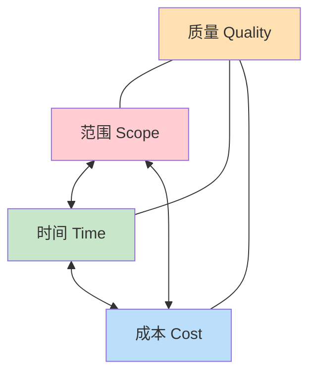

| 约束 | 英文 | 说明 |
|------|------|------|
| **范围** | Scope | 做什么，不做什么 |
| **时间** | Time | 多久完成 |
| **成本** | Cost | 花多少钱 |
| **质量** | Quality | 做到什么程度 |

> 💡 **铁三角关系**：三个角互相制约，一个变了，其他的也会受影响。
> - 要缩短时间 → 要么加成本，要么减范围
> - 要加范围 → 要么加时间，要么加成本
> - 质量是三个约束共同作用的结果

### 7.1.4 项目管理的十大知识领域（PMBOK）

| 知识领域 | 英文 | 核心内容 |
|----------|------|----------|
| **项目整合管理** | Integration | 全局协调，整体把控 |
| **项目范围管理** | Scope | 做什么，不做什么 |
| **项目进度管理** | Schedule | 时间安排，进度跟踪 |
| **项目成本管理** | Cost | 预算控制，成本管理 |
| **项目质量管理** | Quality | 质量保证，质量控制 |
| **项目资源管理** | Resource | 人力、设备、材料管理 |
| **项目沟通管理** | Communication | 信息传递，干系人沟通 |
| **项目风险管理** | Risk | 识别、分析、应对风险 |
| **项目采购管理** | Procurement | 外包、采购管理 |
| **项目相关方管理** | Stakeholder | 干系人管理 |

> 初学者重点掌握：范围、进度、成本、质量、风险 — 这五个是最核心的。

---

## 7.2 项目估算与进度管理

### 7.2.1 项目估算方法

软件项目估算是出了名的难，但我们还是有一些方法。

#### 一、专家判断法

- **做法**：请有经验的专家来估算
- **优点**：简单、快速
- **缺点**：主观性强，依赖专家水平
- **适用**：早期粗略估算

#### 二、类比估算法

- **做法**：找一个类似的历史项目，按比例估算
- **优点**：简单，有参考依据
- **缺点**：找到完全相似的项目很难
- **适用**：有类似项目经验时

#### 三、功能点估算法

- **做法**：按功能点的数量和复杂度来估算
- **优点**：比较客观，不依赖技术
- **缺点**：计算复杂，需要培训
- **适用**：需求比较明确时

#### 四、三点估算法（PERT）

考虑三种情况，取加权平均：

$$
E = \frac{O + 4M + P}{6}
$$

| 符号 | 含义 | 说明 |
|------|------|------|
| **O** | Optimistic | 最乐观时间（最好情况） |
| **M** | Most likely | 最可能时间（正常情况） |
| **P** | Pessimistic | 最悲观时间（最坏情况） |
| **E** | Expected | 期望时间（加权平均） |

**示例**：
- 乐观：3天完成
- 最可能：5天完成
- 悲观：10天完成
- 期望：(3 + 4×5 + 10) / 6 = 33/6 = 5.5天

#### 五、故事点估算法（敏捷常用）

- **做法**：用相对大小（故事点）来估算，而不是绝对时间
- **常用序列**：斐波那契数列 — 1, 2, 3, 5, 8, 13, 21...
- **优点**：相对估算更准确，适合不确定的需求
- **适用**：敏捷开发项目

> 💡 **估算的真理**：
> - 所有的估算都是错的，只是有些估算更有用
> - 估算不是承诺，是预测
> - 越早的估算，误差越大
> - 估算要随着项目进展不断修正

### 7.2.2 WBS 工作分解结构

**WBS（Work Breakdown Structure）**：把项目可交付成果和项目工作分解成较小的、更易于管理的组成部分。

> 简单说：把大任务拆成小任务，越拆越细。

#### WBS 的分解原则

1. **100%原则**：WBS 包含了 100% 的工作，不多也不少
2. **逐层分解**：从上到下，一层一层拆
3. **独立可交付**：每个工作包都有明确的交付物
4. **责任到人**：每个工作包有人负责

#### WBS 示例：开发一个网站

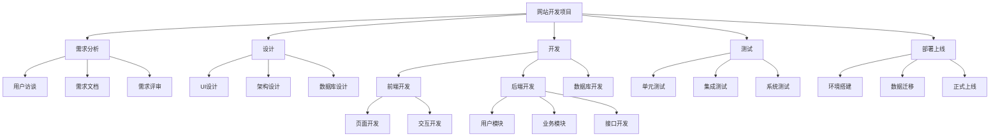

> 📌 **WBS 分解到什么程度合适？**
> - 每个工作包能在 1-2 周内完成
> - 每个工作包有明确的交付物
> - 每个工作包可以分配给一个人或一个小组负责
> - 不能太粗（管不住），也不能太细（管不起）

### 7.2.3 甘特图（Gantt Chart）

**甘特图**：以条形图的方式展示项目进度，横轴是时间，纵轴是任务。

> 甘特图是最常用的项目进度可视化工具。

#### 甘特图示例

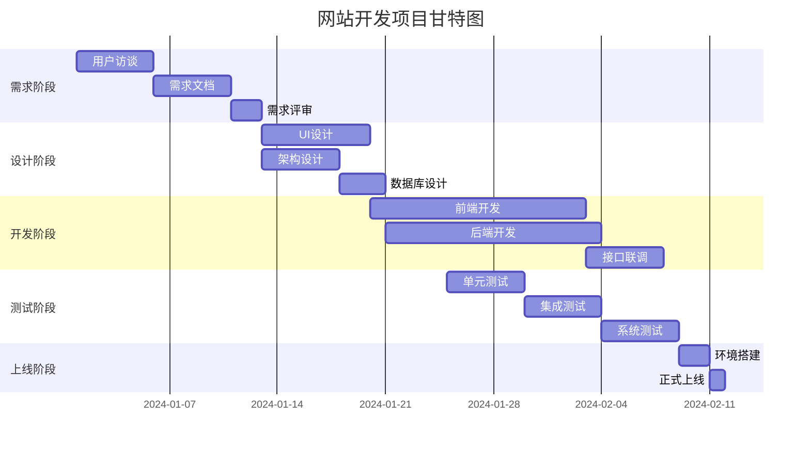

#### 甘特图的优点

1. ✅ 直观易懂，一眼能看出项目进度
2. ✅ 能看到任务之间的依赖关系
3. ✅ 能看到哪些任务并行，哪些串行
4. ✅ 便于跟踪和汇报进度

#### 常用甘特图工具

- Microsoft Project（专业但贵）
- 禅道 / Jira（项目管理工具自带）
- Excel（简单项目可以用）
- 在线工具：Trello、Asana、Monday.com
- 程序员：Mermaid、PlantUML

### 7.2.4 关键路径法（CPM）

**关键路径（Critical Path）**：项目中最长的那条活动路径，决定了项目的最短完成时间。

- 关键路径上的活动叫"关键活动"
- 关键活动延期 → 整个项目延期
- 非关键活动有"浮动时间"，延期一点不影响总工期

> 💡 **项目管理的重点**：盯住关键路径上的活动，确保它们不延期。

---

## 7.3 风险管理

### 7.3.1 什么是风险？

**风险（Risk）**：不确定的事件或条件，一旦发生，会对项目目标产生影响（正面或负面）。

> 我们通常说的风险是指负面风险（威胁），但风险也包括正面的（机会）。

### 7.3.2 风险管理的过程

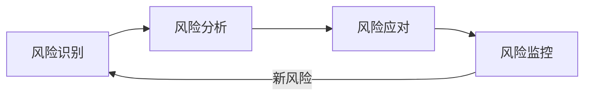

### 7.3.3 风险识别

**风险识别**：找出项目可能面临的风险。

#### 软件项目常见风险

| 风险类型 | 示例 |
|----------|------|
| **需求风险** | 需求不明确、需求频繁变更、需求遗漏 |
| **技术风险** | 技术难度大、新技术不成熟、性能不达标 |
| **人员风险** | 核心人员离职、团队能力不足、人员不够 |
| **进度风险** | 工期太紧、估算不准、关键路径延期 |
| **质量风险** | Bug太多、性能不达标、安全问题 |
| **管理风险** | 沟通不畅、团队冲突、目标不明确 |
| **外部风险** | 政策变化、客户变更、供应商问题 |

#### 风险识别的方法

- 头脑风暴
- 专家访谈
- 历史项目复盘
- 风险检查表
- SWOT 分析

### 7.3.4 风险分析

评估每个风险的**概率**和**影响**，确定优先级。

#### 风险矩阵

```mermaid
graph TD
    subgraph 风险矩阵
        direction TB
        高影响低概率 --> 高影响高概率
        低影响低概率 --> 低影响高概率
    end
    
    note left of 高影响高概率: 🔥 重点关注<br>必须应对
    note right of 低影响低概率: ✅ 接受<br>不用太管
    note left of 高影响低概率: ⚠️ 关注<br>制定预案
    note right of 低影响高概率: 📋 管理<br>想办法降低
```

| 概率\影响 | 低影响 | 高影响 |
|----------|--------|--------|
| **低概率** | 接受（绿） | 关注（黄） |
| **高概率** | 管理（黄） | 重点应对（红） |

### 7.3.5 风险应对策略

对于负面风险（威胁），有四种应对策略：

| 策略 | 英文 | 说明 | 示例 |
|------|------|------|------|
| **规避** | Avoid | 消除风险，改变计划 | 风险太大，干脆不做这个功能 |
| **转移** | Transfer | 把风险转移给第三方 | 买保险、外包给专业公司 |
| **减轻** | Mitigate | 降低风险的概率或影响 | 增加测试、提前做技术预研 |
| **接受** | Accept | 承认风险，不主动处理 | 小风险，发生了再说 |

> 💡 **风险储备**：
> - **时间储备**：在工期中预留缓冲时间
> - **成本储备**：在预算中预留应急资金
> - **人员储备**：关键岗位有 Backup

---

## 7.4 敏捷开发与 Scrum

### 7.4.1 敏捷回顾

敏捷开发的核心价值观（敏捷宣言）：
- **个体和互动** 高于 流程和工具
- **工作的软件** 高于 详尽的文档
- **客户合作** 高于 合同谈判
- **响应变化** 高于 遵循计划

### 7.4.2 Scrum 框架

**Scrum** 是最流行的敏捷开发框架，由 Ken Schwaber 和 Jeff Sutherland 共同创建。

> Scrum 原意是橄榄球运动中的"争球"，寓意团队像橄榄球队一样紧密协作、快速推进。

#### Scrum 的三大角色

| 角色 | 英文 | 职责 |
|------|------|------|
| **产品负责人** | Product Owner, PO | 负责产品方向，维护产品待办列表，排优先级 |
| **Scrum 主管** | Scrum Master | 服务型领导，移除障碍，确保 Scrum 正确执行 |
| **开发团队** | Development Team | 自组织、跨职能的团队，负责交付产品增量 |

> 🔴 **注意**：Scrum Master 不是项目经理，不管理团队，而是服务团队，帮团队扫清障碍。

#### Scrum 的三个工件（产物）

| 工件 | 英文 | 说明 |
|------|------|------|
| **产品待办列表** | Product Backlog | 产品所有需求/任务的有序列表，由 PO 维护 |
| **冲刺待办列表** | Sprint Backlog | 本次迭代要完成的任务列表，由开发团队认领 |
| **产品增量** | Product Increment | 每个 Sprint 结束时交付的可用产品版本 |

#### Scrum 的五个事件（会议）

| 事件 | 英文 | 时间盒 | 目的 |
|------|------|--------|------|
| **Sprint** | Sprint | 1-4周 | 一个迭代周期，产出可用的产品增量 |
| ** Sprint 规划会议** | Sprint Planning | 2-8小时 | 确定本次 Sprint 的目标和任务 |
| **每日站会** | Daily Scrum | 15分钟 | 同步进展，暴露问题 |
| ** Sprint 评审会议** | Sprint Review | 1-4小时 | 演示产品，收集反馈 |
| ** Sprint 回顾会议** | Sprint Retrospective | 0.5-3小时 | 团队反思，持续改进 |

### 7.4.3 Scrum 整体流程

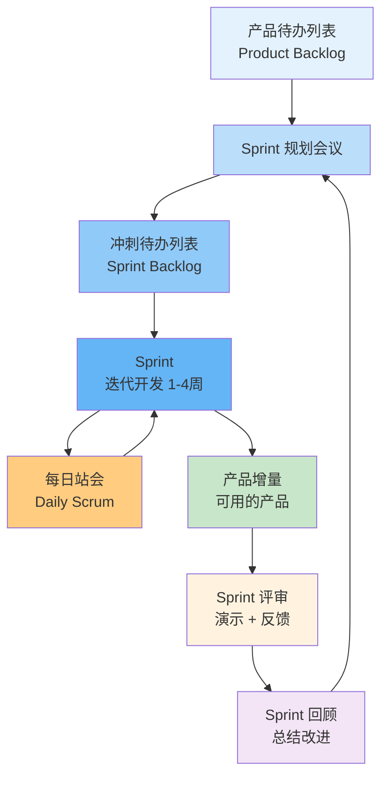

### 7.4.4 每日站会（Daily Scrum）

每日站会是 Scrum 中最著名的实践，每天固定时间、固定地点，团队成员站着开会，控制在 15 分钟内。

**每个人回答三个问题**：
1. 昨天我完成了什么？
2. 今天我计划做什么？
3. 我遇到了什么障碍？

> ⚠️ **常见误区**：
> - 站会不是汇报工作，是团队成员之间的同步
> - 不是只说"做了什么、要做什么"，更重要的是"有什么障碍"
> - 站会只讨论"同步"问题，深入讨论留到站会后

### 7.4.5 用户故事与故事点

**用户故事（User Story）**：敏捷中描述需求的方式。
- 格式：作为一个<角色>，我想要<功能>，以便于<价值>

**故事点（Story Point）**：敏捷中估算工作量的单位。
- 用相对大小，不用绝对时间
- 常用斐波那契数列：0, 1, 2, 3, 5, 8, 13, 21, ...
- 用"计划扑克"（Planning Poker）的方式团队共同估算

### 7.4.6 速率（Velocity）

**速率**：团队在一个 Sprint 中能完成的故事点数量。

- 比如团队一个 Sprint 完成了 30 个故事点，速率就是 30
- 速率是团队自己的标尺，不同团队之间没有可比性
- 用速率可以预测项目进度：剩余故事点 / 速率 = 还需要几个 Sprint

---

## 7.5 配置管理与 Git 工作流

### 7.5.1 什么是配置管理？

**软件配置管理（Software Configuration Management, SCM）**：通过技术和管理手段对软件产品及其开发过程和生命周期进行控制、规范的一系列措施。

> 简单说：管理代码和文档的版本，确保不乱。

#### 配置管理的核心活动

| 活动 | 说明 |
|------|------|
| **配置标识** | 识别哪些是配置项（代码、文档、环境等） |
| **版本控制** | 管理配置项的版本变化 |
| **变更控制** | 管理变更的申请、审批、执行 |
| **配置审计** | 检查配置项的完整性和一致性 |
| **状态报告** | 报告配置项的状态和历史 |

### 7.5.2 版本控制工具

版本控制是配置管理的核心。

| 工具 | 类型 | 特点 |
|------|------|------|
| **Git** | 分布式 | 最流行，速度快，分支强大 |
| **SVN** | 集中式 | 传统工具，逐渐被 Git 取代 |
| **Mercurial** | 分布式 | 类似 Git，小众 |

> 现在行业标准是 **Git**，必须掌握。

### 7.5.3 Git 工作流

Git 工作流有很多种，选择适合团队的就好。

#### 一、Git Flow

最经典的 Git 工作流，有严格的分支模型。

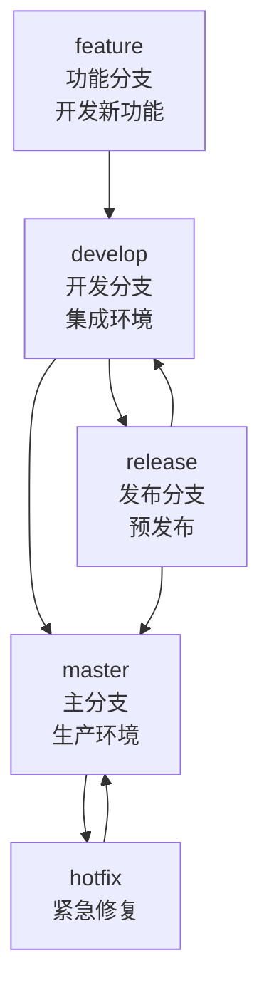

| 分支 | 说明 | 是否长期 |
|------|------|---------|
| **master** | 主分支，只有发布到生产的代码 | ✅ 长期 |
| **develop** | 开发分支，集成所有功能 | ✅ 长期 |
| **feature/*** | 功能分支，开发新功能用 | ❌ 临时 |
| **release/*** | 发布分支，准备新版本 | ❌ 临时 |
| **hotfix/*** | 热修复分支，紧急修bug | ❌ 临时 |

**优点**：规范、严谨，适合大型团队和版本管理严格的项目。
**缺点**：复杂、流程长，不适合快速迭代。

---

#### 二、GitHub Flow

更简单的工作流，只有 master + feature 分支。

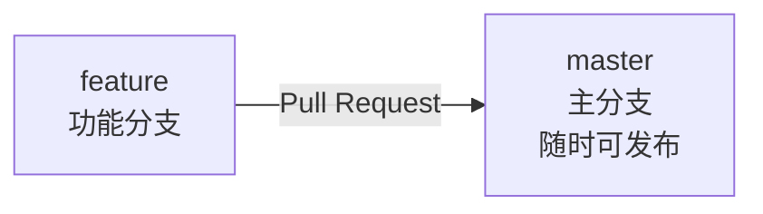

**流程**：
1. 从 master 切出 feature 分支开发
2. 开发完后提交 Pull Request
3. Code Review 通过后合并到 master
4. master 随时可以部署

**优点**：简单、灵活、适合持续交付。
**缺点**：不适合多版本并行维护的场景。

---

#### 三、GitLab Flow

在 GitHub Flow 基础上增加了环境分支。

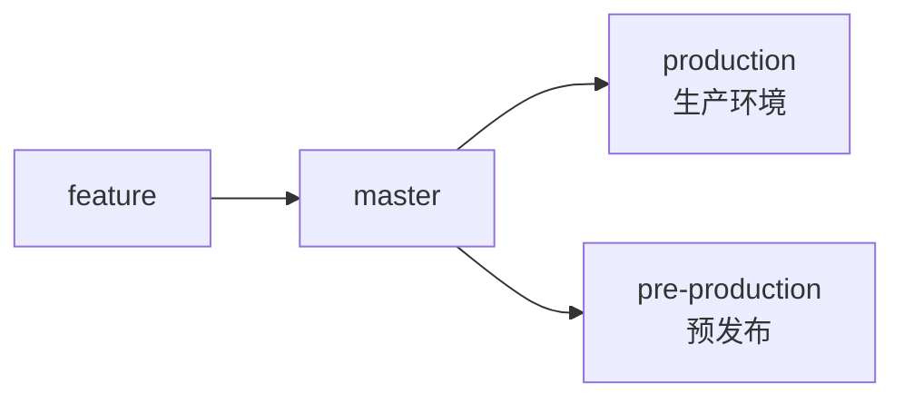

适合有多个环境（开发、预发、生产）的团队。

### 7.5.4 如何选择 Git 工作流？

| 场景 | 推荐工作流 |
|------|-----------|
| 小型团队、快速迭代 | GitHub Flow |
| 大型团队、版本管理严格 | Git Flow |
| 有多个部署环境 | GitLab Flow |
| 特别小的团队、个人项目 | 直接 master 分支也能行 |

> 💡 **原则**：适合的就是最好的，不要为了"规范"而把流程搞复杂。

---

## 7.6 DevOps 与 CI/CD

### 7.6.1 DevOps 回顾

**DevOps** = Development + Operations，是一种文化、运动和实践。

核心目标：**打破开发和运维之间的壁垒，实现快速、可靠的软件交付**。

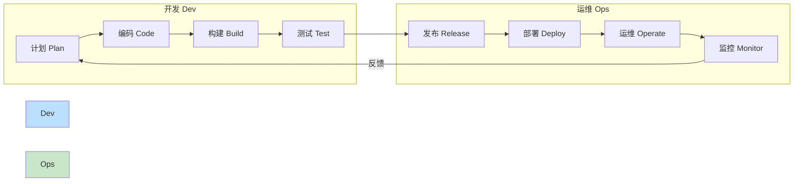

### 7.6.2 CI/CD 是什么？

CI/CD 是 DevOps 的核心实践，是实现自动化交付的关键。

| 缩写 | 全称 | 中文 | 说明 |
|------|------|------|------|
| **CI** | Continuous Integration | 持续集成 | 频繁地把代码集成到主干 |
| **CD** | Continuous Delivery | 持续交付 | 频繁地把软件交付到预生产环境 |
| **CD** | Continuous Deployment | 持续部署 | 自动部署到生产环境 |

> 注意：CD 有两个意思，Delivery（交付）和 Deployment（部署），后者比前者更彻底。

### 7.6.3 持续集成（CI）

**持续集成（Continuous Integration）**：开发人员频繁地（每天多次）将代码集成到主干分支，每次集成都通过自动化的构建和测试来验证。

#### CI 的流程

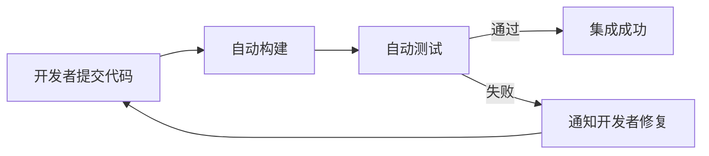

#### CI 的好处

1. ✅ **早发现问题**：每天集成，问题发现早
2. ✅ **减少集成风险**：不会到最后才发现集成不了
3. ✅ **提高质量**：自动化测试保障
4. ✅ **加速反馈**：提交代码很快就知道结果
5. ✅ **减少手工操作**：自动化，省时间

### 7.6.4 持续交付 vs 持续部署

```mermaid
graph LR
    subgraph CI 持续集成
        A[提交代码] --> B[构建]
        B --> C[测试]
    end
    
    subgraph CD 持续交付
        C --> D[预发布环境]
        D --> E[人工审批]
    end
    
    subgraph CD 持续部署
        E --> F[生产环境]
    end
    
    style CI fill:#e3f2fd
    style CD fill:#fff3e0
    note right of F: 持续部署是持续交付的进阶<br>去掉人工审批，全自动
```

| 维度 | 持续交付（Delivery） | 持续部署（Deployment） |
|------|---------------------|-----------------------|
| **到哪一步** | 到预生产环境，随时可以发布 | 直接到生产环境 |
| **是否需要人工** | 需要人工审批才能上线 | 全自动，不需要人工 |
| **上线频率** | 可以随时上线，频率取决于业务 | 每次提交都可能上线 |
| **风险** | 较低（有人工把关） | 较高（对自动化要求高） |
| **适用场景** | 大多数企业 | 成熟的互联网公司 |

> 💡 **大部分公司做到持续交付就够了**，持续部署需要很高的自动化水平和完善的监控体系。

### 7.6.5 CI/CD 工具链

| 环节 | 常用工具 |
|------|----------|
| **代码托管** | GitHub, GitLab, Bitbucket, Gitee |
| **CI/CD 服务** | GitHub Actions, GitLab CI, Jenkins, Travis CI |
| **构建工具** | Maven, Gradle, npm, webpack, Make |
| **测试工具** | JUnit, pytest, Jest, Selenium |
| **制品管理** | Nexus, Artifactory, Docker Hub |
| **部署工具** | Ansible, Kubernetes, Helm |

### 7.6.6 CI/CD 流水线示例

一个典型的 CI/CD 流水线（Pipeline）：

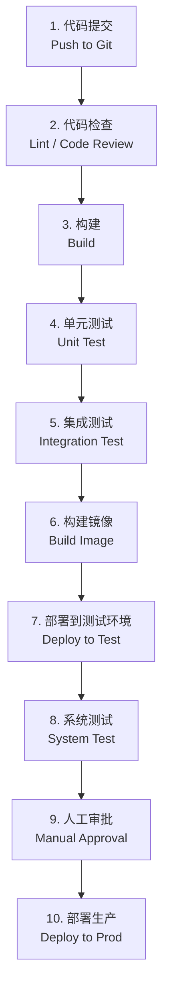

---

## 7.7 容器化与发布策略

### 7.7.1 Docker 与容器化

#### 什么是容器？

**容器（Container）**：一种轻量级的虚拟化技术，把应用及其依赖打包在一起，在任何环境下都能一致地运行。

> 简单说：容器就是"打包应用的盒子"，一次打包，到处运行。

#### Docker 的核心概念

| 概念 | 说明 | 类比 |
|------|------|------|
| **镜像 Image** | 应用的打包文件，只读 | 程序安装包 / 类 |
| **容器 Container** | 镜像运行的实例，可读写 | 运行中的程序 / 对象 |
| **Dockerfile** | 构建镜像的脚本 | 安装说明书 |
| **仓库 Registry** | 存放镜像的地方 | 应用商店 |

#### 容器化的好处

1. ✅ **环境一致**：开发、测试、生产环境一样
2. ✅ **快速部署**：秒级启动和停止
3. ✅ **资源高效**：比虚拟机轻量很多
4. ✅ **易于扩展**：横向扩展方便
5. ✅ **隔离性好**：应用之间互不影响

### 7.7.2 发布策略

上线是有风险的，好的发布策略能降低上线风险。

#### 一、蓝绿发布（Blue-Green Deployment）

**做法**：有两套完全一样的环境（蓝和绿），一套在跑，一套待命。发布时切换流量。

```mermaid
graph LR
    A[用户流量] --> B[负载均衡]
    B --> C[蓝环境<br>当前版本]
    B -.-> D[绿环境<br>新版本]
    
    note right of D: 发布时：<br>1. 部署新版本到绿环境<br>2. 测试没问题<br>3. 切换流量到绿环境<br>4. 蓝环境变成待命
```

| 优点 | 缺点 |
|------|------|
| 零停机发布 | 需要两套环境，成本高 |
| 回滚快（切回去就行） | 资源利用率低 |
| 发布过程安全可控 | 数据库兼容是个问题 |

---

#### 二、金丝雀发布（Canary Release）

**做法**：先让一小部分用户用新版本，没问题再逐步扩大范围。

> 名字来源于"金丝雀矿井"——矿工下井带金丝雀，金丝雀死了就说明有毒气，赶紧撤。

```mermaid
graph LR
    A[用户流量] --> B[流量控制]
    B -->|10%| C[新版本 v2]
    B -->|90%| D[旧版本 v1]
    
    note right of C: 观察新版本表现<br>没问题就逐步增加流量<br>有问题就切回去
```

| 优点 | 缺点 |
|------|------|
| 风险小，出问题只影响少量用户 | 发布过程较长 |
| 可以真实环境验证 | 流量控制复杂 |
| 回滚快 | 多版本共存，数据库要兼容 |

---

#### 三、灰度发布（Gray Release）

灰度发布和金丝雀发布很像，有时候是一个意思。

区别（狭义上）：
- **金丝雀**：按比例逐步扩大
- **灰度**：按用户特征（如地区、用户ID、VIP等级）选择

> 实际工作中不用太纠结名字，核心都是"小范围验证 → 逐步扩大"。

---

#### 四、滚动发布（Rolling Update）

**做法**：逐个（或分批）替换旧版本的实例。

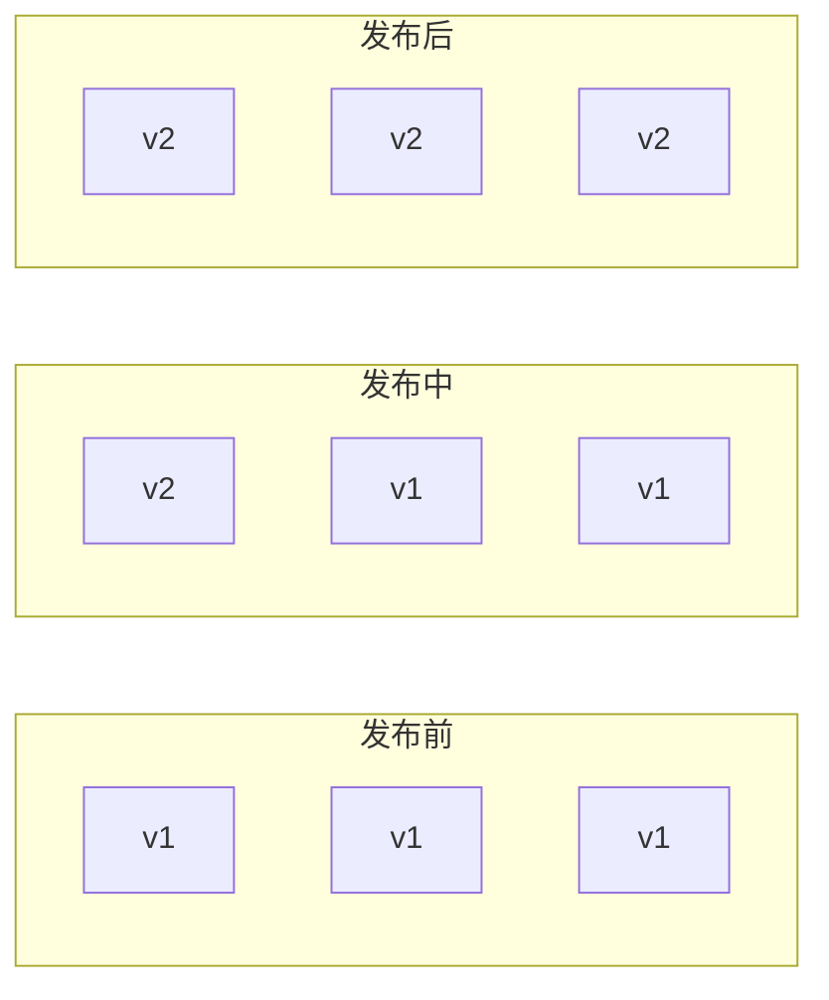

| 优点 | 缺点 |
|------|------|
| 不需要额外资源 | 发布过程中版本混乱 |
| 简单，K8s 原生支持 | 回滚慢 |
| 对用户影响小 | 出问题影响范围逐渐扩大 |

---

#### 发布策略对比总结

| 策略 | 零停机 | 回滚速度 | 资源成本 | 风险 | 适用场景 |
|------|--------|----------|----------|------|----------|
| **蓝绿发布** | ✅ 是 | 很快 | 高（两套环境） | 低 | 重要系统、小项目 |
| **金丝雀/灰度** | ✅ 是 | 快 | 中 | 很低 | 互联网产品、大用户量 |
| **滚动发布** | ✅ 是 | 慢 | 低 | 中 | 一般系统、K8s 环境 |
| **停机发布** | ❌ 否 | - | 最低 | 高 | 内部系统、非工作时间发布 |

---

## 7.8 常见误区与易错点

### 误区1：项目管理就是做计划、盯进度

- ❌ 不全面！项目管理是多维度的
- ✅ 范围、时间、成本、质量、风险、沟通...都要管

### 误区2：估算越精确越好

- ❌ 错！估算是预测，不是承诺，不可能完全精确
- ✅ 估算要有范围，给个区间，而不是一个精确数字
- ✅ 随着项目进展，估算会越来越准确

### 误区3：Scrum = 敏捷

- ❌ 错！Scrum 是敏捷的一种框架，不是敏捷的全部
- ✅ 敏捷还有 XP、Kanban、Crystal 等很多方法
- ✅ 重要的是理解敏捷的价值观，不是照搬 Scrum 流程

### 误区4：DevOps 就是 CI/CD

- ❌ 错！CI/CD 是 DevOps 的工具和实践
- ✅ DevOps 首先是文化和思想，然后才是工具
- ✅ 没有文化支撑，光有工具也没用

### 误区5：Git Flow 是最规范的，必须用

- ❌ 错！没有最好的工作流，只有最合适的
- ✅ 根据团队规模、项目特点、发布频率选择
- ✅ 小团队用 GitHub Flow 比 Git Flow 效率高得多

---

## 7.9 关键术语中英对照

| 中文 | 英文 | 缩写 |
|------|------|------|
| 项目管理 | Project Management | PM |
| 工作分解结构 | Work Breakdown Structure | WBS |
| 甘特图 | Gantt Chart | - |
| 关键路径法 | Critical Path Method | CPM |
| 风险管理 | Risk Management | - |
| 敏捷开发 | Agile Development | - |
| Scrum | Scrum | - |
| 产品负责人 | Product Owner | PO |
| Scrum 主管 | Scrum Master | SM |
| 产品待办列表 | Product Backlog | - |
| 冲刺待办列表 | Sprint Backlog | - |
| 冲刺 | Sprint | - |
| 每日站会 | Daily Scrum / Daily Standup | - |
| 故事点 | Story Point | - |
| 速率 | Velocity | - |
| 软件配置管理 | Software Configuration Management | SCM |
| 版本控制 | Version Control | - |
| Git Flow | Git Flow | - |
| GitHub Flow | GitHub Flow | - |
| DevOps | Development + Operations | DevOps |
| 持续集成 | Continuous Integration | CI |
| 持续交付 | Continuous Delivery | CD |
| 持续部署 | Continuous Deployment | CD |
| 流水线 | Pipeline | - |
| 容器 | Container | - |
| Docker | Docker | - |
| 镜像 | Image | - |
| 蓝绿发布 | Blue-Green Deployment | - |
| 金丝雀发布 | Canary Release | - |
| 灰度发布 | Gray Release / GrayScale Release | - |
| 滚动发布 | Rolling Update / Rolling Release | - |

---

## 7.10 练习题与自测

### 一、选择题

1. 项目管理的"铁三角"不包括（ ）
   - A. 范围
   - B. 时间
   - C. 成本
   - D. 人员

2. WBS 指的是（ ）
   - A. 工作分解结构
   - B. 工作分解标准
   - C. 工作业务系统
   - D. 宽度优先搜索

3. Scrum 框架中的三个角色不包括（ ）
   - A. 产品负责人
   - B. Scrum Master
   - C. 项目经理
   - D. 开发团队

4. 每日站会通常控制在多长时间内？（ ）
   - A. 5分钟
   - B. 15分钟
   - C. 30分钟
   - D. 1小时

5. 持续集成（CI）的核心是（ ）
   - A. 频繁地将代码集成到主干
   - B. 自动部署到生产环境
   - C. 人工审核代码
   - D. 每天只提交一次代码

6. 蓝绿发布的主要缺点是（ ）
   - A. 有停机时间
   - B. 回滚慢
   - C. 需要两套环境，成本高
   - D. 风险大

### 二、简答题

1. 什么是项目管理的铁三角？它们之间是什么关系？

2. 什么是 WBS？WBS 分解的原则是什么？

3. Scrum 有哪些角色、工件和事件？

4. 什么是 CI/CD？CI 和 CD 有什么区别？

5. 常见的发布策略有哪些？各有什么优缺点？

### 三、实践题

**题目**：假设你要开发一个"个人博客系统"，项目周期 4 周，团队 3 个人（前端1，后端1，测试1）。

请完成：
1. 用 WBS 分解项目任务（至少 3 层，20 个以上任务）
2. 画出甘特图（大致安排时间）
3. 识别项目的 Top 5 风险，并给出应对策略
4. 如果用 Scrum 方式开发，2 周一个 Sprint，如何规划两个 Sprint 的内容？

---

## 7.11 参考答案

### 一、选择题

1. **D** — 铁三角是范围、时间、成本，质量是三者共同作用的结果
2. **A** — WBS = Work Breakdown Structure，工作分解结构
3. **C** — Scrum 三个角色：产品负责人、Scrum Master、开发团队，没有项目经理
4. **B** — 每日站会时间盒是 15 分钟
5. **A** — 持续集成的核心是频繁集成，每天多次提交到主干
6. **C** — 蓝绿发布需要两套完全一样的环境，资源成本高

### 二、简答题（要点）

1. **项目铁三角**：范围、时间、成本。
   关系：三者相互制约，构成一个三角形。任何一个角变化，都会影响其他角。比如范围增加，要么时间延长，要么成本增加，要么质量下降。质量是三者共同作用的结果。

2. **WBS**（Work Breakdown Structure）：工作分解结构，把项目工作逐层分解成更小的、更易于管理的工作包。
   分解原则：
   - 100%原则：包含所有工作，不多不少
   - 逐层分解：从上到下，一层一层拆
   - 独立可交付：每个工作包有明确的交付物
   - 责任到人：每个工作包有人负责
   - 粒度适中：每个工作包1-2周内能完成

3. **Scrum 的角色**：产品负责人（PO）、Scrum Master、开发团队
   **Scrum 的工件**：产品待办列表（Product Backlog）、冲刺待办列表（Sprint Backlog）、产品增量（Increment）
   **Scrum 的事件**：Sprint、Sprint 规划会议、每日站会、Sprint 评审、Sprint 回顾

4. **CI/CD**：
   - **CI 持续集成**：频繁地将代码集成到主干，通过自动化构建和测试验证
   - **CD 持续交付**：在CI基础上，自动将软件交付到预生产环境，随时可以发布
   - **CD 持续部署**：在持续交付基础上，自动部署到生产环境，不需要人工干预
   
   **区别**：CI是集成代码，CD是交付/部署软件。CI在前，CD在后。持续交付和持续部署的区别是：前者需要人工审批上线，后者全自动。

5. 常见发布策略：
   - **蓝绿发布**：两套环境切换。优点是零停机、回滚快；缺点是成本高。
   - **金丝雀/灰度发布**：小范围逐步扩大。优点是风险低；缺点是发布过程长。
   - **滚动发布**：逐个替换实例。优点是不需要额外资源；缺点是回滚慢。
   - **停机发布**：停服更新。优点是简单成本低；缺点是有停机时间。

### 三、实践题（参考思路）

**1. WBS 分解（示例）**：

```
个人博客系统
├── 需求分析
│   ├── 功能需求梳理
│   ├── 非功能需求梳理
│   └── 需求文档编写
├── 设计阶段
│   ├── UI设计
│   │   ├── 首页设计
│   │   ├── 文章详情页设计
│   │   └── 后台管理页设计
│   ├── 架构设计
│   │   ├── 技术选型
│   │   └── 分层架构设计
│   └── 数据库设计
│       ├── ER图设计
│       └── 表结构设计
├── 开发阶段
│   ├── 前端开发
│   │   ├── 页面开发
│   │   ├── 文章列表
│   │   ├── 文章详情
│   │   └── 后台管理
│   ├── 后端开发
│   │   ├── 用户模块
│   │   ├── 文章模块
│   │   ├── 评论模块
│   │   └── 接口开发
│   └── 数据库开发
│       ├── 建表脚本
│       └── 初始化数据
├── 测试阶段
│   ├── 单元测试
│   ├── 接口测试
│   ├── 功能测试
│   └── 性能测试
└── 部署上线
    ├── 环境搭建
    ├── 部署配置
    └── 正式上线
```

**2. 甘特图安排（示例）**：

- 第1周：需求分析（2天）+ 设计（3天）
- 第2周：前端开发 + 后端开发（并行）
- 第3周：开发收尾 + 接口联调 + 单元测试
- 第4周：系统测试 + Bug修复 + 部署上线

**3. Top 5 风险（示例）**：

| 风险 | 概率 | 影响 | 应对策略 |
|------|------|------|----------|
| 需求变更频繁 | 高 | 中 | 敏捷开发，快速响应；需求变更走评估 |
| 技术难点（如Markdown编辑器） | 中 | 中 | 提前技术预研；准备备选方案 |
| 人员请假/离职 | 低 | 高 | 代码规范+文档；知识共享；互相Backup |
| 测试不充分，上线出Bug | 中 | 高 | 加强测试；灰度发布；完善监控 |
| 部署环境问题 | 中 | 中 | 使用Docker容器化；提前准备部署脚本 |

**4. Scrum 两个 Sprint 规划（示例）**：

**Sprint 1（第1-2周）：核心功能 MVP**
- 目标：做出可以发布的最小可用版本
- 主要用户故事：
  - 文章列表展示
  - 文章详情页
  - 管理员登录
  - 文章发布（Markdown）
  - 文章管理（增删改查）
- Sprint 结束：演示一个可以看文章、发文章的博客

**Sprint 2（第3-4周）：完善功能 + 上线**
- 目标：完善功能，正式上线
- 主要用户故事：
  - 评论功能
  - 分类/标签
  - 搜索功能
  - 分页
  - 部署上线
  - 性能优化
- Sprint 结束：正式上线的完整博客系统

---

> 📌 **下一章**：通过完整项目案例融会贯通 → [08-完整项目案例.md](./08-完整项目案例.md)
