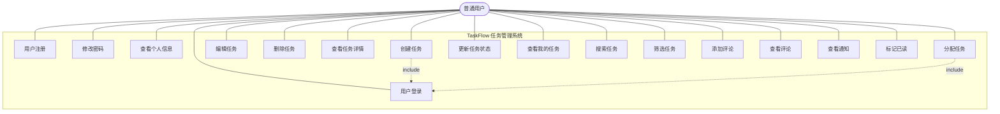
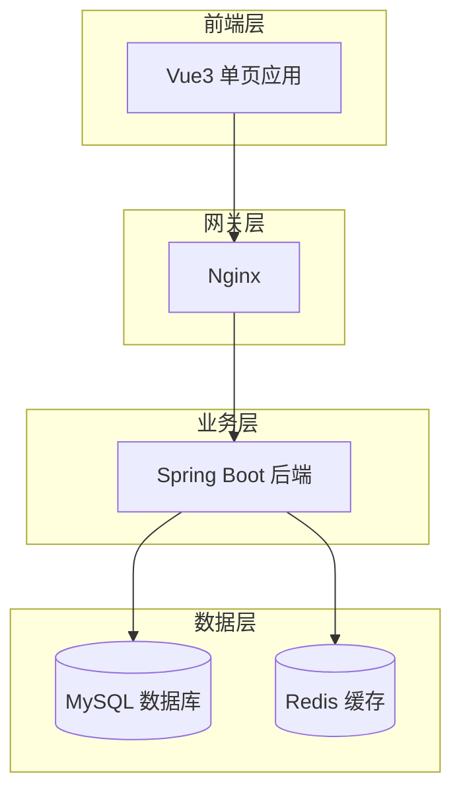
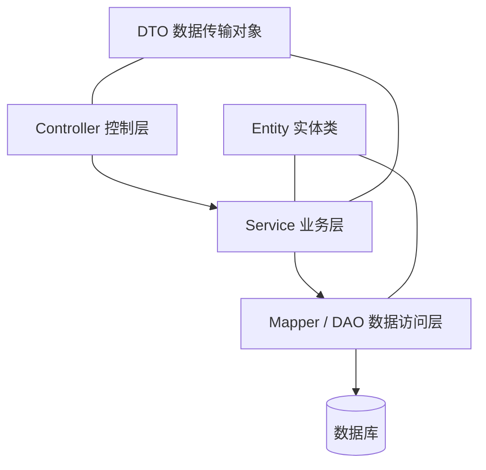
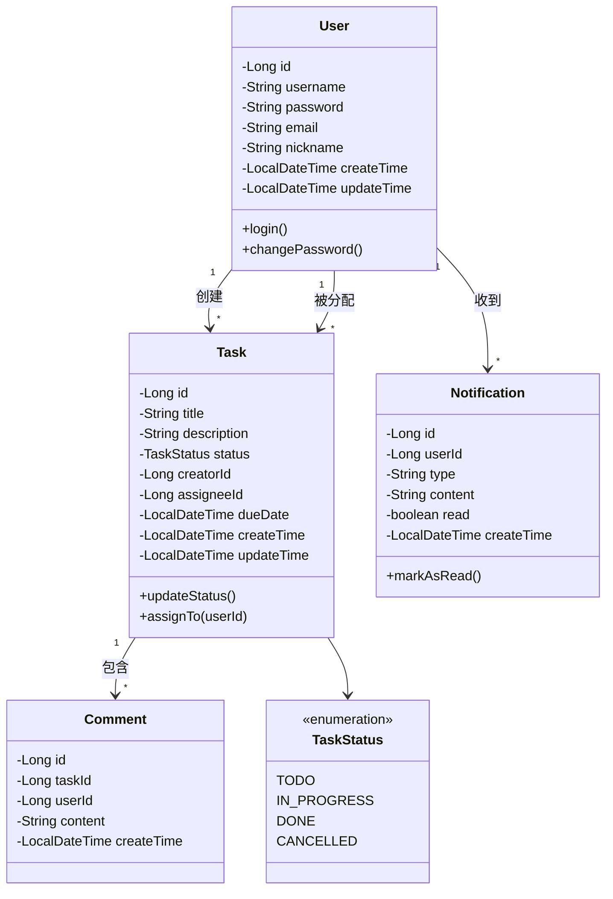
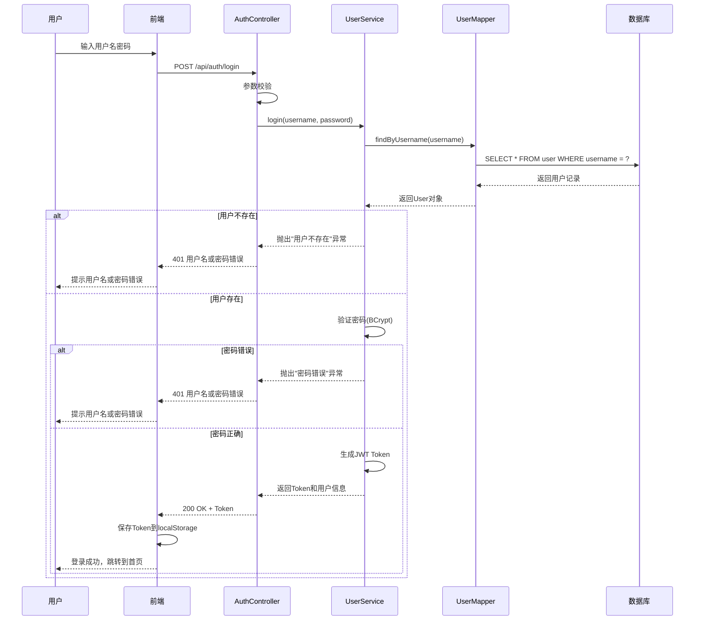
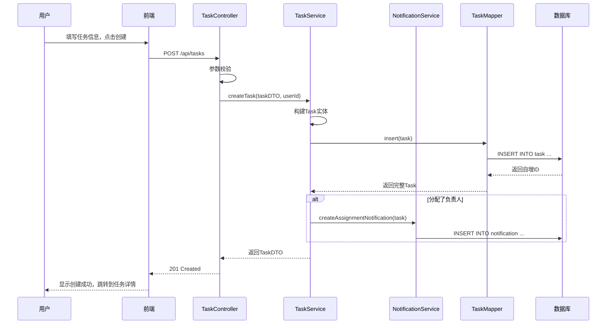
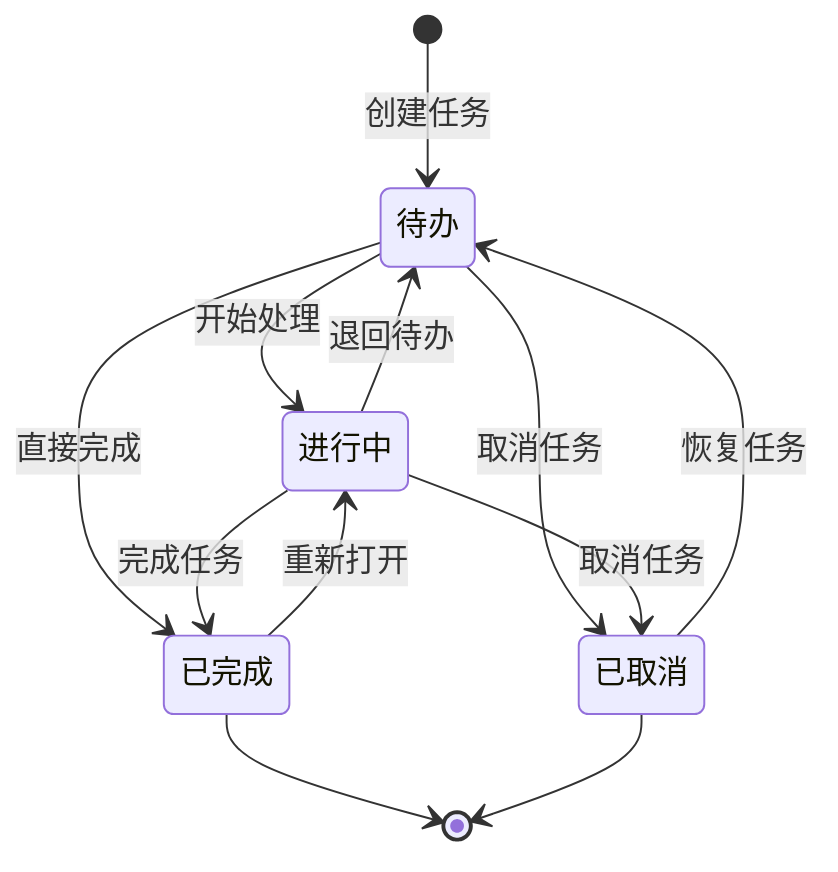
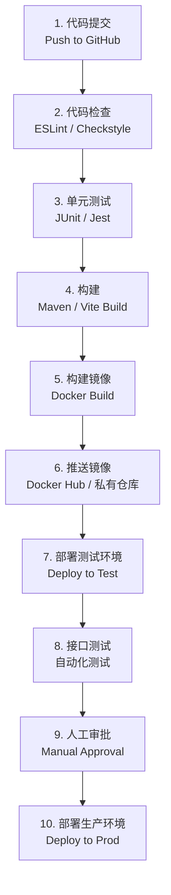

# 第八章 完整项目案例：任务管理系统

> **学习目标**：通过一个完整的项目案例，将软件工程各阶段的知识串联起来，掌握从需求到部署的完整流程
> **预计学时**：6小时 | **重要程度**：⭐⭐⭐⭐⭐

---

## 8.1 项目概述

### 8.1.1 项目背景

**项目名称**：TaskFlow 任务管理系统

**项目背景**：
某创业团队人数增长到 20 人，原来用 Excel 表格管理任务越来越不方便，经常出现：
- 任务分配不清晰，不知道谁在做什么
- 任务进度不透明，领导不知道项目进展
- 任务沟通分散在微信、邮件里，查找困难
- 没有任务提醒，经常忘事

**项目目标**：
开发一个轻量级的任务管理系统，帮助团队高效管理任务，提升协作效率。

### 8.1.2 项目范围

**本期范围（MVP）**：
- 用户管理（注册、登录、个人信息）
- 任务管理（创建、编辑、删除、分配、状态流转）
- 任务列表（我的任务、我创建的、全部任务）
- 任务搜索和筛选
- 任务评论
- 通知提醒

**不在本期范围**：
- 项目/团队管理（多团队、多项目）
- 甘特图、燃尽图
- 时间追踪、工时统计
- 移动端 App
- 第三方集成（钉钉、企业微信）

### 8.1.3 项目约束

| 约束类型 | 具体内容 |
|----------|----------|
| **时间** | 8 周完成 MVP 版本 |
| **人员** | 3 人团队（前端1、后端1、测试1） |
| **技术栈** | 前端 Vue3 + 后端 Spring Boot + MySQL |
| **预算** | 人力成本 + 云服务器费用（约 500 元/月） |
| **性能要求** | 支持 100 人同时在线，页面响应时间 < 2s |

---

## 8.2 需求分析阶段

### 8.2.1 需求获取

通过用户访谈和头脑风暴，收集到以下需求：

**用户访谈记录（摘要）**：

> **问**：你们现在怎么管理任务？
> **答**：主要用 Excel，大项目一个表格，小任务就微信说一下。
>
> **问**：最大的痛点是什么？
> **答**：不知道谁在做什么，经常两个人做了同一件事；还有进度不透明，老板问起来要挨个问。
>
> **问**：希望有哪些功能？
> **答**：能看到每个人的任务列表、任务有状态、能评论讨论、快到期了提醒一下。
>
> **问**：对界面有什么要求？
> **答**：简单好用就行，不要太复杂，我们不是互联网公司，不需要花里胡哨的。

### 8.2.2 需求整理与优先级

**功能需求清单（按 MoSCoW 优先级）**：

| 优先级 | 功能模块 | 功能点 |
|--------|----------|--------|
| **必须有** | 用户 | 用户注册、登录、修改密码、个人信息 |
| **必须有** | 任务 | 创建任务、编辑任务、删除任务、任务详情 |
| **必须有** | 任务 | 分配任务给某人、设置截止日期 |
| **必须有** | 任务 | 任务状态（待办、进行中、已完成、已取消） |
| **必须有** | 任务列表 | 我的任务、我创建的、按状态筛选 |
| **必须有** | 任务列表 | 搜索任务、排序 |
| **应该有** | 任务评论 | 任务下可以评论讨论 |
| **应该有** | 通知 | 任务分配通知、任务截止提醒 |
| **可以有** | 任务标签 | 给任务打标签、按标签筛选 |
| **可以有** | 附件 | 任务可以上传附件 |
| **这次不做** | 项目管理 | 多项目、项目成员管理 |
| **这次不做** | 统计报表 | 任务统计、甘特图 |

**非功能需求**：

| 类型 | 需求 |
|------|------|
| 性能 | 页面加载时间 < 2s，支持 100 并发用户 |
| 可用性 | 系统可用性 99.5%，年停机时间 < 43 小时 |
| 安全性 | 密码加密存储、登录失败次数限制、敏感操作日志 |
| 兼容性 | 支持 Chrome、Firefox、Edge 最新版本 |
| 易用性 | 新用户 10 分钟内可以上手 |

### 8.2.3 用例图



### 8.2.4 核心用户故事

| ID | 用户故事 | 优先级 | 故事点 |
|----|----------|--------|--------|
| US001 | 作为一个用户，我想要注册账号，以便于使用系统 | P0 | 3 |
| US002 | 作为一个用户，我想要登录系统，以便于管理我的任务 | P0 | 2 |
| US003 | 作为一个用户，我想要创建任务，以便于记录要做的事情 | P0 | 2 |
| US004 | 作为一个用户，我想要查看我的任务列表，以便于了解我要做什么 | P0 | 3 |
| US005 | 作为一个用户，我想要更新任务状态，以便于跟踪任务进展 | P0 | 2 |
| US006 | 作为一个用户，我想要分配任务给别人，以便于协作 | P0 | 3 |
| US007 | 作为一个用户，我想要给任务添加评论，以便于讨论 | P1 | 3 |
| US008 | 作为一个用户，我想要搜索任务，以便于快速找到任务 | P1 | 2 |
| US009 | 作为一个用户，我想要收到任务通知，以便于不忘记做事 | P1 | 5 |
| US010 | 作为一个用户，我想要设置任务截止日期，以便于管理时间 | P0 | 2 |

---

## 8.3 系统设计阶段

### 8.3.1 架构设计

**架构风格**：分层架构 + 前后端分离



**分层说明**：

| 层 | 技术选型 | 职责 |
|----|----------|------|
| **表现层** | Vue3 + Element Plus | 用户界面、交互逻辑 |
| **网关层** | Nginx | 反向代理、静态资源、负载均衡 |
| **业务层** | Spring Boot | 业务逻辑、接口、权限 |
| **数据层** | MySQL + Redis | 数据持久化、缓存 |

### 8.3.2 后端分层架构



| 层 | 职责 | 示例 |
|----|------|------|
| **Controller** | 接收请求、参数校验、返回结果 | TaskController |
| **Service** | 核心业务逻辑、事务管理 | TaskService |
| **Mapper/DAO** | 数据库操作、SQL | TaskMapper |
| **Entity** | 数据库实体类，和表对应 | Task |
| **DTO** | 接口传输对象，和前端交互 | TaskDTO |

> 设计原则：每层只和相邻层交互，不跨层调用。

### 8.3.3 类图设计

**核心领域类图**：



### 8.3.4 数据库设计

**核心数据表**：

**用户表（user）**：

| 字段 | 类型 | 说明 | 约束 |
|------|------|------|------|
| id | BIGINT | 用户ID | 主键，自增 |
| username | VARCHAR(50) | 用户名 | 唯一，非空 |
| password | VARCHAR(100) | 密码（加密） | 非空 |
| email | VARCHAR(100) | 邮箱 | 唯一 |
| nickname | VARCHAR(50) | 昵称 | - |
| avatar | VARCHAR(255) | 头像URL | - |
| create_time | DATETIME | 创建时间 | 非空 |
| update_time | DATETIME | 更新时间 | 非空 |

**任务表（task）**：

| 字段 | 类型 | 说明 | 约束 |
|------|------|------|------|
| id | BIGINT | 任务ID | 主键，自增 |
| title | VARCHAR(200) | 任务标题 | 非空 |
| description | TEXT | 任务描述 | - |
| status | VARCHAR(20) | 任务状态 | 非空，默认TODO |
| creator_id | BIGINT | 创建人ID | 非空，外键 |
| assignee_id | BIGINT | 负责人ID | 外键 |
| due_date | DATETIME | 截止日期 | - |
| priority | TINYINT | 优先级（1-5） | 默认3 |
| create_time | DATETIME | 创建时间 | 非空 |
| update_time | DATETIME | 更新时间 | 非空 |

**评论表（comment）**：

| 字段 | 类型 | 说明 | 约束 |
|------|------|------|------|
| id | BIGINT | 评论ID | 主键，自增 |
| task_id | BIGINT | 任务ID | 非空，外键 |
| user_id | BIGINT | 评论人ID | 非空，外键 |
| content | TEXT | 评论内容 | 非空 |
| create_time | DATETIME | 创建时间 | 非空 |

**通知表（notification）**：

| 字段 | 类型 | 说明 | 约束 |
|------|------|------|------|
| id | BIGINT | 通知ID | 主键，自增 |
| user_id | BIGINT | 用户ID | 非空，外键 |
| type | VARCHAR(20) | 通知类型 | 非空 |
| content | VARCHAR(500) | 通知内容 | 非空 |
| is_read | TINYINT | 是否已读 | 默认0 |
| relate_id | BIGINT | 关联ID（如任务ID） | - |
| create_time | DATETIME | 创建时间 | 非空 |

### 8.3.5 接口设计（RESTful API）

**用户模块**：

| 方法 | 路径 | 说明 |
|------|------|------|
| POST | /api/auth/register | 用户注册 |
| POST | /api/auth/login | 用户登录 |
| PUT | /api/users/password | 修改密码 |
| GET | /api/users/me | 获取当前用户信息 |

**任务模块**：

| 方法 | 路径 | 说明 |
|------|------|------|
| POST | /api/tasks | 创建任务 |
| GET | /api/tasks | 获取任务列表 |
| GET | /api/tasks/{id} | 获取任务详情 |
| PUT | /api/tasks/{id} | 更新任务 |
| DELETE | /api/tasks/{id} | 删除任务 |
| PATCH | /api/tasks/{id}/status | 更新任务状态 |
| PATCH | /api/tasks/{id}/assign | 分配任务 |

**评论模块**：

| 方法 | 路径 | 说明 |
|------|------|------|
| POST | /api/tasks/{taskId}/comments | 添加评论 |
| GET | /api/tasks/{taskId}/comments | 获取任务评论列表 |

**通知模块**：

| 方法 | 路径 | 说明 |
|------|------|------|
| GET | /api/notifications | 获取通知列表 |
| PATCH | /api/notifications/{id}/read | 标记已读 |
| PATCH | /api/notifications/read-all | 全部标记已读 |

---

## 8.4 详细设计阶段

### 8.4.1 核心流程时序图

#### 一、用户登录流程



#### 二、创建任务流程



### 8.4.2 任务状态流转（状态图）



### 8.4.3 关键算法与业务规则

**任务列表查询**：
- 支持分页（默认每页 20 条）
- 支持按状态筛选
- 支持按创建人/负责人筛选
- 支持按关键字搜索（标题模糊匹配）
- 支持排序（按创建时间、截止日期、优先级）

**任务权限控制**：
- 创建人可以编辑、删除任务
- 负责人可以更新任务状态
- 任务详情对所有登录用户可见（简化设计，后续再加权限）

**通知触发规则**：
- 任务被分配给某人 → 给被分配人发通知
- 任务状态变化 → 给创建人和负责人发通知
- 任务添加评论 → 给相关人发通知
- 任务截止前 24 小时 → 给负责人发提醒

---

## 8.5 编码实现阶段

### 8.5.1 项目结构

```
taskflow/
├── frontend/                 # 前端项目
│   ├── src/
│   │   ├── api/              # API 接口
│   │   ├── views/            # 页面组件
│   │   ├── components/       # 公共组件
│   │   ├── store/            # 状态管理
│   │   ├── router/           # 路由
│   │   └── utils/            # 工具函数
│   ├── package.json
│   └── vite.config.js
│
├── backend/                  # 后端项目
│   ├── src/main/
│   │   ├── java/com/taskflow/
│   │   │   ├── controller/   # 控制层
│   │   │   ├── service/      # 业务层
│   │   │   ├── mapper/       # 数据访问层
│   │   │   ├── entity/       # 实体类
│   │   │   ├── dto/          # 传输对象
│   │   │   ├── config/       # 配置类
│   │   │   ├── exception/    # 异常处理
│   │   │   └── util/         # 工具类
│   │   └── resources/
│   │       ├── mapper/       # MyBatis XML
│   │       └── application.yml
│   └── pom.xml
│
└── docker/                   # Docker 相关
    ├── docker-compose.yml
    ├── nginx.conf
    └── Dockerfile
```

### 8.5.2 代码示例：核心业务逻辑

#### TaskService（任务业务层）

```java
@Service
public class TaskService {
    
    @Autowired
    private TaskMapper taskMapper;
    
    @Autowired
    private NotificationService notificationService;
    
    /**
     * 创建任务
     */
    @Transactional
    public TaskDTO createTask(TaskCreateDTO dto, Long creatorId) {
        Task task = new Task();
        task.setTitle(dto.getTitle());
        task.setDescription(dto.getDescription());
        task.setStatus(TaskStatus.TODO);
        task.setCreatorId(creatorId);
        task.setAssigneeId(dto.getAssigneeId());
        task.setDueDate(dto.getDueDate());
        task.setPriority(dto.getPriority() != null ? dto.getPriority() : 3);
        task.setCreateTime(LocalDateTime.now());
        task.setUpdateTime(LocalDateTime.now());
        
        taskMapper.insert(task);
        
        // 如果分配了负责人，发送通知
        if (dto.getAssigneeId() != null && !dto.getAssigneeId().equals(creatorId)) {
            notificationService.createAssignmentNotification(
                dto.getAssigneeId(), task.getId(), task.getTitle()
            );
        }
        
        return convertToDTO(task);
    }
    
    /**
     * 更新任务状态
     */
    @Transactional
    public TaskDTO updateStatus(Long taskId, TaskStatus newStatus, Long userId) {
        Task task = taskMapper.selectById(taskId);
        if (task == null) {
            throw new BusinessException("任务不存在");
        }
        
        // 权限校验：只有创建人或负责人可以修改状态
        if (!task.getCreatorId().equals(userId) && 
            !task.getAssigneeId().equals(userId)) {
            throw new BusinessException("无权限修改任务状态");
        }
        
        // 状态流转校验（简化版，实际可以用状态模式）
        validateStatusTransition(task.getStatus(), newStatus);
        
        task.setStatus(newStatus);
        task.setUpdateTime(LocalDateTime.now());
        taskMapper.updateById(task);
        
        // 发送状态变更通知
        notificationService.createStatusChangeNotification(task);
        
        return convertToDTO(task);
    }
    
    /**
     * 分页查询任务列表
     */
    public Page<TaskDTO> listTasks(TaskQueryDTO query, Long userId) {
        // 构建查询条件
        LambdaQueryWrapper<Task> wrapper = Wrappers.lambdaQuery();
        
        // 筛选：我的任务 / 我创建的 / 全部
        if ("my".equals(query.getFilter())) {
            wrapper.eq(Task::getAssigneeId, userId);
        } else if ("created".equals(query.getFilter())) {
            wrapper.eq(Task::getCreatorId, userId);
        }
        
        // 状态筛选
        if (query.getStatus() != null) {
            wrapper.eq(Task::getStatus, query.getStatus());
        }
        
        // 关键字搜索
        if (StringUtils.isNotBlank(query.getKeyword())) {
            wrapper.like(Task::getTitle, query.getKeyword());
        }
        
        // 排序
        if ("dueDate".equals(query.getSortBy())) {
            wrapper.orderByAsc(Task::getDueDate);
        } else {
            wrapper.orderByDesc(Task::getCreateTime);
        }
        
        Page<Task> page = taskMapper.selectPage(
            new Page<>(query.getPageNum(), query.getPageSize()), 
            wrapper
        );
        
        // 转换为 DTO
        return page.convert(this::convertToDTO);
    }
    
    private void validateStatusTransition(TaskStatus current, TaskStatus target) {
        // 简化的状态校验，实际项目可以用状态模式优化
        if (current == target) {
            return; // 状态没变
        }
        
        // 已完成和已取消的任务，不能直接变回进行中
        if ((current == TaskStatus.DONE || current == TaskStatus.CANCELLED) 
            && target == TaskStatus.IN_PROGRESS) {
            throw new BusinessException("已完成/已取消的任务不能直接变为进行中");
        }
    }
    
    private TaskDTO convertToDTO(Task task) {
        TaskDTO dto = new TaskDTO();
        BeanUtils.copyProperties(task, dto);
        // 可以补充创建人姓名、负责人姓名等
        return dto;
    }
}
```

> 💡 **设计模式应用思考**：
> - 这里的状态流转校验可以用**状态模式**重构，每个状态一个类，自己管理能流转到哪些状态
> - 通知发送可以用**观察者模式**，任务状态变化时通知所有关注者
> - 任务查询的筛选条件可以用**策略模式**或**建造者模式**

### 8.5.3 编码规范与质量保障

| 措施 | 说明 |
|------|------|
| **代码规范** | 遵循阿里巴巴 Java 开发手册，前端遵循 ESLint 规范 |
| **代码审查** | 所有代码通过 Pull Request 合并，至少 1 人 review |
| **单元测试** | 核心业务逻辑覆盖率 > 80% |
| **静态检查** | 使用 SonarQube 做代码质量检测 |
| **Git 工作流** | GitHub Flow，功能分支开发，PR 合并到 master |

---

## 8.6 测试阶段

### 8.6.1 测试策略

| 测试级别 | 工具/方法 | 负责人 | 覆盖范围 |
|----------|-----------|--------|----------|
| **单元测试** | JUnit 5 + Mockito | 后端开发 | Service 层核心逻辑 |
| **接口测试** | Postman + JMeter | 测试人员 | 所有 API 接口 |
| **功能测试** | 手工测试 | 测试人员 | 所有功能点 |
| **性能测试** | JMeter | 测试人员 | 核心接口压测 |

### 8.6.2 测试用例设计示例

**测试功能：用户登录**

| 用例编号 | 用例名称 | 前置条件 | 测试步骤 | 预期结果 | 优先级 |
|----------|----------|----------|----------|----------|--------|
| TC-LOGIN-001 | 正确用户名密码登录成功 | 用户已注册 | 1. 输入正确用户名<br>2. 输入正确密码<br>3. 点击登录 | 登录成功，跳转到首页 | P0 |
| TC-LOGIN-002 | 用户名不存在登录失败 | - | 1. 输入不存在的用户名<br>2. 输入任意密码<br>3. 点击登录 | 提示"用户名或密码错误" | P0 |
| TC-LOGIN-003 | 密码错误登录失败 | 用户已注册 | 1. 输入正确用户名<br>2. 输入错误密码<br>3. 点击登录 | 提示"用户名或密码错误" | P0 |
| TC-LOGIN-004 | 用户名为空 | - | 1. 用户名留空<br>2. 输入密码<br>3. 点击登录 | 提示"请输入用户名" | P1 |
| TC-LOGIN-005 | 密码为空 | - | 1. 输入用户名<br>2. 密码留空<br>3. 点击登录 | 提示"请输入密码" | P1 |
| TC-LOGIN-006 | 连续5次登录失败锁定账户 | 用户已注册 | 连续输入5次错误密码 | 账户锁定30分钟 | P2 |
| TC-LOGIN-007 | Token过期自动失效 | 已登录 | 等待Token过期后操作 | 提示登录已过期，跳转到登录页 | P1 |

**边界值测试：任务标题长度**

需求：任务标题长度为 1-100 个字符。

| 用例 | 输入长度 | 预期结果 | 边界类型 |
|------|----------|----------|----------|
| TC01 | 0 | 提示"标题不能为空" | min-1 |
| TC02 | 1 | 创建成功 | min |
| TC03 | 2 | 创建成功 | min+1 |
| TC04 | 99 | 创建成功 | max-1 |
| TC05 | 100 | 创建成功 | max |
| TC06 | 101 | 提示"标题不能超过100字符" | max+1 |

### 8.6.3 测试缺陷管理

缺陷严重程度分级：

| 级别 | 定义 | 示例 |
|------|------|------|
| **致命 P0** | 系统崩溃、数据丢失、核心功能完全不可用 | 登录不了、数据全部丢失 |
| **严重 P1** | 核心功能不可用或有严重问题 | 创建任务失败、任务列表空白 |
| **一般 P2** | 次要功能有问题，或主要功能有 workaround | 排序不对、搜索结果不准 |
| **轻微 P3** | UI 问题、文案错误、体验小问题 | 按钮对齐不好、错别字 |

---

## 8.7 部署与运维阶段

### 8.7.1 CI/CD 流水线



**工具选型**：
- CI/CD：GitHub Actions
- 代码托管：GitHub
- 镜像仓库：Docker Hub（或阿里云容器服务）
- 部署：Docker Compose（简单项目够用）

### 8.7.2 GitHub Actions 配置示例

```yaml
# .github/workflows/ci.yml
name: CI/CD Pipeline

on:
  push:
    branches: [ master ]
  pull_request:
    branches: [ master ]

jobs:
  build-and-test:
    runs-on: ubuntu-latest
    
    steps:
      - uses: actions/checkout@v3
      
      # 后端构建和测试
      - name: Set up JDK 17
        uses: actions/setup-java@v3
        with:
          java-version: '17'
          distribution: 'temurin'
      
      - name: Build and Test Backend
        run: |
          cd backend
          mvn clean test
      
      # 前端构建和测试
      - name: Set up Node.js
        uses: actions/setup-node@v3
        with:
          node-version: '18'
      
      - name: Build and Test Frontend
        run: |
          cd frontend
          npm ci
          npm run build
      
      # 构建 Docker 镜像（仅 master 分支）
      - name: Build Docker Image
        if: github.ref == 'refs/heads/master'
        run: |
          docker build -t taskflow:latest .
      
      # 部署（简化示例，实际用 SSH 或 K8s）
      - name: Deploy
        if: github.ref == 'refs/heads/master'
        run: echo "Deploy to production..."
```

### 8.7.3 Docker 部署

**docker-compose.yml**：

```yaml
version: '3.8'

services:
  # MySQL 数据库
  mysql:
    image: mysql:8.0
    container_name: taskflow-mysql
    environment:
      MYSQL_ROOT_PASSWORD: root123
      MYSQL_DATABASE: taskflow
      MYSQL_USER: taskflow
      MYSQL_PASSWORD: taskflow123
    volumes:
      - mysql_data:/var/lib/mysql
      - ./sql/init.sql:/docker-entrypoint-initdb.d/init.sql
    ports:
      - "3306:3306"
    restart: always

  # Redis 缓存
  redis:
    image: redis:7-alpine
    container_name: taskflow-redis
    ports:
      - "6379:6379"
    restart: always

  # 后端服务
  backend:
    image: taskflow-backend:latest
    container_name: taskflow-backend
    depends_on:
      - mysql
      - redis
    environment:
      SPRING_DATASOURCE_URL: jdbc:mysql://mysql:3306/taskflow
      SPRING_DATASOURCE_USERNAME: taskflow
      SPRING_DATASOURCE_PASSWORD: taskflow123
      SPRING_REDIS_HOST: redis
    ports:
      - "8080:8080"
    restart: always

  # Nginx + 前端
  nginx:
    image: taskflow-nginx:latest
    container_name: taskflow-nginx
    depends_on:
      - backend
    ports:
      - "80:80"
    restart: always

volumes:
  mysql_data:
```

### 8.7.4 发布策略

**MVP 阶段**：停机发布（凌晨发布，影响小）

**后续优化**：蓝绿发布或滚动发布

### 8.7.5 监控与告警

| 监控项 | 工具 | 说明 |
|--------|------|------|
| **服务器监控** | Prometheus + Grafana | CPU、内存、磁盘、网络 |
| **应用监控** | Spring Boot Actuator | 健康检查、接口指标 |
| **日志管理** | ELK / Loki | 日志收集和查询 |
| **错误告警** | 邮件 / 钉钉 / 企业微信 | 5xx 错误、服务宕机告警 |

---

## 8.8 项目总结

### 8.8.1 项目回顾

| 阶段 | 产出物 | 用时 |
|------|--------|------|
| **需求分析** | 需求文档、用例图、用户故事 | 1 周 |
| **系统设计** | 架构设计、类图、数据库设计、接口文档 | 1 周 |
| **详细设计** | 时序图、状态图、核心算法设计 | 0.5 周 |
| **编码实现** | 前后端代码、单元测试 | 3 周 |
| **测试** | 测试用例、测试报告、Bug 修复 | 1.5 周 |
| **部署上线** | CI/CD 流水线、部署文档 | 1 周 |
| **合计** | - | **8 周** |

### 8.8.2 软件工程实践应用清单

在这个项目中，我们应用了以下软件工程知识：

| 领域 | 应用的知识 |
|------|-----------|
| **过程模型** | 增量式开发 + Scrum 敏捷框架 |
| **需求工程** | 用户访谈、用户故事、MoSCoW 优先级、用例图 |
| **软件设计** | 分层架构、SOLID 原则、高内聚低耦合 |
| **UML 建模** | 用例图、类图、时序图、状态图 |
| **编码实现** | 编码规范、代码审查、设计模式 |
| **软件测试** | 单元测试、接口测试、功能测试、等价类、边界值 |
| **项目管理** | WBS 分解、甘特图、风险管理、Scrum |
| **DevOps** | CI/CD、Docker 容器化、自动化部署 |
| **配置管理** | Git、GitHub Flow 工作流 |

### 8.8.3 后续迭代规划

**第二迭代（增强功能）**：
- 任务标签系统
- 任务附件上传
- 甘特图视图
- 项目/团队管理

**第三迭代（高级功能）**：
- 时间追踪
- 统计报表
- 移动端适配
- 第三方集成（钉钉/企业微信）

---

## 8.9 项目思考与练习

### 思考题

1. 在这个项目中，哪些地方可以应用设计模式？请举例说明。

2. 如果用户量从 100 人增长到 10000 人，架构需要做哪些调整？

3. 这个项目的主要风险是什么？如何应对？

4. 如果让你用纯瀑布模型做这个项目，和用敏捷方式做，过程和结果会有什么不同？

5. 这个项目的测试策略合理吗？有什么可以改进的地方？

### 实践建议

学完本章后，建议你：

1. 选择一个你感兴趣的小项目（博客、Todo、电商...）
2. 按照本章的流程，完整走一遍：需求 → 设计 → 编码 → 测试 → 部署
3. 每个阶段都产出对应的文档和图
4. 做完后回顾：哪些地方做对了？哪些地方可以改进？

> 💡 **最好的学习方式是实践**。
> 看十遍书，不如动手做一个项目。
> 做错了没关系，做错了才会印象深刻。

---

> 📌 **下一章**：综合练习题与自测 → [09-练习题与自测.md](./09-练习题与自测.md)
