<!-- Generated by Trae Work -->
# 分布式基础入门指南

> **适用人群**：初学者 · **目标**：系统入门 · **覆盖方向**：全面 · **技术栈**：不限

---

## 📚 知识地图（Knowledge Map）

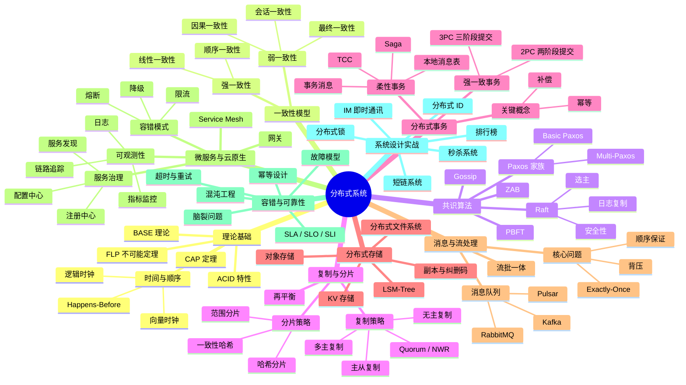

---

## 🗺️ 分阶段学习路径

### 第一阶段：建立框架（第 1-3 天）
- 理解分布式系统是什么、为什么需要它
- 掌握 CAP、BASE 等核心理论
- 了解一致性模型的分类
- **产出**：能用自己的话解释 CAP 和最终一致性

### 第二阶段：核心原理（第 4-10 天）
- 深入共识算法：重点攻克 Raft
- 理解复制与分片的区别和联系
- 掌握分布式事务的各种方案及适用场景
- **产出**：能画出 Raft 选主和 2PC 流程图

### 第三阶段：工程实践（第 11-20 天）
- 消息队列与流处理
- 微服务架构与服务治理
- 容错设计与可靠性保障
- **产出**：能设计一个简单的分布式系统架构

### 第四阶段：设计与拔高（第 21 天+）
- 系统设计实战演练
- 经典面试题训练
- 阅读论文和源码
- **产出**：能独立完成中等难度系统设计题

---

## 📖 模块一：分布式系统概述

### 1.1 什么是分布式系统

> **生活化类比**：想象一家连锁餐厅。以前只有一家店（单机），老板一个人管所有事。后来生意好了，开了很多分店（多节点），每家店都有自己的厨房和服务员，但它们共用一个品牌、共享会员体系。这就是分布式系统——**多台独立的计算机，通过网络连接，对外表现为一个统一的整体**。

**正式定义**：分布式系统是由一组通过网络进行通信、为了完成共同的任务而协调工作的计算机节点组成的系统。

### 1.2 为什么需要分布式系统

| 原因 | 说明 | 类比 |
|------|------|------|
| **性能/容量** | 单机算力、存储有上限 | 一家店接待能力有限，开分店服务更多顾客 |
| **可用性** | 单机会宕机，多节点可容错 | 一家店关门了，顾客可以去别的分店 |
| **地理位置** | 就近访问降低延迟 | 在北京点外卖，不可能从上海的店配送 |
| **成本效益** | 普通机器堆叠比大型机便宜 | 雇很多普通员工 vs 雇一个超级员工 |

### 1.3 分布式系统的挑战

| 挑战 | 说明 |
|------|------|
| **网络不可靠** | 消息可能丢失、延迟、乱序 |
| **时钟不一致** | 每台机器的时间都可能不一样 |
| **部分故障** | 有的节点挂了，有的还在运行——最头疼的问题 |
| **一致性难题** | 多个副本如何保证数据一致 |
| **复杂度爆炸** | 节点数越多，问题越多（调试、排查都很难） |

### 1.4 透明性（Transparency）

分布式系统的目标之一是让用户感觉不到这是一个分布式系统，就像在使用单机一样。

| 透明性类型 | 说明 |
|------------|------|
| 访问透明 | 用户不知道数据存在哪里 |
| 位置透明 | 资源的物理位置是隐藏的 |
| 故障透明 | 某个节点挂了用户无感知 |
| 迁移透明 | 资源可以移动而不影响使用 |
| 并发透明 | 多个用户同时操作不会互相干扰 |

---

## 📖 模块二：理论基础

### 2.1 CAP 定理

> **面试超高频考点！必须背下来并理解。**

#### 什么是 CAP

CAP 定理由 Eric Brewer 提出，指的是在分布式系统中，**三个特性不可能同时满足，最多只能同时满足两个**：

| 特性 | 英文 | 含义 | 类比 |
|------|------|------|------|
| **一致性** | Consistency | 所有节点在同一时间看到的数据是一样的 | 所有分店的菜单价格必须完全同步 |
| **可用性** | Availability | 每次请求都能得到响应（不保证是最新数据） | 不管哪家分店，顾客去了都能点菜 |
| **分区容错性** | Partition Tolerance | 网络分区（节点间通信中断）时系统仍能工作 | 两家分店的电话断了，各自还能正常营业 |

#### 为什么不能三者兼得？

用"连锁餐厅同步菜单"来理解：

1. **有网络分区**（P 必须有）：现实中网络不可靠，分区一定会发生，所以分布式系统**必须选择 P**。
2. 选择 **CP**：为了保证菜单一致（C），电话断了之后，没收到新菜单的分店**暂停营业**（不满足 A），等电话通了同步完菜单再接客。
   - 代表系统：ZooKeeper、etcd、HBase
3. 选择 **AP**：为了保证一直营业（A），电话断了之后，分店**继续用旧菜单**（不满足 C），电话通了再慢慢同步。
   - 代表系统：Cassandra、DynamoDB、CouchDB

> ⚠️ **常见误区**：
> - ❌ "CAP 是三选二" → ✅ 实际上 P 是前提，在分布式环境下必须选 P，所以是 C 和 A 之间的权衡
> - ❌ "CAP 是整个系统的属性" → ✅ CAP 是针对**单个读写操作**和**特定数据**的，不是整个系统非此即彼
> - ❌ "C=强一致性" → ✅ CAP 中的 C 特指**线性一致性**（最强的一致性），比一般的强一致更严格

### 2.2 BASE 理论

BASE 是对 CAP 中权衡的延伸，是**最终一致性**的理论基础。

| 特性 | 含义 | 类比 |
|------|------|------|
| **Basically Available（基本可用）** | 系统出现故障时，允许损失部分可用性 | 高峰期排队久一点，但不会完全不能用 |
| **Soft State（软状态）** | 允许系统存在中间状态，该状态不影响整体可用性 | 分店菜单更新有延迟，但不影响正常营业 |
| **Eventually Consistent（最终一致性）** | 数据不要求实时一致，但经过一段时间后最终能达到一致 | 过几个小时，所有分店的菜单都会同步好 |

> **对比 CAP vs BASE**
>
> | 维度 | CAP | BASE |
> |------|-----|------|
> | 性质 | 定理（不可能同时满足三者） | 设计理念/原则 |
> | 关注点 | 一致性与可用性的二选一 | 可用性优先，接受最终一致 |
> | 适用场景 | 理论分析、系统选型 | 互联网高并发场景设计 |
> | 关系 | BASE 是 CAP 中 AP 方案的延伸 | BASE 是 CAP 的实践落地 |

### 2.3 ACID 特性

ACID 是**单机数据库事务**的四个特性，注意与分布式事务区分：

| 特性 | 含义 | 说明 |
|------|------|------|
| **原子性 Atomicity** | 事务要么全成功，要么全失败 | 不存在中间状态 |
| **一致性 Consistency** | 事务前后数据从一个一致状态到另一个一致状态 | 比如转账前后总额不变 |
| **隔离性 Isolation** | 并发事务之间互不干扰 | 有不同的隔离级别 |
| **持久性 Durability** | 事务提交后，数据就永久保存了 | 即使宕机也不丢失 |

> ⚠️ **易混淆提醒**：ACID 的 C 和 CAP 的 C 不是一回事！
> - ACID 的 C：事务前后数据的**完整性约束**没有被破坏（比如外键、唯一约束）
> - CAP 的 C：分布式系统中多个副本的数据**线性一致**

### 2.4 FLP 不可能定理

> **进阶内容**，初学者先了解结论即可。

FLP 定理由 Fischer、Lynch、Patterson 三人证明：

> 在**异步网络**（消息延迟无上限）中，即使只有**一个节点可能故障**，也**不存在**一个能保证所有正确节点都达成一致的**确定性共识算法**。

**通俗理解**：在完全不可靠的网络环境下，没有算法能 100% 保证在有限时间内达成共识。

**现实中如何绕过**：
- 使用**超时机制**（不是纯异步了）
- 使用**随机化**算法（非确定性）
- 接受**大部分情况下**能达成一致（概率保证）

### 2.5 时间与顺序

#### 物理时钟的问题

每台机器都有自己的时钟，而且**时钟不准**（时钟漂移）。所以不能直接用物理时间来判断事件的先后顺序。

#### 逻辑时钟（Logical Clock）

由 Lamport 提出，核心思想：**用事件的因果关系来定义顺序，而不是物理时间**。

**规则**：
1. 同一个节点内，事件 A 发生在 B 之前，则 A 的时钟 < B 的时钟
2. 如果 A 发送消息给 B，那么 A 的时钟 < B 的时钟
3. 其他情况，并发（concurrent），顺序不确定

> **类比**：朋友圈点赞。你发了一条朋友圈（事件 A），你的朋友在他的手机上看到后点赞（事件 B）。因为"看到"这个动作是因果传递的，所以我们知道 A 一定发生在 B 之前，即使你们的手机时间不一样。

#### 向量时钟（Vector Clock）

逻辑时钟只能判断有因果关系的事件，无法判断两个并发事件的"大小"。向量时钟解决了这个问题。

每个节点维护一个向量，记录自己和其他节点的逻辑时钟：
- 节点 i 发生事件：自己的时钟 +1
- 节点 i 发送消息给 j：带上自己的向量时钟
- 节点 j 收到消息：每个分量取 max，自己的时钟 +1

**判断关系**：
- VC(A) < VC(B)：A 发生在 B 之前（有因果关系）
- 否则：A 和 B 并发

### 2.6 Happens-Before 关系

"happens-before"（→）是分布式系统中描述事件先后的核心概念：

1. **同一进程**：如果事件 A 在事件 B 之前发生，则 A → B
2. **消息传递**：如果 A 是发送消息的事件，B 是接收该消息的事件，则 A → B
3. **传递性**：如果 A → B 且 B → C，则 A → C

如果既没有 A → B，也没有 B → A，那么 A 和 B 是**并发**的。

---

## 📖 模块三：一致性模型

> 一致性模型回答一个问题：**当有多个副本时，读操作能看到什么？**

### 3.1 一致性模型总览

```
强一致性（Strong Consistency）
├── 线性一致性（Linearizability）← CAP 中的 C
└── 顺序一致性（Sequential Consistency）

弱一致性（Weak Consistency）
├── 因果一致性（Causal Consistency）
├── 会话一致性（Session Consistency）
├── 单调读（Monotonic Reads）
├── 单调写（Monotonic Writes）
└── 最终一致性（Eventual Consistency）← 最常见
    ├── 读己之写（Read Your Writes）
    └── 前缀一致（Prefix Consistency）
```

> 从上到下，一致性越来越弱，性能和可用性越来越高。

### 3.2 强一致性模型

#### 线性一致性（Linearizability）

**定义**：一旦某个写操作完成，所有后续的读操作（无论在哪个副本）都必须读到这个最新值。而且操作的顺序要符合**全局实时顺序**。

**类比**：你在 ATM 存了 100 块，然后立刻去手机银行查余额，一定能看到刚存的 100 块。

> ⚠️ **易混淆**：强一致 vs 线性一致
> - 线性一致是**最强**的一致性，要求"实时"
> - "强一致"是个泛称，通常指线性一致，但有时候也指顺序一致
> - 面试时如果说"强一致"，最好明确说是线性一致还是顺序一致

#### 顺序一致性（Sequential Consistency）

**定义**：所有进程看到的操作顺序是一样的，但这个顺序不一定符合真实的物理时间。

**类比**：全班同学看同一部电影（操作顺序一样），但有的人上午看，有的人下午看（不一定是实时的）。

**对比线性一致**：
- 线性一致要求操作顺序 = 真实时间顺序
- 顺序一致只要求大家看到的顺序一样就行，不要求和真实时间一致

### 3.3 弱一致性模型

#### 因果一致性（Causal Consistency）

**定义**：有因果关系的写操作，所有进程看到的顺序都一样；没有因果关系的写操作，不同进程可以看到不同的顺序。

**类比**：你先发朋友圈 A，再评论 B。因为 B 依赖 A（有因果），所以所有人都先看到 A 再看到 B。但如果是两个不相关的人发的朋友圈，谁先谁后无所谓。

#### 最终一致性（Eventual Consistency）

**定义**：如果没有新的更新操作，经过一段时间后，所有副本的数据最终会达到一致的状态。

**类比**：你在淘宝改了收货地址，刚改完立刻下单可能还是旧地址（延迟），但过一会儿所有地方都会显示新地址。

**最终一致性的常见变体**：

| 变体 | 含义 | 场景 |
|------|------|------|
| 读己之写（Read Your Writes） | 你自己写的，自己马上能读到 | 发微博刷新能立刻看到 |
| 单调读（Monotonic Reads） | 读到一个值后，不会再读到更旧的值 | 不会越刷越旧 |
| 单调写（Monotonic Writes） | 同一个进程的写操作，顺序会被保持 | 发两条微博顺序不会乱 |
| 前缀一致（Prefix Consistency） | 读到的数据都是某个时间点之前的完整快照 | 不会看到半条消息 |

### 3.4 一致性模型对比表

| 一致性模型 | 强度 | 性能 | 可用性 | 典型场景 |
|-----------|------|------|--------|----------|
| 线性一致性 | ⭐⭐⭐⭐⭐ 最强 | 最差 | 最低 | 金融账户、etcd |
| 顺序一致性 | ⭐⭐⭐⭐ | 差 | 低 | 分布式锁 |
| 因果一致性 | ⭐⭐⭐ | 中 | 中 | 社交网络、评论 |
| 最终一致性 | ⭐⭐ 最弱 | 最好 | 最高 | 电商详情页、微博 Feed |

---

## 📖 模块四：共识算法

> 共识算法解决的问题：**多个节点如何就某个值达成一致？**
>
> **生活化类比**：一群朋友商量去哪吃饭。有的人说火锅，有的人说烧烤。怎么才能让所有人最终同意同一个方案？这就是共识问题。

### 4.1 共识问题的定义

所有正确的节点，最终都同意同一个值，而且这个值必须是某个节点提出的（不能凭空造出来）。

### 4.2 Paxos 算法

> Paxos 是共识算法的"祖宗"，非常难理解。面试一般不会让你手推 Paxos，但要知道它的地位和基本思想。

#### Paxos 的角色

| 角色 | 职责 |
|------|------|
| Proposer（提议者） | 提出一个值（提案） |
| Acceptor（接受者） | 对提案进行投票 |
| Learner（学习者） | 学习最终达成一致的值 |

一个节点可以同时担任多个角色。

#### Basic Paxos 的两个阶段

**阶段一：Prepare（准备）**
1. Proposer 发送 prepare 请求，带上一个编号 N
2. Acceptor 如果 N 比它见过的都大，就承诺不再接受编号小于 N 的提案，并把它之前接受过的最大编号的提案返回

**阶段二：Accept（接受）**
1. Proposer 如果收到**过半** Acceptor 的响应，就从响应中选编号最大的那个值作为提案值（如果都没有就用自己的值）
2. Proposer 发送 accept 请求
3. Acceptor 如果没有响应过更大编号的 prepare，就接受这个提案

**达成共识**：当某个提案被**过半** Acceptor 接受时，就达成了共识。

> 🔑 **核心思想**：过半机制 + 编号机制保证了即使有冲突，最终也只会有一个值被选中。

#### Multi-Paxos

Basic Paxos 只能对一个值达成共识。Multi-Paxos 是对一系列值（日志）达成共识，通过选举一个 Leader 来优化性能（省去了大部分的 prepare 阶段）。

### 4.3 Raft 算法 ⭐ 重点掌握

> Raft 是为了"可理解性"而设计的共识算法，比 Paxos 容易懂很多。**面试高频！**
>
> Raft 把共识问题拆成了三个子问题：**选主（Leader Election）、日志复制（Log Replication）、安全性（Safety）**。

#### 三种角色

```
Follower（跟随者） ──> Candidate（候选人） ──> Leader（领导者）
     ^                      |                       |
     |                      v                       |
     └──────── 心跳超时 ────┘ <─── 收到投票 ────────┘
```

- **Follower**：被动响应请求，不主动发起任何请求
- **Candidate**：选举中的状态，发起投票
- **Leader**：处理所有客户端请求，负责日志复制

#### Raft 选主流程

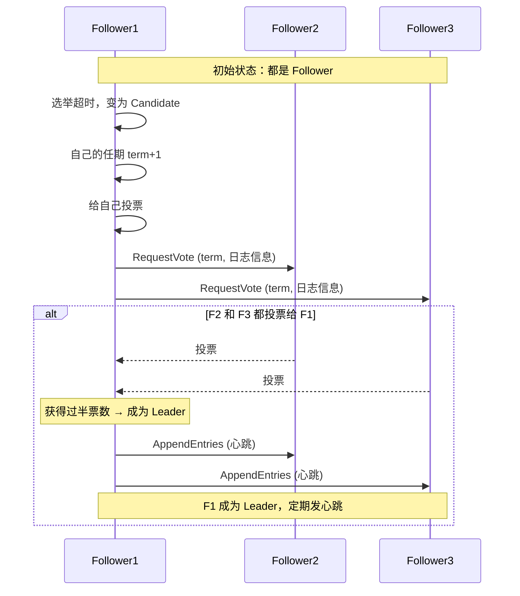

**选主规则**：
1. 每个节点有一个**随机的选举超时时间**（比如 150-300ms）
2. 超时没收到 Leader 的心跳，就变成 Candidate，发起选举
3. 获得**过半**节点的投票，就成为 Leader
4. 同一任期内，每个节点只能投一票（先到先得）
5. 日志更新的节点不会投票给日志更旧的候选人（保证安全性）

> 🔑 **为什么用随机超时？** 这样可以尽量避免"瓜分选票"（split vote）的情况，让选举能快速完成。

#### Raft 日志复制流程

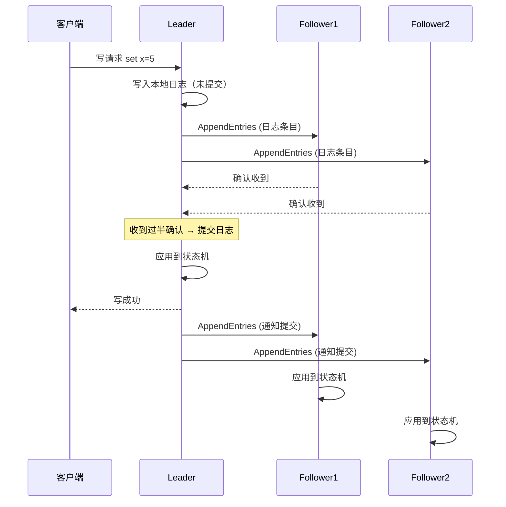

**日志复制要点**：
1. 客户端的写请求先到 Leader
2. Leader 把操作写入本地日志（此时还没提交）
3. Leader 并行把日志发给所有 Follower
4. 收到**过半** Follower 的确认后，Leader **提交**这条日志，应用到状态机
5. Leader 回复客户端成功
6. Leader 通过心跳通知 Follower 提交日志

> ⚠️ **注意**：Leader 提交了，不代表 Follower 立刻提交。Follower 可能会落后。

#### Raft 的安全性保证

Raft 通过以下规则保证不会出现数据不一致：

1. **选举限制**：日志不够新的候选人不能当选 Leader
   - 比较最后一条日志的任期号和索引
2. **只追加（Append-Only）**：Leader 只能追加新日志，不能修改已有日志
3. **Leader 提交原则**：Leader 只能提交自己任期内的日志
4. **日志匹配属性**：如果两个节点的某条日志有相同的索引和任期号，那么这条日志之前的所有日志都相同

### 4.4 Paxos vs Raft 对比

| 维度 | Paxos | Raft |
|------|-------|------|
| 提出时间 | 1989 年 | 2013 年 |
| 可理解性 | 非常难理解 | 设计目标就是"易理解" |
| 角色 | Proposer/Acceptor/Learner | Leader/Follower/Candidate |
| Leader 选举 | 没有明确的选举机制 | 有明确的选举流程和超时机制 |
| 工程实现 | 难以实现，各家实现差异大 | 容易实现，有明确规范 |
| 代表系统 | Google Chubby、Spanner | etcd、TiKV、Consul |
| 面试频率 | 知道思想即可 | 必须深入理解 |

### 4.5 其他共识算法简介

| 算法 | 特点 | 场景 |
|------|------|------|
| **ZAB** | ZooKeeper 使用，类似 Raft，也是基于 Leader 的 | ZooKeeper |
| **PBFT** | 实用拜占庭容错，能容忍恶意节点 | 联盟链、金融 |
| **Gossip** | 流言协议，节点之间随机传播信息，最终一致 | 服务发现、成员管理 |
| **POW** | 工作量证明，靠算力竞争 | 比特币等公链 |

---

## 📖 模块五：复制与分片

> 复制和分片是分布式系统提高**可靠性**和**容量**的两个核心手段。
>
> **类比**：开连锁店
> - 复制 = 每家店都卖一样的东西（数据一样），一家没货了去另一家
> - 分片 = 每家店卖不同的东西（数据拆分），A 店卖服装，B 店卖食品

### 5.1 复制（Replication）

把同一份数据复制到多个节点上，提高**可用性**和**读性能**。

#### 主从复制（Master-Slave / Leader-Follower）

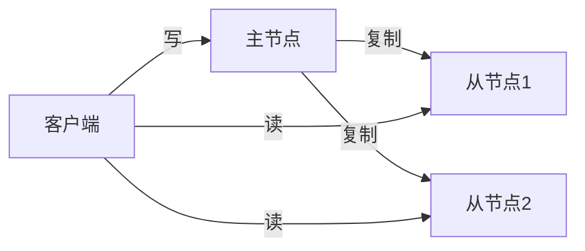

**特点**：
- 只有一个主节点，负责所有写操作
- 从节点复制主节点的数据，负责读操作
- 读写分离，读性能可以水平扩展

**复制方式**：

| 方式 | 说明 | 优点 | 缺点 |
|------|------|------|------|
| **同步复制** | 主节点等从节点都写完才返回 | 一致性强 | 延迟高，可用性差 |
| **异步复制** | 主节点写完自己就返回 | 延迟低，可用性高 | 可能丢数据 |
| **半同步复制** | 等至少一个从节点写完就返回 | 折中方案 | 性能和一致性之间的平衡 |

**主从复制的问题**：
- 主节点是单点（挂了怎么办？→ 选主）
- 主从延迟（读从节点可能读到旧数据）

#### 多主复制（Multi-Leader / Multi-Master）

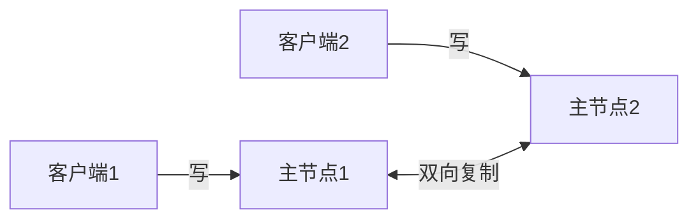

**特点**：
- 多个主节点都可以接受写请求
- 主节点之间互相复制数据

**适用场景**：
- 多数据中心部署（每个数据中心一个主）
- 需要离线编辑的应用

**最大的问题**：**写冲突**！两个主节点同时修改同一条数据怎么办？

**冲突解决方法**：
1. **最后写入为准（LWW）**：用时间戳，谁的时间大用谁的（简单但可能丢数据）
2. **合并**：把两个修改合并在一起（比如 Git）
3. **避免冲突**：规定同一用户的数据固定走一个主节点

#### 无主复制（Leaderless）

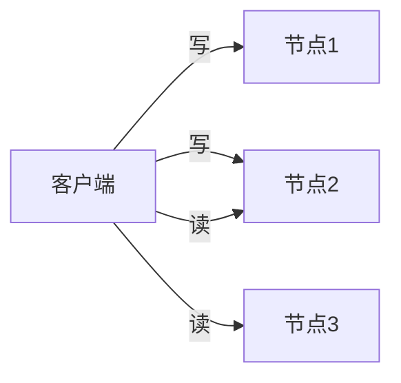

**特点**：
- 没有主节点，任何节点都可以接受读写
- 客户端同时向多个节点读写
- 通过 **Quorum（法定人数）** 来保证一致性

### 5.2 Quorum 与 NWR

> Quorum 是无主复制中保证一致性的核心机制。

**定义**：
- **N**：副本总数（Replication Factor）
- **W**：写成功需要确认的节点数（Write Quorum）
- **R**：读成功需要读取的节点数（Read Quorum）

**一致性保证**：

| 条件 | 一致性级别 | 说明 |
|------|-----------|------|
| **W + R > N** | 强一致（读己之写） | 读集合和写集合一定有交集，一定能读到最新数据 |
| **W + R <= N** | 最终一致 | 可能读不到最新数据 |

**常见配置**：
- N=3, W=2, R=2 → 强一致，容忍 1 个节点故障
- N=3, W=1, R=1 → 最终一致，性能最好
- N=5, W=3, R=3 → 强一致，容忍 2 个节点故障

**Quorum 读写流程**：

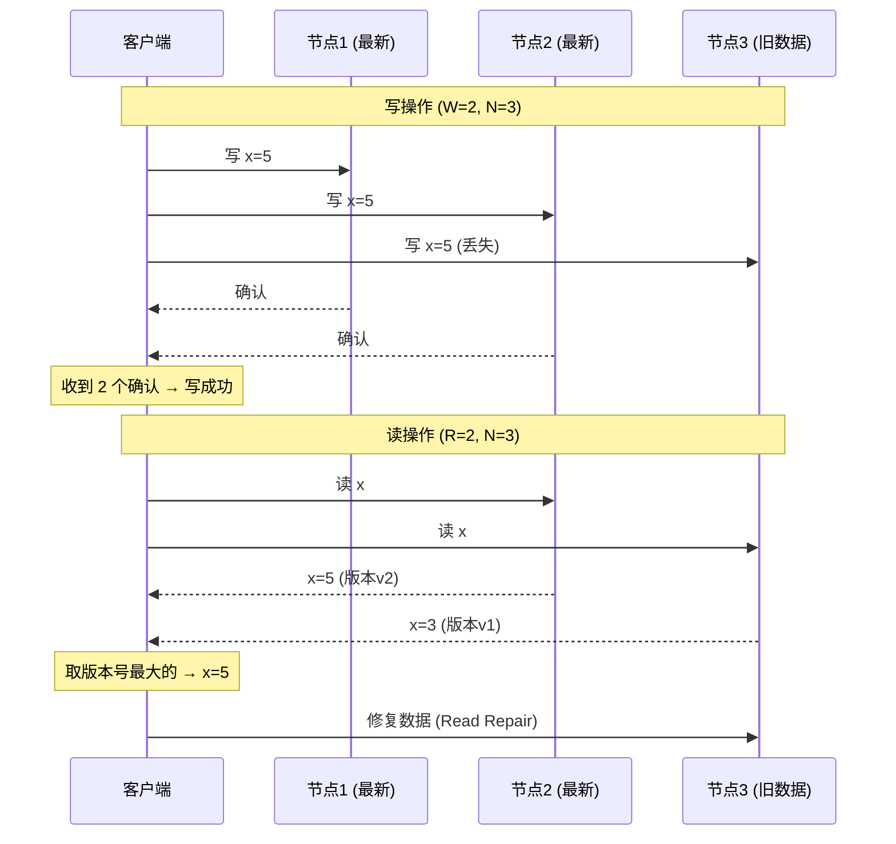

**数据修复机制**：
- **读修复（Read Repair）**：读的时候发现旧数据，顺手修复
- **反熵（Anti-Entropy）**：后台定期对比，修复不一致的数据

### 5.3 分片（Sharding / Partitioning）

把数据分散到不同的节点上，每个节点只存一部分数据，解决**存储容量**和**写性能**的问题。

#### 范围分片（Range Partitioning）

```
节点A: user_id 1 ~ 10000
节点B: user_id 10001 ~ 20000
节点C: user_id 20001 ~ 30000
```

**优点**：
- 范围查询很方便（直接找对应的节点）
- 数据是有序的

**缺点**：
- 容易数据倾斜（比如某段范围数据特别多）
- 热点问题（某个分片访问量特别大）

#### 哈希分片（Hash Partitioning）

```
节点 = hash(user_id) % N
```

**优点**：
- 数据分布比较均匀
- 不会有明显的热点

**缺点**：
- 范围查询很麻烦（要查所有节点）
- 节点数量变化时，几乎所有数据都要重新分布

#### 一致性哈希（Consistent Hashing）

> 解决哈希分片的"节点增减导致大量数据迁移"问题。

**原理**：
1. 把哈希空间想象成一个环（0 ~ 2^32 - 1）
2. 每个节点（服务器）映射到环上的一个位置
3. 每个数据也映射到环上，顺时针找到的第一个节点就是它该去的节点

```mermaid
graph TD
    subgraph 哈希环
        direction circular
        N1[节点A] --> D1[数据1]
        D1 --> D2[数据2]
        D2 --> N2[节点B]
        N2 --> D3[数据3]
        D3 --> N3[节点C]
        N3 --> D4[数据4]
        D4 --> N1
    end
```

**节点增减时**：
- 增加一个节点：只影响它和前一个节点之间的数据
- 删除一个节点：它的数据全部交给下一个节点
- 只有少量数据需要迁移！

**虚拟节点**：
- 实际实现中，每个物理节点对应多个虚拟节点
- 解决节点太少导致的数据不均匀问题
- 节点越多，数据分布越均匀

### 5.4 再平衡（Rebalancing）

当节点数量变化时，数据需要重新分布，这个过程叫再平衡。

**好的再平衡策略应该满足**：
1. 再平衡后数据分布均匀
2. 再平衡过程中，服务不中断
3. 尽量少移动数据（减少网络和磁盘开销）
4. 自动进行，不需要人工干预

---

## 📖 模块六：分布式事务

> 分布式事务解决的问题：**跨多个服务/数据库的操作，如何保证原子性？**
>
> **类比**：你在淘宝下单，要同时扣库存、扣钱、生成订单。这三个操作分布在不同的服务里，怎么保证要么都成功，要么都失败？

### 6.1 分布式事务的分类

```
分布式事务
├── 强一致事务（刚性事务）
│   ├── 2PC（两阶段提交）
│   └── 3PC（三阶段提交）
└── 最终一致事务（柔性事务）
    ├── TCC（Try-Confirm-Cancel）
    ├── Saga
    ├── 本地消息表
    ├── 事务消息
    └── 最大努力通知
```

### 6.2 2PC（两阶段提交）

> 最经典的分布式事务协议，**必须掌握**。

#### 角色

- **协调者（Coordinator）**：事务的管理者，负责协调
- **参与者（Participants）**：各个分支事务

#### 两个阶段

**阶段一：Prepare（准备阶段）**
- 协调者问所有参与者："你们准备好了吗？"
- 参与者执行事务，但不提交，锁定资源
- 参与者回复："准备好了" 或 "不行"

**阶段二：Commit/Rollback（提交/回滚阶段）**
- 如果所有参与者都准备好了，协调者通知大家提交
- 如果有任何一个说不行，协调者通知大家回滚

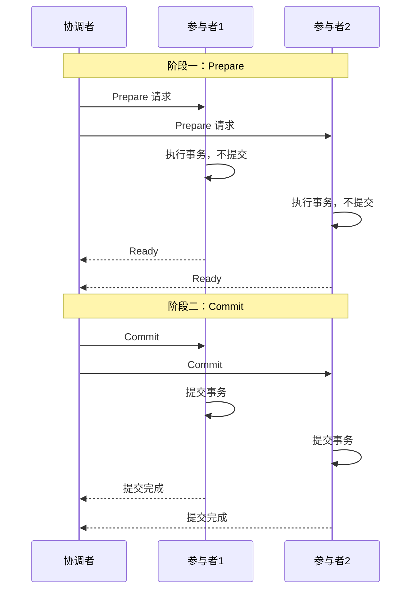

#### 2PC 的问题

| 问题 | 说明 |
|------|------|
| **同步阻塞** | 准备阶段所有参与者都锁定资源，其他事务要等 |
| **单点故障** | 协调者挂了怎么办？（参与者会一直阻塞） |
| **数据不一致** | 提交阶段，协调者发了部分 commit 就挂了，有的提交了有的没提交 |
| **性能差** | 需要两轮 RPC，延迟高 |

### 6.3 3PC（三阶段提交）

为了解决 2PC 的问题，提出了 3PC，加了一个阶段：

1. **CanCommit**：询问是否能提交（不锁定资源）
2. **PreCommit**：预提交（执行事务，锁定资源）
3. **DoCommit**：真正提交

**改进**：
- 减少了阻塞范围（CanCommit 阶段不锁资源）
- 引入了超时机制，参与者超时后会自动提交

**缺点**：
- 更复杂了
- 还是不能完全解决数据不一致问题
- 实际用的很少

### 6.4 TCC（Try-Confirm-Cancel）

> TCC 是一种**补偿型**事务，把事务分成三个阶段。
>
> **类比**：你在网上订酒店
> - Try：先冻结一晚的房间（预留资源）
> - Confirm：确认入住，正式扣钱
> - Cancel：取消预订，解冻房间

#### 三个阶段

| 阶段 | 含义 | 做什么 |
|------|------|--------|
| **Try** | 尝试执行 | 预留资源、检查业务、冻结资金 |
| **Confirm** | 确认提交 | 真正执行，使用 Try 阶段预留的资源 |
| **Cancel** | 取消回滚 | 释放 Try 阶段预留的资源 |

#### TCC 的特点

- **优点**：性能比 2PC 好，不长期锁资源
- **缺点**：业务侵入性强，每个服务都要写 Try/Confirm/Cancel 三个接口
- **适用**：对性能要求高、业务可控的场景

#### TCC 的三个常见问题

1. **空回滚**：Try 没收到，先收到了 Cancel → Cancel 要能处理这种情况
2. **幂等**：网络重试可能导致重复调用 → 每个操作都要保证幂等
3. **悬挂**：Cancel 先到了，Try 后到 → Try 要检查是否已经回滚过了

### 6.5 Saga 模式

> Saga 是一种**长事务**解决方案，把一个大事务拆成多个小事务，按顺序执行。
>
> **类比**：你去旅行，要订机票、订酒店、订门票。如果订酒店失败了，就把机票退了（补偿）。

#### 两种执行方式

**方式一：正向执行 + 失败补偿（推荐）**
```
T1 → T2 → T3 → ... → Tn （全部成功）
T1 → T2 失败 → C2 → C1 （回滚）
```

**方式二：状态机编排**
- 每个步骤都有状态，根据状态决定下一步做什么

#### Saga 的实现方式

| 方式 | 说明 | 优点 | 缺点 |
|------|------|------|------|
| **编排式（Choreography）** | 每个服务完成后发布事件，触发下一个服务 | 简单，松耦合 | 流程不直观，难调试 |
| **编排式（Orchestration）** | 有一个协调者统一指挥 | 流程清晰，好维护 | 协调者可能成为瓶颈 |

#### Saga 的特点

- **优点**：一阶段提交，没有锁，性能好
- **缺点**：不保证隔离性（中间状态可见），补偿逻辑复杂
- **适用**：长事务、参与者多、对一致性要求不高的场景

### 6.6 本地消息表 + 事务消息

> 利用消息队列实现最终一致性，**互联网公司最常用的方案之一**。

#### 本地消息表方案

**核心思想**：把"业务操作"和"发消息"放在同一个本地事务里。

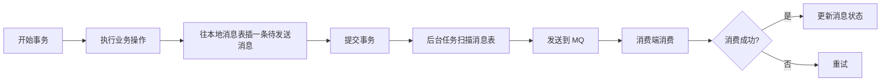

**特点**：
- 简单可靠，容易实现
- 需要额外建消息表
- 消费端要保证幂等

#### 事务消息方案（RocketMQ）

RocketMQ 支持事务消息，原理类似但由 MQ 来保证：

1. 发送半消息（Half Message）——消息对消费者不可见
2. 执行本地事务
3. 根据本地事务结果，提交或回滚半消息
4. 如果长时间没收到确认，MQ 会回查事务状态

### 6.7 幂等设计 ⭐ 非常重要

> 幂等：同一个操作执行一次和执行多次，效果是一样的。

**为什么需要幂等？**
- 网络重试（RPC 重试、MQ 重试）
- 用户重复提交
- 消息重复投递

**实现幂等的常见方法**：

| 方法 | 原理 | 场景 |
|------|------|------|
| **唯一 ID + 去重表** | 每次操作带一个唯一 ID，数据库建唯一索引 | 通用 |
| **数据库唯一约束** | 利用数据库的唯一索引 | 插入操作 |
| **乐观锁** | 带版本号更新，版本不对就不更新 | 更新操作 |
| **状态机幂等** | 状态只能单向流转，重复操作不生效 | 订单状态流转 |
| **Token 机制** | 先拿 token，操作时校验并删除 token | 防止前端重复提交 |
| **Set 天然幂等** | set x=5 不管执行几次结果都一样 | 赋值操作 |

### 6.8 分布式事务方案对比

| 方案 | 一致性 | 性能 | 实现难度 | 业务侵入 | 适用场景 |
|------|--------|------|----------|----------|----------|
| 2PC | 强一致 | 差 | 中 | 低 | 传统企业应用、数据库层面 |
| TCC | 最终一致 | 好 | 高 | 高 | 对性能要求高、业务可控 |
| Saga | 最终一致 | 好 | 中 | 中 | 长事务、参与者多 |
| 本地消息表 | 最终一致 | 好 | 低 | 中 | 异步场景、互联网业务 |
| 事务消息 | 最终一致 | 好 | 低 | 低 | 有 RocketMQ 等支持事务消息的 MQ |

> ⚠️ **易混淆**：2PC vs TCC
> - 2PC 是**资源层**的协议（数据库层面），业务无感知
> - TCC 是**业务层**的协议，需要业务代码实现三个接口
> - 2PC 是同步阻塞的，TCC 是异步的性能更好

---

## 📖 模块七：分布式存储

### 7.1 分布式存储分类

| 类型 | 特点 | 代表产品 |
|------|------|----------|
| **分布式文件系统** | 存文件，POSIX 接口 | HDFS、CephFS、GlusterFS |
| **对象存储** | 存对象（文件+元数据），通过 HTTP 访问 | S3、OSS、MinIO |
| **块存储** | 存裸块设备，像本地磁盘一样用 | Ceph RBD、EBS |
| **KV 存储** | 键值对存储，读写快 | Redis、DynamoDB、RocksDB |
| **分布式数据库** | 支持 SQL 的分布式数据库 | TiDB、Spanner、CockroachDB |

### 7.2 副本 vs 纠删码

这是分布式存储中两种常见的数据冗余方案：

| 方案 | 原理 | 存储开销 | 修复开销 | 适用场景 |
|------|------|----------|----------|----------|
| **副本（Replication）** | 存多份完整副本 | 高（3 副本就是 3 倍） | 低（直接复制） | 热数据、对性能要求高 |
| **纠删码（Erasure Coding）** | 把数据切成块，加上校验块 | 低（1.5 倍左右） | 高（需要计算） | 冷数据、归档数据 |

**纠删码原理（简单理解）**：
- 比如把数据分成 4 个数据块 + 2 个校验块（4+2）
- 任意 4 个块（不管是数据块还是校验块）都能还原出完整数据
- 可以容忍 2 个块丢失
- 存储开销只有 6/4 = 1.5 倍，比 3 副本的 3 倍省很多

### 7.3 LSM-Tree

> Log-Structured Merge-Tree，日志结构合并树。
> 很多 KV 存储（LevelDB、RocksDB、HBase）都用 LSM-Tree 作为存储引擎。

**核心思想**：
- 写操作全部追加写入（顺序写，非常快）
- 内存里维护一个有序的 MemTable
- MemTable 满了就刷到磁盘，变成 SSTable（有序的不可变文件）
- 后台定期合并 SSTable（类似归并排序），清理过期数据

**优点**：
- 写性能极高（顺序写）
- 适合写多读少的场景

**缺点**：
- 读可能要查很多 SSTable（需要布隆过滤器优化）
- 有空间放大（合并前有很多冗余数据）

---

## 📖 模块八：消息与流处理

### 8.1 消息队列的作用

| 作用 | 说明 | 类比 |
|------|------|------|
| **异步** | 不需要等结果，先返回 | 你点外卖，不需要等做好，下单就行 |
| **解耦** | 生产者和消费者互不依赖 | 外卖员不需要知道你家做什么饭 |
| **削峰填谷** | 缓冲突发流量 | 排队吃饭，厨房按自己的节奏做 |
| **广播** | 一条消息多个消费者消费 | 微信群发消息 |

### 8.2 消息队列的核心问题

#### 消息可靠性

| 环节 | 如何保证不丢 |
|------|-------------|
| 生产者 → MQ | 生产者确认（ack）、重试 |
| MQ 内部 | 持久化、多副本 |
| MQ → 消费者 | 手动 ack、消费完再确认 |

#### 消息顺序

- **全局有序**：一个 topic 只有一个队列，一个消费者（性能差）
- **局部有序**：同一个 key 的消息发到同一个队列（常用）

#### 消息重复

- 网络重试会导致消息重复投递
- **解决方案**：消费端保证幂等（见前面的幂等设计）

#### Exactly-Once 语义

| 语义 | 含义 |
|------|------|
| At Most Once | 最多一次，可能丢但不重复 |
| At Least Once | 至少一次，不丢但可能重复 |
| Exactly Once | 精确一次，不丢也不重复（最难） |

> Exactly-Once 通常需要"消息队列 + 消费端幂等 + 事务"配合实现。

### 8.3 Kafka 简介

> 最流行的分布式消息队列，**必须了解**。

#### Kafka 的核心概念

| 概念 | 含义 |
|------|------|
| **Topic** | 消息的主题，一类消息 |
| **Partition** | 分区，一个 topic 分成多个分区，是并行的基本单位 |
| **Producer** | 生产者，发消息 |
| **Consumer** | 消费者，收消息 |
| **Consumer Group** | 消费者组，一组消费者共同消费一个 topic，每个分区只被组内一个消费者消费 |
| **Broker** | Kafka 服务器节点 |
| **Offset** | 消息在分区内的偏移量，类似编号 |
| **Replica** | 副本，每个分区有多个副本，保证可靠性 |

#### Kafka 的架构

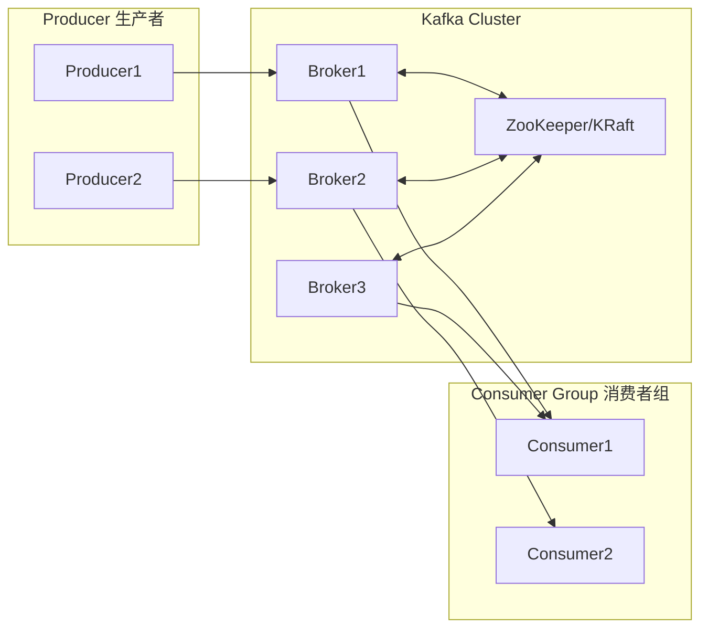

#### Kafka 为什么快？

1. **顺序读写**：消息是追加写入的，磁盘顺序写比随机写快很多
2. **页缓存（Page Cache）**：利用操作系统的页缓存，读写基本在内存
3. **零拷贝（Zero Copy）**：sendfile 技术，减少数据在内核态和用户态之间的拷贝
4. **批量处理**：消息批量发送、批量压缩
5. **分区并行**：多个分区可以并行读写

### 8.4 流处理简介

| 框架 | 特点 |
|------|------|
| **Spark Streaming** | 微批处理，用 Spark 引擎 |
| **Flink** | 真正的流处理，事件时间、状态管理、Exactly-Once |
| **Kafka Streams** | 轻量级，基于 Kafka 的流处理库 |

**核心概念**：
- 事件时间 vs 处理时间
- 水位线（Watermark）
- 窗口（Window）
- 状态管理
-  Exactly-Once 语义

---

## 📖 模块九：微服务与云原生

### 9.1 从单体到微服务

| 架构 | 优点 | 缺点 |
|------|------|------|
| **单体架构** | 开发简单、部署方便、调试容易 | 代码膨胀、部署慢、扩展差、技术栈固定 |
| **微服务架构** | 独立开发部署、技术栈灵活、故障隔离、易于扩展 | 复杂度高、分布式问题、运维成本高 |

> 微服务不是银弹！小团队、业务简单的话，单体可能更好。

### 9.2 微服务核心组件

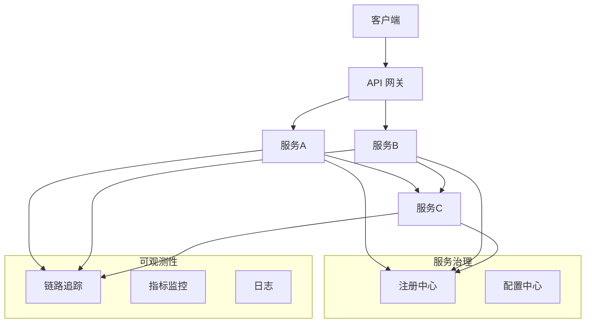

#### 服务发现与注册中心

**为什么需要？** 服务的地址是动态变化的（扩容、缩容、宕机），不能写死。

**流程**：
1. 服务启动时，把自己的地址注册到注册中心
2. 服务调用时，从注册中心查询目标服务的地址
3. 服务挂了，注册中心能感知到并剔除

**常见注册中心**：
- **Nacos**：阿里开源，功能全面（注册中心 + 配置中心）
- **Eureka**：Spring Cloud 原生，AP 型
- **Consul**：Go 写的，功能丰富
- **ZooKeeper**：CP 型，用的越来越少了

#### 配置中心

统一管理各个服务的配置，支持动态更新，不需要重启服务。

**常见产品**：Nacos、Apollo、Spring Cloud Config

#### API 网关

**作用**：
- 统一入口（所有请求都走网关）
- 路由转发
- 鉴权、限流、熔断
- 日志、监控
- 协议转换

**常见产品**：Spring Cloud Gateway、Kong、Nginx、Envoy

### 9.3 容错模式

#### 限流（Rate Limiting）

防止流量过大把系统打垮。

**常见算法**：
1. **计数器**：简单但有"突刺问题"（时间窗口边界）
2. **滑动窗口**：解决突刺问题，但实现稍复杂
3. **漏桶算法**：以固定速率处理请求，平滑流量
4. **令牌桶算法**：往桶里放令牌，请求拿令牌，能应对突发流量

#### 熔断（Circuit Breaker）

> 类比：家里的保险丝，电流太大就跳闸，保护电器。

**三种状态**：
- **Closed（关闭）**：正常状态，请求正常通过
- **Open（打开）**：错误率太高了，直接拒绝请求（快速失败）
- **Half-Open（半开）**：一段时间后，放少量请求试试，看服务恢复了没有

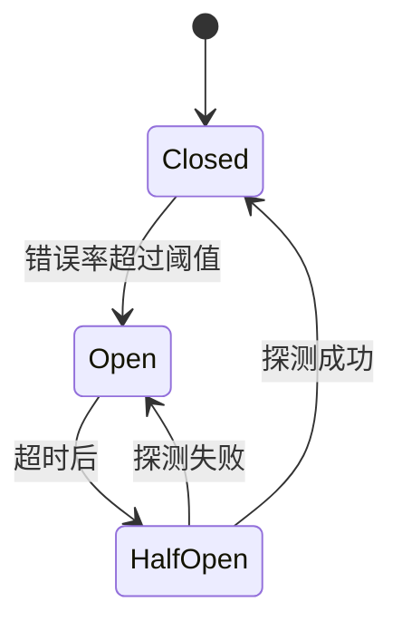

#### 降级（Degradation）

系统压力大的时候，关掉一些非核心功能，保证核心功能可用。

- 比如电商大促时，关闭商品评论功能，保证下单功能正常

### 9.4 可观测性（Observability）

可观测性的三大支柱：

| 支柱 | 作用 | 常见工具 |
|------|------|----------|
| **日志（Logging）** | 记录离散事件，排查问题 | ELK、Loki |
| **指标（Metrics）** | 可聚合的数值，监控告警 | Prometheus、Grafana |
| **链路追踪（Tracing）** | 追踪请求经过了哪些服务 | Jaeger、Zipkin、SkyWalking |

### 9.5 Service Mesh

> 服务网格，把服务治理的能力从业务代码中抽离出来，放到 Sidecar（边车）里。

**特点**：
- 业务代码无感知
- 统一治理（流量、安全、可观测性）
- 多语言支持

**代表产品**：Istio、Linkerd

---

## 📖 模块十：容错与可靠性

### 10.1 故障模型

分布式系统中有各种故障：

| 故障类型 | 说明 |
|----------|------|
| **崩溃故障** | 节点突然挂了，不再响应 |
| **遗漏故障** | 消息丢失 |
| **时序故障** | 消息延迟、超时 |
| **响应故障** | 节点返回了错误的结果 |
| **拜占庭故障** | 节点故意作恶，返回假数据（最难处理） |

### 10.2 脑裂（Split-Brain）

> 因为网络分区，出现了两个"主节点"，都认为自己是老大。

**类比**：一个团队联系不上了，分成了两拨，各自选了一个新领导。等联系恢复了，发现有两个领导。

**怎么防止脑裂？**
- **过半机制**：必须获得超过半数节点的认可才能当 Leader（Raft、ZooKeeper 都是这么做的）
- **fencing（隔离）**：用共享存储等方式，把旧的 Leader "隔离"掉
- **节点数用奇数**：3、5、7，方便过半判断

### 10.3 超时与重试

#### 为什么需要超时？

网络不可靠，请求可能永远得不到响应。如果不设超时，线程会一直等，资源被耗尽。

#### 重试的注意事项

1. **幂等**：重试的操作必须是幂等的
2. **重试次数**：不要无限重试，设上限
3. **退避策略**：不要马上重试，等一会儿再试（指数退避）
4. **重试风暴**：大家都重试，把服务压垮了（加抖动、熔断）

### 10.4 SLA / SLO / SLI

| 概念 | 含义 | 例子 |
|------|------|------|
| **SLI（服务等级指标）** | 衡量服务的量化指标 | 可用性 99.95%、延迟 P99 < 200ms |
| **SLO（服务等级目标）** | SLI 的目标值 | 目标：可用性达到 99.95% |
| **SLA（服务等级协议）** | 和用户签的协议，达不到要赔钱 | 如果可用性低于 99.9%，赔付 10% 费用 |

> SLI 是指标，SLO 是目标，SLA 是承诺（带罚则）。

### 10.5 混沌工程

> 主动在系统中注入故障，测试系统的可靠性。
>
> **理念**：故障一定会发生，与其等它发生，不如主动找出来。

**混沌工程的原则**：
1. 建立稳定状态的假设
2. 多样化真实世界的事件
3. 在生产环境中运行实验
4. 持续自动化运行实验
5. 最小化爆炸半径

**代表工具**：Chaos Monkey（Netflix 出品）

---

## 🛠️ 系统设计实战

### 设计题 1：分布式 ID 生成器

#### 需求
- 全局唯一
- 趋势递增（或有序）
- 高可用、高性能
-  ID 尽量短

#### 方案对比

| 方案 | 优点 | 缺点 | 适用场景 |
|------|------|------|----------|
| **UUID** | 简单，无依赖 | 无序、太长（128 位）、不好存 | 简单场景 |
| **数据库自增** | 简单、有序 | 单点问题、性能瓶颈、分库分表麻烦 | 小项目 |
| **号段模式** | 性能好、有序 | 依赖数据库 | 美团 Leaf、百度 UidGenerator |
| **雪花算法（Snowflake）** | 高性能、有序、不依赖第三方 | 时钟回拨问题 | 大厂常用 |

#### 雪花算法详解

```
+----------------------------------------------------------------------+
| 1位 符号位 | 41位 时间戳 | 10位 工作机器ID | 12位 序列号 |
+----------------------------------------------------------------------+
```

- **符号位**：1 位，永远是 0（正数）
- **时间戳**：41 位，精确到毫秒，可以用 69 年
- **机器 ID**：10 位，最多 1024 台机器
- **序列号**：12 位，每毫秒最多生成 4096 个 ID

**时钟回拨问题**：
- 服务器时间回调了，可能生成重复的 ID
- 解决：记录上次的时间戳，如果回拨了就报错或等待

### 设计题 2：分布式锁

#### 需求
- 互斥性（同一时间只有一个客户端能拿到锁）
- 不会死锁（客户端挂了锁也能释放）
- 可重入
- 高可用

#### 方案对比

| 方案 | 实现方式 | 优点 | 缺点 |
|------|----------|------|------|
| **基于数据库** | 唯一索引 / 乐观锁 | 简单 | 性能差、单点问题 |
| **基于 Redis** | SETNX + 过期时间 + Lua | 性能好、实现简单 | 单点问题、锁误删 |
| **基于 ZooKeeper** | 临时有序节点 | 可靠性高、自动释放 | 性能一般、实现复杂 |
| **Redisson** | Redis 客户端，封装得很好 | 功能全、易用 | 依赖 Redis |

#### Redis 分布式锁的正确实现

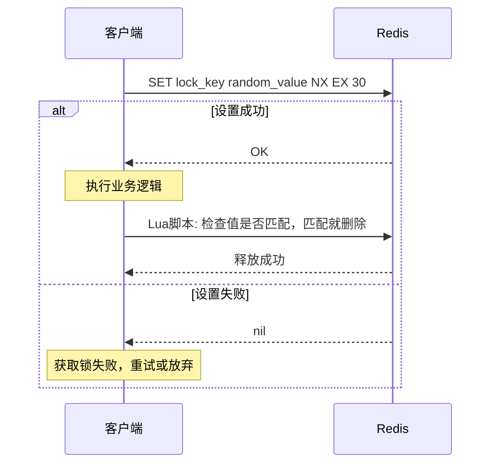

**关键点**：
1. **SET NX EX**：原子操作，加锁同时设过期时间（防止死锁）
2. **随机值**：每个客户端用自己的随机值，防止误删别人的锁
3. **Lua 脚本**：释放锁时用 Lua 脚本保证"判断+删除"的原子性
4. **续期**：业务执行时间可能超过过期时间，需要看门狗续期

#### Redlock（Redis 红锁）

> 多个独立的 Redis 节点，超过半数加锁成功才算成功。解决单点问题。
>
> ⚠️ 注意：Redlock 有争议，Martin Kleppmann 和 Redis 作者吵过。实际中 Redis 哨兵或集群可能更常用。

### 设计题 3：短链接系统

#### 需求
- 长 URL → 短 URL
- 访问短 URL → 跳转到长 URL
- 高性能、高可用
- 自定义短链、过期时间

#### 架构设计

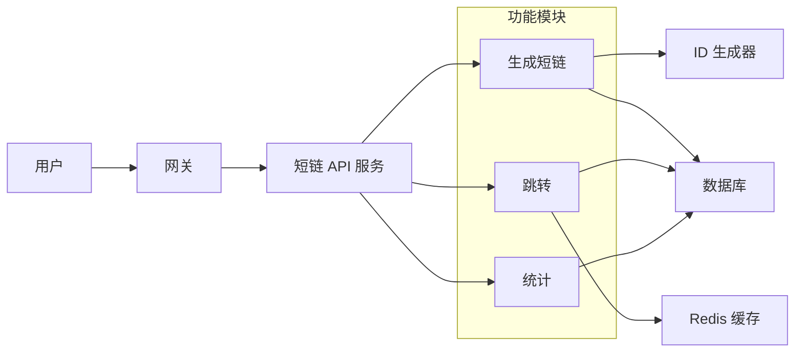

#### 短码生成方案

| 方案 | 说明 |
|------|------|
| **哈希** | 对长 URL 做哈希，取前 N 位（有冲突概率） |
| **自增 ID + 进制转换** | 用自增 ID，转成 62 进制（0-9a-zA-Z） |

**推荐方案**：自增 ID + 62 进制转换
- 1 → 1
- 62 → Z
- 63 → 10
- 不会重复、短码短、趋势递增

### 设计题 4：秒杀系统

#### 难点
- 瞬间高并发
- 库存不能超卖
- 防作弊、防刷

#### 核心思路

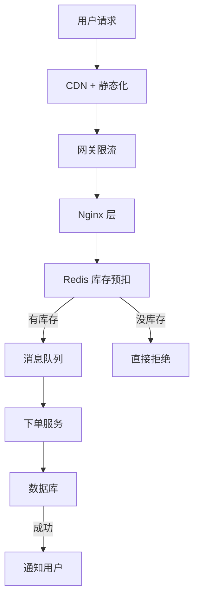

**关键优化点**：
1. **前端限流**：按钮置灰、验证码
2. **CDN 静态化**：活动页放 CDN
3. **网关限流**：拦住大部分请求
4. **Redis 预扣库存**：内存操作，快
5. **消息队列削峰**：异步下单
6. **数据库最终一致**：数据库保证不超卖
7. **用户限流**：同一个用户限制请求次数

---

## 💻 代码示例

### 示例 1：Redis 分布式锁（Go 简化版）

```go
package main

import (
	"context"
	"fmt"
	"time"

	"github.com/redis/go-redis/v9"
)

var (
	redisClient = redis.NewClient(&redis.Options{
		Addr: "localhost:6379",
	})
	ctx = context.Background()
)

// TryLock 尝试获取分布式锁
// 返回值: 是否获取成功, 解锁函数, 错误
func TryLock(key string, value string, expiration time.Duration) (bool, func() error, error) {
	// SET key value NX EX expiration
	// NX: 只有 key 不存在时才设置
	// EX: 设置过期时间（秒）
	ok, err := redisClient.SetNX(ctx, key, value, expiration).Result()
	if err != nil {
		return false, nil, err
	}
	if !ok {
		return false, nil, nil
	}

	// 解锁函数
	unlock := func() error {
		// 使用 Lua 脚本保证原子性：只有值匹配才删除
		luaScript := `
			if redis.call("GET", KEYS[1]) == ARGV[1] then
				return redis.call("DEL", KEYS[1])
			else
				return 0
			end
		`
		_, err := redisClient.Eval(ctx, luaScript, []string{key}, value).Result()
		return err
	}

	return true, unlock, nil
}

func main() {
	lockKey := "order:123"
	lockValue := "client-xxx-001" // 每个客户端唯一的值

	ok, unlock, err := TryLock(lockKey, lockValue, 10*time.Second)
	if err != nil {
		panic(err)
	}
	if !ok {
		fmt.Println("获取锁失败")
		return
	}
	fmt.Println("获取锁成功")

	// 执行业务逻辑
	time.Sleep(2 * time.Second)

	// 释放锁
	if err := unlock(); err != nil {
		fmt.Println("释放锁失败:", err)
	} else {
		fmt.Println("释放锁成功")
	}
}
```

### 示例 2：幂等性实现（数据库唯一索引）

```sql
-- 幂等表：记录已经处理过的请求
CREATE TABLE idempotent_record (
    id BIGINT PRIMARY KEY AUTO_INCREMENT,
    biz_type VARCHAR(32) NOT NULL COMMENT '业务类型',
    biz_id VARCHAR(64) NOT NULL COMMENT '业务唯一ID',
    status TINYINT NOT NULL DEFAULT 0 COMMENT '状态: 0-处理中 1-成功 2-失败',
    result VARCHAR(1024) COMMENT '处理结果',
    created_at DATETIME NOT NULL DEFAULT CURRENT_TIMESTAMP,
    updated_at DATETIME NOT NULL DEFAULT CURRENT_TIMESTAMP ON UPDATE CURRENT_TIMESTAMP,
    UNIQUE KEY uk_biz_type_biz_id (biz_type, biz_id)
) ENGINE=InnoDB DEFAULT CHARSET=utf8mb4;
```

```java
// Java 伪代码
public void processPayment(String orderId, PaymentRequest request) {
    // 1. 先插入幂等记录（利用唯一索引防重）
    try {
        idempotentMapper.insert("payment", orderId, 0);
    } catch (DuplicateKeyException e) {
        // 已经处理过了，直接返回结果
        return getResult("payment", orderId);
    }
    
    try {
        // 2. 执行业务逻辑
        PaymentResult result = doPayment(request);
        
        // 3. 更新状态为成功
        idempotentMapper.updateStatus("payment", orderId, 1, result.toString());
        
    } catch (Exception e) {
        // 4. 更新状态为失败
        idempotentMapper.updateStatus("payment", orderId, 2, e.getMessage());
        throw e;
    }
}
```

### 示例 3：重试 + 指数退避（Java）

```java
public class RetryUtil {
    
    /**
     * 带指数退避的重试
     * @param task 要执行的任务
     * @param maxRetries 最大重试次数
     * @param initialDelayMs 初始延迟（毫秒）
     * @param maxDelayMs 最大延迟（毫秒）
     */
    public static <T> T retryWithExponentialBackoff(
            Supplier<T> task,
            int maxRetries,
            long initialDelayMs,
            long maxDelayMs) {
        
        int attempt = 0;
        long delay = initialDelayMs;
        
        while (true) {
            try {
                return task.get(); // 执行任务
            } catch (Exception e) {
                attempt++;
                if (attempt > maxRetries) {
                    throw new RuntimeException("重试" + maxRetries + "次后仍然失败", e);
                }
                
                // 加一点随机抖动，避免重试风暴
                long jitter = (long) (delay * 0.1 * Math.random());
                long sleepTime = Math.min(delay + jitter, maxDelayMs);
                
                try {
                    Thread.sleep(sleepTime);
                } catch (InterruptedException ie) {
                    Thread.currentThread().interrupt();
                    throw new RuntimeException("重试被中断", ie);
                }
                
                delay = Math.min(delay * 2, maxDelayMs); // 指数增长
            }
        }
    }
}

// 使用示例
String result = RetryUtil.retryWithExponentialBackoff(
    () -> remoteService.call(),  // 远程调用
    3,        // 最多重试 3 次
    100,      // 初始延迟 100ms
    1000      // 最大延迟 1s
);
```

---

## ✅ 自测题与参考答案

### 基础题

**Q1：CAP 定理的三个特性分别是什么？为什么不能同时满足？**

> **答**：一致性（Consistency）、可用性（Availability）、分区容错性（Partition Tolerance）。
>
> 在分布式系统中，网络分区是必然存在的，所以 P 是前提。当发生分区时：
> - 如果要保证一致性（C），就必须拒绝某些节点的请求，牺牲可用性（A）
> - 如果要保证可用性（A），不同分区的节点可以各自处理请求，就会导致数据不一致，牺牲一致性（C）
> - 所以 C 和 A 只能二选一。

**Q2：Raft 算法中，一个节点如何成为 Leader？**

> **答**：
> 1. 当 Follower 在选举超时时间内没收到 Leader 的心跳，就变成 Candidate
> 2. Candidate 给自己投票，并向其他节点发送 RequestVote 请求
> 3. 如果获得过半节点的投票，就成为 Leader
> 4. Leader 定期向 Follower 发送心跳，维持地位

**Q3：什么是最终一致性？举几个生活中的例子。**

> **答**：最终一致性是指数据更新后，经过一段时间，所有副本最终会达到一致的状态。在此期间，读操作可能读到旧数据。
>
> 例子：
> - 发朋友圈，不是所有人同时看到，过一会儿大家都能看到
> - 改收货地址，刚改完可能有的页面还是旧的，过会儿就都更新了
> - DNS 解析变更，全球 DNS 服务器需要一段时间才能全部同步

**Q4：2PC 和 TCC 有什么区别？**

> **答**：
> - **层次不同**：2PC 是资源层（数据库层面）的协议，TCC 是业务层的协议
> - **锁资源**：2PC 在准备阶段就锁定资源，阻塞时间长；TCC 的 Try 阶段只是预留资源，不长期锁定
> - **业务侵入**：2PC 业务无感知；TCC 需要业务实现三个接口，侵入性强
> - **性能**：TCC 性能更好，2PC 因为同步阻塞性能差
> - **一致性**：2PC 是强一致；TCC 是最终一致

**Q5：为什么需要幂等？常见的幂等实现方式有哪些？**

> **答**：
> 需要幂等是因为网络不可靠，可能会有重试（RPC 重试、MQ 重试、用户重复提交），如果操作不幂等，重复执行会出问题。
>
> 常见实现方式：
> 1. 唯一 ID + 去重表
> 2. 数据库唯一约束
> 3. 乐观锁（带版本号）
> 4. 状态机幂等
> 5. Token 机制
> 6. 天然幂等的操作（比如 set、delete）

### 进阶题

**Q6：Raft 如何保证安全性（不会选一个日志不全的节点当 Leader）？**

> **答**：
> Raft 在选举时有一个规则：投票者只会投票给日志至少和自己一样新的候选人。
>
> 比较日志新旧的方法：
> 1. 先比较最后一条日志的任期号，任期号大的更新
> 2. 如果任期号一样，索引（长度）大的更新
>
> 因为 Leader 提交的日志一定存在于过半的节点上，所以选举时，日志不全的节点不可能获得过半投票，也就不可能当选。

**Q7：Quorum 的 NWR 模型中，W+R>N 一定能保证强一致吗？**

> **答**：这个说法不完全准确。
>
> W+R>N 保证的是**读己之写**（Read Your Writes）和**单调读**，但不一定是**线性一致性**。
>
> 比如：
> - 写入节点 A、B（W=2）
> - 然后有另一个并发写入，写入了节点 C、D
> - 读取时读 B、C，可能读到混乱的结果
>
> 要实现线性一致性，还需要额外的机制，比如读修复、版本向量等。

**Q8：Saga 和 TCC 分别适合什么场景？**

> **答**：
>
> **Saga 适合**：
> - 长事务，参与者很多
> - 事务周期长（几分钟、几小时甚至几天）
> - 对一致性要求不高，接受中间状态可见
> - 比如：电商下单流程、旅行预订
>
> **TCC 适合**：
> - 参与者少（2-3 个）
> - 对性能要求高
> - 业务资源可以预留
> - 比如：金融转账、库存扣减

### 系统设计题

**Q9：设计一个排行榜系统，要求支持实时更新、高并发查询。**

> **参考思路**：
>
> **数据存储**：
> - 使用 Redis 的 Sorted Set（ZSet）来存排行榜（天然支持按分数排序）
> - ZADD 更新分数，ZREVRANGE 获取排行榜
>
> **架构**：
> ```
> 写请求 → 消息队列 → 更新服务 → Redis ZSet
> 读请求 → 直接读 Redis
> ```
>
> **优化点**：
> 1. 写操作异步化，通过 MQ 削峰
> 2. 排行榜做缓存（比如排行榜前 100 名缓存 1 秒）
> 3. 分榜单：日榜、周榜、月榜，用不同的 ZSet
> 4. 数据量大了可以分片（比如按分数段分片）
> 5. 持久化：定时把 Redis 数据持久化到数据库

---

## 📚 学习资源推荐

### 入门书籍
1. **《数据密集型应用系统设计》（Designing Data-Intensive Applications）** ⭐⭐⭐⭐⭐
   - 简称 DDIA，分布式系统圣经，必读！
   - 通俗易懂，例子丰富

2. **《从 Paxos 到 Zookeeper》**
   - 专门讲分布式一致性的
   - 国产好书，适合入门

### 在线资源
1. **Raft 可视化动画**：http://thesecretlivesofdata.com/raft/
   - 超级棒的 Raft 动画演示，一看就懂

2. **MIT 6.824 分布式系统课程**
   - 经典课程，有视频和 lab
   - 英文，有一定难度

3. **分布式系统论文**
   - Paxos 论文
   - Raft 论文
   - Dynamo 论文
   - MapReduce 论文

### 实践项目
1. **etcd**：用 Go 实现的 Raft，可以看源码学习
2. **Redis**：学习复制、哨兵、集群
3. **Kafka**：学习消息队列的设计
4. **写一个简单的 Raft**：照着论文实现一下，理解会非常深

---

## 🎯 学习建议

### 给初学者的建议

1. **先建立大局观，再抠细节**
   - 先搞清楚每个模块是干什么的，解决什么问题
   - 不要一开始就扎进某个算法的细节里出不来

2. **多类比，多画图**
   - 分布式概念抽象，用生活中的例子类比会好懂很多
   - 流程图、架构图画一遍，比看十遍都管用

3. **理论 + 实践结合**
   - 学完共识算法，就去看看 etcd 怎么用的
   - 学完消息队列，就装个 Kafka 跑一跑
   - 动手实践才能真正理解

4. **循序渐进，不要急于求成**
   - Paxos、Raft 这些难是正常的，多看几遍就懂了
   - 第一遍懂个大概，第二遍懂流程，第三遍懂细节

5. **多做系统设计题**
   - 学习的最终目的是解决问题
   - 用系统设计题来检验自己的掌握程度

---

> **最后**：分布式系统是一个非常广阔的领域，入门容易精通难。不要焦虑，一步一个脚印，先建立知识框架，再慢慢填充细节。祝你学习顺利！🚀
