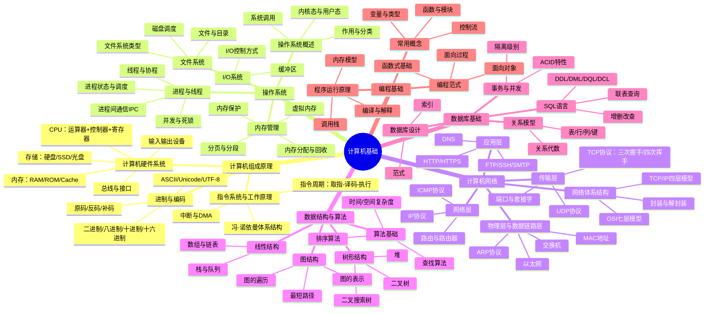

# 计算机基础系统化学习指南（入门启蒙 · 网络安全视角）

> **适用对象**：初学者 · 入门启蒙 · 理论+实践结合 · 长期学习
> **特色视角**：每个模块均融入网络安全应用场景，帮助你建立"安全思维"
> **学习理念**：先搭框架，再填细节；理解原理，动手验证；持续迭代，螺旋上升

---

## 🗺️ 一、知识地图（Knowledge Map）



---

## 📅 二、分阶段学习路径（长期规划）

### 阶段一：筑基期（第 1~2 个月）—— 建立全貌

| 周次 | 主题 | 核心目标 | 实践任务 |
|------|------|----------|----------|
| 第1周 | 计算机组成原理 | 理解计算机"长什么样"、"怎么工作" | 拆解一台电脑（实物或图片），标注各部件 |
| 第2周 | 进制与编码 | 熟练进行进制转换，理解字符编码 | 手动计算二进制/十进制转换，用 Python 验证 |
| 第3周 | 操作系统入门 | 理解 OS 是"管家"，管理软硬件资源 | 安装虚拟机，体验 Linux 基本命令 |
| 第4周 | 进程与线程 | 理解程序如何被"同时"运行 | 用任务管理器/top 观察进程 |
| 第5~6周 | 计算机网络入门 | 理解数据如何在网络中传输 | 用 Wireshark 抓包看 HTTP 请求 |
| 第7~8周 | 阶段复盘 + 编程入门 | 串联前序知识，开始动手写代码 | 完成第一个 Python/C 程序 |

### 阶段二：进阶期（第 3~6 个月）—— 深入理解

- **操作系统深入**：内存管理、文件系统、I/O、死锁
- **网络深入**：TCP 细节、HTTPS、DNS、路由
- **数据结构与算法**：常用数据结构 + 基础算法
- **编程能力提升**：完成 50+ 道编程题

### 阶段三：融合期（第 7~12 个月）—— 应用实践

- **数据库**：SQL + 索引 + 事务
- **编译原理入门**：理解程序如何变成机器码
- **软件工程**：代码组织、版本控制、测试
- **安全专项**：缓冲区溢出、SQL注入、XSS等安全原理

---

## 🔧 三、核心模块详解

---

### 📦 模块 1：计算机组成原理（Computer Organization）

#### 1.1 冯·诺依曼体系结构（Von Neumann Architecture）

**核心概念**：
- 现代计算机的基本架构，由冯·诺依曼于 1945 年提出
- 五大部件：**运算器**、**控制器**、**存储器**、**输入设备**、**输出设备**
- 核心思想：**存储程序**（Stored Program）—— 程序和数据都放在内存中

> 🎯 **安全视角**：正因为"程序也是数据"，才有了"代码注入"攻击的可能——攻击者把恶意代码当作数据输入，然后让 CPU 把它当程序执行。

**生活化类比**：
> 把计算机想象成一家"自动化餐厅"：
> - **存储器（内存）** = 厨房的操作台，放着菜谱（程序）和食材（数据）
> - **控制器** = 厨师长，按菜谱顺序指挥操作
> - **运算器** = 厨师，执行切菜、翻炒等具体操作
> - **输入设备** = 传菜员，把食材送进来
> - **输出设备** = 服务员，把做好的菜端出去

**常见误区**：
- ❌ "CPU 就是运算器" → CPU = 运算器 + 控制器 + 寄存器
- ❌ "内存就是硬盘" → 内存是临时的（断电丢失），硬盘是持久的

---

#### 1.2 进制与编码（Number Systems & Encoding）

##### 进制转换

| 进制 | 英文 | 基数 | 数码 | 示例 |
|------|------|------|------|------|
| 二进制 | Binary | 2 | 0, 1 | `1010`₂ |
| 八进制 | Octal | 8 | 0~7 | `12`₈ |
| 十进制 | Decimal | 10 | 0~9 | `10`₁₀ |
| 十六进制 | Hexadecimal | 16 | 0~9, A~F | `A`₁₆ |

**二进制 → 十进制**（按权展开）：
```
1011₂ = 1×2³ + 0×2² + 1×2¹ + 1×2⁰ = 8 + 0 + 2 + 1 = 11₁₀
```

**十进制 → 二进制**（除 2 取余，逆序排列）：
```
13 ÷ 2 = 6 余 1
6 ÷ 2 = 3 余 0
3 ÷ 2 = 1 余 1
1 ÷ 2 = 0 余 1
结果：1101₂
```

##### 有符号数的表示

| 表示法 | 正数表示 | 负数表示 | 特点 |
|--------|----------|----------|------|
| 原码（Sign-Magnitude） | 符号位0 + 数值位 | 符号位1 + 数值位 | 简单，但+0和-0不统一 |
| 反码（One's Complement） | 与原码相同 | 原码除符号位取反 | 减法可转化为加法，但仍有±0 |
| **补码（Two's Complement）** | 与原码相同 | 反码 + 1 | **现代计算机通用**，只有一个0，减法统一为加法 |

> 🎯 **安全视角**：理解补码对理解"整数溢出"漏洞至关重要——一个很大的正数加1可能变成负数，导致程序逻辑异常，甚至被利用。

##### 字符编码

| 编码 | 英文名 | 长度 | 适用范围 |
|------|--------|------|----------|
| ASCII | American Standard Code for Information Interchange | 7位（1字节） | 英文字母、数字、常用符号 |
| Unicode | Universal Character Set | 理论上无限 | 全球所有文字 |
| UTF-8 | 8-bit Unicode Transformation Format | 1~4字节变长 | **互联网事实标准**，兼容ASCII |

> 🔑 **记忆技巧**：UTF-8 是 Unicode 的一种"变长编码实现"，就像寄快递——小件用小盒子（1字节存英文），大件用大盒子（3字节存中文）。

**实践练习（Python）**：
```python
# 进制转换
print(bin(10))      # 十进制转二进制: 0b1010
print(oct(10))      # 十进制转八进制: 0o12
print(hex(10))      # 十进制转十六进制: 0xa
print(int('1010', 2))  # 二进制转十进制: 10

# 字符编码
print(ord('A'))     # 字符转ASCII码: 65
print(chr(65))      # ASCII码转字符: 'A'
print('你好'.encode('utf-8'))  # b'\xe4\xbd\xa0\xe5\xa5\xbd'
```

---

#### 1.3 CPU、内存与存储

##### CPU（Central Processing Unit，中央处理器）

**组成**：
- **运算器（ALU, Arithmetic Logic Unit）**：执行算术和逻辑运算
- **控制器（CU, Control Unit）**：指挥协调各部件工作
- **寄存器（Register）**：CPU 内部的"小笔记本"，速度最快、容量最小

**性能指标**：
- **主频（Clock Rate）**：Hz，每秒时钟周期数 → 类似"心跳速度"
- **核心数（Cores）**：几个"脑子"同时工作
- **缓存（Cache）**：L1/L2/L3，速度递减、容量递增

> 🔑 **类比**：CPU 寄存器 = 你手里拿的东西（最快，但拿不了几个）；Cache = 你面前的桌子；内存 = 身后的书架；硬盘 = 楼下的仓库。

##### 内存（Memory / RAM）

- **RAM（Random Access Memory）**：随机存取存储器，可读可写，断电丢失
- **ROM（Read Only Memory）**：只读存储器，断电不丢，存 BIOS 等固件
- **内存地址**：每个字节都有一个唯一编号（地址），CPU 通过地址访问内存

> 🎯 **安全视角**：内存地址是很多攻击的关键——缓冲区溢出就是把数据写到"不该写的地址"，覆盖了程序的指令。

##### 存储层次结构

| 层级 | 介质 | 速度 | 容量 | 价格/位 | 持久性 |
|------|------|------|------|---------|--------|
| 寄存器 | 触发器 | 极快（1ns） | 几KB | 最高 | 断电丢失 |
| Cache | SRAM | 很快（1~10ns） | 几MB~几十MB | 高 | 断电丢失 |
| 内存 | DRAM | 较快（~100ns） | 几GB~几十GB | 中 | 断电丢失 |
| SSD | 闪存 | 中等（~100μs） | 几百GB~几TB | 较低 | 断电保留 |
| 硬盘 | 磁介质 | 慢（~10ms） | 几TB | 最低 | 断电保留 |

> 🔑 **核心规律**：速度越快，容量越小，价格越贵。计算机通过"层次化存储"平衡速度、容量、成本。

---

#### 1.4 指令系统与工作原理

**指令（Instruction）**：CPU 能听懂的"命令"，由操作码和地址码组成。

**指令周期（Instruction Cycle）**：
1. **取指（Fetch）**：从内存中取出下一条指令
2. **译码（Decode）**：翻译这条指令要做什么
3. **执行（Execute）**：执行操作
4. **写回（Write-back）**：把结果写回寄存器或内存

> 🔑 **类比**：像厨师做菜——看菜谱（取指）、理解菜名（译码）、动手烹饪（执行）、装盘上桌（写回）。

**流水线（Pipelining）**：让多条指令重叠执行，就像工厂流水线——当第一条指令在"执行"时，第二条已经在"译码"，第三条在"取指"。

---

#### 📝 模块 1 练习题

**基础题**：
1. 将十进制数 42 转换为二进制、八进制、十六进制。
2. 将二进制数 `11010110` 转换为十进制。
3. 用补码表示 -15（假设8位）。
4. 简述冯·诺依曼体系结构的五大组成部分。
5. 为什么计算机采用多级存储层次结构？

**实践题**：
6. 打开任务管理器（Windows）或 `top` 命令（Linux），观察 CPU、内存、进程信息。
7. 用 Python 写一个函数，输入十进制数，输出二进制字符串（不使用 `bin()` 函数）。

**参考答案**：
1. 42₁₀ = 101010₂ = 52₈ = 2A₁₆
2. 128+64+16+4+2 = 214₁₀
3. 15的原码：00001111 → 反码：11110000 → 补码：11110001
4~5. 见正文
7. 参考实现：
```python
def dec_to_bin(n):
    if n == 0:
        return '0'
    result = ''
    while n > 0:
        result = str(n % 2) + result
        n = n // 2
    return result
```

---

### 💻 模块 2：操作系统（Operating System）

#### 2.1 操作系统概述

**什么是操作系统？**
- 操作系统是管理计算机硬件与软件资源的**系统软件**
- 位于硬件和应用程序之间，起"承上启下"的作用

> 🔑 **类比**：操作系统就像一个公司的**行政部 + 后勤部 + 调度中心**：
> - 管理办公场地（内存分配）
> - 管理办公设备（I/O设备）
> - 安排会议日程（进程调度）
> - 管理文件档案（文件系统）
> - 对外提供统一服务窗口（系统调用）

**操作系统的功能**：
1. **进程管理**：创建、调度、终止进程
2. **内存管理**：分配、回收、保护内存
3. **文件管理**：文件的存储、检索、共享
4. **设备管理**：I/O 设备的驱动与调度
5. **用户接口**：命令行、图形界面、系统调用

##### 内核态与用户态（Kernel Mode & User Mode）

| 模式 | 英文 | 权限 | 能访问的资源 | 触发方式 |
|------|------|------|-------------|----------|
| 内核态 | Kernel Mode | 最高 | 所有硬件和内存 | 系统调用、中断、异常 |
| 用户态 | User Mode | 受限 | 只能访问自己的内存空间 | 普通应用程序运行 |

> 🎯 **安全视角**：这是操作系统最重要的安全防线——应用程序不能直接操作硬件，必须通过 OS 提供的"合法入口"（系统调用），防止恶意程序破坏系统。

##### 系统调用（System Call）

应用程序请求操作系统服务的方式。就像你去政府大厅办事——你不能直接进办公室操作，必须在窗口提交申请。

**常见系统调用**：
- 进程类：`fork()`, `exec()`, `exit()`
- 文件类：`open()`, `read()`, `write()`, `close()`
- 内存类：`malloc()`（底层是 `brk()` 或 `mmap()`）
- 网络类：`socket()`, `bind()`, `connect()`

---

#### 2.2 进程与线程（Process & Thread）

##### 什么是进程？

**进程（Process）**：程序的一次执行过程，是操作系统分配资源的基本单位。

> 🔑 **类比**：程序 = 菜谱（静态的），进程 = 做菜的过程（动态的）。同一道菜谱可以同时在多个厨房做（多个进程运行同一个程序）。

**进程的组成**：
- **代码段（Text）**：程序指令
- **数据段（Data）**：全局变量
- **堆（Heap）**：动态分配的内存
- **栈（Stack）**：函数调用栈、局部变量
- **PCB（Process Control Block）**：进程控制块，OS 管理进程的数据结构

##### 进程的状态

```
  创建 → 就绪 ←→ 运行 → 阻塞 → 就绪 → ... → 终止
                 ↓
               时间片到
```

| 状态 | 说明 |
|------|------|
| 创建（New） | 进程正在被创建 |
| 就绪（Ready） | 万事俱备，只等 CPU |
| 运行（Running） | 正在 CPU 上执行 |
| 阻塞（Blocked/Waiting） | 等待某事件（如I/O），暂时不能运行 |
| 终止（Terminated） | 进程执行完毕或被终止 |

##### 进程调度算法（入门级）

| 算法 | 英文 | 思想 | 优点 | 缺点 |
|------|------|------|------|------|
| 先来先服务 | FCFS | 按到达顺序排队 | 简单公平 | 长进程阻塞短进程 |
| 短作业优先 | SJF | 短的先执行 | 平均等待时间最短 | 长进程可能"饿死" |
| 时间片轮转 | RR | 每人轮流用一会儿 | 公平，响应快 | 切换有开销 |
| 优先级调度 | Priority | 优先级高的先跑 | 重要任务优先 | 低优先级可能饿死 |

##### 什么是线程？

**线程（Thread）**：进程内的一个执行流，是 CPU 调度的基本单位。

> 🔑 **类比**：进程 = 一家工厂（资源），线程 = 工厂里的工人（执行流）。一个工厂可以有多个工人协作，他们共享厂房和设备。

**进程 vs 线程**：

| 对比项 | 进程（Process） | 线程（Thread） |
|--------|----------------|----------------|
| 定义 | 资源分配的基本单位 | CPU调度的基本单位 |
| 资源 | 拥有独立资源，不共享 | 共享进程的资源 |
| 切换开销 | 大（要换页表、刷新Cache） | 小（只换寄存器和栈） |
| 通信 | IPC（管道、消息队列、共享内存等） | 直接读写共享变量（需同步） |
| 安全性 | 一个进程崩溃不影响其他 | 一个线程崩溃可能导致整个进程挂 |
| 数量级 | 几十个~几百个 | 几百个~几千个 |

##### 并发与并行（Concurrency & Parallelism）

- **并发**：一段时间内多个任务"交替"执行（单核心快速切换）→ 像你一边吃饭一边看手机
- **并行**：同一时刻多个任务"同时"执行（多核心）→ 像两个人同时吃饭

> 🎯 **安全视角**：并发编程中的"竞态条件"（Race Condition）是常见的安全漏洞来源——多个线程同时修改共享数据，导致数据不一致或逻辑绕过。

---

#### 2.3 内存管理（Memory Management）

**内存管理的目标**：
1. 高效分配和回收内存
2. 让多个程序"安全地"共享内存
3. 让程序觉得自己"独占"整个内存（虚拟内存）

##### 虚拟内存（Virtual Memory）

每个进程都以为自己拥有从 0 开始的一整块连续内存，但实际上这些"虚拟地址"会被 OS 映射到物理内存的不同位置。

> 🔑 **类比**：就像酒店给每个客人一个房间号（虚拟地址），客人只需要说"我要302房间"，不用管302房间在楼的哪个位置（物理地址）。酒店前台（MMU）负责翻译。

**MMU（Memory Management Unit，内存管理单元）**：负责虚拟地址到物理地址的翻译。

##### 分页（Paging）

把虚拟内存和物理内存都分成固定大小的"页"（Page，通常 4KB），然后建立映射关系。

- **页表（Page Table）**：记录虚拟页号 → 物理页号的映射
- **缺页中断（Page Fault）**：访问的页不在内存中，OS 需要从磁盘加载

> 🎯 **安全视角**：页表中的"权限位"（可读/可写/可执行）是内存安全的重要机制。如果一段内存被标记为"不可执行"，即使攻击者注入了代码也无法运行——这就是 DEP（Data Execution Prevention，数据执行保护）的原理。

##### 内存保护

- **地址空间隔离**：每个进程只能访问自己的虚拟地址空间
- **权限检查**：读/写/执行权限
- **栈保护**：Stack Canary（栈金丝雀）防止栈溢出
- **ASLR**：地址空间布局随机化，让攻击者难以猜到目标地址

---

#### 2.4 文件系统（File System）

**文件**：存储在外存上的、有名字的一组相关信息的集合。

**文件系统**：OS 中负责管理和存储文件信息的软件机构。

> 🔑 **类比**：文件系统就像图书馆——文件是书，目录是书架分类，文件系统是图书管理员，帮你快速找到想要的书。

##### 常见文件系统

| 文件系统 | 操作系统 | 特点 |
|----------|----------|------|
| NTFS | Windows | 支持大文件、权限管理、加密 |
| FAT32 | 通用（U盘常用） | 兼容性好，但单文件最大4GB |
| ext4 | Linux | 稳定、高性能 |
| APFS | macOS | 针对SSD优化、支持快照 |

##### 目录结构

- **绝对路径**：从根目录开始的完整路径（如 `C:\Windows\System32`）
- **相对路径**：相对于当前目录的路径（如 `../Documents`）

> 🎯 **安全视角**：路径遍历漏洞（Path Traversal）就是利用 `../` 跳出当前目录，访问不应该访问的文件——比如 `../../etc/passwd`。

---

#### 2.5 I/O 系统

**I/O控制方式**：

| 方式 | 特点 | 适用场景 |
|------|------|----------|
| 程序查询（轮询） | CPU 不断询问设备是否就绪 | 简单但低效 |
| 中断驱动 | 设备准备好后发中断通知CPU | 中速设备，如键盘 |
| DMA（直接存储器访问） | 数据搬运由DMA控制器完成，不用CPU参与 | 高速设备，如磁盘 |

> 🔑 **类比**：
> - 轮询 = 你每隔5分钟就去问外卖员"到了吗"
> - 中断 = 外卖员到了给你打电话
> - DMA = 外卖员直接把餐放到你桌上，不用你起身接

---

#### 📝 模块 2 练习题

**基础题**：
1. 操作系统的主要功能有哪些？
2. 进程和线程的区别是什么？
3. 什么是虚拟内存？它有什么好处？
4. 解释内核态和用户态的区别。
5. 进程有哪几种基本状态？

**实践题**：
6. 在 Windows 任务管理器或 Linux `top` 命令中，找出占用 CPU 最高的 3 个进程。
7. 用 Python 写一个程序，创建 2 个线程分别打印 1~10 的奇数和偶数。

**安全思考题**：
8. 为什么"数据执行保护（DEP）"能防止一部分缓冲区溢出攻击？
9. 如果没有地址空间隔离，会有什么安全风险？

**参考答案（部分）**：
7. 参考实现：
```python
import threading

def print_odd():
    for i in range(1, 11, 2):
        print(f"奇数线程: {i}")

def print_even():
    for i in range(2, 11, 2):
        print(f"偶数线程: {i}")

t1 = threading.Thread(target=print_odd)
t2 = threading.Thread(target=print_even)
t1.start()
t2.start()
t1.join()
t2.join()
```

---

### 🌐 模块 3：计算机网络（Computer Networks）

#### 3.1 网络体系结构

##### OSI 七层模型 vs TCP/IP 四层模型

| OSI 七层 | 功能 | TCP/IP 四层 | 典型协议/设备 |
|----------|------|-------------|---------------|
| 7. 应用层（Application） | 给用户提供服务 | 应用层 | HTTP、FTP、DNS、SSH |
| 6. 表示层（Presentation） | 数据格式转换、加密解密 | （合并到应用层） | SSL/TLS、JPEG |
| 5. 会话层（Session） | 建立、管理、终止会话 | （合并到应用层） | RPC、NetBIOS |
| 4. 传输层（Transport） | 端到端的可靠传输 | 传输层 | TCP、UDP |
| 3. 网络层（Network） | 路由选择、寻址 | 网际层 | IP、ICMP、路由器 |
| 2. 数据链路层（Data Link） | 相邻节点间的帧传输 | 网络接口层 | 以太网、ARP、交换机 |
| 1. 物理层（Physical） | 比特流传输 | 网络接口层 | 网线、光纤、集线器 |

> 🔑 **记忆口诀**：应表会传网数物（All People Seem To Need Data Processing）

##### 封装与解封装（Encapsulation & Decapsulation）

数据从上层往下层传输时，每一层都加上自己的"头部"（Header），就像寄快递：
- 应用层：数据 = 信件内容
- 传输层：TCP头 + 数据 = 装进信封，写上发件人/收件人端口
- 网络层：IP头 + TCP头 + 数据 = 装进快递盒，写上源/目的IP
- 链路层：帧头 + IP包 + 帧尾 = 贴上面单，写上源/目的MAC

> 🎯 **安全视角**：每一层的头部都可能被伪造或篡改，对应不同的攻击：IP欺骗（网络层）、TCP会话劫持（传输层）、HTTP头注入（应用层）等。

---

#### 3.2 物理层与数据链路层

##### 以太网（Ethernet）

- 最广泛使用的局域网技术
- **MAC 地址**（Media Access Control）：网卡的物理地址，全球唯一，48位
  - 格式：`AA:BB:CC:DD:EE:FF`（十六进制）
  - 前24位：厂商标识（OUI），后24位：厂商分配的序列号

##### ARP 协议（Address Resolution Protocol）

- **作用**：根据 IP 地址找 MAC 地址（地址解析协议）
- **工作方式**：广播询问"谁的IP是192.168.1.1？请告诉我你的MAC地址"
- **ARP缓存**：电脑会缓存IP-MAC映射，不用每次都问

> 🎯 **安全视角**：**ARP欺骗（ARP Spoofing）**是经典的局域网攻击——攻击者发送虚假ARP响应，让受害者把流量发往攻击者的机器，从而实现中间人攻击。

##### 交换机 vs 集线器

| 设备 | 工作层级 | 工作方式 | 特点 |
|------|----------|----------|------|
| 集线器（Hub） | 物理层 | 广播所有端口 | 半双工，冲突域大，已淘汰 |
| 交换机（Switch） | 数据链路层 | 根据MAC地址转发 | 全双工，隔离冲突域，更安全 |

---

#### 3.3 网络层

##### IP 协议（Internet Protocol）

- **作用**：提供"尽力而为"的、不可靠的、无连接的数据报传输服务
- **IP地址**：网络层地址，32位（IPv4）或128位（IPv6）

##### IPv4 地址分类

| 类别 | 范围 | 网络位/主机位 | 默认子网掩码 | 用途 |
|------|------|---------------|-------------|------|
| A类 | 1.0.0.0 ~ 126.255.255.255 | 8/24 | 255.0.0.0 | 大型网络 |
| B类 | 128.0.0.0 ~ 191.255.255.255 | 16/16 | 255.255.0.0 | 中型网络 |
| C类 | 192.0.0.0 ~ 223.255.255.255 | 24/8 | 255.255.255.0 | 小型网络 |
| D类 | 224.0.0.0 ~ 239.255.255.255 | - | - | 组播 |
| E类 | 240.0.0.0 ~ 255.255.255.255 | - | - | 保留 |

**特殊IP**：
- `127.0.0.1`：回环地址（Loopback），本机访问自己
- `0.0.0.0`：表示所有地址
- `255.255.255.255`：广播地址
- **私有IP**：
  - A类：`10.0.0.0 ~ 10.255.255.255`
  - B类：`172.16.0.0 ~ 172.31.255.255`
  - C类：`192.168.0.0 ~ 192.168.255.255`

> 🔑 **类比**：公网IP = 身份证号（全球唯一），私有IP = 学号（学校内唯一，出了校门没用）。NAT（网络地址转换）就像学校传达室——外面的人只知道学校地址，传达室负责把信转到具体宿舍。

##### ICMP 协议（Internet Control Message Protocol）

- **作用**：网络层的"信使"，传递差错和控制信息
- **常见用途**：`ping` 命令（测试连通性）、`traceroute`（追踪路由路径）

> 🎯 **安全视角**：Ping 洪水攻击（Ping Flood）就是发送大量 ICMP 包耗尽目标资源。很多防火墙会限制 ICMP 速率。

##### 路由与路由器

- **路由器（Router）**：连接不同网络，根据路由表选择最佳路径
- **路由表**：记录"去哪个网络走哪个网关"
- **默认网关**：不知道往哪发的包，都发给它

---

#### 3.4 传输层

##### TCP vs UDP

| 特性 | TCP（Transmission Control Protocol） | UDP（User Datagram Protocol） |
|------|--------------------------------------|--------------------------------|
| 连接性 | 面向连接（三次握手建立连接） | 无连接（发了就完事） |
| 可靠性 | 可靠（确认、重传、排序） | 不可靠（不保证到达） |
| 顺序性 | 保证按顺序到达 | 不保证顺序 |
| 流量控制 | 有（滑动窗口） | 无 |
| 拥塞控制 | 有 | 无 |
| 首部开销 | 20字节 | 8字节 |
| 速度 | 较慢 | 较快 |
| 适用场景 | 文件传输、网页浏览、邮件 | 视频会议、直播、DNS、游戏 |

> 🔑 **类比**：
> - TCP = 打电话：拨号→对方接了→说话（有来有回）→挂电话
> - UDP = 寄明信片：写好地址直接寄，对方收不收得到你不知道，也不管顺序

##### TCP 三次握手（Three-way Handshake）

建立 TCP 连接的过程：

```
客户端                           服务器
   | SYN (seq=x)                   |
   |------------------------------->|
   |                                |
   | SYN+ACK (seq=y, ack=x+1)      |
   |<-------------------------------|
   |                                |
   | ACK (ack=y+1)                  |
   |------------------------------->|
   |                                |
连接建立                          连接建立
```

**为什么是三次不是两次？**
- 防止已失效的连接请求突然又传到服务器，导致服务器错误地建立连接

> 🎯 **安全视角**：**SYN洪水攻击（SYN Flood）**就是利用三次握手——攻击者发送大量SYN包但不回应ACK，占满服务器的半连接队列，导致正常请求无法建立连接。

##### TCP 四次挥手（Four-way Handshake）

关闭 TCP 连接的过程：

```
客户端                           服务器
   | FIN (seq=u)                   |
   |------------------------------->|
   |                                |
   | ACK (ack=u+1)                 |
   |<-------------------------------|
   |                                | 服务器可能还有数据要发
   | FIN (seq=w)                    |
   |<-------------------------------|
   |                                |
   | ACK (ack=w+1)                  |
   |------------------------------->|
```

##### 端口（Port）

- 16位数字，范围 0~65535
- 作用：标识同一台机器上的不同应用程序
- **熟知端口（Well-known Ports）**：0~1023
  - 80: HTTP, 443: HTTPS, 22: SSH, 21: FTP, 53: DNS, 25: SMTP
- **注册端口**：1024~49151
- **动态/私有端口**：49152~65535

> 🔑 **类比**：IP = 公司地址，Port = 分机号。你打电话到公司总机（IP），然后转分机（Port）找到具体的人（程序）。

**套接字（Socket）**：IP + 端口号，唯一标识网络中的一个通信端点。

---

#### 3.5 应用层

##### HTTP 协议（HyperText Transfer Protocol）

- **作用**：万维网的基础协议，用于传输超文本
- **特点**：基于TCP、无状态、请求-响应模式

**请求方法**：

| 方法 | 作用 | 幂等性 |
|------|------|--------|
| GET | 获取资源 | 是 |
| POST | 提交数据（创建） | 否 |
| PUT | 更新资源（整体替换） | 是 |
| DELETE | 删除资源 | 是 |
| PATCH | 部分更新 | 否 |
| HEAD | 获取响应头（无响应体） | 是 |
| OPTIONS | 查询支持的方法 | 是 |

**常见状态码**：

| 状态码 | 含义 | 说明 |
|--------|------|------|
| 200 OK | 成功 | 请求正常处理 |
| 301 Moved Permanently | 永久重定向 | 资源已永久移动 |
| 302 Found | 临时重定向 | 资源临时在别处 |
| 400 Bad Request | 请求错误 | 请求语法有问题 |
| 401 Unauthorized | 未授权 | 需要身份认证 |
| 403 Forbidden | 禁止访问 | 服务器拒绝执行 |
| 404 Not Found | 未找到 | 资源不存在 |
| 500 Internal Server Error | 服务器内部错误 | 服务器崩了 |
| 502 Bad Gateway | 网关错误 | 网关/代理收到无效响应 |
| 503 Service Unavailable | 服务不可用 | 服务器暂时过载或维护 |

##### HTTPS = HTTP + SSL/TLS

- **作用**：在 HTTP 基础上加了加密层，保证通信安全
- **三大目标**：
  1. **机密性（Confidentiality）**：数据加密，第三方看不懂
  2. **完整性（Integrity）**：数据没被篡改
  3. **身份认证（Authentication）**：确认对方是谁

> 🎯 **安全视角**：HTTPS 通过**对称加密**（加密数据，速度快）+ **非对称加密**（交换密钥，安全但慢）+ **数字证书**（身份认证）实现安全通信。这是网络安全中最重要的基础协议之一。

##### DNS 协议（Domain Name System）

- **作用**：域名解析系统，把域名翻译成IP地址
- **端口**：UDP 53（也用TCP 53处理大数据包）

**DNS查询过程**（递归+迭代）：
1. 浏览器缓存 → 系统缓存 → hosts文件
2. 本地DNS服务器（递归查询）
3. 根域名服务器 → 顶级域名服务器 → 权威域名服务器（迭代查询）

> 🎯 **安全视角**：
> - **DNS劫持**：篡改DNS解析结果，把用户引向钓鱼网站
> - **DNS污染**：在DNS查询返回假结果，让用户访问不到目标网站
> - **DNS隧道**：把数据藏在DNS请求里绕过防火墙

---

#### 📝 模块 3 练习题

**基础题**：
1. OSI七层模型从上到下分别是什么？各层的主要功能是什么？
2. TCP和UDP的区别是什么？各举两个应用场景。
3. 简述TCP三次握手的过程，为什么需要三次而不是两次？
4. HTTP常见状态码 200、301、404、500 分别代表什么？
5. 什么是ARP协议？ARP欺骗的原理是什么？

**实践题**：
6. 用 `ping` 命令测试 `baidu.com` 的连通性。
7. 用 `ipconfig`（Windows）或 `ifconfig`/`ip addr`（Linux）查看本机IP和MAC地址。
8. 安装 Wireshark，抓一个 HTTP 请求包，观察各层封装。

**安全思考题**：
9. 为什么说 HTTP 是不安全的？HTTPS 如何解决这些问题？
10. 如果一个攻击者控制了你的路由器上的 DNS 设置，会有什么后果？

**实践参考答案**：
```bash
# 6. ping 命令
ping baidu.com

# 7. 查看网络配置
# Windows
ipconfig /all
# Linux
ip addr show
```

---

### 🧱 模块 4：数据结构与算法（Data Structures & Algorithms）

#### 4.1 算法复杂度分析

##### 时间复杂度（Time Complexity）

衡量算法运行时间随数据规模增长的趋势，用大O表示法。

| 复杂度 | 名称 | 示例 | 说明 |
|--------|------|------|------|
| O(1) | 常数阶 | 数组索引访问 | 最快，与数据量无关 |
| O(log n) | 对数阶 | 二分查找 | 数据量翻倍，时间只增加一点 |
| O(n) | 线性阶 | 遍历数组 | 时间与数据量成正比 |
| O(n log n) | 线性对数阶 | 归并排序、快速排序（平均） | 较高效的排序 |
| O(n²) | 平方阶 | 冒泡排序、选择排序 | 较慢，适合小数据 |
| O(2ⁿ) | 指数阶 | 递归斐波那契 | 非常慢，尽量避免 |
| O(n!) | 阶乘阶 | 旅行商问题（暴力） | 极慢，基本不可用 |

> 🔑 **记忆**：从好到差 → 常对线性线对平，指数阶乘不能停

##### 空间复杂度（Space Complexity）

衡量算法所需额外空间随数据规模增长的趋势。

> 🎯 **安全视角**：算法复杂度与安全密切相关——攻击者可以构造"最坏情况"输入，让程序运行极慢（拒绝服务攻击）。比如针对哈希表的"哈希碰撞攻击"。

---

#### 4.2 线性结构

##### 数组 vs 链表

| 特性 | 数组（Array） | 链表（Linked List） |
|------|---------------|---------------------|
| 内存布局 | 连续的内存空间 | 零散的内存空间，通过指针连接 |
| 大小 | 固定（静态数组） | 动态，随时增减 |
| 访问方式 | 随机访问 O(1) | 顺序访问 O(n) |
| 插入/删除 | O(n)（要移动元素） | O(1)（已知节点位置时） |
| 缓存友好 | 是（局部性原理） | 否 |
| 空间浪费 | 可能有空闲位置 | 每个节点需要额外指针空间 |

> 🔑 **类比**：
> - 数组 = 一排连在一起的座位，找第5个人直接走过去（O(1)），但要在中间加座就得所有人往后挪
> - 链表 = 手拉手的人，每个人只知道下一个人是谁，找第5个得从第一个开始数（O(n)），但中间加人只要改两个人的手

##### 栈（Stack）

- **特点**：后进先出（LIFO, Last In First Out）
- **操作**：push（入栈）、pop（出栈）、peek（查看栈顶）
- **时间复杂度**：O(1)

> 🔑 **类比**：叠盘子——只能往最上面放，也只能从最上面拿。

**应用场景**：
- 函数调用栈
- 表达式求值（逆波兰表达式）
- 括号匹配
- 浏览器前进后退

> 🎯 **安全视角**：栈溢出（Stack Overflow）是经典漏洞——递归太深或局部变量太大导致栈空间用完，更危险的是"栈缓冲区溢出"——往栈上的数组写太多数据，覆盖返回地址，从而控制程序执行流。

##### 队列（Queue）

- **特点**：先进先出（FIFO, First In First Out）
- **操作**：enqueue（入队）、dequeue（出队）
- **时间复杂度**：O(1)

> 🔑 **类比**：排队买饭——先来的先买，后来的排后面。

**变体**：
- **双端队列（Deque）**：两端都可以入队出队
- **优先队列（Priority Queue）**：按优先级出队（通常用堆实现）

**应用场景**：
- 任务调度
- 广度优先搜索（BFS）
- 消息队列

---

#### 4.3 树形结构

##### 二叉树（Binary Tree）

每个节点最多有两个子节点（左子节点和右子节点）。

**特殊二叉树**：
- **满二叉树**：所有叶子节点都在最后一层，且非叶子节点都有两个子节点
- **完全二叉树**：除最后一层外都是满的，最后一层从左到右连续
- **二叉搜索树（BST, Binary Search Tree）**：左子树所有节点 < 根节点 < 右子树所有节点

##### 二叉搜索树的操作

| 操作 | 平均时间复杂度 | 最坏时间复杂度 |
|------|---------------|---------------|
| 查找 | O(log n) | O(n)（退化成链表） |
| 插入 | O(log n) | O(n) |
| 删除 | O(log n) | O(n) |

> ⚠️ **注意**：二叉搜索树在最坏情况下（如插入有序数据）会退化成链表，所以实际中用**平衡二叉树**（如 AVL树、红黑树）。

##### 二叉树的遍历

1. **前序遍历**（根→左→右）：先访问根，再左子树，再右子树
2. **中序遍历**（左→根→右）：先左子树，再根，再右子树
   - 对二叉搜索树做中序遍历，得到**有序序列**
3. **后序遍历**（左→右→根）：先左子树，再右子树，再根
4. **层序遍历**：按层从上到下、从左到右访问（用队列实现）

> 🔑 **记忆**：前/中/后指的是"根"的位置。

##### 堆（Heap）

- **定义**：一种特殊的完全二叉树
- **分类**：
  - **大顶堆**：每个节点的值 ≥ 其子节点的值（根是最大值）
  - **小顶堆**：每个节点的值 ≤ 其子节点的值（根是最小值）
- **操作**：
  - 插入：O(log n)
  - 取顶（最大/最小）：O(1)
  - 删除顶：O(log n)

**应用**：优先队列、堆排序、Top K 问题

---

#### 4.4 图结构

##### 图的表示

| 表示方式 | 适用场景 | 空间 | 检查相邻 | 遍历邻居 |
|----------|----------|------|----------|----------|
| 邻接矩阵 | 稠密图 | O(V²) | O(1) | O(V) |
| 邻接表 | 稀疏图 | O(V+E) | O(degree) | O(degree) |

##### 图的遍历

| 算法 | 数据结构 | 特点 | 适用场景 |
|------|----------|------|----------|
| DFS（深度优先） | 栈（或递归） | 一条路走到黑，再回溯 | 路径查找、连通性 |
| BFS（广度优先） | 队列 | 一圈一圈往外扩 | 最短路径（无权图） |

##### 最短路径算法

| 算法 | 适用场景 | 时间复杂度 |
|------|----------|-----------|
| Dijkstra | 单源最短路径，无负权边 | O((V+E)log V) |
| Bellman-Ford | 单源最短路径，可检测负权环 | O(VE) |
| Floyd-Warshall | 所有点对最短路径 | O(V³) |

---

#### 4.5 排序算法

| 算法 | 平均时间 | 最坏时间 | 空间 | 稳定性 | 思想 |
|------|----------|----------|------|--------|------|
| 冒泡排序 | O(n²) | O(n²) | O(1) | 稳定 | 相邻比较交换 |
| 选择排序 | O(n²) | O(n²) | O(1) | 不稳定 | 每次选最小的放前面 |
| 插入排序 | O(n²) | O(n²) | O(1) | 稳定 | 像打牌插牌 |
| 快速排序 | O(n log n) | O(n²) | O(log n) | 不稳定 | 分治，选基准分区 |
| 归并排序 | O(n log n) | O(n log n) | O(n) | 稳定 | 分治，两两合并 |
| 堆排序 | O(n log n) | O(n log n) | O(1) | 不稳定 | 利用堆的性质 |
| 计数排序 | O(n+k) | O(n+k) | O(k) | 稳定 | 非比较排序，数据范围小 |

> **稳定性**：相等的元素排序后相对位置不变。
> **何时用什么**：
> - 数据量小：插入排序（实现简单，常数因子小）
> - 一般情况：快速排序（平均最快）
> - 需要稳定：归并排序
> - 数据范围小：计数排序

---

#### 📝 模块 4 练习题

**基础题**：
1. 数组和链表的区别是什么？各有什么优缺点？
2. 栈和队列的特点是什么？各举两个应用场景。
3. 什么是二叉搜索树？它的中序遍历有什么特点？
4. 快速排序的基本思想是什么？平均时间复杂度是多少？
5. DFS 和 BFS 的区别是什么？分别用什么数据结构实现？

**实践题**：
6. 用 Python 实现一个栈（push、pop、peek 方法）。
7. 用 Python 实现冒泡排序。
8. 写一个函数，判断字符串中的括号是否匹配（用栈）。

**参考答案（部分）**：
6. 栈的实现：
```python
class Stack:
    def __init__(self):
        self.items = []
    
    def push(self, item):
        self.items.append(item)
    
    def pop(self):
        if self.is_empty():
            return None
        return self.items.pop()
    
    def peek(self):
        if self.is_empty():
            return None
        return self.items[-1]
    
    def is_empty(self):
        return len(self.items) == 0
    
    def size(self):
        return len(self.items)
```

8. 括号匹配：
```python
def is_valid_parentheses(s):
    stack = []
    mapping = {')': '(', ']': '[', '}': '{'}
    for char in s:
        if char in mapping.values():
            stack.append(char)
        elif char in mapping:
            if not stack or stack.pop() != mapping[char]:
                return False
    return len(stack) == 0
```

---

### 🗄️ 模块 5：数据库基础（Database）

#### 5.1 关系模型

**基本概念**：
- **表（Table）**：数据的集合，由行和列组成
- **行（Row / Tuple）**：一条记录
- **列（Column / Field）**：一个字段/属性
- **主键（Primary Key）**：唯一标识一行记录，不能为空
- **外键（Foreign Key）**：引用另一个表的主键，建立表之间的关系
- **索引（Index）**：加速查询的数据结构（类似书的目录）

> 🎯 **安全视角**：主键和外键保证了数据的**引用完整性**——防止出现"孤儿记录"。从安全角度，这也是数据完整性的一部分。

**三种关系**：
1. **一对一**：一个学生对应一张身份证
2. **一对多**：一个班级有多个学生（最常见）
3. **多对多**：学生和课程（需要中间表）

---

#### 5.2 SQL 语言

SQL（Structured Query Language）分为四类：

| 分类 | 全称 | 作用 | 关键字 |
|------|------|------|--------|
| DDL | Data Definition Language | 定义数据库结构 | CREATE, ALTER, DROP |
| DML | Data Manipulation Language | 操作数据 | INSERT, UPDATE, DELETE |
| DQL | Data Query Language | 查询数据 | SELECT |
| DCL | Data Control Language | 权限控制 | GRANT, REVOKE |

##### 基本查询（SELECT）

```sql
-- 基本语法
SELECT 列名1, 列名2
FROM 表名
WHERE 条件
GROUP BY 列
HAVING 分组后的条件
ORDER BY 列 [ASC|DESC]
LIMIT 数量;
```

**执行顺序**：FROM → WHERE → GROUP BY → HAVING → SELECT → ORDER BY → LIMIT

##### 联表查询（JOIN）

| JOIN类型 | 说明 |
|----------|------|
| INNER JOIN | 两表匹配的行才返回 |
| LEFT JOIN | 左表全部返回，右表匹配不上的为NULL |
| RIGHT JOIN | 右表全部返回，左表匹配不上的为NULL |
| FULL JOIN | 两表都全部返回（MySQL不直接支持） |

> 🔑 **类比**：LEFT JOIN 就像"以左表为准"——左表的每一行都要有，右表有匹配的就带上，没有就空着。

---

#### 5.3 索引（Index）

**什么是索引？**
- 索引是一种数据结构，用于加速数据库查询
- 就像书的目录——通过目录快速找到页码，而不是一页一页翻

**索引的数据结构**：
- **B+树**：MySQL InnoDB 默认索引结构（多路平衡查找树）
- **哈希索引**：等值查询快，但不支持范围查询和排序

**索引的优缺点**：

| 优点 | 缺点 |
|------|------|
| 加速查询 | 占用额外存储空间 |
| 加速排序和分组 | 降低写入速度（增删改要维护索引） |
| 保证唯一性（唯一索引） | 过多索引会降低性能 |

> 🎯 **安全视角**：索引也与安全相关——SQL注入可能利用索引信息；另外，"慢查询"可能被利用做拒绝服务攻击。

---

#### 5.4 事务（Transaction）

**什么是事务？**
- 一组SQL操作，要么全部成功，要么全部失败
- 经典例子：银行转账——A扣钱和B加钱必须同时成功或同时失败

##### ACID 特性

| 特性 | 英文 | 说明 |
|------|------|------|
| 原子性 | Atomicity | 事务是不可分割的最小单位，要么全做要么全不做 |
| 一致性 | Consistency | 事务执行前后，数据保持一致状态（约束不被破坏） |
| 隔离性 | Isolation | 多个事务之间互不干扰 |
| 持久性 | Durability | 事务一旦提交，数据就永久保存，不会丢失 |

##### 事务隔离级别

| 隔离级别 | 脏读 | 不可重复读 | 幻读 | 性能 |
|----------|------|-----------|------|------|
| 读未提交（Read Uncommitted） | ✅ 有 | ✅ 有 | ✅ 有 | 最高 |
| 读已提交（Read Committed） | ❌ 无 | ✅ 有 | ✅ 有 | 较高 |
| 可重复读（Repeatable Read） | ❌ 无 | ❌ 无 | ✅ 有（MySQL通过MVCC解决） | 较低 |
| 串行化（Serializable） | ❌ 无 | ❌ 无 | ❌ 无 | 最低 |

**名词解释**：
- **脏读**：读到了其他事务未提交的数据
- **不可重复读**：同一事务内，两次读同一行数据结果不一样（被别人改了）
- **幻读**：同一事务内，两次查询的行数不一样（别人插入/删除了）

> ⚠️ **注意**：MySQL InnoDB 默认隔离级别是**可重复读（RR）**，并且通过 MVCC + Next-Key Lock 解决了幻读问题。

> 🎯 **安全视角**：事务的隔离性与"竞态条件"相关——低隔离级别可能导致数据不一致，被利用进行业务逻辑攻击（如重复领取优惠券）。

---

#### 5.5 范式（Normalization）

通过分解表来减少数据冗余和更新异常的设计方法。

| 范式 | 核心要求 | 目的 |
|------|----------|------|
| 第一范式（1NF） | 每一列都是不可再分的原子值 | 确保字段原子性 |
| 第二范式（2NF） | 在1NF基础上，非主键列完全依赖于主键（不能只依赖主键的一部分） | 消除部分依赖 |
| 第三范式（3NF） | 在2NF基础上，非主键列只依赖于主键，不依赖于其他非主键列 | 消除传递依赖 |

> 🔑 **通俗理解**：
> - 1NF：每个字段只存一个东西（不能在"联系方式"里同时存电话和地址）
> - 2NF：一张表只做一件事（不要把学生信息和课程信息放一张表里）
> - 3NF：表里的非主键字段之间不能有依赖关系（不要在学生表里存班主任名字，应该存班主任ID）

> ⚠️ **注意**：范式不是越高越好——越高数据冗余越少，但查询可能需要更多JOIN，性能更差。实际开发中通常在3NF和反范式之间权衡。

---

#### 📝 模块 5 练习题

**基础题**：
1. 什么是主键、外键、索引？
2. SQL 分为哪几类？各有什么常用关键字？
3. 事务的 ACID 特性分别是什么？
4. 事务的四个隔离级别分别是什么？可能出现什么问题？
5. 第一、第二、第三范式的核心要求分别是什么？

**实践题**：
6. 写一条 SQL 语句，查询学生表中年龄大于 18 岁的学生姓名和年龄，按年龄降序排列。
7. 有学生表(student)和成绩表(score)，写 SQL 查询每个学生的姓名和总分。

**安全思考题**：
8. 什么是 SQL 注入？如何防范？

**参考答案**：
```sql
-- 6.
SELECT name, age
FROM student
WHERE age > 18
ORDER BY age DESC;

-- 7.
SELECT s.name, SUM(sc.score) as total_score
FROM student s
LEFT JOIN score sc ON s.id = sc.student_id
GROUP BY s.id, s.name;
```

---

### 📝 模块 6：编程基础

#### 6.1 程序运行原理

##### 编译 vs 解释

| 方式 | 英文 | 过程 | 速度 | 典型语言 |
|------|------|------|------|----------|
| 编译型 | Compiled | 先整体翻译成机器码，再执行 | 快 | C、C++、Rust、Go |
| 解释型 | Interpreted | 逐行翻译逐行执行 | 较慢 | Python、JavaScript、PHP |
| 混合型 | Hybrid | 先编译成字节码，再由虚拟机解释 | 中等 | Java、C# |

> 🔑 **类比**：
> - 编译 = 整本翻译书——一次性把整本书翻译好，以后读翻译本（快，但改原文要重新翻译）
> - 解释 = 同声传译——说一句翻一句（灵活但慢）

##### 程序的内存布局

程序运行时，内存通常分为几个区域：

| 区域 | 作用 | 分配方式 | 生命周期 |
|------|------|----------|----------|
| 代码段（Text） | 存放程序指令 | 编译时确定 | 程序运行期间 |
| 数据段（Data） | 全局变量、静态变量 | 编译时确定 | 程序运行期间 |
| BSS段 | 未初始化的全局变量 | 编译时确定 | 程序运行期间 |
| 堆（Heap） | 动态分配的内存 | 手动分配（malloc/new） | 手动释放或GC |
| 栈（Stack） | 函数调用、局部变量 | 自动分配 | 函数调用结束自动释放 |

> 🎯 **安全视角**：理解内存布局对理解漏洞至关重要——
> - 栈上的缓冲区溢出可以覆盖函数返回地址
> - 堆上的漏洞（Use-After-Free、Double Free）可以控制堆块布局
> - 代码段通常是只读且可执行的（但现代OS会做W^X保护）

##### 调用栈（Call Stack）

函数调用时的工作机制：
1. 调用函数 → 压栈（保存返回地址、参数、局部变量）
2. 函数执行 → 使用栈上的空间
3. 函数返回 → 出栈（恢复现场，跳到返回地址）

> 🎯 **安全视角**：栈溢出攻击就是利用了这个机制——通过覆盖栈上的返回地址，让程序跳到攻击者指定的代码位置执行。

---

#### 6.2 编程范式

##### 面向过程（Procedural Programming）

- 以"过程/函数"为中心
- 数据和操作数据的函数是分开的
- 代表：C、早期的BASIC

##### 面向对象（Object-Oriented Programming, OOP）

- 以"对象"为中心，对象包含数据（属性）和操作数据的方法
- **四大特性**：
  1. **封装（Encapsulation）**：把数据和方法包在一起，对外隐藏内部实现
  2. **抽象（Abstraction）**：只暴露必要的接口，隐藏复杂细节
  3. **继承（Inheritance）**：子类继承父类的属性和方法，代码复用
  4. **多态（Polymorphism）**：同一接口，不同实现（重载、重写）

> 🔑 **类比**：
> - 封装 = 电视机——你只需要按遥控器（接口），不用管内部电路
> - 继承 = 动物→狗→哈士奇——儿子继承老子的基因，还可以有自己的特点
> - 多态 = "叫"这个方法——狗叫是汪汪，猫叫是喵喵，同一行为不同表现

##### 函数式编程（Functional Programming）

- 函数是"一等公民"（可以作为参数、返回值）
- 强调纯函数（无副作用，相同输入必有相同输出）
- 不可变数据
- 代表：Haskell、Scala、JavaScript（部分支持）

---

#### 6.3 常用概念速查

| 概念 | 英文 | 说明 |
|------|------|------|
| 变量 | Variable | 存储数据的容器，有名字和类型 |
| 常量 | Constant | 值不能改变的变量 |
| 数组 | Array | 同类型元素的有序集合 |
| 函数 | Function | 可复用的代码块，接收输入返回输出 |
| 递归 | Recursion | 函数调用自己 |
| 指针 | Pointer | 存储内存地址的变量（C/C++/Rust） |
| 引用 | Reference | 变量的别名（不占用额外内存） |
| 作用域 | Scope | 变量的有效范围（全局/局部/块级） |
| 类型系统 | Type System | 静态类型/动态类型，强类型/弱类型 |

---

### 🔐 模块 7：安全视角融合（贯穿全模块）

以下是各模块对应的安全主题，帮助你建立"安全思维"：

| 模块 | 安全主题 | 相关攻击/防御 |
|------|----------|---------------|
| 组成原理 | 二进制安全基础 | 缓冲区溢出、Shellcode、ROP |
| 操作系统 | 系统安全 | 权限提升、rootkit、沙箱逃逸 |
| 内存管理 | 内存破坏漏洞 | 栈溢出、堆溢出、UAF、Double Free |
| 计算机网络 | 网络安全 | ARP欺骗、SYN洪水、DNS劫持、中间人攻击 |
| Web应用 | 应用安全 | SQL注入、XSS、CSRF、SSRF |
| 数据库 | 数据安全 | SQL注入、权限提升、数据泄露 |
| 编程基础 | 代码安全 | 代码注入、反序列化漏洞、逻辑漏洞 |

---

## 📚 四、学习资源推荐

### 经典书籍（入门级）

| 领域 | 书名 | 推荐理由 |
|------|------|----------|
| 计算机组成 | 《编码：隐匿在计算机软硬件背后的语言》 | 最适合入门，从电报讲到CPU，故事性强 |
| 操作系统 | 《操作系统导论》（OSTEP） | 免费开源，通俗易懂，例子丰富 |
| 计算机网络 | 《图解HTTP》+《图解TCP/IP》 | 图文并茂，入门友好 |
| 数据结构 | 《大话数据结构》 | 中文原创，幽默生动 |
| 算法 | 《算法图解》 | 图文丰富，入门首选 |
| 数据库 | 《SQL必知必会》 | 薄而精，快速掌握SQL |

### 在线课程

- **中国大学MOOC**：哈工大刘宏伟《计算机组成原理》、哈工大李治军《操作系统》
- **B站**：搜索相关关键词，找播放量高的课程
- **Coursera**：Andrew S. Tanenbaum 的课程（经典）

### 实践平台

- **编程练习**：LeetCode、牛客网、洛谷
- **网络实验**：Cisco Packet Tracer、GNS3
- **安全练习**：CTFHub、Bugku、攻防世界
- **操作系统实验**：自己装虚拟机，Linux命令行练手

---

## ✅ 五、综合自测题

### 选择题

1. 冯·诺依曼体系结构的核心思想是？（ ）
   A. 二进制运算 B. 存储程序 C. 集成电路 D. 多级存储

2. 以下哪个不是进程的基本状态？（ ）
   A. 就绪态 B. 运行态 C. 阻塞态 D. 睡眠态

3. TCP三次握手的主要目的是？（ ）
   A. 协商加密方式 B. 确认双方收发能力 C. 传输数据 D. 分配端口号

4. 二叉搜索树的中序遍历结果是？（ ）
   A. 随机序列 B. 升序序列 C. 降序序列 D. 层序序列

5. 事务的ACID特性不包括？（ ）
   A. 原子性 B. 一致性 C. 隔离性 D. 可扩展性

### 简答题

6. 简述虚拟内存的原理和作用。
7. HTTP 和 HTTPS 的区别是什么？HTTPS 的加密过程是怎样的？
8. 进程和线程的区别是什么？为什么要有线程？
9. 什么是索引？索引的优缺点是什么？
10. 栈和队列的区别是什么？各举一个实际应用场景。

### 编程题

11. 写一个函数，实现二分查找（输入有序数组和目标值，返回索引，找不到返回-1）。
12. 写一个函数，判断一个字符串是不是回文串。

---

### 自测题参考答案

**选择题**：1.B 2.D 3.B 4.B 5.D

**简答题（要点）**：
6. 虚拟内存通过地址翻译让每个进程以为自己独占内存；作用：隔离进程、扩展内存空间、简化编程
7. HTTPS = HTTP + SSL/TLS；加密过程：非对称加密交换对称密钥，对称加密传输数据，数字证书认证身份
8. 进程是资源分配单位，线程是调度单位；线程切换开销小，共享进程资源，适合并发
9. 索引是加速查询的数据结构；优点：查询快；缺点：占空间、写入慢
10. 栈：LIFO，如函数调用栈；队列：FIFO，如任务排队

**编程题（参考）**：
```python
# 11. 二分查找
def binary_search(nums, target):
    left, right = 0, len(nums) - 1
    while left <= right:
        mid = (left + right) // 2
        if nums[mid] == target:
            return mid
        elif nums[mid] < target:
            left = mid + 1
        else:
            right = mid - 1
    return -1

# 12. 回文串判断
def is_palindrome(s):
    left, right = 0, len(s) - 1
    while left < right:
        if s[left] != s[right]:
            return False
        left += 1
        right -= 1
    return True
```

---

## 🎯 六、下一步行动建议

### 第一个月行动清单

- [ ] **第1周**：通读本指南的知识地图，建立全局观；学习"计算机组成原理"模块
- [ ] **第2周**：练习进制转换；了解CPU、内存、存储的工作原理
- [ ] **第3周**：学习"操作系统"模块的进程与线程部分
- [ ] **第4周**：安装 Linux 虚拟机，练习 20 个常用命令

### 学习方法建议

1. **费曼学习法**：学完一个知识点，试着用自己的话讲给别人听（或写出来）
2. **间隔重复**：不要一次学太久，分散到每天，定期复习
3. **动手实践**：每个知识点都尽量动手验证（写代码、做实验、查资料）
4. **思维导图**：每学完一个模块，画一张思维导图梳理知识结构
5. **安全思维**：每学一个概念，都想想"如果被攻击会怎样？如何防护？"

---

> 💡 **最后想说**：计算机基础是一个需要长期沉淀的领域，不要追求"速成"。初期建立框架比死记细节重要得多——先知道"有什么"，再慢慢理解"为什么"和"怎么用"。坚持每天学一点，半年后你会惊讶于自己的进步！

---

*本文档适合反复阅读，每过一段时间回顾一次，都会有新的理解。祝学习顺利！🚀*
