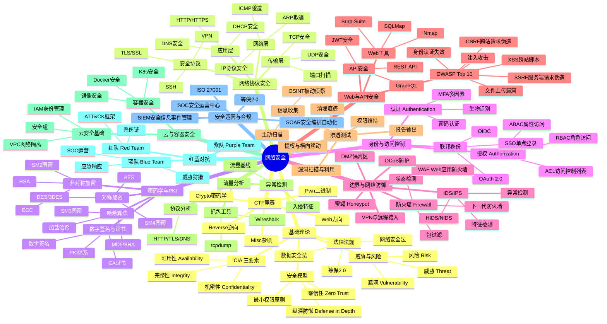
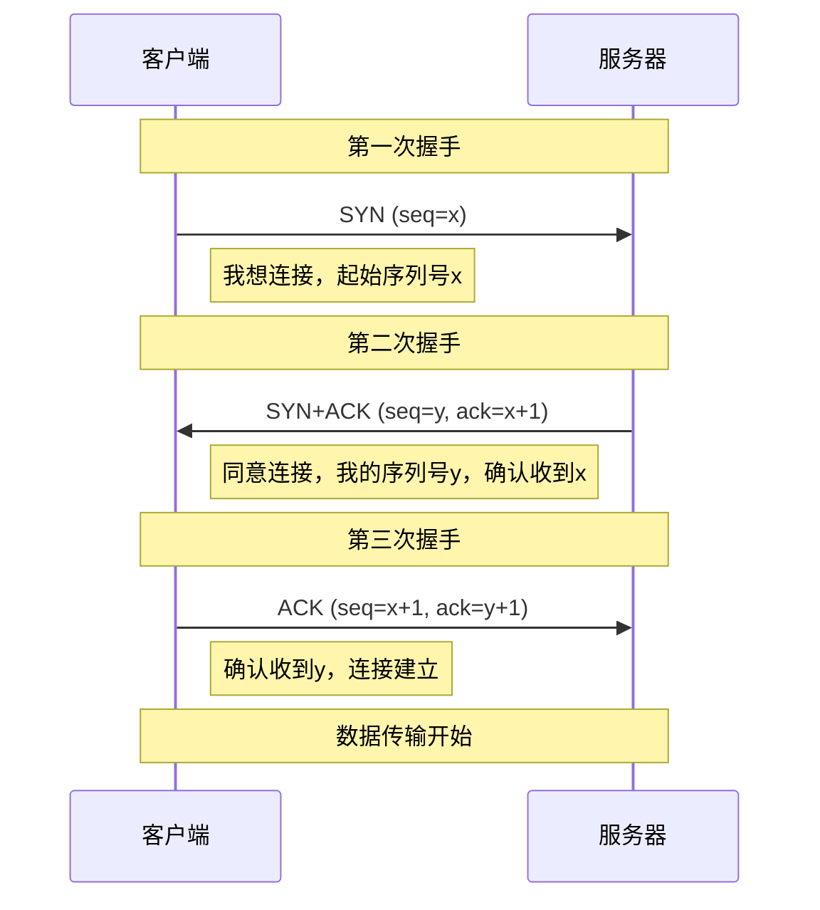
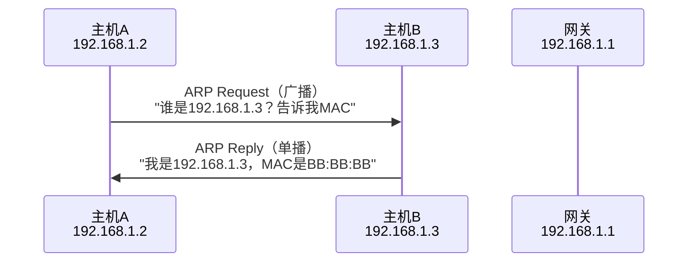
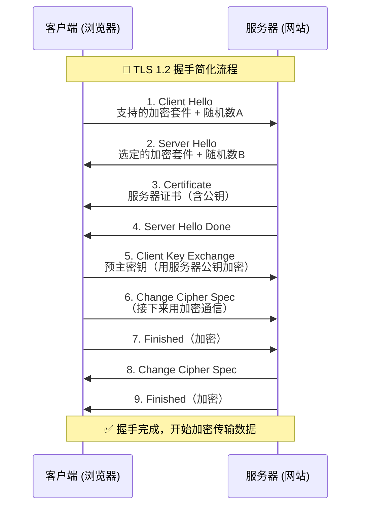
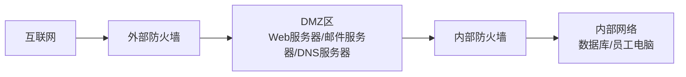
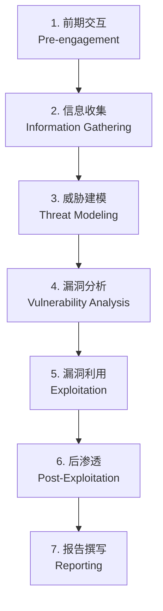
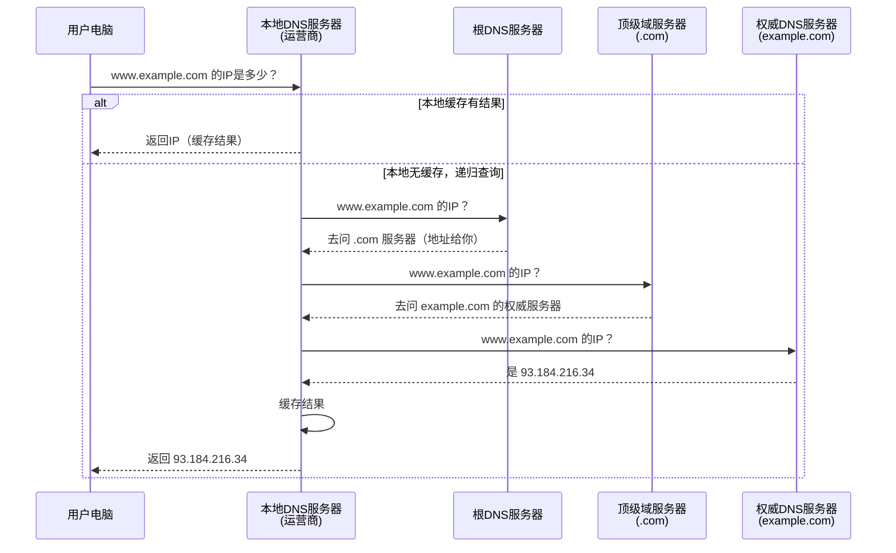
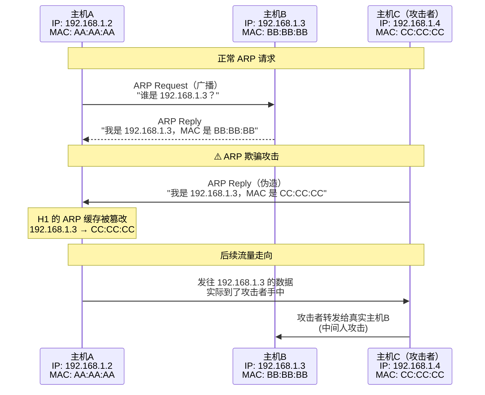

# 🔐 网络安全入门全景指南

> **适用对象**：初学者 | **目标**：全面入门 | **周期**：长期学习
> **最后更新**：2026年9月 | **版本**：v1.0

---

## ⚠️ 合规声明（必读）

> 本指南所有内容**仅用于合法授权的学习、教学、防御研究和 CTF 比赛场景**。
> 严禁利用本文内容对任何未经授权的系统进行攻击、探测或破坏。
> 违反者将承担相应的法律责任。请遵守《网络安全法》、《刑法》第 285/286 条等相关法律法规。
> **记住：能力越大，责任越大。白帽之路，合规为先。** 🛡️

---

## 📋 目录

- [一、网络安全知识地图](#一网络安全知识地图)
- [二、分阶段学习路径](#二分阶段学习路径)
- [三、核心模块详解](#三核心模块详解)
- [四、关键概念对比表](#四关键概念对比表)
- [五、协议交互图解](#五协议交互图解)
- [六、抓包与流量分析入门](#六抓包与流量分析入门)
- [七、常用工具速查](#七常用工具速查)
- [八、实验项目推荐（分级）](#八实验项目推荐分级)
- [九、入门自测题](#九入门自测题)
- [十、学习资源与下一步建议](#十学习资源与下一步建议)

---

## 一、网络安全知识地图



---

## 二、分阶段学习路径

### 📅 总体时间规划（长期）

| 阶段 | 时长 | 目标 | 核心内容 |
|------|------|------|----------|
| **第一阶段：筑基期** | 2-3个月 | 打好计算机与网络基础 | 操作系统、计算机网络、编程基础 |
| **第二阶段：入门期** | 3-4个月 | 建立安全知识体系 | 安全基础、密码学、协议安全、Web安全 |
| **第三阶段：实践期** | 4-6个月 | 掌握工具与实战技能 | 渗透测试、抓包分析、靶场练习 |
| **第四阶段：专精期** | 6个月+ | 选定方向深入发展 | 红队/蓝队/Web/云安全等方向专精 |

---

### 🌱 第一阶段：筑基期（2-3个月）

**目标**：掌握网络安全的底层基础，为后续学习铺路

| 周次 | 模块 | 学习内容 | 产出/验证 |
|------|------|----------|-----------|
| 第1-2周 | 计算机基础 | Windows/Linux 操作系统、文件系统、常用命令 | 能独立使用 Linux 命令行完成日常操作 |
| 第3-4周 | 计算机网络 | OSI七层模型、TCP/IP协议族、HTTP/DNS/ARP | 能说出 TCP 三次握手、DNS 解析流程 |
| 第5-6周 | 编程基础-Python | 变量、循环、函数、文件操作、网络编程 | 写出简单的端口扫描脚本 |
| 第7-8周 | 数据库基础 | SQL 语法、MySQL 基本操作 | 能编写基础的增删改查 SQL |
| 第9-10周 | 密码学入门 | 对称/非对称加密、哈希、数字签名 | 能用 OpenSSL 生成密钥对、签名验证 |
| 第11-12周 | 阶段复盘 | 综合练习 + 知识梳理 | 完成一次阶段自测，正确率达 70%+ |

**📚 配套学习资源**：
- [计算机网络基础](materials/01-计算机与网络基础/02-网络基础/计算机网络基础.md)
- [Linux核心命令](materials/01-计算机与网络基础/01-计算机基础/02-Linux/Linux核心命令参数与案例详解.md)
- [Python编程基础](materials/01-计算机与网络基础/03-编程基础/python/Python编程基础与安全学习资源.md)
- [密码学入门](materials/01-计算机与网络基础/04-数据库与密码学/密码学入门与安全应用.md)

---

### 🚪 第二阶段：入门期（3-4个月）

**目标**：建立完整的网络安全知识框架

| 周次 | 模块 | 学习内容 | 产出/验证 |
|------|------|----------|-----------|
| 第1-3周 | 安全基础理论 | CIA三要素、威胁模型、攻击类型、防御体系 | 能描述常见攻击类型与防御思路 |
| 第4-6周 | 网络协议安全 | ARP欺骗、DNS劫持、TCP安全、TLS握手 | 能用 Wireshark 抓到并分析 ARP/TLS 包 |
| 第7-9周 | 密码学进阶 | PKI体系、TLS握手过程、国密算法 | 能解释 HTTPS 连接建立全过程 |
| 第10-12周 | Web安全基础 | OWASP Top 10、SQL注入、XSS、CSRF | 能在 DVWA 上完成基础 SQL 注入和 XSS |
| 第13-15周 | 边界防御 | 防火墙、IDS/IPS、WAF、VPN | 能配置简单的 iptables 防火墙规则 |
| 第16周 | 阶段复盘 | 综合靶场练习 | 完成一个入门级靶场通关 |

**📚 配套学习资源**：
- [网络安全基础总览](materials/01-计算机与网络基础/02-网络基础/02-网络安全基础/网络安全基础总览.md)
- [网络安全威胁与攻击](materials/01-计算机与网络基础/02-网络基础/02-网络安全基础/网络安全威胁与攻击.md)
- [OWASP Top 10 2025](materials/03-web安全/OWASP-Top10-2025详解.md)
- [防火墙与IDS-IPS入门](study/01-基础网络安全/防火墙与IDS-IPS入门/防火墙与IDS-IPS入门.md)

---

### ⚔️ 第三阶段：实践期（4-6个月）

**目标**：掌握核心工具使用，具备基本实战能力

| 月份 | 模块 | 学习内容 | 产出/验证 |
|------|------|----------|-----------|
| 第1月 | 信息收集与扫描 | Nmap、Masscan、子域名枚举、目录爆破 | 对指定目标完成完整的信息收集报告 |
| 第2月 | Web渗透实战 | Burp Suite使用、SQLMap、XSS平台、文件上传绕过 | 完成 Pikachu/DVWA 全部低级难度 |
| 第3月 | 流量分析 | Wireshark进阶、tcpdump、PCAP分析、异常检测 | 能从给定 PCAP 中找出攻击行为 |
| 第4月 | 系统渗透与提权 | 漏洞利用、Metasploit、Windows/Linux提权 | 完成 Vulhub 若干靶机 |
| 第5月 | 渗透测试全流程 | 渗透测试方法论、报告撰写 | 完成一次完整的授权渗透测试练习 |
| 第6月 | 方向探索 | 尝试 CTF、红蓝对抗、安全运营等方向 | 确定后续专精方向 |

**📚 配套学习资源**：
- [Web安全核心工具实战指南](materials/03-web安全/Web安全核心工具实战指南.md)
- [渗透测试完整指南](study/02-Web应用安全/渗透测试完整指南/渗透测试完整指南.md)
- [网络流量分析与异常检测](study/01-基础网络安全/网络流量分析与异常检测/网络流量分析与异常检测.md)
- [Vulhub靶场详解](materials/03-web安全/靶场/Vulhub靶场详解.md)

---

### 🎯 第四阶段：专精期（6个月+）

根据兴趣和职业规划，选择一个或多个方向深入：

| 方向 | 适合人群 | 核心技能 |
|------|----------|----------|
| **红队/渗透测试** | 喜欢进攻思维、挖漏洞 | 高级渗透、免杀、APT模拟、红队评估 |
| **蓝队/安全运营** | 喜欢防守、分析问题 | 应急响应、威胁狩猎、SIEM、SOC运营 |
| **Web安全** | 对Web应用感兴趣 | 代码审计、高级Web漏洞、WAF绕过 |
| **云安全** | 对云计算感兴趣 | 云架构安全、容器安全、云原生安全 |
| **CTF选手** | 喜欢竞赛、解题 | Web/Pwn/Reverse/Crypto/Misc 全栈 |
| **安全研究** | 喜欢钻研原理 | 漏洞挖掘、0day研究、安全工具开发 |

---

## 三、核心模块详解

### 模块1：网络安全概述

#### 1.1 CIA 三要素——信息安全的基石

> **生活化类比**：想象你把一封信寄给朋友
> - **机密性**：只有你和朋友能看懂信的内容（信封+加密）
> - **完整性**：信在途中没有被人修改或撕掉一页（封蜡/骑缝章）
> - **可用性**：朋友随时能找到并阅读这封信（放在安全且方便取用的地方）

| 要素 | 英文 | 定义 | 常见威胁 | 防御措施 |
|------|------|------|----------|----------|
| 机密性 | Confidentiality | 确保信息不被未授权者获取 | 窃听、数据泄露、暴力破解 | 加密、访问控制、脱敏 |
| 完整性 | Integrity | 确保信息在传输/存储中不被篡改 | 篡改、中间人攻击、重放攻击 | 哈希校验、数字签名、MAC |
| 可用性 | Availability | 确保授权用户能正常访问系统 | DDoS、勒索软件、硬件故障 | 冗余、备份、DDoS防护 |

#### 1.2 关键概念辨析

- **威胁（Threat）**：可能造成危害的潜在因素，比如"黑客"、"病毒"、"地震"
- **漏洞（Vulnerability）**：系统本身的弱点，比如"弱密码"、"未打补丁"
- **风险（Risk）**：威胁利用漏洞造成损失的可能性和影响程度
  - **公式**：风险 = 威胁 × 漏洞 × 影响

> **类比**：威胁就像"小偷"，漏洞就像"没锁的门"，风险就是"小偷偷走东西的可能性和损失大小"。

#### 1.3 安全原则

| 原则 | 说明 |
|------|------|
| **最小权限原则** | 用户/程序只拥有完成任务所需的最小权限 |
| **纵深防御** | 多层防护，一层被攻破还有下一层（城墙+护城河+卫兵） |
| **零信任** | 永不信任，始终验证（不信任内网的任何人） |
| **安全左移** | 在软件开发早期就考虑安全问题 |
| **默认安全** | 系统默认配置就是最安全的状态 |

---

### 模块2：网络协议安全

#### 2.1 TCP/IP 协议栈与安全问题

| 层级 | 协议 | 默认端口 | 安全问题 |
|------|------|----------|----------|
| 应用层 | HTTP | 80 | 明文传输、Cookie劫持、XSS、CSRF |
| 应用层 | HTTPS | 443 | 证书伪造、SSL剥离、弱加密套件 |
| 应用层 | DNS | 53(UDP) | DNS劫持、DNS污染、DNS隧道 |
| 应用层 | FTP | 20/21 | 明文密码、匿名访问、端口跳转 |
| 应用层 | SSH | 22 | 暴力破解、弱密钥、版本漏洞 |
| 传输层 | TCP | - | SYN洪水、端口扫描、会话劫持 |
| 传输层 | UDP | - | UDP洪水、放大攻击 |
| 网络层 | IP/ICMP | - | IP欺骗、Smurf攻击、Ping of Death |
| 链路层 | ARP | - | ARP欺骗、中间人攻击 |

#### 2.2 TCP 三次握手安全问题



**⚠️ 安全问题：SYN Flood 攻击**
- 攻击者发送大量 SYN 包但不回应 ACK
- 服务器半连接队列被占满，无法处理正常请求
- **防御**：SYN Cookie、增大半连接队列、防火墙限速

#### 2.3 ARP 协议安全

**ARP（Address Resolution Protocol）**：IP地址 → MAC地址的转换协议



**⚠️ ARP 欺骗（ARP Spoofing）**
- 原理：ARP 协议**没有认证机制**，谁先回应就信谁
- 攻击：攻击者发送伪造的 ARP 响应，让受害者把流量发给自己
- 后果：中间人攻击（窃听、篡改流量）
- **防御**：静态 ARP 绑定、DAI（动态 ARP 检测）、ARP 防火墙

---

### 模块3：密码学与 PKI

#### 3.1 对称加密 vs 非对称加密

| 特性 | 对称加密 | 非对称加密 |
|------|----------|------------|
| 密钥数量 | 同一个密钥（加密解密用同一把） | 一对密钥（公钥+私钥） |
| 速度 | 快（适合大数据） | 慢（适合小数据） |
| 典型算法 | AES、DES、3DES、SM4 | RSA、ECC、SM2 |
| 密钥分发 | 困难（怎么安全地把密钥给对方？） | 容易（公钥可以公开） |
| 用途 | 加密大量数据 | 密钥交换、数字签名 |
| 类比 | 保险柜的钥匙（同一把开和锁） | 信箱（任何人都能投信，只有主人能取） |

> **生活化类比**：
> - **对称加密**就像一把锁有两把相同的钥匙，你和朋友各一把。但问题是——你怎么安全地把第二把钥匙交给朋友？
> - **非对称加密**就像一个邮筒，任何人都能把信塞进去（公钥加密），但只有邮筒主人有钥匙能打开（私钥解密）。

#### 3.2 哈希（Hash）——不是加密！

**重要提醒**：哈希 ≠ 加密。加密是可逆的，哈希是**不可逆**的。

| 特性 | 说明 |
|------|------|
| 单向性 | 无法从哈希值反推原始数据 |
| 定长输出 | 无论输入多长，输出长度固定 |
| 抗碰撞性 | 不同输入很难得到相同输出 |
| 雪崩效应 | 输入微小变化，输出完全不同 |

**常见哈希算法**：
- MD5（128位）—— 已不安全，碰撞可构造
- SHA-1（160位）—— 已不安全，不推荐使用
- SHA-256/SHA-512 —— 当前安全标准
- SM3（国密）—— 中国国家标准，256位

**用途**：密码存储（加盐）、文件完整性校验、数字签名、区块链

> **类比**：哈希就像"指纹"——每个人的指纹都是唯一的（理论上），你可以通过指纹识别人，但你不能通过指纹还原整张脸。

#### 3.3 TLS 握手过程（HTTPS 的核心）

> **生活化类比**：TLS 握手就像两个人通过信件建立安全通信：
> 1. 你说"你好，我支持这些加密方式"
> 2. 对方回信"好的，我们用这种加密，这是我的身份证（证书）"
> 3. 你验证身份证是公安局（CA）发的，没问题
> 4. 你生成一个"会话密钥"，用对方的公钥加密后发过去
> 5. 对方用私钥解密得到会话密钥
> 6. 之后双方都用这个会话密钥加密通信（对称加密，速度快）



---

### 模块4：身份与访问控制

#### 4.1 认证 vs 授权（易混淆！）

| 概念 | 英文 | 回答的问题 | 例子 |
|------|------|------------|------|
| **认证** | Authentication | **你是谁？** | 输入用户名密码登录、刷脸、刷身份证 |
| **授权** | Authorization | **你能做什么？** | 普通用户只能看，管理员可以改配置 |

> **类比**：去公司上班
> - **认证** = 刷卡进门，证明你是公司员工
> - **授权** = 你的工卡只能进你所在楼层，进不了机房和老板办公室

#### 4.2 常见认证方式

| 方式 | 说明 | 安全性 |
|------|------|--------|
| 密码认证 | 用户名+密码 | ⭐⭐ 弱（易被暴力破解、钓鱼） |
| 多因素认证 MFA | 密码+手机验证码/令牌/指纹 | ⭐⭐⭐⭐ 强 |
| 数字证书 | USB Key / 客户端证书 | ⭐⭐⭐⭐⭐ 很强 |
| 生物识别 | 指纹、人脸、虹膜 | ⭐⭐⭐ 中（难以撤销） |
| SSO 单点登录 | 一次登录，多处访问 | ⭐⭐⭐⭐ 取决于实现 |

#### 4.3 访问控制模型

| 模型 | 全称 | 说明 | 适用场景 |
|------|------|------|----------|
| **DAC** | 自主访问控制 | 资源所有者决定谁能访问 | Linux 文件权限 |
| **MAC** | 强制访问控制 | 系统强制分配安全级别，不可更改 | 军事、高安全系统 |
| **RBAC** | 基于角色的访问控制 | 按角色分配权限（用户→角色→权限） | 企业系统，最常用 |
| **ABAC** | 基于属性的访问控制 | 根据用户/资源/环境属性动态决策 | 零信任、云环境 |

---

### 模块5：边界与网络防御

#### 5.1 防火墙（Firewall）

**工作层级**：网络层 / 传输层（部分工作在应用层）

**类型**：
| 类型 | 说明 | 例子 |
|------|------|------|
| 包过滤防火墙 | 检查每个数据包的源/目IP、端口 | 路由器 ACL |
| 状态检测防火墙 | 跟踪连接状态，只放行合法响应 | iptables、硬件防火墙 |
| 下一代防火墙 NGFW | 集成应用识别、IPS、用户识别 | Palo Alto、深信服 |

**常见配置示例（iptables）**：
```bash
# 允许已建立的连接通过
iptables -A INPUT -m state --state ESTABLISHED,RELATED -j ACCEPT

# 允许 SSH（22端口）
iptables -A INPUT -p tcp --dport 22 -j ACCEPT

# 允许 HTTP/HTTPS
iptables -A INPUT -p tcp --dport 80 -j ACCEPT
iptables -A INPUT -p tcp --dport 443 -j ACCEPT

# 默认拒绝所有入站
iptables -P INPUT DROP
```

#### 5.2 IDS vs IPS vs WAF（重点辨析！）

| 特性 | IDS 入侵检测系统 | IPS 入侵防御系统 | WAF Web应用防火墙 |
|------|-----------------|-----------------|-------------------|
| **位置** | 旁路监听（镜像流量） | 串接在线路上 | 部署在 Web 服务器前 |
| **作用** | 检测并告警 | 检测并阻断 | 防护 Web 应用攻击 |
| **工作层** | 网络层为主 | 网络层+应用层 | 应用层（HTTP/HTTPS） |
| **能否阻断** | ❌ 不能，只报警 | ✅ 能，实时阻断 | ✅ 能，阻断攻击请求 |
| **检测方式** | 特征匹配+异常检测 | 同IDS | 特征规则+语义分析 |
| **防护对象** | 整个网络 | 整个网络 | Web应用（SQL注入、XSS等） |
| **类比** | 小区保安巡逻，发现可疑就报警 | 小区门禁，坏人直接不让进 | 公司前台，专门检查进公司的人 |

#### 5.3 DMZ（隔离区）



**为什么需要 DMZ？**
- 对外服务的服务器（Web、邮件）放在 DMZ，即使被攻破也不会直接影响内网
- 两层防火墙，实现纵深防御
- 外网只能访问 DMZ 的指定端口，不能直接访问内网

---

### 模块6：流量分析与抓包

#### 6.1 Wireshark 入门

**常用过滤表达式**：

| 需求 | 过滤表达式 |
|------|------------|
| 只看 HTTP 流量 | `http` |
| 只看 DNS 流量 | `dns` |
| 只看某个 IP 的流量 | `ip.addr == 192.168.1.100` |
| 只看源 IP | `ip.src == 192.168.1.100` |
| 只看目的 IP | `ip.dst == 192.168.1.100` |
| 只看某个端口 | `tcp.port == 80` 或 `tcp.dstport == 80` |
| HTTP GET 请求 | `http.request.method == "GET"` |
| TCP 三次握手的 SYN 包 | `tcp.flags.syn == 1` |
| 排除 ARP 包 | `!arp` |
| 组合条件（AND） | `ip.addr == 192.168.1.100 && http` |
| 组合条件（OR） | `tcp.port == 80 || tcp.port == 443` |

#### 6.2 tcpdump 常用命令

```bash
# 抓取所有网卡的流量
tcpdump -i any

# 抓取指定网卡的流量
tcpdump -i eth0

# 只抓80端口的流量
tcpdump -i eth0 port 80

# 抓包并保存到文件
tcpdump -i eth0 -w capture.pcap

# 读取 pcap 文件
tcpdump -r capture.pcap

# 显示详细信息（-vv 更详细）
tcpdump -i eth0 -v port 80

# 抓前100个包
tcpdump -i eth0 -c 100

# 只抓 SYN 包
tcpdump -i eth0 'tcp[tcpflags] & tcp-syn != 0'
```

#### 6.3 PCAP 分析要点

分析一个 PCAP 文件的基本思路：
1. **宏观概览**：总流量、协议分布、主要会话
2. **HTTP 分析**：请求方法、URL、状态码、Cookie、User-Agent
3. **DNS 分析**：查询的域名、是否有异常域名（C2通信）
4. **TCP 分析**：端口扫描特征（大量 SYN 无响应）、异常端口
5. **异常检测**：大量 ICMP 包、非常规端口、可疑字符串

---

### 模块7：Web 与 API 安全

#### 7.1 OWASP Top 10 2025 速览

| 排名 | 漏洞类型 | 说明 | 严重程度 |
|------|----------|------|----------|
| 1 | 失效的访问控制 | 用户越权访问他人数据 | 🔴 高危 |
| 2 | 加密机制失效 | 敏感数据明文传输/存储 | 🔴 高危 |
| 3 | 注入攻击 | SQL注入、命令注入等 | 🔴 高危 |
| 4 | 不安全设计 | 架构层面的安全缺陷 | 🟠 中高 |
| 5 | 安全配置错误 | 默认配置、错误配置 | 🟠 中高 |
| 6 | 易受攻击和过时的组件 | 使用有漏洞的第三方库 | 🟠 中高 |
| 7 | 身份认证失效 | 密码弱、会话管理不当 | 🔴 高危 |
| 8 | 软件和数据完整性失效 | 不受信任的更新、CI/CD 风险 | 🟠 中高 |
| 9 | 安全日志和监控失效 | 攻击无法被及时发现 | 🟡 中危 |
| 10 | 服务端请求伪造 SSRF | 服务器被利用发起内网请求 | 🟠 中高 |

#### 7.2 SQL 注入——Web 安全第一课

**原理**：用户输入被拼接到 SQL 语句中，改变了原本的查询逻辑

**最简单的例子**：
```
# 正常登录 SQL
SELECT * FROM users WHERE username='admin' AND password='123456'

# 攻击者输入密码：' OR '1'='1
SELECT * FROM users WHERE username='admin' AND password='' OR '1'='1'
# 条件永远为真，登录成功！
```

**防御措施**：
1. ✅ **预编译语句（PreparedStatement）**——最有效
2. ✅ 输入校验和过滤
3. ✅ 最小权限原则（数据库账号不给 DBA 权限）
4. ❌ 黑名单过滤——容易被绕过

#### 7.3 XSS 跨站脚本攻击

**原理**：攻击者在网页中注入恶意脚本，其他用户访问时脚本在浏览器执行

**三种类型**：
| 类型 | 特点 | 例子 |
|------|------|------|
| 存储型 XSS | 恶意脚本存入数据库，所有访问者中招 | 论坛发帖、评论区 |
| 反射型 XSS | 脚本在URL中，需要诱导用户点击 | 搜索框、错误页面 |
| DOM型 XSS | 纯前端触发，不经过服务器 | URL hash 参数 |

**防御措施**：
1. ✅ 输出编码/转义（HTML实体编码）
2. ✅ CSP（内容安全策略）
3. ✅ HttpOnly Cookie（防止窃取 Cookie）
4. ✅ 输入过滤（白名单优于黑名单）

#### 7.4 XSS vs CSRF（易混淆！）

| 特性 | XSS 跨站脚本 | CSRF 跨站请求伪造 |
|------|-------------|-------------------|
| **原理** | 注入脚本在用户浏览器执行 | 利用用户已登录的身份发起请求 |
| **需要JS** | 是（核心就是脚本执行） | 不一定（img/form也能发起） |
| **能做什么** | 窃取Cookie、篡改页面、钓鱼 | 以用户身份执行操作（转账、改密码） |
| **关键点** | 注入恶意脚本 | 利用用户的登录状态 |
| **类比** | 骗子在公告栏贴了假通知，谁看谁上当 | 骗子利用你的身份证复印件去办事 |

---

### 模块8：渗透测试基础

#### 8.1 渗透测试标准流程



#### 8.2 信息收集（Reconnaissance）

**被动信息收集（不接触目标）**：
- WHOIS 查询（域名注册信息）
- 子域名枚举（Google Hacking、证书透明度）
- 员工信息收集（LinkedIn、社交网络）
- 历史漏洞查询（CVE、乌云镜像）

**主动信息收集（接触目标）**：
- 端口扫描（Nmap）
- 服务识别（版本探测）
- 目录扫描（Dirb、Gobuster）
- 指纹识别（CMS、中间件版本）

**Nmap 常用命令**：
```bash
# 基础扫描
nmap 192.168.1.1

# 指定端口扫描
nmap -p 22,80,443 192.168.1.1

# 全端口扫描
nmap -p- 192.168.1.1

# 服务版本探测
nmap -sV 192.168.1.1

# 操作系统探测
nmap -O 192.168.1.1

# 脚本扫描（漏洞探测）
nmap --script=vuln 192.168.1.1

# 快速扫描
nmap -T4 -F 192.168.1.1

# 保存输出到文件
nmap -oN scan_result.txt 192.168.1.1
```

---

### 模块9：红蓝对抗与应急响应

#### 9.1 攻击链（Kill Chain）

| 阶段 | 英文 | 说明 |
|------|------|------|
| 1. 侦察 | Reconnaissance | 收集目标信息 |
| 2. 武器化 | Weaponization | 制作攻击载荷（木马、漏洞利用代码） |
| 3. 投递 | Delivery | 将攻击载荷发送给目标（邮件、U盘、网站） |
| 4. 利用 | Exploitation | 触发漏洞，执行攻击代码 |
| 5. 安装 | Installation | 安装后门、木马，实现持久化 |
| 6. 命令与控制 | C2 / Command & Control | 建立攻击者与被控主机的通信通道 |
| 7. 目标行动 | Actions on Objectives | 窃取数据、破坏系统、横向移动等 |

#### 9.2 ATT&CK 框架

MITRE ATT&CK（Adversarial Tactics, Techniques, and Common Knowledge）是一个全球共享的攻击行为知识库。

**战术（Tactics）**：侦察、资源开发、初始访问、执行、持久化、权限提升、防御绕过、凭据访问、发现、横向移动、收集、命令与控制、数据渗出、影响

**类比**：ATT&CK 就像一本"犯罪分子作案手法大全"，警察（蓝队）可以对照着检查自己的防范措施够不够。

#### 9.3 应急响应基本流程

| 阶段 | 动作 | 目的 |
|------|------|------|
| **准备** | 建立应急团队、制定预案、准备工具 | 未雨绸缪 |
| **检测** | 监控告警、日志分析、异常发现 | 发现攻击 |
| **遏制** | 断网、隔离、冻结账户 | 防止扩散 |
| **根除** | 清除后门、修复漏洞、查杀病毒 | 彻底清除 |
| **恢复** | 恢复系统、验证安全、恢复服务 | 恢复正常 |
| **总结** | 复盘分析、改进措施、报告输出 | 吃一堑长一智 |

---

### 模块10：云与容器安全（入门）

#### 10.1 云安全责任共担模型

| 服务模式 | 云厂商负责 | 客户负责 |
|----------|-----------|----------|
| **IaaS**（阿里云ECS、AWS EC2） | 基础设施、物理安全、虚拟化 | 操作系统、应用、数据、访问控制 |
| **PaaS**（函数计算、数据库） | 基础设施+操作系统+中间件 | 应用代码、数据、访问配置 |
| **SaaS**（邮箱、钉钉、企业微信） | 全部基础设施和应用 | 数据、账号、权限配置 |

> **类比**：
> - IaaS = 租毛坯房，装修家具自己搞
> - PaaS = 租精装修房，带家具家电，你只要带行李入住
> - SaaS = 住酒店，什么都有，你只要付钱入住

#### 10.2 容器安全要点

- **镜像安全**：使用可信镜像、定期扫描漏洞、最小化镜像
- **运行时安全**：容器最小权限、不使用 root 运行、资源限制
- **编排安全**：K8s RBAC、Secret 管理、网络策略

---

## 四、关键概念对比表

### 表1：加密 vs 哈希 vs 编码

| 特性 | 加密 Encryption | 哈希 Hash | 编码 Encoding |
|------|----------------|-----------|---------------|
| 目的 | 保密（不让别人看懂） | 完整性校验、指纹 | 格式转换（方便传输） |
| 可逆性 | ✅ 可逆（有密钥就能解密） | ❌ 不可逆 | ✅ 可逆（解码即可） |
| 密钥 | 需要密钥 | 不需要密钥 | 不需要密钥 |
| 常见算法 | AES、RSA、SM2/SM4 | MD5、SHA-256、SM3 | Base64、URL编码、Hex |
| 例子 | HTTPS加密传输、加密压缩包 | 密码存储、文件校验、区块链 | 图片转Base64、URL参数编码 |
| 常见误区 | ❌ "MD5加密"——MD5是哈希不是加密 | ❌ 用哈希保护密码但不加盐 | ❌ 把Base64当加密用 |

### 表2：认证 vs 授权 vs 审计

| 概念 | 英文 | 核心问题 | 例子 |
|------|------|----------|------|
| 认证 | Authentication | 你是谁？ | 登录、刷脸 |
| 授权 | Authorization | 你能做什么？ | 权限控制、角色管理 |
| 审计 | Auditing / Accounting | 你做了什么？ | 操作日志、登录记录 |

> 合称 **AAA**（Authentication, Authorization, Accounting）

### 表3：防火墙 vs WAF vs IDS/IPS

| 特性 | 防火墙 Firewall | WAF Web应用防火墙 | IDS 入侵检测 | IPS 入侵防御 |
|------|----------------|-------------------|-------------|-------------|
| **主要防护** | 网络层/传输层访问控制 | Web应用层攻击 | 检测入侵行为 | 检测并阻断入侵 |
| **工作层级** | 3-4层 | 7层（应用层） | 3-7层 | 3-7层 |
| **部署方式** | 串接 | 串接/反向代理 | 旁路（镜像） | 串接 |
| **能否阻断** | ✅ 按规则放行/阻断 | ✅ 阻断攻击请求 | ❌ 只告警 | ✅ 实时阻断 |
| **典型规则** | IP+端口 | SQL注入、XSS特征 | 攻击特征码 | 攻击特征码 |
| **类比** | 小区大门保安（看脸放行） | 公司前台（检查包裹内容） | 监控室保安（看到异常喊人） | 保安队长（看到坏人直接拿下） |

### 表4：VPN vs 零信任

| 特性 | VPN 虚拟专用网络 | 零信任 Zero Trust |
|------|-----------------|-------------------|
| **核心思想** | 接入VPN = 进入内网 = 信任 | 永不信任，始终验证 |
| **网络视角** | 边界安全模型（内外网有别） | 无边界安全模型（内外网都不可信） |
| **访问粒度** | 粗粒度（连入后可访问整个内网） | 细粒度（按人/应用/权限逐一验证） |
| **适用场景** | 远程办公接入内网 | 现代企业、多云环境、远程办公 |
| **类比** | 进入公司大门就可以到处走 | 每个房间都要刷卡验证身份 |

### 表5：HTTP vs HTTPS

| 特性 | HTTP | HTTPS |
|------|------|-------|
| 端口 | 80 | 443 |
| 安全性 | 明文传输，不安全 | TLS加密传输，安全 |
| 速度 | 快 | 稍慢（握手开销） |
| 证书 | 不需要 | 需要CA颁发的SSL证书 |
| 协议 | 应用层协议 | HTTP + TLS/SSL |
| 风险 | 窃听、篡改、劫持 | 证书伪造、降级攻击、弱加密 |

---

## 五、协议交互图解

### 5.1 DNS 域名解析过程



**DNS 安全问题**：
- **DNS 劫持**：篡改 DNS 解析结果，把用户引导到钓鱼网站
- **DNS 污染**：向 DNS 查询返回伪造的响应
- **DNS 隧道**：利用 DNS 协议传输其他数据（绕过防火墙）
- **防御**：DNSSEC（DNS安全扩展）、DoH/DoT（加密DNS）

---

### 5.2 ARP 请求与响应



---

## 六、抓包与流量分析入门

### 6.1 Wireshark 快速上手

**安装**：官网下载安装包，Windows/Linux/macOS 均支持

**第一次抓包步骤**：
1. 打开 Wireshark
2. 选择要抓包的网卡（以太网/Wi-Fi）
3. 点击鲨鱼鳍图标开始抓包
4. 做一些操作（访问网站、ping 等）
5. 点击红色方块停止抓包
6. 在过滤器中输入表达式分析

### 6.2 实战练习：抓一个 HTTP 请求

```
1. 打开 Wireshark，选择网卡，开始抓包
2. 浏览器访问 http://example.com（注意是 http，不是 https）
3. 停止抓包
4. 过滤器输入：http
5. 找到 GET / HTTP/1.1 的请求包
6. 右键 → Follow → HTTP Stream，查看完整请求和响应
```

### 6.3 实战练习：抓 TCP 三次握手

```
1. 开始抓包
2. 浏览器访问任意网站
3. 停止抓包
4. 过滤器输入：tcp.flags.syn == 1
5. 找到一个 SYN 包，右键 → Follow → TCP Stream
6. 观察前三个包：SYN → SYN+ACK → ACK
```

### 6.4 常见攻击的流量特征

| 攻击类型 | 流量特征 |
|----------|----------|
| **端口扫描** | 大量 SYN 包发往不同端口，多数无响应 |
| **ARP 欺骗** | 同一 IP 对应多个 MAC 地址 |
| **SQL 注入** | HTTP 请求中包含 `' OR 1=1--`、`UNION SELECT` 等特征 |
| **XSS** | HTTP 请求中包含 `<script>`、`javascript:` 等 |
| **DDoS** | 大量来源IP的请求涌向目标，流量异常大 |
| **DNS 隧道** | DNS 查询的子域名特别长，包含可疑字符 |

---

## 七、常用工具速查

### 7.1 信息收集类

| 工具 | 用途 | 平台 |
|------|------|------|
| **Nmap** | 端口扫描、服务识别、漏洞探测 | Linux/Windows/Mac |
| **Masscan** | 高速端口扫描（全网段几分钟扫完） | Linux |
| **Dig / nslookup** | DNS 查询 | Linux/Windows |
| **Whois** | 域名注册信息查询 | 命令行/在线 |
| **Shodan** | 搜索引擎，搜索联网设备 | 在线 |
| **FOFA** | 网络空间资产搜索（国内） | 在线 |

### 7.2 Web 安全类

| 工具 | 用途 | 平台 |
|------|------|------|
| **Burp Suite** | Web 渗透测试神器（抓包、改包、扫描） | 全平台 |
| **SQLMap** | 自动化 SQL 注入工具 | Linux/Windows |
| **Dirb / Gobuster** | 目录爆破 | Linux |
| **Xray** | 被动/主动漏洞扫描器 | 全平台 |
| **AWVS** | Web 漏洞扫描器 | Windows/Linux |

### 7.3 抓包分析类

| 工具 | 用途 | 平台 |
|------|------|------|
| **Wireshark** | 图形化抓包分析工具 | 全平台 |
| **tcpdump** | 命令行抓包工具 | Linux/Unix |
| **Fiddler** | HTTP/HTTPS 抓包调试工具 | Windows（跨平台有Fiddler Everywhere） |
| **Charles** | HTTP/HTTPS 代理抓包 | Mac/Windows |

### 7.4 漏洞利用类

| 工具 | 用途 | 平台 |
|------|------|------|
| **Metasploit** | 渗透测试框架（漏洞利用、后渗透） | Linux/Windows |
| **Cobalt Strike** | 红队协作工具（商业软件） | 全平台 |
| **MSFvenom** | 生成各种格式的 Shellcode | Linux |

### 7.5 密码破解类

| 工具 | 用途 |
|------|------|
| **Hydra** | 网络服务暴力破解（SSH/FTP/HTTP等） |
| **John the Ripper** | 密码哈希破解 |
| **Hashcat** | GPU 加速密码破解 |

---

## 八、实验项目推荐（分级）

### 🌱 入门级（第1-3个月）

| 项目 | 难度 | 所需工具 | 学习目标 |
|------|------|----------|----------|
| Linux 命令行练习 | ⭐ | Linux 虚拟机 | 熟练使用 50+ 常用命令 |
| Wireshark 抓包分析 | ⭐ | Wireshark | 抓 HTTP/DNS/TCP 包并分析 |
| 搭建 DVWA 靶场 | ⭐⭐ | Docker / XAMPP | 学会搭建靶场环境 |
| DVWA 低级难度通关 | ⭐⭐ | Burp Suite + DVWA | 了解常见 Web 漏洞原理 |
| Nmap 端口扫描练习 | ⭐ | Nmap | 掌握各种扫描参数 |
| 配置 iptables 防火墙 | ⭐⭐ | Linux | 理解防火墙工作原理 |

### 📗 进阶级（第4-6个月）

| 项目 | 难度 | 所需工具 | 学习目标 |
|------|------|----------|----------|
| Pikachu 靶场全通关 | ⭐⭐⭐ | Burp Suite + Pikachu | 掌握各种 Web 漏洞利用 |
| Vulhub 10 个靶机 | ⭐⭐⭐ | Docker + Vulhub | 了解真实漏洞利用流程 |
| SQLMap 自动化注入 | ⭐⭐ | SQLMap | 掌握自动化注入工具使用 |
| 从 PCAP 中找攻击行为 | ⭐⭐⭐ | Wireshark | 提升流量分析能力 |
| 编写 Python 端口扫描器 | ⭐⭐⭐ | Python | 编程+安全结合 |
| ARP 欺骗实验（授权环境） | ⭐⭐⭐ | Ettercap / scapy | 理解中间人攻击原理 |

### ⚔️ 高级（第6个月+）

| 项目 | 难度 | 所需工具 | 学习目标 |
|------|------|----------|----------|
| CTF Web 方向刷题 50 道 | ⭐⭐⭐⭐ | 各种工具 | 提升综合解题能力 |
| 红队渗透全流程演练 | ⭐⭐⭐⭐⭐ | 整套工具链 | 完整渗透测试能力 |
| 应急响应演练 | ⭐⭐⭐⭐ | 日志分析工具 | 提升蓝队能力 |
| 代码审计实战 | ⭐⭐⭐⭐ | 代码审计工具 | 白盒测试能力 |

### 🎯 推荐靶场平台

| 平台 | 类型 | 特点 | 地址 |
|------|------|------|------|
| **DVWA** | Web入门 | PHP编写，难度可调，适合新手 | 本地搭建 |
| **Pikachu** | Web入门 | 国内项目，中文友好，漏洞类型全 | 本地搭建 |
| **Vulhub** | 综合靶场 | Docker一键启动，真实漏洞 | vulhub.org |
| **Bugku** | CTF入门 | 国内平台，题目多，适合新手 | bugku.com |
| **攻防世界** | CTF |  XCTF联赛官方平台 | adworld.xctf.org.cn |
| **Hack The Box** | 综合实战 | 国外知名平台，质量高 | hackthebox.com |
| **TryHackMe** | 入门教学 | 房间式学习，手把手教 | tryhackme.com |

---

## 九、入门自测题

### 选择题（初级）

**1. CIA 三要素不包括以下哪一项？**
- A. 机密性（Confidentiality）
- B. 完整性（Integrity）
- C. 可用性（Availability）
- D. 可追溯性（Accountability）

<details>
<summary>📝 点击查看答案</summary>
**答案：D**

CIA 三要素是机密性（Confidentiality）、完整性（Integrity）、可用性（Availability）。可追溯性（Accountability）是 AAA 中的 Accounting，不是 CIA 三要素。
</details>

---

**2. 以下哪个协议默认使用 UDP 端口 53？**
- A. HTTP
- B. DNS
- C. FTP
- D. SSH

<details>
<summary>📝 点击查看答案</summary>
**答案：B**

DNS 默认使用 UDP 53 端口进行查询。HTTP 是 TCP 80，FTP 是 TCP 20/21，SSH 是 TCP 22。
</details>

---

**3. 关于哈希算法，以下说法正确的是？**
- A. 哈希是一种加密算法，可以解密还原原始数据
- B. MD5 是目前最安全的哈希算法
- C. 哈希算法是单向的，不可逆
- D. 相同长度的输入，哈希值长度也相同；不同长度的输入，哈希值长度不同

<details>
<summary>📝 点击查看答案</summary>
**答案：C**

哈希算法是单向的、不可逆的，不能从哈希值还原原始数据。
- A 错误：哈希不是加密，加密可逆，哈希不可逆
- B 错误：MD5 已被破解，不安全，推荐 SHA-256 或更高
- D 错误：无论输入多长，同一哈希算法的输出长度固定（如 SHA-256 总是 256 位）
</details>

---

**4. IDS 和 IPS 的主要区别是什么？**
- A. IDS 工作在网络层，IPS 工作在应用层
- B. IDS 只能检测告警，IPS 可以实时阻断
- C. IDS 是硬件设备，IPS 是软件
- D. IDS 防护 Web 攻击，IPS 防护网络攻击

<details>
<summary>📝 点击查看答案</summary>
**答案：B**

IDS（入侵检测系统）只能检测并发出告警，不能主动阻断攻击；IPS（入侵防御系统）部署在链路上，可以实时检测并阻断攻击。
</details>

---

**5. SQL 注入的最佳防御方式是？**
- A. 过滤掉单引号
- B. 使用预编译语句（PreparedStatement）
- C. 把用户输入转成全大写
- D. 限制用户输入长度

<details>
<summary>📝 点击查看答案</summary>
**答案：B**

预编译语句（参数化查询）是防御 SQL 注入的最佳方式，因为 SQL 结构和数据分离，用户输入永远被当作数据处理，不会改变 SQL 逻辑。
- A 错误：黑名单过滤可以被绕过（如双写、编码绕过）
- C 错误：完全不相关
- D 错误：长度限制可以被绕过，且不是根本解决办法
</details>

---

### 简答题

**1. 请简述 TCP 三次握手的过程，并说明为什么需要三次而不是两次？**

<details>
<summary>📝 点击查看参考答案</summary>
**TCP 三次握手过程：**

第一次握手：客户端发送 SYN 包（seq=x），进入 SYN_SENT 状态
第二次握手：服务器收到 SYN，回复 SYN+ACK 包（seq=y, ack=x+1），进入 SYN_RCVD 状态
第三次握手：客户端收到 SYN+ACK，回复 ACK 包（seq=x+1, ack=y+1），双方进入 ESTABLISHED 状态

**为什么需要三次而不是两次？**

主要是为了**防止已失效的连接请求报文段突然又传到了服务器，导致服务器错误地建立连接**。

想象一下：客户端发了一个 SYN 包，因为网络拥堵没有及时到达，客户端超时重发了一个新的 SYN，第二次成功建立了连接。等连接释放后，第一个迟到的 SYN 才到达服务器。
- 如果只有两次握手，服务器收到这个迟到的 SYN 就会建立连接，一直等客户端发数据，浪费资源
- 三次握手机制下，客户端收到服务器的 SYN+ACK 后，发现这个序列号不是自己期望的，就会丢弃，不回复 ACK，服务器收不到 ACK 就不会建立连接
</details>

---

**2. 请解释什么是 XSS 和 CSRF，它们有什么区别？**

<details>
<summary>📝 点击查看参考答案</summary>
**XSS（跨站脚本攻击）**：攻击者在网页中注入恶意 JavaScript 代码，当其他用户访问该页面时，脚本在用户浏览器中执行，从而窃取 Cookie、篡改页面、钓鱼等。

**CSRF（跨站请求伪造）**：攻击者诱导已登录的用户访问恶意网站，恶意网站向目标网站发起请求，利用用户的登录状态，以用户的身份执行操作（如转账、改密码）。

**主要区别：**

| 特性 | XSS | CSRF |
|------|-----|------|
| 核心 | 注入脚本执行 | 利用用户登录状态发起请求 |
| 是否需要JS | 是 | 不一定（img/form也能发起） |
| 攻击目标 | 用户浏览器/数据 | 服务器端操作 |
| 攻击者能做什么 | 窃取Cookie、篡改页面、执行任意JS | 以用户身份执行操作 |

简单说：XSS 是把脚本注入到网站里，用户访问就中招；CSRF 是借用户的身份去干坏事，用户自己可能都不知道。
</details>

---

**3. 什么是零信任？它和传统的边界安全模型有什么不同？**

<details>
<summary>📝 点击查看参考答案</summary>
**零信任（Zero Trust）** 的核心思想是：**永不信任，始终验证（Never Trust, Always Verify）**。

它不假设网络内部的任何用户、设备或流量是可信的，无论请求来自内网还是外网，都需要进行身份验证和授权检查。

**与传统边界安全模型的区别：**

| 特性 | 传统边界模型 | 零信任模型 |
|------|-------------|-----------|
| 核心假设 | 内网=可信，外网=不可信 | 内外网都不可信，默认不信任任何人和设备 |
| 防护重点 | 边界防护（防火墙） | 身份与数据保护 |
| 访问粒度 | 粗粒度（接入内网即可访问大部分资源） | 细粒度（每次访问都要验证，最小权限） |
| 适用场景 | 传统企业内网 | 多云、远程办公、移动办公时代 |

**类比**：
- 传统模型 = 小区大门有保安，进了小区就可以随便走
- 零信任 = 每栋楼、每个房间都要刷卡验证，全程不因为你进了大门就信任你
</details>

---

### 动手题

**1. Wireshark 抓包练习**
- 安装 Wireshark，抓取访问 `http://example.com` 的流量
- 找出 HTTP GET 请求和响应
- 查看 TCP 三次握手的三个包
- 用过滤器只显示 DNS 流量

**2. Linux 命令练习**
- 在 Linux 系统中用 iptables 配置一条规则：只允许 192.168.1.0/24 网段访问 22 端口
- 用 tcpdump 抓取 80 端口的流量并保存为 pcap 文件

**3. 靶场练习**
- 搭建 DVWA 靶场
- 完成 DVWA 低级难度的 SQL Injection 和 XSS (Reflected)

---

## 十、学习资源与下一步建议

### 10.1 配套学习材料

本仓库已整理好系统化的学习材料，建议按以下顺序学习：

**第一阶段（基础）**：
1. [计算机基础](study/01-基础网络安全/计算机基础/计算机基础.md)
2. [计算机网络基础](study/01-基础网络安全/计算机网络基础/计算机网络基础.md)
3. [Python语言基础](study/01-基础网络安全/Python语言基础/Python语言基础.md)
4. [基础网络安全学习指南](study/01-基础网络安全/基础网络安全学习指南/基础网络安全学习指南.md)

**第二阶段（入门）**：
1. [ARP与DNS协议安全](study/01-基础网络安全/ARP与DNS协议安全/ARP与DNS协议安全.md)
2. [防火墙与IDS-IPS入门](study/01-基础网络安全/防火墙与IDS-IPS入门/防火墙与IDS-IPS入门.md)
3. [VPN技术与安全](study/01-基础网络安全/VPN技术与安全/VPN技术与安全.md)
4. [Web应用安全学习指南](study/02-Web应用安全/Web应用安全学习指南/Web应用安全学习指南.md)

**长期学习路线**：
- [网络安全52周详细学习路线](study/网络安全52周详细学习路线/网络安全52周详细学习路线.md)
- [网络安全365天每日学习计划](study/网络安全365天每日学习计划/网络安全365天每日学习计划.md)

### 10.2 在线学习平台

| 平台 | 类型 | 推荐理由 |
|------|------|----------|
| **TryHackMe** | 入门教学 | 房间式学习，从零开始手把手教 |
| **Hack The Box** | 实战靶场 | 全球知名，质量高，社区活跃 |
| **攻防世界** | CTF平台 | 国内XCTF官方平台，题目质量高 |
| **Bugku** | CTF入门 | 国内平台，题目多，适合新手 |
| **MOOC/慕课** | 系统课程 | 高校公开课，打基础用 |
| **B站** | 视频教程 | 免费资源多，搜索关键词即可 |

### 10.3 推荐书籍

| 书名 | 适合阶段 | 说明 |
|------|----------|------|
| 《图解TCP/IP》 | 入门 | 图文并茂，网络基础必读 |
| 《白帽子讲Web安全》 | 入门-进阶 | Web安全经典，通俗易懂 |
| 《网络安全基础：应用与标准》 | 入门 | 经典教材，理论全面 |
| 《Metasploit 渗透测试指南》 | 进阶 | Metasploit 实战 |
| 《深入理解计算机系统》 | 进阶 | CSAPP，底层原理必备 |
| 《加密与解密》 | 进阶-高级 | 逆向工程经典 |

### 10.4 学习建议

1. **动手至上**：网络安全是实践性极强的领域，光看书没用，一定要搭环境、动手做实验
2. **循序渐进**：先把计算机网络和操作系统基础打牢，再学安全，否则都是空中楼阁
3. **笔记习惯**：边学边记，建立自己的知识体系，推荐用 Markdown 整理
4. **CTF 练手**：学到一定程度后，刷 CTF 题是提升最快的方式
5. **关注社区**：关注安全公众号、论坛、Twitter，了解最新动态
6. **合规红线**：永远记住，未经授权的攻击是违法的，学习和实验一定要在合法环境中进行

### 10.5 下一步行动

✅ **今天就可以开始**：
1. 安装一台 Linux 虚拟机（推荐 Kali 或 Ubuntu）
2. 安装 Wireshark，试着抓一次包
3. 浏览本仓库的 [基础网络安全学习指南](study/01-基础网络安全/基础网络安全学习指南/基础网络安全学习指南.md)

---

> 📌 **本指南为入门总览，每个模块的详细内容请参考配套的专项学习材料。**
> 祝你在网络安全的学习之路上一切顺利！🛡️
>
> **路虽远，行则将至；事虽难，做则必成。**
