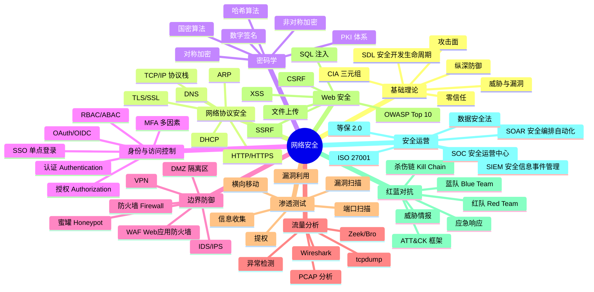

# 网络安全入门完全指南

> **适用人群**：初学者 / 零基础入门  
> **学习目标**：建立网络安全全局认知，掌握核心概念与基础攻防原理  
> **预计周期**：长期系统化学习（建议 3~6 个月）  
> **实验环境**：不限（Kali / Windows / Linux / Docker 均可）  
> **合规声明**：本文所有攻防内容仅用于合法授权、教学研究、CTF 竞赛与防御目的，严禁用于未授权测试。

---

## 目录

- [一、知识地图](#一知识地图)
- [二、分阶段学习路径](#二分阶段学习路径)
- [三、核心模块详解](#三核心模块详解)
  - [模块 1：网络安全概述](#模块-1网络安全概述)
  - [模块 2：网络协议安全](#模块-2网络协议安全)
  - [模块 3：密码学与 PKI](#模块-3密码学与-pki)
  - [模块 4：身份与访问控制](#模块-4身份与访问控制)
  - [模块 5：边界与网络防御](#模块-5边界与网络防御)
  - [模块 6：流量分析与抓包](#模块-6流量分析与抓包)
  - [模块 7：渗透测试基础](#模块-7渗透测试基础)
  - [模块 8：Web 与 API 安全](#模块-8web-与-api-安全)
  - [模块 9：红蓝对抗与应急响应](#模块-9红蓝对抗与应急响应)
  - [模块 10：安全运营与合规](#模块-10安全运营与合规)
- [四、关键对比表格](#四关键对比表格)
- [五、工具命令速查](#五工具命令速查)
- [六、实验项目与靶场](#六实验项目与靶场)
- [七、练习题与自测](#七练习题与自测)
- [八、学习资源推荐](#八学习资源推荐)

---

## 一、知识地图



---

## 二、分阶段学习路径

### 第一阶段：筑基期（第 1~4 周）—— 打好计算机与网络基础

| 周次 | 学习内容 | 目标 | 实验 |
|------|---------|------|------|
| 第1周 | 计算机组成原理、操作系统基础（Windows/Linux） | 理解 CPU、内存、磁盘、进程、文件系统 | 安装虚拟机，熟悉 Linux 基本命令 |
| 第2周 | 计算机网络基础、TCP/IP 协议栈 | 掌握 OSI 七层模型、TCP/UDP、IP 地址 | Wireshark 抓包看 TCP 三次握手 |
| 第3周 | HTTP/HTTPS、DNS、ARP 等应用层协议 | 理解网页访问全流程 | 用 curl 发请求，nslookup 查 DNS |
| 第4周 | 密码学基础、编程入门（Python） | 掌握加密哈希概念，能写简单脚本 | 写 Python 脚本计算 MD5/SHA |

### 第二阶段：入门期（第 5~12 周）—— 建立安全全局认知

| 周次 | 学习内容 | 目标 | 实验 |
|------|---------|------|------|
| 第5-6周 | 网络安全概述、威胁模型、攻防思维 | 建立 CIA、攻击面、纵深防御概念 | 搭建 DVWA 靶场 |
| 第7-8周 | 边界防御体系、防火墙/WAF/IDS | 理解各防御设备作用与位置 | 配置简单防火墙规则 |
| 第9-10周 | Web 安全基础、OWASP Top 10 | 掌握常见 Web 漏洞原理 | DVWA 上练习 SQL 注入、XSS |
| 第11-12周 | 渗透测试流程、信息收集与扫描 | 掌握渗透测试方法论 | Nmap 扫描、Burp Suite 基础使用 |

### 第三阶段：进阶期（第 13~24 周）—— 深入专项技能

| 方向 | 学习内容 | 建议时长 |
|------|---------|---------|
| 流量分析方向 | Wireshark 高级过滤、tcpdump、PCAP 分析、异常流量识别 | 4 周 |
| Web 安全方向 | SQL 注入深入、XSS 进阶、SSRF、文件上传、命令注入、JWT 安全 | 6 周 |
| 渗透测试方向 | 漏洞利用、提权、横向移动、后渗透、Metasploit | 6 周 |
| 防御方向 | SIEM、日志分析、应急响应、威胁情报、等保合规 | 4 周 |

### 第四阶段：实战期（第 25 周起）—— 靶场与 CTF

-  Vulhub 靶场逐个击破
-  CTF 入门题（Web / Misc / Crypto）
-  参加线上比赛（如 XCTF 联赛新人赛）
-  搭建个人靶场环境

---

## 三、核心模块详解

---

### 模块 1：网络安全概述

#### 1.1 CIA 三元组（CIA Triad）

网络安全的核心目标，也是一切安全工作的出发点：

| 要素 | 英文 | 含义 | 生活化类比 |
|------|------|------|-----------|
| 机密性 | **C**onfidentiality | 信息不被未授权的人获取 | 信件封在信封里，只有收信人能拆 |
| 完整性 | **I**ntegrity | 信息在传输/存储中不被篡改 | 快递包裹的封条，拆过就会留下痕迹 |
| 可用性 | **A**vailability | 授权用户随时能正常访问系统 | 银行 ATM 机 24 小时可用，不能总坏 |

> ⚠️ **易混淆提醒**：很多初学者把"安全"等同于"保密"，但实际上完整性和可用性同样重要。比如网站被 DDoS 攻击打挂了，机密性没丢，但可用性被破坏了，这也是安全事件。

#### 1.2 核心概念辨析

- **威胁（Threat）**：可能造成危害的潜在原因。例如：黑客、病毒、地震、火灾。
- **漏洞（Vulnerability）**：系统中可以被利用的弱点。例如：弱密码、未打补丁、配置错误。
- **风险（Risk）**：威胁利用漏洞造成损失的可能性和影响。**风险 = 威胁 × 漏洞 × 影响**。
- **攻击面（Attack Surface）**：系统中所有可被攻击的入口点总和。减少攻击面是重要的防御手段。

> 📌 **生活化类比**：你家的门、窗、烟囱、通风口都是"攻击面"。小偷是"威胁"。窗户没锁是"漏洞"。家里有多少值钱东西决定了"影响"大小。

#### 1.3 纵深防御（Defense in Depth）

不依赖单一安全措施，而是在多个层面部署防护，一层被突破还有下一层。

```
┌─────────────────────────────────────┐
│  数据层：加密、备份、DLP            │ ← 最后一道防线
├─────────────────────────────────────┤
│  应用层：WAF、代码安全、输入验证    │
├─────────────────────────────────────┤
│  主机层：主机防火墙、EDR、补丁管理  │
├─────────────────────────────────────┤
│  网络层：防火墙、IDS/IPS、网络分段  │
├─────────────────────────────────────┤
│  物理层：门禁、监控、机房安保       │ ← 第一道防线
└─────────────────────────────────────┘
```

#### 1.4 零信任（Zero Trust）

核心原则：**永不信任，始终验证（Never Trust, Always Verify）**。

- 传统安全：默认内网是安全的，只防外部。
- 零信任：不论内外网，每次访问都要验证身份和权限。
- 关键技术：最小权限原则、微隔离、持续验证、MFA。

> 📌 **生活化类比**：传统安全像小区大门，进了大门就可以随便逛；零信任像酒店，每层楼、每个房间都要刷房卡验证。

#### 1.5 常见面试/自测题

1. **Q：CIA 三元组是什么？请举例说明每个要素被破坏的场景。**
   - A：机密性（用户数据泄露）、完整性（网站首页被篡改）、可用性（DDoS 导致网站无法访问）。

2. **Q：威胁和漏洞有什么区别？**
   - A：威胁是外部的潜在危害来源（如黑客），漏洞是系统内部的弱点（如弱密码）。威胁利用漏洞才能造成实际危害。

3. **Q：什么是纵深防御？为什么需要它？**
   - A：在多个层面部署防护措施，因为任何单一防护都可能被突破。多层防护可以增加攻击成本和难度。

---

### 模块 2：网络协议安全

#### 2.1 OSI 七层模型与 TCP/IP 四层模型

| OSI 七层 | TCP/IP 四层 | 典型协议 | 安全关注点 |
|---------|------------|---------|-----------|
| 应用层 | 应用层 | HTTP、FTP、DNS、SSH | Web 漏洞、应用层攻击 |
| 表示层 | 应用层 | TLS/SSL、ASCII | 加密算法、编码问题 |
| 会话层 | 应用层 | RPC、NetBIOS | 会话劫持 |
| 传输层 | 传输层 | TCP、UDP | 端口扫描、SYN Flood |
| 网络层 | 网络层 | IP、ICMP、ARP | IP 欺骗、Smurf 攻击 |
| 数据链路层 | 网络接口层 | 以太网、Wi-Fi | ARP 欺骗、MAC 洪泛 |
| 物理层 | 网络接口层 | 光纤、双绞线 | 物理窃听、破坏 |

#### 2.2 TCP 协议安全

**TCP 三次握手（Three-way Handshake）：**

```
客户端                          服务器
   │─── SYN (seq=x) ────────────→│   第1次：我想连接，初始序号x
   │←── SYN+ACK (seq=y, ack=x+1)─┤   第2次：好的，我的序号y，确认你的x+1
   │─── ACK (ack=y+1) ──────────→│   第3次：确认你的y+1，连接建立
   │                              │
   │         数据传输              │
   │                              │
```

**常见 TCP 攻击：**

| 攻击类型 | 原理 | 防御 |
|---------|------|------|
| **SYN Flood** | 发送大量 SYN 包不回 ACK，占满半连接队列 | SYN Cookie、增大队列、防火墙限速 |
| **TCP 会话劫持** | 猜测序列号，注入数据到已建立连接 | 加密（TLS）、随机化初始序列号 |
| **端口扫描** | 发送 SYN 探测端口是否开放 | 防火墙、端口敲门（Port Knocking） |
| **RST 攻击** | 伪造 RST 包断开连接 | 加密、序列号随机化 |

> ⚠️ **抓包验证**：用 Wireshark 过滤 `tcp.flags.syn == 1` 可以看到所有 SYN 包，正常情况下每个 SYN 应该对应一个 SYN-ACK 和一个 ACK。如果只有大量 SYN 没有后续，可能是 SYN Flood 攻击。

#### 2.3 ARP 协议安全

**ARP（Address Resolution Protocol）**：根据 IP 地址找 MAC 地址。

```
主机 A (192.168.1.10)        主机 B (192.168.1.20)
   │── ARP 请求（广播）────────→│  谁是 192.168.1.20？请告诉我 MAC
   │←─ ARP 应答（单播）─────────┤  我是 192.168.1.20，MAC 是 xx:xx:xx:xx:xx:xx
   │                             │
```

**ARP 欺骗（ARP Spoofing/Poisoning）：**

- **原理**：ARP 是无状态的，主机收到 ARP 应答就会更新缓存，不管有没有发过请求。攻击者发送伪造的 ARP 应答，让目标把流量发给攻击者。
- **危害**：中间人攻击（MITM）、断网攻击、数据窃取。
- **防御**：静态 ARP 绑定、DAI（动态 ARP 检测）、ARP 防火墙。

#### 2.4 DNS 协议安全

**DNS（Domain Name System）**：域名 → IP 地址的翻译系统。

```
用户 → 本地 DNS → 根 DNS → 顶级域 DNS → 权威 DNS
          ↓         ↓        ↓          ↓
        缓存      指引      指引       返回IP
```

**常见 DNS 安全问题：**

| 攻击类型 | 原理 | 防御 |
|---------|------|------|
| **DNS 欺骗/缓存投毒** | 伪造 DNS 响应，让缓存存错误记录 | DNSSEC、DNS over HTTPS/TLS |
| **DNS 隧道** | 把数据藏在 DNS 查询里外传数据 | 监控异常 DNS 流量、DNS 防火墙 |
| **DDoS via DNS** | 利用开放 DNS 服务器放大攻击 | 禁递归、响应速率限制 |
| **域名劫持** | 篡改域名注册信息或 DNS 配置 | 域名锁定、双因素认证 |

#### 2.5 HTTP/HTTPS 协议安全

**HTTP 默认端口**：80（明文传输）  
**HTTPS 默认端口**：443（HTTP + TLS/SSL 加密）

**HTTP 常见安全问题：**
- 明文传输，可被窃听和篡改
- 无状态，需要 Cookie/Session 维持会话
- Cookie 可能被盗用（XSS、CSRF）
- 头信息泄露服务器版本等敏感信息

**HTTPS = HTTP + TLS**，解决了：
- ✅ 机密性：内容加密，窃听看不到
- ✅ 完整性：篡改能被检测到
- ✅ 身份认证：确认你访问的是真网站

> 📌 **生活化类比**：HTTP 像写明信片，邮递员和任何经手的人都能看到内容；HTTPS 像把信装在带锁的加密信封里，只有收信人有钥匙能打开。

#### 2.6 关键协议端口速记

| 协议 | 端口 | 说明 |
|------|------|------|
| FTP | 20/21 | 文件传输（明文） |
| SSH | 22 | 安全远程登录 |
| Telnet | 23 | 远程登录（明文，已淘汰） |
| SMTP | 25 | 邮件发送 |
| DNS | 53 | 域名解析 |
| DHCP | 67/68 | 动态主机配置 |
| HTTP | 80 | 超文本传输 |
| POP3 | 110 | 邮件接收 |
| HTTPS | 443 | 安全超文本传输 |
| RDP | 3389 | Windows 远程桌面 |
| MySQL | 3306 | MySQL 数据库 |
| Redis | 6379 | Redis 缓存 |

#### 2.7 自测题

1. **Q：TCP 和 UDP 的区别是什么？各举两个应用场景。**
   - A：TCP 面向连接、可靠、有序、有流量控制（如 HTTP、HTTPS、FTP、SSH）；UDP 无连接、不可靠、快、开销小（如 DNS、视频直播、在线游戏、语音通话）。

2. **Q：ARP 欺骗为什么能成功？如何防御？**
   - A：因为 ARP 协议无状态，主机收到 ARP 响应就会更新缓存。防御：静态 ARP 绑定、交换机 DAI、ARP 防火墙软件。

3. **Q：HTTPS 比 HTTP 多了什么？解决了什么问题？**
   - A：多了 TLS/SSL 加密层。解决了窃听（机密性）、篡改（完整性）、冒充（身份认证）三个问题。

---

### 模块 3：密码学与 PKI

#### 3.1 密码学三大基础功能

| 功能 | 实现技术 | 解决的问题 |
|------|---------|-----------|
| 机密性 | 加密算法（对称/非对称） | 防止信息被窃听 |
| 完整性 | 哈希算法、MAC | 防止信息被篡改 |
| 不可否认性 | 数字签名 | 防止发送方抵赖 |

#### 3.2 对称加密 vs 非对称加密

| 对比项 | 对称加密（Symmetric） | 非对称加密（Asymmetric） |
|--------|---------------------|------------------------|
| **密钥** | 同一个密钥加密解密 | 公钥加密，私钥解密（一对） |
| **速度** | 快 | 慢（约慢 100~1000 倍） |
| **密钥分发** | 困难（怎么安全把密钥给对方？） | 容易（公钥可以公开） |
| **典型算法** | AES、DES、3DES、SM4 | RSA、ECC、SM2、ElGamal |
| **适用场景** | 大量数据加密 | 密钥交换、数字签名 |
| **类比** | 同一把钥匙锁门和开门 | 邮箱（公钥=地址，私钥=钥匙） |

> ⚠️ **常见误区**：HTTPS 不是全程用非对称加密！实际是用非对称加密交换"会话密钥"，然后用对称加密传输数据。这样既安全又高效。

#### 3.3 哈希算法（Hash）

**特点**：
- 单向性：从原文能算出哈希值，但从哈希值推不出原文
- 确定性：同一个原文永远算出同一个哈希值
- 雪崩效应：原文改一点点，哈希值完全不同
- 固定长度：不管原文多长，输出长度固定

**常见哈希算法：**

| 算法 | 输出长度 | 状态 |
|------|---------|------|
| MD5 | 128 bit | 已不安全（碰撞攻击） |
| SHA-1 | 160 bit | 已不安全（碰撞攻击） |
| SHA-256 | 256 bit | 安全，目前主流 |
| SHA-512 | 512 bit | 安全 |
| SM3 | 256 bit | 国密算法，安全 |

> ⚠️ **重要区分：加密 vs 哈希**
> - 加密是双向的（加密 → 解密，能还原）
> - 哈希是单向的（只能算过去，不能算回来）
> - 密码存储应该用哈希（加盐），而不是加密

**密码加盐（Salt）：**
- 为什么加盐？防止彩虹表攻击。
- 怎么做？用户密码 + 随机盐 → 一起哈希，盐和哈希值一起存。
- 推荐算法：bcrypt、Argon2、PBKDF2（自带慢哈希，抗暴力破解）。

#### 3.4 数字签名

**原理**：用私钥加密消息摘要，公钥解密验证。

```
发送方：原文 → 哈希 → 私钥加密 → 数字签名 → （原文+签名）发送
接收方：收到 → 原文哈希 / 签名用公钥解密 → 比较两个哈希值 → 一致则验证通过
```

**作用**：
1. 身份认证：确认消息确实是私钥持有者发的
2. 完整性：消息没被篡改（改了哈希就不对了）
3. 不可否认性：发过的不能抵赖（只有你有私钥）

#### 3.5 PKI 与数字证书

**PKI（Public Key Infrastructure，公钥基础设施）**：一套管理公钥和数字证书的体系。

**数字证书（Digital Certificate）**：
- 相当于"网络身份证"
- 包含：域名、公钥、颁发机构、有效期、签名等
- 由 CA（Certificate Authority，证书颁发机构）签发

**证书信任链：**
```
根 CA 证书（自签名，操作系统/浏览器内置）
    ↓ 签发
中级 CA 证书
    ↓ 签发
用户/网站证书
```

> 📌 **生活化类比**：PKI 就像公安局发证系统。CA 是公安局，数字证书是身份证。你去办事，出示身份证，对方看是公安局发的、照片是你、没过期，就信你。

#### 3.6 TLS 握手过程

以 TLS 1.2 为例（简化版）：

```
客户端                           服务器
   │── ClientHello ──────────────→│  支持的加密套件、随机数A
   │←─ ServerHello ───────────────┤  选定加密套件、随机数B
   │←─ Certificate ───────────────┤  服务器证书（含公钥）
   │←─ ServerHelloDone ───────────┤  服务器打招呼结束
   │                               │
   │── ClientKeyExchange ────────→│  预主密钥（用服务器公钥加密）
   │── ChangeCipherSpec ─────────→│  通知：后面用加密通信了
   │── Finished ─────────────────→│  握手消息的哈希（加密）
   │                               │
   │←─ ChangeCipherSpec ──────────┤  通知：我也切换加密了
   │←─ Finished ──────────────────┤  握手消息的哈希（加密）
   │                               │
   │──── 加密数据传输 ────────────→│
   │←─── 加密数据传输 ─────────────│
```

> 📌 **生活化类比（TLS 握手 = 双方约定加密通信的过程）**：
> 1. 你打电话给银行："你好，我支持普通话、英语、粤语"（ClientHello）
> 2. 银行："你好，我们用普通话，这是我的工作证"（ServerHello + Certificate）
> 3. 你验证工作证是真的，然后说："这是我们的暗语，用你的公钥加密了"（ClientKeyExchange）
> 4. 双方用这个暗语加密后续对话

#### 3.7 国密算法

中国自主研发的密码算法（SM 系列）：

| 算法 | 类型 | 对应国际算法 |
|------|------|-------------|
| SM2 | 非对称加密（ECC） | RSA / ECDSA |
| SM3 | 哈希算法 | SHA-256 |
| SM4 | 对称加密 | AES |
| SM9 | 标识密码 | — |

#### 3.8 自测题

1. **Q：对称加密和非对称加密的区别？为什么 HTTPS 要结合使用？**
   - A：对称加密速度快但密钥分发困难，非对称加密密钥分发容易但速度慢。HTTPS 用非对称加密安全地交换对称密钥，然后用对称密钥加密数据，兼顾安全和效率。

2. **Q：加密和哈希有什么区别？密码为什么应该用哈希而不是加密？**
   - A：加密是双向的（可解密还原），哈希是单向的（不可还原）。密码用哈希存储，即使数据库泄露也无法还原出原始密码。

3. **Q：数字签名是怎么实现的？能提供哪三种安全保证？**
   - A：发送方用私钥加密消息的哈希值作为签名。提供：身份认证、完整性、不可否认性。

4. **Q：什么是 PKI？CA 的作用是什么？**
   - A：PKI 是公钥基础设施，一套管理公钥和证书的体系。CA 是证书颁发机构，负责签发和管理数字证书，证明公钥的归属。

---

### 模块 4：身份与访问控制

#### 4.1 认证 vs 授权

| 对比项 | 认证（Authentication） | 授权（Authorization） |
|--------|----------------------|---------------------|
| **回答的问题** | 你是谁？ | 你能做什么？ |
| **过程** | 验证身份 | 分配权限 |
| **举例** | 输入用户名密码登录 | 登录后只能看自己的文件 |
| **顺序** | 先认证 | 后授权 |

> ⚠️ **高频易混点**：很多人把认证和授权搞混。记住：认证是"验明正身"，授权是"给你权限"。先认证后授权，没认证就谈不上授权。

#### 4.2 认证方式

| 认证类型 | 说明 | 例子 |
|---------|------|------|
| 你知道什么 | 基于知识 | 密码、PIN 码、密保问题 |
| 你有什么 | 基于持有物 | 手机验证码、U 盾、智能卡 |
| 你是什么 | 基于生物特征 | 指纹、人脸、虹膜、声纹 |
| 你在哪里 | 基于位置 | 地理围栏、IP 白名单 |

#### 4.3 MFA 多因素认证

**MFA（Multi-Factor Authentication）**：同时使用两种或以上不同类型的认证因素。

- 为什么需要？单因素（比如只有密码）容易被盗。
- 常见组合：密码 + 手机验证码、密码 + 指纹、密码 + U 盾。
- 注意：密码 + 密保问题不叫 MFA，因为都是"你知道什么"同一类。

> 📌 **生活化类比**：进小区门只刷门禁卡是单因素；既要刷门禁卡又要刷脸是多因素。偷了卡也进不去，整容也进不去。

#### 4.4 授权模型

**RBAC（Role-Based Access Control，基于角色的访问控制）：**
- 给角色分配权限，给用户分配角色
- 例子：管理员角色、普通用户角色、访客角色
- 优点：管理方便，人员变动只需改角色

**ABAC（Attribute-Based Access Control，基于属性的访问控制）：**
- 根据属性（用户属性、资源属性、环境属性）动态决策
- 例子："工作日 9-18 点，部门经理可以访问财务报表"
- 更灵活，但更复杂

#### 4.5 OAuth 2.0 与 OIDC

**OAuth 2.0**：授权框架，让第三方应用在用户授权下获取有限权限，不用给密码。

**四种授权模式：**
1. 授权码模式（Authorization Code）—— 最安全，Web 应用常用
2. 隐式模式（Implicit）—— 简化版，浏览器端用，安全性稍差
3. 密码模式（Resource Owner Password Credentials）—— 直接给密码，高信任场景
4. 客户端模式（Client Credentials）—— 应用之间认证，无用户参与

**OIDC（OpenID Connect）**：在 OAuth 2.0 上增加了身份认证层，提供 ID Token。

> 📌 **生活化类比（OAuth）**：
> 你去快递柜取快递（第三方应用想访问你的数据），不用把家门钥匙（密码）给快递柜。
> 你扫快递柜二维码 → 跳转到微信（授权服务器）→ 你点"确认授权" → 微信给快递柜一个取件码（令牌）→ 快递柜用取件码开柜子（访问资源）。
> 全程你没把微信密码告诉快递柜。

#### 4.6 SSO 单点登录

**SSO（Single Sign-On）**：一次登录，处处通行。

- 企业场景：登录一次公司系统，就能访问 OA、邮箱、CRM 等所有系统。
- 常见协议：SAML 2.0、OIDC、CAS。
- 优点：用户体验好，密码管理集中，安全策略统一。

#### 4.7 零信任架构

零信任不是一个产品，而是一种架构理念：

**核心原则：**
1. 永不信任，始终验证
2. 最小权限原则（Least Privilege）
3. 假设 breach（已经被入侵）
4. 持续验证，不是一次性验证

**关键技术组件：**
- 身份认证与 MFA
- 微隔离（Micro-segmentation）
- 软件定义边界（SDP）
- 持续信任评估

#### 4.8 自测题

1. **Q：认证和授权的区别？哪个先发生？**
   - A：认证是验证身份（你是谁），授权是分配权限（你能做什么）。先认证后授权。

2. **Q：什么是 MFA？密码 + 密保问题算不算 MFA？**
   - A：多因素认证，使用两种以上不同类型的认证因素。不算，因为密码和密保问题都属于"你知道什么"同一类型。

3. **Q：OAuth 2.0 解决了什么问题？授权码模式的大致流程？**
   - A：解决了第三方应用获取用户资源授权的问题，不用共享密码。流程：用户访问第三方 → 跳转到授权服务器 → 用户授权 → 授权服务器返回授权码 → 第三方用授权码换令牌 → 用令牌访问资源。

4. **Q：零信任的核心思想是什么？和传统边界安全有什么不同？**
   - A：永不信任，始终验证。传统安全默认内网可信，只防外部；零信任不分内外，每次访问都要验证。

---

### 模块 5：边界与网络防御

#### 5.1 防火墙（Firewall）

**作用**：根据预设规则，控制进出网络的流量（允许/拒绝）。

**分类：**

| 分类方式 | 类型 | 说明 |
|---------|------|------|
| 技术代际 | 包过滤防火墙 | 基于 IP/端口，第一代，快但粗 |
| | 状态检测防火墙 | 跟踪连接状态，主流类型 |
| | 应用层防火墙/代理 | 理解应用协议，最精细但最慢 |
| 部署位置 | 网络防火墙 | 部署在网络边界 |
| | 主机防火墙 | 安装在单个主机上（如 Windows 防火墙） |
| 形态 | 硬件防火墙 | 专用设备，性能高 |
| | 软件防火墙 | 程序，成本低 |

> ⚠️ **防火墙的局限**：防火墙工作在网络层/传输层，看不懂应用层内容。比如 SQL 注入的数据包，防火墙看到的就是正常的 HTTP 请求，不会拦。这就是为什么需要 WAF。

#### 5.2 WAF（Web Application Firewall）

**作用**：Web 应用防火墙，专门防护 HTTP/HTTPS 应用层攻击。

**防护的攻击类型：**
- SQL 注入
- XSS 跨站脚本
- CSRF 跨站请求伪造
- 文件包含
- 命令注入
- CC 攻击

**部署方式：**
- 透明网桥模式
- 反向代理模式（最常见）
- 旁路镜像模式

#### 5.3 IDS vs IPS

| 对比项 | IDS（入侵检测系统） | IPS（入侵防御系统） |
|--------|-------------------|-------------------|
| **全称** | Intrusion Detection System | Intrusion Prevention System |
| **作用** | 检测攻击，发出告警 | 检测并**主动阻断**攻击 |
| **部署方式** | 旁路（镜像流量） | 串接（流量必经之路） |
| **对业务影响** | 不影响（挂了流量照走） | 有影响（串接，挂了就断网） |
| **响应方式** | 告警、记录 | 阻断、告警、记录 |
| **误报代价** | 低（只是告警） | 高（误报会误杀正常流量） |

> 📌 **生活化类比**：
> IDS 像烟雾报警器，发现火灾就响，但不会自己灭火。
> IPS 像自动喷淋系统，检测到火灾不仅报警，还会喷水灭火。但如果误判了，把客人淋湿了就很尴尬（误报代价高）。

#### 5.4 VPN

**VPN（Virtual Private Network，虚拟专用网络）**：在公共网络上建立加密的专用通道。

**常见类型：**
- **IPsec VPN**：网络层，站点到站点（Site-to-Site），企业总部-分公司
- **SSL VPN**：应用层，远程访问，员工在家办公
- **WireGuard**：新型 VPN，轻量、高性能

**注意**：VPN 只解决传输加密和身份认证问题，不等于完全安全。VPN 接入后默认在内网，这也是零信任要解决的问题。

#### 5.5 DMZ（隔离区）

**DMZ（Demilitarized Zone，非军事区）**：在内外网之间的一个隔离网络区域。

```
互联网 → 防火墙 → [DMZ区：Web服务器、邮件服务器] → 防火墙 → 内网
```

- 为什么需要 DMZ？对外提供服务的服务器放 DMZ，即使被攻破了，攻击者也不能直接进内网。
- DMZ 里的服务器只能有限地访问内网。

#### 5.6 NAT 与 ACL

**NAT（Network Address Translation，网络地址转换）：**
- 内网 IP → 公网 IP 转换
- 节省公网 IP 地址
- 隐藏内网结构，一定程度上增加安全性（但不是安全措施！）

**ACL（Access Control List，访问控制列表）：**
- 路由器/交换机上的规则列表
- 根据源 IP、目的 IP、端口等控制流量
- 是防火墙规则的基础

#### 5.7 DDoS 防护

**DDoS（Distributed Denial of Service，分布式拒绝服务）：**

**常见类型：**
| 类型 | 原理 | 例子 |
|------|------|------|
| 流量型 | 耗尽带宽 | UDP Flood、ICMP Flood |
| 协议型 | 耗尽连接资源 | SYN Flood |
| 应用层 | 耗尽服务器资源 | HTTP Flood、CC 攻击 |

**防护手段：**
- 流量清洗（清洗中心）
- CDN 分流
- 黑洞路由
- 限速/限流
- SYN Cookie、增大连接队列

#### 5.8 蜜罐（Honeypot）

**作用**：故意布置的"假目标"，吸引攻击者攻击，从而：
- 消耗攻击者精力
- 研究攻击手法
- 提前发现攻击
- 告警触发

**类型：**
- 低交互蜜罐：模拟服务，简单但信息量少
- 高交互蜜罐：真实系统，信息量多但风险大

#### 5.9 自测题

1. **Q：防火墙和 WAF 的区别？分别工作在什么层？**
   - A：防火墙工作在网络层/传输层，基于 IP/端口控制流量；WAF 工作在应用层，专门防护 Web 攻击。防火墙看不懂 HTTP 内容，WAF 能。

2. **Q：IDS 和 IPS 的区别？部署方式有什么不同？**
   - A：IDS 只检测告警，旁路部署；IPS 检测并阻断，串接部署。IDS 不影响业务，IPS 会影响业务。

3. **Q：DMZ 的作用是什么？哪些服务器应该放 DMZ？**
   - A：DMZ 是内外网之间的隔离区，放对外提供服务的服务器（Web、邮件、DNS 等）。即使 DMZ 被攻破，攻击者也不能直接进内网。

4. **Q：NAT 能提供安全防护吗？为什么？**
   - A：NAT 主要是地址转换，隐藏了内网结构，客观上有一点"安全 by  obscurity"的效果，但 NAT 不是安全措施，不能替代防火墙。

---

### 模块 6：流量分析与抓包

#### 6.1 Wireshark 使用基础

**Wireshark**：最流行的网络抓包分析工具，免费开源。

**常用过滤表达式：**

| 过滤需求 | 表达式 |
|---------|--------|
| 只看 HTTP | `http` |
| 只看某个 IP | `ip.addr == 192.168.1.100` |
| 只看源 IP | `ip.src == 192.168.1.100` |
| 只看目的 IP | `ip.dst == 192.168.1.100` |
| 只看某个端口 | `tcp.port == 80` 或 `tcp.port == 443` |
| 只看 SYN 包 | `tcp.flags.syn == 1` |
| 只看 DNS | `dns` |
| HTTP GET 请求 | `http.request.method == "GET"` |
| 组合条件（与） | `ip.addr == 192.168.1.100 && tcp.port == 80` |
| 组合条件（或） | `http || dns` |
| 排除条件 | `!arp` |

**PCAP 文件关键字段解读：**

| 层 | 关键字段 | 说明 |
|----|---------|------|
| 以太网层 | 源 MAC、目的 MAC | 数据链路层地址 |
| IP 层 | 源 IP、目的 IP、TTL、协议号 | 网络层地址和路由信息 |
| TCP/UDP 层 | 源端口、目的端口、序列号、标志位 | 传输层端口和连接状态 |
| 应用层 | HTTP 方法/状态码、DNS 查询名等 | 应用数据 |

#### 6.2 tcpdump 常用命令

**tcpdump**：Linux 下的命令行抓包工具。

```bash
# 基本抓包（指定网卡）
tcpdump -i eth0

# 抓 100 个包就停止
tcpdump -i eth0 -c 100

# 保存到文件（后续用 Wireshark 分析）
tcpdump -i eth0 -w capture.pcap

# 从文件读取
tcpdump -r capture.pcap

# 抓指定主机的流量
tcpdump -i eth0 host 192.168.1.100

# 抓指定端口
tcpdump -i eth0 port 80

# 抓指定协议
tcpdump -i eth0 icmp

# 抓源端口为 80 的流量
tcpdump -i eth0 src port 80

# 组合条件
tcpdump -i eth0 'src host 192.168.1.100 and dst port 443'

# 显示详细内容（ASCII）
tcpdump -i eth0 -A

# 显示详细内容（十六进制+ASCII）
tcpdump -i eth0 -X
```

#### 6.3 常见异常流量特征

| 异常类型 | 流量特征 |
|---------|---------|
| 端口扫描 | 单个源 IP 向大量不同目的端口发 SYN |
| SYN Flood | 大量 SYN 包，很少有 ACK 回应 |
| DNS 隧道 | DNS 查询包异常大，查询名奇怪，频率异常高 |
| 数据外泄 | 内部主机向外部发送大量数据（出站流量异常大） |
| C&C 通信 | 规律性的心跳包，非工作时间通信，陌生境外 IP |
| ARP 欺骗 | 大量 ARP 应答，一个 IP 对应多个 MAC |

#### 6.4 抓包分析实战步骤

1. **明确目标**：要分析什么问题？（慢、断、攻击、异常）
2. **选择位置**：在哪里抓？（客户端、服务器、中间节点）
3. **抓包过滤**：尽量缩小范围，避免包太多
4. **统计概览**：先看协议分布、端点统计、会话统计
5. **深入分析**：过滤关键流量，看具体内容
6. **得出结论**：问题原因、攻击方式、应对建议

#### 6.5 自测题

1. **Q：Wireshark 过滤表达式中，如何只看源 IP 为 192.168.1.1 的 HTTP 流量？**
   - A：`ip.src == 192.168.1.1 && http`

2. **Q：tcpdump 中如何把抓包结果保存到文件？如何读取？**
   - A：`tcpdump -i eth0 -w file.pcap` 保存；`tcpdump -r file.pcap` 读取。

3. **Q：SYN Flood 攻击在抓包中会呈现什么特征？**
   - A：大量 SYN 包，源 IP 可能是伪造的，对应的 SYN-ACK 很少有 ACK 回应，半连接队列占满。

---

### 模块 7：渗透测试基础

#### 7.1 什么是渗透测试

**渗透测试（Penetration Testing）**：模拟黑客攻击，在合法授权下，评估系统的真实安全性。

> ⚠️ **合规红线**：渗透测试必须获得书面授权！未授权测试属于违法行为。

#### 7.2 渗透测试标准流程

```
1. 前期交互（Pre-engagement）
   ↓ 签合同、定范围、定时间
2. 信息收集（Information Gathering）
   ↓ 域名、IP、端口、人员、技术栈
3. 漏洞扫描与分析（Vulnerability Assessment）
   ↓ 扫描端口、服务、漏洞
4. 漏洞利用（Exploitation）
   ↓ 利用漏洞获取访问权限
5. 后渗透（Post-Exploitation）
   ↓ 提权、横向移动、数据窃取
6. 痕迹清理与报告（Reporting）
   ↓ 清理痕迹、输出测试报告
```

#### 7.3 信息收集

**被动信息收集（不直接接触目标）：**
- Whois 查询（域名注册信息）
- DNS 信息收集（子域名、MX 记录等）
- 搜索引擎（Google Hacking）
- 社交媒体、招聘网站
- 代码托管平台（GitHub 敏感信息泄露）

**主动信息收集（直接接触目标）：**
- 端口扫描
- 服务识别
- 操作系统探测
- 目录扫描

#### 7.4 Nmap 常用命令

> ⚠️ **合规提醒**：仅在授权范围内使用 Nmap 扫描。

```bash
# 基本扫描（默认 1000 个常用端口）
nmap 192.168.1.100

# 扫描指定端口
nmap -p 80,443,3306 192.168.1.100

# 扫描全端口（1-65535）
nmap -p- 192.168.1.100

# 快速扫描
nmap -F 192.168.1.100

# 服务版本探测
nmap -sV 192.168.1.100

# 操作系统探测
nmap -O 192.168.1.100

# 综合扫描（-A = -sV -O -sC --traceroute）
nmap -A 192.168.1.100

# SYN 半开扫描（更隐蔽，需要 root）
nmap -sS 192.168.1.100

# UDP 扫描
nmap -sU 192.168.1.100

# 扫描整个网段
nmap 192.168.1.0/24

# 从文件读取目标列表
nmap -iL targets.txt

# 输出到文件
nmap -oN result.txt 192.168.1.100
```

#### 7.5 漏洞扫描工具

| 工具 | 类型 | 说明 |
|------|------|------|
| Nessus | 商业 | 最知名的漏洞扫描器 |
| OpenVAS | 开源 | Nessus 开源分支 |
| Nikto | 开源 | Web 服务器漏洞扫描 |
| AWVS | 商业 | Web 应用漏洞扫描 |
| Burp Suite Scanner | 商业 | 集成在 Burp 中的 Web 扫描 |

#### 7.6 Metasploit 基础

**Metasploit Framework（MSF）**：最流行的渗透测试框架。

**基本概念：**
- **Exploit（漏洞利用模块）**：利用漏洞的代码
- **Payload（载荷）**：成功利用后执行的代码
- **Shellcode**：Payload 的机器码形式
- **Module（模块）**：MSF 的功能单元（exploit、auxiliary、post 等）

**常用命令：**
```bash
msfconsole          # 启动 MSF
search ms17_010     # 搜索漏洞模块
use exploit/...     # 使用模块
show options        # 查看需要设置的参数
set RHOSTS 1.1.1.1  # 设置目标
set PAYLOAD ...     # 设置载荷
exploit / run       # 执行攻击
```

#### 7.7 自测题

1. **Q：渗透测试的标准流程有哪几步？第一步和最后一步分别是什么？**
   - A：前期交互、信息收集、漏洞扫描、漏洞利用、后渗透、报告。第一步是前期交互（签合同定范围），最后一步是输出报告。

2. **Q：主动信息收集和被动信息收集的区别？各举两个例子。**
   - A：被动收集不直接接触目标（Whois 查询、搜索引擎、GitHub 信息泄露）；主动收集直接发请求（端口扫描、目录扫描、服务探测）。

3. **Q：Nmap 中 -sS、-sV、-O、-A 分别是什么意思？**
   - A：-sS 是 SYN 半开扫描；-sV 是服务版本探测；-O 是操作系统探测；-A 是综合扫描（包含 sV、O、sC 等）。

---

### 模块 8：Web 与 API 安全

#### 8.1 OWASP Top 10（2021 版）

OWASP（开放式 Web 应用安全项目）每几年更新一次 Top 10 最严重的 Web 安全风险：

| 排名 | 风险 | 说明 |
|------|------|------|
| 1 | 访问控制失效（Broken Access Control） | 越权访问、未授权操作 |
| 2 | 加密机制失效（Cryptographic Failures） | 敏感数据未加密、弱加密 |
| 3 | 注入（Injection） | SQL 注入、命令注入等 |
| 4 | 不安全设计（Insecure Design） | 设计层面的安全缺陷 |
| 5 | 安全配置错误（Security Misconfiguration） | 默认配置、不必要的功能 |
| 6 | 易受攻击和过时的组件 | 使用有漏洞的第三方组件 |
| 7 | 认证和授权失效 | 密码策略弱、会话管理不当 |
| 8 | 软件和数据完整性失败 | 更新包、CI/CD 管道被篡改 |
| 9 | 安全日志和监控失败 | 攻击未被检测和记录 |
| 10 | 服务端请求伪造（SSRF） | 服务器被利用发起请求 |

> 注：2025 版可能有更新，以官方最新版本为准。

#### 8.2 SQL 注入（SQL Injection）

**原理**：用户输入被拼接到 SQL 语句中，改变了 SQL 的语义。

**示例**：
```
登录查询：SELECT * FROM users WHERE username='$user' AND password='$pass'

正常输入：admin / 123456
SQL 变成：SELECT * FROM users WHERE username='admin' AND password='123456'

注入输入：admin' -- 
SQL 变成：SELECT * FROM users WHERE username='admin' -- ' AND password='...'
（-- 后面被注释掉了，密码验证被绕过）
```

**危害**：
- 绕过登录验证
- 拖库（数据泄露）
- 篡改、删除数据
- 执行系统命令（某些数据库）

**防御**：
1. ✅ **预编译语句（Prepared Statements / 参数化查询）** —— 最有效
2. ✅ 输入验证与过滤
3. ✅ 最小权限原则（数据库账号不要给太高权限）
4. ✅ WAF 辅助防护

> ⚠️ **常见误区**：用正则过滤关键字（如 select、union）就能防 SQL 注入？错！可以用大小写绕过（SeLecT）、编码绕过、注释绕过等。预编译才是根本解法。

#### 8.3 XSS 跨站脚本（Cross-Site Scripting）

**原理**：攻击者在网页中注入恶意脚本，其他用户访问时执行。

**三种类型：**

| 类型 | 特点 | 举例 |
|------|------|------|
| **存储型 XSS** | 恶意脚本存在数据库里，每次访问都触发 | 论坛发帖、评论区注入脚本 |
| **反射型 XSS** | 脚本在 URL 里，需要诱导用户点击链接 | 搜索框输出用户输入 |
| **DOM 型 XSS** | 纯前端问题，JS 读取 URL 等输出到页面 | 前端读取 hash 值渲染 |

**危害**：
- Cookie 窃取（会话劫持）
- 钓鱼、挂马
- 键盘记录
- 内网探测

**防御**：
1. ✅ 输出编码/转义（HTML 实体编码）
2. ✅ HttpOnly Cookie（防止 JS 读取 Cookie）
3. ✅ CSP（内容安全策略）
4. ✅ 输入验证

#### 8.4 CSRF 跨站请求伪造

**原理**：利用用户已登录的身份，在用户不知情的情况下，以用户名义执行操作。

**条件**：
1. 用户已登录目标网站
2. 用户访问了恶意网站
3. 目标网站的关键操作只靠 Cookie 认证

```
用户登录了 bank.com → Cookie 存在浏览器里
用户访问 evil.com → 页面上有 
浏览器自动带上 bank.com 的 Cookie 发请求 → 转账成功
```

**防御**：
1. ✅ **CSRF Token**（随机令牌，每次请求带 token，服务端验证）
2. ✅ 验证 Referer / Origin
3. ✅ 关键操作二次验证（短信验证码、密码确认）
4. ✅ SameSite Cookie 属性

> ⚠️ **XSS vs CSRF 对比**：
> - XSS：注入脚本，在目标网站域内执行，能做的事情很多
> - CSRF：借用户身份发请求，只能"伪造请求"，看不到响应
> - XSS 可以实现 CSRF，但 CSRF 不能实现 XSS

#### 8.5 SSRF 服务端请求伪造

**原理**：攻击者利用服务器发起请求，探测/攻击内网。

**常见场景**：
- 图片加载（从 URL 加载图片）
- 网页截图
- 第三方服务调用

**危害**：
- 探测内网资产（端口扫描）
- 攻击内网服务（Redis、MySQL 等）
- 访问云服务元数据（获取密钥）

**防御**：
1. ✅ 白名单（只允许请求指定域名）
2. ✅ 禁用协议（只允许 HTTP/HTTPS，禁 file://、gopher:// 等）
3. ✅ 不跟随跳转
4. ✅ 网络隔离（应用服务器和内网服务隔离）

#### 8.6 文件上传漏洞

**原理**：允许上传文件但未做严格验证，攻击者上传 webshell 控制服务器。

**常见绕过：**
- 改扩展名（.php → .php5、.phtml）
- 双扩展名（shell.php.jpg）
- %00 截断
- .htaccess 解析
- MIME 类型绕过

**防御**：
1. ✅ 文件扩展名白名单（不是黑名单！）
2. ✅ 文件内容检测（图片验证）
3. ✅ 重命名文件（随机文件名）
4. ✅ 上传目录不可执行（移到静态资源服务器、设置权限）
5. ✅ 单独域名存放上传文件

#### 8.7 JWT 安全

**JWT（JSON Web Token）**：三部分组成 —— Header.Payload.Signature

**常见安全问题：**
- 算法混淆攻击（把 RS256 改成 HS256）
- 密钥泄露
- 未校验签名（直接改 Payload）
- 敏感信息放在 Payload 里（Base64 不是加密！）

**安全实践**：
- 使用强密钥
- 设置合理的过期时间
- 敏感信息不放 Payload
- 验证签名和算法

#### 8.8 Burp Suite 基础使用

**Burp Suite**：Web 安全测试神器。

**核心模块：**
| 模块 | 功能 |
|------|------|
| Proxy | 代理，拦截修改请求/响应 |
| Repeater | 重放请求，手动测试 |
| Intruder | 自动化攻击（爆破、fuzz） |
| Decoder | 编码解码 |
| Comparer | 比较两个响应的差异 |
| Scanner | 主动/被动扫描漏洞 |

**基本使用流程：**
1. 浏览器设置代理 → Burp Proxy
2. 正常浏览网站 → Burp 记录所有请求
3. 把可疑请求发到 Repeater → 修改参数测试
4. 需要爆破的请求发到 Intruder → 设置 payload 位置 → 开始攻击

#### 8.9 自测题

1. **Q：SQL 注入的原理是什么？最根本的防御方法是什么？**
   - A：用户输入被拼接到 SQL 语句中，改变了 SQL 语义。最根本的防御是预编译语句（参数化查询）。

2. **Q：XSS 有哪三种类型？区别是什么？**
   - A：存储型（存在数据库，持久化）、反射型（在 URL 中，需点击）、DOM 型（纯前端，不经过服务器）。

3. **Q：CSRF 的原理是什么？和 XSS 有什么区别？**
   - A：利用用户已登录的身份，诱导用户访问恶意页面，以用户名义发起请求。XSS 是注入脚本在目标站执行，能看到响应；CSRF 只是伪造请求，看不到响应。

4. **Q：SSRF 是什么？通常能用来做什么？**
   - A：服务端请求伪造，让服务器替攻击者发请求。通常用来探测内网、攻击内网服务、获取云元数据。

5. **Q：JWT 的 Payload 里能放敏感信息吗？为什么？**
   - A：不能。因为 JWT 的 Payload 只是 Base64 编码，不是加密，任何人都能解码看到内容。

---

### 模块 9：红蓝对抗与应急响应

#### 9.1 红队 vs 蓝队 vs 紫队

| 角色 | 英文 | 职责 | 类比 |
|------|------|------|------|
| 红队 | Red Team | 模拟攻击，找漏洞，测试防御 | 进攻方 / 矛 |
| 蓝队 | Blue Team | 防守、检测、响应、加固 | 防守方 / 盾 |
| 紫队 | Purple Team | 红队蓝队协作，红蓝对抗优化 | 教练 / 裁判 |

#### 9.2 网络杀伤链（Cyber Kill Chain）

洛克希德·马丁提出的攻击七阶段模型：

```
1. 侦察（Reconnaissance）     → 收集目标信息
2. 武器化（Weaponization）     → 制作恶意代码/漏洞利用
3. 投递（Delivery）           → 把武器送到目标（钓鱼邮件、U盘）
4. 利用（Exploitation）       → 利用漏洞执行代码
5. 安装（Installation）       → 安装后门、持久化
6. 指挥控制（C2）             → 建立通信通道
7. 行动（Actions on Objectives）→ 达成最终目的（窃密、破坏）
```

**防御思路**：在每个阶段阻断，越早越好。

#### 9.3 MITRE ATT&CK 框架

**ATT&CK**（Adversarial Tactics, Techniques, and Common Knowledge）：
- 基于真实攻击数据的知识库
- 按战术（Tactics）和技术（Techniques）组织
- 蓝队用来检测、红队用来模拟、管理层用来评估

**战术（Tactics）**：初始访问、执行、持久化、权限提升、防御绕过、凭证访问、发现、横向移动、收集、数据外泄、命令与控制、影响。

#### 9.4 应急响应流程

**PDCERF 模型**：

| 阶段 | 英文 | 工作内容 |
|------|------|---------|
| 准备 | Preparation | 工具、预案、培训、备份 |
| 检测 | Detection | 发现异常、确认事件 |
| 遏制 | Containment | 止损，防止扩散（断网、隔离） |
| 根除 | Eradication | 清除恶意代码、修复漏洞 |
| 恢复 | Recovery | 恢复服务、验证正常 |
| 总结 | Follow-up | 报告、复盘、改进 |

> ⚠️ **重要原则**：先遏制再根除！不要一上来就想"杀毒"，先把攻击限制住，防止扩散。就像火灾先灭火再找原因。

#### 9.5 取证与日志分析

**关键日志来源：**
- 操作系统日志（Windows Event Log、Linux syslog）
- Web 服务器日志（Apache、Nginx access/error log）
- 数据库日志
- 防火墙/IDS/IPS 日志
- DNS 日志
- 终端安全日志（EDR）

**IOC（Indicators of Compromise，失陷指标）：**
- 恶意 IP 地址
- 恶意域名
- 恶意文件哈希（MD5、SHA256）
- C&C 服务器特征

#### 9.6 威胁情报（Threat Intelligence）

**作用**：了解攻击者的 TTP（Tactics、Techniques、Procedures），提前防御。

**来源**：
- 开源威胁情报（OSINT）
- 商业威胁情报平台
- 行业信息共享
- 自己的安全数据

#### 9.7 自测题

1. **Q：红队和蓝队的职责分别是什么？紫队呢？**
   - A：红队模拟攻击找漏洞，蓝队防守检测响应，紫队是红蓝协作，互相提升。

2. **Q：网络杀伤链有哪七步？防御的最佳时机是哪几步？**
   - A：侦察、武器化、投递、利用、安装、C2、行动。越靠前阻断越好，尤其是侦察和投递阶段成本最低。

3. **Q：应急响应的 PDCERF 模型是什么？遏制和根除哪个先做？**
   - A：准备、检测、遏制、根除、恢复、总结。先遏制（止损）再根除，防止攻击扩散。

4. **Q：IOC 是什么？举几个例子。**
   - A：失陷指标，用来判断是否被入侵的特征。例子：恶意 IP、恶意域名、恶意文件哈希、C&C 特征。

---

### 模块 10：安全运营与合规

#### 10.1 SOC 安全运营中心

**SOC（Security Operations Center）**：集中处理安全事件的团队/平台/场所。

**核心能力：**
- 7x24 监控
- 事件检测与响应
- 威胁情报运营
- 漏洞管理
- 安全态势感知

#### 10.2 SIEM

**SIEM（Security Information and Event Management）**：
- 收集全量日志（集中化）
- 关联分析（跨设备发现攻击链）
- 告警与响应
- 报表与合规

**常见产品：**
- Splunk
- ELK Stack（Elasticsearch + Logstash + Kibana）— 开源
- QRadar
- 奇安信、深信服、安恒等国内厂商

#### 10.3 SOAR

**SOAR（Security Orchestration, Automation and Response）**：
- 安全编排：把多个工具和流程串起来
- 自动化：自动执行重复性响应操作
- 响应：标准化处置流程

**和 SIEM 的关系**：SIEM 负责发现问题，SOAR 负责自动处理问题。

#### 10.4 等保 2.0

**网络安全等级保护制度**：中国的网络安全基本制度。

**五个等级：**
- 第一级：自主保护（个人网站等）
- 第二级：指导保护（一般企业系统）
- 第三级：监督保护（重要行业，如金融、医疗）
- 第四级：强制保护（重要领域核心系统）
- 第五级：专控保护（国家核心机密系统）

**等保 2.0 核心要求：**
- 安全物理环境
- 安全通信网络
- 安全区域边界
- 安全计算环境
- 安全管理中心
- 安全管理制度
- 安全管理机构
- 安全管理人员
- 安全建设管理
- 安全运维管理

#### 10.5 其他重要法规标准

| 法规/标准 | 国家/地区 | 说明 |
|----------|----------|------|
| 网络安全法 | 中国 | 网络安全基本法律 |
| 数据安全法 | 中国 | 数据安全监管 |
| 个人信息保护法 | 中国 | 个人信息保护 |
| 关键信息基础设施安全保护条例 | 中国 | 关基保护 |
| ISO 27001 | 国际 | 信息安全管理体系 |
| GDPR | 欧盟 | 通用数据保护条例 |
| PCI DSS | 国际 | 支付卡行业数据安全标准 |
| HIPAA | 美国 | 医疗信息保护 |

#### 10.6 自测题

1. **Q：SIEM 和 SOAR 的区别和联系是什么？**
   - A：SIEM 侧重日志收集、关联分析、告警发现；SOAR 侧重编排、自动化响应。SIEM 发现问题，SOAR 自动处理问题，二者经常配合使用。

2. **Q：等保 2.0 分几个等级？你了解哪些核心要求？**
   - A：五个等级。核心要求包括"一个中心三重防护"（安全管理中心、安全通信网络、安全区域边界、安全计算环境），加上安全管理制度、机构、人员、建设、运维管理。

---

## 四、关键对比表格

### 表 1：对称加密 vs 非对称加密

| 对比项 | 对称加密 | 非对称加密 |
|--------|---------|-----------|
| 密钥数量 | 1 个（加密解密用同一个） | 1 对（公钥+私钥） |
| 速度 | 快 | 慢（约 100~1000 倍） |
| 密钥分发 | 困难 | 容易（公钥公开） |
| 典型算法 | AES、DES、3DES、SM4 | RSA、ECC、SM2 |
| 主要用途 | 大量数据加密 | 密钥交换、数字签名 |
| 安全风险 | 密钥泄露风险 | 私钥泄露风险 |

### 表 2：加密 vs 哈希

| 对比项 | 加密 | 哈希 |
|--------|------|------|
| 是否可逆 | 是（可解密还原） | 否（单向，不可逆） |
| 密钥 | 需要密钥 | 不需要密钥（加盐是另一回事） |
| 输出长度 | 不固定（和原文相关） | 固定长度 |
| 用途 | 机密性保护 | 完整性校验、密码存储、数字签名 |
| 典型算法 | AES、RSA | MD5、SHA-256、SM3、bcrypt |

### 表 3：认证 vs 授权

| 对比项 | 认证（Authentication） | 授权（Authorization） |
|--------|----------------------|---------------------|
| 回答问题 | 你是谁？ | 你能做什么？ |
| 验证内容 | 身份 | 权限 |
| 顺序 | 先 | 后 |
| 举例 | 用户名密码登录、指纹解锁 | 用户角色权限、文件访问控制 |

### 表 4：IDS vs IPS

| 对比项 | IDS | IPS |
|--------|-----|-----|
| 全称 | 入侵检测系统 | 入侵防御系统 |
| 核心功能 | 检测、告警 | 检测、告警、阻断 |
| 部署方式 | 旁路（镜像流量） | 串接（流量必经） |
| 对业务影响 | 无（设备故障不影响） | 有（设备故障会断网） |
| 误报代价 | 低（只是误告警） | 高（误杀正常业务流量） |
| 响应时机 | 事后检测 | 实时阻断 |

### 表 5：防火墙 vs WAF

| 对比项 | 防火墙（Firewall） | WAF |
|--------|-------------------|-----|
| 工作层次 | 网络层/传输层 | 应用层 |
| 防护对象 | IP/端口级别的访问控制 | Web 应用攻击 |
| 能否理解 HTTP | 不能 | 能 |
| 防护内容 | 端口扫描、非法 IP 访问等 | SQL 注入、XSS、CSRF 等 |
| 部署位置 | 网络边界 | Web 服务器前端 |

### 表 6：XSS vs CSRF

| 对比项 | XSS | CSRF |
|--------|-----|------|
| 全称 | 跨站脚本 | 跨站请求伪造 |
| 核心 | 注入脚本在目标站执行 | 借用户身份伪造请求 |
| 是否需要脚本 | 是 | 不一定（img 标签也行） |
| 能否看到响应 | 能（脚本执行） | 不能（只是发请求） |
| 危害范围 | 大（能做很多事） | 相对有限（只能发请求） |
| 防御 | 输出编码、HttpOnly、CSP | CSRF Token、SameSite、二次验证 |

### 表 7：HTTP vs HTTPS

| 对比项 | HTTP | HTTPS |
|--------|------|-------|
| 默认端口 | 80 | 443 |
| 传输方式 | 明文 | 加密（TLS/SSL） |
| 安全性 | 低（可窃听、篡改、冒充） | 高 |
| 速度 | 快 | 稍慢（加密解密开销） |
| 证书 | 不需要 | 需要 CA 证书 |
| URL 前缀 | http:// | https:// |
| OSI 层 | 应用层 | 应用层 + 表示层（TLS） |

### 表 8：VPN vs 零信任

| 对比项 | VPN | 零信任 |
|--------|-----|--------|
| 核心理念 | 接入即信任 | 永不信任，始终验证 |
| 网络视角 | 内外网有别 | 无内外网之分 |
| 粒度 | 粗（接入整个内网） | 细（按应用/资源授权） |
| 验证时机 | 接入时一次验证 | 持续验证 |
| 被攻破后 | 攻击者在内网横着走 | 只能访问授权的资源 |

---

## 五、工具命令速查

### 5.1 Nmap 速查表

| 命令 | 功能 |
|------|------|
| `nmap target` | 默认扫描 1000 个常用端口 |
| `nmap -p 80,443 target` | 扫描指定端口 |
| `nmap -p- target` | 扫描全部 65535 端口 |
| `nmap -sV target` | 探测服务版本 |
| `nmap -O target` | 探测操作系统 |
| `nmap -A target` | 综合扫描（版本+OS+脚本） |
| `nmap -sS target` | SYN 半开扫描（更隐蔽） |
| `nmap -sU target` | UDP 扫描 |
| `nmap -T4 target` | 速度级别（0~5，越大越快） |
| `nmap -oN result.txt target` | 输出结果到文件 |

> ⚠️ **合规提醒**：仅在获得明确书面授权的目标上使用扫描工具。

### 5.2 Wireshark 过滤速查表

| 过滤需求 | 表达式 |
|---------|--------|
| IP 过滤 | `ip.addr == 1.1.1.1` |
| 源 IP | `ip.src == 1.1.1.1` |
| 目的 IP | `ip.dst == 1.1.1.1` |
| 端口过滤 | `tcp.port == 80` |
| 协议过滤 | `http` / `dns` / `tls` / `ftp` |
| HTTP 方法 | `http.request.method == "GET"` |
| HTTP 状态码 | `http.response.code == 200` |
| TCP 标志位 | `tcp.flags.syn == 1` |
| 组合（与） | `ip.addr == 1.1.1.1 && http` |
| 组合（或） | `dns || http` |
| 排除 | `!arp` |
| 包含字符串 | `http contains "password"` |

### 5.3 tcpdump 速查表

| 命令 | 功能 |
|------|------|
| `tcpdump -i eth0` | 指定网卡抓包 |
| `tcpdump -i eth0 -c 100` | 抓 100 个包停止 |
| `tcpdump -i eth0 -w file.pcap` | 保存到文件 |
| `tcpdump -r file.pcap` | 读取文件 |
| `tcpdump host 1.1.1.1` | 抓指定主机 |
| `tcpdump port 80` | 抓指定端口 |
| `tcpdump src host 1.1.1.1` | 抓源主机 |
| `tcpdump dst port 443` | 抓目的端口 |
| `tcpdump -A` | ASCII 显示内容 |
| `tcpdump -X` | 十六进制+ASCII |
| `tcpdump 'tcp[tcpflags] & tcp-syn != 0'` | 只抓 SYN 包 |

### 5.4 Burp Suite 常用功能

| 模块 | 用途 | 快捷键 |
|------|------|--------|
| Proxy | 拦截请求/响应 | — |
| Repeater | 手动重放测试 | Ctrl+R 发送到 Repeater |
| Intruder | 自动化爆破/fuzz | Ctrl+I 发送到 Intruder |
| Decoder | 编码解码 | — |
| Comparer | 比较差异 | — |
| Scanner | 漏洞扫描 | — |

### 5.5 Metasploit 常用命令

| 命令 | 功能 |
|------|------|
| `msfconsole` | 启动控制台 |
| `search keyword` | 搜索模块 |
| `use module_path` | 使用模块 |
| `show options` | 显示参数 |
| `set RHOSTS ip` | 设置目标 IP |
| `set LHOST ip` | 设置本机 IP |
| `set PAYLOAD payload` | 设置载荷 |
| `exploit` / `run` | 执行 |
| `sessions -l` | 列出会话 |
| `sessions -i 1` | 进入会话 1 |
| `background` | 把会话放后台 |
| `exit` | 退出 |

---

## 六、实验项目与靶场

### 6.1 环境搭建（入门级）

#### 实验 1：虚拟机环境搭建
- **难度**：⭐
- **目标**：搭建学习用的虚拟环境
- **步骤**：
  1. 安装 VMware Workstation 或 VirtualBox
  2. 安装 Kali Linux（攻击机）
  3. 安装 Windows 10/11（靶机）
  4. 安装 Ubuntu Server（靶机）
  5. 配置虚拟机网络（NAT/仅主机模式）
- **验证**：三台机器能互相 ping 通

#### 实验 2：Wireshark 抓包看 TCP 三次握手
- **难度**：⭐
- **目标**：理解 TCP 连接建立过程
- **步骤**：
  1. 打开 Wireshark，选择网卡
  2. 开始抓包，过滤 `tcp`
  3. 浏览器访问一个 HTTP 网站（或用 curl）
  4. 找到三次握手的三个包
  5. 观察 SYN、SYN+ACK、ACK 的标志位和序列号
- **思考题**：为什么需要三次握手而不是两次？

#### 实验 3：DVWA 靶场搭建
- **难度**：⭐⭐
- **目标**：搭建 Web 漏洞练习平台
- **方式一**：Docker 一键启动
  ```bash
  docker run -d -p 80:80 vulnerables/web-dvwa
  ```
- **方式二**：手动部署（XAMPP + DVWA）
- **验证**：浏览器访问 `http://localhost`，能看到 DVWA 登录页

### 6.2 Web 安全实验（进阶级）

#### 实验 4：SQL 注入实战（DVWA Low）
- **难度**：⭐⭐
- **目标**：掌握 SQL 注入原理和手工注入流程
- **步骤**：
  1. 登录 DVWA，安全级别设为 Low
  2. 进入 SQL Injection 模块
  3. 输入 `1'` 看报错（判断注入点）
  4. 用 `order by` 猜字段数
  5. 用 `union select` 爆库名、表名、列名
  6. 拖出管理员账号密码
- **防御验证**：把安全级别调到 Impossible，看预编译的效果

#### 实验 5：XSS 三种类型实战
- **难度**：⭐⭐
- **目标**：理解三种 XSS 的区别和利用方式
- **步骤**：
  1. 反射型 XSS：在 XSS reflected 模块注入 `<script>alert(1)</script>`
  2. 存储型 XSS：在 XSS stored 模块留言注入脚本
  3. DOM 型 XSS：在 XSS DOM 模块观察 URL 中的 default 参数
  4. 进阶：尝试获取 Cookie（配合 Cookie 注入模块）
- **防御验证**：Medium/High 级别下的绕过练习

#### 实验 6：CSRF 实战
- **难度**：⭐⭐
- **目标**：理解 CSRF 攻击原理
- **步骤**：
  1. 登录 DVWA，进入 CSRF 模块（修改密码功能）
  2. 构造恶意 HTML 页面，自动提交修改密码的表单
  3. 用另一个浏览器/标签页模拟受害者访问恶意页面
  4. 观察密码是否被修改
- **思考**：为什么 CSRF 需要受害者已登录？

### 6.3 渗透测试实验（进阶级）

#### 实验 7：Nmap 端口扫描实战
- **难度**：⭐⭐
- **目标**：熟练使用 Nmap 进行信息收集
- **步骤**：
  1. 扫描靶机的常用端口
  2. 扫描靶机的全部端口
  3. 探测服务版本和操作系统
  4. 扫描整个网段的存活主机
  5. 对比不同扫描方式的速度和结果
- **注意**：仅扫描你自己的靶机！

#### 实验 8：Vulhub 靶场练习
- **难度**：⭐⭐⭐
- **推荐靶机（按难度排序）**：
  1. **Log4j2 漏洞**（CVE-2021-44228）—— 经典漏洞必练
  2. **Apache Shiro 反序列化** —— Java 安全入门
  3. **ThinkPHP 多语言 RCE** —— PHP 框架漏洞
  4. **Nginx 解析漏洞** —— 经典配置漏洞
  5. **Redis 未授权访问** —— 经典服务配置漏洞
  6. **ActiveMQ 反序列化** —— 中间件漏洞
- **练习流程**：环境搭建 → 漏洞原理 → 复现利用 → 修复方案

### 6.4 流量分析实验（进阶级）

#### 实验 9：PCAP 流量分析入门
- **难度**：⭐⭐
- **目标**：培养从抓包文件中找线索的能力
- **练习资源**：
  - Wireshark 官方 sample captures
  - CTF 中的 Misc/流量分析题
- **分析步骤**：
  1. 先看 Statistics → Protocol Hierarchy（协议分布）
  2. 看 Conversations（会话统计）
  3. 看 Endpoints（端点统计）
  4. 过滤关键协议深入分析
  5. 导出 HTTP 对象、文件

### 6.5 CTF 入门题推荐

| 方向 | 题目平台 | 难度 | 说明 |
|------|---------|------|------|
| Web | DVWA / Pikachu | ⭐ | 入门必练 |
| Web | Vulhub | ⭐⭐ | 真实漏洞环境 |
| Crypto | CryptoHack | ⭐⭐ | 密码学练习平台 |
| Crypto | BUUCTF Crypto 分类 | ⭐⭐ | 中文 CTF 平台 |
| Misc | BUUCTF Misc 分类 | ⭐⭐ | 杂项入门 |
| Reverse | 看雪论坛新手区 | ⭐⭐⭐ | 逆向入门 |
| Pwn | pwnable.kr | ⭐⭐⭐ | 二进制漏洞入门 |

---

## 七、练习题与自测

### 7.1 单选题

**1. 以下哪项不属于 CIA 三元组？**
- A. 机密性（Confidentiality）
- B. 完整性（Integrity）
- C. 可用性（Availability）
- D. 可追溯性（Accountability）

> 答案：D。CIA 是机密性、完整性、可用性。可追溯性虽然重要，但不属于 CIA 三元组。

**2. TCP 三次握手的顺序是？**
- A. SYN → SYN+ACK → ACK
- B. SYN → ACK → SYN+ACK
- C. SYN+ACK → SYN → ACK
- D. ACK → SYN → SYN+ACK

> 答案：A。客户端发 SYN → 服务器回 SYN+ACK → 客户端回 ACK。

**3. 以下哪种算法是对称加密算法？**
- A. RSA
- B. ECC
- C. AES
- D. SHA-256

> 答案：C。AES 是对称加密。RSA 和 ECC 是非对称，SHA-256 是哈希算法。

**4. IDS 和 IPS 的主要区别是？**
- A. IDS 工作在网络层，IPS 工作在应用层
- B. IDS 只能检测告警，IPS 还能主动阻断
- C. IDS 是硬件，IPS 是软件
- D. IDS 比 IPS 更贵

> 答案：B。IDS 是入侵检测系统，只检测告警；IPS 是入侵防御系统，检测并主动阻断。

**5. SQL 注入最根本的防御方法是？**
- A. 过滤单引号
- B. WAF
- C. 预编译语句（参数化查询）
- D. 禁用数据库

> 答案：C。预编译语句能从根本上防止 SQL 注入。过滤可以被绕过，WAF 只是辅助。

**6. 以下关于 HTTPS 的说法，错误的是？**
- A. 默认端口是 443
- B. 传输过程是加密的
- C. 全程使用非对称加密
- D. 需要数字证书

> 答案：C。HTTPS 不是全程非对称加密，而是用非对称加密交换会话密钥，然后用对称加密传输数据。

**7. XSS 和 CSRF 的区别，以下说法正确的是？**
- A. XSS 是跨站脚本，CSRF 是跨站请求伪造
- B. XSS 和 CSRF 是同一种攻击的不同叫法
- C. CSRF 能执行脚本，XSS 不能
- D. XSS 只危害服务端，CSRF 只危害客户端

> 答案：A。B 错，是两种不同攻击；C 说反了；D 都不对。

**8. 零信任的核心思想是？**
- A. 内网都是可信的
- B. 永不信任，始终验证
- C. 只要有防火墙就够了
- D. 只信任管理员

> 答案：B。零信任的核心原则是"永不信任，始终验证"。

**9. 应急响应的正确流程顺序是？**
- A. 检测 → 遏制 → 根除 → 恢复 → 总结
- B. 根除 → 检测 → 遏制 → 恢复 → 总结
- C. 检测 → 根除 → 遏制 → 恢复 → 总结
- D. 遏制 → 检测 → 根除 → 恢复 → 总结

> 答案：A。PDCERF：准备→检测→遏制→根除→恢复→总结。注意先遏制再根除。

**10. 以下哪个端口是 HTTPS 的默认端口？**
- A. 21
- B. 22
- C. 80
- D. 443

> 答案：D。21 是 FTP，22 是 SSH，80 是 HTTP，443 是 HTTPS。

### 7.2 简答题

**1. 什么是纵深防御？请举例说明至少三个层面的防护措施。**

> 参考答案：纵深防御是指在多个层面部署安全防护措施，不依赖单一防御，一层被突破还有下一层。
> 例如：
> - 物理层：机房门禁、监控
> - 网络层：防火墙、IDS/IPS、网络分段
> - 主机层：主机防火墙、EDR、补丁管理
> - 应用层：WAF、代码安全审计、输入验证
> - 数据层：数据加密、备份、DLP

**2. 请简述 TLS 握手的大致过程（以 TLS 1.2 为例）。**

> 参考答案：
> 1. ClientHello：客户端发送支持的加密套件、随机数 A
> 2. ServerHello：服务器选定加密套件、返回随机数 B
> 3. Certificate：服务器发送数字证书（含公钥）
> 4. ServerHelloDone：服务器打招呼结束
> 5. ClientKeyExchange：客户端发送预主密钥（用服务器公钥加密）
> 6. 双方用随机数 A + 随机数 B + 预主密钥算出会话密钥
> 7. ChangeCipherSpec + Finished：双方切换加密通信，验证握手完整性

**3. 什么是 ARP 欺骗？为什么能成功？如何防御？**

> 参考答案：
> ARP 欺骗是攻击者发送伪造的 ARP 应答，让目标主机的 ARP 缓存中保存错误的 IP-MAC 映射，从而把流量发给攻击者。
> 能成功的原因：ARP 协议是无状态的，主机收到 ARP 应答就会更新缓存，不管之前有没有发过请求。
> 防御方法：
> - 静态 ARP 绑定（手动绑定 IP 和 MAC）
> - 交换机 DAI（动态 ARP 检测）
> - ARP 防火墙软件
> - 网络分段

**4. 请解释 CSRF 攻击的原理，并列举至少三种防御方法。**

> 参考答案：
> CSRF（跨站请求伪造）是利用用户已登录的身份，在用户不知情的情况下，诱导用户访问恶意网站，以用户的名义向目标网站发起请求，执行未授权操作。
> 攻击条件：用户已登录目标网站 + 用户访问恶意页面 + 目标网站仅靠 Cookie 认证。
> 防御方法：
> 1. CSRF Token：每个请求带随机令牌，服务端验证
> 2. SameSite Cookie 属性：限制跨站请求携带 Cookie
> 3. 验证 Referer / Origin 头
> 4. 关键操作二次验证（密码、验证码）
> 5. 自定义请求头（如 X-Requested-With）

**5. 什么是 SQL 注入？为什么简单的关键字过滤不能完全防止 SQL 注入？**

> 参考答案：
> SQL 注入是攻击者将恶意 SQL 代码插入到应用的输入参数中，后端数据库执行了被篡改的 SQL 语句，导致数据泄露或被篡改。
> 简单的关键字过滤（如过滤 select、union 等）不能完全防住，因为有很多绕过方式：
> - 大小写绕过：SeLeCt、UNIOn
> - 编码绕过：URL 编码、Unicode 编码
> - 注释绕过：`sel/*foo*/ect`
> - 等价函数绕过：用 benchmark 代替 sleep 等
> - 双写绕过：selselectect → select
> 最根本的防御是预编译语句（参数化查询）。

### 7.3 实操题

**实操题 1：Wireshark 抓包分析**
- 任务：打开 Wireshark 抓包，访问一个 HTTP 网站，找到对应的 HTTP 请求和响应
- 要求：
  1. 能说出 HTTP 请求的方法、URL、协议版本
  2. 能说出 HTTP 响应的状态码
  3. 能找到 TCP 三次握手的三个包
  4. 能解释为什么三次握手是三次而不是两次

**实操题 2：DVWA SQL 注入（Low）**
- 任务：在 DVWA 的 SQL Injection 模块，通过手工注入获取所有用户名和密码
- 要求：
  1. 判断注入点（字符型还是数字型）
  2. 用 order by 判断字段数
  3. 用 union select 获取数据库名、表名、列名
  4. 最终拖出所有用户数据
  5. 说明防御方法

**实操题 3：Nmap 扫描练习**
- 任务：对你自己的靶机进行 Nmap 扫描
- 要求：
  1. 扫描常用端口，列出开放的端口和服务
  2. 尝试探测服务版本
  3. 尝试探测操作系统
  4. 对比 -sS 和 -sT 扫描的区别
  5. （合规提醒）强调只能扫描自己授权的目标

---

## 八、学习资源推荐

### 8.1 书籍推荐

| 书名 | 适合阶段 | 说明 |
|------|---------|------|
| 《白帽子讲 Web 安全》 | 入门→进阶 | Web 安全经典，吴翰清著 |
| 《Web 安全深度剖析》 | 入门→进阶 | 实战性强 |
| 《网络安全基础：应用与标准》 | 入门 | 教材类，理论全面 |
| 《图解 HTTP》 | 入门 | 图文并茂，HTTP 入门好书 |
| 《密码学入门》 | 入门 | 结城浩著，通俗易懂 |
| 《Metasploit 渗透测试指南》 | 进阶 | MSF 入门 |
| 《Wireshark 网络分析实战》 | 进阶 | 流量分析 |
| 《ATT&CK 框架入门与实践》 | 进阶 | 红蓝对抗 |

### 8.2 在线课程

- **慕课网/极客时间**：有不少网络安全专栏课程
- **FreeBuf 学院**：安全从业者的学习平台
- **i 春秋**：合天智汇旗下，CTF 和渗透测试课程
- **攻防世界**：CTF 练习平台

### 8.3 靶场与练习平台

| 平台 | 类型 | 说明 |
|------|------|------|
| DVWA | Web 靶场 | 入门必练，PHP 写的漏洞平台 |
| Pikachu | Web 靶场 | 中文的，漏洞类型全 |
| Vulhub | 综合靶场 | Docker 一键启动，真实漏洞环境 |
| BWAPP | Web 靶场 | 漏洞很多，老牌靶场 |
| Hack The Box | 综合靶场 | 国外知名，难度分级 |
| TryHackMe | 综合靶场 | 引导式学习，适合新手 |
| 攻防世界 | CTF 平台 | 国内，新手区适合入门 |
| BUUCTF | CTF 平台 | 国内，题目多 |
| NSSCTF | CTF 平台 | 国内新兴平台 |

### 8.4 技术社区与资讯

- **FreeBuf**：国内知名安全媒体
- **安全客**：360 旗下安全平台
- **先知社区**：阿里安全社区
- **看雪论坛**：逆向工程老牌论坛
- **GitHub**：找工具、找 payload、关注安全项目
- **Hacker News**：国外技术新闻

### 8.5 工具下载

- **Kali Linux**：https://www.kali.org/ （渗透测试系统，集成大量工具）
- **Wireshark**：https://www.wireshark.org/ （抓包分析）
- **Burp Suite**：https://portswigger.net/burp （Web 安全测试）
- **Nmap**：https://nmap.org/ （端口扫描）
- **Metasploit**：https://www.metasploit.com/ （渗透测试框架）
- **Docker Desktop**：https://www.docker.com/ （快速搭建靶场环境）

---

## 写在最后

网络安全是一个非常广阔的领域，没有人能精通所有方向。作为初学者：

1. **先建立全局认知**，再选一个感兴趣的方向深入
2. **动手实践是关键**，光看书不实操学不会安全
3. **重视法律和伦理**，技术是双刃剑，守住底线
4. **保持学习的习惯**，安全领域更新很快，逆水行舟不进则退
5. **多写多总结**，写博客、做笔记，输出是最好的学习方式

> ⚠️ **再次强调**：本文所有攻防技术仅用于合法授权的学习、研究、CTF 竞赛和防御目的。任何未经授权的攻击行为都违反法律，后果自负。

---

*文档版本：v1.0 | 最后更新：2026 年 9 月*
