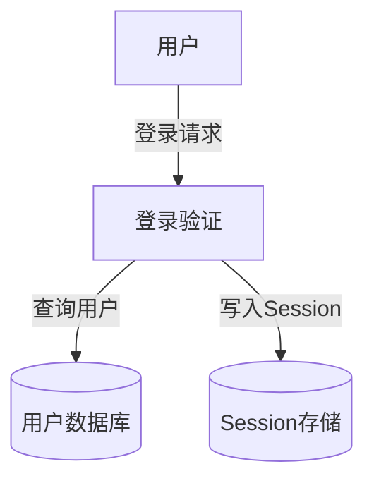

# 威胁建模实战指南

> 本文档系统介绍威胁建模的理论基础、方法论、工具使用与实战案例，帮助开发者和安全工程师在软件开发生命周期中系统性地识别、评估和缓解安全威胁。

---

## 目录

- [第1章 威胁建模概述](#第1章-威胁建模概述)
- [第2章 威胁建模方法论](#第2章-威胁建模方法论)
- [第3章 威胁建模完整流程](#第3章-威胁建模完整流程)
- [第4章 数据流图（DFD）绘制](#第4章-数据流图dfd绘制)
- [第5章 Microsoft Threat Modeling Tool使用](#第5章-microsoft-threat-modeling-tool使用)
- [第6章 常见威胁与缓解措施速查](#第6章-常见威胁与缓解措施速查)
- [第7章 实战案例](#第7章-实战案例)
- [第8章 威胁建模在敏捷/DevOps中的应用](#第8章-威胁建模在敏捷devops中的应用)
- [第9章 常见误区与最佳实践](#第9章-常见误区与最佳实践)
- [第10章 工具与资源](#第10章-工具与资源)

---

## 第1章 威胁建模概述

### 1.1 什么是威胁建模

威胁建模（Threat Modeling）是一种系统性的安全分析方法，用于识别、评估和缓解软件系统或业务流程中可能存在的安全威胁。它通过结构化的方式思考"攻击者会如何攻击这个系统？"，从而在设计阶段就发现潜在的安全风险，而不是等到系统上线后被动应对。

威胁建模的核心思想是**主动防御**——与其在漏洞被利用后匆忙修补，不如在设计之初就考虑安全问题，从架构层面构建安全的系统。

威胁建模回答以下关键问题：

- **我们要保护什么？** —— 识别系统中的关键资产
- **谁会攻击我们？** —— 识别潜在的威胁主体（威胁源）
- **攻击者如何攻击？** —— 识别可能的攻击路径和威胁向量
- **攻击会造成什么影响？** —— 评估风险等级
- **我们该如何防御？** —— 制定缓解措施和安全控制

### 1.2 威胁建模的价值与意义

#### 1.2.1 经济效益

根据IBM《数据泄露成本报告》的数据，在设计阶段修复一个安全缺陷的成本仅为上线后修复的1/100。威胁建模能够在软件开发早期发现安全问题，大幅降低安全修复成本。

#### 1.2.2 安全左移

威胁建模是安全左移（Shift Left）的核心实践之一。它将安全考虑嵌入到软件设计阶段，而不是等到测试或运维阶段才开始关注安全。这种方式能够：

- 从架构层面解决安全问题，避免治标不治本
- 减少后期安全测试发现的漏洞数量
- 缩短安全修复周期，加快产品交付速度

#### 1.2.3 提升安全意识

威胁建模过程本身就是一次安全培训。通过参与威胁建模，开发团队成员能够：

- 建立安全思维模式
- 了解常见的攻击方式和防御手段
- 增强对安全需求的理解
- 形成"安全人人有责"的文化

#### 1.2.4 合规与审计支持

许多行业标准和法规（如PCI DSS、HIPAA、ISO 27001、等保2.0）都要求进行威胁分析和风险评估。威胁建模的产出物可以作为合规审计的重要证据。

### 1.3 威胁建模在SSDLC中的位置

安全软件开发生命周期（Secure Software Development Life Cycle, SSDLC）将安全活动融入到软件开发的各个阶段。威胁建模主要发生在**安全设计阶段**，但它的影响贯穿整个生命周期。

```
需求阶段 → 设计阶段 → 编码阶段 → 测试阶段 → 部署阶段 → 运维阶段
              ↑
          威胁建模
```

**各阶段与威胁建模的关系：**

| 阶段 | 与威胁建模的关系 |
|------|----------------|
| 需求阶段 | 收集安全需求，为威胁建模提供输入 |
| **设计阶段** | **执行威胁建模，识别威胁并设计缓解措施** |
| 编码阶段 | 按照威胁建模的缓解措施进行安全编码 |
| 测试阶段 | 验证缓解措施是否有效执行 |
| 部署阶段 | 验证生产环境配置是否符合安全设计 |
| 运维阶段 | 定期回顾和更新威胁模型，应对新威胁 |

### 1.4 威胁建模的时机与频率

#### 1.4.1 何时进行威胁建模

- **新项目启动时**：在架构设计阶段进行首次威胁建模
- **重大功能迭代时**：当系统架构或核心业务流程发生重大变化时
- **新系统集成时**：当引入新的外部系统或第三方组件时
- **安全事件发生后**：发生安全事件后，重新审视威胁模型
- **定期回顾**：至少每年回顾一次，应对新出现的威胁

#### 1.4.2 威胁建模的频率

| 场景 | 建议频率 |
|------|---------|
| 敏捷开发（Sprint） | 每个Sprint开始时，针对新功能进行轻量化威胁建模 |
| 瀑布开发 | 设计阶段进行完整威胁建模，后续阶段按需更新 |
| DevOps | 作为CI/CD流水线的一部分，自动化执行基础威胁检查 |
| 运维阶段 | 每季度或每半年回顾一次威胁模型 |

### 1.5 谁应该参与威胁建模

威胁建模不是安全团队独有的工作，而是一个跨职能的协作过程。以下角色应该参与：

| 角色 | 职责 |
|------|------|
| **安全工程师/安全架构师** | 主导威胁建模过程，提供安全专业知识，引导讨论 |
| **系统架构师** | 提供系统架构信息，解释设计决策 |
| **开发工程师** | 了解技术实现细节，评估缓解措施的可行性 |
| **产品经理/业务分析师** | 明确业务目标和资产价值，帮助确定优先级 |
| **测试工程师** | 参与威胁识别，设计安全测试用例 |
| **运维工程师** | 评估部署环境的安全风险，考虑运维层面的缓解措施 |

**最佳实践：** 威胁建模会议通常以工作坊（Workshop）的形式进行，时长约2-4小时。会议前需要准备好系统架构图和相关文档，会议中由安全工程师引导讨论，确保覆盖所有关键威胁。

---

## 第2章 威胁建模方法论

### 2.1 STRIDE方法详解

STRIDE是由微软公司提出的威胁分类模型，是目前应用最广泛的威胁建模方法论之一。它将威胁分为六大类，每个字母代表一类威胁。

#### 2.1.1 Spoofing（仿冒）

**定义：** 攻击者伪装成另一个人或系统，以获取未授权的访问或权限。

**常见场景：**
- 盗用用户账号密码进行登录
- 伪造IP地址进行IP欺骗
- 伪造SSL证书实施中间人攻击
- 冒充管理员发送钓鱼邮件

**典型示例：**
- 攻击者通过钓鱼获取用户密码，登录用户账号
- DNS欺骗将用户重定向到恶意网站
- 会话劫持——窃取用户的Session ID冒充用户

#### 2.1.2 Tampering（篡改）

**定义：** 攻击者未经授权地修改数据或代码，破坏数据的完整性。

**常见场景：**
- 修改数据库中的敏感数据
- 篡改传输中的数据（中间人攻击）
- 修改配置文件或源代码
- 篡改URL参数或表单数据

**典型示例：**
- 在转账请求中修改收款人账号
- 篡改购物车中的商品价格
- SQL注入修改数据库内容
- 修改客户端JavaScript绕过验证

#### 2.1.3 Repudiation（抵赖）

**定义：** 用户或攻击者否认执行了某个操作，而系统无法提供证据证明其行为。

**常见场景：**
- 用户否认进行了某笔交易
- 攻击者删除日志掩盖攻击痕迹
- 系统缺乏审计日志无法追溯操作

**典型示例：**
- 用户否认下了订单，但系统没有日志记录
- 攻击者删除服务器日志，无法追溯攻击来源
- 电子合同签署后一方否认签署

#### 2.1.4 Information Disclosure（信息泄露）

**定义：** 敏感信息被未授权的人员获取，破坏数据的保密性。

**常见场景：**
- 数据库泄露导致用户信息被盗
- 错误页面暴露系统内部信息
- API接口返回过多数据
- 日志文件中包含敏感信息

**典型示例：**
- SQL注入获取数据库中的用户密码
- 错误页面显示数据库连接字符串
- 备份文件未授权访问
- 调试信息泄露在生产环境

#### 2.1.5 Denial of Service（拒绝服务）

**定义：** 攻击者通过各种手段使系统无法正常提供服务，破坏系统的可用性。

**常见场景：**
- DDoS攻击耗尽带宽或服务器资源
- 慢连接攻击（Slowloris）耗尽连接数
- 资源耗尽攻击（内存、CPU、磁盘）
- 逻辑漏洞导致服务崩溃

**典型示例：**
- SYN洪水攻击耗尽服务器连接
- 暴力破解导致账户锁定服务不可用
- 上传大文件耗尽磁盘空间
- 正则表达式DoS（ReDoS）

#### 2.1.6 Elevation of Privilege（权限提升）

**定义：** 攻击者通过利用漏洞获得超出其应有权限的访问能力。

**常见场景：**
- 垂直越权：普通用户获得管理员权限
- 水平越权：用户A访问用户B的数据
- 本地提权：从普通用户提升为系统管理员
- 沙箱逃逸：从受限环境突破到宿主系统

**典型示例：**
- 通过修改URL中的user_id访问他人数据
- 利用操作系统漏洞获得root权限
- 绕过权限检查直接访问管理接口
- JWT令牌被篡改提升权限等级

#### 2.1.7 STRIDE与安全属性的对应关系

| STRIDE威胁 | 违反的安全属性 | 对应安全原则 |
|-----------|--------------|-------------|
| Spoofing（仿冒） | 真实性（Authenticity） | 身份认证 |
| Tampering（篡改） | 完整性（Integrity） | 完整性校验 |
| Repudiation（抵赖） | 不可否认性（Non-repudiation） | 审计日志 |
| Information Disclosure（信息泄露） | 保密性（Confidentiality） | 访问控制、加密 |
| Denial of Service（拒绝服务） | 可用性（Availability） | 冗余、限流 |
| Elevation of Privilege（权限提升） | 授权（Authorization） | 权限控制 |

### 2.2 PASTA方法

PASTA（Process for Attack Simulation and Threat Analysis）是一种以风险为中心的威胁建模方法论，由Tony UcedaVelez和Marco Morana提出。它强调将业务影响与技术威胁关联起来。

#### PASTA的七个阶段：

**阶段1：定义目标（Define Objectives）**
- 明确业务目标和安全目标
- 识别关键业务资产
- 确定合规要求

**阶段2：定义技术范围（Define Technical Scope）**
- 识别系统边界和组件
- 梳理技术栈和依赖
- 确定分析的深度和广度

**阶段3：应用分解（Application Decomposition）**
- 绘制系统架构图和数据流图
- 识别信任边界
- 枚举用户角色和权限
- 识别数据资产和敏感数据

**阶段4：威胁分析（Threat Analysis）**
- 识别威胁源和威胁动机
- 构建威胁场景
- 参考威胁情报和历史事件

**阶段5：漏洞与弱点分析（Vulnerability and Weakness Analysis）**
- 识别系统漏洞和弱点
- 结合CVE、CWE等漏洞数据库
- 评估现有控制措施的有效性

**阶段6：攻击模拟（Attack Modeling & Simulation）**
- 构建攻击树和攻击路径
- 模拟攻击场景
- 评估攻击成功的可能性

**阶段7：风险与影响分析（Risk & Impact Analysis）**
- 评估风险等级
- 计算业务影响
- 制定风险处置策略

**PASTA的特点：**
- 以业务风险为导向，技术威胁与业务影响紧密关联
- 七阶段流程完整，适合复杂系统的深度分析
- 强调攻击模拟，更贴近真实攻击场景
- 适合有一定安全成熟度的组织

### 2.3 OCTAVE方法

OCTAVE（Operationally Critical Threat, Asset, and Vulnerability Evaluation）是由卡内基梅隆大学软件工程研究所（SEI）提出的一套风险评估方法论。

#### OCTAVE的三个阶段：

**阶段1：构建资产威胁画像（Build Asset-Based Threat Profiles）**
- 识别关键信息资产
- 识别对资产的威胁
- 评估资产的价值和影响
- 确定安全需求

**阶段2：识别基础设施弱点（Identify Infrastructure Vulnerabilities）**
- 评估当前的安全措施
- 识别技术层面的漏洞
- 进行漏洞扫描和渗透测试

**阶段3：制定安全策略（Develop Security Strategy and Plans）**
- 评估风险等级
- 制定风险缓解计划
- 确定优先级和资源分配

**OCTAVE的特点：**
- 自评估导向，适合组织层面的风险评估
- 关注操作风险和业务影响
- 强调组织流程和人员因素
- 有OCTAVE-S（小型组织版）和OCTAVE Allegro（简化版）等变体

### 2.4 DREAD风险评估模型

DREAD是一种风险量化评估模型，用于评估已识别威胁的风险等级。它从五个维度对威胁进行评分，通常每个维度按1-10分打分。

#### 2.4.1 Damage potential（潜在损害）

**定义：** 威胁被利用后可能造成的损害程度。

**评分参考：**
- 1-3分：轻微影响，如信息泄露非敏感数据
- 4-6分：中等影响，如用户数据泄露、服务短暂中断
- 7-10分：严重影响，如系统完全接管、大规模数据泄露、财务损失巨大

#### 2.4.2 Reproducibility（可复现性）

**定义：** 攻击被成功复现的难易程度。

**评分参考：**
- 1-3分：难以复现，需要特定条件或高级技巧
- 4-6分：中等难度，需要一定技术能力
- 7-10分：极易复现，有公开工具或简单步骤

#### 2.4.3 Exploitability（可利用性）

**定义：** 攻击者利用该威胁的难易程度。

**评分参考：**
- 1-3分：需要高级技能和内部权限
- 4-6分：需要中等技术能力，可能需要认证
- 7-10分：无需认证，有成熟的攻击工具

#### 2.4.4 Affected users（受影响用户数）

**定义：** 威胁被利用后受影响的用户数量或范围。

**评分参考：**
- 1-3分：影响少量用户或单个用户
- 4-6分：影响部分用户或某个部门
- 7-10分：影响所有用户或大规模用户群体

#### 2.4.5 Discoverability（可发现性）

**定义：** 攻击者发现该漏洞的难易程度。

**评分参考：**
- 1-3分：非常隐蔽，几乎不可能被发现
- 4-6分：需要深入分析才能发现
- 7-10分：很容易被发现，有公开披露

#### 2.4.6 DREAD计算方法

**总分 = (Damage + Reproducibility + Exploitability + Affected users + Discoverability) / 5**

**风险等级划分：**
- 0-3分：低风险（Low）
- 3-7分：中风险（Medium）
- 7-10分：高风险（High）

**示例计算：**
```
某SQL注入漏洞：
- Damage: 9（可获取所有用户数据）
- Reproducibility: 8（有SQLMap工具可自动化利用）
- Exploitability: 8（无需认证，参数即可利用）
- Affected users: 9（所有注册用户）
- Discoverability: 7（通过简单测试可发现）

总分 = (9+8+8+9+7) / 5 = 8.2 → 高风险
```

### 2.5 各方法对比与选择

| 维度 | STRIDE | PASTA | OCTAVE | DREAD |
|------|--------|-------|--------|-------|
| **核心思想** | 威胁分类 | 风险驱动 | 资产驱动 | 风险量化 |
| **适用阶段** | 设计阶段 | 全生命周期 | 运维/评估阶段 | 威胁评估阶段 |
| **复杂度** | 低-中 | 高 | 中-高 | 低 |
| **学习成本** | 低 | 高 | 中 | 低 |
| **输出内容** | 威胁列表 | 风险报告 | 安全策略 | 风险评分 |
| **适合场景** | 应用系统威胁识别 | 复杂系统深度分析 | 组织级风险评估 | 威胁优先级排序 |
| **工具支持** | 好（微软TMT等） | 一般 | 一般 | 易集成 |

**选择建议：**

1. **初学者或首次开展威胁建模**：从STRIDE开始，简单易学，工具支持好
2. **需要量化风险优先级**：STRIDE + DREAD组合使用
3. **复杂业务系统，关注业务影响**：选择PASTA
4. **组织级安全评估，关注管理流程**：选择OCTAVE
5. **敏捷/DevOps环境**：使用轻量化的STRIDE-per-Element方法

---

## 第3章 威胁建模完整流程

### 3.1 第1步：明确安全目标

威胁建模的第一步是明确"我们要保护什么"和"保护到什么程度"。没有明确的安全目标，威胁建模就会失去方向。

#### 3.1.1 业务目标识别

首先要理解系统的业务目标，因为安全是为业务服务的。

**需要回答的问题：**
- 系统提供什么核心业务功能？
- 哪些功能是业务关键功能？
- 系统服务的用户群体是谁？
- 业务连续性要求是什么？
- 最大的业务风险是什么？

**输出物：**
- 业务功能清单
- 关键业务流程
- 业务优先级排序

#### 3.1.2 安全需求定义

基于业务目标，推导出安全需求。

**常见安全需求类别：**

| 安全需求类别 | 示例 |
|-------------|------|
| **身份认证** | 用户必须通过多因素认证才能登录 |
| **访问控制** | 普通用户不能访问管理后台 |
| **数据保密** | 用户密码必须加密存储 |
| **数据完整** | 交易数据必须防篡改 |
| **审计日志** | 所有敏感操作必须记录日志 |
| **可用性** | 系统可用性需达到99.9% |
| **不可否认** | 关键操作需要电子签名确认 |

**方法：**
- 参考安全需求框架（如NIST SP 800-53）
- 从历史安全事件中提炼需求
- 参照行业最佳实践

#### 3.1.3 合规要求梳理

不同行业有不同的合规要求，这些都是安全目标的重要来源。

**常见合规标准：**
- **网络安全等级保护2.0**（中国）
- **PCI DSS**（支付卡行业）
- **HIPAA**（医疗健康）
- **GDPR**（欧盟数据保护）
- **ISO 27001**（信息安全管理体系）
- **SOC 2**（服务组织控制）

**梳理方法：**
1. 确定适用的合规标准
2. 提取与待建系统相关的控制要求
3. 将合规要求转化为具体的安全需求
4. 标注合规要求的优先级（必须/建议/可选）

#### 3.1.4 资产价值评估

识别系统中的关键资产，并评估其价值，为后续风险评估提供依据。

**资产分类：**

| 资产类型 | 示例 |
|---------|------|
| **数据资产** | 用户信息、交易数据、知识产权、配置信息 |
| **功能资产** | 核心业务功能、管理功能、API接口 |
| **系统资产** | 服务器、数据库、网络设备 |
| **声誉资产** | 品牌形象、用户信任 |

**评估维度：**
- **机密性价值**：数据泄露造成的损失
- **完整性价值**：数据被篡改造成的损失
- **可用性价值**：服务不可用造成的损失

**资产价值分级示例：**
- **极高（Critical）**：泄露或损坏将造成重大业务损失，如用户密码、支付信息
- **高（High）**：重要业务数据，如用户个人信息、交易记录
- **中（Medium）**：一般业务数据，如用户偏好设置、日志数据
- **低（Low）**：公开信息，如产品介绍、帮助文档

### 3.2 第2步：系统图与架构图绘制

在明确安全目标后，需要清晰地描述系统的结构和数据流动，为威胁识别提供基础。

#### 3.2.1 数据流图（DFD）绘制方法

数据流图（Data Flow Diagram, DFD）是威胁建模的核心工具。它展示了数据如何在系统中流动、处理和存储。

**DFD的四种基本元素：**

| 元素 | 符号 | 含义 | 示例 |
|------|------|------|------|
| **外部实体** | 矩形 | 系统外部的人或系统 | 用户、第三方支付系统 |
| **过程** | 圆形/圆角矩形 | 对数据进行处理的功能模块 | 登录验证、订单处理 |
| **数据存储** | 两条平行线 | 数据持久化存储的地方 | 用户数据库、文件存储 |
| **数据流** | 箭头 | 数据在各元素之间的流动 | 登录请求、查询结果 |

**绘制步骤：**
1. 从上下文图（Context Diagram）开始，展示系统与外部实体的交互
2. 展开0层DFD，将系统分解为主要的过程和数据存储
3. 逐步细化，对复杂的过程绘制更详细的子图
4. 标注每个数据流的数据内容
5. 识别并标注信任边界

#### 3.2.2 信任边界识别

信任边界（Trust Boundary）是指不同信任级别的区域之间的分界线。在信任边界两侧，数据的可信度不同。

**常见的信任边界：**
- 互联网与内部网络之间（防火墙）
- 用户与系统之间（用户输入不可信）
- 前端与后端之间（客户端数据不可信）
- 应用服务器与数据库之间
- 内部系统与第三方系统之间

**为什么信任边界重要：**
- 威胁通常发生在信任边界处
- 跨越信任边界的数据需要进行验证
- 信任边界是安全控制的部署点

**识别方法：**
- 问"数据从哪里来？可信吗？"
- 检查不同权限等级的区域之间的交互
- 识别所有外部输入点

#### 3.2.3 系统组件与数据流标识

**组件标识要点：**
- 列出所有的系统组件（服务、模块、数据库等）
- 标注每个组件的功能和职责
- 标注组件的技术栈和版本
- 标识组件的部署位置（内网/外网/云端）

**数据流标识要点：**
- 每个数据流都要有明确的起点和终点
- 标注数据流包含的数据内容
- 标识敏感数据（PII、支付信息、密码等）
- 标注数据传输协议（HTTP/HTTPS、TCP等）

#### 3.2.4 外部依赖与接口

**外部依赖清单：**
- 第三方API服务（支付、短信、地图等）
- 第三方库和框架
- 外部系统集成
- 云服务（OSS、CDN、数据库服务等）

**接口梳理：**
- 对外提供的API接口
- 调用外部系统的接口
- 内部各模块之间的接口
- 管理接口和运维接口

**每个接口需要记录：**
- 接口名称和功能
- 通信协议和方式
- 认证方式
- 输入输出数据格式
- 敏感数据标识

### 3.3 第3步：威胁识别与枚举

基于系统图和架构图，系统性地识别可能存在的威胁。

#### 3.3.1 基于STRIDE的威胁枚举

使用STRIDE方法，对每个数据流图元素逐一分析可能存在的威胁。

**STRIDE-per-Element方法：**

| DFD元素 | Spoofing | Tampering | Repudiation | Information Disclosure | DoS | Elevation of Privilege |
|---------|----------|-----------|-------------|----------------------|-----|----------------------|
| **外部实体** | ✓ | | ✓ | | | |
| **过程** | ✓ | ✓ | ✓ | ✓ | ✓ | ✓ |
| **数据存储** | | ✓ | ✓ | ✓ | ✓ | |
| **数据流** | | ✓ | | ✓ | ✓ | |
| **信任边界** | ✓ | ✓ | | ✓ | | ✓ |

**操作步骤：**
1. 取一个DFD元素（如"用户登录"过程）
2. 对照STRIDE的六个类别，逐一思考是否存在对应的威胁
3. 记录识别到的威胁
4. 对下一个元素重复上述过程

**威胁描述模板：**
```
威胁ID：T-001
威胁名称：SQL注入导致用户数据泄露
威胁类型：Information Disclosure（信息泄露）
涉及元素：登录过程（过程P1）、用户数据库（数据存储D1）
威胁描述：攻击者在登录表单中注入恶意SQL语句，绕过认证并获取用户表中的所有数据
影响资产：用户账号信息、密码哈希
```

#### 3.3.2 威胁库与检查清单

除了STRIDE方法，还可以参考以下威胁库和检查清单来补充威胁识别：

**OWASP Top 10：**
- 注入（Injection）
- 失效的身份认证（Broken Authentication）
- 敏感数据泄露（Sensitive Data Exposure）
- XML外部实体（XXE）
- 失效的访问控制（Broken Access Control）
- 安全配置错误（Security Misconfiguration）
- 跨站脚本（XSS）
- 不安全的反序列化（Insecure Deserialization）
- 使用含有已知漏洞的组件（Using Components with Known Vulnerabilities）
- 不足的日志记录和监控（Insufficient Logging & Monitoring）

**CWE（Common Weakness Enumeration）：**
- CWE-79：跨站脚本（XSS）
- CWE-89：SQL注入
- CWE-78：OS命令注入
- CWE-287：不正确的身份认证
- CWE-352：跨站请求伪造（CSRF）

**检查清单示例：**
- [ ] 所有用户输入是否都经过验证？
- [ ] 敏感数据是否加密存储？
- [ ] 密码是否使用了安全的哈希算法？
- [ ] 是否存在水平越权和垂直越权的可能？
- [ ] 错误信息是否会泄露系统内部信息？
- [ ] 会话管理是否安全？
- [ ] 是否有CSRF防护措施？
- [ ] 第三方组件是否存在已知漏洞？

#### 3.3.3 攻击树方法

攻击树（Attack Tree）是一种树形结构，用于描述攻击目标和实现该目标的各种可能路径。

**攻击树的结构：**
- **根节点**：攻击目标（如"获取管理员权限"）
- **中间节点**：子目标或中间步骤
- **叶子节点**：具体的攻击方法

**示例：获取用户账号密码的攻击树**
```
获取用户账号密码
├── 网络窃取
│   ├── 中间人攻击窃取明文密码
│   ├── 嗅探未加密的登录请求
│   └── 钓鱼网站诱导用户输入
├── 数据库获取
│   ├── SQL注入获取密码哈希
│   ├── 直接访问数据库（弱口令）
│   └── 备份文件泄露
├── 本地获取
│   ├── 键盘记录器
│   ├── 浏览器密码管理器窃取
│   └── 社会工程学
└── 暴力破解
    ├── 字典攻击
    ├── 暴力破解弱密码
    └── 密码重用攻击
```

**攻击树的价值：**
- 可视化攻击路径，便于理解和沟通
- 帮助识别系统的薄弱环节
- 可以计算攻击的成本和概率
- 为缓解措施设计提供依据

### 3.4 第4步：风险评估与排序

识别出所有威胁后，需要评估每个威胁的风险等级，确定处理优先级。

#### 3.4.1 风险计算方法

**风险 = 可能性 × 影响**

**可能性（Likelihood）评估：**

| 等级 | 描述 | 评分 |
|------|------|------|
| 几乎确定 | 大多数情况下都会发生 | 5 |
| 很可能 | 多数情况下可能发生 | 4 |
| 可能 | 在某些情况下会发生 | 3 |
| 不太可能 | 在特殊情况下才会发生 | 2 |
| 罕见 | 几乎不可能发生 | 1 |

**影响（Impact）评估：**

| 等级 | 描述 | 评分 |
|------|------|------|
| 灾难性 | 系统瘫痪、重大数据泄露、巨额财务损失 | 5 |
| 严重 | 重要功能不可用、敏感数据泄露、重大业务影响 | 4 |
| 中等 | 部分功能受影响、一般数据泄露、中等业务影响 | 3 |
| 轻微 | 轻微影响、非敏感数据泄露、有限业务影响 | 2 |
| 可忽略 | 几乎无影响 | 1 |

**风险矩阵：**

| 可能性\影响 | 可忽略(1) | 轻微(2) | 中等(3) | 严重(4) | 灾难性(5) |
|------------|----------|---------|---------|---------|----------|
| **罕见(1)** | 1 | 2 | 3 | 4 | 5 |
| **不太可能(2)** | 2 | 4 | 6 | 8 | 10 |
| **可能(3)** | 3 | 6 | 9 | 12 | 15 |
| **很可能(4)** | 4 | 8 | 12 | 16 | 20 |
| **几乎确定(5)** | 5 | 10 | 15 | 20 | 25 |

#### 3.4.2 优先级排序

**风险等级划分：**

| 风险值 | 等级 | 颜色 | 处理要求 |
|--------|------|------|---------|
| 20-25 | 极高（Critical） | 红色 | 必须立即修复，否则系统不能上线 |
| 13-19 | 高（High） | 橙色 | 必须在上线前修复，或有明确的补偿控制 |
| 7-12 | 中（Medium） | 黄色 | 应在合理时间内修复，可排入开发计划 |
| 2-6 | 低（Low） | 蓝色 | 可接受或安排修复 |
| 1 | 可忽略（Negligible） | 绿色 | 无需处理 |

**排序输出示例：**

| 威胁ID | 威胁名称 | 可能性 | 影响 | 风险值 | 等级 | 优先级 |
|--------|---------|--------|------|--------|------|--------|
| T-001 | SQL注入获取用户数据 | 4 | 5 | 20 | 极高 | P0 |
| T-002 | 未授权访问管理接口 | 3 | 5 | 15 | 高 | P1 |
| T-003 | 密码明文传输 | 4 | 4 | 16 | 高 | P1 |
| T-004 | 暴力破解用户账号 | 3 | 3 | 9 | 中 | P2 |
| T-005 | 错误信息泄露版本号 | 5 | 1 | 5 | 低 | P3 |

#### 3.4.3 风险接受准则

并非所有风险都需要缓解。对于某些风险，可以根据以下准则决定是否接受：

**可接受风险的条件：**
1. 风险等级为低或可忽略
2. 缓解成本远高于风险造成的损失
3. 有其他补偿控制措施
4. 业务需求优先，且管理层知情并批准

**风险接受流程：**
- 记录风险接受的原因
- 评估剩余风险
- 获得管理层批准
- 定期回顾接受的风险

**风险处置策略：**
- **缓解（Mitigate）**：采取措施降低风险
- **转移（Transfer）**：将风险转移给第三方（如保险、外包）
- **接受（Accept）**：知情并接受风险
- **避免（Avoid）**：放弃导致风险的功能或活动

### 3.5 第5步：缓解措施设计

针对识别出的威胁，设计相应的缓解措施。

#### 3.5.1 对应每个威胁的缓解策略

**STRIDE威胁对应的通用缓解策略：**

| 威胁类型 | 缓解策略 | 具体措施示例 |
|---------|---------|-------------|
| **Spoofing（仿冒）** | 强身份认证 | 多因素认证、证书认证、OAuth |
| **Tampering（篡改）** | 完整性保护 | 数字签名、消息认证码、哈希校验 |
| **Repudiation（抵赖）** | 审计追踪 | 详细日志、数字签名、时间戳 |
| **Information Disclosure（信息泄露）** | 保密控制 | 加密、访问控制、数据脱敏 |
| **Denial of Service（拒绝服务）** | 可用性保护 | 限流、熔断、冗余、DDoS防护 |
| **Elevation of Privilege（权限提升）** | 授权控制 | 最小权限原则、权限校验、RBAC |

#### 3.5.2 安全控制选择

**安全控制的类型：**

| 控制类型 | 作用 | 示例 |
|---------|------|------|
| **预防性控制** | 防止威胁发生 | 防火墙、输入验证、访问控制 |
| **检测性控制** | 检测威胁的发生 | 入侵检测系统、日志监控、告警 |
| **纠正性控制** | 减轻威胁的影响 | 备份恢复、应急响应、漏洞修复 |

**控制选择原则：**
1. **深度防御**：多层防护，避免单点失效
2. **最小权限**：只授予必要的权限
3. **纵深防御**：技术控制+管理控制+物理控制
4. **成本效益**：控制成本不超过风险损失

#### 3.5.3 缓解有效性评估

在设计缓解措施后，需要评估其有效性：

**评估维度：**
- **有效性**：能在多大程度上降低风险？
- **可行性**：技术上是否可行？开发成本如何？
- **性能影响**：对系统性能有多大影响？
- **用户体验**：对用户体验有多大影响？
- **可维护性**：后续维护是否方便？

**残留风险评估：**
```
原始风险：极高（20分）
缓解措施：输入验证 + 参数化查询 + WAF
缓解后风险：低（3分）
残留风险：可接受
```

### 3.6 第6步：验证与迭代

威胁建模不是一次性的活动，而是一个持续迭代的过程。

#### 3.6.1 威胁建模评审

**评审内容：**
- 系统图是否完整准确？
- 威胁识别是否全面？
- 风险评估是否合理？
- 缓解措施是否有效可行？
- 是否有遗漏的威胁？

**评审方式：**
- 团队内部评审
- 安全团队评审
- 跨部门评审
- 外部专家评审

#### 3.6.2 实施验证

**验证缓解措施是否落地：**
- 安全代码审查（SAST）
- 安全测试（DAST、渗透测试）
- 配置核查
- 日志审计

**验证方法：**
- 针对每个威胁，设计测试用例验证缓解措施
- 对比威胁建模报告和实际实现
- 定期抽查和回归测试

#### 3.6.3 定期更新

**触发更新的条件：**
- 新功能上线
- 架构重大调整
- 发现新的威胁类型
- 发生安全事件
- 定期回顾（每季度/每半年）

**更新流程：**
1. 评估变化对威胁模型的影响
2. 更新系统图和架构图
3. 重新识别和评估威胁
4. 更新缓解措施
5. 记录变更历史

---

## 第4章 数据流图（DFD）绘制

### 4.1 DFD基本元素

数据流图（Data Flow Diagram）是威胁建模的核心可视化工具。它通过简洁的图形符号描述系统中数据的流动、处理和存储情况，帮助团队系统性地识别威胁。

#### 4.1.1 外部实体（External Entity）

**符号：** 矩形

**定义：** 位于系统边界之外，与系统进行数据交互的人、组织或其他系统。外部实体是数据的来源或目的地。

**示例：**
- 用户（Web用户、移动端用户、管理员）
- 第三方系统（支付网关、短信服务、OAuth提供商）
- 外部数据库或服务
- 运维人员

**标识要点：**
- 给每个外部实体一个清晰的名称
- 明确外部实体与系统的交互方式
- 标注外部实体的信任级别（可信/不可信）

#### 4.1.2 过程（Process）

**符号：** 圆形或圆角矩形（微软TMT中使用圆角矩形）

**定义：** 对数据进行处理、转换或计算的功能模块。过程接收输入数据，经过处理后产生输出数据。

**示例：**
- 用户认证过程
- 订单处理过程
- 数据加密过程
- API请求处理

**标识要点：**
- 过程名称应使用动词+名词的形式（如"验证用户身份"）
- 每个过程应有明确的输入和输出
- 过程的粒度要适中，既不过粗也不过细
- 可以编号（如P1、P2）便于引用

#### 4.1.3 数据存储（Data Store）

**符号：** 两条平行横线（或开口矩形）

**定义：** 数据持久化存储的地方，如数据库、文件系统、缓存等。数据存储是数据的"静止"状态。

**示例：**
- 用户数据库
- 订单表
- 配置文件
- 消息队列
- 缓存（Redis等）

**标识要点：**
- 标注数据存储的名称和类型（如"用户数据库（MySQL）"）
- 标识存储的敏感数据
- 标注数据存储的访问方式
- 可以编号（如D1、D2）便于引用

#### 4.1.4 数据流（Data Flow）

**符号：** 带箭头的直线

**定义：** 数据在外部实体、过程和数据存储之间的流动。箭头表示数据流动的方向。

**示例：**
- 登录请求（用户名、密码）
- 查询结果（用户信息）
- 支付请求（订单号、金额）
- API响应（JSON数据）

**标识要点：**
- 每个数据流都要有明确的描述
- 标注数据流包含的具体数据项
- 标识敏感数据（用特殊颜色或标记）
- 标注数据传输协议（HTTP/HTTPS、TCP等）
- 双向数据流可以用双向箭头

### 4.2 信任边界（Trust Boundary）

#### 4.2.1 什么是信任边界

**符号：** 虚线矩形或阴影区域

**定义：** 信任边界是分隔不同信任级别的区域的边界线。在边界一侧的数据是可信的，另一侧的数据是不可信的或信任级别不同。

**为什么信任边界重要：**
- 威胁最常发生在信任边界处
- 跨越信任边界的数据需要验证和检查
- 信任边界是部署安全控制的关键位置

#### 4.2.2 常见的信任边界类型

| 信任边界类型 | 描述 | 示例 |
|-------------|------|------|
| **网络边界** | 不同安全级别的网络之间 | 互联网→DMZ、DMZ→内网 |
| **用户-系统边界** | 用户输入与系统处理之间 | Web浏览器→Web服务器 |
| **应用-数据边界** | 应用逻辑与数据存储之间 | 应用服务器→数据库 |
| **进程边界** | 不同进程或服务之间 | 微服务A→微服务B |
| **权限边界** | 不同权限级别之间 | 普通用户→管理员功能 |

#### 4.2.3 信任边界的识别方法

1. **找输入点**：所有来自外部的输入都是信任边界的穿越点
2. **找权限变化**：普通用户访问管理员功能时跨越权限边界
3. **找网络分段**：防火墙两侧是不同的信任区域
4. **找数据流向**：数据从低可信区流向高可信区时需要验证
5. **问"信任吗？"**：对每个数据源问"我们信任这些数据吗？"

#### 4.2.4 信任边界的标注规范

- 使用虚线框表示信任边界
- 给信任边界命名，说明其含义
- 标注边界两侧的信任级别
- 确保所有跨越边界的数据流都被识别

### 4.3 DFD层次结构

DFD采用分层的方式绘制，从宏观到微观逐步细化。

#### 4.3.1 上下文图（Context Diagram）

**又称：** 0层图（Level 0）的上一级，有时也称为-1层图

**描述：** 最高层次的DFD，将整个系统表示为一个单一的过程，展示系统与外部实体之间的交互。

**用途：**
- 明确系统边界
- 识别所有外部交互方
- 展示系统的宏观输入输出

**示例：**
```
          ┌─────────────┐
   用户 →  │             │ → 支付系统
          │  电商系统    │
  管理员 → │             │ → 物流系统
          └─────────────┘
```

#### 4.3.2 0层图（Level 0 DFD）

**描述：** 将上下文图中的单一过程展开为主要的子过程和数据存储，展示系统的主要功能模块和核心数据流。

**用途：**
- 展示系统的主要组成部分
- 识别核心业务流程
- 为进一步细化提供框架

**示例：**
```
  用户 ──→ ┌──────────┐    ┌──────────┐    ┌──────────┐ ←── 支付系统
           │ 用户认证  │ →  │ 订单管理  │ →  │ 支付处理  │
           └──────────┘    └────┬─────┘    └──────────┘
                                │
                                ↓
                           ┌──────────┐
                           │ 用户数据库│
                           └──────────┘
```

#### 4.3.3 1层图及细化图（Level 1+）

**描述：** 将0层图中的每个过程进一步展开，展示更详细的内部处理逻辑和数据流。

**细化原则：**
- 每个复杂的过程都可以展开为一张子图
- 子图的输入输出应与父过程保持一致（平衡原则）
- 细化到足够识别威胁的程度即可
- 简单的过程不需要再细化

**细化程度判断：**
- 当你能针对每个过程识别STRIDE威胁时，粒度就合适了
- 如果某个过程涉及多种不同的安全处理逻辑，应该继续细化
- 如果细化后不能发现更多威胁，就停止细化

### 4.4 绘制工具

#### 4.4.1 Microsoft Threat Modeling Tool

**特点：**
- 微软官方免费工具
- 内置STRIDE威胁模型
- 可自动生成威胁报告
- 提供丰富的模板和组件

**适用场景：**
- 基于STRIDE方法论的威胁建模
- Windows平台
- 需要自动化威胁生成

#### 4.4.2 draw.io（diagrams.net）

**特点：**
- 开源免费
- 支持多种图表类型
- 云存储和本地文件都支持
- 丰富的形状库

**适用场景：**
- 需要灵活自定义图表
- 跨平台使用
- 团队协作编辑

#### 4.4.3 Microsoft Visio

**特点：**
- 功能强大的专业绘图工具
- 丰富的模板和形状
- 与Office套件集成好
- 企业级协作支持

**适用场景：**
- 企业环境
- 需要高质量图表输出
- 复杂的架构图绘制

#### 4.4.4 Lucidchart

**特点：**
- 云端协作绘图工具
- 实时多人协作
- 丰富的集成能力
- 模板库丰富

**适用场景：**
- 远程团队协作
- 需要与其他工具集成
- 敏捷开发团队

#### 4.4.5 其他工具

| 工具名称 | 类型 | 特点 |
|---------|------|------|
| **OWASP Threat Dragon** | 开源工具 | Web和桌面版，支持STRIDE和LINDDUN |
| **IriusRisk** | 商业工具 | 自动化威胁建模，支持多种方法论 |
| **ThreatModeler** | 商业工具 | 企业级威胁建模平台 |
| **Mermaid** | 代码绘图 | 文本描述生成DFD，适合DevOps |
| **PlantUML** | 代码绘图 | UML风格的文本绘图工具 |

### 4.5 绘制最佳实践

#### 4.5.1 DFD绘制原则

1. **从简到繁，逐步细化**
   - 先画上下文图，再画0层图，最后细化
   - 避免一开始就陷入细节

2. **保持图的平衡**
   - 子图的输入输出必须与父过程一致
   - 数据流必须有起点和终点

3. **命名清晰准确**
   - 过程使用"动词+名词"结构
   - 数据流描述具体的数据内容
   - 避免模糊的名称（如"处理数据"）

4. **每个图元素数量适中**
   - 单张图的过程数量控制在5-9个
   - 太多则需要分层或分组

5. **标注敏感数据**
   - 用特殊颜色或标记标注敏感数据流
   - 标注数据存储中的敏感数据

#### 4.5.2 常见错误

| 错误类型 | 示例 | 修正方法 |
|---------|------|---------|
| **控制流与数据流混淆** | 画了if-else分支 | DFD只画数据流，不画控制流 |
| **数据流没有方向** | 无箭头的连线 | 所有数据流都必须有箭头 |
| **过程命名不规范** | "用户管理"（太泛） | 改为"验证用户身份"等具体名称 |
| **遗漏信任边界** | 没有标注信任边界 | 识别所有外部输入和权限变化点 |
| **粒度过粗或过细** | 一个过程包含所有功能 | 按功能模块合理拆分 |
| **数据存储与过程混淆** | 把数据库画成过程 | 数据存储用平行四边形/双线 |

#### 4.5.3 效率提升技巧

- **使用模板**：建立常用架构的DFD模板
- **复用组件**：常见模块（如认证模块）可以复用
- **团队协作**：多人协作绘制，互相审查
- **版本管理**：对DFD文件进行版本控制
- **持续更新**：架构变化时及时更新DFD

### 4.6 常见架构的DFD示例

#### 4.6.1 典型Web应用架构

```
信任边界：互联网
┌─────────────────────────────────────────────────────────┐
│  外部实体          过程              数据存储           │
│                                                       │
│  ┌──────┐     ┌────────────┐     ┌──────────────┐    │
│  │ 用户  │ →→  │ Web前端     │ →→  │ 用户会话存储  │    │
│  └──────┘     └─────┬──────┘     └──────────────┘    │
│                      │                                │
│                      ↓                                │
│                ┌────────────┐     ┌──────────────┐    │
│                │ 应用服务器  │ →→  │ 用户数据库    │    │
│                └─────┬──────┘     └──────────────┘    │
│                      │                                │
│                      ↓                                │
│                ┌────────────┐                         │
│                │ 缓存层     │                         │
│                └────────────┘                         │
└─────────────────────────────────────────────────────────┘
信任边界：内部网络
```

**关键信任边界：**
- 用户与Web前端之间（互联网边界）
- Web前端与应用服务器之间
- 应用服务器与数据库之间

#### 4.6.2 微服务架构

```
           ┌─────────┐
           │  用户    │
           └────┬────┘
                ↓
        ┌───────────────┐
        │   API网关      │ ← 信任边界1
        └───────┬───────┘
                │
    ┌───────────┼───────────┐
    ↓           ↓           ↓
┌───────┐  ┌───────┐  ┌───────┐
│用户服务│  │订单服务│  │支付服务│
└───┬───┘  └───┬───┘  └───┬───┘
    │          │          │
    ↓          ↓          ↓
┌───────┐  ┌───────┐  ┌───────┐
│用户DB  │  │订单DB  │  │支付DB  │
└───────┘  └───────┘  └───────┘
```

**关键威胁点：**
- API网关的认证与授权
- 服务间通信的安全
- 服务间的信任边界
- 数据一致性与完整性

#### 4.6.3 移动应用架构

```
┌──────────┐     ┌──────────────┐     ┌──────────────┐
│ 移动App  │ →→  │  API服务器    │ →→  │  后端数据库   │
└──────────┘     └──────────────┘     └──────────────┘
     ↑                  ↑
     │                  │
┌──────────┐     ┌──────────────┐
│ 推送服务  │     │ 第三方服务    │
└──────────┘     └──────────────┘
```

**关键威胁点：**
- App本地存储安全
- API接口认证（防止重放、篡改）
- 反编译与代码篡改
- 不安全的第三方SDK

---

## 第5章 Microsoft Threat Modeling Tool使用

### 5.1 工具介绍与安装

#### 5.1.1 工具介绍

Microsoft Threat Modeling Tool（简称TMT）是微软推出的免费威胁建模工具，是STRIDE方法论的标杆性工具。它通过图形化界面帮助用户绘制系统架构图，并基于STRIDE模型自动生成威胁分析报告。

**核心功能：**
- 图形化绘制系统架构和数据流图
- 内置STRIDE威胁生成引擎
- 自动识别威胁并生成威胁列表
- 提供缓解措施建议
- 生成可导出的威胁报告
- 支持模板自定义

**适用场景：**
- 软件架构设计阶段的威胁分析
- 安全设计评审
- 开发团队安全培训
- 安全需求梳理

#### 5.1.2 安装方法

**系统要求：**
- 操作系统：Windows 7及以上
- .NET Framework：4.7.2或更高版本
- 内存：至少2GB RAM
- 磁盘空间：至少100MB可用空间

**安装步骤：**

1. **下载安装包**
   - 访问微软官方下载页面：https://aka.ms/threatmodelingtool
   - 下载最新版本的MSI安装包

2. **运行安装程序**
   - 双击下载的MSI文件
   - 按照安装向导提示完成安装
   - 选择安装路径（默认即可）

3. **启动工具**
   - 从开始菜单启动"Microsoft Threat Modeling Tool"
   - 首次启动可能需要加载模板

**注意事项：**
- 该工具仅支持Windows平台
- 需要联网获取最新的威胁知识库
- 建议定期更新到最新版本

### 5.2 创建威胁建模项目

#### 5.2.1 新建项目

**操作步骤：**
1. 启动TMT工具
2. 点击"Create a Model"或"新建模型"
3. 选择模板（通常选择"SDL TM Knowledge Base"）
4. 选择保存位置和文件名
5. 点击"保存"创建项目

**项目文件格式：**
- 文件扩展名：`.tb7`（最新版本）或`.tm7`
- 文件本质：包含图表和威胁数据的压缩包
- 可以加入版本控制系统进行管理

#### 5.2.2 项目设置

**基本信息设置：**
- 项目名称
- 项目描述
- 负责人
- 创建日期
- 版本号

**威胁模型选择：**
- 默认使用STRIDE模型
- 可以根据需要选择或自定义威胁生成规则
- 可以导入自定义的威胁知识库

### 5.3 绘制系统架构图

#### 5.3.1 工具栏介绍

TMT的左侧工具栏提供了以下绘图元素：

| 元素类别 | 包含元素 | 说明 |
|---------|---------|------|
| **Generic Elements** | 实体、过程、数据存储、数据流 | 基础DFD元素 |
| **Boundaries** | 信任边界、通用边界 | 边界元素 |
| **Web Model** | Web浏览器、Web应用、Web服务等 | Web相关组件 |
| **Cloud Model** | 云服务、虚拟机、存储等 | 云计算相关 |
| **Mobile Model** | 移动设备、移动应用等 | 移动应用相关 |
| **IoT Model** | IoT设备、网关等 | 物联网相关 |

#### 5.3.2 绘图基本操作

**添加元素：**
1. 从左侧工具栏选择元素类型
2. 在画布上点击或拖拽添加元素
3. 双击元素修改名称和属性

**连接元素（创建数据流）：**
1. 选择数据流工具
2. 从源元素拖拽到目标元素
3. 双击数据流修改名称和属性

**添加信任边界：**
1. 选择信任边界工具
2. 在画布上拖拽绘制边界框
3. 将相关元素拖入边界内

**元素属性设置：**
- 名称（Name）：元素的标识名称
- 描述（Description）：元素的详细说明
- 技术/实现说明：实现方式和技术栈
- 进出数据流：自动列出关联的数据流

#### 5.3.3 绘图技巧

1. **分层绘制**
   - 先画整体架构（上下文视图）
   - 再逐步细化各模块

2. **合理布局**
   - 使用对齐工具保持图面整洁
   - 数据流尽量避免交叉
   - 相关元素放在一起

3. **命名规范**
   - 外部实体：名词短语（如"Web用户"）
   - 过程：动词+名词（如"验证用户凭证"）
   - 数据存储：名词（如"用户配置表"）
   - 数据流：描述数据内容（如"登录请求（用户名/密码）"）

4. **标注敏感数据**
   - 在数据流描述中标注敏感数据
   - 可以使用注释功能补充说明

### 5.4 选择威胁模型（STRIDE）

#### 5.4.1 威胁模型配置

TMT默认使用STRIDE威胁模型。可以通过以下方式查看和配置：

1. 点击菜单栏的"Analysis"（分析）
2. 选择"Threat Model Settings"（威胁模型设置）
3. 查看当前使用的威胁生成规则
4. 根据需要启用或禁用某些威胁类别

#### 5.4.2 STRIDE威胁生成规则

TMT内置的威胁生成规则基于元素类型和交互关系：

| 元素类型 | 生成的STRIDE威胁 |
|---------|-----------------|
| **外部实体** | Spoofing, Repudiation |
| **过程** | Spoofing, Tampering, Repudiation, Information Disclosure, DoS, Elevation of Privilege |
| **数据存储** | Tampering, Repudiation, Information Disclosure, DoS |
| **数据流** | Tampering, Information Disclosure, DoS |
| **信任边界** | Spoofing, Tampering, Information Disclosure, Elevation of Privilege |

#### 5.4.3 自定义威胁规则

高级用户可以自定义威胁生成规则：

1. 打开模板编辑器
2. 添加新的威胁类型
3. 定义触发条件
4. 设置默认的缓解措施

### 5.5 自动生成威胁报告

#### 5.5.1 运行分析

**操作步骤：**
1. 完成系统架构图绘制后
2. 点击工具栏的"Analyze Threats"（分析威胁）按钮
3. 或点击菜单"Analysis" → "Run Analysis"
4. 工具会自动扫描所有元素和数据流
5. 生成威胁列表

#### 5.5.2 威胁列表解读

威胁列表包含以下信息：

| 列名 | 说明 |
|------|------|
| **Priority** | 优先级（高/中/低） |
| **Threat Type** | 威胁类型（STRIDE类别） |
| **Threat Title** | 威胁标题 |
| **Description** | 威胁详细描述 |
| **Interaction** | 涉及的元素交互 |
| **Status** | 状态（未开始/进行中/已缓解/不适用） |

#### 5.5.3 威胁分类筛选

可以通过以下方式筛选威胁：
- 按威胁类型筛选（只看Spoofing类威胁）
- 按优先级筛选（只看高危威胁）
- 按状态筛选（只看未处理的威胁）
- 按涉及元素筛选（查看某个组件的所有威胁）

### 5.6 缓解措施建议

#### 5.6.1 查看缓解建议

对于每个自动生成的威胁，TMT会提供标准的缓解措施建议：

1. 选中某个威胁
2. 在右侧面板查看"Mitigations"（缓解措施）
3. 每种威胁类型都有对应的标准缓解方案

**示例：SQL注入威胁的缓解建议**
- 使用参数化查询或存储过程
- 输入验证和过滤
- 最小权限数据库账户
- Web应用防火墙（WAF）

#### 5.6.2 编辑威胁状态

对每个威胁可以设置处理状态：

| 状态 | 含义 |
|------|------|
| **Not Started** | 未开始处理 |
| **In Progress** | 正在处理中 |
| **Mitigated** | 已缓解 |
| **Not Applicable** | 不适用（该威胁在此场景下不存在） |
| **Needs Investigation** | 需要进一步调查 |

#### 5.6.3 添加自定义备注

可以为每个威胁添加：
- 具体的缓解措施描述
- 负责人和计划完成时间
- 相关的需求或任务编号
- 验证结果和备注

### 5.7 报告生成与导出

#### 5.7.1 生成HTML报告

**操作步骤：**
1. 点击菜单"File" → "Create Report"
2. 选择报告模板（完整报告/摘要报告）
3. 选择报告内容（威胁列表、图、缓解措施等）
4. 选择输出路径
5. 生成HTML格式报告

**报告包含内容：**
- 项目基本信息
- 系统架构图（可包含多级视图）
- 威胁列表（按类型/优先级分类）
- 每个威胁的详细描述
- 缓解措施和状态
- 风险概览统计

#### 5.7.2 其他导出格式

- **HTML**：最常用，支持交互式查看
- **PDF**：需要通过浏览器打印为PDF
- **图片**：可以单独导出架构图为图片
- **Excel/CSV**：威胁列表可以复制到表格软件

#### 5.7.3 报告使用建议

- **设计评审**：在设计评审会议上使用报告
- **任务跟踪**：将威胁转化为开发任务
- **合规审计**：作为安全设计的证据
- **知识沉淀**：作为项目安全文档的一部分

### 5.8 团队协作与版本管理

#### 5.8.1 版本控制

TMT项目文件可以纳入版本控制系统：

**最佳实践：**
- 将`.tb7`文件加入Git/SVN等版本控制
- 每次重大更新提交新版本
- 编写提交说明描述变更内容
- 使用分支管理不同版本的威胁模型

**注意事项：**
- TMT文件是二进制格式，不支持文本diff
- 建议配合变更日志使用
- 避免多人同时编辑同一文件

#### 5.8.2 团队协作流程

**协作模式：**
1. **安全工程师主导**：安全工程师创建和维护威胁模型，开发团队参与评审
2. **共同编辑**：团队成员共同编辑，但需要协调避免冲突
3. **评审模式**：一人负责编辑，其他人通过评审会提供反馈

**协作建议：**
- 定期召开威胁建模评审会
- 威胁变更需要经过评审
- 保持威胁模型与代码同步更新
- 将威胁建模纳入开发流程

#### 5.8.3 与其他工具集成

- **Azure DevOps**：可以将威胁关联到工作项
- **Jira**：手动或通过API创建安全缺陷
- **Confluence**：将报告发布到Wiki
- **静态分析工具**：关联SAST扫描结果

---

## 第6章 常见威胁与缓解措施速查

### 6.1 身份认证相关威胁与缓解

#### 6.1.1 常见威胁

| 威胁名称 | STRIDE分类 | 描述 |
|---------|-----------|------|
| 密码暴力破解 | Spoofing | 攻击者通过尝试大量密码组合获取用户账号 |
| 凭证填充攻击 | Spoofing | 使用其他网站泄露的账号密码尝试登录 |
| 弱密码策略 | Spoofing | 用户设置过于简单的密码容易被猜解 |
| 会话劫持 | Spoofing | 攻击者窃取用户Session ID冒充用户 |
| 中间人攻击 | Spoofing | 在传输过程中窃取用户凭证 |
| 钓鱼攻击 | Spoofing | 通过伪造网站诱骗用户输入凭证 |
| 不安全的密码重置 | Spoofing | 密码重置流程存在缺陷可被绕过 |
| MFA绕过 | Spoofing | 多因素认证存在绕过漏洞 |

#### 6.1.2 缓解措施

**密码安全：**
- 强制密码复杂度要求（长度、字符种类）
- 禁止使用常见弱密码
- 密码使用bcrypt/Argon2等安全哈希算法存储
- 定期更换密码建议（非强制）

**登录防护：**
- 登录失败次数限制和账户锁定
- 验证码（防止自动化攻击）
- 异地登录提醒和验证
- 登录日志和异常检测

**认证强化：**
- 实施多因素认证（MFA）
- 使用OAuth 2.0 / OpenID Connect等标准协议
- 密码使用HTTPS传输
- 实施密码强度检测

**会话安全：**
- 使用安全的Session ID（足够随机、长度足够）
- 设置合理的会话超时时间
- 登录后重新生成Session ID（防止会话固定）
- 敏感操作需要重新认证

### 6.2 访问控制相关威胁与缓解

#### 6.2.1 常见威胁

| 威胁名称 | STRIDE分类 | 描述 |
|---------|-----------|------|
| 水平越权 | EoP | 用户A访问用户B的数据（同级别权限） |
| 垂直越权 | EoP | 普通用户访问管理员功能（低权限到高权限） |
| 权限绕过 | EoP | 直接访问URL或API绕过权限检查 |
| 不安全的直接对象引用（IDOR） | EoP | 通过修改ID参数访问他人资源 |
| 权限提升 | EoP | 利用漏洞获得更高权限 |
| 最小权限缺失 | EoP | 用户或进程拥有过多权限 |

#### 6.2.2 缓解措施

**访问控制设计：**
- 采用基于角色的访问控制（RBAC）
- 实施最小权限原则
- 统一的权限校验中间件/过滤器
- 权限与业务逻辑分离

**数据访问控制：**
- 所有数据访问都需要权限校验
- 不要依赖前端隐藏来实现权限控制
- 使用数据级权限控制（行级/列级）
- 关键操作进行二次鉴权

**API安全：**
- API网关统一鉴权
- 每个API端点都要有权限控制
- 使用OAuth 2.0 Scope控制访问范围
- 避免通过对象引用直接访问（IDOR防护）

**审计与监控：**
- 记录权限变更日志
- 监控异常的权限使用
- 定期权限审计和清理
- 管理员操作全程审计

### 6.3 输入验证相关威胁与缓解

#### 6.3.1 常见威胁

| 威胁名称 | STRIDE分类 | 描述 |
|---------|-----------|------|
| SQL注入 | Tampering / Info Disclosure | 注入恶意SQL语句操作数据库 |
| XSS跨站脚本 | Tampering | 注入恶意脚本在用户浏览器执行 |
| 命令注入 | Tampering / EoP | 注入系统命令执行任意代码 |
| XML注入/XXE | Tampering / Info Disclosure | XML外部实体注入攻击 |
| 路径遍历 | Info Disclosure / Tampering | 构造路径访问非授权文件 |
| 反序列化攻击 | EoP / Tampering | 恶意序列化数据执行代码 |
| 文件上传漏洞 | Tampering / EoP | 上传恶意文件获取服务器权限 |

#### 6.3.2 缓解措施

**输入验证原则：**
- 所有输入都是不可信的（默认拒绝）
- 使用白名单验证（允许什么），而非黑名单
- 在服务端验证（客户端验证仅用于提升体验）
- 验证输入的类型、长度、格式和范围

**各类型攻击的防护：**

**SQL注入防护：**
- 使用参数化查询/预编译语句
- 避免拼接SQL字符串
- 使用ORM框架
- 最小权限数据库账户

**XSS防护：**
- 输出编码（HTML编码、JavaScript编码）
- 使用Content Security Policy（CSP）
- HttpOnly Cookie（防止窃取Session）
- 输入验证和过滤

**命令注入防护：**
- 避免使用系统命令执行函数
- 使用安全的API替代系统调用
- 严格验证命令参数
- 使用白名单限制可执行的命令

**文件上传防护：**
- 验证文件类型（MIME类型+文件头+扩展名）
- 随机化文件名
- 限制文件大小
- 将上传文件存储在Web根目录之外
- 独立域名存储上传文件

### 6.4 数据加密相关威胁与缓解

#### 6.4.1 常见威胁

| 威胁名称 | STRIDE分类 | 描述 |
|---------|-----------|------|
| 明文存储 | Info Disclosure | 敏感数据明文存储在数据库或文件中 |
| 明文传输 | Info Disclosure | 敏感数据在网络中明文传输 |
| 弱加密算法 | Info Disclosure | 使用已被破解或强度不足的加密算法 |
| 硬编码密钥 | Tampering / Info Disclosure | 加密密钥硬编码在代码或配置中 |
| 密钥管理不当 | Info Disclosure | 密钥存储、轮换、备份机制不完善 |
| 密码弱哈希 | Spoofing | 用户密码使用弱哈希算法（如MD5、SHA1） |
| 不安全的随机数 | Spoofing / Tampering | 使用不安全的随机数生成器 |

#### 6.4.2 缓解措施

**传输加密：**
- 全站HTTPS，禁用HTTP
- 使用TLS 1.2以上版本
- 禁用弱密码套件
- 配置HSTS（HTTP严格传输安全）
- 内部服务间通信也应加密

**存储加密：**
- 敏感数据加密存储
- 分类分级确定加密范围
- 使用行业标准加密算法（AES-256）
- 数据库透明加密（TDE）
- 备份数据也需要加密

**密码安全：**
- 使用bcrypt、Argon2、PBKDF2等慢哈希算法
- 添加随机Salt（每个密码独立Salt）
- 足够的迭代次数/工作因子
- 永远不要存储明文密码

**密钥管理：**
- 密钥与数据分离存储
- 使用密钥管理服务（KMS）
- 定期轮换密钥
- 密钥访问权限控制
- 密钥备份和恢复机制

### 6.5 会话管理相关威胁与缓解

#### 6.5.1 常见威胁

| 威胁名称 | STRIDE分类 | 描述 |
|---------|-----------|------|
| 会话固定攻击 | Spoofing | 攻击者预设Session ID，诱使受害者使用 |
| 会话劫持 | Spoofing | 窃取用户Session ID冒充用户 |
| 会话超时过长 | Spoofing | Session过期时间太长增加被盗风险 |
| 不安全的Cookie | Info Disclosure | Cookie缺少Secure、HttpOnly等属性 |
| 并行会话过多 | Spoofing / DoS | 允许多设备同时登录增加风险 |
| 注销不彻底 | Spoofing | 退出登录后Session未完全失效 |

#### 6.5.2 缓解措施

**Session ID安全：**
- 使用足够随机的Session ID（密码学安全的随机数生成器）
- Session ID长度至少128位
- 登录成功后重新生成Session ID
- 不要在URL中传递Session ID

**Cookie安全属性：**
- Secure属性：仅通过HTTPS传输
- HttpOnly属性：禁止JavaScript访问
- SameSite属性：防止CSRF攻击
- 设置合理的Domain和Path
- 设置过期时间（Expires/Max-Age）

**会话生命周期：**
- 设置合理的会话超时时间（如30分钟无操作超时）
- 支持绝对超时（如24小时强制重新登录）
- 用户主动注销时立即销毁Session
- 修改密码后使所有旧Session失效
- 支持用户查看和管理活跃会话

**会话监控：**
- 检测异常的会话行为
- 异地登录提醒
- 可疑活动强制下线
- 会话审计日志

### 6.6 错误处理相关威胁与缓解

#### 6.6.1 常见威胁

| 威胁名称 | STRIDE分类 | 描述 |
|---------|-----------|------|
| 敏感信息泄露 | Info Disclosure | 错误页面暴露系统内部信息（堆栈、路径、版本） |
| 不一致的错误处理 | DoS / EoP | 不同地方错误处理不一致可能导致绕过 |
| 错误导致的状态不一致 | Tampering | 异常处理不当导致数据状态不一致 |
| 资源泄露 | DoS | 异常发生时资源未正确释放 |

#### 6.6.2 缓解措施

**错误信息处理：**
- 生产环境关闭详细错误信息
- 对外只返回通用错误提示
- 详细错误信息记录到日志（内部可见）
- 自定义错误页面（404、500等）

**异常处理规范：**
- 统一的异常处理机制
- 捕获所有未处理异常
- 异常发生时正确回滚事务
- 资源使用try-finally确保释放
- 不要用异常处理来控制业务流程

**安全相关的错误处理：**
- 认证失败返回统一错误信息（不要区分"用户名不存在"和"密码错误"）
- 权限不足返回403或重定向到登录页
- 限流/封禁时返回适当的错误码
- API错误响应使用标准HTTP状态码

### 6.7 日志审计相关威胁与缓解

#### 6.7.1 常见威胁

| 威胁名称 | STRIDE分类 | 描述 |
|---------|-----------|------|
| 日志缺失 | Repudiation | 关键操作没有日志记录，无法追溯 |
| 日志注入 | Tampering / Repudiation | 攻击者注入恶意日志内容，干扰审计 |
| 日志篡改 | Repudiation | 攻击者修改或删除日志掩盖攻击行为 |
| 敏感信息记录 | Info Disclosure | 日志中记录了密码等敏感信息 |
| 日志泄露 | Info Disclosure | 日志文件未授权访问 |

#### 6.7.2 缓解措施

**日志内容规范：**
- 记录关键操作（登录、修改、删除、权限变更等）
- 记录操作人、操作时间、操作内容、结果
- 记录IP地址、User-Agent等上下文信息
- **禁止记录**：密码、密钥、Token等敏感信息
- 对日志中的敏感数据进行脱敏

**日志安全保护：**
- 日志文件设置合适的权限（仅管理员可读）
- 日志集中存储（ELK、SIEM等）
- 日志服务器与业务服务器隔离
- 日志防篡改（追加写入、数字签名、区块链等）
- 定期备份日志

**日志监控与告警：**
- 实时监控异常登录行为
- 监控高危操作和敏感数据访问
- 设置安全事件告警规则
- 定期日志审计和分析
- 日志留存时间满足合规要求

### 6.8 第三方组件相关威胁与缓解

#### 6.8.1 常见威胁

| 威胁名称 | STRIDE分类 | 描述 |
|---------|-----------|------|
| 已知漏洞组件 | EoP / Tampering等 | 使用存在已知漏洞的开源组件 |
| 组件供应链攻击 | Tampering / EoP | 第三方组件被植入恶意代码 |
| 过时的组件 | 多种 | 使用不再维护的过时组件 |
| 过度的权限 | EoP | 第三方SDK请求过多权限 |
| 不安全的配置 | 多种 | 第三方组件默认配置不安全 |
| 数据泄露风险 | Info Disclosure | 第三方SDK收集和传输用户数据 |

#### 6.8.2 缓解措施

**组件管理：**
- 建立组件清单（SBOM - 软件物料清单）
- 使用SCA工具扫描已知漏洞
- 制定组件引入审批流程
- 优先选择活跃维护的组件
- 关注组件的社区健康度

**安全措施：**
- 及时更新有漏洞的组件
- 锁定组件版本（避免意外升级）
- 验证组件完整性（校验哈希、签名）
- 从官方可信源下载组件
- 最小化依赖（只引入需要的功能）

**运行时防护：**
- 第三方代码运行在隔离环境中
- 限制第三方组件的网络访问
- 监控第三方组件的异常行为
- 对第三方SDK进行隐私合规审查
- 定期审视第三方组件的必要性

---

## 第7章 实战案例

### 7.1 案例1：用户登录系统威胁建模

#### 7.1.1 系统描述

**业务背景：**
某Web应用需要实现用户登录功能，支持用户名/密码登录，登录成功后跳转到用户首页。系统需要保护用户账号安全，防止未授权访问。

**功能范围：**
- 用户注册（本案例暂不重点分析）
- 用户登录（用户名+密码）
- 登录状态保持（Session）
- 退出登录

**技术栈：**
- 前端：Vue.js + Nginx
- 后端：Spring Boot
- 数据库：MySQL
- 会话管理：服务器端Session + Redis

**关键资产：**
- 用户账号信息（用户名、密码哈希、邮箱、手机号）
- 用户会话（Session ID）
- 登录日志

**安全目标：**
- 防止账号被盗用
- 防止暴力破解
- 防止会话劫持
- 登录操作可审计
- 满足等保2.0三级身份鉴别要求

#### 7.1.2 数据流图绘制

**0层DFD：**

```
┌─────────┐
│  Web用户 │ ←── 外部实体（不可信）
└────┬────┘
     │ 登录请求（用户名、密码）
     ↓
┌─────────────────────────────────────────────────────┐
│  信任边界：互联网 → 应用层                            │
│                                                      │
│  ┌──────────────┐      ┌──────────────┐             │
│  │  P1: 登录验证  │ →→→  │  D1: 用户数据库 │             │
│  └──────┬───────┘      └──────────────┘             │
│         │                                            │
│         ↓                                            │
│  ┌──────────────┐                                    │
│  │  D2: Session存储 │                                    │
│  └──────────────┘                                    │
│                                                      │
└─────────────────────────────────────────────────────┘
信任边界：内部网络
```

**详细数据流说明：**

| 数据流编号 | 起点 | 终点 | 数据内容 | 敏感级别 |
|-----------|------|------|---------|---------|
| DF1 | Web用户 | P1登录验证 | 用户名、密码 | 高 |
| DF2 | P1登录验证 | D1用户数据库 | 查询SQL（用户名） | 中 |
| DF3 | D1用户数据库 | P1登录验证 | 用户信息（密码哈希） | 高 |
| DF4 | P1登录验证 | D2 Session存储 | Session数据 | 高 |
| DF5 | P1登录验证 | Web用户 | 登录结果 + Session Cookie | 中 |

**信任边界：**
- **边界1**：Web用户与登录验证过程之间（互联网边界，用户输入不可信）
- **边界2**：登录验证过程与数据库之间（应用层与数据层边界）

#### 7.1.3 STRIDE威胁枚举

**P1: 登录验证过程**

| 威胁ID | STRIDE类型 | 威胁名称 | 威胁描述 |
|--------|-----------|---------|---------|
| T1-01 | Spoofing | 暴力破解密码 | 攻击者通过自动化工具尝试大量用户名/密码组合，猜测正确密码 |
| T1-02 | Spoofing | 凭证填充攻击 | 攻击者利用其他网站泄露的账号密码批量尝试登录 |
| T1-03 | Spoofing | 会话固定攻击 | 攻击者预设Session ID，诱使用户登录后窃取会话 |
| T1-04 | Tampering | SQL注入 | 攻击者在用户名/密码输入框注入恶意SQL，绕过认证或获取数据 |
| T1-05 | Tampering | 登录请求篡改 | 攻击者拦截并修改登录请求数据（如添加额外参数） |
| T1-06 | Repudiation | 登录抵赖 | 用户否认进行了登录操作，系统无法提供充分证据 |
| T1-07 | Info Disclosure | 用户名枚举 | 通过登录错误提示差异（用户名不存在vs密码错误），攻击者可枚举有效用户名 |
| T1-08 | Info Disclosure | 错误信息泄露 | 异常错误页面暴露系统信息（堆栈、数据库版本等） |
| T1-09 | DoS | 登录接口DoS | 攻击者大量请求登录接口，耗尽服务器资源 |
| T1-10 | DoS | 账户锁定攻击 | 攻击者恶意尝试某账号密码，触发账户锁定导致合法用户无法登录 |
| T1-11 | EoP | 认证绕过 | 利用认证逻辑漏洞直接绕过登录验证 |

**D1: 用户数据库（数据存储）**

| 威胁ID | STRIDE类型 | 威胁名称 | 威胁描述 |
|--------|-----------|---------|---------|
| T1-12 | Tampering | 数据库篡改 | 攻击者通过SQL注入或其他方式修改用户数据（如密码） |
| T1-13 | Info Disclosure | 数据泄露 | 数据库被入侵，用户密码哈希和个人信息泄露 |
| T1-14 | Repudiation | 数据篡改无法追溯 | 数据库操作缺少审计，无法追溯谁修改了数据 |
| T1-15 | DoS | 数据库资源耗尽 | 大量查询请求导致数据库响应缓慢或不可用 |

**D2: Session存储（数据存储）**

| 威胁ID | STRIDE类型 | 威胁名称 | 威胁描述 |
|--------|-----------|---------|---------|
| T1-16 | Tampering | Session篡改 | 攻击者修改Session数据提升权限或冒充他人 |
| T1-17 | Info Disclosure | Session窃取 | Session存储被入侵，大量Session ID泄露 |
| T1-18 | DoS | Session存储耗尽 | 攻击者创建大量会话耗尽存储资源 |

**DF1: 登录请求数据流**

| 威胁ID | STRIDE类型 | 威胁名称 | 威胁描述 |
|--------|-----------|---------|---------|
| T1-19 | Tampering | 中间人攻击篡改数据 | 攻击者在传输过程中修改登录请求 |
| T1-20 | Info Disclosure | 明文传输密码 | 使用HTTP传输导致密码被网络嗅探窃取 |
| T1-21 | DoS | 大量登录请求 | 发送大量登录请求导致服务不可用 |

#### 7.1.4 风险评估

使用DREAD模型对高优先级威胁进行评估：

| 威胁ID | 威胁名称 | Damage | Reproducibility | Exploitability | Affected users | Discoverability | 总分 | 等级 |
|--------|---------|--------|-----------------|----------------|----------------|-----------------|------|------|
| T1-04 | SQL注入 | 9 | 8 | 8 | 9 | 6 | 8.0 | 高 |
| T1-20 | 明文传输密码 | 8 | 7 | 6 | 9 | 4 | 6.8 | 中-高 |
| T1-01 | 暴力破解 | 7 | 9 | 9 | 7 | 8 | 8.0 | 高 |
| T1-13 | 数据库数据泄露 | 10 | 5 | 4 | 10 | 3 | 6.4 | 中 |
| T1-07 | 用户名枚举 | 5 | 10 | 10 | 8 | 9 | 8.4 | 高 |
| T1-02 | 凭证填充 | 7 | 8 | 8 | 6 | 5 | 6.8 | 中-高 |
| T1-03 | 会话固定 | 6 | 5 | 5 | 2 | 3 | 4.2 | 中 |
| T1-10 | 账户锁定DoS | 5 | 8 | 9 | 5 | 7 | 6.8 | 中-高 |
| T1-09 | 登录接口DoS | 6 | 7 | 8 | 10 | 6 | 7.4 | 高 |
| T1-11 | 认证绕过 | 10 | 4 | 4 | 10 | 2 | 6.0 | 中 |

**风险排序（按优先级）：**
1. **T1-07 用户名枚举**（8.4分，高）
2. **T1-04 SQL注入**（8.0分，高）
3. **T1-01 暴力破解**（8.0分，高）
4. **T1-09 登录接口DoS**（7.4分，高）
5. **T1-20 明文传输密码**（6.8分，中-高）
6. **T1-02 凭证填充**（6.8分，中-高）
7. **T1-10 账户锁定DoS**（6.8分，中-高）
8. **T1-13 数据库数据泄露**（6.4分，中）

#### 7.1.5 缓解措施设计

| 威胁ID | 威胁名称 | 缓解措施 | 缓解后风险 | 实施优先级 |
|--------|---------|---------|-----------|-----------|
| T1-04 | SQL注入 | 1. 使用参数化查询/预编译语句<br>2. 输入验证（用户名格式、长度限制）<br>3. 数据库最小权限账户 | 低 | P0 |
| T1-20 | 明文传输密码 | 1. 全站HTTPS<br>2. 配置HSTS<br>3. 禁用HTTP或自动跳转HTTPS | 低 | P0 |
| T1-01 | 暴力破解 | 1. 登录失败次数限制（如5次后锁定15分钟）<br>2. 图形验证码/滑动验证<br>3. IP限流<br>4. 异常登录检测 | 低 | P0 |
| T1-07 | 用户名枚举 | 1. 统一错误提示（"用户名或密码错误"）<br>2. 密码找回流程也统一提示 | 低 | P1 |
| T1-02 | 凭证填充 | 1. 密码强度检测<br>2. 常见密码黑名单<br>3. 异常登录检测（异地、新设备）<br>4. 推荐开启MFA | 中-低 | P1 |
| T1-09 | 登录接口DoS | 1. 接口限流（按IP/账号）<br>2. CDN/WAF防护<br>3. 验证码机制增加攻击成本 | 中-低 | P1 |
| T1-03 | 会话固定 | 1. 登录成功后重新生成Session ID<br>2. Session ID绑定User-Agent/IP（部分） | 低 | P1 |
| T1-10 | 账户锁定DoS | 1. 渐进式锁定（失败越多锁定越久）<br>2. IP维度的限流而非账号维度<br>3. 解锁机制（邮箱/手机验证） | 中 | P2 |
| T1-13 | 数据库数据泄露 | 1. 密码使用bcrypt+Salt哈希存储<br>2. 数据库访问权限控制<br>3. 敏感数据加密存储<br>4. 数据库审计 | 中 | P1 |
| T1-06 | 登录抵赖 | 1. 详细登录日志（时间、IP、设备、结果）<br>2. 日志集中存储防篡改<br>3. 登录通知（邮件/短信） | 低 | P2 |
| T1-08 | 错误信息泄露 | 1. 生产环境关闭详细错误信息<br>2. 自定义错误页面<br>3. 异常统一处理 | 低 | P2 |

**安全设计要点总结：**

1. **传输安全**：全程HTTPS加密传输，防止窃听和篡改
2. **密码安全**：bcrypt哈希存储，强密码策略，防止泄露后被破解
3. **认证防护**：限流+验证码+异常检测，多层防护暴力破解
4. **会话安全**：登录后重置Session ID，安全Cookie属性
5. **信息泄露防护**：统一错误提示，防止用户名枚举
6. **审计追踪**：完整登录日志，支持安全事件追溯

---

### 7.2 案例2：电商支付系统威胁建模

#### 7.2.1 系统描述

**业务背景：**
某电商平台的支付系统，支持用户使用余额、银行卡、第三方支付（支付宝/微信）等多种支付方式完成订单支付。支付系统涉及资金流转，安全性要求极高。

**功能范围：**
- 创建支付订单
- 余额支付
- 银行卡支付
- 第三方支付集成（支付宝、微信支付）
- 支付回调处理
- 退款处理
- 支付记录查询

**关键资产：**
- 用户资金（账户余额）
- 银行卡信息（卡号、CVV等）
- 支付订单数据
- 支付密钥/证书
- 交易流水记录

**合规要求：**
- PCI DSS（支付卡行业数据安全标准）
- 人民银行网络安全等级保护
- 金融行业相关监管要求

#### 7.2.2 数据流图绘制

```
┌─────────┐   ┌──────────┐   ┌──────────────┐
│  用户    │   │ 商家系统  │   │ 第三方支付网关 │
└────┬────┘   └────┬─────┘   └──────┬───────┘
     │             │                │
     │ 支付请求    │ 创建支付订单    │ 支付回调
     ↓             ↓                ↑
┌───────────────────────────────────────────────────────┐
│  信任边界：互联网 → DMZ                                │
│                                                       │
│  ┌──────────────┐    ┌──────────────┐                 │
│  │  支付网关API  │ →  │  支付服务     │                 │
│  └──────────────┘    └──────┬───────┘                 │
│                             │                         │
│              ┌──────────────┼──────────────┐          │
│              ↓              ↓              ↓          │
│        ┌──────────┐  ┌──────────┐  ┌──────────┐      │
│        │订单数据库│  │账户数据库│  │流水数据库│      │
│        └──────────┘  └──────────┘  └──────────┘      │
│                                                       │
└───────────────────────────────────────────────────────┘
信任边界：DMZ → 核心支付区
```

**信任边界说明：**
1. **互联网 → DMZ边界**：用户请求进入DMZ区域，所有外部输入不可信
2. **DMZ → 核心支付区边界**：支付网关与支付核心服务之间的边界
3. **系统 → 第三方支付边界**：与第三方支付系统的交互边界

#### 7.2.3 STRIDE威胁枚举（关键威胁）

| 威胁ID | STRIDE | 威胁名称 | 威胁描述 | 影响 |
|--------|--------|---------|---------|------|
| T2-01 | Tampering | 支付金额篡改 | 攻击者修改支付请求中的金额参数，以低价购买高价商品 | 资金损失 |
| T2-02 | Tampering | 订单状态篡改 | 攻击者伪造支付成功回调，将订单状态改为已支付 | 资金损失 |
| T2-03 | Spoofing | 身份冒用 | 攻击者盗用他人账号进行支付 | 用户资金损失 |
| T2-04 | EoP | 越权访问他人订单 | 通过修改订单号查看或操作他人支付订单 | 信息泄露+资金风险 |
| T2-05 | Info Disclosure | 银行卡信息泄露 | 支付过程中银行卡信息被窃取 | 合规风险+资金损失 |
| T2-06 | Repudiation | 交易抵赖 | 用户否认进行了某笔支付，无法证明 | 纠纷处理困难 |
| T2-07 | DoS | 支付服务不可用 | 支付系统遭受DDoS攻击，用户无法支付 | 业务损失 |
| T2-08 | Tampering | 重复支付/重复回调 | 利用重复的支付回调通知多次更新订单状态 | 业务逻辑错误 |
| T2-09 | EoP | 退款金额篡改 | 攻击者修改退款申请金额，超额退款 | 资金损失 |
| T2-10 | Info Disclosure | 支付日志泄露 | 支付日志中包含敏感支付信息被泄露 | 合规风险 |
| T2-11 | Tampering | 第三方回调伪造 | 攻击者伪造第三方支付的回调通知 | 资金损失 |
| T2-12 | Spoofing | CSRF支付 | 利用CSRF漏洞诱导用户发起支付 | 用户资金损失 |

#### 7.2.4 风险评估与缓解措施

| 威胁ID | 风险等级 | 缓解措施 |
|--------|---------|---------|
| T2-01 支付金额篡改 | 极高 | 1. 服务端校验订单金额（从数据库读取，不使用前端传值）<br>2. 支付请求签名验证<br>3. 金额范围校验和异常监控 |
| T2-02 订单状态篡改 | 极高 | 1. 支付回调签名验证<br>2. 幂等性设计（多次回调不重复处理）<br>3. 状态机校验（只有待支付状态才能变为已支付） |
| T2-03 身份冒用 | 高 | 1. 支付密码/生物识别二次验证<br>2. 异常支付检测（大额、异地、新设备）<br>3. 短信验证码确认 |
| T2-04 越权访问订单 | 高 | 1. 订单查询必须校验用户归属<br>2. 订单号使用不可预测的ID（UUID而非自增ID）<br>3. 接口权限控制 |
| T2-05 银行卡信息泄露 | 极高 | 1. 银行卡号脱敏显示和存储<br>2. 支付页面独立域名和SSL证书<br>3. 符合PCI DSS要求<br>4. 内存中敏感数据及时清理 |
| T2-06 交易抵赖 | 中-高 | 1. 完整交易日志（时间、金额、双方、渠道）<br>2. 数字签名和时间戳<br>3. 第三方支付凭证留存<br>4. 日志防篡改存储 |
| T2-07 支付服务DoS | 高 | 1. DDoS防护（高防CDN）<br>2. 接口限流和熔断<br>3. 多机房多活架构<br>4. 支付降级预案 |
| T2-11 回调伪造 | 极高 | 1. 回调签名验证（RSA/HMAC）<br>2. 回调来源IP白名单<br>3. 主动查询验证（收到回调后主动查询第三方确认）<br>4. 回调内容与订单信息一致性校验 |

**支付系统安全设计核心原则：**
- **不信任任何外部输入**：所有参数都要在服务端校验
- **幂等性设计**：防止重复提交和重复回调
- **全程签名**：关键请求和回调都要有数字签名
- **状态机严格**：订单状态流转必须符合预定规则
- **对账机制**：定期与第三方支付平台对账
- **资金安全**：涉及资金的操作需要多重验证和审计

---

### 7.3 案例3：微服务架构威胁建模

#### 7.3.1 系统描述

**业务背景：**
某互联网产品采用微服务架构，将单体应用拆分为多个独立服务。服务之间通过REST API和消息队列通信，使用API网关对外提供服务。

**架构组成：**
- API网关（Kong/Zuul）
- 用户服务（用户注册、登录、信息管理）
- 订单服务（订单创建、查询、状态管理）
- 支付服务（支付处理、退款）
- 商品服务（商品信息、库存管理）
- 消息队列（Kafka/RabbitMQ）
- 服务注册中心（Nacos/Eureka）
- 配置中心

**部署环境：** Kubernetes集群

#### 7.3.2 架构图与信任边界

```
                    ┌─────────┐
                    │  外部用户 │
                    └────┬────┘
                         ↓
┌─────────────────────────────────────────────────────────┐
│  信任边界1：互联网 → DMZ                                 │
│                                                         │
│  ┌─────────────────────────────────────────────────┐    │
│  │                   API网关                         │    │
│  │   （认证、限流、路由、日志）                       │    │
│  └─────────────────────┬───────────────────────────┘    │
└────────────────────────┼────────────────────────────────┘
                         ↓
┌─────────────────────────────────────────────────────────┐
│  信任边界2：DMZ → 内部服务区                             │
│                                                         │
│    ┌─────────┐  ┌─────────┐  ┌─────────┐  ┌─────────┐  │
│    │用户服务  │  │订单服务  │  │支付服务  │  │商品服务  │  │
│    └────┬────┘  └────┬────┘  └────┬────┘  └────┬────┘  │
│         │            │            │            │        │
│         └────────────┼────────────┼────────────┘        │
│                      │            │                     │
│                ┌─────┴─────┐      │                     │
│                │ 消息队列   │ ←────┘                     │
│                └───────────┘                            │
│                                                         │
│    ┌─────────┐  ┌─────────┐  ┌─────────┐  ┌─────────┐  │
│    │用户DB    │  │订单DB    │  │支付DB    │  │商品DB    │  │
│    └─────────┘  └─────────┘  └─────────┘  └─────────┘  │
│                                                         │
└─────────────────────────────────────────────────────────┘
信任边界3：服务 → 数据库
```

#### 7.3.3 关键威胁识别

**API网关层威胁：**

| 威胁ID | STRIDE | 威胁描述 |
|--------|--------|---------|
| T3-01 | Spoofing | 认证绕过——直接访问内部服务绕过网关认证 |
| T3-02 | DoS | API网关成为单点故障和DDoS攻击目标 |
| T3-03 | Info Disclosure | 网关配置错误暴露内部服务信息 |
| T3-04 | Tampering | JWT令牌被篡改或伪造 |

**服务间通信威胁：**

| 威胁ID | STRIDE | 威胁描述 |
|--------|--------|---------|
| T3-05 | Spoofing | 服务身份伪造——恶意服务冒充合法服务调用其他服务 |
| T3-06 | Tampering | 服务间通信数据被篡改 |
| T3-07 | Info Disclosure | 服务间通信明文传输敏感数据 |
| T3-08 | EoP | 横向渗透——攻陷一个服务后攻击其他服务 |
| T3-09 | DoS | 级联故障——一个服务故障导致连锁反应 |

**数据层威胁：**

| 威胁ID | STRIDE | 威胁描述 |
|--------|--------|---------|
| T3-10 | Info Disclosure | 某个服务被攻破导致对应数据库数据泄露 |
| T3-11 | Tampering | 通过一个服务篡改其他服务的数据 |
| T3-12 | EoP | 数据库账户权限过大，可访问其他业务的数据 |

**消息队列威胁：**

| 威胁ID | STRIDE | 威胁描述 |
|--------|--------|---------|
| T3-13 | Tampering | 消息被篡改或伪造 |
| T3-14 | Repudiation | 消息发送/接收无法追溯 |
| T3-15 | DoS | 消息队列被大量恶意消息填满 |

#### 7.3.4 缓解措施设计

**API网关安全：**
- 统一认证入口（OAuth 2.0 / JWT）
- 网络策略限制：内部服务只能通过网关被访问
- 网关集群部署，避免单点故障
- WAF集成，防护常见Web攻击
- 细粒度的访问控制和限流策略

**服务间安全（东西向流量）：**
- 服务间身份认证（mTLS双向认证）
- 服务网格（Istio/Linkerd）实现零信任
- 每个服务独立的数据库账户和权限
- 服务间调用的授权校验（不隐式信任）
- 敏感数据即使在内部传输也要加密

**数据隔离：**
- 每个服务独立数据库，禁止跨库访问
- 数据库账号最小权限原则
- 敏感数据加密存储（应用层加密）
- 数据访问审计日志

**消息队列安全：**
- 消息签名验证
- 消息队列的访问控制（ACL）
- 消息幂等性设计
- 消费端限流和保护
- 消息内容加密（敏感消息）

**K8s安全加固：**
- Network Policy限制Pod间通信
- RBAC权限控制
- 容器镜像安全扫描
- Secret安全管理
- Pod安全策略（PSP/PSS）

---

### 7.4 案例4：API网关威胁建模

#### 7.4.1 系统描述

**业务背景：**
某企业API网关作为所有后端服务的统一入口，对外提供RESTful API。网关负责认证、路由、限流、日志等功能。后端有20+微服务，服务调用方包括Web端、移动端、第三方合作伙伴。

**网关功能：**
- 统一接入和路由
- 身份认证和鉴权
- 流量控制（限流、熔断）
- 协议转换
- 日志审计
- API版本管理

**API分类：**
- 公开API（无需认证，如商品列表）
- 用户API（需用户认证，如个人中心）
- 管理API（需管理员权限）
- 合作伙伴API（需AppKey/AppSecret签名认证）

#### 7.4.2 数据流图

```
┌──────────┐  ┌──────────┐  ┌──────────┐
│  Web前端  │  │ 移动App  │  │ 合作方    │
└────┬─────┘  └────┬─────┘  └────┬─────┘
     │             │             │
     └─────────────┼─────────────┘
                   ↓
        ┌───────────────────────┐
        │      API网关           │
        │  ┌─────────────────┐  │
        │  │ 认证层           │  │
        │  ├─────────────────┤  │
        │  │ 路由层           │  │
        │  ├─────────────────┤  │
        │  │ 限流/熔断层      │  │
        │  ├─────────────────┤  │
        │  │ 日志/监控层      │  │
        │  └─────────────────┘  │
        └───────────┬───────────┘
                    │
    ┌───────────────┼───────────────┐
    ↓               ↓               ↓
┌────────┐    ┌────────┐    ┌────────┐
│服务A    │    │服务B    │    │服务C    │
└────────┘    └────────┘    └────────┘
```

#### 7.4.3 威胁枚举与缓解

| 威胁ID | STRIDE | 威胁描述 | 风险 | 缓解措施 |
|--------|--------|---------|------|---------|
| T4-01 | Spoofing | 认证令牌伪造/篡改 | 高 | 使用JWT需验证签名；选择强加密算法；密钥安全管理；令牌过期时间短 |
| T4-02 | Spoofing | 权限绕过——直接访问内部API | 高 | 网络隔离：内部服务不对外暴露；所有请求必须经过网关；内部服务验证请求来源 |
| T4-03 | EoP | 越权访问——普通用户调用管理API | 高 | 网关层做权限校验（基于角色/Scope）；后端服务二次鉴权；API分组管理权限 |
| T4-04 | EoP | 水平越权——访问他人资源 | 高 | 网关层做基础鉴权；业务层做数据归属校验；避免在URL中暴露可预测的ID |
| T4-05 | Tampering | 请求参数篡改 | 中-高 | 关键请求做签名验证；HTTPS防篡改；服务端参数校验 |
| T4-06 | Info Disclosure | 错误信息泄露内部服务细节 | 中 | 网关统一错误处理；隐藏内部错误信息；只返回通用错误码 |
| T4-07 | DoS | API接口被滥用/爬虫 | 高 | 全局限流+单用户限流；API调用配额管理；异常流量检测和封禁 |
| T4-08 | DoS | 网关单点故障 | 高 | 网关集群部署；多可用区部署；健康检查和自动故障转移 |
| T4-09 | Repudiation | API调用不可追溯 | 中 | 详细的访问日志；请求ID链路追踪；日志集中存储和防篡改 |
| T4-10 | Spoofing | 合作伙伴签名被破解 | 高 | 使用RSA非对称签名；密钥定期轮换；IP白名单；请求时间戳防重放 |
| T4-11 | Tampering | 重放攻击 | 中-高 | 请求携带时间戳和Nonce；签名中包含时间戳；短期有效的令牌 |
| T4-12 | Info Disclosure | API文档/接口暴露 | 中 | 生产环境关闭API文档；接口鉴权；使用不透明的URL路径 |
| T4-13 | EoP | 注入攻击（SQL/命令注入） | 高 | 网关层WAF检测和拦截；后端服务做好输入验证；参数化查询 |
| T4-14 | Tampering | 响应数据篡改 | 低 | HTTPS加密传输；敏感响应做签名；客户端响应校验 |

**API网关安全设计清单：**

认证与授权：
- [ ] 统一的身份认证机制
- [ ] 细粒度的权限控制
- [ ] 令牌安全管理（过期、吊销、续签）
- [ ] 多种认证方式支持（用户、合作伙伴、内部服务）

流量安全：
- [ ] 全局限流和单用户限流
- [ ] 熔断和降级机制
- [ ] WAF/IPS集成
- [ ] 黑白名单（IP、设备、用户）

数据安全：
- [ ] HTTPS/TLS加密
- [ ] 敏感数据脱敏（日志、响应）
- [ ] 请求/响应签名
- [ ] 数据传输安全

可观测性：
- [ ] 完整的访问日志
- [ ] 安全事件告警
- [ ] 链路追踪
- [ ] 审计报表

---

## 第8章 威胁建模在敏捷/DevOps中的应用

### 8.1 敏捷开发中的威胁建模挑战

传统的威胁建模通常是一个重量级的、阶段性的活动，需要几天甚至几周的时间来完成。但在敏捷开发中，迭代周期短（通常2-4周），需求变化快，这给威胁建模带来了挑战。

#### 8.1.1 主要挑战

| 挑战 | 描述 |
|------|------|
| **时间压力** | Sprint周期短，没有充足时间做详细的威胁建模 |
| **需求变化快** | 需求频繁变更，威胁模型需要频繁更新 |
| **团队规模** | 小团队可能没有专职安全人员 |
| **优先级冲突** | 业务功能优先，安全活动容易被挤压 |
| **知识不足** | 开发团队可能缺乏威胁建模的技能 |
| **工具适配** | 传统工具偏重桌面端，不适合敏捷协作 |

#### 8.1.2 敏捷环境下的威胁建模原则

1. **轻量化**：简化流程，只做必要的分析
2. **增量式**：每次Sprint只分析新增/变更的功能
3. **左移更早**：在需求和设计阶段就融入安全考虑
4. **自动化**：尽可能自动化威胁检查
5. **持续迭代**：威胁模型随产品持续演进
6. **赋能团队**：让开发团队具备基本的威胁建模能力

### 8.2 轻量化威胁建模方法

#### 8.2.1 STRIDE-per-Element快速法

这是最常用的轻量化方法，针对每个新增或变更的组件，快速过一遍STRIDE六个类别。

**操作步骤：**
1. 画出新增/变更功能的简化DFD（可以是手绘图）
2. 对每个新元素，逐一问六个问题：
   - 这里有仿冒风险吗？
   - 这里有篡改风险吗？
   - 这里有抵赖风险吗？
   - 这里有信息泄露风险吗？
   - 这里有拒绝服务风险吗？
   - 这里有权限提升风险吗？
3. 记录识别到的高危威胁
4. 讨论缓解措施

**时间估算：** 15-30分钟/功能

**适用场景：** 单个用户故事或小功能的威胁分析

#### 8.2.2 安全用户故事（Security User Story）

将安全需求以用户故事的形式表达，融入敏捷需求管理流程。

**模板：**
```
作为 [角色]，我需要 [安全功能]，以便 [安全目标]。
```

**示例：**
- 作为用户，我需要密码使用强哈希存储，以便数据库泄露后密码不会被破解
- 作为系统管理员，我需要登录失败次数限制，以便防止暴力破解攻击
- 作为开发者，我需要输入验证框架，以便防止SQL注入和XSS攻击

**验收标准（AC）：**
每个安全用户故事也需要明确的验收标准，例如：
- Given 用户输入特殊字符，When 提交表单，Then 输入被正确转义且不会产生注入
- Given 连续5次登录失败，When 第6次尝试，Then 账号被锁定15分钟

#### 8.2.3 滥用案例（Abuse Case）

与用例（Use Case）相对应，滥用案例描述攻击者会如何滥用系统功能。

**格式：**
```
滥用案例ID：AC-001
滥用者：攻击者
滥用目标：绕过登录认证
前置条件：系统存在登录接口
滥用步骤：
  1. 攻击者在用户名输入框注入SQL语句
  2. 系统未正确过滤输入
  3. SQL注入成功，绕过认证
后果：攻击者获得未授权访问
缓解措施：使用参数化查询、输入验证
```

**与用户故事的对应关系：**
- 每个用户故事可以对应多个滥用案例
- 滥用案例帮助团队思考"反面场景"
- 可以作为安全测试用例的来源

#### 8.2.4 威胁建模扑克牌/游戏

通过游戏化的方式让团队参与威胁建模，降低门槛，提高参与度。

**Elevation of Privilege Card Game（微软）：**
- 一套卡牌游戏，每张牌代表一种STRIDE威胁
- 玩家轮流出牌，针对系统中的某个组件提出威胁
- 以游戏的方式进行威胁头脑风暴
- 适合团队建设和安全培训

**实施方法：**
1. 准备好系统架构图（打印或白板）
2. 参与者轮流抽取威胁卡牌
3. 根据卡牌上的威胁类型，针对系统提出具体威胁
4. 记录有效的威胁
5. 讨论缓解措施

**优点：**
- 降低参与门槛，非安全人员也能参与
- 游戏化增加趣味性
- 激发创造力，发现更多威胁
- 天然适合团队协作

### 8.3 冲刺（Sprint）中的威胁建模

#### 8.3.1 Sprint中的安全活动时间线

```
Sprint Planning → Sprint执行 → Sprint Review → Sprint Retrospective
     ↓                ↓             ↓                ↓
  安全需求分析    安全编码       安全测试          安全回顾
  威胁建模        代码审查       渗透测试          流程改进
```

#### 8.3.2 Sprint Planning阶段

**活动：** 轻量化威胁建模

**输入：**
- 本Sprint的用户故事列表
- 上一版威胁模型
- 已知的安全问题

**输出：**
- 新增/更新的威胁列表
- 安全用户故事
- 安全验收标准

**操作要点：**
- 只分析本Sprint新增或变更的功能
- 识别相关的威胁和缓解措施
- 将安全任务纳入Sprint Backlog
- 预估安全工作量

**时间投入：** 30分钟-1小时

#### 8.3.3 Sprint执行阶段

**活动1：安全设计评审**
- 对复杂功能进行设计评审
- 验证威胁建模中的缓解措施是否落实
- 安全工程师参与方案设计讨论

**活动2：安全编码指导**
- 提供安全编码规范和Checklist
- 安全工程师进行代码审查
- 团队进行Pair Programming时考虑安全

**活动3：威胁模型更新**
- 实现过程中发现新威胁时及时更新
- 架构调整时更新威胁模型

#### 8.3.4 Sprint Review阶段

**活动：** 安全验证与演示

- 演示安全功能的实现
- 展示安全测试的结果
- 回顾本Sprint的威胁处理情况
- 收集利益相关方的安全反馈

#### 8.3.5 Sprint Retrospective阶段

**活动：** 安全流程回顾

- 本Sprint安全工作做得好的地方
- 安全工作中遇到的问题和障碍
- 如何改进安全流程
- 下一个Sprint的安全改进计划

### 8.4 自动化威胁建模工具

#### 8.4.1 为什么需要自动化

手动威胁建模的痛点：
- 耗时长，需要安全专家参与
- 依赖个人经验，结果不一致
- 更新维护成本高
- 难以与开发流程集成

自动化工具可以解决的问题：
- 基于代码/配置自动生成系统架构图
- 自动识别已知威胁模式
- 提供标准化的威胁分析
- 与CI/CD流水线集成
- 持续监控和更新威胁模型

#### 8.4.2 自动化威胁建模的层次

| 层次 | 自动化程度 | 描述 | 示例工具 |
|------|-----------|------|---------|
| **L1：辅助绘图** | 低 | 图形化工具辅助绘制DFD，手动分析威胁 | Microsoft TMT、draw.io |
| **L2：模板匹配** | 中 | 基于组件类型自动生成威胁建议 | Microsoft TMT、OWASP Threat Dragon |
| **L3：代码分析** | 中-高 | 从代码/配置中提取架构信息，自动识别威胁 | IriusRisk、ThreatModeler |
| **L4：持续扫描** | 高 | 嵌入CI/CD，每次变更自动检测新威胁 | IriusRisk、CodeThreat |
| **L5：智能分析** | 很高 | AI辅助威胁识别和缓解建议 | 各类AI安全工具（发展中） |

#### 8.4.3 常见自动化工具

**IriusRisk**
- 商业工具，功能强大
- 支持从代码、架构图、问卷调查中提取信息
- 内置丰富的威胁库和缓解措施库
- 支持Jira、Jenkins等工具集成
- 适合企业级使用

**ThreatModeler**
- 企业级威胁建模平台
- 支持架构自动发现
- 内置威胁情报
- 支持DevOps集成

**OWASP Threat Dragon**
- 开源免费
- 支持STRIDE和LINDDUN
- Web版和桌面版
- 支持与GitHub集成
- 适合中小团队

**CodeThreat**
- 代码级威胁建模
- 静态分析与威胁建模结合
- 支持CI/CD集成

### 8.5 威胁建模与CI/CD集成

#### 8.5.1 集成模式

**模式1：门禁式集成（Gate）**
- 在代码合并或部署前进行威胁检查
- 发现高危威胁则阻断流水线
- 适用于对安全要求高的场景

**模式2：通知式集成（Notify）**
- 检测到威胁后创建工单或发送通知
- 不阻断流水线，但跟踪处理
- 适用于敏捷开发环境

**模式3：增量分析集成**
- 每次提交只分析变更的部分
- 快速反馈，不影响开发速度
- 定期进行全量分析

#### 8.5.2 集成点设计

```
代码提交 → SAST扫描 → 威胁建模增量分析 → 代码审查 → 合并到主干
                                                        ↓
                                                   CI构建
                                                        ↓
                                                   DAST扫描
                                                        ↓
                                                   部署到生产
                                                        ↓
                                                   运行时监控
```

**关键集成点：**
1. **Pull Request阶段**：增量威胁分析，检查新增代码是否引入新威胁
2. **合并到主干后**：全量威胁建模更新
3. **部署前**：验证缓解措施是否落实
4. **运行时**：威胁情报驱动的监控

#### 8.5.3 实施步骤

1. **选择工具**：选择支持API/CLI的威胁建模工具
2. **定义基线**：建立初始威胁模型作为基线
3. **编写脚本**：编写调用威胁建模工具的脚本
4. **配置流水线**：将脚本集成到CI/CD配置中
5. **定义规则**：定义威胁等级与流水线动作的映射
6. **试点运行**：在一个项目中试点，调整规则
7. **推广落地**：在更多项目中推广

### 8.6 威胁即代码（Threat Modeling as Code）

#### 8.6.1 什么是威胁即代码

威胁即代码（TMaC）是将威胁模型以代码（文本）的形式进行描述和管理，类似于基础设施即代码（IaC）的理念。

**核心理念：**
- 威胁模型用文本格式描述（YAML、JSON、DSL等）
- 存储在版本控制系统中
- 支持代码审查和版本追踪
- 可以通过工具自动生成图表和报告
- 可以与CI/CD流水线集成

#### 8.6.2 威胁即代码的优势

| 优势 | 描述 |
|------|------|
| **版本控制** | 威胁模型的变更历史清晰可追溯 |
| **协作友好** | 支持多人协作，PR/MR模式评审 |
| **自动化** | 可以脚本化处理，嵌入CI/CD |
| **可复现** | 从代码生成图表和报告，结果一致 |
| **易于集成** | 与代码同仓管理，随代码一起演进 |
| **降低门槛** | 开发者熟悉的文本编辑方式 |

#### 8.6.3 实现方式

**方式1：Mermaid + 威胁描述**

使用Mermaid绘制DFD图，配合Markdown描述威胁：



**方式2：专用DSL（如pytm）**

使用Python库pytm以代码方式描述威胁模型：

```python
from pytm import TM, Server, Datastore, Dataflow, Actor

tm = TM("登录系统")
user = Actor("用户")
web = Server("Web服务器")
db = Datastore("用户数据库")

df1 = Dataflow(user, web, "登录请求")
df2 = Dataflow(web, db, "用户查询")

tm.process()
```

**方式3：YAML/JSON描述**

使用结构化数据描述威胁模型：

```yaml
system: "用户登录系统"
elements:
  - id: user
    type: actor
    name: "Web用户"
  - id: login_process
    type: process
    name: "登录验证"
  - id: user_db
    type: datastore
    name: "用户数据库"
dataflows:
  - from: user
    to: login_process
    name: "登录请求（用户名、密码）"
    sensitive: true
threats:
  - id: T001
    type: Spoofing
    name: "暴力破解"
    target: login_process
    risk: high
```

#### 8.6.4 最佳实践

1. **威胁模型与代码同仓**：威胁模型文件放在代码仓库中，随代码一起版本管理
2. **变更即审查**：威胁模型的变更通过PR/MR进行审查
3. **自动生成报告**：通过CI自动生成最新的威胁模型报告和图表
4. **与需求关联**：将威胁与用户故事/需求进行关联
5. **定期同步**：确保威胁模型与实际架构保持同步

---

## 第9章 常见误区与最佳实践

### 9.1 常见错误与陷阱

#### 9.1.1 方法论层面的误区

**误区1：威胁建模=画DFD图**
- **表现**：花大量时间画漂亮的DFD图，但没有深入分析威胁
- **问题**：DFD只是工具，威胁识别和缓解才是核心
- **纠正**：DFD够用就行，重点放在威胁分析和缓解措施上

**误区2：追求完美，一次到位**
- **表现**：试图一次性识别所有威胁，模型做得极其复杂
- **问题**：耗时过长，难以落地，且无法跟上变化
- **纠正**：接受不完美，先完成核心部分，持续迭代优化

**误区3：威胁建模只是安全团队的事**
- **表现**：安全工程师单独完成威胁建模，开发团队不参与
- **问题**：开发团队不理解威胁，不认可缓解措施，执行不到位
- **纠正**：以工作坊形式让跨职能团队共同参与

**误区4：只在项目开始时做一次**
- **表现**：项目初期做一次威胁建模，之后再也不更新
- **问题**：系统演进后威胁模型过时，失去指导意义
- **纠正**：将威胁建模纳入迭代流程，定期回顾更新

#### 9.1.2 执行层面的陷阱

**陷阱1：威胁列表过长，重点不突出**
- **表现**：识别了几十上百个威胁，但没有优先级排序
- **问题**：团队不知道从何下手，最终都不了了之
- **纠正**：进行风险评估，聚焦高风险威胁，先解决Top 10

**陷阱2：缓解措施空泛，无法落地**
- **表现**：缓解措施只写"加强输入验证"之类的笼统描述
- **问题**：开发人员不知道具体该怎么做
- **纠正**：缓解措施要具体到技术方案，最好有代码示例或参考实现

**陷阱3：只识别威胁，不跟踪落地**
- **表现**：威胁建模报告写得很全，但没人跟进实施
- **问题**：威胁建模沦为纸面工作，没有实际效果
- **纠正**：将威胁转化为开发任务，纳入项目管理，定期跟踪

**陷阱4：过度依赖工具自动生成**
- **表现**：完全依赖工具生成的威胁列表，不进行人工分析
- **问题**：工具只能发现模式化的威胁，会遗漏业务逻辑相关的威胁
- **纠正**：工具作为辅助，人工分析是核心，尤其关注业务逻辑威胁

#### 9.1.3 文化与组织层面的障碍

**障碍1：业务压力大，没时间做安全**
- **表现**："业务功能都做不完，哪有空搞威胁建模"
- **应对**：轻量化威胁建模，融入现有流程，展示安全的商业价值

**障碍2：安全与开发对立**
- **表现**：安全团队只说"不行"，不说"怎么做"
- **应对**：安全团队转变为赋能角色，提供解决方案和工具支持

**障碍3：缺乏管理层支持**
- **表现**：管理层不重视安全，没有资源投入
- **应对**：用数据说话，展示威胁建模的ROI，争取高层支持

### 9.2 最佳实践总结

#### 9.2.1 流程最佳实践

1. **从小处开始，逐步扩展**
   - 先从一个项目试点
   - 总结经验后逐步推广
   - 不要一开始就全面铺开

2. **明确角色和职责**
   - 安全工程师：引导和专家支持
   - 开发团队：参与分析和实施缓解措施
   - 产品经理：确定优先级和资源
   - 管理层：提供支持和资源

3. **建立标准和模板**
   - 统一的威胁建模模板
   - 标准化的威胁分类和描述
   - 常见场景的缓解措施库
   - 检查表和评审清单

4. **融入开发生命周期**
   - 需求阶段：安全需求分析
   - 设计阶段：威胁建模
   - 编码阶段：安全编码+代码审查
   - 测试阶段：安全测试验证
   - 运维阶段：监控和定期回顾

5. **持续迭代和改进**
   - 每次迭代更新威胁模型
   - 定期回顾威胁建模流程
   - 根据实际效果调整方法
   - 积累组织知识库

#### 9.2.2 技术最佳实践

1. **DFD绘制**
   - 从上下文图开始，逐步细化
   - 重点标注信任边界
   - 标注敏感数据流
   - 保持图面简洁清晰

2. **威胁识别**
   - STRIDE作为基础框架
   - 结合OWASP Top 10
   - 关注业务逻辑威胁
   - 使用攻击树分析复杂场景
   - 参考历史漏洞和安全事件

3. **风险评估**
   - 使用DREAD或风险矩阵
   - 评估要基于具体场景
   - 考虑现有控制措施
   - 定期重新评估风险

4. **缓解措施**
   - 优先修复高风险威胁
   - 缓解措施要具体可执行
   - 考虑开发成本和业务影响
   - 多层防御，避免单点失效
   - 验证缓解措施的有效性

5. **文档管理**
   - 威胁模型版本化
   - 记录变更历史
   - 与代码/需求关联
   - 定期审查和更新

#### 9.2.3 团队协作最佳实践

1. **工作坊形式**
   - 提前准备材料（架构图、需求文档）
   - 控制参与人数（5-8人最佳）
   - 由安全工程师引导讨论
   - 控制会议时长（2-4小时）
   - 会后及时整理输出

2. **有效引导技巧**
   - 用具体的例子引导思考
   - 鼓励不同角色的发言
   - 避免陷入技术实现细节
   - 聚焦高价值的威胁
   - 保持建设性的讨论氛围

3. **知识共享**
   - 定期分享威胁建模案例
   - 建立内部威胁库
   - 培训开发团队安全技能
   - 安全工程师与开发团队结对工作

### 9.3 如何推动威胁建模落地

#### 9.3.1 落地路径

**阶段1：试点期（1-2个月）**
- 选择1-2个合适的项目试点
- 安全工程师深度参与，手把手指导
- 总结方法论和模板
- 收集反馈，调整流程

**阶段2：推广期（3-6个月）**
- 在更多项目中推广
- 培训更多的威胁建模引导师
- 建立工具和知识库
- 制定标准和规范

**阶段3：常态化（6个月以上）**
- 威胁建模成为开发流程的标准环节
- 开发团队能自主完成基础威胁建模
- 安全团队聚焦复杂场景和能力建设
- 持续度量和优化

#### 9.3.2 关键成功因素

1. **管理层支持**
   - 获得高层的认可和资源投入
   - 将安全纳入绩效考核
   - 建立安全问责机制

2. **安全团队赋能**
   - 安全团队从"守门员"转变为"教练"
   - 提供工具、模板、培训
   - 降低威胁建模的门槛

3. **开发团队参与**
   - 让开发团队理解威胁建模的价值
   - 从被动接受到主动参与
   - 培养开发者的安全意识

4. **工具和流程支撑**
   - 轻量化的工具链
   - 与现有开发工具集成
   - 标准化的流程和模板
   - 知识库和最佳实践库

5. **持续度量改进**
   - 建立度量指标
   - 定期评估效果
   - 持续优化流程

### 9.4 度量指标与效果评估

#### 9.4.1 过程指标

| 指标 | 计算公式 | 目标 |
|------|---------|------|
| **威胁建模覆盖率** | 已完成威胁建模的项目数 / 总项目数 | > 80% |
| **高危威胁修复率** | 已修复的高危威胁数 / 高危威胁总数 | 100% |
| **威胁修复及时率** | 在SLA内修复的威胁数 / 需修复威胁数 | > 90% |
| **威胁模型更新率** | 按期更新的威胁模型数 / 总威胁模型数 | > 80% |
| **开发团队参与率** | 参与过威胁建模的开发者 / 总开发者数 | > 70% |

#### 9.4.2 结果指标

| 指标 | 说明 | 期望趋势 |
|------|------|---------|
| **安全缺陷密度** | 每千行代码的安全缺陷数量 | 下降 |
| **高危漏洞数量** | 安全测试/渗透测试发现的高危漏洞数 | 下降 |
| **安全事件数量** | 生产环境发生的安全事件数 | 下降 |
| **安全修复成本** | 修复安全缺陷的平均成本 | 下降 |
| **合规通过率** | 安全合规审计的通过率 | 上升 |

#### 9.4.3 成熟度评估

可以从以下维度评估威胁建模的成熟度：

| 成熟度等级 | 特征 |
|-----------|------|
| **初始级（Level 1）** | 没有正式的威胁建模，安全靠经验和测试 |
| **可重复级（Level 2）** | 部分项目有威胁建模，依赖安全专家，流程不统一 |
| **已定义级（Level 3）** | 有标准的威胁建模流程和模板，多数项目执行 |
| **已管理级（Level 4）** | 威胁建模量化管理，有度量指标和持续改进机制 |
| **优化级（Level 5）** | 高度自动化，威胁建模融入开发流程，持续优化 |

---

## 第10章 工具与资源

### 10.1 威胁建模工具汇总

#### 10.1.1 桌面端工具

| 工具名称 | 开发商 | 授权 | 平台 | 特点 |
|---------|--------|------|------|------|
| **Microsoft Threat Modeling Tool** | Microsoft | 免费 | Windows | STRIDE方法论标杆工具，自动生成威胁 |
| **OWASP Threat Dragon** | OWASP | 开源 | 跨平台 | 支持STRIDE/LINDDUN，Web+桌面版 |
| **IriusRisk** | IriusRisk | 商业 | 跨平台 | 企业级自动化威胁建模，DevOps集成 |
| **ThreatModeler** | ThreatModeler | 商业 | 跨平台 | 企业级平台，自动架构发现 |
| **securiCAD** | foreseeti | 商业 | 跨平台 | 基于攻击图的量化风险分析 |
| **RiskThreat** | RiskThreat | 商业 | 跨平台 | 风险导向的威胁建模 |

#### 10.1.2 在线/Web工具

| 工具名称 | 类型 | 特点 |
|---------|------|------|
| **OWASP Threat Dragon Web** | 开源 | 在线版威胁建模，支持GitHub集成 |
| **Lucidchart** | 商业 | 在线绘图，模板丰富，团队协作 |
| **Draw.io（diagrams.net）** | 开源 | 免费在线绘图，支持DFD模板 |
| **Creately** | 商业 | 在线协作绘图，威胁建模模板 |
| **Miro** | 商业 | 在线白板，适合威胁建模工作坊 |

#### 10.1.3 代码化工具

| 工具名称 | 语言 | 特点 |
|---------|------|------|
| **pytm** | Python | Python DSL描述威胁模型，生成DFD和威胁报告 |
| **ThreatSpec** | 多语言 | 代码注释中描述威胁，自动生成威胁模型 |
| **Terraform + 安全扫描** | HCL | IaC安全扫描，发现基础设施威胁 |
| **Mermaid** | JavaScript | 文本描述生成DFD图 |
| **PlantUML** | Java | UML风格文本绘图，可绘制DFD |

#### 10.1.4 工具选择指南

**选择考虑因素：**
- 团队规模和预算
- 技术栈和开发流程
- 安全成熟度
- 集成需求
- 合规要求

**不同场景的推荐：**

| 场景 | 推荐工具 |
|------|---------|
| 初学者学习STRIDE | Microsoft TMT |
| 预算有限的小团队 | OWASP Threat Dragon + draw.io |
| 企业级DevOps环境 | IriusRisk |
| 偏好代码化 | pytm + Mermaid |
| 敏捷团队协作 | OWASP Threat Dragon Web |
| 关注基础设施安全 | （IaC扫描工具）Checkov、Trivy |

### 10.2 威胁库与检查清单

#### 10.2.1 权威威胁分类

| 名称 | 发布方 | 说明 |
|------|--------|------|
| **MITRE ATT&CK** | MITRE | 真实世界攻击战术和技术知识库 |
| **CAPEC** | MITRE | 常见攻击模式枚举和分类 |
| **CWE** | MITRE | 常见软件弱点枚举 |
| **CVE** | MITRE | 公开披露的安全漏洞列表 |
| **OWASP Top 10** | OWASP | Web应用十大安全风险 |
| **OWASP API Security Top 10** | OWASP | API十大安全风险 |
| **NVD** | NIST | 国家漏洞数据库 |

#### 10.2.2 威胁建模检查清单

**通用威胁建模检查清单：**

- [ ] 系统边界是否清晰定义？
- [ ] 所有外部实体是否已识别？
- [ ] 所有信任边界是否已标注？
- [ ] 关键资产是否已识别和分级？
- [ ] 每个过程是否分析了STRIDE六类威胁？
- [ ] 每个数据存储是否分析了相关威胁？
- [ ] 每个数据流是否分析了相关威胁？
- [ ] 业务逻辑威胁是否考虑？
- [ ] 第三方组件的威胁是否考虑？
- [ ] 威胁是否进行了风险评估和排序？
- [ ] 高风险威胁是否有缓解措施？
- [ ] 缓解措施是否具体可执行？
- [ ] 缓解措施是否分配了责任人？
- [ ] 是否有验证缓解措施有效性的计划？
- [ ] 威胁模型是否有版本管理？
- [ ] 是否有定期回顾和更新的计划？

#### 10.2.3 安全需求检查清单

**身份认证：**
- [ ] 是否有明确的认证机制？
- [ ] 是否支持多因素认证？
- [ ] 密码策略是否足够强？
- [ ] 是否有防暴力破解机制？
- [ ] Session管理是否安全？

**访问控制：**
- [ ] 是否有明确的权限模型？
- [ ] 是否遵循最小权限原则？
- [ ] 水平越权是否有防护？
- [ ] 垂直越权是否有防护？
- [ ] 管理接口是否有额外保护？

**输入验证：**
- [ ] 所有外部输入是否都验证？
- [ ] 是否使用白名单验证？
- [ ] SQL注入是否有防护？
- [ ] XSS是否有防护？
- [ ] 文件上传是否安全？

**数据保护：**
- [ ] 敏感数据是否加密存储？
- [ ] 传输是否加密（HTTPS）？
- [ ] 密码是否使用安全哈希？
- [ ] 密钥管理是否安全？
- [ ] 备份数据是否加密？

**日志审计：**
- [ ] 关键操作是否有日志？
- [ ] 日志是否包含足够信息？
- [ ] 日志是否防篡改？
- [ ] 是否有安全告警机制？
- [ ] 日志中是否有敏感信息？

### 10.3 学习资源推荐

#### 10.3.1 书籍

| 书名 | 作者 | 推荐理由 |
|------|------|---------|
| **《威胁建模：设计和交付更安全的软件》** | Adam Shostack | 威胁建模领域经典著作，STRIDE权威解读 |
| **《Threat Modeling: Designing for Security》** | Adam Shostack | 英文原版，内容更全 |
| **《Risk Centric Threat Modeling》** | Tony UcedaVelez, Marco Morana | PASTA方法论详细介绍 |
| **《Web安全深度剖析》** | 张炳帅 | 适合国内读者，Web安全全面介绍 |
| **《白帽子讲Web安全》** | 吴翰清 | 国内安全经典，Web安全实战指南 |
| **《安全架构》 | 李雨航等 | 企业安全架构设计 |

#### 10.3.2 在线资源

**官方网站：**
- OWASP Threat Modeling Project：https://owasp.org/www-community/Threat_Modeling
- Microsoft Threat Modeling Tool：https://aka.ms/threatmodelingtool
- MITRE ATT&CK：https://attack.mitre.org/
- CWE官方网站：https://cwe.mitre.org/

**博客与文章：**
- OWASP Threat Modeling Cheat Sheet
- Microsoft Security Blog - Threat Modeling
- 安全客、FreeBuf等安全媒体的威胁建模专栏

**视频课程：**
- Coursera上的软件安全课程
- 各大安全会议（Black Hat、DEF CON、OWASP）的演讲
- 国内安全大会（XCon、ISC、CSS）的分享

#### 10.3.3 社区与交流

- OWASP中国分会
- 国内安全社区（FreeBuf、安全客、先知社区）
- GitHub上的威胁建模开源项目
- 各类安全技术微信群/QQ群

### 10.4 模板与示例

#### 10.4.1 威胁建模报告模板

```
# [项目名称] 威胁建模报告

## 1. 项目概述
- 项目名称：
- 项目版本：
- 文档版本：
- 编写日期：
- 参与人员：
- 审核人员：

## 2. 安全目标
- 业务目标：
- 安全需求：
- 合规要求：
- 关键资产清单：

## 3. 系统架构
### 3.1 系统描述
### 3.2 架构图/DFD图
### 3.3 信任边界说明
### 3.4 外部依赖

## 4. 威胁分析
### 4.1 威胁识别
（按STRIDE分类列出所有威胁）

### 4.2 风险评估
（风险矩阵/DREAD评分）

### 4.3 威胁优先级排序

## 5. 缓解措施
### 5.1 缓解措施清单
（威胁ID、缓解措施、责任人、计划完成时间、状态）

### 5.2 残留风险评估

## 6. 验证计划
- 安全测试计划
- 代码审查计划
- 验证标准

## 7. 附录
- 术语表
- 参考资料
- 变更历史
```

#### 10.4.2 威胁条目模板

```
威胁ID：T-XXX
威胁名称：[简洁描述威胁]
STRIDE分类：[S/T/R/I/D/E]
涉及元素：[DFD中的元素名称]

威胁描述：
[详细描述威胁场景、攻击路径、利用条件]

攻击示例：
[举一个具体的攻击例子]

影响分析：
- 影响资产：
- 业务影响：
- 安全属性破坏：

风险评估：
- 可能性：[1-5]
- 影响：[1-5]
- 风险值：[1-25]
- 风险等级：[低/中/高/极高]

缓解措施：
1. [具体的缓解措施1]
2. [具体的缓解措施2]
3. ...

实施状态：[未开始/进行中/已完成/已接受]
责任人：
计划完成时间：
验证结果：
```

#### 10.4.3 常见架构模板

可以预先建立常见架构的威胁建模模板，提高效率：

1. **用户认证系统模板**
   - 注册、登录、密码找回等标准流程
   - 常见威胁和缓解措施清单

2. **支付系统模板**
   - 下单、支付、回调、退款等流程
   - PCI DSS相关安全要求
   - 支付安全最佳实践

3. **微服务架构模板**
   - API网关、服务间通信、数据隔离
   - 容器安全、K8s安全
   - 零信任架构参考

4. **API服务模板**
   - 认证、鉴权、限流
   - 输入验证、输出编码
   - API安全Top 10防护

---

> **结语**
>
> 威胁建模是一项需要长期实践和持续改进的安全活动。它不是一次性的项目，而是融入软件开发生命周期的持续过程。从理论到实践，从工具到流程，从个人到团队，威胁建模的落地需要耐心和坚持。
>
> 希望这份指南能够帮助你入门威胁建模，并在实践中不断深化理解，构建更安全的软件系统。安全之路，道阻且长，行则将至。


