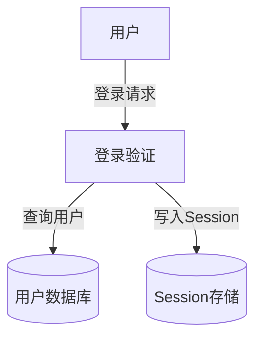

# 第8章 威胁建模在敏捷/DevOps中的应用

### 8.1 敏捷开发中的威胁建模挑战

传统的威胁建模通常是一个重量级的、阶段性的活动，需要几天甚至几周的时间来完成。但在敏捷开发中，迭代周期短（通常2-4周），需求变化快，这给威胁建模带来了挑战。

#### 8.1.1 主要挑战

| 挑战 | 描述 |
|------|------|
| **时间压力** | Sprint周期短，没有充足时间做详细的威胁建模 |
| **需求变化快** | 需求频繁变更，威胁模型需要频繁更新 |
| **团队规模** | 小团队可能没有专职安全人员 |
| **优先级冲突** | 业务功能优先，安全活动容易被挤压 |
| **知识不足** | 开发团队可能缺乏威胁建模的技能 |
| **工具适配** | 传统工具偏重桌面端，不适合敏捷协作 |

#### 8.1.2 敏捷环境下的威胁建模原则

1. **轻量化**：简化流程，只做必要的分析
2. **增量式**：每次Sprint只分析新增/变更的功能
3. **左移更早**：在需求和设计阶段就融入安全考虑
4. **自动化**：尽可能自动化威胁检查
5. **持续迭代**：威胁模型随产品持续演进
6. **赋能团队**：让开发团队具备基本的威胁建模能力

### 8.2 轻量化威胁建模方法

#### 8.2.1 STRIDE-per-Element快速法

这是最常用的轻量化方法，针对每个新增或变更的组件，快速过一遍STRIDE六个类别。

**操作步骤：**
1. 画出新增/变更功能的简化DFD（可以是手绘图）
2. 对每个新元素，逐一问六个问题：
   - 这里有仿冒风险吗？
   - 这里有篡改风险吗？
   - 这里有抵赖风险吗？
   - 这里有信息泄露风险吗？
   - 这里有拒绝服务风险吗？
   - 这里有权限提升风险吗？
3. 记录识别到的高危威胁
4. 讨论缓解措施

**时间估算：** 15-30分钟/功能

**适用场景：** 单个用户故事或小功能的威胁分析

#### 8.2.2 安全用户故事（Security User Story）

将安全需求以用户故事的形式表达，融入敏捷需求管理流程。

**模板：**
```
作为 [角色]，我需要 [安全功能]，以便 [安全目标]。
```

**示例：**
- 作为用户，我需要密码使用强哈希存储，以便数据库泄露后密码不会被破解
- 作为系统管理员，我需要登录失败次数限制，以便防止暴力破解攻击
- 作为开发者，我需要输入验证框架，以便防止SQL注入和XSS攻击

**验收标准（AC）：**
每个安全用户故事也需要明确的验收标准，例如：
- Given 用户输入特殊字符，When 提交表单，Then 输入被正确转义且不会产生注入
- Given 连续5次登录失败，When 第6次尝试，Then 账号被锁定15分钟

#### 8.2.3 滥用案例（Abuse Case）

与用例（Use Case）相对应，滥用案例描述攻击者会如何滥用系统功能。

**格式：**
```
滥用案例ID：AC-001
滥用者：攻击者
滥用目标：绕过登录认证
前置条件：系统存在登录接口
滥用步骤：
  1. 攻击者在用户名输入框注入SQL语句
  2. 系统未正确过滤输入
  3. SQL注入成功，绕过认证
后果：攻击者获得未授权访问
缓解措施：使用参数化查询、输入验证
```

**与用户故事的对应关系：**
- 每个用户故事可以对应多个滥用案例
- 滥用案例帮助团队思考"反面场景"
- 可以作为安全测试用例的来源

#### 8.2.4 威胁建模扑克牌/游戏

通过游戏化的方式让团队参与威胁建模，降低门槛，提高参与度。

**Elevation of Privilege Card Game（微软）：**
- 一套卡牌游戏，每张牌代表一种STRIDE威胁
- 玩家轮流出牌，针对系统中的某个组件提出威胁
- 以游戏的方式进行威胁头脑风暴
- 适合团队建设和安全培训

**实施方法：**
1. 准备好系统架构图（打印或白板）
2. 参与者轮流抽取威胁卡牌
3. 根据卡牌上的威胁类型，针对系统提出具体威胁
4. 记录有效的威胁
5. 讨论缓解措施

**优点：**
- 降低参与门槛，非安全人员也能参与
- 游戏化增加趣味性
- 激发创造力，发现更多威胁
- 天然适合团队协作

### 8.3 冲刺（Sprint）中的威胁建模

#### 8.3.1 Sprint中的安全活动时间线

```
Sprint Planning → Sprint执行 → Sprint Review → Sprint Retrospective
     ↓                ↓             ↓                ↓
  安全需求分析    安全编码       安全测试          安全回顾
  威胁建模        代码审查       渗透测试          流程改进
```

#### 8.3.2 Sprint Planning阶段

**活动：** 轻量化威胁建模

**输入：**
- 本Sprint的用户故事列表
- 上一版威胁模型
- 已知的安全问题

**输出：**
- 新增/更新的威胁列表
- 安全用户故事
- 安全验收标准

**操作要点：**
- 只分析本Sprint新增或变更的功能
- 识别相关的威胁和缓解措施
- 将安全任务纳入Sprint Backlog
- 预估安全工作量

**时间投入：** 30分钟-1小时

#### 8.3.3 Sprint执行阶段

**活动1：安全设计评审**
- 对复杂功能进行设计评审
- 验证威胁建模中的缓解措施是否落实
- 安全工程师参与方案设计讨论

**活动2：安全编码指导**
- 提供安全编码规范和Checklist
- 安全工程师进行代码审查
- 团队进行Pair Programming时考虑安全

**活动3：威胁模型更新**
- 实现过程中发现新威胁时及时更新
- 架构调整时更新威胁模型

#### 8.3.4 Sprint Review阶段

**活动：** 安全验证与演示

- 演示安全功能的实现
- 展示安全测试的结果
- 回顾本Sprint的威胁处理情况
- 收集利益相关方的安全反馈

#### 8.3.5 Sprint Retrospective阶段

**活动：** 安全流程回顾

- 本Sprint安全工作做得好的地方
- 安全工作中遇到的问题和障碍
- 如何改进安全流程
- 下一个Sprint的安全改进计划

### 8.4 自动化威胁建模工具

#### 8.4.1 为什么需要自动化

手动威胁建模的痛点：
- 耗时长，需要安全专家参与
- 依赖个人经验，结果不一致
- 更新维护成本高
- 难以与开发流程集成

自动化工具可以解决的问题：
- 基于代码/配置自动生成系统架构图
- 自动识别已知威胁模式
- 提供标准化的威胁分析
- 与CI/CD流水线集成
- 持续监控和更新威胁模型

#### 8.4.2 自动化威胁建模的层次

| 层次 | 自动化程度 | 描述 | 示例工具 |
|------|-----------|------|---------|
| **L1：辅助绘图** | 低 | 图形化工具辅助绘制DFD，手动分析威胁 | Microsoft TMT、draw.io |
| **L2：模板匹配** | 中 | 基于组件类型自动生成威胁建议 | Microsoft TMT、OWASP Threat Dragon |
| **L3：代码分析** | 中-高 | 从代码/配置中提取架构信息，自动识别威胁 | IriusRisk、ThreatModeler |
| **L4：持续扫描** | 高 | 嵌入CI/CD，每次变更自动检测新威胁 | IriusRisk、CodeThreat |
| **L5：智能分析** | 很高 | AI辅助威胁识别和缓解建议 | 各类AI安全工具（发展中） |

#### 8.4.3 常见自动化工具

**IriusRisk**
- 商业工具，功能强大
- 支持从代码、架构图、问卷调查中提取信息
- 内置丰富的威胁库和缓解措施库
- 支持Jira、Jenkins等工具集成
- 适合企业级使用

**ThreatModeler**
- 企业级威胁建模平台
- 支持架构自动发现
- 内置威胁情报
- 支持DevOps集成

**OWASP Threat Dragon**
- 开源免费
- 支持STRIDE和LINDDUN
- Web版和桌面版
- 支持与GitHub集成
- 适合中小团队

**CodeThreat**
- 代码级威胁建模
- 静态分析与威胁建模结合
- 支持CI/CD集成

### 8.5 威胁建模与CI/CD集成

#### 8.5.1 集成模式

**模式1：门禁式集成（Gate）**
- 在代码合并或部署前进行威胁检查
- 发现高危威胁则阻断流水线
- 适用于对安全要求高的场景

**模式2：通知式集成（Notify）**
- 检测到威胁后创建工单或发送通知
- 不阻断流水线，但跟踪处理
- 适用于敏捷开发环境

**模式3：增量分析集成**
- 每次提交只分析变更的部分
- 快速反馈，不影响开发速度
- 定期进行全量分析

#### 8.5.2 集成点设计

```
代码提交 → SAST扫描 → 威胁建模增量分析 → 代码审查 → 合并到主干
                                                        ↓
                                                   CI构建
                                                        ↓
                                                   DAST扫描
                                                        ↓
                                                   部署到生产
                                                        ↓
                                                   运行时监控
```

**关键集成点：**
1. **Pull Request阶段**：增量威胁分析，检查新增代码是否引入新威胁
2. **合并到主干后**：全量威胁建模更新
3. **部署前**：验证缓解措施是否落实
4. **运行时**：威胁情报驱动的监控

#### 8.5.3 实施步骤

1. **选择工具**：选择支持API/CLI的威胁建模工具
2. **定义基线**：建立初始威胁模型作为基线
3. **编写脚本**：编写调用威胁建模工具的脚本
4. **配置流水线**：将脚本集成到CI/CD配置中
5. **定义规则**：定义威胁等级与流水线动作的映射
6. **试点运行**：在一个项目中试点，调整规则
7. **推广落地**：在更多项目中推广

### 8.6 威胁即代码（Threat Modeling as Code）

#### 8.6.1 什么是威胁即代码

威胁即代码（TMaC）是将威胁模型以代码（文本）的形式进行描述和管理，类似于基础设施即代码（IaC）的理念。

**核心理念：**
- 威胁模型用文本格式描述（YAML、JSON、DSL等）
- 存储在版本控制系统中
- 支持代码审查和版本追踪
- 可以通过工具自动生成图表和报告
- 可以与CI/CD流水线集成

#### 8.6.2 威胁即代码的优势

| 优势 | 描述 |
|------|------|
| **版本控制** | 威胁模型的变更历史清晰可追溯 |
| **协作友好** | 支持多人协作，PR/MR模式评审 |
| **自动化** | 可以脚本化处理，嵌入CI/CD |
| **可复现** | 从代码生成图表和报告，结果一致 |
| **易于集成** | 与代码同仓管理，随代码一起演进 |
| **降低门槛** | 开发者熟悉的文本编辑方式 |

#### 8.6.3 实现方式

**方式1：Mermaid + 威胁描述**

使用Mermaid绘制DFD图，配合Markdown描述威胁：



**方式2：专用DSL（如pytm）**

使用Python库pytm以代码方式描述威胁模型：

```python
from pytm import TM, Server, Datastore, Dataflow, Actor

tm = TM("登录系统")
user = Actor("用户")
web = Server("Web服务器")
db = Datastore("用户数据库")

df1 = Dataflow(user, web, "登录请求")
df2 = Dataflow(web, db, "用户查询")

tm.process()
```

**方式3：YAML/JSON描述**

使用结构化数据描述威胁模型：

```yaml
system: "用户登录系统"
elements:
  - id: user
    type: actor
    name: "Web用户"
  - id: login_process
    type: process
    name: "登录验证"
  - id: user_db
    type: datastore
    name: "用户数据库"
dataflows:
  - from: user
    to: login_process
    name: "登录请求（用户名、密码）"
    sensitive: true
threats:
  - id: T001
    type: Spoofing
    name: "暴力破解"
    target: login_process
    risk: high
```

#### 8.6.4 最佳实践

1. **威胁模型与代码同仓**：威胁模型文件放在代码仓库中，随代码一起版本管理
2. **变更即审查**：威胁模型的变更通过PR/MR进行审查
3. **自动生成报告**：通过CI自动生成最新的威胁模型报告和图表
4. **与需求关联**：将威胁与用户故事/需求进行关联
5. **定期同步**：确保威胁模型与实际架构保持同步

---

---

## 📋 内容审核与补充建议

> 针对「第8章 威胁建模在敏捷/DevOps中的应用」部分的内容审核结果：

### 🛡️ 防御方案
- ⚠️ 缺少defense相关内容

### 📖 参考资料
- ⚠️ 缺少参考资料/延伸阅读

---

## 📌 拓展学习资源

### 推荐学习路径
- 理论基础 → 工具实践 → 实战演练 → 深度研究
- 建议搭建本地实验环境进行动手练习

### 相关工具与资源
- 在线实验平台：Hack The Box、TryHackMe、VulnHub
- 技术文档：官方文档、RFC、OWASP 指南
- 社区资源：GitHub、安全论坛、技术博客
